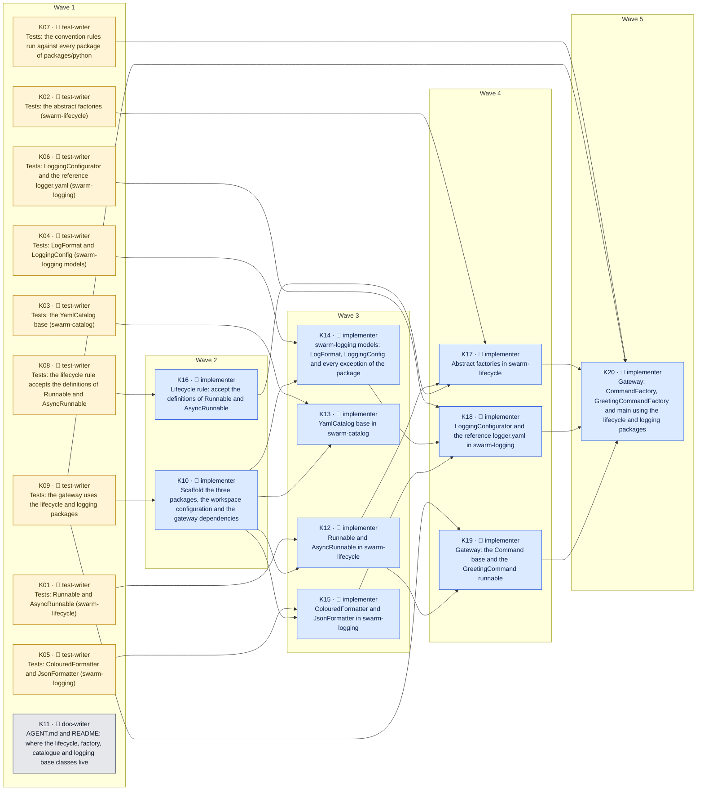

# T0.05: Plan

**Plan:** 🟢 Approved

<!-- ticket:specs -->
## 📚 Specifications

The technical pages, features, use cases and business rules of [TICKET.md](TICKET.md), copied by `python3 .claude/scripts/ticket_refs.py sync`.

- [🔩 Engine and services](../../specs/technical/04-engine.md#overview)
- [🩺 Observability: signals](../../specs/technical/08-observability.md#signals)
- [🗂️ Architecture: mono-repo](../../specs/technical/01-architecture.md#mono-repo)
- [🧅 Architecture: layers inside each service](../../specs/technical/01-architecture.md#layers)
<!-- /ticket:specs -->

## 🧭 Summary

T0.05 delivers three shared Python packages under `packages/python/`, a small widening of the convention tests, and the adoption of the packages by the gateway, which is the only service skeleton that exists today.

**The packages**

- `swarm-lifecycle` (`swarm_lifecycle`) holds:
  - `Runnable` and `AsyncRunnable`, with `initialize`, `run`, `close` and `execute`;
  - the abstract factories: a `Factory[T]` base with a public `create()` over an abstract `_build()`, plus `RunnableFactory` and `AsyncRunnableFactory`.
- `swarm-logging` (`swarm_logging`) holds:
  - `ColouredFormatter` and `JsonFormatter`;
  - the `LoggingConfig` model, with `path` and `format` (`LogFormat` is `coloured` or `json`);
  - `LoggingConfigurator.configure()`, which loads a dictConfig YAML and switches every formatter to JSON in production;
  - a reference `conf/logger.yaml`: coloured console on stderr and a coloured rotating file under `logs/`, root level DEBUG.
- `swarm-catalog` (`swarm_catalog`) holds the `YamlCatalog` base, with `load(path)` and `UNREADABLE`.

**Convention tests**

- A new `tests/conventions/packages/test_package_conventions.py` runs the seven rules against every package of `packages/python/`. This closes acceptance criterion 3, and leaves the services test and its child-process counts unchanged.
- The lifecycle rule accepts the definitions of `Runnable` and `AsyncRunnable` themselves.

**Gateway**

- `main()` now configures logging with the package, builds a `GreetingCommand` (a `Command(Runnable)`) through `CommandFactory` / `GreetingCommandFactory`, and executes it. The output is still exactly "Hello from swarm!". This closes acceptance criterion 1 for the skeletons that exist.

**Waves:** 20 tasks in 5 waves (K10 waits for K09, approved by the person to meet TKT-4).

- **Wave 1, 10 tasks (8 at once):**
  - 9 test-writers: runnables, factories, YamlCatalog, logging models, formatters, configurator, package conventions, lifecycle-rule exemption, gateway;
  - the AGENT.md and README doc-writer.
- **Wave 2, 2 tasks:** the scaffolding implementer (the package pyproject files, `uv.lock`, the root pytest/mypy/ruff configuration, the gateway dependencies and `.gitignore`), after the gateway tests of K09; the lifecycle-rule fix.
- **Wave 3, 4 tasks:** runnables, YamlCatalog, logging models and exceptions, formatters.
- **Wave 4, 3 tasks:** factories, configurator with the reference logger.yaml, gateway commands.
- **Wave 5, 1 task:** gateway factories and `main`, with the whole-suite acceptance run.

No two tasks of the same wave share a file. Specifications applied:

- docs/specs/technical/04-engine.md#overview
- docs/specs/technical/08-observability.md#signals
- docs/specs/technical/01-architecture.md#mono-repo
- docs/specs/technical/01-architecture.md#layers

## 🧠 Assumptions

1. The roadmap row names no feature, use case or business rule, so the acceptance criteria cite none.
2. Every service skeleton of P0 uses them is checked only for the skeletons that exist when the ticket is done; later skeletons are built by their own tickets.
3. The exact behaviour of YamlCatalog and of the factories is taken from AGENT.md, the most conservative source.
4. How production is detected for the JSON logs is not specified beyond JSON in production; it is left to the plan.
5. The work is split into three packages, `swarm-lifecycle`, `swarm-logging` and `swarm-catalog`, named like the `swarm-models` and `swarm-storage` of the data and storage pages. `YamlCatalog` has its own package for two reasons: it is neither lifecycle nor logging, and `swarm-models` belongs to T0.06, which is out of scope.
6. Inside a package, the Pydantic models, enums and exceptions sit in `src/<module>/models/`, as in a service. The convention rule refuses a Pydantic model anywhere else, `tests/` included. Package tests therefore build `YamlCatalog` subclasses with `pydantic.create_model` or `type()`, never with a `class` statement.
7. The convention tests are widened to `packages/python/*` by a separate file, `tests/conventions/packages/test_package_conventions.py`, with a `packages_root()` helper and the `SWARM_CONVENTIONS_PACKAGES_ROOT` override. This leaves the services test and the pass and fail counts of the T0.03 child processes (14 passed, 7 failed) unchanged.
8. The lifecycle rule accepts a class named `Runnable` or `AsyncRunnable` as the lifecycle base itself, because the package defines `run` on these abstract bases. `start` and `stop` stay refused everywhere.
9. `Runnable` and `AsyncRunnable` share no common base, although AGENT.md says that classes sharing a method name share a base. Their methods differ in kind (sync and coroutine), and AGENT.md itself names them as two separate bases.
10. `execute()` closes in a `finally` and catches nothing, since AGENT.md allows no broad except. A success flag decides the log: INFO on success, ERROR when the work raised. The original error propagates unchanged.
11. The factories are a generic `Factory[T]`, with a public `create()` that logs and an abstract `_build()`, plus `RunnableFactory[R: Runnable]` and `AsyncRunnableFactory[A: AsyncRunnable]`. They use PEP 695 generics (Python 3.12), so that no TypeVar sits at module level.
12. How production is detected is not specified. JSON is selected by `LoggingConfig.format` (`coloured` by default, `json` in production), which the deployment's configuration sets. The package reads no environment variable. In JSON mode every formatter of the configuration becomes `JsonFormatter`, and the handlers stay unchanged.
13. The reference `logger.yaml` ships inside `swarm_logging`. Its values are not in the specifications:
    - format `%(asctime)s %(levelname)-8s %(name)s: %(message)s`;
    - console on stderr;
    - file `logs/swarm.log`;
    - 10 MiB per file, 5 backups;
    - `disable_existing_loggers: false`.
    `LoggingConfig.path = None` uses it.
14. The ANSI colour of each level and the JSON keys (`time` ISO 8601 UTC with milliseconds, `level`, `logger`, `message`, and `exception` when present) are not in the specifications. The formatters use the standard library only (no colorlog). PyYAML is added as a dependency, and `types-pyyaml` to the dev group for mypy.
15. Acceptance criterion 1 is closed for the only skeleton that exists, the gateway. Its `main()` configures logging with the package and executes a `GreetingCommand` built by `CommandFactory` / `GreetingCommandFactory`, with the same stdout output. The gateway's own `conf/logger.yaml` and `conf/app.yaml` are left to T0.12, so it uses the reference logger.yaml for now.
16. ruff gets `known-first-party = [tests, gateway, swarm_catalog, swarm_lifecycle, swarm_logging]`, so that the AGENT.md import groups match isort. Wave-1 test-writers check isort with the same list through `--config`, because the scaffold merges only after their wave.
17. Package test folders cannot be imported by full path, because the package folder names contain a hyphen. Stand-in classes therefore get their own files with unique basenames, imported by bare module name through pytest's prepend import mode. Fixtures are methods of the test class, never conftest.py files.
18. The root pytest `testpaths` and the mypy `files` and `mypy_path` list the three packages. `logs/` is added to `.gitignore`. `packages/python/.gitkeep` is left in place.
19. No specification page changes. AGENT.md and README.md get short factual additions in a doc task beside the code (TKT-4).

<!-- plan:graph -->

> [!NOTE]
> Generated from the json block at the end of this page by `python3 .claude/scripts/plan.py render`.
> To change a task, edit the json block, then render again: never edit this view by hand.

## Waves

| Wave | Tasks | Agents running at once |
| --- | --- | --- |
| 1 | [K01](#k01), [K02](#k02), [K03](#k03), [K04](#k04), [K05](#k05), [K06](#k06), [K07](#k07), [K08](#k08), [K09](#k09), [K11](#k11) | 8 of 10 |
| 2 | [K10](#k10), [K16](#k16) | 2 of 2 |
| 3 | [K12](#k12), [K13](#k13), [K14](#k14), [K15](#k15) | 4 of 4 |
| 4 | [K17](#k17), [K18](#k18), [K19](#k19) | 3 of 3 |
| 5 | [K20](#k20) | 1 of 1 |

| Wave | Task | Agent | Depends on | Unblocks |
| --- | --- | --- | --- | --- |
| 1 | [K01](#k01) Tests: Runnable and AsyncRunnable (swarm-lifecycle) | 🧪 test-writer | none | [K12](#k12) |
| 1 | [K02](#k02) Tests: the abstract factories (swarm-lifecycle) | 🧪 test-writer | none | [K17](#k17) |
| 1 | [K03](#k03) Tests: the YamlCatalog base (swarm-catalog) | 🧪 test-writer | none | [K13](#k13) |
| 1 | [K04](#k04) Tests: LogFormat and LoggingConfig (swarm-logging models) | 🧪 test-writer | none | [K14](#k14) |
| 1 | [K05](#k05) Tests: ColouredFormatter and JsonFormatter (swarm-logging) | 🧪 test-writer | none | [K15](#k15) |
| 1 | [K06](#k06) Tests: LoggingConfigurator and the reference logger.yaml (swarm-logging) | 🧪 test-writer | none | [K18](#k18) |
| 1 | [K07](#k07) Tests: the convention rules run against every package of packages/python | 🧪 test-writer | none | [K20](#k20) |
| 1 | [K08](#k08) Tests: the lifecycle rule accepts the definitions of Runnable and AsyncRunnable | 🧪 test-writer | none | [K16](#k16) |
| 1 | [K09](#k09) Tests: the gateway uses the lifecycle and logging packages | 🧪 test-writer | none | [K10](#k10), [K19](#k19), [K20](#k20) |
| 1 | [K11](#k11) AGENT.md and README: where the lifecycle, factory, catalogue and logging base classes live | 📝 doc-writer | none | none |
| 2 | [K10](#k10) Scaffold the three packages, the workspace configuration and the gateway dependencies | 🐍 implementer | [K09](#k09) | [K12](#k12), [K13](#k13), [K14](#k14), [K15](#k15) |
| 2 | [K16](#k16) Lifecycle rule: accept the definitions of Runnable and AsyncRunnable | 🐍 implementer | [K08](#k08) | [K17](#k17) |
| 3 | [K12](#k12) Runnable and AsyncRunnable in swarm-lifecycle | 🐍 implementer | [K01](#k01), [K10](#k10) | [K17](#k17), [K19](#k19) |
| 3 | [K13](#k13) YamlCatalog base in swarm-catalog | 🐍 implementer | [K03](#k03), [K10](#k10) | none |
| 3 | [K14](#k14) swarm-logging models: LogFormat, LoggingConfig and every exception of the package | 🐍 implementer | [K04](#k04), [K10](#k10) | [K18](#k18) |
| 3 | [K15](#k15) ColouredFormatter and JsonFormatter in swarm-logging | 🐍 implementer | [K05](#k05), [K10](#k10) | [K18](#k18) |
| 4 | [K17](#k17) Abstract factories in swarm-lifecycle | 🐍 implementer | [K02](#k02), [K12](#k12), [K16](#k16) | [K20](#k20) |
| 4 | [K18](#k18) LoggingConfigurator and the reference logger.yaml in swarm-logging | 🐍 implementer | [K06](#k06), [K14](#k14), [K15](#k15) | [K20](#k20) |
| 4 | [K19](#k19) Gateway: the Command base and the GreetingCommand runnable | 🐍 implementer | [K09](#k09), [K12](#k12) | [K20](#k20) |
| 5 | [K20](#k20) Gateway: CommandFactory, GreetingCommandFactory and main using the lifecycle and logging packages | 🐍 implementer | [K07](#k07), [K09](#k09), [K17](#k17), [K18](#k18), [K19](#k19) | none |

## Dependency graph



## Tasks

### <a id="k01"></a>K01: Tests: Runnable and AsyncRunnable (swarm-lifecycle)

| Agent | Wave | Depends on | Unblocks |
| --- | --- | --- | --- |
| 🧪 test-writer | 1 | none | [K12](#k12) |

**Files** (only this task may change them in its wave):

- `packages/python/swarm-lifecycle/tests/runnables/test_runnable.py`
- `packages/python/swarm-lifecycle/tests/runnables/test_async_runnable.py`
- `packages/python/swarm-lifecycle/tests/runnables/lifecycle_recording_runnable.py`
- `packages/python/swarm-lifecycle/tests/runnables/lifecycle_recording_async_runnable.py`

**Done when:** `uv run ruff check --config "lint.isort.known-first-party = ['tests', 'gateway', 'swarm_catalog', 'swarm_lifecycle', 'swarm_logging']" packages/python/swarm-lifecycle/tests/runnables` and `uv run ruff format --check packages/python/swarm-lifecycle/tests/runnables` pass. `uv run pytest packages/python/swarm-lifecycle/tests/runnables -q` fails only with ModuleNotFoundError for swarm_lifecycle.

**Brief:**

Ticket T0.05 (docs/tickets/T0.05/TICKET.md), acceptance criterion 2 (the packages' own tests pass). Applies docs/specs/technical/04-engine.md#overview (runnables with initialize, run, close), docs/specs/technical/01-architecture.md#mono-repo (shared Python in packages/python/) and AGENT.md#lifecycle-and-factories.

Write the tests of the two lifecycle base classes that K12 implements. The contract:
- `from swarm_lifecycle.runnables.runnable import Runnable` and `from swarm_lifecycle.runnables.async_runnable import AsyncRunnable`.
- Both are ABCs. Their constructor is `__init__(self, logger: Optional[Logger] = None)`, and it sets `self.logger` to the given logger, or else to `getLogger(__name__)`.
- `initialize`, `run` and `close` are abstract, take no argument and return None. They are coroutines on AsyncRunnable.
- `execute()` (`async` on AsyncRunnable) calls `initialize()` then `run()`, and calls `close()` in a `finally` whatever happens. It re-raises the original error unchanged.
- `execute()` logs INFO with the class name (`type(self).__name__`) when the work succeeds. It logs ERROR with the class name when `initialize` or `run` raised.

1) Stand-ins, one class per file:
- lifecycle_recording_runnable.py holds `RecordingRunnable(Runnable)`, with `__init__(self, fail_in: Optional[str] = None, logger: Optional[Logger] = None)`.
  - It has a public `calls: List[str]` attribute.
  - Each of its three methods appends its own name to `calls`, then raises `RuntimeError` when `fail_in` equals that name.
- lifecycle_recording_async_runnable.py holds the same as `RecordingAsyncRunnable(AsyncRunnable)`, with async methods.
- Test files import them by bare module name (`from lifecycle_recording_runnable import RecordingRunnable`). The package folder name has a hyphen, so a full-path import is impossible, and pytest's prepend import mode puts the test folder on sys.path.

2) test_runnable.py (`TestRunnable`) and test_async_runnable.py (`TestAsyncRunnable`) each cover:
- the base cannot be instantiated;
- a subclass missing each one of the three methods cannot be instantiated. Parametrise over the method, and build the partial subclasses with `type(...)`, never a second `class` statement in the file;
- execute calls initialize, run, close in that order;
- a failing initialize: run is not called, close is called, and the RuntimeError propagates;
- a failing run: close is called and the error propagates;
- a failing close: the error propagates after run;
- the INFO and ERROR records, through `caplog`, name the class;
- a given logger is used, and the default one is a `Logger`.
Async tests need no marker (asyncio_mode auto).

Follow AGENT.md#tests:
- one Test&lt;Subject> class per file, and test names written as sentences;
- parametrize, no mocks;
- no `__init__.py` and no conftest.py: fixtures are methods of the test class.

Also follow AGENT.md#file-shape and AGENT.md#rules-a-test-enforces:
- one class per file, at most five Python files per folder;
- no nested function, no `Any`, no `@staticmethod`, no attribute starting with an underscore;
- `from __future__ import annotations` first, and `typing` generics;
- British English, no em dashes.

Test basenames must be unique in the repository. Format only your files.

The ruff config does not yet know swarm_lifecycle as first-party (K10 adds it), so check isort with the override in done_when: a blank line separates third-party imports (pytest) from `swarm_lifecycle` imports and from the bare stand-in imports, as ruff decides.

### <a id="k02"></a>K02: Tests: the abstract factories (swarm-lifecycle)

| Agent | Wave | Depends on | Unblocks |
| --- | --- | --- | --- |
| 🧪 test-writer | 1 | none | [K17](#k17) |

**Files** (only this task may change them in its wave):

- `packages/python/swarm-lifecycle/tests/factories/runnable/test_runnable_factory.py`
- `packages/python/swarm-lifecycle/tests/factories/runnable/lifecycle_sample_runnable.py`
- `packages/python/swarm-lifecycle/tests/factories/runnable/lifecycle_sample_runnable_factory.py`
- `packages/python/swarm-lifecycle/tests/factories/async_runnable/test_async_runnable_factory.py`
- `packages/python/swarm-lifecycle/tests/factories/async_runnable/lifecycle_sample_async_runnable.py`
- `packages/python/swarm-lifecycle/tests/factories/async_runnable/lifecycle_sample_async_runnable_factory.py`

**Done when:** `uv run ruff check --config "lint.isort.known-first-party = ['tests', 'gateway', 'swarm_catalog', 'swarm_lifecycle', 'swarm_logging']" packages/python/swarm-lifecycle/tests/factories` and `uv run ruff format --check packages/python/swarm-lifecycle/tests/factories` pass. `uv run pytest packages/python/swarm-lifecycle/tests/factories -q` fails only with ModuleNotFoundError for swarm_lifecycle.

**Brief:**

Ticket T0.05 (docs/tickets/T0.05/TICKET.md), acceptance criterion 2. Applies docs/specs/technical/04-engine.md#overview (factories), docs/specs/technical/01-architecture.md#layers (each layer's factories/ package) and AGENT.md#lifecycle-and-factories (runnables are created by an abstract factory).

Write the tests of the abstract factories that K17 implements. The contract:
- `swarm_lifecycle.factories.factory.Factory[T]` is an ABC using PEP 695 generics (`class Factory[T](ABC)`). Its constructor is `__init__(self, logger: Optional[Logger] = None)`.
  - It has an abstract `_build(self) -> T`.
  - Its public `create(self) -> T` calls `_build()`, logs DEBUG with the class name of the product, and returns the product.
- `swarm_lifecycle.factories.runnable_factory.RunnableFactory[R: Runnable](Factory[R])` and `swarm_lifecycle.factories.async_runnable_factory.AsyncRunnableFactory[A: AsyncRunnable](Factory[A])` add nothing but the bound. Both stay abstract.
- Runnable and AsyncRunnable are as in K01: `swarm_lifecycle.runnables.runnable` and `swarm_lifecycle.runnables.async_runnable`, with initialize, run, close and execute.

1) Stand-ins, one class per file, imported by bare module name (the package folder has a hyphen):
- lifecycle_sample_runnable.py: `SampleRunnable(Runnable)`, with no-op methods and a public `executed: bool` set by run.
- lifecycle_sample_runnable_factory.py: `SampleRunnableFactory(RunnableFactory[SampleRunnable])`, whose `_build` returns a new SampleRunnable.
- The same pair for async: `SampleAsyncRunnable` and `SampleAsyncRunnableFactory`.

2) test_runnable_factory.py (`TestRunnableFactory`) and test_async_runnable_factory.py (`TestAsyncRunnableFactory`) each cover:
- Factory, and RunnableFactory (or AsyncRunnableFactory), cannot be instantiated;
- the factory is a `Factory` subclass;
- `create()` returns an instance of the sample runnable, and a new one on each call;
- the created runnable executes (`executed` is True after `execute()`, awaited for async);
- `create()` logs a DEBUG record naming the product class (caplog);
- a given logger is used.

Follow AGENT.md#tests:
- one Test&lt;Subject> class per file, test names as sentences;
- no mocks, no `__init__.py`, no conftest.py.

Also follow AGENT.md#file-shape and AGENT.md#rules-a-test-enforces:
- one class per file, at most five Python files per folder;
- no nested function, no `Any`, no `@staticmethod`, no attribute starting with an underscore;
- `from __future__ import annotations` first;
- British English, no em dashes.

Test basenames must be unique in the repository. Format only your files.

### <a id="k03"></a>K03: Tests: the YamlCatalog base (swarm-catalog)

| Agent | Wave | Depends on | Unblocks |
| --- | --- | --- | --- |
| 🧪 test-writer | 1 | none | [K13](#k13) |

**Files** (only this task may change them in its wave):

- `packages/python/swarm-catalog/tests/models/test_yaml_catalog.py`

**Done when:** `uv run ruff check --config "lint.isort.known-first-party = ['tests', 'gateway', 'swarm_catalog', 'swarm_lifecycle', 'swarm_logging']" packages/python/swarm-catalog/tests` and `uv run ruff format --check packages/python/swarm-catalog/tests` pass. `uv run pytest packages/python/swarm-catalog/tests -q` fails only with ModuleNotFoundError for swarm_catalog.

**Brief:**

Ticket T0.05 (docs/tickets/T0.05/TICKET.md): the `YamlCatalog` base, acceptance criterion 2. Applies docs/specs/technical/01-architecture.md#mono-repo (shared Python in packages/python/), docs/specs/technical/01-architecture.md#layers (Pydantic models live in models/), AGENT.md#data-and-enums (data goes in conf/catalogs/*.yaml, loaded by a model that subclasses YamlCatalog, which provides load(path) and raises the model's UNREADABLE exception) and AGENT.md#pydantic-models.

Write packages/python/swarm-catalog/tests/models/test_yaml_catalog.py with one class `TestYamlCatalog`, for what K13 implements. The contract:
- `from swarm_catalog.models.yaml_catalog import YamlCatalog` and `from swarm_catalog.models.exceptions import SEYamlCatalogUnreadable`.
- `YamlCatalog(BaseModel)` has `model_config = ConfigDict(extra="forbid", frozen=True)` and no field.
- `UNREADABLE: ClassVar[type[Exception]] = SEYamlCatalogUnreadable`.
- The classmethod `load(cls, path: Path) -> Self` reads the file as UTF-8 YAML and validates the mapping into `cls`.
- It raises `cls.UNREADABLE`, with the cause kept (`__cause__` set), when:
  - the file is missing or unreadable (OSError);
  - it is not valid YAML;
  - its top level is not a mapping, which includes an empty file.
- Validation errors of the model propagate unchanged: a pydantic ValidationError for an unknown key.
- `SEYamlCatalogUnreadable` subclasses `Exception`, not ValueError.

Cases:
- `{}` loads into YamlCatalog;
- a missing file, invalid YAML, a list at top level, and an empty file each raise SEYamlCatalogUnreadable (parametrise), with `__cause__` set where an error caused it;
- an unknown key raises ValidationError;
- a subclass with a field `name: str` loads its value, including non-ASCII text (UTF-8);
- a subclass that sets `UNREADABLE = LookupError` raises LookupError for a missing file;
- a loaded catalogue is frozen.

Build the subclasses with `pydantic.create_model("SampleCatalog", __base__=YamlCatalog, name=(str, ...))`, then set `UNREADABLE` on the class, or with `type(...)`. Never write a `class` statement deriving from YamlCatalog in tests: the convention rule refuses a Pydantic model outside src/&lt;package>/models/. Write the YAML files in `tmp_path`.

Follow AGENT.md#tests:
- one Test&lt;Subject> class, test names as sentences;
- parametrize, `pytest.raises` with the specific exception;
- no mocks, no `__init__.py`, no conftest.py.

Also follow AGENT.md#file-shape and AGENT.md#rules-a-test-enforces:
- no nested function, no `Any`;
- `from __future__ import annotations` first;
- British English, no em dashes.

Test basenames must be unique in the repository. Format only your file.

### <a id="k04"></a>K04: Tests: LogFormat and LoggingConfig (swarm-logging models)

| Agent | Wave | Depends on | Unblocks |
| --- | --- | --- | --- |
| 🧪 test-writer | 1 | none | [K14](#k14) |

**Files** (only this task may change them in its wave):

- `packages/python/swarm-logging/tests/models/test_logging_config.py`
- `packages/python/swarm-logging/tests/models/test_log_format.py`

**Done when:** `uv run ruff check --config "lint.isort.known-first-party = ['tests', 'gateway', 'swarm_catalog', 'swarm_lifecycle', 'swarm_logging']" packages/python/swarm-logging/tests/models` and `uv run ruff format --check packages/python/swarm-logging/tests/models` pass. `uv run pytest packages/python/swarm-logging/tests/models -q` fails only with ModuleNotFoundError for swarm_logging.

**Brief:**

Ticket T0.05 (docs/tickets/T0.05/TICKET.md): the logging configuration, including JSON in production. Applies docs/specs/technical/08-observability.md#signals (logs: coloured on the console, JSON in production), AGENT.md#pydantic-models, AGENT.md#data-and-enums (StrEnum with @unique) and AGENT.md#exceptions.

Write the tests of the models that K14 implements. The contract:
- `from swarm_logging.models.enums import LogFormat`: a `StrEnum` with `@unique`, whose members are `COLOURED = "coloured"` and `JSON = "json"`.
- `from swarm_logging.models.logging_config import LoggingConfig`: a `BaseModel` with `model_config = ConfigDict(extra="forbid", validate_default=True, frozen=True)`. Its fields:
  - `path: Optional[str] = None` is the path of a dictConfig YAML file, where None means the reference logger.yaml shipped with the package. A string is stripped, and an empty string or a non-string raises `SELoggingConfigInvalidPath`.
  - `format: LogFormat = LogFormat.COLOURED` accepts a LogFormat or its string value. Anything else, including bool, raises `SELoggingConfigInvalidFormat`.
  - None becomes the default for both fields.
- From `swarm_logging.models.exceptions`: `SEInvalidLoggingConfigException` is the base, and the two field exceptions subclass it. All subclass Exception, not ValueError, so they propagate out of pydantic.

1) test_log_format.py (`TestLogFormat`):
- the members and their values;
- building from the strings;
- an unknown string raises ValueError.

2) test_logging_config.py (`TestLoggingConfig`), with the AGENT.md set of model tests:
- `test_defaults`;
- `test_full_valid_construction`;
- `test_none_becomes_the_default` (parametrised by field name);
- `test_rejects_bad_values` (parametrised name, value, error: an empty and a blank path, a non-string path, an unknown format, True as format, 3 as format);
- `test_rejects_unknown_keys` (a pydantic ValidationError);
- `test_round_trip` (`model_validate(model_dump())` equals).
Also cover:
- a path with surrounding spaces is stripped;
- `format="json"` gives LogFormat.JSON.

Follow AGENT.md#tests:
- one Test&lt;Subject> class per file, test names as sentences;
- parametrize, `pytest.raises` with the specific exception;
- no mocks, no `__init__.py`, no conftest.py.

Also:
- no nested function, no `Any`;
- `from __future__ import annotations` first;
- British English, no em dashes.

Test basenames must be unique in the repository. Format only your files.

### <a id="k05"></a>K05: Tests: ColouredFormatter and JsonFormatter (swarm-logging)

| Agent | Wave | Depends on | Unblocks |
| --- | --- | --- | --- |
| 🧪 test-writer | 1 | none | [K15](#k15) |

**Files** (only this task may change them in its wave):

- `packages/python/swarm-logging/tests/formatters/test_coloured_formatter.py`
- `packages/python/swarm-logging/tests/formatters/test_json_formatter.py`

**Done when:** `uv run ruff check --config "lint.isort.known-first-party = ['tests', 'gateway', 'swarm_catalog', 'swarm_lifecycle', 'swarm_logging']" packages/python/swarm-logging/tests/formatters` and `uv run ruff format --check packages/python/swarm-logging/tests/formatters` pass. `uv run pytest packages/python/swarm-logging/tests/formatters -q` fails only with ModuleNotFoundError for swarm_logging.

**Brief:**

Ticket T0.05 (docs/tickets/T0.05/TICKET.md): the coloured console and file, and JSON in production. Applies docs/specs/technical/08-observability.md#signals (logs: coloured on the console, JSON in production, stored in Loki; no secrets in signals) and AGENT.md#logging (coloured console and coloured rotating file; the log file holds colour codes).

Write the tests of the two formatters that K15 implements. Both subclass `logging.Formatter` and override `format(record)`.

- `swarm_logging.formatters.coloured_formatter.ColouredFormatter`:
  - `COLOURS: ClassVar[Dict[int, str]]` maps each level to its ANSI code: DEBUG `\x1b[36m`, INFO `\x1b[32m`, WARNING `\x1b[33m`, ERROR `\x1b[31m`, CRITICAL `\x1b[1;31m`.
  - `RESET: ClassVar[str] = "\x1b[0m"`.
  - `format` returns `COLOURS[level] + super().format(record) + RESET`, and returns the plain line for a level with no colour.
  - It accepts the usual `fmt` and `datefmt` constructor arguments.
- `swarm_logging.formatters.json_formatter.JsonFormatter`: `format` returns one line holding one JSON object with these keys in this order:
  - `time`: ISO 8601 in UTC with milliseconds, from `record.created`;
  - `level`: the level name;
  - `logger`: the record name;
  - `message`: `record.getMessage()`;
  - `exception`: the formatted traceback, present only when the record has `exc_info`.
  It writes non-ASCII characters as they are (`ensure_ascii=False`) and no colour code.

Build records with `logging.LogRecord(...)` or `logging.makeLogRecord`. For exc_info, use the `sys.exc_info()` of a caught exception.

1) test_coloured_formatter.py (`TestColouredFormatter`):
- parametrised per level, the line starts with that level's code and ends with RESET;
- a custom level (25) has no code;
- message arguments are interpolated;
- a traceback is included for exc_info;
- `fmt` is honoured.

2) test_json_formatter.py (`TestJsonFormatter`):
- the output parses with `json.loads` and has the four keys in order;
- `time` parses with `datetime.fromisoformat` and is UTC;
- a message with a newline still gives a single line;
- the `exception` key is present only with exc_info, and holds the exception's type name;
- non-ASCII text is kept;
- there is no `\x1b`.

Follow AGENT.md#tests:
- one Test&lt;Subject> class per file, test names as sentences;
- parametrize, no mocks, no `__init__.py`, no conftest.py.

Also:
- no nested function, no `Any`;
- `from __future__ import annotations` first;
- British English, no em dashes.

Test basenames must be unique in the repository. Format only your files.

### <a id="k06"></a>K06: Tests: LoggingConfigurator and the reference logger.yaml (swarm-logging)

| Agent | Wave | Depends on | Unblocks |
| --- | --- | --- | --- |
| 🧪 test-writer | 1 | none | [K18](#k18) |

**Files** (only this task may change them in its wave):

- `packages/python/swarm-logging/tests/configurators/test_logging_configurator.py`

**Done when:** `uv run ruff check --config "lint.isort.known-first-party = ['tests', 'gateway', 'swarm_catalog', 'swarm_lifecycle', 'swarm_logging']" packages/python/swarm-logging/tests/configurators` and `uv run ruff format --check packages/python/swarm-logging/tests/configurators` pass. `uv run pytest packages/python/swarm-logging/tests/configurators -q` fails only with ModuleNotFoundError for swarm_logging.

**Brief:**

Ticket T0.05 (docs/tickets/T0.05/TICKET.md): the logging configuration of AGENT.md (coloured console, coloured rotating file, JSON in production). Applies docs/specs/technical/08-observability.md#signals, docs/specs/technical/04-engine.md#overview (logging rules) and AGENT.md#logging (root level DEBUG, written to logs/).

Write packages/python/swarm-logging/tests/configurators/test_logging_configurator.py with one class `TestLoggingConfigurator`, for what K18 implements.

The configurator, `swarm_logging.configurators.logging_configurator.LoggingConfigurator`:
- Its constructor is `__init__(self, config: LoggingConfig, logger: Optional[Logger] = None)`.
- `REFERENCE_PATH: ClassVar[Path]` is the reference file `swarm_logging/conf/logger.yaml`, shipped inside the package.
- `configure() -> None`:
  - reads `config.path`, or REFERENCE_PATH when it is None, as UTF-8 YAML;
  - when `config.format` is `LogFormat.JSON`, replaces every entry under `formatters` with `{"()": "swarm_logging.formatters.json_formatter.JsonFormatter"}`;
  - creates the parent folder of every handler's `filename`;
  - calls `logging.config.dictConfig`;
  - logs INFO.
- It raises `SELoggingConfigurationUnreadableError` (cause kept) when the file is missing or unreadable, is invalid YAML, or is not a mapping.
- It raises `SELoggingConfigurationRefusedError` (cause kept) when dictConfig refuses the configuration (ValueError, TypeError, AttributeError or ImportError).
- Both subclass `SELoggingError`.

The imports:
- `LoggingConfig` from swarm_logging.models.logging_config;
- `LogFormat` from swarm_logging.models.enums;
- the exceptions from swarm_logging.models.exceptions;
- the formatters from swarm_logging.formatters.coloured_formatter and swarm_logging.formatters.json_formatter.

The reference logger.yaml must hold:
- `version: 1` and `disable_existing_loggers: false`;
- a formatter `coloured` whose `()` is `swarm_logging.formatters.coloured_formatter.ColouredFormatter`, with a `format` string;
- a handler `console`: `logging.StreamHandler` with `stream: ext://sys.stderr`, formatter coloured;
- a handler `file`: `logging.handlers.RotatingFileHandler` with `filename: logs/swarm.log`, `maxBytes`, `backupCount`, `encoding: utf-8`, formatter coloured;
- `root` at level DEBUG with both handlers.

Tests:
- Use `monkeypatch.chdir(tmp_path)`, so that `logs/` is created under tmp_path.
- Add an autouse fixture written as a method of the class (`@pytest.fixture(autouse=True)` with yield), never a nested function or a conftest.py. It saves the root logger's handlers and level, then closes and removes every handler added and restores the level.

Cases:
- REFERENCE_PATH exists, and its YAML has the content above;
- configure with `LoggingConfig()`:
  - the root level is DEBUG;
  - the root has a StreamHandler and a RotatingFileHandler, both with ColouredFormatter;
  - `logs/swarm.log` is created;
  - a logged line in it contains `\x1b[`;
- configure with `LoggingConfig(format="json")`:
  - every root handler's formatter is a JsonFormatter;
  - the last line of logs/swarm.log parses as JSON with the logged message;
- configure with a custom `path` written in tmp_path (a single file handler to `out/custom.log`) creates `out/` and uses it;
- a missing file, invalid YAML and a YAML list each raise SELoggingConfigurationUnreadableError (parametrise);
- a handler with an unknown class raises SELoggingConfigurationRefusedError, with `__cause__` set.

Follow AGENT.md#tests:
- one Test&lt;Subject> class, test names as sentences;
- parametrize, specific `pytest.raises`;
- no mocks, no `__init__.py`.

Also:
- no nested function, no `Any`;
- `from __future__ import annotations` first;
- British English, no em dashes.

Test basenames must be unique in the repository. Format only your file.

### <a id="k07"></a>K07: Tests: the convention rules run against every package of packages/python

| Agent | Wave | Depends on | Unblocks |
| --- | --- | --- | --- |
| 🧪 test-writer | 1 | none | [K20](#k20) |

**Files** (only this task may change them in its wave):

- `tests/conventions/helpers.py`
- `tests/conventions/packages/test_package_conventions.py`

**Done when:** `uv run ruff check tests/conventions/helpers.py tests/conventions/packages` and `uv run ruff format --check tests/conventions/helpers.py tests/conventions/packages` pass. `uv run pytest tests/conventions -q` passes, with the package parametrisation skipped or passing.

**Brief:**

Ticket T0.05 (docs/tickets/T0.05/TICKET.md), acceptance criterion 3: given the packages, when the convention tests of tests/conventions/ run, then they accept them. Applies docs/specs/technical/01-architecture.md#mono-repo (packages/python/ holds shared Python), docs/specs/technical/01-architecture.md#layers (a test in tests/conventions/ fails on any other import) and AGENT.md#rules-a-test-enforces (the Python rules apply to services/ and packages/python/).

What exists, from T0.03:
- `ServiceTree.discover(root)` in tests/conventions/rules/service_tree.py finds every direct sub-folder not starting with `.` or `_`, and walks its src/ and tests/.
- `ConventionRules.all()` in tests/conventions/rules/convention_rules.py.
- tests/conventions/services/test_service_conventions.py.
- tests/conventions/helpers.py with `repo_root`, `services_root`, `write_files` and `run_convention_tests`.

1) tests/conventions/helpers.py: add one function, in the style of `services_root()`. Change nothing else, so that `run_convention_tests` and the counts of tests/conventions/samples/ stay the same.
- `packages_root() -> Path` returns `Path(os.environ["SWARM_CONVENTIONS_PACKAGES_ROOT"])` when that variable is set and not empty.
- Otherwise it returns `repo_root() / "packages" / "python"`.

2) Create tests/conventions/packages/test_package_conventions.py with one class `TestPackageConventions`. It mirrors test_service_conventions.py:
- one test is parametrised over `itertools.product(ServiceTree.discover(packages_root()), ConventionRules.all())`, with ids `"<package folder name>-<rule NAME>"`;
- it asserts that `rule.violations(package) == []`, with the violations one per line as the message;
- it holds no list of package names.
An empty packages folder gives an empty parameter set, which pytest reports as skipped. That is expected until the packages exist.

Also, using `write_files` and `tmp_path`, add a test showing that a package folder written under a temporary root is discovered by `ServiceTree.discover`. Pass the root to discover directly; do not change the environment.

Follow AGENT.md#tests and the T0.03 style of tests/conventions/. One class per file, no nested function, no `Any`, `from __future__ import annotations` first, British English, no em dashes. Test basenames must be unique in the repository. Format only your files.

### <a id="k08"></a>K08: Tests: the lifecycle rule accepts the definitions of Runnable and AsyncRunnable

| Agent | Wave | Depends on | Unblocks |
| --- | --- | --- | --- |
| 🧪 test-writer | 1 | none | [K16](#k16) |

**Files** (only this task may change them in its wave):

- `tests/conventions/rules/classes/test_lifecycle_base_classes.py`

**Done when:** `uv run ruff check tests/conventions/rules/classes/test_lifecycle_base_classes.py` and `uv run ruff format --check` on it pass. `uv run pytest tests/conventions/rules/classes/test_lifecycle_base_classes.py -q` fails only on the new cases for the definitions of Runnable and AsyncRunnable without start or stop. Every pre-existing test still passes.

**Brief:**

Ticket T0.05 (docs/tickets/T0.05/TICKET.md), acceptance criterion 3: the convention tests accept the packages. Applies AGENT.md#rules-a-test-enforces (a class outside src/models/ with start or stop, or with run but no lifecycle base class), AGENT.md#lifecycle-and-factories and docs/specs/technical/01-architecture.md#layers.

The rule tests/conventions/rules/classes/lifecycle_base_classes.py (`LifecycleBaseClasses`, BASES `("Runnable", "AsyncRunnable")`) reports a class that defines `run` without a base resolving to BASES. `swarm_lifecycle` (K12) defines `class Runnable(ABC)` and `class AsyncRunnable(ABC)` with an abstract `run`, so the rule must accept a class whose own name is in BASES. K16 implements this.

Add to the existing `TestLifecycleBaseClasses`, and keep every existing test unchanged. Use the existing `violations` helper method and inline sources:
- `class Runnable(ABC):` with `def run(self) -> None: ...`, in `src/sample/runnables/runnable.py`: no violation;
- `class AsyncRunnable(ABC):` with `async def run(self) -> None: ...`: no violation;
- `class Runnable:` with `def start(self) -> None: ...`: still one violation, because start and stop stay refused even there;
- `class Job(Runnable)` with run, beside the Runnable definition in the same service: no violation.
Parametrise where cases share a behaviour.

Follow AGENT.md#tests: no nested function, no `Any`, British English, no em dashes. Format only your file.

### <a id="k09"></a>K09: Tests: the gateway uses the lifecycle and logging packages

| Agent | Wave | Depends on | Unblocks |
| --- | --- | --- | --- |
| 🧪 test-writer | 1 | none | [K10](#k10), [K19](#k19), [K20](#k20) |

**Files** (only this task may change them in its wave):

- `services/gateway/tests/api/cli/test_main.py`
- `services/gateway/tests/api/cli/commands/test_greeting_command.py`
- `services/gateway/tests/api/factories/greeting/test_greeting_command_factory.py`

**Done when:** `uv run ruff check --config "lint.isort.known-first-party = ['tests', 'gateway', 'swarm_catalog', 'swarm_lifecycle', 'swarm_logging']" services/gateway/tests` and `uv run ruff format --check services/gateway/tests` pass. `uv run pytest services/gateway/tests -q` fails only with ModuleNotFoundError for the gateway modules or the swarm packages that do not exist yet, or on test_main assertions about logging.

**Brief:**

Ticket T0.05 (docs/tickets/T0.05/TICKET.md), acceptance criterion 1: given the service skeletons of P0, every one uses the lifecycle and logging packages. The gateway is the only skeleton that exists. Applies docs/specs/technical/04-engine.md#overview (runnables, factories, logging rules), docs/specs/technical/01-architecture.md#layers (api/cli/ is an entry point and holds no business rule), AGENT.md#lifecycle-and-factories (CommandFactory in api/factories/, concrete ones in sub-folders, results read from attributes such as Command.exit_code; no runnable constructor called in src/ outside a factory) and AGENT.md#logging.

The contract, implemented by K19 and K20:
- `gateway.api.cli.commands.command.Command(Runnable)` is abstract. Its constructor is `__init__(self, logger: Optional[Logger] = None)`, and it sets a public `exit_code: int = 0`.
- `gateway.api.cli.commands.greeting_command.GreetingCommand(Command)`: `run()` prints exactly `Hello from swarm!` to stdout and leaves `exit_code` at 0.
- `gateway.api.factories.command_factory.CommandFactory(RunnableFactory[Command])` is abstract.
- `gateway.api.factories.greeting.greeting_command_factory.GreetingCommandFactory(CommandFactory)`: `create()` returns a new GreetingCommand.
- `gateway.api.cli.main.main() -> None`:
  - configures logging with `LoggingConfigurator(LoggingConfig()).configure()`, which uses the reference logger.yaml of swarm_logging and writes `logs/swarm.log` under the current folder;
  - creates the command with GreetingCommandFactory and executes it;
  - raises SystemExit with `exit_code` only when it is not 0.
- `Runnable` comes from swarm_lifecycle.runnables.runnable, and `RunnableFactory` from swarm_lifecycle.factories.runnable_factory.

1) Rewrite services/gateway/tests/api/cli/test_main.py (`TestMain`):
- keep the console-script test;
- `main()` prints exactly `Hello from swarm!\n` on stdout (capsys) and returns normally;
- after `main()`, `logs/swarm.log` exists under the current folder;
- the root logger has a RotatingFileHandler.
Use `monkeypatch.chdir(tmp_path)`. Add an autouse fixture method of the class (yield) that saves the root handlers and level, then closes and removes the added handlers and restores the level.

2) services/gateway/tests/api/cli/commands/test_greeting_command.py (`TestGreetingCommand`):
- `execute()` prints the greeting, and `exit_code` is 0;
- it is a Command and a Runnable;
- Command cannot be instantiated.

3) services/gateway/tests/api/factories/greeting/test_greeting_command_factory.py (`TestGreetingCommandFactory`):
- `create()` returns a GreetingCommand, a new one on each call;
- the factory is a CommandFactory and a RunnableFactory;
- CommandFactory cannot be instantiated.

Follow AGENT.md#tests:
- one Test&lt;Subject> class per file, test names as sentences;
- no mocks, no `__init__.py`, no conftest.py.

Also:
- no nested function, no `Any`;
- `from __future__ import annotations` first;
- British English, no em dashes.

Test basenames must be unique in the repository. Format only your files.

K10 makes gateway, swarm_lifecycle and swarm_logging first-party for ruff, so check isort with the override in done_when. Third-party imports (pytest) and first-party imports form separate blocks.

### <a id="k11"></a>K11: AGENT.md and README: where the lifecycle, factory, catalogue and logging base classes live

| Agent | Wave | Depends on | Unblocks |
| --- | --- | --- | --- |
| 📝 doc-writer | 1 | none | none |

**Files** (only this task may change them in its wave):

- `AGENT.md`
- `README.md`

**Done when:** `grep -c 'swarm_lifecycle' AGENT.md` is at least 2. `grep -n 'LoggingConfigurator' AGENT.md`, `grep -n 'SWARM_CONVENTIONS_PACKAGES_ROOT' AGENT.md` and `grep -n 'packages/python/swarm-logging/tests' README.md` each print a line. `grep -n '—' AGENT.md README.md` prints nothing. `git diff --stat` shows only AGENT.md and README.md.

**Brief:**

Ticket T0.05 (docs/tickets/T0.05/TICKET.md). Applies:
- docs/specs/technical/01-architecture.md#mono-repo (packages/python/ holds shared Python: models, lifecycle, logging);
- docs/specs/technical/04-engine.md#overview (runnables, factories, logging rules);
- docs/specs/technical/08-observability.md#signals (logs coloured on the console, JSON in production).

Make small factual additions to AGENT.md and README.md. Keep the existing text and structure. Write plain British English with no em dashes, and add no fact beyond this list.

AGENT.md:
- **Commands:** add `uv run mypy packages/python/<package>/src` and `uv run pytest packages/python/<package>/tests -n 2`.
- **Mono-repo:** after the paths table, add one sentence naming the packages of packages/python/:
  - `swarm-lifecycle` (`swarm_lifecycle`): Runnable, AsyncRunnable and the abstract factories;
  - `swarm-logging` (`swarm_logging`): the logging configuration;
  - `swarm-catalog` (`swarm_catalog`): YamlCatalog.
  Then say that inside a package, Pydantic models, enums and exceptions sit in `src/<module>/models/`, as in a service.
- **Lifecycle and factories:**
  - the base classes are `swarm_lifecycle.runnables.runnable.Runnable` and `swarm_lifecycle.runnables.async_runnable.AsyncRunnable`;
  - a subclass passes its logger to `super().__init__(logger)`;
  - an abstract factory of a layer subclasses `swarm_lifecycle.factories.runnable_factory.RunnableFactory[...]` or `swarm_lifecycle.factories.async_runnable_factory.AsyncRunnableFactory[...]`;
  - a concrete factory implements `_build()`, and callers call `create()`.
- **Data and enums:** YamlCatalog is `swarm_catalog.models.yaml_catalog.YamlCatalog`. A subclass sets `UNREADABLE` to its own exception.
- **Logging:**
  - a service configures logging once, at its entry point, with `swarm_logging.configurators.logging_configurator.LoggingConfigurator(LoggingConfig(...)).configure()`;
  - `LoggingConfig.path` names the service's `conf/logger.yaml`, and None uses the reference `logger.yaml` shipped in swarm_logging;
  - `LoggingConfig.format` is `coloured` by default and `json` in production, which writes one JSON object per line on every handler.
- **Rules a test enforces:** add to the T0.03 paragraph:
  - `tests/conventions/packages/test_package_conventions.py` runs the same rules against every package of `packages/python/`, and `SWARM_CONVENTIONS_PACKAGES_ROOT` points it at another folder;
  - the lifecycle rule accepts the definitions of `Runnable` and `AsyncRunnable` themselves.

README.md, section 'Run the checks':
- add `uv run mypy packages/python/swarm-lifecycle/src packages/python/swarm-catalog/src packages/python/swarm-logging/src`;
- add `uv run pytest packages/python/swarm-lifecycle/tests packages/python/swarm-catalog/tests packages/python/swarm-logging/tests`;
- in the layout table, change the tests/ row to say the convention tests run against every service and every Python package.

### <a id="k10"></a>K10: Scaffold the three packages, the workspace configuration and the gateway dependencies

| Agent | Wave | Depends on | Unblocks |
| --- | --- | --- | --- |
| 🐍 implementer | 2 | [K09](#k09) | [K12](#k12), [K13](#k13), [K14](#k14), [K15](#k15) |

**Files** (only this task may change them in its wave):

- `pyproject.toml`
- `uv.lock`
- `.gitignore`
- `packages/python/swarm-lifecycle/pyproject.toml`
- `packages/python/swarm-lifecycle/src/swarm_lifecycle/__init__.py`
- `packages/python/swarm-lifecycle/src/swarm_lifecycle/py.typed`
- `packages/python/swarm-catalog/pyproject.toml`
- `packages/python/swarm-catalog/src/swarm_catalog/__init__.py`
- `packages/python/swarm-catalog/src/swarm_catalog/py.typed`
- `packages/python/swarm-logging/pyproject.toml`
- `packages/python/swarm-logging/src/swarm_logging/__init__.py`
- `packages/python/swarm-logging/src/swarm_logging/py.typed`
- `services/gateway/pyproject.toml`

**Done when:** `uv sync` succeeds, and `uv run python -c "import swarm_lifecycle, swarm_catalog, swarm_logging, yaml"` exits 0. `uv run pytest tests/conventions/mono_repo -q` passes. `uv run pytest services/gateway/tests -q` passes. `uv run ruff check services packages tests --exclude services/gateway/tests/api/cli/test_main.py` passes. `git diff --stat` shows only the files of this task.

**Brief:**

Ticket T0.05 (docs/tickets/T0.05/TICKET.md): the packages live in packages/python/. Applies:
- docs/specs/technical/01-architecture.md#mono-repo: packages/python/ holds shared Python (models, lifecycle, logging); one uv workspace with one uv.lock;
- docs/specs/technical/02-data-models.md: shared packages are named `packages/python/swarm-<name>`, like swarm-models;
- AGENT.md#mono-repo and AGENT.md#commands.

Do only the scaffolding. Other tasks write the code.

1) Create three uv workspace members. Copy the shape of services/gateway/pyproject.toml: version 0.1.0, `readme = "../../../README.md"`, `requires-python = ">=3.12"`, the same `uv_build` build-system pin, and `[tool.uv.build-backend] module-name`.
- packages/python/swarm-lifecycle: name `swarm-lifecycle`, module `swarm_lifecycle`. Description: the Runnable and AsyncRunnable base classes and their abstract factories. No dependency.
- packages/python/swarm-catalog: name `swarm-catalog`, module `swarm_catalog`. Description: the YamlCatalog base of the data catalogues. Dependencies: pydantic (`>=2.14.3`, as the gateway) and pyyaml.
- packages/python/swarm-logging: name `swarm-logging`, module `swarm_logging`. Description: the logging configuration (coloured console and rotating file, JSON in production). Dependencies: pydantic (`>=2.14.3`) and pyyaml.
- Add pyyaml with `uv add --package <name> pyyaml`, so that the lower bound is the version uv resolves, never a guessed one.
- Each package gets an empty `src/<module>/__init__.py` and an empty `py.typed`. Create no other source file and no tests folder.

2) services/gateway/pyproject.toml: add swarm-lifecycle and swarm-logging as workspace dependencies with `uv add --package swarm-gateway swarm-lifecycle swarm-logging`. This must write `[tool.uv.sources]` with `workspace = true`.

3) Root pyproject.toml:
- add `types-pyyaml` to the dev group (`uv add --dev types-pyyaml`);
- add `packages/python/swarm-lifecycle/tests`, `packages/python/swarm-catalog/tests` and `packages/python/swarm-logging/tests` to pytest `testpaths`;
- add the three `packages/python/<package>/src` folders to mypy `files` and `mypy_path`;
- set `[tool.ruff.lint.isort] known-first-party = ["tests", "gateway", "swarm_catalog", "swarm_lifecycle", "swarm_logging"]`. Extend its comment: the code of the repository is first-party, so that the AGENT.md import groups match ruff.
Keep the uv workspace members `services/*` and `packages/python/*` unchanged.

4) .gitignore: add `logs/` under a comment saying the log files written by the logging configuration stay out of the repository.

5) Run `uv lock` and `uv sync`. This needs network access.

Note that services/gateway/tests/api/cli/test_main.py will then show an isort finding (pytest and gateway in one block). That file is rewritten by K09 in the same wave, so leave it alone.

### <a id="k16"></a>K16: Lifecycle rule: accept the definitions of Runnable and AsyncRunnable

| Agent | Wave | Depends on | Unblocks |
| --- | --- | --- | --- |
| 🐍 implementer | 2 | [K08](#k08) | [K17](#k17) |

**Files** (only this task may change them in its wave):

- `tests/conventions/rules/classes/lifecycle_base_classes.py`

**Done when:** `uv run pytest tests/conventions -q` passes. `uv run ruff check tests/conventions/rules/classes/lifecycle_base_classes.py` and `uv run ruff format --check` on it pass.

**Brief:**

Ticket T0.05 (docs/tickets/T0.05/TICKET.md), acceptance criterion 3: the convention tests accept the packages. Applies AGENT.md#rules-a-test-enforces, AGENT.md#lifecycle-and-factories and docs/specs/technical/01-architecture.md#layers.

In tests/conventions/rules/classes/lifecycle_base_classes.py (`LifecycleBaseClasses`):
- a class whose own name is in `BASES` (`Runnable`, `AsyncRunnable`) is the lifecycle base itself, so defining `run` there is accepted;
- `start` and `stop` stay refused for every class.

Make the smallest change: `_is_lifecycle` returns True when the starting name is in BASES. Add a Notes bullet explaining that swarm_lifecycle defines these bases.

The new cases in tests/conventions/rules/classes/test_lifecycle_base_classes.py (K08) must pass, and every other test of tests/conventions must still pass. This includes the broken sample, which fails each rule exactly once. Keep the T0.03 style of the file. British English, no em dashes. Format only your file.

### <a id="k12"></a>K12: Runnable and AsyncRunnable in swarm-lifecycle

| Agent | Wave | Depends on | Unblocks |
| --- | --- | --- | --- |
| 🐍 implementer | 3 | [K01](#k01), [K10](#k10) | [K17](#k17), [K19](#k19) |

**Files** (only this task may change them in its wave):

- `packages/python/swarm-lifecycle/src/swarm_lifecycle/runnables/__init__.py`
- `packages/python/swarm-lifecycle/src/swarm_lifecycle/runnables/runnable.py`
- `packages/python/swarm-lifecycle/src/swarm_lifecycle/runnables/async_runnable.py`

**Done when:** `uv run pytest packages/python/swarm-lifecycle/tests/runnables -q` passes. `uv run ruff check packages/python/swarm-lifecycle` and `uv run ruff format --check` on your files pass. `uv run mypy packages/python/swarm-lifecycle/src` passes. `uv run pytest tests/conventions/packages -q -k "swarm-lifecycle and not lifecycle_base_classes"` passes.

**Brief:**

Ticket T0.05 (docs/tickets/T0.05/TICKET.md): `Runnable` and `AsyncRunnable` with initialize, run, close and execute. Applies docs/specs/technical/04-engine.md#overview (runnables with initialize, run, close), docs/specs/technical/01-architecture.md#mono-repo (packages/python/), AGENT.md#lifecycle-and-factories, AGENT.md#logging and AGENT.md#docstrings-and-comments.

Implement the two base classes so that the tests of K01 pass: packages/python/swarm-lifecycle/tests/runnables/. Read them first. They fix the contract.

- `runnables/runnable.py` holds `class Runnable(ABC)`:
  - its constructor is `__init__(self, logger: Optional[Logger] = None)`, with `self.logger = logger if logger else getLogger(__name__)`;
  - `initialize`, `run` and `close` are abstract, with no argument, returning None;
  - `execute()` records the start time, then calls `initialize()` and `run()` inside a `try`, with `close()` in `finally`.
- Do not catch the error (AGENT.md: no broad except). A local `succeeded` flag set after run decides the log in `finally`:
  - INFO `Executed %s in %d ms.`;
  - otherwise ERROR `Execution of %s stopped by an error after %d ms.`;
  - the class name comes from `type(self).__name__`, and DEBUG `Executing %s.` is logged at the start.
  The error then propagates unchanged.
- `runnables/async_runnable.py` holds `class AsyncRunnable(ABC)`, the same with `async def`, and `async def execute()`.
- `runnables/__init__.py` is empty.

The two classes share no base, because their methods differ in kind (sync and coroutine). Say why in the Notes of each docstring.

Follow AGENT.md:
- Google docstrings on every class and method, with `Attributes:` and `Notes:`, including that close must be safe after a failed or partial initialize;
- the two banners;
- `from __future__ import annotations` first, with import group comments;
- `typing` generics, no `Any`, no `@staticmethod`, no attribute starting with an underscore, no nested function, no module-level code;
- lazy log arguments;
- the exception-and-log-messages skill for every log call;
- British English, no em dashes.

Format only your files.

### <a id="k13"></a>K13: YamlCatalog base in swarm-catalog

| Agent | Wave | Depends on | Unblocks |
| --- | --- | --- | --- |
| 🐍 implementer | 3 | [K03](#k03), [K10](#k10) | none |

**Files** (only this task may change them in its wave):

- `packages/python/swarm-catalog/src/swarm_catalog/models/__init__.py`
- `packages/python/swarm-catalog/src/swarm_catalog/models/yaml_catalog.py`
- `packages/python/swarm-catalog/src/swarm_catalog/models/exceptions/__init__.py`
- `packages/python/swarm-catalog/src/swarm_catalog/models/exceptions/se_yaml_catalog_unreadable.py`

**Done when:** `uv run pytest packages/python/swarm-catalog/tests -q` passes. `uv run ruff check packages/python/swarm-catalog` and `uv run ruff format --check` on your files pass. `uv run mypy packages/python/swarm-catalog/src` passes. `uv run pytest tests/conventions/packages -q -k swarm-catalog` passes.

**Brief:**

Ticket T0.05 (docs/tickets/T0.05/TICKET.md): the `YamlCatalog` base. Applies docs/specs/technical/01-architecture.md#mono-repo, docs/specs/technical/01-architecture.md#layers (Pydantic models, enums and exceptions in models/, which logs nothing and imports no other layer), AGENT.md#data-and-enums, AGENT.md#pydantic-models and AGENT.md#exceptions.

Implement the base so that packages/python/swarm-catalog/tests/models/test_yaml_catalog.py (K03) passes. Read it first.

- `models/exceptions/se_yaml_catalog_unreadable.py` holds `SEYamlCatalogUnreadable(Exception)`, with the docstring `Exception raised when a YAML catalog cannot be read.` Do not subclass ValueError, so that the exception is never wrapped by pydantic.
- `models/exceptions/__init__.py` re-exports it through a sorted `__all__`.
- `models/yaml_catalog.py` holds `class YamlCatalog(BaseModel)`:
  - `model_config = ConfigDict(extra="forbid", frozen=True)`;
  - `UNREADABLE: ClassVar[type[Exception]] = SEYamlCatalogUnreadable`;
  - the classmethod `load(cls, path: Path) -> Self` opens the file with `encoding="utf-8"` and runs `yaml.safe_load`.
  - On OSError or yaml.YAMLError, and when the result is not a dict (an empty file gives None), it raises `cls.UNREADABLE(...)`, `from error` where an error exists. Otherwise it returns `cls.model_validate(data)`.
- `models/__init__.py` is empty.

Models never log (AGENT.md). Use the exception-and-log-messages skill for the message, such as `Unreadable catalog: {path}.` and `Must be a YAML mapping in UTF-8.`, one sentence per source line, with `# noqa: E501` on the first. Write Google docstrings with Notes explaining why subclasses set UNREADABLE. Use `typing` generics, no `Any` (hold the YAML result as `object`), and no module-level code. British English, no em dashes. Format only your files.

### <a id="k14"></a>K14: swarm-logging models: LogFormat, LoggingConfig and every exception of the package

| Agent | Wave | Depends on | Unblocks |
| --- | --- | --- | --- |
| 🐍 implementer | 3 | [K04](#k04), [K10](#k10) | [K18](#k18) |

**Files** (only this task may change them in its wave):

- `packages/python/swarm-logging/src/swarm_logging/models/__init__.py`
- `packages/python/swarm-logging/src/swarm_logging/models/logging_config.py`
- `packages/python/swarm-logging/src/swarm_logging/models/enums/__init__.py`
- `packages/python/swarm-logging/src/swarm_logging/models/enums/log_format.py`
- `packages/python/swarm-logging/src/swarm_logging/models/exceptions/__init__.py`
- `packages/python/swarm-logging/src/swarm_logging/models/exceptions/config/__init__.py`
- `packages/python/swarm-logging/src/swarm_logging/models/exceptions/config/se_invalid_logging_config_exception.py`
- `packages/python/swarm-logging/src/swarm_logging/models/exceptions/config/se_logging_config_invalid_path.py`
- `packages/python/swarm-logging/src/swarm_logging/models/exceptions/config/se_logging_config_invalid_format.py`
- `packages/python/swarm-logging/src/swarm_logging/models/exceptions/configurator/__init__.py`
- `packages/python/swarm-logging/src/swarm_logging/models/exceptions/configurator/se_logging_error.py`
- `packages/python/swarm-logging/src/swarm_logging/models/exceptions/configurator/se_logging_configuration_unreadable_error.py`
- `packages/python/swarm-logging/src/swarm_logging/models/exceptions/configurator/se_logging_configuration_refused_error.py`

**Done when:** `uv run pytest packages/python/swarm-logging/tests/models -q` passes. `uv run ruff check packages/python/swarm-logging` and `uv run ruff format --check` on your files pass. `uv run mypy packages/python/swarm-logging/src` passes. `uv run python -c "from swarm_logging.models.exceptions import SELoggingConfigurationUnreadableError, SELoggingConfigurationRefusedError, SELoggingError"` exits 0.

**Brief:**

Ticket T0.05 (docs/tickets/T0.05/TICKET.md): the logging configuration, JSON in production. Applies docs/specs/technical/08-observability.md#signals (coloured on the console, JSON in production), docs/specs/technical/01-architecture.md#layers (models hold Pydantic models, enums and exceptions, and import no other layer), AGENT.md#pydantic-models, AGENT.md#data-and-enums, AGENT.md#exceptions and AGENT.md#naming.

Implement the models so that packages/python/swarm-logging/tests/models/ (K04) passes. Read the tests first.

- `models/enums/log_format.py`: `@unique class LogFormat(StrEnum)` with `COLOURED = "coloured"` and `JSON = "json"`, its members listed under `Attributes:`. `models/enums/__init__.py` re-exports it (sorted `__all__`).
- `models/logging_config.py`: `LoggingConfig(BaseModel)` with `model_config = ConfigDict(extra="forbid", validate_default=True, frozen=True)`. Each field has `Field(description=...)` and a `validate_<field>` validator with `mode="before"`, without @classmethod:
  - `path: Optional[str] = None`: None gives the default; a non-string raises `SELoggingConfigInvalidPath`; the string is stripped, and an empty one raises.
  - `format: LogFormat = LogFormat.COLOURED`: None gives the default; a LogFormat is kept; a str is converted when it is a member value. Anything else, including bool, raises `SELoggingConfigInvalidFormat`.
  - Messages read `Invalid <field>: {value!r}.` then `Must be ...`, written with the exception-and-log-messages skill.
- Exceptions, one per file, none subclassing ValueError:
  - config/: `SEInvalidLoggingConfigException(Exception)`, with the docstring `Exception raised when an invalid LoggingConfig is provided.`, plus `SELoggingConfigInvalidPath` and `SELoggingConfigInvalidFormat`, which both subclass it;
  - configurator/: `SELoggingError(Exception)`, with the docstring `Base class for every error raised while configuring logging.`, plus `SELoggingConfigurationUnreadableError` and `SELoggingConfigurationRefusedError`, which both subclass it. K18 raises these two.
- `models/exceptions/__init__.py` re-exports all six through a sorted `__all__`. The sub-folder `__init__.py` files may be empty. `models/__init__.py` is empty.

Models never log. Write Google docstrings. Use `JsonValue` for validator input, `typing` generics, no `Any` and no module-level code. British English, no em dashes. Format only your files.

### <a id="k15"></a>K15: ColouredFormatter and JsonFormatter in swarm-logging

| Agent | Wave | Depends on | Unblocks |
| --- | --- | --- | --- |
| 🐍 implementer | 3 | [K05](#k05), [K10](#k10) | [K18](#k18) |

**Files** (only this task may change them in its wave):

- `packages/python/swarm-logging/src/swarm_logging/formatters/__init__.py`
- `packages/python/swarm-logging/src/swarm_logging/formatters/coloured_formatter.py`
- `packages/python/swarm-logging/src/swarm_logging/formatters/json_formatter.py`

**Done when:** `uv run pytest packages/python/swarm-logging/tests/formatters -q` passes. `uv run ruff check packages/python/swarm-logging` and `uv run ruff format --check` on your files pass. `uv run mypy packages/python/swarm-logging/src` passes.

**Brief:**

Ticket T0.05 (docs/tickets/T0.05/TICKET.md): coloured console, coloured rotating file, and JSON in production. Applies docs/specs/technical/08-observability.md#signals (logs coloured on the console, JSON in production, stored in Loki), AGENT.md#logging (the log file holds colour codes) and AGENT.md#file-shape (constants are ClassVar in UPPER_CASE).

Implement the two formatters so that packages/python/swarm-logging/tests/formatters/ (K05) passes. Read the tests first. Use the standard library only: no colorlog and no JSON logging library.

- `formatters/coloured_formatter.py`: `ColouredFormatter(logging.Formatter)`.
  - `COLOURS: ClassVar[Dict[int, str]]` maps DEBUG `\x1b[36m`, INFO `\x1b[32m`, WARNING `\x1b[33m`, ERROR `\x1b[31m` and CRITICAL `\x1b[1;31m`.
  - `RESET: ClassVar[str] = "\x1b[0m"`.
  - `format(self, record: logging.LogRecord) -> str` wraps `super().format(record)` in the level's colour and RESET, and returns the plain line for a level with no colour.
- `formatters/json_formatter.py`: `JsonFormatter(logging.Formatter)`. Its `format` builds a dict, in this order:
  - `time`: `datetime.fromtimestamp(record.created, tz=UTC).isoformat(timespec="milliseconds")`;
  - `level`: `record.levelname`;
  - `logger`: `record.name`;
  - `message`: `record.getMessage()`;
  - `exception`: `self.formatException(record.exc_info)`, only when `record.exc_info` is set.
  It returns `json.dumps(..., ensure_ascii=False)`, which keeps a multi-line message on one line.
- `formatters/__init__.py` is empty.

Formatters run for every event, so they log nothing (AGENT.md#logging). The two classes override `format` from their shared base `logging.Formatter`. Write Google docstrings with Notes, for example on why JSON is used in production (Loki). Use `typing` generics, `Dict[str, object]` rather than `Any`, no `@staticmethod` and no module-level code. British English, no em dashes. Format only your files.

### <a id="k17"></a>K17: Abstract factories in swarm-lifecycle

| Agent | Wave | Depends on | Unblocks |
| --- | --- | --- | --- |
| 🐍 implementer | 4 | [K02](#k02), [K12](#k12), [K16](#k16) | [K20](#k20) |

**Files** (only this task may change them in its wave):

- `packages/python/swarm-lifecycle/src/swarm_lifecycle/factories/__init__.py`
- `packages/python/swarm-lifecycle/src/swarm_lifecycle/factories/factory.py`
- `packages/python/swarm-lifecycle/src/swarm_lifecycle/factories/runnable_factory.py`
- `packages/python/swarm-lifecycle/src/swarm_lifecycle/factories/async_runnable_factory.py`

**Done when:** `uv run pytest packages/python/swarm-lifecycle/tests -q` passes. `uv run ruff check packages/python/swarm-lifecycle` and `uv run ruff format --check` on your files pass. `uv run mypy packages/python/swarm-lifecycle/src` passes. `uv run pytest tests/conventions/packages -q -k swarm-lifecycle` passes.

**Brief:**

Ticket T0.05 (docs/tickets/T0.05/TICKET.md): the abstract factories. Applies docs/specs/technical/04-engine.md#overview (factories), docs/specs/technical/01-architecture.md#layers (a service receives its repositories and clients through its constructor, built by the layer's factory) and AGENT.md#lifecycle-and-factories (runnables are created by an abstract factory in their layer's factories/ package; classes that share a method name share a base class).

Implement the factories so that packages/python/swarm-lifecycle/tests/factories/ (K02) passes. Read the tests first.

- `factories/factory.py`: `class Factory[T](ABC)`. Use PEP 695 generics, so that no TypeVar sits at module level (AGENT.md: nothing else at module level).
  - Its constructor is `__init__(self, logger: Optional[Logger] = None)`.
  - The internal helper `_build(self) -> T` is abstract.
  - The public `create(self) -> T` calls `_build()`, logs DEBUG `Created %s.` with the product's class name, and returns the product.
- `factories/runnable_factory.py`: `class RunnableFactory[R: Runnable](Factory[R])`, abstract, adding nothing but the bound. Its docstring says that a layer's abstract factory (for example `CommandFactory` in api/factories/) subclasses it.
- `factories/async_runnable_factory.py`: `class AsyncRunnableFactory[A: AsyncRunnable](Factory[A])`, the same.
- `factories/__init__.py` is empty.

If mypy refuses PEP 695 syntax, report it as a blocker. Do not fall back to a module-level TypeVar silently.

Follow AGENT.md: Google docstrings with Notes, the banners, import group comments, no `Any`, no `@staticmethod`, no attribute starting with an underscore, lazy log arguments. British English, no em dashes. Format only your files.

### <a id="k18"></a>K18: LoggingConfigurator and the reference logger.yaml in swarm-logging

| Agent | Wave | Depends on | Unblocks |
| --- | --- | --- | --- |
| 🐍 implementer | 4 | [K06](#k06), [K14](#k14), [K15](#k15) | [K20](#k20) |

**Files** (only this task may change them in its wave):

- `packages/python/swarm-logging/src/swarm_logging/configurators/__init__.py`
- `packages/python/swarm-logging/src/swarm_logging/configurators/logging_configurator.py`
- `packages/python/swarm-logging/src/swarm_logging/conf/logger.yaml`

**Done when:** `uv run pytest packages/python/swarm-logging/tests -q` passes. `uv run ruff check packages/python/swarm-logging` and `uv run ruff format --check` on your Python files pass. `uv run mypy packages/python/swarm-logging/src` passes. `uv run pytest tests/conventions/packages -q -k swarm-logging` passes.

**Brief:**

Ticket T0.05 (docs/tickets/T0.05/TICKET.md): the logging configuration of AGENT.md (coloured console, coloured rotating file, JSON in production). Applies docs/specs/technical/08-observability.md#signals, docs/specs/technical/04-engine.md#overview (logging rules) and AGENT.md#logging (conf/logger.yaml: coloured console and coloured rotating file written to logs/; root level DEBUG; never log a secret).

Implement the configurator and its reference configuration so that packages/python/swarm-logging/tests/configurators/test_logging_configurator.py (K06) passes. Read the test first.

1) `src/swarm_logging/conf/logger.yaml` is a dictConfig file:
- `version: 1` and `disable_existing_loggers: false`;
- formatter `coloured`, with `()` set to `swarm_logging.formatters.coloured_formatter.ColouredFormatter` and `format: "%(asctime)s %(levelname)-8s %(name)s: %(message)s"`;
- handler `console`: `class: logging.StreamHandler`, `stream: ext://sys.stderr`, `level: DEBUG`, `formatter: coloured`;
- handler `file`: `class: logging.handlers.RotatingFileHandler`, `filename: logs/swarm.log`, `maxBytes: 10485760`, `backupCount: 5`, `encoding: utf-8`, `level: DEBUG`, `formatter: coloured`;
- `root`: `level: DEBUG` with `handlers: [console, file]`.
Write every default out, with a short comment at the top saying that services may copy this file to their own `conf/logger.yaml`.

2) `configurators/logging_configurator.py` holds `LoggingConfigurator`, with the constructor `__init__(self, config: LoggingConfig, logger: Optional[Logger] = None)`.
- `REFERENCE_PATH: ClassVar[Path] = Path(__file__).resolve().parents[1] / "conf" / "logger.yaml"`.
- Private helpers:
  - read the YAML (UTF-8, `yaml.safe_load`). On OSError, yaml.YAMLError or a result that is not a dict, log ERROR and raise `SELoggingConfigurationUnreadableError ... from error`;
  - in JSON mode, replace every entry of `formatters` with `{"()": "swarm_logging.formatters.json_formatter.JsonFormatter"}`;
  - create the parent folder of each handler's `filename` (`mkdir(parents=True, exist_ok=True)`).
- `configure()` logs DEBUG with the path, calls `logging.config.dictConfig`, then logs INFO `Configured logging from %s in %s format.`.
  - On ValueError, TypeError, AttributeError or ImportError from dictConfig, it logs ERROR with `type(error).__name__` and raises `SELoggingConfigurationRefusedError ... from error`.
- Import the exceptions from `swarm_logging.models.exceptions`, and `LoggingConfig` and `LogFormat` from the models.
- `configurators/__init__.py` is empty.

Follow AGENT.md:
- Google docstrings with Notes, for example why every formatter becomes JSON in production and why folders are created;
- the banners and import group comments;
- `Dict[str, object]`, never `Any`; no `@staticmethod`, no attribute starting with an underscore, no nested function, no module-level code;
- lazy log arguments;
- the exception-and-log-messages skill for every raise and log call;
- British English, no em dashes.

Format only your Python files.

### <a id="k19"></a>K19: Gateway: the Command base and the GreetingCommand runnable

| Agent | Wave | Depends on | Unblocks |
| --- | --- | --- | --- |
| 🐍 implementer | 4 | [K09](#k09), [K12](#k12) | [K20](#k20) |

**Files** (only this task may change them in its wave):

- `services/gateway/src/gateway/api/cli/commands/__init__.py`
- `services/gateway/src/gateway/api/cli/commands/command.py`
- `services/gateway/src/gateway/api/cli/commands/greeting_command.py`

**Done when:** `uv run pytest services/gateway/tests/api/cli/commands -q` passes. `uv run ruff check services/gateway/src` and `uv run ruff format --check` on your files pass. `uv run mypy services/gateway/src` passes.

**Brief:**

Ticket T0.05 (docs/tickets/T0.05/TICKET.md), acceptance criterion 1: the existing service skeleton uses the lifecycle package. Applies docs/specs/technical/04-engine.md#overview (runnables with initialize, run, close), docs/specs/technical/01-architecture.md#layers (api/cli/ is an entry point and holds no business rule) and AGENT.md#lifecycle-and-factories (inputs go to the constructor, and results are read from attributes such as Command.exit_code; only api/cli/ uses print).

Implement the commands so that services/gateway/tests/api/cli/commands/test_greeting_command.py (K09) passes. Read it first.

- `commands/command.py` holds `class Command(Runnable)`, abstract, with `Runnable` from `swarm_lifecycle.runnables.runnable`.
  - Its constructor is `__init__(self, logger: Optional[Logger] = None)`. It calls `super().__init__(logger)` and sets `self.exit_code = 0`.
  - Its docstring explains that the exit code is read after `execute()`.
- `commands/greeting_command.py` holds `class GreetingCommand(Command)`:
  - `initialize()` and `close()` log DEBUG;
  - `run()` prints exactly `Hello from swarm!` and logs INFO `Printed the greeting.`;
  - `exit_code` stays 0.
- `commands/__init__.py` is empty.

The console must keep exactly the old output on stdout. Follow AGENT.md: Google docstrings, the banners, import group comments (swarm_lifecycle is first-party), lazy log arguments, the exception-and-log-messages skill, no `Any` and no `@staticmethod`. British English, no em dashes. Format only your files.

### <a id="k20"></a>K20: Gateway: CommandFactory, GreetingCommandFactory and main using the lifecycle and logging packages

| Agent | Wave | Depends on | Unblocks |
| --- | --- | --- | --- |
| 🐍 implementer | 5 | [K07](#k07), [K09](#k09), [K17](#k17), [K18](#k18), [K19](#k19) | none |

**Files** (only this task may change them in its wave):

- `services/gateway/src/gateway/api/factories/__init__.py`
- `services/gateway/src/gateway/api/factories/command_factory.py`
- `services/gateway/src/gateway/api/factories/greeting/__init__.py`
- `services/gateway/src/gateway/api/factories/greeting/greeting_command_factory.py`
- `services/gateway/src/gateway/api/cli/main.py`

**Done when:** Each of these passes:
- `uv run pytest services/gateway/tests -q`;
- `uv run pytest packages/python/swarm-lifecycle/tests -q`;
- `uv run pytest packages/python/swarm-catalog/tests -q`;
- `uv run pytest packages/python/swarm-logging/tests -q`;
- `uv run pytest tests/conventions -q`;
- `uv run ruff check services packages tests`;
- `uv run mypy services/gateway/src packages/python/swarm-lifecycle/src packages/python/swarm-catalog/src packages/python/swarm-logging/src`.
`uv run swarm-gateway` prints `Hello from swarm!` on stdout and exits 0.

**Brief:**

Ticket T0.05 (docs/tickets/T0.05/TICKET.md), acceptance criteria 1, 2 and 3. Applies docs/specs/technical/04-engine.md#overview (runnables, factories, logging rules), docs/specs/technical/08-observability.md#signals (coloured console, JSON in production), docs/specs/technical/01-architecture.md#layers (api holds the entry points; the layer's factory builds its runnables) and AGENT.md#lifecycle-and-factories (CommandFactory in api/factories/, concrete ones in its sub-folders; no runnable constructor called in src/ outside a factory).

Implement the factories and the entry point so that services/gateway/tests (K09) pass. Read the tests first.

- `api/factories/command_factory.py` holds `class CommandFactory(RunnableFactory[Command])`, abstract. `RunnableFactory` comes from `swarm_lifecycle.factories.runnable_factory`, and `Command` from `gateway.api.cli.commands.command`.
- `api/factories/greeting/greeting_command_factory.py` holds `class GreetingCommandFactory(CommandFactory)`. Its `_build(self) -> Command` returns a new `GreetingCommand(logger=self.logger)` and logs DEBUG.
- The two `__init__.py` files are empty.
- `api/cli/main.py`: `main() -> None` keeps its module docstring and the Notes on print. It:
  - calls `LoggingConfigurator(LoggingConfig()).configure()`, using `swarm_logging.configurators.logging_configurator` and `swarm_logging.models.logging_config`; the default LoggingConfig uses the reference logger.yaml of the package;
  - creates the command with `GreetingCommandFactory().create()`;
  - calls `execute()`;
  - raises `SystemExit(command.exit_code)` only when it is not 0.
  Update its docstring and Notes: logging is configured once at the entry point.
- Leave the console script `swarm-gateway = gateway.api.cli.main:main` unchanged.

Then check the whole ticket:
- the gateway, the three packages and tests/conventions all pass;
- in particular, tests/conventions/packages/test_package_conventions.py accepts every package (acceptance criterion 3);
- the services conventions still accept the gateway.
If a failure lies in a file you do not own, report it with its file and owner task. Do not edit that file.

Follow AGENT.md: Google docstrings, the banners, import group comments, lazy log arguments, no `Any`, no `@staticmethod`. British English, no em dashes. Format only your files.

<!-- /plan:graph -->

## Task graph

<details>
<summary>🤖 Task graph as read by <code>/ticket-run</code> (json)</summary>

```json
[
  {
    "id": "K01",
    "title": "Tests: Runnable and AsyncRunnable (swarm-lifecycle)",
    "agent": "test-writer",
    "depends_on": [],
    "files": [
      "packages/python/swarm-lifecycle/tests/runnables/test_runnable.py",
      "packages/python/swarm-lifecycle/tests/runnables/test_async_runnable.py",
      "packages/python/swarm-lifecycle/tests/runnables/lifecycle_recording_runnable.py",
      "packages/python/swarm-lifecycle/tests/runnables/lifecycle_recording_async_runnable.py"
    ],
    "brief": "Ticket T0.05 (docs/tickets/T0.05/TICKET.md), acceptance criterion 2 (the packages' own tests pass). Applies docs/specs/technical/04-engine.md#overview (runnables with initialize, run, close), docs/specs/technical/01-architecture.md#mono-repo (shared Python in packages/python/) and AGENT.md#lifecycle-and-factories.\n\nWrite the tests of the two lifecycle base classes that K12 implements. The contract:\n- `from swarm_lifecycle.runnables.runnable import Runnable` and `from swarm_lifecycle.runnables.async_runnable import AsyncRunnable`.\n- Both are ABCs. Their constructor is `__init__(self, logger: Optional[Logger] = None)`, and it sets `self.logger` to the given logger, or else to `getLogger(__name__)`.\n- `initialize`, `run` and `close` are abstract, take no argument and return None. They are coroutines on AsyncRunnable.\n- `execute()` (`async` on AsyncRunnable) calls `initialize()` then `run()`, and calls `close()` in a `finally` whatever happens. It re-raises the original error unchanged.\n- `execute()` logs INFO with the class name (`type(self).__name__`) when the work succeeds. It logs ERROR with the class name when `initialize` or `run` raised.\n\n1) Stand-ins, one class per file:\n- lifecycle_recording_runnable.py holds `RecordingRunnable(Runnable)`, with `__init__(self, fail_in: Optional[str] = None, logger: Optional[Logger] = None)`.\n  - It has a public `calls: List[str]` attribute.\n  - Each of its three methods appends its own name to `calls`, then raises `RuntimeError` when `fail_in` equals that name.\n- lifecycle_recording_async_runnable.py holds the same as `RecordingAsyncRunnable(AsyncRunnable)`, with async methods.\n- Test files import them by bare module name (`from lifecycle_recording_runnable import RecordingRunnable`). The package folder name has a hyphen, so a full-path import is impossible, and pytest's prepend import mode puts the test folder on sys.path.\n\n2) test_runnable.py (`TestRunnable`) and test_async_runnable.py (`TestAsyncRunnable`) each cover:\n- the base cannot be instantiated;\n- a subclass missing each one of the three methods cannot be instantiated. Parametrise over the method, and build the partial subclasses with `type(...)`, never a second `class` statement in the file;\n- execute calls initialize, run, close in that order;\n- a failing initialize: run is not called, close is called, and the RuntimeError propagates;\n- a failing run: close is called and the error propagates;\n- a failing close: the error propagates after run;\n- the INFO and ERROR records, through `caplog`, name the class;\n- a given logger is used, and the default one is a `Logger`.\nAsync tests need no marker (asyncio_mode auto).\n\nFollow AGENT.md#tests:\n- one Test<Subject> class per file, and test names written as sentences;\n- parametrize, no mocks;\n- no `__init__.py` and no conftest.py: fixtures are methods of the test class.\n\nAlso follow AGENT.md#file-shape and AGENT.md#rules-a-test-enforces:\n- one class per file, at most five Python files per folder;\n- no nested function, no `Any`, no `@staticmethod`, no attribute starting with an underscore;\n- `from __future__ import annotations` first, and `typing` generics;\n- British English, no em dashes.\n\nTest basenames must be unique in the repository. Format only your files.\n\nThe ruff config does not yet know swarm_lifecycle as first-party (K10 adds it), so check isort with the override in done_when: a blank line separates third-party imports (pytest) from `swarm_lifecycle` imports and from the bare stand-in imports, as ruff decides.",
    "done_when": "`uv run ruff check --config \"lint.isort.known-first-party = ['tests', 'gateway', 'swarm_catalog', 'swarm_lifecycle', 'swarm_logging']\" packages/python/swarm-lifecycle/tests/runnables` and `uv run ruff format --check packages/python/swarm-lifecycle/tests/runnables` pass. `uv run pytest packages/python/swarm-lifecycle/tests/runnables -q` fails only with ModuleNotFoundError for swarm_lifecycle.",
    "wave": 1
  },
  {
    "id": "K02",
    "title": "Tests: the abstract factories (swarm-lifecycle)",
    "agent": "test-writer",
    "depends_on": [],
    "files": [
      "packages/python/swarm-lifecycle/tests/factories/runnable/test_runnable_factory.py",
      "packages/python/swarm-lifecycle/tests/factories/runnable/lifecycle_sample_runnable.py",
      "packages/python/swarm-lifecycle/tests/factories/runnable/lifecycle_sample_runnable_factory.py",
      "packages/python/swarm-lifecycle/tests/factories/async_runnable/test_async_runnable_factory.py",
      "packages/python/swarm-lifecycle/tests/factories/async_runnable/lifecycle_sample_async_runnable.py",
      "packages/python/swarm-lifecycle/tests/factories/async_runnable/lifecycle_sample_async_runnable_factory.py"
    ],
    "brief": "Ticket T0.05 (docs/tickets/T0.05/TICKET.md), acceptance criterion 2. Applies docs/specs/technical/04-engine.md#overview (factories), docs/specs/technical/01-architecture.md#layers (each layer's factories/ package) and AGENT.md#lifecycle-and-factories (runnables are created by an abstract factory).\n\nWrite the tests of the abstract factories that K17 implements. The contract:\n- `swarm_lifecycle.factories.factory.Factory[T]` is an ABC using PEP 695 generics (`class Factory[T](ABC)`). Its constructor is `__init__(self, logger: Optional[Logger] = None)`.\n  - It has an abstract `_build(self) -> T`.\n  - Its public `create(self) -> T` calls `_build()`, logs DEBUG with the class name of the product, and returns the product.\n- `swarm_lifecycle.factories.runnable_factory.RunnableFactory[R: Runnable](Factory[R])` and `swarm_lifecycle.factories.async_runnable_factory.AsyncRunnableFactory[A: AsyncRunnable](Factory[A])` add nothing but the bound. Both stay abstract.\n- Runnable and AsyncRunnable are as in K01: `swarm_lifecycle.runnables.runnable` and `swarm_lifecycle.runnables.async_runnable`, with initialize, run, close and execute.\n\n1) Stand-ins, one class per file, imported by bare module name (the package folder has a hyphen):\n- lifecycle_sample_runnable.py: `SampleRunnable(Runnable)`, with no-op methods and a public `executed: bool` set by run.\n- lifecycle_sample_runnable_factory.py: `SampleRunnableFactory(RunnableFactory[SampleRunnable])`, whose `_build` returns a new SampleRunnable.\n- The same pair for async: `SampleAsyncRunnable` and `SampleAsyncRunnableFactory`.\n\n2) test_runnable_factory.py (`TestRunnableFactory`) and test_async_runnable_factory.py (`TestAsyncRunnableFactory`) each cover:\n- Factory, and RunnableFactory (or AsyncRunnableFactory), cannot be instantiated;\n- the factory is a `Factory` subclass;\n- `create()` returns an instance of the sample runnable, and a new one on each call;\n- the created runnable executes (`executed` is True after `execute()`, awaited for async);\n- `create()` logs a DEBUG record naming the product class (caplog);\n- a given logger is used.\n\nFollow AGENT.md#tests:\n- one Test<Subject> class per file, test names as sentences;\n- no mocks, no `__init__.py`, no conftest.py.\n\nAlso follow AGENT.md#file-shape and AGENT.md#rules-a-test-enforces:\n- one class per file, at most five Python files per folder;\n- no nested function, no `Any`, no `@staticmethod`, no attribute starting with an underscore;\n- `from __future__ import annotations` first;\n- British English, no em dashes.\n\nTest basenames must be unique in the repository. Format only your files.",
    "done_when": "`uv run ruff check --config \"lint.isort.known-first-party = ['tests', 'gateway', 'swarm_catalog', 'swarm_lifecycle', 'swarm_logging']\" packages/python/swarm-lifecycle/tests/factories` and `uv run ruff format --check packages/python/swarm-lifecycle/tests/factories` pass. `uv run pytest packages/python/swarm-lifecycle/tests/factories -q` fails only with ModuleNotFoundError for swarm_lifecycle.",
    "wave": 1
  },
  {
    "id": "K03",
    "title": "Tests: the YamlCatalog base (swarm-catalog)",
    "agent": "test-writer",
    "depends_on": [],
    "files": [
      "packages/python/swarm-catalog/tests/models/test_yaml_catalog.py"
    ],
    "brief": "Ticket T0.05 (docs/tickets/T0.05/TICKET.md): the `YamlCatalog` base, acceptance criterion 2. Applies docs/specs/technical/01-architecture.md#mono-repo (shared Python in packages/python/), docs/specs/technical/01-architecture.md#layers (Pydantic models live in models/), AGENT.md#data-and-enums (data goes in conf/catalogs/*.yaml, loaded by a model that subclasses YamlCatalog, which provides load(path) and raises the model's UNREADABLE exception) and AGENT.md#pydantic-models.\n\nWrite packages/python/swarm-catalog/tests/models/test_yaml_catalog.py with one class `TestYamlCatalog`, for what K13 implements. The contract:\n- `from swarm_catalog.models.yaml_catalog import YamlCatalog` and `from swarm_catalog.models.exceptions import SEYamlCatalogUnreadable`.\n- `YamlCatalog(BaseModel)` has `model_config = ConfigDict(extra=\"forbid\", frozen=True)` and no field.\n- `UNREADABLE: ClassVar[type[Exception]] = SEYamlCatalogUnreadable`.\n- The classmethod `load(cls, path: Path) -> Self` reads the file as UTF-8 YAML and validates the mapping into `cls`.\n- It raises `cls.UNREADABLE`, with the cause kept (`__cause__` set), when:\n  - the file is missing or unreadable (OSError);\n  - it is not valid YAML;\n  - its top level is not a mapping, which includes an empty file.\n- Validation errors of the model propagate unchanged: a pydantic ValidationError for an unknown key.\n- `SEYamlCatalogUnreadable` subclasses `Exception`, not ValueError.\n\nCases:\n- `{}` loads into YamlCatalog;\n- a missing file, invalid YAML, a list at top level, and an empty file each raise SEYamlCatalogUnreadable (parametrise), with `__cause__` set where an error caused it;\n- an unknown key raises ValidationError;\n- a subclass with a field `name: str` loads its value, including non-ASCII text (UTF-8);\n- a subclass that sets `UNREADABLE = LookupError` raises LookupError for a missing file;\n- a loaded catalogue is frozen.\n\nBuild the subclasses with `pydantic.create_model(\"SampleCatalog\", __base__=YamlCatalog, name=(str, ...))`, then set `UNREADABLE` on the class, or with `type(...)`. Never write a `class` statement deriving from YamlCatalog in tests: the convention rule refuses a Pydantic model outside src/<package>/models/. Write the YAML files in `tmp_path`.\n\nFollow AGENT.md#tests:\n- one Test<Subject> class, test names as sentences;\n- parametrize, `pytest.raises` with the specific exception;\n- no mocks, no `__init__.py`, no conftest.py.\n\nAlso follow AGENT.md#file-shape and AGENT.md#rules-a-test-enforces:\n- no nested function, no `Any`;\n- `from __future__ import annotations` first;\n- British English, no em dashes.\n\nTest basenames must be unique in the repository. Format only your file.",
    "done_when": "`uv run ruff check --config \"lint.isort.known-first-party = ['tests', 'gateway', 'swarm_catalog', 'swarm_lifecycle', 'swarm_logging']\" packages/python/swarm-catalog/tests` and `uv run ruff format --check packages/python/swarm-catalog/tests` pass. `uv run pytest packages/python/swarm-catalog/tests -q` fails only with ModuleNotFoundError for swarm_catalog.",
    "wave": 1
  },
  {
    "id": "K04",
    "title": "Tests: LogFormat and LoggingConfig (swarm-logging models)",
    "agent": "test-writer",
    "depends_on": [],
    "files": [
      "packages/python/swarm-logging/tests/models/test_logging_config.py",
      "packages/python/swarm-logging/tests/models/test_log_format.py"
    ],
    "brief": "Ticket T0.05 (docs/tickets/T0.05/TICKET.md): the logging configuration, including JSON in production. Applies docs/specs/technical/08-observability.md#signals (logs: coloured on the console, JSON in production), AGENT.md#pydantic-models, AGENT.md#data-and-enums (StrEnum with @unique) and AGENT.md#exceptions.\n\nWrite the tests of the models that K14 implements. The contract:\n- `from swarm_logging.models.enums import LogFormat`: a `StrEnum` with `@unique`, whose members are `COLOURED = \"coloured\"` and `JSON = \"json\"`.\n- `from swarm_logging.models.logging_config import LoggingConfig`: a `BaseModel` with `model_config = ConfigDict(extra=\"forbid\", validate_default=True, frozen=True)`. Its fields:\n  - `path: Optional[str] = None` is the path of a dictConfig YAML file, where None means the reference logger.yaml shipped with the package. A string is stripped, and an empty string or a non-string raises `SELoggingConfigInvalidPath`.\n  - `format: LogFormat = LogFormat.COLOURED` accepts a LogFormat or its string value. Anything else, including bool, raises `SELoggingConfigInvalidFormat`.\n  - None becomes the default for both fields.\n- From `swarm_logging.models.exceptions`: `SEInvalidLoggingConfigException` is the base, and the two field exceptions subclass it. All subclass Exception, not ValueError, so they propagate out of pydantic.\n\n1) test_log_format.py (`TestLogFormat`):\n- the members and their values;\n- building from the strings;\n- an unknown string raises ValueError.\n\n2) test_logging_config.py (`TestLoggingConfig`), with the AGENT.md set of model tests:\n- `test_defaults`;\n- `test_full_valid_construction`;\n- `test_none_becomes_the_default` (parametrised by field name);\n- `test_rejects_bad_values` (parametrised name, value, error: an empty and a blank path, a non-string path, an unknown format, True as format, 3 as format);\n- `test_rejects_unknown_keys` (a pydantic ValidationError);\n- `test_round_trip` (`model_validate(model_dump())` equals).\nAlso cover:\n- a path with surrounding spaces is stripped;\n- `format=\"json\"` gives LogFormat.JSON.\n\nFollow AGENT.md#tests:\n- one Test<Subject> class per file, test names as sentences;\n- parametrize, `pytest.raises` with the specific exception;\n- no mocks, no `__init__.py`, no conftest.py.\n\nAlso:\n- no nested function, no `Any`;\n- `from __future__ import annotations` first;\n- British English, no em dashes.\n\nTest basenames must be unique in the repository. Format only your files.",
    "done_when": "`uv run ruff check --config \"lint.isort.known-first-party = ['tests', 'gateway', 'swarm_catalog', 'swarm_lifecycle', 'swarm_logging']\" packages/python/swarm-logging/tests/models` and `uv run ruff format --check packages/python/swarm-logging/tests/models` pass. `uv run pytest packages/python/swarm-logging/tests/models -q` fails only with ModuleNotFoundError for swarm_logging.",
    "wave": 1
  },
  {
    "id": "K05",
    "title": "Tests: ColouredFormatter and JsonFormatter (swarm-logging)",
    "agent": "test-writer",
    "depends_on": [],
    "files": [
      "packages/python/swarm-logging/tests/formatters/test_coloured_formatter.py",
      "packages/python/swarm-logging/tests/formatters/test_json_formatter.py"
    ],
    "brief": "Ticket T0.05 (docs/tickets/T0.05/TICKET.md): the coloured console and file, and JSON in production. Applies docs/specs/technical/08-observability.md#signals (logs: coloured on the console, JSON in production, stored in Loki; no secrets in signals) and AGENT.md#logging (coloured console and coloured rotating file; the log file holds colour codes).\n\nWrite the tests of the two formatters that K15 implements. Both subclass `logging.Formatter` and override `format(record)`.\n\n- `swarm_logging.formatters.coloured_formatter.ColouredFormatter`:\n  - `COLOURS: ClassVar[Dict[int, str]]` maps each level to its ANSI code: DEBUG `\\x1b[36m`, INFO `\\x1b[32m`, WARNING `\\x1b[33m`, ERROR `\\x1b[31m`, CRITICAL `\\x1b[1;31m`.\n  - `RESET: ClassVar[str] = \"\\x1b[0m\"`.\n  - `format` returns `COLOURS[level] + super().format(record) + RESET`, and returns the plain line for a level with no colour.\n  - It accepts the usual `fmt` and `datefmt` constructor arguments.\n- `swarm_logging.formatters.json_formatter.JsonFormatter`: `format` returns one line holding one JSON object with these keys in this order:\n  - `time`: ISO 8601 in UTC with milliseconds, from `record.created`;\n  - `level`: the level name;\n  - `logger`: the record name;\n  - `message`: `record.getMessage()`;\n  - `exception`: the formatted traceback, present only when the record has `exc_info`.\n  It writes non-ASCII characters as they are (`ensure_ascii=False`) and no colour code.\n\nBuild records with `logging.LogRecord(...)` or `logging.makeLogRecord`. For exc_info, use the `sys.exc_info()` of a caught exception.\n\n1) test_coloured_formatter.py (`TestColouredFormatter`):\n- parametrised per level, the line starts with that level's code and ends with RESET;\n- a custom level (25) has no code;\n- message arguments are interpolated;\n- a traceback is included for exc_info;\n- `fmt` is honoured.\n\n2) test_json_formatter.py (`TestJsonFormatter`):\n- the output parses with `json.loads` and has the four keys in order;\n- `time` parses with `datetime.fromisoformat` and is UTC;\n- a message with a newline still gives a single line;\n- the `exception` key is present only with exc_info, and holds the exception's type name;\n- non-ASCII text is kept;\n- there is no `\\x1b`.\n\nFollow AGENT.md#tests:\n- one Test<Subject> class per file, test names as sentences;\n- parametrize, no mocks, no `__init__.py`, no conftest.py.\n\nAlso:\n- no nested function, no `Any`;\n- `from __future__ import annotations` first;\n- British English, no em dashes.\n\nTest basenames must be unique in the repository. Format only your files.",
    "done_when": "`uv run ruff check --config \"lint.isort.known-first-party = ['tests', 'gateway', 'swarm_catalog', 'swarm_lifecycle', 'swarm_logging']\" packages/python/swarm-logging/tests/formatters` and `uv run ruff format --check packages/python/swarm-logging/tests/formatters` pass. `uv run pytest packages/python/swarm-logging/tests/formatters -q` fails only with ModuleNotFoundError for swarm_logging.",
    "wave": 1
  },
  {
    "id": "K06",
    "title": "Tests: LoggingConfigurator and the reference logger.yaml (swarm-logging)",
    "agent": "test-writer",
    "depends_on": [],
    "files": [
      "packages/python/swarm-logging/tests/configurators/test_logging_configurator.py"
    ],
    "brief": "Ticket T0.05 (docs/tickets/T0.05/TICKET.md): the logging configuration of AGENT.md (coloured console, coloured rotating file, JSON in production). Applies docs/specs/technical/08-observability.md#signals, docs/specs/technical/04-engine.md#overview (logging rules) and AGENT.md#logging (root level DEBUG, written to logs/).\n\nWrite packages/python/swarm-logging/tests/configurators/test_logging_configurator.py with one class `TestLoggingConfigurator`, for what K18 implements.\n\nThe configurator, `swarm_logging.configurators.logging_configurator.LoggingConfigurator`:\n- Its constructor is `__init__(self, config: LoggingConfig, logger: Optional[Logger] = None)`.\n- `REFERENCE_PATH: ClassVar[Path]` is the reference file `swarm_logging/conf/logger.yaml`, shipped inside the package.\n- `configure() -> None`:\n  - reads `config.path`, or REFERENCE_PATH when it is None, as UTF-8 YAML;\n  - when `config.format` is `LogFormat.JSON`, replaces every entry under `formatters` with `{\"()\": \"swarm_logging.formatters.json_formatter.JsonFormatter\"}`;\n  - creates the parent folder of every handler's `filename`;\n  - calls `logging.config.dictConfig`;\n  - logs INFO.\n- It raises `SELoggingConfigurationUnreadableError` (cause kept) when the file is missing or unreadable, is invalid YAML, or is not a mapping.\n- It raises `SELoggingConfigurationRefusedError` (cause kept) when dictConfig refuses the configuration (ValueError, TypeError, AttributeError or ImportError).\n- Both subclass `SELoggingError`.\n\nThe imports:\n- `LoggingConfig` from swarm_logging.models.logging_config;\n- `LogFormat` from swarm_logging.models.enums;\n- the exceptions from swarm_logging.models.exceptions;\n- the formatters from swarm_logging.formatters.coloured_formatter and swarm_logging.formatters.json_formatter.\n\nThe reference logger.yaml must hold:\n- `version: 1` and `disable_existing_loggers: false`;\n- a formatter `coloured` whose `()` is `swarm_logging.formatters.coloured_formatter.ColouredFormatter`, with a `format` string;\n- a handler `console`: `logging.StreamHandler` with `stream: ext://sys.stderr`, formatter coloured;\n- a handler `file`: `logging.handlers.RotatingFileHandler` with `filename: logs/swarm.log`, `maxBytes`, `backupCount`, `encoding: utf-8`, formatter coloured;\n- `root` at level DEBUG with both handlers.\n\nTests:\n- Use `monkeypatch.chdir(tmp_path)`, so that `logs/` is created under tmp_path.\n- Add an autouse fixture written as a method of the class (`@pytest.fixture(autouse=True)` with yield), never a nested function or a conftest.py. It saves the root logger's handlers and level, then closes and removes every handler added and restores the level.\n\nCases:\n- REFERENCE_PATH exists, and its YAML has the content above;\n- configure with `LoggingConfig()`:\n  - the root level is DEBUG;\n  - the root has a StreamHandler and a RotatingFileHandler, both with ColouredFormatter;\n  - `logs/swarm.log` is created;\n  - a logged line in it contains `\\x1b[`;\n- configure with `LoggingConfig(format=\"json\")`:\n  - every root handler's formatter is a JsonFormatter;\n  - the last line of logs/swarm.log parses as JSON with the logged message;\n- configure with a custom `path` written in tmp_path (a single file handler to `out/custom.log`) creates `out/` and uses it;\n- a missing file, invalid YAML and a YAML list each raise SELoggingConfigurationUnreadableError (parametrise);\n- a handler with an unknown class raises SELoggingConfigurationRefusedError, with `__cause__` set.\n\nFollow AGENT.md#tests:\n- one Test<Subject> class, test names as sentences;\n- parametrize, specific `pytest.raises`;\n- no mocks, no `__init__.py`.\n\nAlso:\n- no nested function, no `Any`;\n- `from __future__ import annotations` first;\n- British English, no em dashes.\n\nTest basenames must be unique in the repository. Format only your file.",
    "done_when": "`uv run ruff check --config \"lint.isort.known-first-party = ['tests', 'gateway', 'swarm_catalog', 'swarm_lifecycle', 'swarm_logging']\" packages/python/swarm-logging/tests/configurators` and `uv run ruff format --check packages/python/swarm-logging/tests/configurators` pass. `uv run pytest packages/python/swarm-logging/tests/configurators -q` fails only with ModuleNotFoundError for swarm_logging.",
    "wave": 1
  },
  {
    "id": "K07",
    "title": "Tests: the convention rules run against every package of packages/python",
    "agent": "test-writer",
    "depends_on": [],
    "files": [
      "tests/conventions/helpers.py",
      "tests/conventions/packages/test_package_conventions.py"
    ],
    "brief": "Ticket T0.05 (docs/tickets/T0.05/TICKET.md), acceptance criterion 3: given the packages, when the convention tests of tests/conventions/ run, then they accept them. Applies docs/specs/technical/01-architecture.md#mono-repo (packages/python/ holds shared Python), docs/specs/technical/01-architecture.md#layers (a test in tests/conventions/ fails on any other import) and AGENT.md#rules-a-test-enforces (the Python rules apply to services/ and packages/python/).\n\nWhat exists, from T0.03:\n- `ServiceTree.discover(root)` in tests/conventions/rules/service_tree.py finds every direct sub-folder not starting with `.` or `_`, and walks its src/ and tests/.\n- `ConventionRules.all()` in tests/conventions/rules/convention_rules.py.\n- tests/conventions/services/test_service_conventions.py.\n- tests/conventions/helpers.py with `repo_root`, `services_root`, `write_files` and `run_convention_tests`.\n\n1) tests/conventions/helpers.py: add one function, in the style of `services_root()`. Change nothing else, so that `run_convention_tests` and the counts of tests/conventions/samples/ stay the same.\n- `packages_root() -> Path` returns `Path(os.environ[\"SWARM_CONVENTIONS_PACKAGES_ROOT\"])` when that variable is set and not empty.\n- Otherwise it returns `repo_root() / \"packages\" / \"python\"`.\n\n2) Create tests/conventions/packages/test_package_conventions.py with one class `TestPackageConventions`. It mirrors test_service_conventions.py:\n- one test is parametrised over `itertools.product(ServiceTree.discover(packages_root()), ConventionRules.all())`, with ids `\"<package folder name>-<rule NAME>\"`;\n- it asserts that `rule.violations(package) == []`, with the violations one per line as the message;\n- it holds no list of package names.\nAn empty packages folder gives an empty parameter set, which pytest reports as skipped. That is expected until the packages exist.\n\nAlso, using `write_files` and `tmp_path`, add a test showing that a package folder written under a temporary root is discovered by `ServiceTree.discover`. Pass the root to discover directly; do not change the environment.\n\nFollow AGENT.md#tests and the T0.03 style of tests/conventions/. One class per file, no nested function, no `Any`, `from __future__ import annotations` first, British English, no em dashes. Test basenames must be unique in the repository. Format only your files.",
    "done_when": "`uv run ruff check tests/conventions/helpers.py tests/conventions/packages` and `uv run ruff format --check tests/conventions/helpers.py tests/conventions/packages` pass. `uv run pytest tests/conventions -q` passes, with the package parametrisation skipped or passing.",
    "wave": 1
  },
  {
    "id": "K08",
    "title": "Tests: the lifecycle rule accepts the definitions of Runnable and AsyncRunnable",
    "agent": "test-writer",
    "depends_on": [],
    "files": [
      "tests/conventions/rules/classes/test_lifecycle_base_classes.py"
    ],
    "brief": "Ticket T0.05 (docs/tickets/T0.05/TICKET.md), acceptance criterion 3: the convention tests accept the packages. Applies AGENT.md#rules-a-test-enforces (a class outside src/models/ with start or stop, or with run but no lifecycle base class), AGENT.md#lifecycle-and-factories and docs/specs/technical/01-architecture.md#layers.\n\nThe rule tests/conventions/rules/classes/lifecycle_base_classes.py (`LifecycleBaseClasses`, BASES `(\"Runnable\", \"AsyncRunnable\")`) reports a class that defines `run` without a base resolving to BASES. `swarm_lifecycle` (K12) defines `class Runnable(ABC)` and `class AsyncRunnable(ABC)` with an abstract `run`, so the rule must accept a class whose own name is in BASES. K16 implements this.\n\nAdd to the existing `TestLifecycleBaseClasses`, and keep every existing test unchanged. Use the existing `violations` helper method and inline sources:\n- `class Runnable(ABC):` with `def run(self) -> None: ...`, in `src/sample/runnables/runnable.py`: no violation;\n- `class AsyncRunnable(ABC):` with `async def run(self) -> None: ...`: no violation;\n- `class Runnable:` with `def start(self) -> None: ...`: still one violation, because start and stop stay refused even there;\n- `class Job(Runnable)` with run, beside the Runnable definition in the same service: no violation.\nParametrise where cases share a behaviour.\n\nFollow AGENT.md#tests: no nested function, no `Any`, British English, no em dashes. Format only your file.",
    "done_when": "`uv run ruff check tests/conventions/rules/classes/test_lifecycle_base_classes.py` and `uv run ruff format --check` on it pass. `uv run pytest tests/conventions/rules/classes/test_lifecycle_base_classes.py -q` fails only on the new cases for the definitions of Runnable and AsyncRunnable without start or stop. Every pre-existing test still passes.",
    "wave": 1
  },
  {
    "id": "K09",
    "title": "Tests: the gateway uses the lifecycle and logging packages",
    "agent": "test-writer",
    "depends_on": [],
    "files": [
      "services/gateway/tests/api/cli/test_main.py",
      "services/gateway/tests/api/cli/commands/test_greeting_command.py",
      "services/gateway/tests/api/factories/greeting/test_greeting_command_factory.py"
    ],
    "brief": "Ticket T0.05 (docs/tickets/T0.05/TICKET.md), acceptance criterion 1: given the service skeletons of P0, every one uses the lifecycle and logging packages. The gateway is the only skeleton that exists. Applies docs/specs/technical/04-engine.md#overview (runnables, factories, logging rules), docs/specs/technical/01-architecture.md#layers (api/cli/ is an entry point and holds no business rule), AGENT.md#lifecycle-and-factories (CommandFactory in api/factories/, concrete ones in sub-folders, results read from attributes such as Command.exit_code; no runnable constructor called in src/ outside a factory) and AGENT.md#logging.\n\nThe contract, implemented by K19 and K20:\n- `gateway.api.cli.commands.command.Command(Runnable)` is abstract. Its constructor is `__init__(self, logger: Optional[Logger] = None)`, and it sets a public `exit_code: int = 0`.\n- `gateway.api.cli.commands.greeting_command.GreetingCommand(Command)`: `run()` prints exactly `Hello from swarm!` to stdout and leaves `exit_code` at 0.\n- `gateway.api.factories.command_factory.CommandFactory(RunnableFactory[Command])` is abstract.\n- `gateway.api.factories.greeting.greeting_command_factory.GreetingCommandFactory(CommandFactory)`: `create()` returns a new GreetingCommand.\n- `gateway.api.cli.main.main() -> None`:\n  - configures logging with `LoggingConfigurator(LoggingConfig()).configure()`, which uses the reference logger.yaml of swarm_logging and writes `logs/swarm.log` under the current folder;\n  - creates the command with GreetingCommandFactory and executes it;\n  - raises SystemExit with `exit_code` only when it is not 0.\n- `Runnable` comes from swarm_lifecycle.runnables.runnable, and `RunnableFactory` from swarm_lifecycle.factories.runnable_factory.\n\n1) Rewrite services/gateway/tests/api/cli/test_main.py (`TestMain`):\n- keep the console-script test;\n- `main()` prints exactly `Hello from swarm!\\n` on stdout (capsys) and returns normally;\n- after `main()`, `logs/swarm.log` exists under the current folder;\n- the root logger has a RotatingFileHandler.\nUse `monkeypatch.chdir(tmp_path)`. Add an autouse fixture method of the class (yield) that saves the root handlers and level, then closes and removes the added handlers and restores the level.\n\n2) services/gateway/tests/api/cli/commands/test_greeting_command.py (`TestGreetingCommand`):\n- `execute()` prints the greeting, and `exit_code` is 0;\n- it is a Command and a Runnable;\n- Command cannot be instantiated.\n\n3) services/gateway/tests/api/factories/greeting/test_greeting_command_factory.py (`TestGreetingCommandFactory`):\n- `create()` returns a GreetingCommand, a new one on each call;\n- the factory is a CommandFactory and a RunnableFactory;\n- CommandFactory cannot be instantiated.\n\nFollow AGENT.md#tests:\n- one Test<Subject> class per file, test names as sentences;\n- no mocks, no `__init__.py`, no conftest.py.\n\nAlso:\n- no nested function, no `Any`;\n- `from __future__ import annotations` first;\n- British English, no em dashes.\n\nTest basenames must be unique in the repository. Format only your files.\n\nK10 makes gateway, swarm_lifecycle and swarm_logging first-party for ruff, so check isort with the override in done_when. Third-party imports (pytest) and first-party imports form separate blocks.",
    "done_when": "`uv run ruff check --config \"lint.isort.known-first-party = ['tests', 'gateway', 'swarm_catalog', 'swarm_lifecycle', 'swarm_logging']\" services/gateway/tests` and `uv run ruff format --check services/gateway/tests` pass. `uv run pytest services/gateway/tests -q` fails only with ModuleNotFoundError for the gateway modules or the swarm packages that do not exist yet, or on test_main assertions about logging.",
    "wave": 1
  },
  {
    "id": "K11",
    "title": "AGENT.md and README: where the lifecycle, factory, catalogue and logging base classes live",
    "agent": "doc-writer",
    "depends_on": [],
    "files": [
      "AGENT.md",
      "README.md"
    ],
    "brief": "Ticket T0.05 (docs/tickets/T0.05/TICKET.md). Applies:\n- docs/specs/technical/01-architecture.md#mono-repo (packages/python/ holds shared Python: models, lifecycle, logging);\n- docs/specs/technical/04-engine.md#overview (runnables, factories, logging rules);\n- docs/specs/technical/08-observability.md#signals (logs coloured on the console, JSON in production).\n\nMake small factual additions to AGENT.md and README.md. Keep the existing text and structure. Write plain British English with no em dashes, and add no fact beyond this list.\n\nAGENT.md:\n- **Commands:** add `uv run mypy packages/python/<package>/src` and `uv run pytest packages/python/<package>/tests -n 2`.\n- **Mono-repo:** after the paths table, add one sentence naming the packages of packages/python/:\n  - `swarm-lifecycle` (`swarm_lifecycle`): Runnable, AsyncRunnable and the abstract factories;\n  - `swarm-logging` (`swarm_logging`): the logging configuration;\n  - `swarm-catalog` (`swarm_catalog`): YamlCatalog.\n  Then say that inside a package, Pydantic models, enums and exceptions sit in `src/<module>/models/`, as in a service.\n- **Lifecycle and factories:**\n  - the base classes are `swarm_lifecycle.runnables.runnable.Runnable` and `swarm_lifecycle.runnables.async_runnable.AsyncRunnable`;\n  - a subclass passes its logger to `super().__init__(logger)`;\n  - an abstract factory of a layer subclasses `swarm_lifecycle.factories.runnable_factory.RunnableFactory[...]` or `swarm_lifecycle.factories.async_runnable_factory.AsyncRunnableFactory[...]`;\n  - a concrete factory implements `_build()`, and callers call `create()`.\n- **Data and enums:** YamlCatalog is `swarm_catalog.models.yaml_catalog.YamlCatalog`. A subclass sets `UNREADABLE` to its own exception.\n- **Logging:**\n  - a service configures logging once, at its entry point, with `swarm_logging.configurators.logging_configurator.LoggingConfigurator(LoggingConfig(...)).configure()`;\n  - `LoggingConfig.path` names the service's `conf/logger.yaml`, and None uses the reference `logger.yaml` shipped in swarm_logging;\n  - `LoggingConfig.format` is `coloured` by default and `json` in production, which writes one JSON object per line on every handler.\n- **Rules a test enforces:** add to the T0.03 paragraph:\n  - `tests/conventions/packages/test_package_conventions.py` runs the same rules against every package of `packages/python/`, and `SWARM_CONVENTIONS_PACKAGES_ROOT` points it at another folder;\n  - the lifecycle rule accepts the definitions of `Runnable` and `AsyncRunnable` themselves.\n\nREADME.md, section 'Run the checks':\n- add `uv run mypy packages/python/swarm-lifecycle/src packages/python/swarm-catalog/src packages/python/swarm-logging/src`;\n- add `uv run pytest packages/python/swarm-lifecycle/tests packages/python/swarm-catalog/tests packages/python/swarm-logging/tests`;\n- in the layout table, change the tests/ row to say the convention tests run against every service and every Python package.",
    "done_when": "`grep -c 'swarm_lifecycle' AGENT.md` is at least 2. `grep -n 'LoggingConfigurator' AGENT.md`, `grep -n 'SWARM_CONVENTIONS_PACKAGES_ROOT' AGENT.md` and `grep -n 'packages/python/swarm-logging/tests' README.md` each print a line. `grep -n '—' AGENT.md README.md` prints nothing. `git diff --stat` shows only AGENT.md and README.md.",
    "wave": 1
  },
  {
    "id": "K10",
    "title": "Scaffold the three packages, the workspace configuration and the gateway dependencies",
    "agent": "implementer",
    "depends_on": [
      "K09"
    ],
    "files": [
      "pyproject.toml",
      "uv.lock",
      ".gitignore",
      "packages/python/swarm-lifecycle/pyproject.toml",
      "packages/python/swarm-lifecycle/src/swarm_lifecycle/__init__.py",
      "packages/python/swarm-lifecycle/src/swarm_lifecycle/py.typed",
      "packages/python/swarm-catalog/pyproject.toml",
      "packages/python/swarm-catalog/src/swarm_catalog/__init__.py",
      "packages/python/swarm-catalog/src/swarm_catalog/py.typed",
      "packages/python/swarm-logging/pyproject.toml",
      "packages/python/swarm-logging/src/swarm_logging/__init__.py",
      "packages/python/swarm-logging/src/swarm_logging/py.typed",
      "services/gateway/pyproject.toml"
    ],
    "brief": "Ticket T0.05 (docs/tickets/T0.05/TICKET.md): the packages live in packages/python/. Applies:\n- docs/specs/technical/01-architecture.md#mono-repo: packages/python/ holds shared Python (models, lifecycle, logging); one uv workspace with one uv.lock;\n- docs/specs/technical/02-data-models.md: shared packages are named `packages/python/swarm-<name>`, like swarm-models;\n- AGENT.md#mono-repo and AGENT.md#commands.\n\nDo only the scaffolding. Other tasks write the code.\n\n1) Create three uv workspace members. Copy the shape of services/gateway/pyproject.toml: version 0.1.0, `readme = \"../../../README.md\"`, `requires-python = \">=3.12\"`, the same `uv_build` build-system pin, and `[tool.uv.build-backend] module-name`.\n- packages/python/swarm-lifecycle: name `swarm-lifecycle`, module `swarm_lifecycle`. Description: the Runnable and AsyncRunnable base classes and their abstract factories. No dependency.\n- packages/python/swarm-catalog: name `swarm-catalog`, module `swarm_catalog`. Description: the YamlCatalog base of the data catalogues. Dependencies: pydantic (`>=2.14.3`, as the gateway) and pyyaml.\n- packages/python/swarm-logging: name `swarm-logging`, module `swarm_logging`. Description: the logging configuration (coloured console and rotating file, JSON in production). Dependencies: pydantic (`>=2.14.3`) and pyyaml.\n- Add pyyaml with `uv add --package <name> pyyaml`, so that the lower bound is the version uv resolves, never a guessed one.\n- Each package gets an empty `src/<module>/__init__.py` and an empty `py.typed`. Create no other source file and no tests folder.\n\n2) services/gateway/pyproject.toml: add swarm-lifecycle and swarm-logging as workspace dependencies with `uv add --package swarm-gateway swarm-lifecycle swarm-logging`. This must write `[tool.uv.sources]` with `workspace = true`.\n\n3) Root pyproject.toml:\n- add `types-pyyaml` to the dev group (`uv add --dev types-pyyaml`);\n- add `packages/python/swarm-lifecycle/tests`, `packages/python/swarm-catalog/tests` and `packages/python/swarm-logging/tests` to pytest `testpaths`;\n- add the three `packages/python/<package>/src` folders to mypy `files` and `mypy_path`;\n- set `[tool.ruff.lint.isort] known-first-party = [\"tests\", \"gateway\", \"swarm_catalog\", \"swarm_lifecycle\", \"swarm_logging\"]`. Extend its comment: the code of the repository is first-party, so that the AGENT.md import groups match ruff.\nKeep the uv workspace members `services/*` and `packages/python/*` unchanged.\n\n4) .gitignore: add `logs/` under a comment saying the log files written by the logging configuration stay out of the repository.\n\n5) Run `uv lock` and `uv sync`. This needs network access.\n\nNote that services/gateway/tests/api/cli/test_main.py will then show an isort finding (pytest and gateway in one block). That file is rewritten by K09 in the same wave, so leave it alone.",
    "done_when": "`uv sync` succeeds, and `uv run python -c \"import swarm_lifecycle, swarm_catalog, swarm_logging, yaml\"` exits 0. `uv run pytest tests/conventions/mono_repo -q` passes. `uv run pytest services/gateway/tests -q` passes. `uv run ruff check services packages tests --exclude services/gateway/tests/api/cli/test_main.py` passes. `git diff --stat` shows only the files of this task.",
    "wave": 2
  },
  {
    "id": "K16",
    "title": "Lifecycle rule: accept the definitions of Runnable and AsyncRunnable",
    "agent": "implementer",
    "depends_on": [
      "K08"
    ],
    "files": [
      "tests/conventions/rules/classes/lifecycle_base_classes.py"
    ],
    "brief": "Ticket T0.05 (docs/tickets/T0.05/TICKET.md), acceptance criterion 3: the convention tests accept the packages. Applies AGENT.md#rules-a-test-enforces, AGENT.md#lifecycle-and-factories and docs/specs/technical/01-architecture.md#layers.\n\nIn tests/conventions/rules/classes/lifecycle_base_classes.py (`LifecycleBaseClasses`):\n- a class whose own name is in `BASES` (`Runnable`, `AsyncRunnable`) is the lifecycle base itself, so defining `run` there is accepted;\n- `start` and `stop` stay refused for every class.\n\nMake the smallest change: `_is_lifecycle` returns True when the starting name is in BASES. Add a Notes bullet explaining that swarm_lifecycle defines these bases.\n\nThe new cases in tests/conventions/rules/classes/test_lifecycle_base_classes.py (K08) must pass, and every other test of tests/conventions must still pass. This includes the broken sample, which fails each rule exactly once. Keep the T0.03 style of the file. British English, no em dashes. Format only your file.",
    "done_when": "`uv run pytest tests/conventions -q` passes. `uv run ruff check tests/conventions/rules/classes/lifecycle_base_classes.py` and `uv run ruff format --check` on it pass.",
    "wave": 2
  },
  {
    "id": "K12",
    "title": "Runnable and AsyncRunnable in swarm-lifecycle",
    "agent": "implementer",
    "depends_on": [
      "K01",
      "K10"
    ],
    "files": [
      "packages/python/swarm-lifecycle/src/swarm_lifecycle/runnables/__init__.py",
      "packages/python/swarm-lifecycle/src/swarm_lifecycle/runnables/runnable.py",
      "packages/python/swarm-lifecycle/src/swarm_lifecycle/runnables/async_runnable.py"
    ],
    "brief": "Ticket T0.05 (docs/tickets/T0.05/TICKET.md): `Runnable` and `AsyncRunnable` with initialize, run, close and execute. Applies docs/specs/technical/04-engine.md#overview (runnables with initialize, run, close), docs/specs/technical/01-architecture.md#mono-repo (packages/python/), AGENT.md#lifecycle-and-factories, AGENT.md#logging and AGENT.md#docstrings-and-comments.\n\nImplement the two base classes so that the tests of K01 pass: packages/python/swarm-lifecycle/tests/runnables/. Read them first. They fix the contract.\n\n- `runnables/runnable.py` holds `class Runnable(ABC)`:\n  - its constructor is `__init__(self, logger: Optional[Logger] = None)`, with `self.logger = logger if logger else getLogger(__name__)`;\n  - `initialize`, `run` and `close` are abstract, with no argument, returning None;\n  - `execute()` records the start time, then calls `initialize()` and `run()` inside a `try`, with `close()` in `finally`.\n- Do not catch the error (AGENT.md: no broad except). A local `succeeded` flag set after run decides the log in `finally`:\n  - INFO `Executed %s in %d ms.`;\n  - otherwise ERROR `Execution of %s stopped by an error after %d ms.`;\n  - the class name comes from `type(self).__name__`, and DEBUG `Executing %s.` is logged at the start.\n  The error then propagates unchanged.\n- `runnables/async_runnable.py` holds `class AsyncRunnable(ABC)`, the same with `async def`, and `async def execute()`.\n- `runnables/__init__.py` is empty.\n\nThe two classes share no base, because their methods differ in kind (sync and coroutine). Say why in the Notes of each docstring.\n\nFollow AGENT.md:\n- Google docstrings on every class and method, with `Attributes:` and `Notes:`, including that close must be safe after a failed or partial initialize;\n- the two banners;\n- `from __future__ import annotations` first, with import group comments;\n- `typing` generics, no `Any`, no `@staticmethod`, no attribute starting with an underscore, no nested function, no module-level code;\n- lazy log arguments;\n- the exception-and-log-messages skill for every log call;\n- British English, no em dashes.\n\nFormat only your files.",
    "done_when": "`uv run pytest packages/python/swarm-lifecycle/tests/runnables -q` passes. `uv run ruff check packages/python/swarm-lifecycle` and `uv run ruff format --check` on your files pass. `uv run mypy packages/python/swarm-lifecycle/src` passes. `uv run pytest tests/conventions/packages -q -k \"swarm-lifecycle and not lifecycle_base_classes\"` passes.",
    "wave": 3
  },
  {
    "id": "K13",
    "title": "YamlCatalog base in swarm-catalog",
    "agent": "implementer",
    "depends_on": [
      "K03",
      "K10"
    ],
    "files": [
      "packages/python/swarm-catalog/src/swarm_catalog/models/__init__.py",
      "packages/python/swarm-catalog/src/swarm_catalog/models/yaml_catalog.py",
      "packages/python/swarm-catalog/src/swarm_catalog/models/exceptions/__init__.py",
      "packages/python/swarm-catalog/src/swarm_catalog/models/exceptions/se_yaml_catalog_unreadable.py"
    ],
    "brief": "Ticket T0.05 (docs/tickets/T0.05/TICKET.md): the `YamlCatalog` base. Applies docs/specs/technical/01-architecture.md#mono-repo, docs/specs/technical/01-architecture.md#layers (Pydantic models, enums and exceptions in models/, which logs nothing and imports no other layer), AGENT.md#data-and-enums, AGENT.md#pydantic-models and AGENT.md#exceptions.\n\nImplement the base so that packages/python/swarm-catalog/tests/models/test_yaml_catalog.py (K03) passes. Read it first.\n\n- `models/exceptions/se_yaml_catalog_unreadable.py` holds `SEYamlCatalogUnreadable(Exception)`, with the docstring `Exception raised when a YAML catalog cannot be read.` Do not subclass ValueError, so that the exception is never wrapped by pydantic.\n- `models/exceptions/__init__.py` re-exports it through a sorted `__all__`.\n- `models/yaml_catalog.py` holds `class YamlCatalog(BaseModel)`:\n  - `model_config = ConfigDict(extra=\"forbid\", frozen=True)`;\n  - `UNREADABLE: ClassVar[type[Exception]] = SEYamlCatalogUnreadable`;\n  - the classmethod `load(cls, path: Path) -> Self` opens the file with `encoding=\"utf-8\"` and runs `yaml.safe_load`.\n  - On OSError or yaml.YAMLError, and when the result is not a dict (an empty file gives None), it raises `cls.UNREADABLE(...)`, `from error` where an error exists. Otherwise it returns `cls.model_validate(data)`.\n- `models/__init__.py` is empty.\n\nModels never log (AGENT.md). Use the exception-and-log-messages skill for the message, such as `Unreadable catalog: {path}.` and `Must be a YAML mapping in UTF-8.`, one sentence per source line, with `# noqa: E501` on the first. Write Google docstrings with Notes explaining why subclasses set UNREADABLE. Use `typing` generics, no `Any` (hold the YAML result as `object`), and no module-level code. British English, no em dashes. Format only your files.",
    "done_when": "`uv run pytest packages/python/swarm-catalog/tests -q` passes. `uv run ruff check packages/python/swarm-catalog` and `uv run ruff format --check` on your files pass. `uv run mypy packages/python/swarm-catalog/src` passes. `uv run pytest tests/conventions/packages -q -k swarm-catalog` passes.",
    "wave": 3
  },
  {
    "id": "K14",
    "title": "swarm-logging models: LogFormat, LoggingConfig and every exception of the package",
    "agent": "implementer",
    "depends_on": [
      "K04",
      "K10"
    ],
    "files": [
      "packages/python/swarm-logging/src/swarm_logging/models/__init__.py",
      "packages/python/swarm-logging/src/swarm_logging/models/logging_config.py",
      "packages/python/swarm-logging/src/swarm_logging/models/enums/__init__.py",
      "packages/python/swarm-logging/src/swarm_logging/models/enums/log_format.py",
      "packages/python/swarm-logging/src/swarm_logging/models/exceptions/__init__.py",
      "packages/python/swarm-logging/src/swarm_logging/models/exceptions/config/__init__.py",
      "packages/python/swarm-logging/src/swarm_logging/models/exceptions/config/se_invalid_logging_config_exception.py",
      "packages/python/swarm-logging/src/swarm_logging/models/exceptions/config/se_logging_config_invalid_path.py",
      "packages/python/swarm-logging/src/swarm_logging/models/exceptions/config/se_logging_config_invalid_format.py",
      "packages/python/swarm-logging/src/swarm_logging/models/exceptions/configurator/__init__.py",
      "packages/python/swarm-logging/src/swarm_logging/models/exceptions/configurator/se_logging_error.py",
      "packages/python/swarm-logging/src/swarm_logging/models/exceptions/configurator/se_logging_configuration_unreadable_error.py",
      "packages/python/swarm-logging/src/swarm_logging/models/exceptions/configurator/se_logging_configuration_refused_error.py"
    ],
    "brief": "Ticket T0.05 (docs/tickets/T0.05/TICKET.md): the logging configuration, JSON in production. Applies docs/specs/technical/08-observability.md#signals (coloured on the console, JSON in production), docs/specs/technical/01-architecture.md#layers (models hold Pydantic models, enums and exceptions, and import no other layer), AGENT.md#pydantic-models, AGENT.md#data-and-enums, AGENT.md#exceptions and AGENT.md#naming.\n\nImplement the models so that packages/python/swarm-logging/tests/models/ (K04) passes. Read the tests first.\n\n- `models/enums/log_format.py`: `@unique class LogFormat(StrEnum)` with `COLOURED = \"coloured\"` and `JSON = \"json\"`, its members listed under `Attributes:`. `models/enums/__init__.py` re-exports it (sorted `__all__`).\n- `models/logging_config.py`: `LoggingConfig(BaseModel)` with `model_config = ConfigDict(extra=\"forbid\", validate_default=True, frozen=True)`. Each field has `Field(description=...)` and a `validate_<field>` validator with `mode=\"before\"`, without @classmethod:\n  - `path: Optional[str] = None`: None gives the default; a non-string raises `SELoggingConfigInvalidPath`; the string is stripped, and an empty one raises.\n  - `format: LogFormat = LogFormat.COLOURED`: None gives the default; a LogFormat is kept; a str is converted when it is a member value. Anything else, including bool, raises `SELoggingConfigInvalidFormat`.\n  - Messages read `Invalid <field>: {value!r}.` then `Must be ...`, written with the exception-and-log-messages skill.\n- Exceptions, one per file, none subclassing ValueError:\n  - config/: `SEInvalidLoggingConfigException(Exception)`, with the docstring `Exception raised when an invalid LoggingConfig is provided.`, plus `SELoggingConfigInvalidPath` and `SELoggingConfigInvalidFormat`, which both subclass it;\n  - configurator/: `SELoggingError(Exception)`, with the docstring `Base class for every error raised while configuring logging.`, plus `SELoggingConfigurationUnreadableError` and `SELoggingConfigurationRefusedError`, which both subclass it. K18 raises these two.\n- `models/exceptions/__init__.py` re-exports all six through a sorted `__all__`. The sub-folder `__init__.py` files may be empty. `models/__init__.py` is empty.\n\nModels never log. Write Google docstrings. Use `JsonValue` for validator input, `typing` generics, no `Any` and no module-level code. British English, no em dashes. Format only your files.",
    "done_when": "`uv run pytest packages/python/swarm-logging/tests/models -q` passes. `uv run ruff check packages/python/swarm-logging` and `uv run ruff format --check` on your files pass. `uv run mypy packages/python/swarm-logging/src` passes. `uv run python -c \"from swarm_logging.models.exceptions import SELoggingConfigurationUnreadableError, SELoggingConfigurationRefusedError, SELoggingError\"` exits 0.",
    "wave": 3
  },
  {
    "id": "K15",
    "title": "ColouredFormatter and JsonFormatter in swarm-logging",
    "agent": "implementer",
    "depends_on": [
      "K05",
      "K10"
    ],
    "files": [
      "packages/python/swarm-logging/src/swarm_logging/formatters/__init__.py",
      "packages/python/swarm-logging/src/swarm_logging/formatters/coloured_formatter.py",
      "packages/python/swarm-logging/src/swarm_logging/formatters/json_formatter.py"
    ],
    "brief": "Ticket T0.05 (docs/tickets/T0.05/TICKET.md): coloured console, coloured rotating file, and JSON in production. Applies docs/specs/technical/08-observability.md#signals (logs coloured on the console, JSON in production, stored in Loki), AGENT.md#logging (the log file holds colour codes) and AGENT.md#file-shape (constants are ClassVar in UPPER_CASE).\n\nImplement the two formatters so that packages/python/swarm-logging/tests/formatters/ (K05) passes. Read the tests first. Use the standard library only: no colorlog and no JSON logging library.\n\n- `formatters/coloured_formatter.py`: `ColouredFormatter(logging.Formatter)`.\n  - `COLOURS: ClassVar[Dict[int, str]]` maps DEBUG `\\x1b[36m`, INFO `\\x1b[32m`, WARNING `\\x1b[33m`, ERROR `\\x1b[31m` and CRITICAL `\\x1b[1;31m`.\n  - `RESET: ClassVar[str] = \"\\x1b[0m\"`.\n  - `format(self, record: logging.LogRecord) -> str` wraps `super().format(record)` in the level's colour and RESET, and returns the plain line for a level with no colour.\n- `formatters/json_formatter.py`: `JsonFormatter(logging.Formatter)`. Its `format` builds a dict, in this order:\n  - `time`: `datetime.fromtimestamp(record.created, tz=UTC).isoformat(timespec=\"milliseconds\")`;\n  - `level`: `record.levelname`;\n  - `logger`: `record.name`;\n  - `message`: `record.getMessage()`;\n  - `exception`: `self.formatException(record.exc_info)`, only when `record.exc_info` is set.\n  It returns `json.dumps(..., ensure_ascii=False)`, which keeps a multi-line message on one line.\n- `formatters/__init__.py` is empty.\n\nFormatters run for every event, so they log nothing (AGENT.md#logging). The two classes override `format` from their shared base `logging.Formatter`. Write Google docstrings with Notes, for example on why JSON is used in production (Loki). Use `typing` generics, `Dict[str, object]` rather than `Any`, no `@staticmethod` and no module-level code. British English, no em dashes. Format only your files.",
    "done_when": "`uv run pytest packages/python/swarm-logging/tests/formatters -q` passes. `uv run ruff check packages/python/swarm-logging` and `uv run ruff format --check` on your files pass. `uv run mypy packages/python/swarm-logging/src` passes.",
    "wave": 3
  },
  {
    "id": "K17",
    "title": "Abstract factories in swarm-lifecycle",
    "agent": "implementer",
    "depends_on": [
      "K02",
      "K12",
      "K16"
    ],
    "files": [
      "packages/python/swarm-lifecycle/src/swarm_lifecycle/factories/__init__.py",
      "packages/python/swarm-lifecycle/src/swarm_lifecycle/factories/factory.py",
      "packages/python/swarm-lifecycle/src/swarm_lifecycle/factories/runnable_factory.py",
      "packages/python/swarm-lifecycle/src/swarm_lifecycle/factories/async_runnable_factory.py"
    ],
    "brief": "Ticket T0.05 (docs/tickets/T0.05/TICKET.md): the abstract factories. Applies docs/specs/technical/04-engine.md#overview (factories), docs/specs/technical/01-architecture.md#layers (a service receives its repositories and clients through its constructor, built by the layer's factory) and AGENT.md#lifecycle-and-factories (runnables are created by an abstract factory in their layer's factories/ package; classes that share a method name share a base class).\n\nImplement the factories so that packages/python/swarm-lifecycle/tests/factories/ (K02) passes. Read the tests first.\n\n- `factories/factory.py`: `class Factory[T](ABC)`. Use PEP 695 generics, so that no TypeVar sits at module level (AGENT.md: nothing else at module level).\n  - Its constructor is `__init__(self, logger: Optional[Logger] = None)`.\n  - The internal helper `_build(self) -> T` is abstract.\n  - The public `create(self) -> T` calls `_build()`, logs DEBUG `Created %s.` with the product's class name, and returns the product.\n- `factories/runnable_factory.py`: `class RunnableFactory[R: Runnable](Factory[R])`, abstract, adding nothing but the bound. Its docstring says that a layer's abstract factory (for example `CommandFactory` in api/factories/) subclasses it.\n- `factories/async_runnable_factory.py`: `class AsyncRunnableFactory[A: AsyncRunnable](Factory[A])`, the same.\n- `factories/__init__.py` is empty.\n\nIf mypy refuses PEP 695 syntax, report it as a blocker. Do not fall back to a module-level TypeVar silently.\n\nFollow AGENT.md: Google docstrings with Notes, the banners, import group comments, no `Any`, no `@staticmethod`, no attribute starting with an underscore, lazy log arguments. British English, no em dashes. Format only your files.",
    "done_when": "`uv run pytest packages/python/swarm-lifecycle/tests -q` passes. `uv run ruff check packages/python/swarm-lifecycle` and `uv run ruff format --check` on your files pass. `uv run mypy packages/python/swarm-lifecycle/src` passes. `uv run pytest tests/conventions/packages -q -k swarm-lifecycle` passes.",
    "wave": 4
  },
  {
    "id": "K18",
    "title": "LoggingConfigurator and the reference logger.yaml in swarm-logging",
    "agent": "implementer",
    "depends_on": [
      "K06",
      "K14",
      "K15"
    ],
    "files": [
      "packages/python/swarm-logging/src/swarm_logging/configurators/__init__.py",
      "packages/python/swarm-logging/src/swarm_logging/configurators/logging_configurator.py",
      "packages/python/swarm-logging/src/swarm_logging/conf/logger.yaml"
    ],
    "brief": "Ticket T0.05 (docs/tickets/T0.05/TICKET.md): the logging configuration of AGENT.md (coloured console, coloured rotating file, JSON in production). Applies docs/specs/technical/08-observability.md#signals, docs/specs/technical/04-engine.md#overview (logging rules) and AGENT.md#logging (conf/logger.yaml: coloured console and coloured rotating file written to logs/; root level DEBUG; never log a secret).\n\nImplement the configurator and its reference configuration so that packages/python/swarm-logging/tests/configurators/test_logging_configurator.py (K06) passes. Read the test first.\n\n1) `src/swarm_logging/conf/logger.yaml` is a dictConfig file:\n- `version: 1` and `disable_existing_loggers: false`;\n- formatter `coloured`, with `()` set to `swarm_logging.formatters.coloured_formatter.ColouredFormatter` and `format: \"%(asctime)s %(levelname)-8s %(name)s: %(message)s\"`;\n- handler `console`: `class: logging.StreamHandler`, `stream: ext://sys.stderr`, `level: DEBUG`, `formatter: coloured`;\n- handler `file`: `class: logging.handlers.RotatingFileHandler`, `filename: logs/swarm.log`, `maxBytes: 10485760`, `backupCount: 5`, `encoding: utf-8`, `level: DEBUG`, `formatter: coloured`;\n- `root`: `level: DEBUG` with `handlers: [console, file]`.\nWrite every default out, with a short comment at the top saying that services may copy this file to their own `conf/logger.yaml`.\n\n2) `configurators/logging_configurator.py` holds `LoggingConfigurator`, with the constructor `__init__(self, config: LoggingConfig, logger: Optional[Logger] = None)`.\n- `REFERENCE_PATH: ClassVar[Path] = Path(__file__).resolve().parents[1] / \"conf\" / \"logger.yaml\"`.\n- Private helpers:\n  - read the YAML (UTF-8, `yaml.safe_load`). On OSError, yaml.YAMLError or a result that is not a dict, log ERROR and raise `SELoggingConfigurationUnreadableError ... from error`;\n  - in JSON mode, replace every entry of `formatters` with `{\"()\": \"swarm_logging.formatters.json_formatter.JsonFormatter\"}`;\n  - create the parent folder of each handler's `filename` (`mkdir(parents=True, exist_ok=True)`).\n- `configure()` logs DEBUG with the path, calls `logging.config.dictConfig`, then logs INFO `Configured logging from %s in %s format.`.\n  - On ValueError, TypeError, AttributeError or ImportError from dictConfig, it logs ERROR with `type(error).__name__` and raises `SELoggingConfigurationRefusedError ... from error`.\n- Import the exceptions from `swarm_logging.models.exceptions`, and `LoggingConfig` and `LogFormat` from the models.\n- `configurators/__init__.py` is empty.\n\nFollow AGENT.md:\n- Google docstrings with Notes, for example why every formatter becomes JSON in production and why folders are created;\n- the banners and import group comments;\n- `Dict[str, object]`, never `Any`; no `@staticmethod`, no attribute starting with an underscore, no nested function, no module-level code;\n- lazy log arguments;\n- the exception-and-log-messages skill for every raise and log call;\n- British English, no em dashes.\n\nFormat only your Python files.",
    "done_when": "`uv run pytest packages/python/swarm-logging/tests -q` passes. `uv run ruff check packages/python/swarm-logging` and `uv run ruff format --check` on your Python files pass. `uv run mypy packages/python/swarm-logging/src` passes. `uv run pytest tests/conventions/packages -q -k swarm-logging` passes.",
    "wave": 4
  },
  {
    "id": "K19",
    "title": "Gateway: the Command base and the GreetingCommand runnable",
    "agent": "implementer",
    "depends_on": [
      "K09",
      "K12"
    ],
    "files": [
      "services/gateway/src/gateway/api/cli/commands/__init__.py",
      "services/gateway/src/gateway/api/cli/commands/command.py",
      "services/gateway/src/gateway/api/cli/commands/greeting_command.py"
    ],
    "brief": "Ticket T0.05 (docs/tickets/T0.05/TICKET.md), acceptance criterion 1: the existing service skeleton uses the lifecycle package. Applies docs/specs/technical/04-engine.md#overview (runnables with initialize, run, close), docs/specs/technical/01-architecture.md#layers (api/cli/ is an entry point and holds no business rule) and AGENT.md#lifecycle-and-factories (inputs go to the constructor, and results are read from attributes such as Command.exit_code; only api/cli/ uses print).\n\nImplement the commands so that services/gateway/tests/api/cli/commands/test_greeting_command.py (K09) passes. Read it first.\n\n- `commands/command.py` holds `class Command(Runnable)`, abstract, with `Runnable` from `swarm_lifecycle.runnables.runnable`.\n  - Its constructor is `__init__(self, logger: Optional[Logger] = None)`. It calls `super().__init__(logger)` and sets `self.exit_code = 0`.\n  - Its docstring explains that the exit code is read after `execute()`.\n- `commands/greeting_command.py` holds `class GreetingCommand(Command)`:\n  - `initialize()` and `close()` log DEBUG;\n  - `run()` prints exactly `Hello from swarm!` and logs INFO `Printed the greeting.`;\n  - `exit_code` stays 0.\n- `commands/__init__.py` is empty.\n\nThe console must keep exactly the old output on stdout. Follow AGENT.md: Google docstrings, the banners, import group comments (swarm_lifecycle is first-party), lazy log arguments, the exception-and-log-messages skill, no `Any` and no `@staticmethod`. British English, no em dashes. Format only your files.",
    "done_when": "`uv run pytest services/gateway/tests/api/cli/commands -q` passes. `uv run ruff check services/gateway/src` and `uv run ruff format --check` on your files pass. `uv run mypy services/gateway/src` passes.",
    "wave": 4
  },
  {
    "id": "K20",
    "title": "Gateway: CommandFactory, GreetingCommandFactory and main using the lifecycle and logging packages",
    "agent": "implementer",
    "depends_on": [
      "K07",
      "K09",
      "K17",
      "K18",
      "K19"
    ],
    "files": [
      "services/gateway/src/gateway/api/factories/__init__.py",
      "services/gateway/src/gateway/api/factories/command_factory.py",
      "services/gateway/src/gateway/api/factories/greeting/__init__.py",
      "services/gateway/src/gateway/api/factories/greeting/greeting_command_factory.py",
      "services/gateway/src/gateway/api/cli/main.py"
    ],
    "brief": "Ticket T0.05 (docs/tickets/T0.05/TICKET.md), acceptance criteria 1, 2 and 3. Applies docs/specs/technical/04-engine.md#overview (runnables, factories, logging rules), docs/specs/technical/08-observability.md#signals (coloured console, JSON in production), docs/specs/technical/01-architecture.md#layers (api holds the entry points; the layer's factory builds its runnables) and AGENT.md#lifecycle-and-factories (CommandFactory in api/factories/, concrete ones in its sub-folders; no runnable constructor called in src/ outside a factory).\n\nImplement the factories and the entry point so that services/gateway/tests (K09) pass. Read the tests first.\n\n- `api/factories/command_factory.py` holds `class CommandFactory(RunnableFactory[Command])`, abstract. `RunnableFactory` comes from `swarm_lifecycle.factories.runnable_factory`, and `Command` from `gateway.api.cli.commands.command`.\n- `api/factories/greeting/greeting_command_factory.py` holds `class GreetingCommandFactory(CommandFactory)`. Its `_build(self) -> Command` returns a new `GreetingCommand(logger=self.logger)` and logs DEBUG.\n- The two `__init__.py` files are empty.\n- `api/cli/main.py`: `main() -> None` keeps its module docstring and the Notes on print. It:\n  - calls `LoggingConfigurator(LoggingConfig()).configure()`, using `swarm_logging.configurators.logging_configurator` and `swarm_logging.models.logging_config`; the default LoggingConfig uses the reference logger.yaml of the package;\n  - creates the command with `GreetingCommandFactory().create()`;\n  - calls `execute()`;\n  - raises `SystemExit(command.exit_code)` only when it is not 0.\n  Update its docstring and Notes: logging is configured once at the entry point.\n- Leave the console script `swarm-gateway = gateway.api.cli.main:main` unchanged.\n\nThen check the whole ticket:\n- the gateway, the three packages and tests/conventions all pass;\n- in particular, tests/conventions/packages/test_package_conventions.py accepts every package (acceptance criterion 3);\n- the services conventions still accept the gateway.\nIf a failure lies in a file you do not own, report it with its file and owner task. Do not edit that file.\n\nFollow AGENT.md: Google docstrings, the banners, import group comments, lazy log arguments, no `Any`, no `@staticmethod`. British English, no em dashes. Format only your files.",
    "done_when": "Each of these passes:\n- `uv run pytest services/gateway/tests -q`;\n- `uv run pytest packages/python/swarm-lifecycle/tests -q`;\n- `uv run pytest packages/python/swarm-catalog/tests -q`;\n- `uv run pytest packages/python/swarm-logging/tests -q`;\n- `uv run pytest tests/conventions -q`;\n- `uv run ruff check services packages tests`;\n- `uv run mypy services/gateway/src packages/python/swarm-lifecycle/src packages/python/swarm-catalog/src packages/python/swarm-logging/src`.\n`uv run swarm-gateway` prints `Hello from swarm!` on stdout and exits 0.",
    "wave": 5
  }
]
```

</details>
