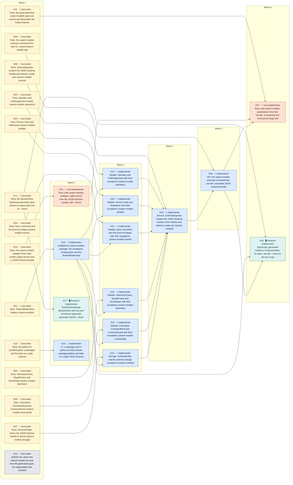

# T0.06: Plan

**Plan:** 🟢 Approved

<!-- ticket:specs -->
## 📚 Specifications

The technical pages, features, use cases and business rules of [TICKET.md](TICKET.md), copied by `python3 .claude/scripts/tickets/ticket_refs.py sync`.

- [🧱 Data models: conventions](../../specs/technical/02-data-models.md#conventions)
- [🧱 Data models: events](../../specs/technical/02-data-models.md#events)
- [🧱 Data models: main models](../../specs/technical/02-data-models.md#models)
- [🧱 Data models: telemetry frames and commands](../../specs/technical/02-data-models.md#telemetry)
- [🧱 Data models: versioning](../../specs/technical/02-data-models.md#versioning)
- [🗂️ Architecture: mono-repo](../../specs/technical/01-architecture.md#mono-repo)
<!-- /ticket:specs -->

## 🧭 Summary

T0.06 delivers four things.

1. The shared Python package `packages/python/swarm-models` (`swarm_models`), with a `SwarmModel` base whose helpers check UUIDv7 identifiers, UTC datetimes, text and bounded numbers.
2. The first versions of the models of the ticket, grouped in five concerns under `swarm_models/models/`:
   - `operators`: `Operator` and `CellAssignment`;
   - `people`: `Person`, `Role` and `RoleName`;
   - `events`: `Actor`, `ActorKind` and `Event`;
   - `telemetry`: `TelemetryFrame`, `SquadFrame` and `DroneState`;
   - `commands`: `Command`, `CommandKind` and `CommandLane`.

   Each concern has its own field exceptions, and every model has the six AGENT.md model tests.
3. The JSON Schema export, built in three layers inside the package:
   - `storage/schemas/SchemaFolder` reads and writes the files;
   - `service/schemas/SchemaExporter` renders one canonical bundle, `schemas/swarm_models.schema.json`, and says whether the committed one is stale;
   - the console script `swarm-models-schemas [--check] [--output DIR]` sits in `api/cli/export_schemas.py`.
4. The generated types, each with a check that fails when the file is stale:
   - **Rust:** a `swarm-models-codegen` crate (typify) writes `packages/rust/swarm-models/src/generated.rs`. A cargo test fails when that file is stale.
   - **TypeScript:** `packages/ts/live` has `scripts/generate.ts` (json-schema-to-typescript), which writes `src/generated/models.ts`. Its `test` script runs `--check`.
   - **Python:** the CI `python.yml` gets a `packages` job that runs ruff, mypy and pytest on `packages/python`, then `swarm-models-schemas --check`.

These close acceptance criterion 2 (CI fails on a stale JSON Schema, Rust or TypeScript file). AGENT.md is updated beside the code.

**Waves:** 28 tasks in 6 waves.

- **Wave 1, 14 tasks (8 at once):** 13 test-writers and 1 doc-writer.
- **Wave 2, 4 tasks:**
  - the package scaffold and `SwarmModel` base;
  - the Rust codegen crate;
  - the TypeScript generator;
  - the CI `packages` job.
- **Wave 3, 6 tasks:** the five model concerns and `SchemaFolder`.
- **Wave 4:** `SchemaExporter`.
- **Wave 5:** the CLI, which writes the committed schema bundle.
- **Wave 6:** the Rust `swarm-models` crate with `generated.rs`, and the TypeScript generated models.

No two tasks of a wave share a file.

Specifications applied:

- docs/specs/technical/02-data-models.md#conventions
- docs/specs/technical/02-data-models.md#models
- docs/specs/technical/02-data-models.md#telemetry
- docs/specs/technical/02-data-models.md#events
- docs/specs/technical/02-data-models.md#versioning
- docs/specs/technical/01-architecture.md#mono-repo
- docs/specs/technical/01-architecture.md#layers

## 🧠 Assumptions

1. The roadmap row names no feature, use case or business rule, so the acceptance criteria cite none.
2. Proposal is not built here: the roadmap lists Event but not Proposal.
3. The fields of Operator, Person, Role, CellAssignment and SquadFrame are not listed in the specifications beyond their names. The plan takes the most conservative set and records it.
4. Where the CI check of stale generated files runs is not specified beyond the T0.04 workflows. The plan reuses them.
5. **T0.05 merges first.** T0.06 runs after T0.05 has been merged into develop. Its tasks add `swarm-models` to the root pyproject lists (pytest testpaths, mypy files and mypy_path, ruff known-first-party) and keep the entries T0.05 added. Nothing here imports the lifecycle, logging or catalog packages, so the plan does not depend on their code.
6. **One package, one layout.** The models live in one package, `packages/python/swarm-models` (`swarm_models`), as the conventions section names it. Like the T0.05 packages, they sit under `src/swarm_models/models/`, grouped in five concerns: operators, people, events, telemetry, commands. The JSON Schema export uses the service layers inside the package: storage `SchemaFolder`, service `SchemaExporter`, and an api/cli console script `swarm-models-schemas`. This keeps the AGENT.md import rules: api never imports storage.
7. **SwarmModel base.** All models subclass a `SwarmModel` base with no fields. Its public classmethods (`parse_uuid7`, `parse_utc`, `parse_text`, `parse_int`, `parse_float`) share the validation rules of the conventions: UUIDv7, UTC, and bool refused for numbers. Each field still has its own validator and its own exception.
8. **One exception per field.** Every field has its own `SE<Model>Invalid<Field>` exception, under a `SEInvalid<Model>Exception` base that subclasses Exception and not ValueError, as in T0.05. Sub-folders keep every folder at five Python files or fewer.
9. **Identifiers and time.** Identifiers are required and must be version-7 UUIDs. No model generates them, because models only load and validate, and Python 3.12 has no uuid7. Datetimes must be timezone-aware, and are converted to UTC with their microseconds kept.
10. **First versions of the global models.** The specification names these models without their fields, so the most conservative set is used:
    - `Operator`: `id`, `name`.
    - `Person`: `id`, `operator_id` (optional, for a Swarm administrator), `name`, `email`. The email check is minimal: one `@`, non-empty parts, no whitespace.
    - `Role` is one role a Person holds: `person_id`, `operator_id` (optional) and `name: RoleName`. RoleName has the seven roles of 06-security.md#authorisation. `operator_id` is None exactly for a Swarm administrator.
    - `CellAssignment`: `operator_id`, `cell`, `assigned_at`.

    The global models are not frozen: the specification freezes only events, frames and commands.
11. **Event.**
    - `type` must match `^[a-z][a-z0-9_]*(\.[a-z][a-z0-9_]*)+$`, after the example `mission.planned`.
    - `version` is an int of at least 1, with a default of 1.
    - `mission_id` is optional, because fleet events have no Mission (subject `op.<operator_id>.fleet.<event>`).
    - `payload` is a required `Dict[str, JsonValue]`: the dumped model that changed.
    - `actor` is an `Actor`:
      - `kind` is PERSON, SWARM_AGENT or OUTSIDE_AGENT;
      - `person_id` and `agent_name` are optional;
      - PERSON needs `person_id` only, SWARM_AGENT needs `agent_name`, and OUTSIDE_AGENT needs both.
    - `Proposal` is not built (TICKET.md).
12. **TelemetryFrame bounds.**
    - `seq` and `t_us` >= 0.
    - `lat_e7` in [-900000000, 900000000] and `lon_e7` in [-1800000000, 1800000000] (degrees x 1e7).
    - `speed_m_s` >= 0.
    - `heading_deg` in [0, 360).
    - `battery_pct` and `link_quality_pct` in [0, 100].
    - `altitude_m` only finite, since it is measured above the take-off point and may be negative.

    These bounds are physical limits, not product limits from the specification.
13. **No `payload_state` yet.** `TelemetryFrame` leaves out `payload_state`, because the glossary names no Payload state to put in a `PayloadState` enum. Adding it later as an optional field is an additive change within a version (02-data-models.md#versioning).
14. **DroneState values.** `DroneState` has the six Drone states of the glossary: Ready, Grounded, Airborne, Returning, Landed and Lost. Its member names are upper case and its values lower case: `airborne`.
15. **SquadFrame.** The first version of `SquadFrame` holds full `TelemetryFrame`s: `mission_id`, `t_us`, `frames`. Delta encoding against the previous tick is a wire-encoding concern of the live path (T0.18/T0.19 and P1). The model refuses a frame of another Mission and two frames of the same Drone, and allows an empty list.
16. **Command.** `Command` has `id`, `mission_id`, `drone_id` (None targets the whole Squad), `kind`, `issued_by` (the Person) and `lane`.
    - `CommandKind` holds only the four safety kinds the specification names: hold, abort, return_home and manual_control. Normal-lane kinds arrive with the flight engine.
    - A safety kind on the normal lane is refused.
17. **One schema bundle.** The JSON Schema export is one canonical bundle, `packages/python/swarm-models/schemas/swarm_models.schema.json`:
    - it is the second element of `models_json_schema` over the nine models, in validation mode, with the title `Swarm models`;
    - it is dumped with sorted keys and indent 2, and ends with one newline.

    One bundle gives Rust and TypeScript a single set of type names. The model list is a ClassVar tuple of classes, which is code and not catalogue data.
18. **Rust generation.** The Rust structs are generated by a separate crate, `packages/rust/swarm-models-codegen` (typify as a library), into the committed `packages/rust/swarm-models/src/generated.rs`. The stale check is a cargo test, so the existing `cargo test --workspace --locked` of rust.yml fails on a stale file, and rust.yml is unchanged.
19. **TypeScript generation.** The TypeScript generator is `packages/ts/live/scripts/generate.ts` (json-schema-to-typescript), run with `node --experimental-strip-types`. It writes the committed `src/generated/models.ts`, and the package's `test` script ends with `generate.ts --check`, so typescript.yml is unchanged.
20. **CI for Python packages.** T0.04's CI does not check `packages/python`. A third job, `packages`, is added to python.yml, gated on the `repository` input, which is true whenever `packages/` changes. It runs ruff, mypy and pytest on `packages/python`, then `swarm-models-schemas --check`. detect_changes.py and ci.yml are unchanged, and `test_python_workflow.py` is updated from two jobs to three.
21. **Isort during wave 1.** Wave-1 Python test-writers check isort with a `--config` override that includes `swarm_models`. K15 adds it to the root known-first-party in wave 2. Until then, the SubagentStop hook may report I001 on their files, as in T0.05.
22. **Test-file constraints.** Package test folders cannot be imported by full path (hyphen in `swarm-models`), so constants are ClassVars of the test classes and there is no conftest.py. Test basenames are unique, so the CLI module is `export_schemas.py`, not `main.py`, whose test basename the gateway already uses.
23. **No consuming service yet.** No service imports swarm-models in this ticket. The gateway has no model yet, and later tickets adopt the package.
24. **No specification change.** The ticket changes no specification page. AGENT.md gets short factual additions, in a doc task beside the code: where the shared models live, the three regenerate commands and the three stale checks.
25. **Toolchains and network.** The Rust toolchain, cargo, Node and pnpm, and network access to crates.io and the npm registry, are available to the Rust and TypeScript tasks. If they are missing, the run stops as an environment failure (TKT-6).

<!-- plan:graph -->

> [!NOTE]
> Generated from the json block at the end of this page by `python3 .claude/scripts/tickets/plan.py render`.
> To change a task, edit the json block, then render again: never edit this view by hand.

## Waves

| Wave | Tasks | Agents running at once |
| --- | --- | --- |
| 1 | [K01](#k01), [K02](#k02), [K03](#k03), [K04](#k04), [K05](#k05), [K06](#k06), [K07](#k07), [K08](#k08), [K09](#k09), [K10](#k10), [K11](#k11), [K12](#k12), [K13](#k13), [K14](#k14) | 8 of 14 |
| 2 | [K15](#k15), [K16](#k16), [K17](#k17), [K18](#k18) | 4 of 4 |
| 3 | [K19](#k19), [K20](#k20), [K21](#k21), [K22](#k22), [K23](#k23), [K24](#k24) | 6 of 6 |
| 4 | [K25](#k25) | 1 of 1 |
| 5 | [K26](#k26) | 1 of 1 |
| 6 | [K27](#k27), [K28](#k28) | 2 of 2 |

| Wave | Task | Agent | Depends on | Unblocks |
| --- | --- | --- | --- | --- |
| 1 | [K01](#k01) Tests: SwarmModel base helpers (swarm-models) | 🧪 test-writer | none | [K15](#k15) |
| 1 | [K02](#k02) Tests: Operator and CellAssignment models (swarm-models operators) | 🧪 test-writer | none | [K19](#k19) |
| 1 | [K03](#k03) Tests: Person, Role and RoleName (swarm-models people) | 🧪 test-writer | none | [K20](#k20) |
| 1 | [K04](#k04) Tests: Actor, ActorKind and the Event envelope (swarm-models events) | 🧪 test-writer | none | [K21](#k21) |
| 1 | [K05](#k05) Tests: TelemetryFrame, SquadFrame and DroneState (swarm-models telemetry) | 🧪 test-writer | none | [K22](#k22) |
| 1 | [K06](#k06) Tests: Command, CommandKind and CommandLane (swarm-models commands) | 🧪 test-writer | none | [K23](#k23) |
| 1 | [K07](#k07) Tests: SchemaFolder, where the JSON Schema bundle is stored (swarm-models storage) | 🧪 test-writer | none | [K24](#k24) |
| 1 | [K08](#k08) Tests: SchemaExporter renders the JSON Schema bundle and detects a stale one (swarm-models service) | 🧪 test-writer | none | [K25](#k25) |
| 1 | [K09](#k09) Tests: the swarm-models-schemas command line, with its --check (swarm-models api) | 🧪 test-writer | none | [K26](#k26) |
| 1 | [K10](#k10) Tests: the swarm-models-codegen Rust crate renders typify structs from a JSON Schema bundle | 🧪 test-writer | none | [K16](#k16) |
| 1 | [K11](#k11) Tests: the generated Rust swarm-models types are current and deserialise the Python frames | 🧪 test-writer | none | [K27](#k27) |
| 1 | [K12](#k12) Tests: the @swarm/live TypeScript generator (json-schema-to-typescript) and its --check | 🧪 test-writer | none | [K17](#k17), [K28](#k28) |
| 1 | [K13](#k13) Tests: the python CI workflow gains a packages job that fails on a stale schema | 🧪 test-writer | none | [K18](#k18) |
| 1 | [K14](#k14) AGENT.md: where the shared models live and how the generated types are regenerated and checked | 📝 doc-writer | none | none |
| 2 | [K15](#k15) Scaffold the swarm-models package, the workspace configuration and the SwarmModel base | 🐍 implementer | [K01](#k01) | [K19](#k19), [K20](#k20), [K21](#k21), [K22](#k22), [K23](#k23), [K24](#k24) |
| 2 | [K16](#k16) Rust crate swarm-models-codegen: typify structs from the JSON Schema bundle, with --check | 🦀 rust-implementer | [K10](#k10) | [K27](#k27) |
| 2 | [K17](#k17) TypeScript package @swarm/live with the json-schema-to-typescript generator and its --check | 🖥️ frontend-implementer | [K12](#k12) | [K28](#k28) |
| 2 | [K18](#k18) CI: a packages job in python.yml that checks packages/python and fails on a stale JSON Schema | 🐍 implementer | [K13](#k13) | none |
| 3 | [K19](#k19) Models: Operator and CellAssignment with their exceptions (swarm-models operators) | 🐍 implementer | [K02](#k02), [K15](#k15) | [K25](#k25) |
| 3 | [K20](#k20) Models: Person, Role and RoleName with their exceptions (swarm-models people) | 🐍 implementer | [K03](#k03), [K15](#k15) | [K25](#k25) |
| 3 | [K21](#k21) Models: Actor, ActorKind and the Event envelope with their exceptions (swarm-models events) | 🐍 implementer | [K04](#k04), [K15](#k15) | [K25](#k25) |
| 3 | [K22](#k22) Models: TelemetryFrame, SquadFrame and DroneState with their exceptions (swarm-models telemetry) | 🐍 implementer | [K05](#k05), [K15](#k15) | [K25](#k25) |
| 3 | [K23](#k23) Models: Command, CommandKind and CommandLane with their exceptions (swarm-models commands) | 🐍 implementer | [K06](#k06), [K15](#k15) | [K25](#k25) |
| 3 | [K24](#k24) Storage: SchemaFolder and the schema storage exceptions (swarm-models) | 🐍 implementer | [K07](#k07), [K15](#k15) | [K25](#k25) |
| 4 | [K25](#k25) Service: SchemaExporter renders the JSON Schema bundle of the models and detects a stale one (swarm-models) | 🐍 implementer | [K08](#k08), [K19](#k19), [K20](#k20), [K21](#k21), [K22](#k22), [K23](#k23), [K24](#k24) | [K26](#k26) |
| 5 | [K26](#k26) API: the swarm-models-schemas command line, and the committed JSON Schema bundle | 🐍 implementer | [K09](#k09), [K25](#k25) | [K27](#k27), [K28](#k28) |
| 6 | [K27](#k27) Rust crate swarm-models: generated.rs from the bundle, re-exported and checked by cargo test | 🦀 rust-implementer | [K11](#k11), [K16](#k16), [K26](#k26) | none |
| 6 | [K28](#k28) TypeScript: generated models.ts in @swarm/live, its index, and the --check in the test script | 🖥️ frontend-implementer | [K12](#k12), [K17](#k17), [K26](#k26) | none |

## Dependency graph



## Tasks

### <a id="k01"></a>K01: Tests: SwarmModel base helpers (swarm-models)

| Agent | Wave | Depends on | Unblocks |
| --- | --- | --- | --- |
| 🧪 test-writer | 1 | none | [K15](#k15) |

**Files** (only this task may change them in its wave):

- `packages/python/swarm-models/tests/models/base/test_swarm_model.py`

**Done when:** `uv run ruff check --config "lint.isort.known-first-party = ['tests', 'gateway', 'swarm_catalog', 'swarm_lifecycle', 'swarm_logging', 'swarm_models']" packages/python/swarm-models/tests/models/base` and `uv run ruff format --check packages/python/swarm-models/tests/models/base` pass. `uv run pytest packages/python/swarm-models/tests/models/base -q` fails only with ModuleNotFoundError for swarm_models.

**Brief:**

Ticket T0.06 (docs/tickets/T0.06/TICKET.md). Applies docs/specs/technical/02-data-models.md#conventions (Pydantic v2 under AGENT.md, UUIDv7 identifiers, UTC with microsecond precision, units in names) and docs/specs/technical/01-architecture.md#mono-repo (shared Python in packages/python/). Rules: AGENT.md#pydantic-models, AGENT.md#tests, AGENT.md#messages.

Write packages/python/swarm-models/tests/models/base/test_swarm_model.py with one class `TestSwarmModel`, for what K15 implements.

The contract:
- `from swarm_models.models.base.swarm_model import SwarmModel`. It is a pydantic `BaseModel` with `model_config = ConfigDict(extra="forbid")` and no field. Every model of the package subclasses it.
- It has five public classmethods. Each takes the field name, the raw value and the exception class to raise, and raises that class (never ValueError) with a message starting `Invalid <field>: <repr(value)>.` and containing `Must be`:
  - `parse_uuid7(field, value, error) -> UUID`: accepts a `uuid.UUID` or a string of a version-7 UUID. It refuses another version, an unparsable string, an int, a bool and None.
  - `parse_utc(field, value, error) -> datetime`: accepts an aware `datetime` or an ISO 8601 string with an offset (`Z` or `+02:00`), and returns it converted to UTC (`tzinfo` is `timezone.utc`, the same instant, microseconds kept). It refuses a naive datetime, a string without an offset, an unparsable string, an int, a bool and None.
  - `parse_text(field, value, error) -> str`: returns the stripped string, and refuses an empty or blank string, a non-string and None.
  - `parse_int(field, value, error, minimum=None, maximum=None) -> int`: accepts an int within the inclusive bounds. It refuses a bool, a float, a string, None and a value out of bounds.
  - `parse_float(field, value, error, minimum=None, maximum=None, maximum_exclusive=False) -> float`: accepts an int or a float and returns a float. It refuses a bool, NaN, an infinity, a string, None, a value out of bounds, and a value equal to the maximum when `maximum_exclusive` is True.

Use version-7 UUIDs such as `01943c5e-8a4b-7c2d-9e1f-0a1b2c3d4e5f`, and a version-4 one such as `3f2b8c1e-5d4a-4b6c-9e7f-1a2b3c4d5e6f`. Pass a builtin exception class such as `LookupError` as `error`, to show that the given class is raised. Parametrise each helper's accepted and refused cases.

Follow AGENT.md#tests:
- one Test&lt;Subject> class, test names written as sentences;
- parametrize, and `pytest.raises` with the specific exception;
- no mocks, no `__init__.py`, no conftest.py. Constants are ClassVar attributes of the test class: the package folder has a hyphen, so nothing in tests is imported by full path;
- no `class` statement deriving from BaseModel;
- `from __future__ import annotations` first, no Any, no nested function;
- British English, no em dashes.

Test basenames must be unique in the repository. Format only your file. The SubagentStop hook runs ruff without the isort override and may report I001 on `swarm_models` imports until K15 adds it to known-first-party. The override in done_when is the reference.

### <a id="k02"></a>K02: Tests: Operator and CellAssignment models (swarm-models operators)

| Agent | Wave | Depends on | Unblocks |
| --- | --- | --- | --- |
| 🧪 test-writer | 1 | none | [K19](#k19) |

**Files** (only this task may change them in its wave):

- `packages/python/swarm-models/tests/models/operators/test_operator.py`
- `packages/python/swarm-models/tests/models/operators/test_cell_assignment.py`

**Done when:** `uv run ruff check --config "lint.isort.known-first-party = ['tests', 'gateway', 'swarm_catalog', 'swarm_lifecycle', 'swarm_logging', 'swarm_models']" packages/python/swarm-models/tests/models/operators` and `uv run ruff format --check packages/python/swarm-models/tests/models/operators` pass. `uv run pytest packages/python/swarm-models/tests/models/operators -q` fails only with ModuleNotFoundError for swarm_models.

**Brief:**

Ticket T0.06 (docs/tickets/T0.06/TICKET.md), acceptance criterion 1 (each model has the six AGENT.md model tests). Applies docs/specs/technical/02-data-models.md#models (Operator and CellAssignment are global models), docs/specs/technical/02-data-models.md#conventions (UUIDv7, UTC) and docs/specs/technical/01-architecture.md#mono-repo. Rules: AGENT.md#pydantic-models and AGENT.md#tests (the six model tests).

Write the tests of what K19 implements. Imports:
- `from swarm_models.models.operators.operator import Operator`;
- `from swarm_models.models.operators.cell_assignment import CellAssignment`;
- the exceptions from `swarm_models.models.operators.exceptions`.

The contract:
- `Operator`: `ConfigDict(extra="forbid")`, not frozen. Fields:
  - `id: UUID`, a required UUIDv7, refused with `SEOperatorInvalidId`;
  - `name: str`, required, stripped, empty or blank or non-string refused with `SEOperatorInvalidName`.
  - Base exception: `SEInvalidOperatorException`.
- `CellAssignment`: `ConfigDict(extra="forbid")`, not frozen. It routes one Operator to its cell. Fields:
  - `operator_id: UUID`, a required UUIDv7, refused with `SECellAssignmentInvalidOperatorId`;
  - `cell: str`, required, stripped, refused with `SECellAssignmentInvalidCell`;
  - `assigned_at: datetime`, required. An aware datetime or ISO string with an offset is converted to UTC. A naive one, a string without an offset, an int or a bool is refused with `SECellAssignmentInvalidAssignedAt`.
  - Base exception: `SEInvalidCellAssignmentException`.
- Every field exception subclasses its model's base, which subclasses Exception and not ValueError, so it propagates out of pydantic unchanged.
- Neither model has a defaulted field.

For each model, one Test&lt;Model> class with the AGENT.md set:
- `test_defaults`: every field is required (`model_fields[name].is_required()`);
- `test_full_valid_construction`, from strings: the UUID becomes a UUID, the name is stripped, and a `+01:00` datetime becomes the same instant in UTC with its microseconds;
- `test_none_becomes_the_default`, parametrised by field: no field has a default, so None is refused with that field's exception. Say so in a one-line docstring;
- `test_rejects_bad_values`, parametrised (name, value, error), with at least:
  - a v4 UUID, `not-a-uuid`, 7 and True for identifiers;
  - `''`, `'   '` and 3 for text;
  - a naive datetime, `2027-01-18T09:30:00`, 1700000000 and True for `assigned_at`;
- `test_rejects_unknown_keys`: a pydantic ValidationError;
- `test_round_trip`: both `model_validate(model.model_dump())` and `model_validate_json(model.model_dump_json())` equal the model.
Also test that every field exception is a subclass of the model base, and not of ValueError.

Use version-7 UUIDs such as `01943c5e-8a4b-7c2d-9e1f-0a1b2c3d4e5f` and `01943c5e-8a4b-7d00-8000-000000000001`, and the v4 UUID `3f2b8c1e-5d4a-4b6c-9e7f-1a2b3c4d5e6f`.

Follow AGENT.md#tests:
- one Test&lt;Subject> class per file, test names as sentences;
- parametrize, `pytest.raises` with the specific exception;
- no mocks, no `__init__.py`, no conftest.py. Constants are ClassVars of the test class;
- no class deriving from BaseModel in tests;
- `from __future__ import annotations` first, no Any, no nested function;
- British English, no em dashes.

Test basenames must be unique in the repository. Format only your files. The hook may report I001 on `swarm_models` imports until K15. The override in done_when is the reference.

### <a id="k03"></a>K03: Tests: Person, Role and RoleName (swarm-models people)

| Agent | Wave | Depends on | Unblocks |
| --- | --- | --- | --- |
| 🧪 test-writer | 1 | none | [K20](#k20) |

**Files** (only this task may change them in its wave):

- `packages/python/swarm-models/tests/models/people/test_person.py`
- `packages/python/swarm-models/tests/models/people/test_role.py`
- `packages/python/swarm-models/tests/models/people/test_role_name.py`

**Done when:** `uv run ruff check --config "lint.isort.known-first-party = ['tests', 'gateway', 'swarm_catalog', 'swarm_lifecycle', 'swarm_logging', 'swarm_models']" packages/python/swarm-models/tests/models/people` and `uv run ruff format --check packages/python/swarm-models/tests/models/people` pass. `uv run pytest packages/python/swarm-models/tests/models/people -q` fails only with ModuleNotFoundError for swarm_models.

**Brief:**

Ticket T0.06 (docs/tickets/T0.06/TICKET.md), acceptance criterion 1. Applies:
- docs/specs/technical/02-data-models.md#models (Person and Role are global models);
- docs/specs/technical/02-data-models.md#conventions (UUIDv7; every Operator-owned model carries operator_id; states and choices as StrEnum);
- docs/specs/technical/06-security.md#authorisation (the seven roles);
- docs/specs/technical/01-architecture.md#mono-repo.
Rules: AGENT.md#pydantic-models, AGENT.md#data-and-enums, AGENT.md#tests.

Write the tests of what K20 implements. Imports:
- `swarm_models.models.people.person.Person` and `swarm_models.models.people.role.Role`;
- `from swarm_models.models.people.enums import RoleName`;
- the exceptions from `swarm_models.models.people.exceptions`.

The contract:
- `RoleName`: a `StrEnum` with `@unique`. Its members and values:
  - PILOT `pilot`, MISSION_PLANNER `mission_planner`, FLEET_MAINTAINER `fleet_maintainer`, INSTRUCTOR `instructor`;
  - CLIENT `client`, SITE_AGENT `site_agent`, SWARM_ADMINISTRATOR `swarm_administrator`.
- `Person`: `ConfigDict(extra="forbid")`, not frozen. Fields:
  - `id: UUID`, a required UUIDv7, refused with `SEPersonInvalidId`;
  - `operator_id: Optional[UUID] = None`, a UUIDv7 when given, refused with `SEPersonInvalidOperatorId`;
  - `name: str`, required, stripped, refused with `SEPersonInvalidName`;
  - `email: str`, required and stripped, with exactly one `@`, a non-empty part on each side and no whitespace. Anything else is refused with `SEPersonInvalidEmail`.
  - Base exception: `SEInvalidPersonException`.
- `Role`, one role a Person holds: `ConfigDict(extra="forbid")`, not frozen. Fields:
  - `person_id: UUID`, required UUIDv7, refused with `SERoleInvalidPersonId`;
  - `operator_id: Optional[UUID] = None`, refused with `SERoleInvalidOperatorId`;
  - `name: RoleName`, a member or its string value. Anything else, bool included, is refused with `SERoleInvalidName`.
  - Cross-field rule: `operator_id` is None exactly when `name` is SWARM_ADMINISTRATOR, otherwise `SERoleOperatorMismatch`.
  - Base exception: `SEInvalidRoleException`.
- Every exception subclasses its model base, which subclasses Exception and not ValueError.

Tests:
1) test_role_name.py (`TestRoleName`):
- the members and values;
- building from the strings;
- an unknown string raises ValueError.
2) test_person.py (`TestPerson`) and test_role.py (`TestRole`), with the AGENT.md set:
- `test_defaults`. For Role, build a Swarm administrator, because the default `operator_id=None` is valid only for it;
- `test_full_valid_construction`;
- `test_none_becomes_the_default`, parametrised: None becomes the default for `operator_id`, and None for a required field raises that field's exception;
- `test_rejects_bad_values`, parametrised (name, value, error). Email cases: `''`, `no-at-sign`, `a@b@c`, `@example.org`, `ada@`, `ada lovelace@example.org` and 5. Also a v4 UUID, True, `'  '` and an unknown role `pilot-in-chief`;
- `test_rejects_unknown_keys`;
- `test_round_trip` (python and JSON).
Also cover:
- a Pilot role without an Operator raises SERoleOperatorMismatch;
- a Swarm administrator role with an Operator raises SERoleOperatorMismatch;
- the exception hierarchy.

UUIDs: version 7 such as `01943c5e-8a4b-7c2d-9e1f-0a1b2c3d4e5f`, and v4 `3f2b8c1e-5d4a-4b6c-9e7f-1a2b3c4d5e6f`.

Follow AGENT.md#tests:
- one Test&lt;Subject> class per file, test names as sentences;
- parametrize, `pytest.raises` with the specific exception;
- no mocks, no `__init__.py`, no conftest.py. Constants are ClassVars;
- no class deriving from BaseModel;
- `from __future__ import annotations` first, no Any, no nested function;
- British English, no em dashes.

Test basenames must be unique. Format only your files. The hook may report I001 on `swarm_models` imports until K15. The override in done_when is the reference.

### <a id="k04"></a>K04: Tests: Actor, ActorKind and the Event envelope (swarm-models events)

| Agent | Wave | Depends on | Unblocks |
| --- | --- | --- | --- |
| 🧪 test-writer | 1 | none | [K21](#k21) |

**Files** (only this task may change them in its wave):

- `packages/python/swarm-models/tests/models/events/test_actor.py`
- `packages/python/swarm-models/tests/models/events/test_actor_kind.py`
- `packages/python/swarm-models/tests/models/events/test_event.py`

**Done when:** `uv run ruff check --config "lint.isort.known-first-party = ['tests', 'gateway', 'swarm_catalog', 'swarm_lifecycle', 'swarm_logging', 'swarm_models']" packages/python/swarm-models/tests/models/events` and `uv run ruff format --check packages/python/swarm-models/tests/models/events` pass. `uv run pytest packages/python/swarm-models/tests/models/events -q` fails only with ModuleNotFoundError for swarm_models.

**Brief:**

Ticket T0.06 (docs/tickets/T0.06/TICKET.md), acceptance criterion 1. Applies:
- docs/specs/technical/02-data-models.md#events: the Event fields `id`, `type`, `version`, `operator_id`, `mission_id`, `occurred_at`, `actor`, `payload`. The actor is a Person, a Swarm agent, or an Outside agent with the person it acts for;
- docs/specs/technical/02-data-models.md#conventions (frozen events, UUIDv7, UTC microseconds);
- docs/specs/glossary.md#term-outside-agent.
Rules: AGENT.md#pydantic-models and AGENT.md#tests.

Write the tests of what K21 implements. Imports:
- `swarm_models.models.events.actor.Actor` and `swarm_models.models.events.event.Event`;
- `from swarm_models.models.events.enums import ActorKind`;
- the exceptions from `swarm_models.models.events.exceptions`.

The contract:
- `ActorKind`: a StrEnum with `@unique`: PERSON `person`, SWARM_AGENT `swarm_agent`, OUTSIDE_AGENT `outside_agent`.
- `Actor`: `ConfigDict(extra="forbid", frozen=True)`. Fields:
  - `kind: ActorKind`, a member or its value. Anything else, bool included, is refused with `SEActorInvalidKind`;
  - `person_id: Optional[UUID] = None`, a UUIDv7, refused with `SEActorInvalidPersonId`;
  - `agent_name: Optional[str] = None`, stripped and non-empty when given, refused with `SEActorInvalidAgentName`.
  - Cross-field rule, refused with `SEActorInconsistentKind`:
    - PERSON needs `person_id` and no `agent_name`;
    - SWARM_AGENT needs `agent_name`, and `person_id` is optional (the person it acts for);
    - OUTSIDE_AGENT needs both.
  - Base exception: `SEInvalidActorException`.
- `Event`: `ConfigDict(extra="forbid", frozen=True)`. Fields:
  - `id: UUID`, a required UUIDv7, refused with `SEEventInvalidId`;
  - `type: str`, required, matching `^[a-z][a-z0-9_]*(\.[a-z][a-z0-9_]*)+$` such as `mission.planned`, refused with `SEEventInvalidType`;
  - `version: int = 1`, at least 1, refused with `SEEventInvalidVersion`;
  - `operator_id: UUID`, required, refused with `SEEventInvalidOperatorId`;
  - `mission_id: Optional[UUID] = None` (fleet events have none), refused with `SEEventInvalidMissionId`;
  - `occurred_at: datetime`, required, aware and converted to UTC with its microseconds kept, refused with `SEEventInvalidOccurredAt`;
  - `actor: Actor`, an Actor or a mapping. Anything else is refused with `SEEventInvalidActor`. A mapping with a bad kind raises `SEActorInvalidKind` unchanged;
  - `payload: Dict[str, JsonValue]`, required, the model that changed, dumped. A non-mapping or None is refused with `SEEventInvalidPayload`.
  - Base exception: `SEInvalidEventException`.
- Every exception subclasses its model base, which subclasses Exception and not ValueError.

Tests:
1) test_actor_kind.py (`TestActorKind`):
- the members and values;
- building from strings;
- an unknown string raises ValueError.
2) test_actor.py (`TestActor`) and test_event.py (`TestEvent`), each with the AGENT.md set:
- `test_defaults`;
- `test_full_valid_construction`;
- `test_none_becomes_the_default`, parametrised. None gives the default for defaulted fields: `person_id`, `agent_name`, `version`, `mission_id`. None for a required field raises its exception;
- `test_rejects_bad_values`, parametrised. Types: `Mission.Planned`, `mission`, `mission..planned`, `''`, 3. Versions: 0, -1, True, 1.5, `'1'`. Also a naive datetime, a v4 UUID, an actor `'person'`, a payload `[1, 2]` and `'x'`;
- `test_rejects_unknown_keys`;
- `test_round_trip`, python and JSON, the JSON form of `occurred_at` keeping its microseconds.
Also cover:
- each inconsistent actor kind (parametrised);
- an Outside agent with its person is accepted;
- assigning a field of a built Actor or Event raises a pydantic ValidationError (frozen);
- a `+02:00` `occurred_at` becomes UTC;
- the exception hierarchy.

UUIDs: version 7 such as `01943c5e-8a4b-7c2d-9e1f-0a1b2c3d4e5f`, and v4 `3f2b8c1e-5d4a-4b6c-9e7f-1a2b3c4d5e6f`.

Follow AGENT.md#tests:
- one Test&lt;Subject> class per file, test names as sentences;
- parametrize, `pytest.raises` with the specific exception;
- no mocks, no `__init__.py`, no conftest.py. Constants are ClassVars;
- no class deriving from BaseModel;
- `from __future__ import annotations` first, no Any, no nested function;
- British English, no em dashes.

Test basenames must be unique. Format only your files. The hook may report I001 on `swarm_models` imports until K15. The override in done_when is the reference.

### <a id="k05"></a>K05: Tests: TelemetryFrame, SquadFrame and DroneState (swarm-models telemetry)

| Agent | Wave | Depends on | Unblocks |
| --- | --- | --- | --- |
| 🧪 test-writer | 1 | none | [K22](#k22) |

**Files** (only this task may change them in its wave):

- `packages/python/swarm-models/tests/models/telemetry/test_telemetry_frame.py`
- `packages/python/swarm-models/tests/models/telemetry/test_squad_frame.py`
- `packages/python/swarm-models/tests/models/telemetry/test_drone_state.py`

**Done when:** `uv run ruff check --config "lint.isort.known-first-party = ['tests', 'gateway', 'swarm_catalog', 'swarm_lifecycle', 'swarm_logging', 'swarm_models']" packages/python/swarm-models/tests/models/telemetry` and `uv run ruff format --check packages/python/swarm-models/tests/models/telemetry` pass. `uv run pytest packages/python/swarm-models/tests/models/telemetry -q` fails only with ModuleNotFoundError for swarm_models.

**Brief:**

Ticket T0.06 (docs/tickets/T0.06/TICKET.md), acceptance criterion 1. Applies:
- docs/specs/technical/02-data-models.md#telemetry: the TelemetryFrame fields, and one SquadFrame per Mission per tick with the frames of every Drone;
- docs/specs/technical/02-data-models.md#conventions (frozen frames, `t_us` integer microseconds, units in names, states as StrEnum with the glossary names);
- the Drone states of docs/specs/glossary.md#st-drone-ready, #st-drone-grounded, #st-drone-airborne, #st-drone-returning, #st-drone-landed and #st-drone-lost.
Rules: AGENT.md#pydantic-models (bounds as `<FIELD>_MIN` / `<FIELD>_MAX` ClassVars, bool refused where a number is expected) and AGENT.md#tests.

Write the tests of what K22 implements. Imports:
- `swarm_models.models.telemetry.telemetry_frame.TelemetryFrame` and `swarm_models.models.telemetry.squad_frame.SquadFrame`;
- `from swarm_models.models.telemetry.enums import DroneState`;
- the exceptions from `swarm_models.models.telemetry.exceptions`.

The contract:
- `DroneState`: a StrEnum with `@unique`: READY `ready`, GROUNDED `grounded`, AIRBORNE `airborne`, RETURNING `returning`, LANDED `landed`, LOST `lost`.
- `TelemetryFrame`: `ConfigDict(extra="forbid", frozen=True)`. All fields are required, none has a default, and each has its exception `SETelemetryFrameInvalid<Field>`:
  - `mission_id`, `drone_id`: UUIDv7 (`...InvalidMissionId`, `...InvalidDroneId`);
  - `seq: int` >= 0 (`...InvalidSeq`);
  - `t_us: int` >= 0 (`...InvalidTUs`);
  - `lat_e7: int` in [-900000000, 900000000] (`...InvalidLatE7`);
  - `lon_e7: int` in [-1800000000, 1800000000] (`...InvalidLonE7`);
  - `altitude_m: float`, finite (`...InvalidAltitudeM`);
  - `speed_m_s: float` >= 0 (`...InvalidSpeedMS`);
  - `heading_deg: float` in [0, 360), 360 refused (`...InvalidHeadingDeg`);
  - `battery_pct` and `link_quality_pct`: float in [0, 100] (`...InvalidBatteryPct`, `...InvalidLinkQualityPct`);
  - `state: DroneState`, a member or its value (`...InvalidState`).
  - Ints refuse bool, float and str. Floats accept ints and refuse bool, NaN and infinity.
  - There is **no** `payload_state` field in this version, so it is refused as an unknown key.
  - Base exception: `SEInvalidTelemetryFrameException`.
- `SquadFrame`: `ConfigDict(extra="forbid", frozen=True)`. Fields:
  - `mission_id: UUID` (`SESquadFrameInvalidMissionId`);
  - `t_us: int` >= 0 (`SESquadFrameInvalidTUs`);
  - `frames: List[TelemetryFrame]`, a list of frames or mappings, which may be empty. A non-list is refused with `SESquadFrameInvalidFrames`.
  - Cross-field rules: a frame of another Mission raises `SESquadFrameMissionMismatch`, and two frames of the same Drone raise `SESquadFrameDuplicateDrone`.
  - Base exception: `SEInvalidSquadFrameException`.
- Every exception subclasses its model base, which subclasses Exception and not ValueError.

Tests:
1) test_drone_state.py (`TestDroneState`):
- the members and values;
- building from strings;
- an unknown string raises ValueError.
2) test_telemetry_frame.py (`TestTelemetryFrame`) and test_squad_frame.py (`TestSquadFrame`), each with the AGENT.md set:
- `test_defaults`: every field is required;
- `test_full_valid_construction`;
- `test_none_becomes_the_default`, parametrised by field: no field has a default, so None raises that field's exception. Say so in a docstring;
- `test_rejects_bad_values`, parametrised (name, value, error), with every bound just outside, True, NaN, `float('inf')`, a string, heading 360.0, lat 900000001 and a v4 UUID;
- `test_rejects_unknown_keys`, including `payload_state`;
- `test_round_trip`, python and JSON.
Also cover:
- the bounds are inclusive at both ends (except the heading maximum);
- the bound ClassVars exist with these values (`LAT_E7_MIN`, `LAT_E7_MAX`, `LON_E7_MIN`, `LON_E7_MAX`, `HEADING_DEG_MIN`, `HEADING_DEG_MAX`, `BATTERY_PCT_MIN`, `BATTERY_PCT_MAX`, `LINK_QUALITY_PCT_MIN`, `LINK_QUALITY_PCT_MAX`, `SEQ_MIN`, `T_US_MIN`, `SPEED_M_S_MIN`);
- an int altitude becomes a float;
- frozen assignment raises ValidationError;
- a SquadFrame built from mappings holds TelemetryFrame instances;
- the mission mismatch and duplicate Drone rules;
- the exception hierarchy.

UUIDs: version 7 such as `01943c5e-8a4b-7c2d-9e1f-0a1b2c3d4e5f` and `01943c5e-8a4b-7c2d-9e1f-0a1b2c3d4e60`, and v4 `3f2b8c1e-5d4a-4b6c-9e7f-1a2b3c4d5e6f`.

Follow AGENT.md#tests:
- one Test&lt;Subject> class per file, test names as sentences;
- parametrize, `pytest.raises` with the specific exception;
- no mocks, no `__init__.py`, no conftest.py. Constants are ClassVars;
- no class deriving from BaseModel;
- `from __future__ import annotations` first, no Any, no nested function;
- British English, no em dashes.

Test basenames must be unique. Format only your files. The hook may report I001 on `swarm_models` imports until K15. The override in done_when is the reference.

### <a id="k06"></a>K06: Tests: Command, CommandKind and CommandLane (swarm-models commands)

| Agent | Wave | Depends on | Unblocks |
| --- | --- | --- | --- |
| 🧪 test-writer | 1 | none | [K23](#k23) |

**Files** (only this task may change them in its wave):

- `packages/python/swarm-models/tests/models/commands/test_command.py`
- `packages/python/swarm-models/tests/models/commands/test_command_kind.py`
- `packages/python/swarm-models/tests/models/commands/test_command_lane.py`

**Done when:** `uv run ruff check --config "lint.isort.known-first-party = ['tests', 'gateway', 'swarm_catalog', 'swarm_lifecycle', 'swarm_logging', 'swarm_models']" packages/python/swarm-models/tests/models/commands` and `uv run ruff format --check packages/python/swarm-models/tests/models/commands` pass. `uv run pytest packages/python/swarm-models/tests/models/commands -q` fails only with ModuleNotFoundError for swarm_models.

**Brief:**

Ticket T0.06 (docs/tickets/T0.06/TICKET.md), acceptance criterion 1. Applies:
- docs/specs/technical/02-data-models.md#telemetry: `Command` has id, Mission, target Drone or Squad, kind, issued by and lane. There are two lanes: safety (Hold the Squad, abort, Return home, manual control) always jumps the queue, and normal is for the rest;
- docs/specs/technical/02-data-models.md#conventions (frozen commands, UUIDv7);
- docs/specs/glossary.md#term-hold and docs/specs/glossary.md#term-return-home.
Rules: AGENT.md#pydantic-models, AGENT.md#data-and-enums, AGENT.md#tests.

Write the tests of what K23 implements. Imports:
- `swarm_models.models.commands.command.Command`;
- `from swarm_models.models.commands.enums import CommandKind, CommandLane`;
- the exceptions from `swarm_models.models.commands.exceptions`.

The contract:
- `CommandKind`: a StrEnum with `@unique`: HOLD `hold`, ABORT `abort`, RETURN_HOME `return_home`, MANUAL_CONTROL `manual_control`.
- `CommandLane`: a StrEnum with `@unique`: SAFETY `safety`, NORMAL `normal`.
- `Command`: `ConfigDict(extra="forbid", frozen=True)`. Fields:
  - `id: UUID`, required UUIDv7 (`SECommandInvalidId`);
  - `mission_id: UUID`, required (`SECommandInvalidMissionId`);
  - `drone_id: Optional[UUID] = None`, where None targets the whole Squad (`SECommandInvalidDroneId`);
  - `kind: CommandKind`, a member or value (`SECommandInvalidKind`);
  - `issued_by: UUID`, the Person who issued it, required UUIDv7 (`SECommandInvalidIssuedBy`);
  - `lane: CommandLane`, a member or value (`SECommandInvalidLane`).
  - `SAFETY_KINDS: ClassVar[FrozenSet[CommandKind]]` holds the four kinds. A safety kind on the NORMAL lane raises `SECommandWrongLane`.
  - Base exception: `SEInvalidCommandException`.
- Every exception subclasses the base, which subclasses Exception and not ValueError.

Tests:
1) test_command_kind.py (`TestCommandKind`) and test_command_lane.py (`TestCommandLane`):
- the members and values;
- building from strings;
- an unknown string raises ValueError.
2) test_command.py (`TestCommand`), with the AGENT.md set:
- `test_defaults` (`drone_id` is None);
- `test_full_valid_construction`;
- `test_none_becomes_the_default`, parametrised: None is the default for `drone_id`, and raises the field's exception for every other field;
- `test_rejects_bad_values`, parametrised: a v4 UUID, True, `jump` as kind, `fast` as lane, 1;
- `test_rejects_unknown_keys`;
- `test_round_trip`, python and JSON.
Also cover:
- each safety kind on the NORMAL lane raises SECommandWrongLane (parametrised);
- each safety kind on the SAFETY lane is accepted;
- a Hold of the Squad (`drone_id` None) is accepted;
- frozen assignment raises ValidationError;
- the exception hierarchy.

UUIDs: version 7 such as `01943c5e-8a4b-7c2d-9e1f-0a1b2c3d4e5f`, and v4 `3f2b8c1e-5d4a-4b6c-9e7f-1a2b3c4d5e6f`.

Follow AGENT.md#tests:
- one Test&lt;Subject> class per file, test names as sentences;
- parametrize, `pytest.raises` with the specific exception;
- no mocks, no `__init__.py`, no conftest.py. Constants are ClassVars;
- no class deriving from BaseModel;
- `from __future__ import annotations` first, no Any, no nested function;
- British English, no em dashes.

Test basenames must be unique. Format only your files. The hook may report I001 on `swarm_models` imports until K15. The override in done_when is the reference.

### <a id="k07"></a>K07: Tests: SchemaFolder, where the JSON Schema bundle is stored (swarm-models storage)

| Agent | Wave | Depends on | Unblocks |
| --- | --- | --- | --- |
| 🧪 test-writer | 1 | none | [K24](#k24) |

**Files** (only this task may change them in its wave):

- `packages/python/swarm-models/tests/storage/schemas/test_schema_folder.py`

**Done when:** `uv run ruff check --config "lint.isort.known-first-party = ['tests', 'gateway', 'swarm_catalog', 'swarm_lifecycle', 'swarm_logging', 'swarm_models']" packages/python/swarm-models/tests/storage` and `uv run ruff format --check packages/python/swarm-models/tests/storage` pass. `uv run pytest packages/python/swarm-models/tests/storage -q` fails only with ModuleNotFoundError for swarm_models.

**Brief:**

Ticket T0.06 (docs/tickets/T0.06/TICKET.md), acceptance criterion 2 (a stale generated file fails CI). Applies:
- docs/specs/technical/02-data-models.md#versioning: JSON Schema exported from the Pydantic models, and CI fails when a generated file is out of date;
- docs/specs/technical/01-architecture.md#layers: storage only reads and writes.
Rules: AGENT.md#exceptions and AGENT.md#tests.

Write packages/python/swarm-models/tests/storage/schemas/test_schema_folder.py with one class `TestSchemaFolder`, for what K24 implements.

The contract:
- `from swarm_models.storage.schemas.schema_folder import SchemaFolder`.
- `from swarm_models.models.schemas.exceptions import SESchemaError, SESchemaUnreadableError, SESchemaUnwritableError`. Both errors subclass `SESchemaError`, which subclasses Exception.
- The constructor is `SchemaFolder(root: Path, logger: Optional[Logger] = None)`. Its attributes are `root` and `logger` (the given logger, or else a `logging.Logger`).
- `DEFAULT_ROOT: ClassVar[Path]` is the absolute `packages/python/swarm-models/schemas` folder. Test: `DEFAULT_ROOT.is_absolute()` and `DEFAULT_ROOT.parts[-2:] == ('swarm-models', 'schemas')`.
- `path(name: str) -> Path` returns `root / name`.
- `read(name: str) -> Optional[str]`:
  - returns the UTF-8 text, or None when the file does not exist;
  - raises `SESchemaUnreadableError`, with `__cause__` set, when the path is a folder or the bytes are not UTF-8 (write `b'\xff\xfe\xfa'`).
- `write(name: str, text: str) -> Path`:
  - creates `root` and its parents when missing;
  - writes the text as UTF-8 exactly, with `\n` line endings unchanged and non-ASCII text kept;
  - overwrites an existing file, and returns the path;
  - raises `SESchemaUnwritableError`, with `__cause__` set, when `root` is an existing file;
  - logs an INFO record naming the file (caplog).

Cases:
- read a missing file;
- a write then read round trip, with non-ASCII text;
- a write into a missing nested root;
- an overwrite;
- `\n` endings kept byte for byte (`read_bytes`);
- the unreadable and unwritable cases;
- the INFO record;
- a given logger is used;
- DEFAULT_ROOT.
Use `tmp_path`.

Follow AGENT.md#tests:
- one Test&lt;Subject> class, test names as sentences;
- parametrize, `pytest.raises` with the specific exception;
- no mocks, no `__init__.py`, no conftest.py;
- `from __future__ import annotations` first, no Any, no nested function;
- British English, no em dashes.

Test basenames must be unique. Format only your file. The hook may report I001 on `swarm_models` imports until K15. The override in done_when is the reference.

### <a id="k08"></a>K08: Tests: SchemaExporter renders the JSON Schema bundle and detects a stale one (swarm-models service)

| Agent | Wave | Depends on | Unblocks |
| --- | --- | --- | --- |
| 🧪 test-writer | 1 | none | [K25](#k25) |

**Files** (only this task may change them in its wave):

- `packages/python/swarm-models/tests/service/schemas/test_schema_exporter.py`

**Done when:** `uv run ruff check --config "lint.isort.known-first-party = ['tests', 'gateway', 'swarm_catalog', 'swarm_lifecycle', 'swarm_logging', 'swarm_models']" packages/python/swarm-models/tests/service` and `uv run ruff format --check packages/python/swarm-models/tests/service` pass. `uv run pytest packages/python/swarm-models/tests/service -q` fails only with ModuleNotFoundError for swarm_models.

**Brief:**

Ticket T0.06 (docs/tickets/T0.06/TICKET.md), acceptance criterion 2. Applies:
- docs/specs/technical/02-data-models.md#versioning: JSON Schema exported from the Pydantic models, and CI fails when a generated file is out of date, the same way `specs.py check` fails on stale generated content;
- docs/specs/technical/02-data-models.md#telemetry: Pydantic stays the single source;
- docs/specs/technical/01-architecture.md#layers.
Rules: AGENT.md#tests.

Write packages/python/swarm-models/tests/service/schemas/test_schema_exporter.py with one class `TestSchemaExporter`, for what K25 implements.

The contract:
- `from swarm_models.service.schemas.schema_exporter import SchemaExporter`. The constructor is `SchemaExporter(root: Optional[Path] = None, logger: Optional[Logger] = None)`.
  - Its attribute `folder` is a `SchemaFolder` (`swarm_models.storage.schemas.schema_folder`) rooted at `root`, or at `SchemaFolder.DEFAULT_ROOT` when `root` is None.
- `MODELS: ClassVar[Tuple[Type[BaseModel], ...]]` equals, in this order: `(Operator, CellAssignment, Person, Role, Actor, Event, TelemetryFrame, SquadFrame, Command)`. Import them from `swarm_models.models.<concern>.<module>`:
  - operators: operator, cell_assignment;
  - people: person, role;
  - events: actor, event;
  - telemetry: telemetry_frame, squad_frame;
  - commands: command.
- `FILE_NAME: ClassVar[str] = 'swarm_models.schema.json'` and `TITLE: ClassVar[str] = 'Swarm models'`.
- The `path` property is `folder.root / FILE_NAME`.
- `render() -> str`: the JSON of `pydantic.json_schema.models_json_schema` over MODELS in validation mode, with `title=TITLE`, dumped with `indent=2, sort_keys=True, ensure_ascii=False`, plus a final newline.
- `export() -> Path`: writes `render()` to FILE_NAME through the folder, returns the path, and logs INFO.
- `is_stale() -> bool`: True when the file is missing or differs from `render()` in any byte. It logs WARNING when stale.

Cases:
- MODELS, FILE_NAME and TITLE;
- the default folder root;
- `render()`:
  - parses as JSON, with top-level keys exactly `$defs` and `title`, and the title is `Swarm models`;
  - `$defs` holds at least these 14 names: Operator, CellAssignment, Person, Role, RoleName, Actor, ActorKind, Event, TelemetryFrame, DroneState, SquadFrame, Command, CommandKind, CommandLane;
  - the properties of TelemetryFrame are exactly the 12 fields `mission_id`, `drone_id`, `seq`, `t_us`, `lat_e7`, `lon_e7`, `altitude_m`, `speed_m_s`, `heading_deg`, `battery_pct`, `link_quality_pct`, `state`;
  - it is identical across calls, ends with one newline, and equals its own canonical re-dump;
- `export()` writes a file equal to `render()` under `tmp_path`;
- `is_stale()` is:
  - True before export;
  - False after export;
  - True after one character changed;
  - True after a trailing space is added;
- the INFO and WARNING records (caplog).
Use a real SchemaFolder through `root=tmp_path`, and no mocks.

Follow AGENT.md#tests:
- one Test&lt;Subject> class, test names as sentences;
- no `__init__.py`, no conftest.py;
- `from __future__ import annotations` first, no Any, no nested function;
- British English, no em dashes.

Test basenames must be unique. Format only your file. The hook may report I001 on `swarm_models` imports until K15. The override in done_when is the reference.

### <a id="k09"></a>K09: Tests: the swarm-models-schemas command line, with its --check (swarm-models api)

| Agent | Wave | Depends on | Unblocks |
| --- | --- | --- | --- |
| 🧪 test-writer | 1 | none | [K26](#k26) |

**Files** (only this task may change them in its wave):

- `packages/python/swarm-models/tests/api/cli/test_export_schemas.py`

**Done when:** `uv run ruff check --config "lint.isort.known-first-party = ['tests', 'gateway', 'swarm_catalog', 'swarm_lifecycle', 'swarm_logging', 'swarm_models']" packages/python/swarm-models/tests/api` and `uv run ruff format --check packages/python/swarm-models/tests/api` pass. `uv run pytest packages/python/swarm-models/tests/api -q` fails only with ModuleNotFoundError for swarm_models.

**Brief:**

Ticket T0.06 (docs/tickets/T0.06/TICKET.md), acceptance criterion 2. Applies:
- docs/specs/technical/02-data-models.md#versioning: CI fails when a generated file is out of date;
- docs/specs/technical/01-architecture.md#layers: `api/cli/` is the command line, calls one service, and only it prints.
Rules: AGENT.md#tests.

Write packages/python/swarm-models/tests/api/cli/test_export_schemas.py with one class `TestExportSchemas`, for what K26 implements.

The contract:
- `from swarm_models.api.cli.export_schemas import main`, with `main(argv: Optional[List[str]] = None) -> int`. It is the console script `swarm-models-schemas` (`swarm_models.api.cli.export_schemas:main`).
- Arguments: `--check`, and `--output DIR`, which defaults to the package's `schemas/` folder. The file is `swarm_models.schema.json`.
- Without `--check`, it writes the bundle, prints `Wrote <path>.` on stdout and returns 0.
- With `--check`:
  - when the file is current, it prints `<path> is up to date.` on stdout and returns 0;
  - when the file is missing or stale, it prints on stderr `<path> is out of date. Run swarm-models-schemas to regenerate it.` and returns 1. It writes nothing.
- When the bundle cannot be written or read (a schema storage error), it prints the error on stderr and returns 2.
- An unknown argument ends in SystemExit with code 2 (argparse).

Cases (capsys, `tmp_path`):
- a write to `tmp_path`: the file exists and stdout names it;
- `--check` returns 1 on an empty folder, and stderr names `swarm-models-schemas`;
- `--check` returns 0 after the write;
- `--check` returns 1 after the file was changed;
- `--output` pointing at an existing file returns 2;
- an unknown argument;
- the console script entry point (`importlib.metadata.entry_points(group='console_scripts')`);
- `main(['--check'])`, with the default folder, returns 0. **This is the Python half of acceptance criterion 2:** the committed bundle `packages/python/swarm-models/schemas/swarm_models.schema.json` is up to date. It fails until K26 commits the bundle.

Follow AGENT.md#tests:
- one Test&lt;Subject> class, test names as sentences;
- no mocks, no `__init__.py`, no conftest.py;
- `from __future__ import annotations` first, no Any, no nested function;
- British English, no em dashes.

The basename `test_export_schemas.py` is unique, unlike `test_main.py`, which the gateway already uses. Format only your file. The hook may report I001 on `swarm_models` imports until K15. The override in done_when is the reference.

### <a id="k10"></a>K10: Tests: the swarm-models-codegen Rust crate renders typify structs from a JSON Schema bundle

| Agent | Wave | Depends on | Unblocks |
| --- | --- | --- | --- |
| 🧪 test-writer | 1 | none | [K16](#k16) |

**Files** (only this task may change them in its wave):

- `packages/rust/swarm-models-codegen/tests/render.rs`
- `packages/rust/swarm-models-codegen/tests/fixtures/sample.schema.json`

**Done when:** `rustfmt --edition 2021 --check packages/rust/swarm-models-codegen/tests/render.rs` passes, and the fixture parses with `python3 -m json.tool packages/rust/swarm-models-codegen/tests/fixtures/sample.schema.json`.

**Brief:**

Ticket T0.06 (docs/tickets/T0.06/TICKET.md), acceptance criterion 2. Applies:
- docs/specs/technical/02-data-models.md#telemetry: the Rust core uses structs generated from the JSON Schema of these models (typify), so Pydantic stays the single source;
- docs/specs/technical/02-data-models.md#versioning: CI fails when a generated file is out of date;
- docs/specs/technical/01-architecture.md#mono-repo: a Cargo workspace in packages/rust.

Write the integration tests of the crate that K16 implements: `packages/rust/swarm-models-codegen`, library `swarm_models_codegen`, with a binary of the same name.

The library API:
- `pub const HEADER: &str`. It is the first line of every rendered file: `// @generated by swarm-models-codegen from packages/python/swarm-models/schemas/swarm_models.schema.json. Do not edit.`
- `pub fn render(schema_json: &str) -> Result<String, CodegenError>`: one Rust type per entry of the bundle's `$defs`, through typify. The output is deterministic.
- `pub fn is_stale(schema: &Path, output: &Path) -> Result<bool, CodegenError>`: Ok(true) when the output is missing or differs from `render` of the schema, and Err when the schema cannot be read or parsed.
- `pub fn write(schema: &Path, output: &Path) -> Result<(), CodegenError>`: writes `render` of the schema.
- `pub fn default_schema_path() -> PathBuf` and `pub fn default_output_path() -> PathBuf`: the bundle, and `packages/rust/swarm-models/src/generated.rs`.
- `pub enum CodegenError` implements `std::error::Error` and `Display`.
- Dev-dependency: `tempfile` (K16 adds it).

1) The fixture `tests/fixtures/sample.schema.json` is a Pydantic-like bundle:
- `{"title": "Sample models", "$defs": {...}}`;
- `Sample`: an object with `additionalProperties: false`, properties `id` (string, format uuid), `count` (integer) and `state` (`$ref` `#/$defs/SampleState`), all required;
- `SampleState`: a string enum `["on", "off"]`. Each definition has a `title` equal to its key.
2) tests/render.rs:
- render of the fixture is Ok;
- its first line equals HEADER;
- it contains `pub struct Sample` and `pub enum SampleState`;
- two renders are equal;
- render of `not json` is Err;
- in a `tempfile::tempdir()`:
  - `is_stale` is true with no output;
  - `write` then `is_stale` is false, and the written file equals render;
  - after appending a line it is true again;
  - `is_stale` with a missing schema is Err;
- `default_output_path()` ends with `swarm-models/src/generated.rs`, and `default_schema_path()` ends with `swarm-models/schemas/swarm_models.schema.json`.
Read the fixture with `env!("CARGO_MANIFEST_DIR")`.

Write idiomatic Rust that passes `cargo fmt` and `cargo clippy --all-targets -- -D warnings` under the workspace lints (clippy all denied, pedantic warned, missing_docs warned). Give test names that read as sentences. Use no em dashes.

### <a id="k11"></a>K11: Tests: the generated Rust swarm-models types are current and deserialise the Python frames

| Agent | Wave | Depends on | Unblocks |
| --- | --- | --- | --- |
| 🧪 test-writer | 1 | none | [K27](#k27) |

**Files** (only this task may change them in its wave):

- `packages/rust/swarm-models/tests/generated_is_current.rs`
- `packages/rust/swarm-models/tests/deserialise.rs`

**Done when:** `rustfmt --edition 2021 --check packages/rust/swarm-models/tests/generated_is_current.rs packages/rust/swarm-models/tests/deserialise.rs` passes.

**Brief:**

Ticket T0.06 (docs/tickets/T0.06/TICKET.md), acceptance criterion 2: a stale Rust structs file fails CI, because the Rust workflow runs `cargo test --workspace --locked`. Applies:
- docs/specs/technical/02-data-models.md#telemetry (typify structs generated from the JSON Schema, Pydantic the single source);
- docs/specs/technical/02-data-models.md#versioning;
- docs/specs/technical/01-architecture.md#mono-repo.

Write the integration tests of the crate that K27 builds: `packages/rust/swarm-models`, library `swarm_models`. Its `src/generated.rs` is written by `swarm-models-codegen` (K16), and its types are re-exported at the crate root. It dev-depends on `swarm-models-codegen` (path) and on `serde_json`.

1) tests/generated_is_current.rs:
- `swarm_models_codegen::is_stale(&swarm_models_codegen::default_schema_path(), &swarm_models_codegen::default_output_path())` is `Ok(false)`;
- the failure message is `src/generated.rs is out of date. Run cargo run -p swarm-models-codegen to regenerate it.`
2) tests/deserialise.rs, with `serde_json::json!` samples:
- **A TelemetryFrame.** The sample:
  - `mission_id` `01943c5e-8a4b-7c2d-9e1f-0a1b2c3d4e5f` and `drone_id` `01943c5e-8a4b-7c2d-9e1f-0a1b2c3d4e60`;
  - `seq` 42, `t_us` 1768728600000000, `lat_e7` 482000000, `lon_e7` 23500000;
  - `altitude_m` 35.5, `speed_m_s` 8.25, `heading_deg` 90.0, `battery_pct` 76.5, `link_quality_pct` 99.0;
  - `state` `airborne`.
  It deserialises into `swarm_models::TelemetryFrame`:
  - its `state` equals `swarm_models::DroneState::Airborne` and its `seq` is 42;
  - `serde_json::to_value` of it equals the sample.
- The same sample with an extra key `payload_state` fails, because the Pydantic `extra=forbid` becomes `deny_unknown_fields`.
- The same sample with `state` `flying` fails.
- A `swarm_models::SquadFrame` with the same `mission_id`, `t_us` and one frame deserialises, and has `frames.len() == 1`.
- **A Command.** The sample:
  - `id` `01943c5e-8a4b-7d00-8000-000000000001`, with the mission and Drone above;
  - `kind` `hold`, `issued_by` `01943c5e-8a4b-7d00-8000-000000000002`, `lane` `safety`.
  It deserialises into `swarm_models::Command`:
  - `kind == swarm_models::CommandKind::Hold` and `lane == swarm_models::CommandLane::Safety`;
  - it round-trips to the same value.
Compare through `serde_json::Value` rather than naming field types, because typify chooses them.

Write idiomatic Rust that passes `cargo fmt` and `cargo clippy --all-targets -- -D warnings` under the workspace lints. Give test names that read as sentences. Use no em dashes. These tests fail until K27.

### <a id="k12"></a>K12: Tests: the @swarm/live TypeScript generator (json-schema-to-typescript) and its --check

| Agent | Wave | Depends on | Unblocks |
| --- | --- | --- | --- |
| 🧪 test-writer | 1 | none | [K17](#k17), [K28](#k28) |

**Files** (only this task may change them in its wave):

- `packages/ts/live/test/render.test.ts`
- `packages/ts/live/test/fixtures/sample.schema.json`

**Done when:** Both files exist, the fixture parses with `python3 -m json.tool packages/ts/live/test/fixtures/sample.schema.json`, and `node --experimental-strip-types --test packages/ts/live/test/render.test.ts` fails only because `scripts/generate.ts` does not exist (ERR_MODULE_NOT_FOUND).

**Brief:**

Ticket T0.06 (docs/tickets/T0.06/TICKET.md), acceptance criterion 2. Applies:
- docs/specs/technical/02-data-models.md#versioning: for live frames and events, JSON Schema is exported from the Pydantic models and TypeScript types are generated (json-schema-to-typescript) into packages/ts/live. CI fails when a generated file is out of date;
- docs/specs/technical/01-architecture.md#mono-repo: a pnpm workspace in packages/ts.

Write the tests of the generator that K17 implements in `packages/ts/live/scripts/generate.ts`. The tests run with `node --experimental-strip-types --test test/*.test.ts`, use `node:test` and `node:assert/strict`, and import `../scripts/generate.ts` with its extension.

The module's exports:
- `SCHEMA_PATH: string`: the absolute path of packages/python/swarm-models/schemas/swarm_models.schema.json.
- `OUTPUT_PATH: string`: the absolute path of packages/ts/live/src/generated/models.ts.
- `BANNER: string`: `// Generated from packages/python/swarm-models/schemas/swarm_models.schema.json by packages/ts/live/scripts/generate.ts. Do not edit.`
- `renderModels(schemaText: string): Promise<string>`. It renders one exported TypeScript type per entry of the bundle's `$defs`, and the text starts with BANNER. It rejects on invalid JSON.
- `isStale(schemaPath: string, outputPath: string): Promise<boolean>`: true when the output is missing or differs from the render.
- `writeModels(schemaPath: string, outputPath: string): Promise<void>`: creates the parent folders.
- Run directly, `node --experimental-strip-types scripts/generate.ts [--check]` writes the file, or checks it and exits 1 when it is stale.

1) The fixture `test/fixtures/sample.schema.json` is a Pydantic-like bundle:
- `{"title": "Sample models", "$defs": {...}}`;
- `Sample`: an object with `additionalProperties: false`, properties `id` (string, format uuid), `count` (integer) and `state` (`$ref` `#/$defs/SampleState`), all required;
- `SampleState`: a string enum `["on", "off"]`. Each definition has a `title` equal to its key.
2) test/render.test.ts:
- the render of the fixture starts with BANNER;
- it matches `/export interface Sample\b/` and `/export type SampleState =\s*"on"\s*\|\s*"off"/`;
- two renders are equal;
- invalid JSON rejects;
- in a `fs.mkdtemp(os.tmpdir())` folder:
  - isStale is true with no output;
  - writeModels into a missing nested folder then isStale is false, and the file equals the render;
  - after appending text it is true again;
- SCHEMA_PATH ends with `swarm-models/schemas/swarm_models.schema.json`, and OUTPUT_PATH ends with `live/src/generated/models.ts`.

The code must pass eslint `strictTypeChecked` and `stylisticTypeChecked`, and the strict tsconfig of packages/ts/config/tsconfig.base.json:
- no `any`, no non-null assertion;
- explicit types where inference is unclear;
- bracket access for index signatures, because `noPropertyAccessFromIndexSignature` is on.
Use no em dashes.

### <a id="k13"></a>K13: Tests: the python CI workflow gains a packages job that fails on a stale schema

| Agent | Wave | Depends on | Unblocks |
| --- | --- | --- | --- |
| 🧪 test-writer | 1 | none | [K18](#k18) |

**Files** (only this task may change them in its wave):

- `tests/ci/workflows/test_python_workflow.py`

**Done when:** `uv run ruff check tests/ci/workflows/test_python_workflow.py` and `uv run ruff format --check tests/ci/workflows/test_python_workflow.py` pass. `uv run pytest tests/ci/workflows/test_python_workflow.py -q` fails only on the new or changed tests about the packages job.

**Brief:**

Ticket T0.06 (docs/tickets/T0.06/TICKET.md), acceptance criterion 2: given a stale generated file, when CI runs, then it fails. Applies:
- docs/specs/technical/02-data-models.md#versioning (CI fails when a generated file is out of date);
- docs/specs/technical/01-architecture.md#mono-repo (shared Python in packages/python/);
- AGENT.md#ci-cd (step 2 runs ruff, ruff format, mypy and pytest).

Update tests/ci/workflows/test_python_workflow.py (`TestPythonWorkflow`, from T0.04) for what K18 adds to .github/workflows/python.yml. Keep every existing test that still holds, and make these changes:
- `test_there_are_exactly_two_jobs` becomes `test_there_are_exactly_three_jobs`: the jobs are `packages`, `repository` and `services`;
- `test_each_job_runs_on_ubuntu` also covers `packages`.

Add these tests for the new `packages` job:
- its `if` contains `inputs.repository`. A change in `packages/` selects everything, so the repository input is true;
- it checks out (`actions/checkout@`), sets up uv (`astral-sh/setup-uv@`), and its first run step contains `uv sync --locked`;
- its run steps contain, in this order:
  - `uv run ruff check` with `packages/python`;
  - `uv run ruff format --check` with `packages/python`;
  - `uv run mypy` with `packages/python`;
  - `uv run pytest` with `packages/python` and `-n 2`;
  - `uv run swarm-models-schemas --check`, which is the stale JSON Schema check;
- no run step of the job contains `${{`.
Reuse the class's helper methods (`job`, `runs`, `uses`, `run_index`, `run_with`).

Follow AGENT.md#tests:
- one Test&lt;Subject> class;
- test names as sentences;
- parametrize;
- no mocks;
- British English, no em dashes.
Format only this file.

### <a id="k14"></a>K14: AGENT.md: where the shared models live and how the generated types are regenerated and checked

| Agent | Wave | Depends on | Unblocks |
| --- | --- | --- | --- |
| 📝 doc-writer | 1 | none | none |

**Files** (only this task may change them in its wave):

- `AGENT.md`

**Done when:** `grep -n 'swarm-models-schemas' AGENT.md`, `grep -n 'swarm-models-codegen' AGENT.md` and `grep -n 'packages/ts/live' AGENT.md` each find the new lines. `grep -n '—' AGENT.md` finds nothing.

**Brief:**

Ticket T0.06 (docs/tickets/T0.06/TICKET.md). Applies:
- docs/specs/technical/02-data-models.md#conventions: `packages/python/swarm-models`, imported by every service, and services never redefine a model;
- docs/specs/technical/02-data-models.md#versioning: JSON Schema export, TypeScript types into packages/ts/live, and CI fails when a generated file is out of date;
- docs/specs/technical/02-data-models.md#telemetry: typify structs for Rust;
- docs/specs/technical/01-architecture.md#mono-repo.

Make short, factual additions to AGENT.md. Change nothing else and keep its style: plain British English, no em dashes, short sentences.

1) In `## Commands`, add a fenced block or a few bullets with the regeneration commands, in this order:
- `uv run swarm-models-schemas` writes `packages/python/swarm-models/schemas/swarm_models.schema.json`;
- `cargo run -p swarm-models-codegen`, run in `packages/rust`, writes `packages/rust/swarm-models/src/generated.rs`;
- `pnpm --filter ./packages/ts/live run generate` writes `packages/ts/live/src/generated/models.ts`.
Say that they run in this order after any change to a model.
2) In `## Mono-repo`, add a short sub-section `**Shared models**`, with these points:
- **The models:** every Pydantic model shared between services lives in `packages/python/swarm-models`, under `swarm_models/models/<concern>/`, and a service never redefines one.
- **The single source:** the JSON Schema bundle, the Rust structs and the TypeScript types are generated from those models, and are never edited by hand.
- **The CI checks:** CI fails when one of them is stale. Name the three checks:
  - the `packages` job of `python.yml` runs `swarm-models-schemas --check`;
  - `cargo test` runs `generated_is_current` in `packages/rust/swarm-models`;
  - the `test` script of `packages/ts/live` runs `generate.ts --check`.
3) Where AGENT.md describes the per-language CI (step 2 of CI/CD or the Commands notes), add one sentence: the `packages` job of `python.yml` runs ruff, mypy and pytest on `packages/python`.

Do not describe anything that the plan of docs/tickets/T0.06 does not build.

### <a id="k15"></a>K15: Scaffold the swarm-models package, the workspace configuration and the SwarmModel base

| Agent | Wave | Depends on | Unblocks |
| --- | --- | --- | --- |
| 🐍 implementer | 2 | [K01](#k01) | [K19](#k19), [K20](#k20), [K21](#k21), [K22](#k22), [K23](#k23), [K24](#k24) |

**Files** (only this task may change them in its wave):

- `packages/python/swarm-models/pyproject.toml`
- `packages/python/swarm-models/src/swarm_models/__init__.py`
- `packages/python/swarm-models/src/swarm_models/py.typed`
- `packages/python/swarm-models/src/swarm_models/models/__init__.py`
- `packages/python/swarm-models/src/swarm_models/models/base/__init__.py`
- `packages/python/swarm-models/src/swarm_models/models/base/swarm_model.py`
- `pyproject.toml`
- `uv.lock`

**Done when:** `uv sync` succeeds. `uv run pytest packages/python/swarm-models/tests/models/base -q` passes. `uv run mypy packages/python/swarm-models/src` passes. `uv run ruff check packages/python/swarm-models/src` passes. `uv run pytest tests/conventions -q` passes.

**Brief:**

Ticket T0.06 (docs/tickets/T0.06/TICKET.md). Applies:
- docs/specs/technical/02-data-models.md#conventions: Pydantic v2 under AGENT.md, UUIDv7, UTC microseconds, and `packages/python/swarm-models` imported by every service;
- docs/specs/technical/01-architecture.md#mono-repo: the uv workspace with one uv.lock, shared Python in packages/python/;
- docs/specs/technical/01-architecture.md#layers: models in `models/`.
Rules: AGENT.md#mono-repo, AGENT.md#file-shape, AGENT.md#pydantic-models, AGENT.md#messages, AGENT.md#docstrings-and-comments.

1) The package `packages/python/swarm-models/pyproject.toml`, modelled on services/gateway/pyproject.toml:
- `name = "swarm-models"`, `version = "0.1.0"`;
- the description `The shared Pydantic models of Swarm, and the JSON Schema they export.`;
- `readme = "../../../README.md"`, `requires-python = ">=3.12"`, `dependencies = ["pydantic>=2.14.3"]`;
- `[project.scripts] swarm-models-schemas = "swarm_models.api.cli.export_schemas:main"`. K26 writes the module;
- `[tool.uv.build-backend] module-name = "swarm_models"`, and the same uv_build build-system as the gateway.
Also create `src/swarm_models/__init__.py`, `models/__init__.py` and `models/base/__init__.py` with module docstrings only, and an empty `py.typed`.

2) The root pyproject.toml. Keep every existing entry, including those T0.05 added:
- add `packages/python/swarm-models/tests` to pytest `testpaths`;
- add `packages/python/swarm-models/src` to mypy `files` and `mypy_path`;
- add `swarm_models` to `[tool.ruff.lint.isort] known-first-party`.
Then run `uv lock` and `uv sync`, so that uv.lock lists swarm-models.

3) `src/swarm_models/models/base/swarm_model.py` holds `SwarmModel(BaseModel)`, the base of every model of the package. It has `model_config = ConfigDict(extra="forbid")` and no field, and five public classmethods, exactly as the tests of K01 (packages/python/swarm-models/tests/models/base/test_swarm_model.py) expect:
- `parse_uuid7`;
- `parse_utc`;
- `parse_text`;
- `parse_int(field, value, error, minimum=None, maximum=None)`;
- `parse_float(field, value, error, minimum=None, maximum=None, maximum_exclusive=False)`.
Each raises the given exception class. Messages follow AGENT.md#messages: `Invalid <field>: {value!r}.` then `Must be ...`, one sentence per source line, with `# noqa: E501` on the first. Use the exception-and-log-messages skill. The raw value is typed `JsonValue`. Refuse bool wherever a number is expected. Models never log.

Also follow AGENT.md:
- one class per file, at most five Python files per folder;
- no module-level constants or helpers, no nested function, no Any, no `@staticmethod`, no attribute starting with an underscore;
- `from __future__ import annotations` first, then the import group comments;
- typing generics, and Google docstrings on every class and method;
- British English, no em dashes.
Format only your files.

### <a id="k16"></a>K16: Rust crate swarm-models-codegen: typify structs from the JSON Schema bundle, with --check

| Agent | Wave | Depends on | Unblocks |
| --- | --- | --- | --- |
| 🦀 rust-implementer | 2 | [K10](#k10) | [K27](#k27) |

**Files** (only this task may change them in its wave):

- `packages/rust/Cargo.toml`
- `packages/rust/Cargo.lock`
- `packages/rust/swarm-models-codegen/Cargo.toml`
- `packages/rust/swarm-models-codegen/src/lib.rs`
- `packages/rust/swarm-models-codegen/src/error.rs`
- `packages/rust/swarm-models-codegen/src/main.rs`

**Done when:** In packages/rust: `cargo fmt --all --check`, `cargo clippy --workspace --all-targets --locked -- -D warnings` and `cargo test --workspace --locked` pass, including tests/render.rs.

**Brief:**

Ticket T0.06 (docs/tickets/T0.06/TICKET.md), acceptance criterion 2. Applies:
- docs/specs/technical/02-data-models.md#telemetry: the Rust core uses structs generated from the JSON Schema of these models (typify), so Pydantic stays the single source;
- docs/specs/technical/02-data-models.md#versioning: CI fails when a generated file is out of date;
- docs/specs/technical/01-architecture.md#mono-repo: a Cargo workspace in packages/rust, with Cargo.lock.

Create the crate `packages/rust/swarm-models-codegen` (library `swarm_models_codegen`, and a binary of the same name). Add it to `members` of packages/rust/Cargo.toml.

The crate's Cargo.toml:
- `edition.workspace = true`, `[lints] workspace = true`, `publish = false`;
- dependencies: `typify`, `serde_json`, `schemars` (the version typify uses), `prettyplease` and `syn`;
- the dev-dependency `tempfile`.
Update Cargo.lock (`cargo generate-lockfile` or a build), so that `--locked` passes.

Implement exactly the API that tests/render.rs (K10) expects: `HEADER`, `render`, `is_stale`, `write`, `default_schema_path`, `default_output_path` and `CodegenError` (in src/error.rs, implementing `Display` and `std::error::Error`).

`render`:
- parses the bundle and generates one Rust type per `$defs` entry with a typify `TypeSpace`. schemars 0.8 reads `definitions`, so move `$defs` into `definitions` and rewrite `#/$defs/` references in memory if needed;
- formats the code with prettyplease, and prefixes HEADER and a newline;
- is deterministic.

`default_schema_path()` and `default_output_path()` resolve from `env!("CARGO_MANIFEST_DIR")` to:
- `../../python/swarm-models/schemas/swarm_models.schema.json`;
- `../swarm-models/src/generated.rs`.

The binary `swarm-models-codegen [--check]`:
- writes the default output from the default schema;
- with `--check`, prints `<path> is out of date. Run cargo run -p swarm-models-codegen to regenerate it.` on stderr and exits 1 when stale, or prints `<path> is up to date.` and exits 0;
- on an error, prints it and exits 2.

The workspace lints apply: clippy all denied, pedantic warned, missing_docs warned. Every public item has a doc comment. Use British English and no em dashes. The schema bundle and the swarm-models crate do not exist yet (K26 and K27), so the tests use the fixture only.

### <a id="k17"></a>K17: TypeScript package @swarm/live with the json-schema-to-typescript generator and its --check

| Agent | Wave | Depends on | Unblocks |
| --- | --- | --- | --- |
| 🖥️ frontend-implementer | 2 | [K12](#k12) | [K28](#k28) |

**Files** (only this task may change them in its wave):

- `packages/ts/live/package.json`
- `packages/ts/live/tsconfig.json`
- `packages/ts/live/eslint.config.js`
- `packages/ts/live/scripts/generate.ts`
- `pnpm-lock.yaml`

**Done when:** `pnpm install --frozen-lockfile` passes, and `pnpm --filter ./packages/ts/live run lint`, `pnpm --filter ./packages/ts/live run typecheck` and `pnpm --filter ./packages/ts/live run test` pass. `uv run pytest tests/conventions -q` still passes.

**Brief:**

Ticket T0.06 (docs/tickets/T0.06/TICKET.md), acceptance criterion 2. Applies:
- docs/specs/technical/02-data-models.md#versioning: for live frames and events, JSON Schema is exported from the Pydantic models and TypeScript types are generated (json-schema-to-typescript) into packages/ts/live. CI fails when a generated file is out of date;
- docs/specs/technical/01-architecture.md#mono-repo: a pnpm workspace with pnpm-lock.yaml.

Create the package `packages/ts/live`, modelled on packages/ts/config.

package.json:
- `name` `@swarm/live`, `private: true`, `type: module`, and `exports` `{".": "./src/index.ts"}` (K28 writes src/index.ts);
- scripts:
  - `lint`: `eslint .`;
  - `typecheck`: `tsc --noEmit -p tsconfig.json`;
  - `test`: `node --experimental-strip-types --test test/*.test.ts`;
  - `generate`: `node --experimental-strip-types scripts/generate.ts`;
- devDependencies pinned to exact versions:
  - `@swarm/config` `workspace:*`;
  - `json-schema-to-typescript`;
  - `eslint`, `@eslint/js`, `typescript`, `typescript-eslint` and `@types/node`, at the same versions as packages/ts/config.
Other files:
- tsconfig.json extends `@swarm/config/tsconfig.base.json`, adds `allowImportingTsExtensions` and the Node types, and includes `scripts`, `test` and `src`;
- eslint.config.js reuses `@swarm/config/eslint`, with type-aware linting of scripts and test, and ignores `src/generated/`.
Run `pnpm install` at the root, so that pnpm-lock.yaml has the `packages/ts/live` importer and `pnpm install --frozen-lockfile` passes.

scripts/generate.ts implements exactly the exports that test/render.test.ts (K12) expects: `SCHEMA_PATH`, `OUTPUT_PATH`, `BANNER`, `renderModels`, `isStale` and `writeModels`. When run directly, it writes the file, and with `--check` it prints the stale message and exits 1:
- `renderModels` compiles one exported type per `$defs` entry with `compile` of json-schema-to-typescript, with `bannerComment` set to BANNER;
- if that version does not walk `$defs`, rename it to `definitions` in memory and use `unreachableDefinitions`;
- the output is deterministic.
The stale message: `<path> is out of date. Run pnpm --filter ./packages/ts/live run generate to regenerate it.`
The generated file and the --check in the test script come with K28, because the schema bundle does not exist yet.

Use only erasable TypeScript syntax (Node strip-types), and no em dashes.

### <a id="k18"></a>K18: CI: a packages job in python.yml that checks packages/python and fails on a stale JSON Schema

| Agent | Wave | Depends on | Unblocks |
| --- | --- | --- | --- |
| 🐍 implementer | 2 | [K13](#k13) | none |

**Files** (only this task may change them in its wave):

- `.github/workflows/python.yml`

**Done when:** `uv run pytest tests/ci -q` passes. `python3 -c "import yaml; yaml.safe_load(open('.github/workflows/python.yml'))"` succeeds.

**Brief:**

Ticket T0.06 (docs/tickets/T0.06/TICKET.md), acceptance criterion 2: given a stale generated file, when CI runs, then it fails. Applies:
- docs/specs/technical/02-data-models.md#versioning (CI fails when a generated file is out of date);
- docs/specs/technical/01-architecture.md#mono-repo;
- AGENT.md#ci-cd (step 2: ruff, ruff format, mypy and pytest).

Add a third job, `packages`, to .github/workflows/python.yml (the reusable workflow of T0.04). Change nothing in the `services` and `repository` jobs. The job:
- `if: inputs.repository`. A change in `packages/` selects everything in detect_changes.py, so this input is true then;
- `runs-on: ubuntu-latest`, the same checkout and `astral-sh/setup-uv` steps as the other jobs, then `uv sync --locked`;
- then, in this order, one run step each:
  - `uv run ruff check packages/python`;
  - `uv run ruff format --check packages/python`;
  - mypy on every `packages/python/*/src` folder, failing on the first error (a bash loop calling `uv run mypy "$src"`, with a guard that says mypy is not applicable when no folder exists);
  - `uv run pytest packages/python -n 2`, with a guard when there is no test file;
  - `uv run swarm-models-schemas --check`, which fails when the committed JSON Schema bundle is stale.
- No `${{` expression inside any run step.
The Rust and TypeScript halves of the stale check run in rust.yml (`cargo test`) and typescript.yml (the `test` script), which need no change.

Make the updated tests of K13 (tests/ci/workflows/test_python_workflow.py) pass. Use British English, no em dashes.

### <a id="k19"></a>K19: Models: Operator and CellAssignment with their exceptions (swarm-models operators)

| Agent | Wave | Depends on | Unblocks |
| --- | --- | --- | --- |
| 🐍 implementer | 3 | [K02](#k02), [K15](#k15) | [K25](#k25) |

**Files** (only this task may change them in its wave):

- `packages/python/swarm-models/src/swarm_models/models/operators/__init__.py`
- `packages/python/swarm-models/src/swarm_models/models/operators/operator.py`
- `packages/python/swarm-models/src/swarm_models/models/operators/cell_assignment.py`
- `packages/python/swarm-models/src/swarm_models/models/operators/exceptions/__init__.py`
- `packages/python/swarm-models/src/swarm_models/models/operators/exceptions/operator/__init__.py`
- `packages/python/swarm-models/src/swarm_models/models/operators/exceptions/operator/se_invalid_operator_exception.py`
- `packages/python/swarm-models/src/swarm_models/models/operators/exceptions/operator/se_operator_invalid_id.py`
- `packages/python/swarm-models/src/swarm_models/models/operators/exceptions/operator/se_operator_invalid_name.py`
- `packages/python/swarm-models/src/swarm_models/models/operators/exceptions/cell_assignment/__init__.py`
- `packages/python/swarm-models/src/swarm_models/models/operators/exceptions/cell_assignment/se_invalid_cell_assignment_exception.py`
- `packages/python/swarm-models/src/swarm_models/models/operators/exceptions/cell_assignment/se_cell_assignment_invalid_operator_id.py`
- `packages/python/swarm-models/src/swarm_models/models/operators/exceptions/cell_assignment/se_cell_assignment_invalid_cell.py`
- `packages/python/swarm-models/src/swarm_models/models/operators/exceptions/cell_assignment/se_cell_assignment_invalid_assigned_at.py`

**Done when:** `uv run pytest packages/python/swarm-models/tests/models/operators -q`, `uv run mypy packages/python/swarm-models/src` and `uv run ruff check packages/python/swarm-models` pass.

**Brief:**

Ticket T0.06 (docs/tickets/T0.06/TICKET.md), acceptance criterion 1. Applies:
- docs/specs/technical/02-data-models.md#models: Operator and CellAssignment are global models;
- docs/specs/technical/02-data-models.md#conventions: UUIDv7, UTC;
- docs/specs/technical/01-architecture.md#cells: an Operator lives in exactly one cell.
Rules: AGENT.md#pydantic-models, AGENT.md#exceptions, AGENT.md#messages, AGENT.md#file-shape.

Implement `Operator` (`id`, `name`) and `CellAssignment` (`operator_id`, `cell`, `assigned_at`). Each subclasses `SwarmModel` (`swarm_models.models.base.swarm_model`) and has `model_config = ConfigDict(extra="forbid")`.

The contract is the one of K02's tests, in packages/python/swarm-models/tests/models/operators/:
- every field has `Field(description=...)` and a `validate_<field>` `@field_validator(mode="before")` that raises its own exception, through the `SwarmModel` `parse_*` helpers;
- there are no defaults.

Exceptions:
- `SEInvalidOperatorException(Exception)`, with `SEOperatorInvalidId` and `SEOperatorInvalidName` subclassing it;
- `SEInvalidCellAssignmentException(Exception)`, with `SECellAssignmentInvalidOperatorId`, `SECellAssignmentInvalidCell` and `SECellAssignmentInvalidAssignedAt` subclassing it.
- Docstrings follow the AGENT.md#exceptions table.
- Each sub-folder's `__init__.py` re-exports its files. `models/operators/exceptions/__init__.py` re-exports everything under it with a sorted `__all__`.
- `models/operators/__init__.py` holds a module docstring only.

Also follow AGENT.md:
- one class per file, at most five Python files per folder;
- no module-level code, no Any, no nested function, no attribute starting with an underscore;
- `from __future__ import annotations` first, then the import group comments;
- Google docstrings listing every attribute and ClassVar;
- models never log;
- British English, no em dashes.
Format only your files.

### <a id="k20"></a>K20: Models: Person, Role and RoleName with their exceptions (swarm-models people)

| Agent | Wave | Depends on | Unblocks |
| --- | --- | --- | --- |
| 🐍 implementer | 3 | [K03](#k03), [K15](#k15) | [K25](#k25) |

**Files** (only this task may change them in its wave):

- `packages/python/swarm-models/src/swarm_models/models/people/__init__.py`
- `packages/python/swarm-models/src/swarm_models/models/people/person.py`
- `packages/python/swarm-models/src/swarm_models/models/people/role.py`
- `packages/python/swarm-models/src/swarm_models/models/people/enums/__init__.py`
- `packages/python/swarm-models/src/swarm_models/models/people/enums/role_name.py`
- `packages/python/swarm-models/src/swarm_models/models/people/exceptions/__init__.py`
- `packages/python/swarm-models/src/swarm_models/models/people/exceptions/person/__init__.py`
- `packages/python/swarm-models/src/swarm_models/models/people/exceptions/person/se_invalid_person_exception.py`
- `packages/python/swarm-models/src/swarm_models/models/people/exceptions/person/se_person_invalid_id.py`
- `packages/python/swarm-models/src/swarm_models/models/people/exceptions/person/se_person_invalid_operator_id.py`
- `packages/python/swarm-models/src/swarm_models/models/people/exceptions/person/se_person_invalid_name.py`
- `packages/python/swarm-models/src/swarm_models/models/people/exceptions/person/se_person_invalid_email.py`
- `packages/python/swarm-models/src/swarm_models/models/people/exceptions/role/__init__.py`
- `packages/python/swarm-models/src/swarm_models/models/people/exceptions/role/se_invalid_role_exception.py`
- `packages/python/swarm-models/src/swarm_models/models/people/exceptions/role/se_role_invalid_person_id.py`
- `packages/python/swarm-models/src/swarm_models/models/people/exceptions/role/se_role_invalid_operator_id.py`
- `packages/python/swarm-models/src/swarm_models/models/people/exceptions/role/se_role_invalid_name.py`
- `packages/python/swarm-models/src/swarm_models/models/people/exceptions/role/se_role_operator_mismatch.py`

**Done when:** `uv run pytest packages/python/swarm-models/tests/models/people -q`, `uv run mypy packages/python/swarm-models/src` and `uv run ruff check packages/python/swarm-models` pass.

**Brief:**

Ticket T0.06 (docs/tickets/T0.06/TICKET.md), acceptance criterion 1. Applies:
- docs/specs/technical/02-data-models.md#models (Person and Role are global models);
- docs/specs/technical/02-data-models.md#conventions (UUIDv7, operator_id on Operator-owned models, StrEnum);
- docs/specs/technical/06-security.md#authorisation (the seven roles, and a Swarm administrator has no access to Operators' data).
Rules: AGENT.md#pydantic-models, AGENT.md#data-and-enums, AGENT.md#exceptions, AGENT.md#messages.

Implement exactly the contract of K03's tests, in packages/python/swarm-models/tests/models/people/:
- `RoleName`: a `StrEnum` with `@unique`, in `models/people/enums/role_name.py`, re-exported by `enums/__init__.py`. Its members are listed under `Attributes:`.
- `Person` (`id`, `operator_id`, `name`, `email`) and `Role` (`person_id`, `operator_id`, `name`), both subclassing `SwarmModel` (`swarm_models.models.base.swarm_model`) with `ConfigDict(extra="forbid")`.
- Every field has `Field(description=...)` and a `validate_<field>` before-validator raising its own exception through the `SwarmModel` helpers. None becomes the default for `operator_id`.
- Role's cross-field rule is a `@model_validator(mode="after")` raising `SERoleOperatorMismatch`: `operator_id` is None exactly for SWARM_ADMINISTRATOR.
- The exceptions are listed in this task's files. Each base subclasses Exception, and each field or rule exception subclasses its base. Docstrings follow AGENT.md#exceptions.
- Each sub-folder's `__init__.py` re-exports its files. `people/exceptions/__init__.py` re-exports everything with a sorted `__all__`.

Also follow AGENT.md:
- one class per file, at most five Python files per folder;
- no module-level code, no Any, no nested function;
- `from __future__ import annotations` and the import group comments;
- Google docstrings;
- models never log;
- British English, no em dashes.
Format only your files.

### <a id="k21"></a>K21: Models: Actor, ActorKind and the Event envelope with their exceptions (swarm-models events)

| Agent | Wave | Depends on | Unblocks |
| --- | --- | --- | --- |
| 🐍 implementer | 3 | [K04](#k04), [K15](#k15) | [K25](#k25) |

**Files** (only this task may change them in its wave):

- `packages/python/swarm-models/src/swarm_models/models/events/__init__.py`
- `packages/python/swarm-models/src/swarm_models/models/events/actor.py`
- `packages/python/swarm-models/src/swarm_models/models/events/event.py`
- `packages/python/swarm-models/src/swarm_models/models/events/enums/__init__.py`
- `packages/python/swarm-models/src/swarm_models/models/events/enums/actor_kind.py`
- `packages/python/swarm-models/src/swarm_models/models/events/exceptions/__init__.py`
- `packages/python/swarm-models/src/swarm_models/models/events/exceptions/actor/__init__.py`
- `packages/python/swarm-models/src/swarm_models/models/events/exceptions/actor/se_invalid_actor_exception.py`
- `packages/python/swarm-models/src/swarm_models/models/events/exceptions/actor/se_actor_invalid_kind.py`
- `packages/python/swarm-models/src/swarm_models/models/events/exceptions/actor/se_actor_invalid_person_id.py`
- `packages/python/swarm-models/src/swarm_models/models/events/exceptions/actor/se_actor_invalid_agent_name.py`
- `packages/python/swarm-models/src/swarm_models/models/events/exceptions/actor/se_actor_inconsistent_kind.py`
- `packages/python/swarm-models/src/swarm_models/models/events/exceptions/event/__init__.py`
- `packages/python/swarm-models/src/swarm_models/models/events/exceptions/event/se_invalid_event_exception.py`
- `packages/python/swarm-models/src/swarm_models/models/events/exceptions/event/header/__init__.py`
- `packages/python/swarm-models/src/swarm_models/models/events/exceptions/event/header/se_event_invalid_id.py`
- `packages/python/swarm-models/src/swarm_models/models/events/exceptions/event/header/se_event_invalid_type.py`
- `packages/python/swarm-models/src/swarm_models/models/events/exceptions/event/header/se_event_invalid_version.py`
- `packages/python/swarm-models/src/swarm_models/models/events/exceptions/event/routing/__init__.py`
- `packages/python/swarm-models/src/swarm_models/models/events/exceptions/event/routing/se_event_invalid_operator_id.py`
- `packages/python/swarm-models/src/swarm_models/models/events/exceptions/event/routing/se_event_invalid_mission_id.py`
- `packages/python/swarm-models/src/swarm_models/models/events/exceptions/event/content/__init__.py`
- `packages/python/swarm-models/src/swarm_models/models/events/exceptions/event/content/se_event_invalid_occurred_at.py`
- `packages/python/swarm-models/src/swarm_models/models/events/exceptions/event/content/se_event_invalid_actor.py`
- `packages/python/swarm-models/src/swarm_models/models/events/exceptions/event/content/se_event_invalid_payload.py`

**Done when:** `uv run pytest packages/python/swarm-models/tests/models/events -q`, `uv run mypy packages/python/swarm-models/src` and `uv run ruff check packages/python/swarm-models` pass.

**Brief:**

Ticket T0.06 (docs/tickets/T0.06/TICKET.md), acceptance criterion 1. Applies:
- docs/specs/technical/02-data-models.md#events: the Event fields, the actor (a Person, a Swarm agent, or an Outside agent with the person it acts for), and the payload (the model that changed);
- docs/specs/technical/02-data-models.md#conventions: frozen events, UUIDv7, UTC microseconds;
- docs/specs/glossary.md#term-outside-agent.
Rules: AGENT.md#pydantic-models, AGENT.md#data-and-enums, AGENT.md#exceptions, AGENT.md#messages.

Implement exactly the contract of K04's tests, in packages/python/swarm-models/tests/models/events/:
- `ActorKind`: a StrEnum with `@unique`, re-exported by `events/enums/__init__.py`.
- `Actor` and `Event` subclass `SwarmModel` (`swarm_models.models.base.swarm_model`) with `ConfigDict(extra="forbid", frozen=True)`.
- Every field has `Field(description=...)` and a `validate_<field>` before-validator raising its own exception through the `SwarmModel` helpers:
  - `Event.type` is checked against a `TYPE_PATTERN` ClassVar;
  - `version` has a `VERSION_MIN` ClassVar of 1;
  - `payload` is `Dict[str, JsonValue]`;
  - `actor` accepts an Actor or a mapping, and lets the Actor's own exceptions propagate.
- Actor's kind rule is a `@model_validator(mode="after")` raising `SEActorInconsistentKind`.
- The exceptions are listed in this task's files:
  - each base subclasses Exception, and the others subclass their base;
  - Event's field exceptions sit in the `header/`, `routing/` and `content/` sub-folders, so that no folder holds more than five Python files;
  - each sub-folder's `__init__.py` re-exports its files, and `events/exceptions/__init__.py` re-exports everything with a sorted `__all__`;
  - docstrings follow AGENT.md#exceptions.

Also follow AGENT.md:
- one class per file;
- no module-level code, no Any, no nested function;
- `from __future__ import annotations` and the import group comments;
- Google docstrings listing every attribute and ClassVar;
- models never log;
- British English, no em dashes.
Format only your files.

### <a id="k22"></a>K22: Models: TelemetryFrame, SquadFrame and DroneState with their exceptions (swarm-models telemetry)

| Agent | Wave | Depends on | Unblocks |
| --- | --- | --- | --- |
| 🐍 implementer | 3 | [K05](#k05), [K15](#k15) | [K25](#k25) |

**Files** (only this task may change them in its wave):

- `packages/python/swarm-models/src/swarm_models/models/telemetry/__init__.py`
- `packages/python/swarm-models/src/swarm_models/models/telemetry/telemetry_frame.py`
- `packages/python/swarm-models/src/swarm_models/models/telemetry/squad_frame.py`
- `packages/python/swarm-models/src/swarm_models/models/telemetry/enums/__init__.py`
- `packages/python/swarm-models/src/swarm_models/models/telemetry/enums/drone_state.py`
- `packages/python/swarm-models/src/swarm_models/models/telemetry/exceptions/__init__.py`
- `packages/python/swarm-models/src/swarm_models/models/telemetry/exceptions/telemetry_frame/__init__.py`
- `packages/python/swarm-models/src/swarm_models/models/telemetry/exceptions/telemetry_frame/se_invalid_telemetry_frame_exception.py`
- `packages/python/swarm-models/src/swarm_models/models/telemetry/exceptions/telemetry_frame/identity/__init__.py`
- `packages/python/swarm-models/src/swarm_models/models/telemetry/exceptions/telemetry_frame/identity/se_telemetry_frame_invalid_mission_id.py`
- `packages/python/swarm-models/src/swarm_models/models/telemetry/exceptions/telemetry_frame/identity/se_telemetry_frame_invalid_drone_id.py`
- `packages/python/swarm-models/src/swarm_models/models/telemetry/exceptions/telemetry_frame/identity/se_telemetry_frame_invalid_seq.py`
- `packages/python/swarm-models/src/swarm_models/models/telemetry/exceptions/telemetry_frame/identity/se_telemetry_frame_invalid_t_us.py`
- `packages/python/swarm-models/src/swarm_models/models/telemetry/exceptions/telemetry_frame/position/__init__.py`
- `packages/python/swarm-models/src/swarm_models/models/telemetry/exceptions/telemetry_frame/position/se_telemetry_frame_invalid_lat_e7.py`
- `packages/python/swarm-models/src/swarm_models/models/telemetry/exceptions/telemetry_frame/position/se_telemetry_frame_invalid_lon_e7.py`
- `packages/python/swarm-models/src/swarm_models/models/telemetry/exceptions/telemetry_frame/position/se_telemetry_frame_invalid_altitude_m.py`
- `packages/python/swarm-models/src/swarm_models/models/telemetry/exceptions/telemetry_frame/status/__init__.py`
- `packages/python/swarm-models/src/swarm_models/models/telemetry/exceptions/telemetry_frame/status/se_telemetry_frame_invalid_speed_m_s.py`
- `packages/python/swarm-models/src/swarm_models/models/telemetry/exceptions/telemetry_frame/status/se_telemetry_frame_invalid_heading_deg.py`
- `packages/python/swarm-models/src/swarm_models/models/telemetry/exceptions/telemetry_frame/status/se_telemetry_frame_invalid_battery_pct.py`
- `packages/python/swarm-models/src/swarm_models/models/telemetry/exceptions/telemetry_frame/status/se_telemetry_frame_invalid_link_quality_pct.py`
- `packages/python/swarm-models/src/swarm_models/models/telemetry/exceptions/telemetry_frame/status/se_telemetry_frame_invalid_state.py`
- `packages/python/swarm-models/src/swarm_models/models/telemetry/exceptions/squad_frame/__init__.py`
- `packages/python/swarm-models/src/swarm_models/models/telemetry/exceptions/squad_frame/se_invalid_squad_frame_exception.py`
- `packages/python/swarm-models/src/swarm_models/models/telemetry/exceptions/squad_frame/se_squad_frame_invalid_mission_id.py`
- `packages/python/swarm-models/src/swarm_models/models/telemetry/exceptions/squad_frame/se_squad_frame_invalid_t_us.py`
- `packages/python/swarm-models/src/swarm_models/models/telemetry/exceptions/squad_frame/se_squad_frame_invalid_frames.py`
- `packages/python/swarm-models/src/swarm_models/models/telemetry/exceptions/squad_frame/rules/__init__.py`
- `packages/python/swarm-models/src/swarm_models/models/telemetry/exceptions/squad_frame/rules/se_squad_frame_mission_mismatch.py`
- `packages/python/swarm-models/src/swarm_models/models/telemetry/exceptions/squad_frame/rules/se_squad_frame_duplicate_drone.py`

**Done when:** `uv run pytest packages/python/swarm-models/tests/models/telemetry -q`, `uv run mypy packages/python/swarm-models/src` and `uv run ruff check packages/python/swarm-models` pass.

**Brief:**

Ticket T0.06 (docs/tickets/T0.06/TICKET.md), acceptance criterion 1. Applies:
- docs/specs/technical/02-data-models.md#telemetry: the TelemetryFrame fields, and one SquadFrame per Mission per tick;
- docs/specs/technical/02-data-models.md#conventions: frozen frames, `t_us`, units in names, states as StrEnum with the glossary names;
- the Drone states of docs/specs/glossary.md#st-drone-ready to #st-drone-lost.
Rules: AGENT.md#pydantic-models (bounds as `<FIELD>_MIN` / `<FIELD>_MAX` ClassVars, bool refused for numbers), AGENT.md#data-and-enums, AGENT.md#exceptions, AGENT.md#messages.

Implement exactly the contract of K05's tests, in packages/python/swarm-models/tests/models/telemetry/:
- `DroneState`: a StrEnum with `@unique`.
- `TelemetryFrame` has the 12 fields of the specification, without `payload_state` in this version. `SquadFrame` has `mission_id`, `t_us` and `frames: List[TelemetryFrame]`.
- Both subclass `SwarmModel` (`swarm_models.models.base.swarm_model`) with `ConfigDict(extra="forbid", frozen=True)`.
- Every field has `Field(description=...)` and a `validate_<field>` before-validator raising its own exception through the `SwarmModel` helpers. Fields with the same rule may share a validator, as long as each still raises its own exception.
- The bounds are ClassVars: `LAT_E7_MIN`, `LAT_E7_MAX`, `LON_E7_MIN`, `LON_E7_MAX`, `SEQ_MIN`, `T_US_MIN`, `SPEED_M_S_MIN`, `HEADING_DEG_MIN`, `HEADING_DEG_MAX` (exclusive), `BATTERY_PCT_MIN`, `BATTERY_PCT_MAX`, `LINK_QUALITY_PCT_MIN` and `LINK_QUALITY_PCT_MAX`.
- SquadFrame's rules are `@model_validator(mode="after")` raising `SESquadFrameMissionMismatch` and `SESquadFrameDuplicateDrone`.
- The exceptions are listed in this task's files:
  - each base subclasses Exception, and the others subclass their base;
  - the sub-folders keep every folder at five Python files or fewer;
  - each sub-folder's `__init__.py` re-exports its files, and `telemetry/exceptions/__init__.py` re-exports everything with a sorted `__all__`;
  - class names: `SETelemetryFrameInvalidMissionId`, `...InvalidDroneId`, `...InvalidSeq`, `...InvalidTUs`, `...InvalidLatE7`, `...InvalidLonE7`, `...InvalidAltitudeM`, `...InvalidSpeedMS`, `...InvalidHeadingDeg`, `...InvalidBatteryPct`, `...InvalidLinkQualityPct`, `...InvalidState`, and `SESquadFrameInvalidMissionId`, `...InvalidTUs`, `...InvalidFrames`.

Also follow AGENT.md:
- one class per file;
- no module-level code, no Any, no nested function;
- `from __future__ import annotations` and the import group comments;
- Google docstrings listing every attribute and ClassVar;
- models never log;
- British English, no em dashes.
Format only your files.

### <a id="k23"></a>K23: Models: Command, CommandKind and CommandLane with their exceptions (swarm-models commands)

| Agent | Wave | Depends on | Unblocks |
| --- | --- | --- | --- |
| 🐍 implementer | 3 | [K06](#k06), [K15](#k15) | [K25](#k25) |

**Files** (only this task may change them in its wave):

- `packages/python/swarm-models/src/swarm_models/models/commands/__init__.py`
- `packages/python/swarm-models/src/swarm_models/models/commands/command.py`
- `packages/python/swarm-models/src/swarm_models/models/commands/enums/__init__.py`
- `packages/python/swarm-models/src/swarm_models/models/commands/enums/command_kind.py`
- `packages/python/swarm-models/src/swarm_models/models/commands/enums/command_lane.py`
- `packages/python/swarm-models/src/swarm_models/models/commands/exceptions/__init__.py`
- `packages/python/swarm-models/src/swarm_models/models/commands/exceptions/command/__init__.py`
- `packages/python/swarm-models/src/swarm_models/models/commands/exceptions/command/se_invalid_command_exception.py`
- `packages/python/swarm-models/src/swarm_models/models/commands/exceptions/command/targets/__init__.py`
- `packages/python/swarm-models/src/swarm_models/models/commands/exceptions/command/targets/se_command_invalid_id.py`
- `packages/python/swarm-models/src/swarm_models/models/commands/exceptions/command/targets/se_command_invalid_mission_id.py`
- `packages/python/swarm-models/src/swarm_models/models/commands/exceptions/command/targets/se_command_invalid_drone_id.py`
- `packages/python/swarm-models/src/swarm_models/models/commands/exceptions/command/orders/__init__.py`
- `packages/python/swarm-models/src/swarm_models/models/commands/exceptions/command/orders/se_command_invalid_kind.py`
- `packages/python/swarm-models/src/swarm_models/models/commands/exceptions/command/orders/se_command_invalid_issued_by.py`
- `packages/python/swarm-models/src/swarm_models/models/commands/exceptions/command/orders/se_command_invalid_lane.py`
- `packages/python/swarm-models/src/swarm_models/models/commands/exceptions/command/orders/se_command_wrong_lane.py`

**Done when:** `uv run pytest packages/python/swarm-models/tests/models/commands -q`, `uv run mypy packages/python/swarm-models/src` and `uv run ruff check packages/python/swarm-models` pass.

**Brief:**

Ticket T0.06 (docs/tickets/T0.06/TICKET.md), acceptance criterion 1. Applies:
- docs/specs/technical/02-data-models.md#telemetry: Command (id, Mission, target Drone or Squad, kind, issued by, lane). The safety lane (Hold the Squad, abort, Return home, manual control) always jumps the queue, and normal is for the rest;
- docs/specs/technical/02-data-models.md#conventions: frozen commands, UUIDv7;
- docs/specs/glossary.md#term-hold and docs/specs/glossary.md#term-return-home.
Rules: AGENT.md#pydantic-models, AGENT.md#data-and-enums, AGENT.md#exceptions, AGENT.md#messages.

Implement exactly the contract of K06's tests, in packages/python/swarm-models/tests/models/commands/:
- `CommandKind` and `CommandLane`: StrEnums with `@unique`, re-exported by `commands/enums/__init__.py`.
- `Command` subclasses `SwarmModel` (`swarm_models.models.base.swarm_model`) with `ConfigDict(extra="forbid", frozen=True)`.
- Every field has `Field(description=...)` and a `validate_<field>` before-validator raising its own exception through the `SwarmModel` helpers. None becomes the default for `drone_id`, which then targets the whole Squad.
- `SAFETY_KINDS: ClassVar[FrozenSet[CommandKind]]` holds the four kinds. A `@model_validator(mode="after")` raises `SECommandWrongLane` when a safety kind is on the NORMAL lane.
- The exceptions are listed in this task's files:
  - the base subclasses Exception, and the others subclass it;
  - each sub-folder's `__init__.py` re-exports its files, and `commands/exceptions/__init__.py` re-exports everything with a sorted `__all__`;
  - docstrings follow AGENT.md#exceptions.

Also follow AGENT.md:
- one class per file, at most five Python files per folder;
- no module-level code, no Any, no nested function;
- `from __future__ import annotations` and the import group comments;
- Google docstrings listing every attribute and ClassVar;
- models never log;
- British English, no em dashes.
Format only your files.

### <a id="k24"></a>K24: Storage: SchemaFolder and the schema storage exceptions (swarm-models)

| Agent | Wave | Depends on | Unblocks |
| --- | --- | --- | --- |
| 🐍 implementer | 3 | [K07](#k07), [K15](#k15) | [K25](#k25) |

**Files** (only this task may change them in its wave):

- `packages/python/swarm-models/src/swarm_models/storage/__init__.py`
- `packages/python/swarm-models/src/swarm_models/storage/schemas/__init__.py`
- `packages/python/swarm-models/src/swarm_models/storage/schemas/schema_folder.py`
- `packages/python/swarm-models/src/swarm_models/models/schemas/__init__.py`
- `packages/python/swarm-models/src/swarm_models/models/schemas/exceptions/__init__.py`
- `packages/python/swarm-models/src/swarm_models/models/schemas/exceptions/se_schema_error.py`
- `packages/python/swarm-models/src/swarm_models/models/schemas/exceptions/se_schema_unreadable_error.py`
- `packages/python/swarm-models/src/swarm_models/models/schemas/exceptions/se_schema_unwritable_error.py`

**Done when:** `uv run pytest packages/python/swarm-models/tests/storage -q`, `uv run mypy packages/python/swarm-models/src` and `uv run ruff check packages/python/swarm-models` pass.

**Brief:**

Ticket T0.06 (docs/tickets/T0.06/TICKET.md), acceptance criterion 2. Applies:
- docs/specs/technical/02-data-models.md#versioning: the JSON Schema export, and CI fails when a generated file is out of date;
- docs/specs/technical/01-architecture.md#layers: storage reads and writes data and nothing else, and imports only models.
Rules: AGENT.md#exceptions, AGENT.md#logging, AGENT.md#messages, AGENT.md#file-shape.

Implement exactly the contract of K07's tests (packages/python/swarm-models/tests/storage/schemas/test_schema_folder.py).

`SchemaFolder` in `storage/schemas/schema_folder.py`:
- the constructor is `(root: Path, logger: Optional[Logger] = None)`, and sets `self.logger = logger if logger else getLogger(__name__)`;
- `DEFAULT_ROOT: ClassVar[Path]` resolves from `__file__` to `packages/python/swarm-models/schemas`;
- the methods are `path(name)`, `read(name) -> Optional[str]` and `write(name, text) -> Path`:
  - files are UTF-8, and `write` keeps `\n` endings (`newline=""` or `"\n"`);
  - `write` creates the folders;
  - errors raise `SESchemaUnreadableError` or `SESchemaUnwritableError` with `from error`, and log ERROR just before raising;
  - log DEBUG for decisions, such as a missing file read as None, and INFO for a write.

Exceptions in `models/schemas/exceptions/`:
- `SESchemaError(Exception)`, with the docstring `Base class for every error raised while storing a schema.`;
- `SESchemaUnreadableError` and `SESchemaUnwritableError` subclass it;
- the package `__init__.py` re-exports them with a sorted `__all__`.
`storage/__init__.py`, `storage/schemas/__init__.py` and `models/schemas/__init__.py` hold module docstrings only.

Use lazy log arguments, never an f-string. Also follow AGENT.md:
- one class per file;
- the two banners;
- no module-level code, no Any, no nested function, no attribute starting with an underscore;
- `from __future__ import annotations` and the import group comments;
- Google docstrings;
- British English, no em dashes.
Format only your files.

### <a id="k25"></a>K25: Service: SchemaExporter renders the JSON Schema bundle of the models and detects a stale one (swarm-models)

| Agent | Wave | Depends on | Unblocks |
| --- | --- | --- | --- |
| 🐍 implementer | 4 | [K08](#k08), [K19](#k19), [K20](#k20), [K21](#k21), [K22](#k22), [K23](#k23), [K24](#k24) | [K26](#k26) |

**Files** (only this task may change them in its wave):

- `packages/python/swarm-models/src/swarm_models/service/__init__.py`
- `packages/python/swarm-models/src/swarm_models/service/schemas/__init__.py`
- `packages/python/swarm-models/src/swarm_models/service/schemas/schema_exporter.py`

**Done when:** `uv run pytest packages/python/swarm-models/tests/service -q`, `uv run mypy packages/python/swarm-models/src` and `uv run ruff check packages/python/swarm-models` pass.

**Brief:**

Ticket T0.06 (docs/tickets/T0.06/TICKET.md), acceptance criterion 2. Applies:
- docs/specs/technical/02-data-models.md#versioning: JSON Schema exported from the Pydantic models, and CI fails when a generated file is out of date, the same way `specs.py check` fails on stale content;
- docs/specs/technical/02-data-models.md#telemetry: Pydantic stays the single source;
- docs/specs/technical/01-architecture.md#layers: service imports storage and models only.
Rules: AGENT.md#logging, AGENT.md#file-shape, AGENT.md#docstrings-and-comments.

Implement exactly the contract of K08's tests (packages/python/swarm-models/tests/service/schemas/test_schema_exporter.py).

`SchemaExporter` in `service/schemas/schema_exporter.py`:
- the constructor is `(root: Optional[Path] = None, logger: Optional[Logger] = None)`. It builds `self.folder = SchemaFolder(root or SchemaFolder.DEFAULT_ROOT, logger)`;
- ClassVars:
  - `MODELS`, the nine models in the order of the tests;
  - `FILE_NAME = "swarm_models.schema.json"`;
  - `TITLE = "Swarm models"`;
- the `path` property;
- `render() -> str`: `pydantic.json_schema.models_json_schema([(model, "validation") for model in MODELS], title=TITLE)[1]`, dumped with `json.dumps(..., indent=2, sort_keys=True, ensure_ascii=False) + "\n"`;
- `export() -> Path`, which logs INFO;
- `is_stale() -> bool`, which logs DEBUG when current and WARNING when stale.
Storage errors propagate unchanged.

`service/__init__.py` and `service/schemas/__init__.py` hold module docstrings only.

Use lazy log arguments. Also follow AGENT.md:
- one class per file;
- the two banners;
- no module-level code, no Any, no nested function, no attribute starting with an underscore;
- `from __future__ import annotations` and the import group comments;
- Google docstrings, with a `Notes:` saying why one bundle is exported: one set of type names for Rust and TypeScript;
- British English, no em dashes.
Format only your files.

### <a id="k26"></a>K26: API: the swarm-models-schemas command line, and the committed JSON Schema bundle

| Agent | Wave | Depends on | Unblocks |
| --- | --- | --- | --- |
| 🐍 implementer | 5 | [K09](#k09), [K25](#k25) | [K27](#k27), [K28](#k28) |

**Files** (only this task may change them in its wave):

- `packages/python/swarm-models/src/swarm_models/api/__init__.py`
- `packages/python/swarm-models/src/swarm_models/api/cli/__init__.py`
- `packages/python/swarm-models/src/swarm_models/api/cli/export_schemas.py`
- `packages/python/swarm-models/schemas/swarm_models.schema.json`

**Done when:** `uv run pytest packages/python/swarm-models/tests -q` passes (all of swarm-models). `uv run swarm-models-schemas --check` exits 0. `uv run mypy packages/python/swarm-models/src` and `uv run ruff check packages/python/swarm-models` pass.

**Brief:**

Ticket T0.06 (docs/tickets/T0.06/TICKET.md), acceptance criterion 2. Applies:
- docs/specs/technical/02-data-models.md#versioning: the JSON Schema export, and CI fails when a generated file is out of date;
- docs/specs/technical/01-architecture.md#layers: `api/cli/` calls one service and never storage, and only it prints.
Rules: AGENT.md#file-shape (only a `main()` for a console script at module level), AGENT.md#messages.

Implement `main(argv: Optional[List[str]] = None) -> int` in `api/cli/export_schemas.py`, exactly as K09's tests expect (packages/python/swarm-models/tests/api/cli/test_export_schemas.py):
- **Arguments:** argparse parses `--check` and `--output DIR`. It builds `SchemaExporter(root=Path(output) if output else None)` from `swarm_models.service.schemas.schema_exporter`.
- **Write:** it writes the bundle, prints `Wrote <path>.` and returns 0.
- **Check:**
  - when the bundle is current, it prints `<path> is up to date.` and returns 0;
  - when it is stale, it prints `<path> is out of date. Run swarm-models-schemas to regenerate it.` on stderr and returns 1.
- **Errors:** it catches `SESchemaError` (`from swarm_models.models.schemas.exceptions`), prints it on stderr and returns 2.
The console script `swarm-models-schemas` is already declared by K15. `api/__init__.py` and `api/cli/__init__.py` hold module docstrings only.

Then generate and commit the bundle with `uv run swarm-models-schemas`, so that `packages/python/swarm-models/schemas/swarm_models.schema.json` exists and `uv run swarm-models-schemas --check` exits 0. Never edit the bundle by hand.

Also follow AGENT.md:
- `from __future__ import annotations` and the import group comments;
- a Google docstring;
- no other module-level code;
- British English, no em dashes.
Format only your files.

### <a id="k27"></a>K27: Rust crate swarm-models: generated.rs from the bundle, re-exported and checked by cargo test

| Agent | Wave | Depends on | Unblocks |
| --- | --- | --- | --- |
| 🦀 rust-implementer | 6 | [K11](#k11), [K16](#k16), [K26](#k26) | none |

**Files** (only this task may change them in its wave):

- `packages/rust/Cargo.toml`
- `packages/rust/Cargo.lock`
- `packages/rust/swarm-models/Cargo.toml`
- `packages/rust/swarm-models/src/lib.rs`
- `packages/rust/swarm-models/src/generated.rs`

**Done when:** In packages/rust: `cargo fmt --all --check`, `cargo clippy --workspace --all-targets --locked -- -D warnings` and `cargo test --workspace --locked` pass, including generated_is_current and deserialise. `cargo run -p swarm-models-codegen -- --check` exits 0.

**Brief:**

Ticket T0.06 (docs/tickets/T0.06/TICKET.md). This task closes the Rust half of acceptance criterion 2. Applies:
- docs/specs/technical/02-data-models.md#telemetry: the Rust core uses structs generated from the JSON Schema of these models (typify), so Pydantic stays the single source;
- docs/specs/technical/02-data-models.md#versioning: CI fails when a generated file is out of date;
- docs/specs/technical/01-architecture.md#mono-repo.

Create the crate `packages/rust/swarm-models` (library `swarm_models`) and add it to `members` of packages/rust/Cargo.toml, keeping `swarm-models-codegen`.

Its Cargo.toml:
- `edition.workspace = true`, `[lints] workspace = true`, `publish = false`;
- dependencies: what the generated code needs, such as `serde` with derive, `serde_json`, `uuid` with serde, and `chrono` with serde;
- dev-dependencies: `swarm-models-codegen` (path `../swarm-models-codegen`) and `serde_json`.
Update Cargo.lock.

Generate `src/generated.rs` with `cargo run -p swarm-models-codegen`, run in packages/rust from the committed bundle `packages/python/swarm-models/schemas/swarm_models.schema.json`. Never edit it by hand.

src/lib.rs:
- a crate doc comment;
- the generated module, behind the attributes it needs to pass the workspace lints, such as `#[allow(clippy::all, clippy::pedantic, missing_docs)]` and `#[rustfmt::skip]`, so that `cargo fmt --check` and clippy with `-D warnings` pass without touching the generated text;
- `pub use` of every generated type at the crate root, as the tests expect.

If a test of K11 (tests/generated_is_current.rs, tests/deserialise.rs) shows the generated types cannot match, fix the generator crate only through a new task. Report it instead of editing files outside this task.

### <a id="k28"></a>K28: TypeScript: generated models.ts in @swarm/live, its index, and the --check in the test script

| Agent | Wave | Depends on | Unblocks |
| --- | --- | --- | --- |
| 🖥️ frontend-implementer | 6 | [K12](#k12), [K17](#k17), [K26](#k26) | none |

**Files** (only this task may change them in its wave):

- `packages/ts/live/src/generated/models.ts`
- `packages/ts/live/src/index.ts`
- `packages/ts/live/package.json`
- `packages/ts/live/tsconfig.json`

**Done when:** `pnpm --filter ./packages/ts/live run lint`, `pnpm --filter ./packages/ts/live run typecheck` and `pnpm --filter ./packages/ts/live run test` pass, and the test script includes `generate.ts --check`. `node --experimental-strip-types packages/ts/live/scripts/generate.ts --check` exits 0.

**Brief:**

Ticket T0.06 (docs/tickets/T0.06/TICKET.md). This task closes the TypeScript half of acceptance criterion 2. Applies:
- docs/specs/technical/02-data-models.md#versioning: TypeScript types are generated (json-schema-to-typescript) into packages/ts/live, and CI fails when a generated file is out of date;
- docs/specs/technical/01-architecture.md#mono-repo.

1) Run `pnpm --filter ./packages/ts/live run generate` to write `src/generated/models.ts` from the committed bundle `packages/python/swarm-models/schemas/swarm_models.schema.json`. Never edit it by hand. It holds one exported type per model and enum of the bundle, among them:
- Operator, CellAssignment, Person, Role, RoleName;
- Actor, ActorKind, Event;
- TelemetryFrame, DroneState, SquadFrame;
- Command, CommandKind, CommandLane.
2) `src/index.ts` re-exports the generated types (`export type * from "./generated/models.ts";` or equivalent, under verbatimModuleSyntax).
3) In package.json, the `test` script becomes `node --experimental-strip-types --test test/*.test.ts && node --experimental-strip-types scripts/generate.ts --check`. typescript.yml runs this script, so CI fails when models.ts is stale.
4) Adjust tsconfig.json only if `src` needs it to type-check. The eslint config already ignores `src/generated/`.

Do not change scripts/generate.ts. If the generated file does not type-check under the strict base config, report it, because it needs a generator change.
Use no em dashes.

<!-- /plan:graph -->

## Task graph

<details>
<summary>🤖 Task graph as read by <code>/ticket-run</code> (json)</summary>

```json
[
  {
    "id": "K01",
    "title": "Tests: SwarmModel base helpers (swarm-models)",
    "agent": "test-writer",
    "depends_on": [],
    "files": [
      "packages/python/swarm-models/tests/models/base/test_swarm_model.py"
    ],
    "brief": "Ticket T0.06 (docs/tickets/T0.06/TICKET.md). Applies docs/specs/technical/02-data-models.md#conventions (Pydantic v2 under AGENT.md, UUIDv7 identifiers, UTC with microsecond precision, units in names) and docs/specs/technical/01-architecture.md#mono-repo (shared Python in packages/python/). Rules: AGENT.md#pydantic-models, AGENT.md#tests, AGENT.md#messages.\n\nWrite packages/python/swarm-models/tests/models/base/test_swarm_model.py with one class `TestSwarmModel`, for what K15 implements.\n\nThe contract:\n- `from swarm_models.models.base.swarm_model import SwarmModel`. It is a pydantic `BaseModel` with `model_config = ConfigDict(extra=\"forbid\")` and no field. Every model of the package subclasses it.\n- It has five public classmethods. Each takes the field name, the raw value and the exception class to raise, and raises that class (never ValueError) with a message starting `Invalid <field>: <repr(value)>.` and containing `Must be`:\n  - `parse_uuid7(field, value, error) -> UUID`: accepts a `uuid.UUID` or a string of a version-7 UUID. It refuses another version, an unparsable string, an int, a bool and None.\n  - `parse_utc(field, value, error) -> datetime`: accepts an aware `datetime` or an ISO 8601 string with an offset (`Z` or `+02:00`), and returns it converted to UTC (`tzinfo` is `timezone.utc`, the same instant, microseconds kept). It refuses a naive datetime, a string without an offset, an unparsable string, an int, a bool and None.\n  - `parse_text(field, value, error) -> str`: returns the stripped string, and refuses an empty or blank string, a non-string and None.\n  - `parse_int(field, value, error, minimum=None, maximum=None) -> int`: accepts an int within the inclusive bounds. It refuses a bool, a float, a string, None and a value out of bounds.\n  - `parse_float(field, value, error, minimum=None, maximum=None, maximum_exclusive=False) -> float`: accepts an int or a float and returns a float. It refuses a bool, NaN, an infinity, a string, None, a value out of bounds, and a value equal to the maximum when `maximum_exclusive` is True.\n\nUse version-7 UUIDs such as `01943c5e-8a4b-7c2d-9e1f-0a1b2c3d4e5f`, and a version-4 one such as `3f2b8c1e-5d4a-4b6c-9e7f-1a2b3c4d5e6f`. Pass a builtin exception class such as `LookupError` as `error`, to show that the given class is raised. Parametrise each helper's accepted and refused cases.\n\nFollow AGENT.md#tests:\n- one Test<Subject> class, test names written as sentences;\n- parametrize, and `pytest.raises` with the specific exception;\n- no mocks, no `__init__.py`, no conftest.py. Constants are ClassVar attributes of the test class: the package folder has a hyphen, so nothing in tests is imported by full path;\n- no `class` statement deriving from BaseModel;\n- `from __future__ import annotations` first, no Any, no nested function;\n- British English, no em dashes.\n\nTest basenames must be unique in the repository. Format only your file. The SubagentStop hook runs ruff without the isort override and may report I001 on `swarm_models` imports until K15 adds it to known-first-party. The override in done_when is the reference.",
    "done_when": "`uv run ruff check --config \"lint.isort.known-first-party = ['tests', 'gateway', 'swarm_catalog', 'swarm_lifecycle', 'swarm_logging', 'swarm_models']\" packages/python/swarm-models/tests/models/base` and `uv run ruff format --check packages/python/swarm-models/tests/models/base` pass. `uv run pytest packages/python/swarm-models/tests/models/base -q` fails only with ModuleNotFoundError for swarm_models.",
    "wave": 1
  },
  {
    "id": "K02",
    "title": "Tests: Operator and CellAssignment models (swarm-models operators)",
    "agent": "test-writer",
    "depends_on": [],
    "files": [
      "packages/python/swarm-models/tests/models/operators/test_operator.py",
      "packages/python/swarm-models/tests/models/operators/test_cell_assignment.py"
    ],
    "brief": "Ticket T0.06 (docs/tickets/T0.06/TICKET.md), acceptance criterion 1 (each model has the six AGENT.md model tests). Applies docs/specs/technical/02-data-models.md#models (Operator and CellAssignment are global models), docs/specs/technical/02-data-models.md#conventions (UUIDv7, UTC) and docs/specs/technical/01-architecture.md#mono-repo. Rules: AGENT.md#pydantic-models and AGENT.md#tests (the six model tests).\n\nWrite the tests of what K19 implements. Imports:\n- `from swarm_models.models.operators.operator import Operator`;\n- `from swarm_models.models.operators.cell_assignment import CellAssignment`;\n- the exceptions from `swarm_models.models.operators.exceptions`.\n\nThe contract:\n- `Operator`: `ConfigDict(extra=\"forbid\")`, not frozen. Fields:\n  - `id: UUID`, a required UUIDv7, refused with `SEOperatorInvalidId`;\n  - `name: str`, required, stripped, empty or blank or non-string refused with `SEOperatorInvalidName`.\n  - Base exception: `SEInvalidOperatorException`.\n- `CellAssignment`: `ConfigDict(extra=\"forbid\")`, not frozen. It routes one Operator to its cell. Fields:\n  - `operator_id: UUID`, a required UUIDv7, refused with `SECellAssignmentInvalidOperatorId`;\n  - `cell: str`, required, stripped, refused with `SECellAssignmentInvalidCell`;\n  - `assigned_at: datetime`, required. An aware datetime or ISO string with an offset is converted to UTC. A naive one, a string without an offset, an int or a bool is refused with `SECellAssignmentInvalidAssignedAt`.\n  - Base exception: `SEInvalidCellAssignmentException`.\n- Every field exception subclasses its model's base, which subclasses Exception and not ValueError, so it propagates out of pydantic unchanged.\n- Neither model has a defaulted field.\n\nFor each model, one Test<Model> class with the AGENT.md set:\n- `test_defaults`: every field is required (`model_fields[name].is_required()`);\n- `test_full_valid_construction`, from strings: the UUID becomes a UUID, the name is stripped, and a `+01:00` datetime becomes the same instant in UTC with its microseconds;\n- `test_none_becomes_the_default`, parametrised by field: no field has a default, so None is refused with that field's exception. Say so in a one-line docstring;\n- `test_rejects_bad_values`, parametrised (name, value, error), with at least:\n  - a v4 UUID, `not-a-uuid`, 7 and True for identifiers;\n  - `''`, `'   '` and 3 for text;\n  - a naive datetime, `2027-01-18T09:30:00`, 1700000000 and True for `assigned_at`;\n- `test_rejects_unknown_keys`: a pydantic ValidationError;\n- `test_round_trip`: both `model_validate(model.model_dump())` and `model_validate_json(model.model_dump_json())` equal the model.\nAlso test that every field exception is a subclass of the model base, and not of ValueError.\n\nUse version-7 UUIDs such as `01943c5e-8a4b-7c2d-9e1f-0a1b2c3d4e5f` and `01943c5e-8a4b-7d00-8000-000000000001`, and the v4 UUID `3f2b8c1e-5d4a-4b6c-9e7f-1a2b3c4d5e6f`.\n\nFollow AGENT.md#tests:\n- one Test<Subject> class per file, test names as sentences;\n- parametrize, `pytest.raises` with the specific exception;\n- no mocks, no `__init__.py`, no conftest.py. Constants are ClassVars of the test class;\n- no class deriving from BaseModel in tests;\n- `from __future__ import annotations` first, no Any, no nested function;\n- British English, no em dashes.\n\nTest basenames must be unique in the repository. Format only your files. The hook may report I001 on `swarm_models` imports until K15. The override in done_when is the reference.",
    "done_when": "`uv run ruff check --config \"lint.isort.known-first-party = ['tests', 'gateway', 'swarm_catalog', 'swarm_lifecycle', 'swarm_logging', 'swarm_models']\" packages/python/swarm-models/tests/models/operators` and `uv run ruff format --check packages/python/swarm-models/tests/models/operators` pass. `uv run pytest packages/python/swarm-models/tests/models/operators -q` fails only with ModuleNotFoundError for swarm_models.",
    "wave": 1
  },
  {
    "id": "K03",
    "title": "Tests: Person, Role and RoleName (swarm-models people)",
    "agent": "test-writer",
    "depends_on": [],
    "files": [
      "packages/python/swarm-models/tests/models/people/test_person.py",
      "packages/python/swarm-models/tests/models/people/test_role.py",
      "packages/python/swarm-models/tests/models/people/test_role_name.py"
    ],
    "brief": "Ticket T0.06 (docs/tickets/T0.06/TICKET.md), acceptance criterion 1. Applies:\n- docs/specs/technical/02-data-models.md#models (Person and Role are global models);\n- docs/specs/technical/02-data-models.md#conventions (UUIDv7; every Operator-owned model carries operator_id; states and choices as StrEnum);\n- docs/specs/technical/06-security.md#authorisation (the seven roles);\n- docs/specs/technical/01-architecture.md#mono-repo.\nRules: AGENT.md#pydantic-models, AGENT.md#data-and-enums, AGENT.md#tests.\n\nWrite the tests of what K20 implements. Imports:\n- `swarm_models.models.people.person.Person` and `swarm_models.models.people.role.Role`;\n- `from swarm_models.models.people.enums import RoleName`;\n- the exceptions from `swarm_models.models.people.exceptions`.\n\nThe contract:\n- `RoleName`: a `StrEnum` with `@unique`. Its members and values:\n  - PILOT `pilot`, MISSION_PLANNER `mission_planner`, FLEET_MAINTAINER `fleet_maintainer`, INSTRUCTOR `instructor`;\n  - CLIENT `client`, SITE_AGENT `site_agent`, SWARM_ADMINISTRATOR `swarm_administrator`.\n- `Person`: `ConfigDict(extra=\"forbid\")`, not frozen. Fields:\n  - `id: UUID`, a required UUIDv7, refused with `SEPersonInvalidId`;\n  - `operator_id: Optional[UUID] = None`, a UUIDv7 when given, refused with `SEPersonInvalidOperatorId`;\n  - `name: str`, required, stripped, refused with `SEPersonInvalidName`;\n  - `email: str`, required and stripped, with exactly one `@`, a non-empty part on each side and no whitespace. Anything else is refused with `SEPersonInvalidEmail`.\n  - Base exception: `SEInvalidPersonException`.\n- `Role`, one role a Person holds: `ConfigDict(extra=\"forbid\")`, not frozen. Fields:\n  - `person_id: UUID`, required UUIDv7, refused with `SERoleInvalidPersonId`;\n  - `operator_id: Optional[UUID] = None`, refused with `SERoleInvalidOperatorId`;\n  - `name: RoleName`, a member or its string value. Anything else, bool included, is refused with `SERoleInvalidName`.\n  - Cross-field rule: `operator_id` is None exactly when `name` is SWARM_ADMINISTRATOR, otherwise `SERoleOperatorMismatch`.\n  - Base exception: `SEInvalidRoleException`.\n- Every exception subclasses its model base, which subclasses Exception and not ValueError.\n\nTests:\n1) test_role_name.py (`TestRoleName`):\n- the members and values;\n- building from the strings;\n- an unknown string raises ValueError.\n2) test_person.py (`TestPerson`) and test_role.py (`TestRole`), with the AGENT.md set:\n- `test_defaults`. For Role, build a Swarm administrator, because the default `operator_id=None` is valid only for it;\n- `test_full_valid_construction`;\n- `test_none_becomes_the_default`, parametrised: None becomes the default for `operator_id`, and None for a required field raises that field's exception;\n- `test_rejects_bad_values`, parametrised (name, value, error). Email cases: `''`, `no-at-sign`, `a@b@c`, `@example.org`, `ada@`, `ada lovelace@example.org` and 5. Also a v4 UUID, True, `'  '` and an unknown role `pilot-in-chief`;\n- `test_rejects_unknown_keys`;\n- `test_round_trip` (python and JSON).\nAlso cover:\n- a Pilot role without an Operator raises SERoleOperatorMismatch;\n- a Swarm administrator role with an Operator raises SERoleOperatorMismatch;\n- the exception hierarchy.\n\nUUIDs: version 7 such as `01943c5e-8a4b-7c2d-9e1f-0a1b2c3d4e5f`, and v4 `3f2b8c1e-5d4a-4b6c-9e7f-1a2b3c4d5e6f`.\n\nFollow AGENT.md#tests:\n- one Test<Subject> class per file, test names as sentences;\n- parametrize, `pytest.raises` with the specific exception;\n- no mocks, no `__init__.py`, no conftest.py. Constants are ClassVars;\n- no class deriving from BaseModel;\n- `from __future__ import annotations` first, no Any, no nested function;\n- British English, no em dashes.\n\nTest basenames must be unique. Format only your files. The hook may report I001 on `swarm_models` imports until K15. The override in done_when is the reference.",
    "done_when": "`uv run ruff check --config \"lint.isort.known-first-party = ['tests', 'gateway', 'swarm_catalog', 'swarm_lifecycle', 'swarm_logging', 'swarm_models']\" packages/python/swarm-models/tests/models/people` and `uv run ruff format --check packages/python/swarm-models/tests/models/people` pass. `uv run pytest packages/python/swarm-models/tests/models/people -q` fails only with ModuleNotFoundError for swarm_models.",
    "wave": 1
  },
  {
    "id": "K04",
    "title": "Tests: Actor, ActorKind and the Event envelope (swarm-models events)",
    "agent": "test-writer",
    "depends_on": [],
    "files": [
      "packages/python/swarm-models/tests/models/events/test_actor.py",
      "packages/python/swarm-models/tests/models/events/test_actor_kind.py",
      "packages/python/swarm-models/tests/models/events/test_event.py"
    ],
    "brief": "Ticket T0.06 (docs/tickets/T0.06/TICKET.md), acceptance criterion 1. Applies:\n- docs/specs/technical/02-data-models.md#events: the Event fields `id`, `type`, `version`, `operator_id`, `mission_id`, `occurred_at`, `actor`, `payload`. The actor is a Person, a Swarm agent, or an Outside agent with the person it acts for;\n- docs/specs/technical/02-data-models.md#conventions (frozen events, UUIDv7, UTC microseconds);\n- docs/specs/glossary.md#term-outside-agent.\nRules: AGENT.md#pydantic-models and AGENT.md#tests.\n\nWrite the tests of what K21 implements. Imports:\n- `swarm_models.models.events.actor.Actor` and `swarm_models.models.events.event.Event`;\n- `from swarm_models.models.events.enums import ActorKind`;\n- the exceptions from `swarm_models.models.events.exceptions`.\n\nThe contract:\n- `ActorKind`: a StrEnum with `@unique`: PERSON `person`, SWARM_AGENT `swarm_agent`, OUTSIDE_AGENT `outside_agent`.\n- `Actor`: `ConfigDict(extra=\"forbid\", frozen=True)`. Fields:\n  - `kind: ActorKind`, a member or its value. Anything else, bool included, is refused with `SEActorInvalidKind`;\n  - `person_id: Optional[UUID] = None`, a UUIDv7, refused with `SEActorInvalidPersonId`;\n  - `agent_name: Optional[str] = None`, stripped and non-empty when given, refused with `SEActorInvalidAgentName`.\n  - Cross-field rule, refused with `SEActorInconsistentKind`:\n    - PERSON needs `person_id` and no `agent_name`;\n    - SWARM_AGENT needs `agent_name`, and `person_id` is optional (the person it acts for);\n    - OUTSIDE_AGENT needs both.\n  - Base exception: `SEInvalidActorException`.\n- `Event`: `ConfigDict(extra=\"forbid\", frozen=True)`. Fields:\n  - `id: UUID`, a required UUIDv7, refused with `SEEventInvalidId`;\n  - `type: str`, required, matching `^[a-z][a-z0-9_]*(\\.[a-z][a-z0-9_]*)+$` such as `mission.planned`, refused with `SEEventInvalidType`;\n  - `version: int = 1`, at least 1, refused with `SEEventInvalidVersion`;\n  - `operator_id: UUID`, required, refused with `SEEventInvalidOperatorId`;\n  - `mission_id: Optional[UUID] = None` (fleet events have none), refused with `SEEventInvalidMissionId`;\n  - `occurred_at: datetime`, required, aware and converted to UTC with its microseconds kept, refused with `SEEventInvalidOccurredAt`;\n  - `actor: Actor`, an Actor or a mapping. Anything else is refused with `SEEventInvalidActor`. A mapping with a bad kind raises `SEActorInvalidKind` unchanged;\n  - `payload: Dict[str, JsonValue]`, required, the model that changed, dumped. A non-mapping or None is refused with `SEEventInvalidPayload`.\n  - Base exception: `SEInvalidEventException`.\n- Every exception subclasses its model base, which subclasses Exception and not ValueError.\n\nTests:\n1) test_actor_kind.py (`TestActorKind`):\n- the members and values;\n- building from strings;\n- an unknown string raises ValueError.\n2) test_actor.py (`TestActor`) and test_event.py (`TestEvent`), each with the AGENT.md set:\n- `test_defaults`;\n- `test_full_valid_construction`;\n- `test_none_becomes_the_default`, parametrised. None gives the default for defaulted fields: `person_id`, `agent_name`, `version`, `mission_id`. None for a required field raises its exception;\n- `test_rejects_bad_values`, parametrised. Types: `Mission.Planned`, `mission`, `mission..planned`, `''`, 3. Versions: 0, -1, True, 1.5, `'1'`. Also a naive datetime, a v4 UUID, an actor `'person'`, a payload `[1, 2]` and `'x'`;\n- `test_rejects_unknown_keys`;\n- `test_round_trip`, python and JSON, the JSON form of `occurred_at` keeping its microseconds.\nAlso cover:\n- each inconsistent actor kind (parametrised);\n- an Outside agent with its person is accepted;\n- assigning a field of a built Actor or Event raises a pydantic ValidationError (frozen);\n- a `+02:00` `occurred_at` becomes UTC;\n- the exception hierarchy.\n\nUUIDs: version 7 such as `01943c5e-8a4b-7c2d-9e1f-0a1b2c3d4e5f`, and v4 `3f2b8c1e-5d4a-4b6c-9e7f-1a2b3c4d5e6f`.\n\nFollow AGENT.md#tests:\n- one Test<Subject> class per file, test names as sentences;\n- parametrize, `pytest.raises` with the specific exception;\n- no mocks, no `__init__.py`, no conftest.py. Constants are ClassVars;\n- no class deriving from BaseModel;\n- `from __future__ import annotations` first, no Any, no nested function;\n- British English, no em dashes.\n\nTest basenames must be unique. Format only your files. The hook may report I001 on `swarm_models` imports until K15. The override in done_when is the reference.",
    "done_when": "`uv run ruff check --config \"lint.isort.known-first-party = ['tests', 'gateway', 'swarm_catalog', 'swarm_lifecycle', 'swarm_logging', 'swarm_models']\" packages/python/swarm-models/tests/models/events` and `uv run ruff format --check packages/python/swarm-models/tests/models/events` pass. `uv run pytest packages/python/swarm-models/tests/models/events -q` fails only with ModuleNotFoundError for swarm_models.",
    "wave": 1
  },
  {
    "id": "K05",
    "title": "Tests: TelemetryFrame, SquadFrame and DroneState (swarm-models telemetry)",
    "agent": "test-writer",
    "depends_on": [],
    "files": [
      "packages/python/swarm-models/tests/models/telemetry/test_telemetry_frame.py",
      "packages/python/swarm-models/tests/models/telemetry/test_squad_frame.py",
      "packages/python/swarm-models/tests/models/telemetry/test_drone_state.py"
    ],
    "brief": "Ticket T0.06 (docs/tickets/T0.06/TICKET.md), acceptance criterion 1. Applies:\n- docs/specs/technical/02-data-models.md#telemetry: the TelemetryFrame fields, and one SquadFrame per Mission per tick with the frames of every Drone;\n- docs/specs/technical/02-data-models.md#conventions (frozen frames, `t_us` integer microseconds, units in names, states as StrEnum with the glossary names);\n- the Drone states of docs/specs/glossary.md#st-drone-ready, #st-drone-grounded, #st-drone-airborne, #st-drone-returning, #st-drone-landed and #st-drone-lost.\nRules: AGENT.md#pydantic-models (bounds as `<FIELD>_MIN` / `<FIELD>_MAX` ClassVars, bool refused where a number is expected) and AGENT.md#tests.\n\nWrite the tests of what K22 implements. Imports:\n- `swarm_models.models.telemetry.telemetry_frame.TelemetryFrame` and `swarm_models.models.telemetry.squad_frame.SquadFrame`;\n- `from swarm_models.models.telemetry.enums import DroneState`;\n- the exceptions from `swarm_models.models.telemetry.exceptions`.\n\nThe contract:\n- `DroneState`: a StrEnum with `@unique`: READY `ready`, GROUNDED `grounded`, AIRBORNE `airborne`, RETURNING `returning`, LANDED `landed`, LOST `lost`.\n- `TelemetryFrame`: `ConfigDict(extra=\"forbid\", frozen=True)`. All fields are required, none has a default, and each has its exception `SETelemetryFrameInvalid<Field>`:\n  - `mission_id`, `drone_id`: UUIDv7 (`...InvalidMissionId`, `...InvalidDroneId`);\n  - `seq: int` >= 0 (`...InvalidSeq`);\n  - `t_us: int` >= 0 (`...InvalidTUs`);\n  - `lat_e7: int` in [-900000000, 900000000] (`...InvalidLatE7`);\n  - `lon_e7: int` in [-1800000000, 1800000000] (`...InvalidLonE7`);\n  - `altitude_m: float`, finite (`...InvalidAltitudeM`);\n  - `speed_m_s: float` >= 0 (`...InvalidSpeedMS`);\n  - `heading_deg: float` in [0, 360), 360 refused (`...InvalidHeadingDeg`);\n  - `battery_pct` and `link_quality_pct`: float in [0, 100] (`...InvalidBatteryPct`, `...InvalidLinkQualityPct`);\n  - `state: DroneState`, a member or its value (`...InvalidState`).\n  - Ints refuse bool, float and str. Floats accept ints and refuse bool, NaN and infinity.\n  - There is **no** `payload_state` field in this version, so it is refused as an unknown key.\n  - Base exception: `SEInvalidTelemetryFrameException`.\n- `SquadFrame`: `ConfigDict(extra=\"forbid\", frozen=True)`. Fields:\n  - `mission_id: UUID` (`SESquadFrameInvalidMissionId`);\n  - `t_us: int` >= 0 (`SESquadFrameInvalidTUs`);\n  - `frames: List[TelemetryFrame]`, a list of frames or mappings, which may be empty. A non-list is refused with `SESquadFrameInvalidFrames`.\n  - Cross-field rules: a frame of another Mission raises `SESquadFrameMissionMismatch`, and two frames of the same Drone raise `SESquadFrameDuplicateDrone`.\n  - Base exception: `SEInvalidSquadFrameException`.\n- Every exception subclasses its model base, which subclasses Exception and not ValueError.\n\nTests:\n1) test_drone_state.py (`TestDroneState`):\n- the members and values;\n- building from strings;\n- an unknown string raises ValueError.\n2) test_telemetry_frame.py (`TestTelemetryFrame`) and test_squad_frame.py (`TestSquadFrame`), each with the AGENT.md set:\n- `test_defaults`: every field is required;\n- `test_full_valid_construction`;\n- `test_none_becomes_the_default`, parametrised by field: no field has a default, so None raises that field's exception. Say so in a docstring;\n- `test_rejects_bad_values`, parametrised (name, value, error), with every bound just outside, True, NaN, `float('inf')`, a string, heading 360.0, lat 900000001 and a v4 UUID;\n- `test_rejects_unknown_keys`, including `payload_state`;\n- `test_round_trip`, python and JSON.\nAlso cover:\n- the bounds are inclusive at both ends (except the heading maximum);\n- the bound ClassVars exist with these values (`LAT_E7_MIN`, `LAT_E7_MAX`, `LON_E7_MIN`, `LON_E7_MAX`, `HEADING_DEG_MIN`, `HEADING_DEG_MAX`, `BATTERY_PCT_MIN`, `BATTERY_PCT_MAX`, `LINK_QUALITY_PCT_MIN`, `LINK_QUALITY_PCT_MAX`, `SEQ_MIN`, `T_US_MIN`, `SPEED_M_S_MIN`);\n- an int altitude becomes a float;\n- frozen assignment raises ValidationError;\n- a SquadFrame built from mappings holds TelemetryFrame instances;\n- the mission mismatch and duplicate Drone rules;\n- the exception hierarchy.\n\nUUIDs: version 7 such as `01943c5e-8a4b-7c2d-9e1f-0a1b2c3d4e5f` and `01943c5e-8a4b-7c2d-9e1f-0a1b2c3d4e60`, and v4 `3f2b8c1e-5d4a-4b6c-9e7f-1a2b3c4d5e6f`.\n\nFollow AGENT.md#tests:\n- one Test<Subject> class per file, test names as sentences;\n- parametrize, `pytest.raises` with the specific exception;\n- no mocks, no `__init__.py`, no conftest.py. Constants are ClassVars;\n- no class deriving from BaseModel;\n- `from __future__ import annotations` first, no Any, no nested function;\n- British English, no em dashes.\n\nTest basenames must be unique. Format only your files. The hook may report I001 on `swarm_models` imports until K15. The override in done_when is the reference.",
    "done_when": "`uv run ruff check --config \"lint.isort.known-first-party = ['tests', 'gateway', 'swarm_catalog', 'swarm_lifecycle', 'swarm_logging', 'swarm_models']\" packages/python/swarm-models/tests/models/telemetry` and `uv run ruff format --check packages/python/swarm-models/tests/models/telemetry` pass. `uv run pytest packages/python/swarm-models/tests/models/telemetry -q` fails only with ModuleNotFoundError for swarm_models.",
    "wave": 1
  },
  {
    "id": "K06",
    "title": "Tests: Command, CommandKind and CommandLane (swarm-models commands)",
    "agent": "test-writer",
    "depends_on": [],
    "files": [
      "packages/python/swarm-models/tests/models/commands/test_command.py",
      "packages/python/swarm-models/tests/models/commands/test_command_kind.py",
      "packages/python/swarm-models/tests/models/commands/test_command_lane.py"
    ],
    "brief": "Ticket T0.06 (docs/tickets/T0.06/TICKET.md), acceptance criterion 1. Applies:\n- docs/specs/technical/02-data-models.md#telemetry: `Command` has id, Mission, target Drone or Squad, kind, issued by and lane. There are two lanes: safety (Hold the Squad, abort, Return home, manual control) always jumps the queue, and normal is for the rest;\n- docs/specs/technical/02-data-models.md#conventions (frozen commands, UUIDv7);\n- docs/specs/glossary.md#term-hold and docs/specs/glossary.md#term-return-home.\nRules: AGENT.md#pydantic-models, AGENT.md#data-and-enums, AGENT.md#tests.\n\nWrite the tests of what K23 implements. Imports:\n- `swarm_models.models.commands.command.Command`;\n- `from swarm_models.models.commands.enums import CommandKind, CommandLane`;\n- the exceptions from `swarm_models.models.commands.exceptions`.\n\nThe contract:\n- `CommandKind`: a StrEnum with `@unique`: HOLD `hold`, ABORT `abort`, RETURN_HOME `return_home`, MANUAL_CONTROL `manual_control`.\n- `CommandLane`: a StrEnum with `@unique`: SAFETY `safety`, NORMAL `normal`.\n- `Command`: `ConfigDict(extra=\"forbid\", frozen=True)`. Fields:\n  - `id: UUID`, required UUIDv7 (`SECommandInvalidId`);\n  - `mission_id: UUID`, required (`SECommandInvalidMissionId`);\n  - `drone_id: Optional[UUID] = None`, where None targets the whole Squad (`SECommandInvalidDroneId`);\n  - `kind: CommandKind`, a member or value (`SECommandInvalidKind`);\n  - `issued_by: UUID`, the Person who issued it, required UUIDv7 (`SECommandInvalidIssuedBy`);\n  - `lane: CommandLane`, a member or value (`SECommandInvalidLane`).\n  - `SAFETY_KINDS: ClassVar[FrozenSet[CommandKind]]` holds the four kinds. A safety kind on the NORMAL lane raises `SECommandWrongLane`.\n  - Base exception: `SEInvalidCommandException`.\n- Every exception subclasses the base, which subclasses Exception and not ValueError.\n\nTests:\n1) test_command_kind.py (`TestCommandKind`) and test_command_lane.py (`TestCommandLane`):\n- the members and values;\n- building from strings;\n- an unknown string raises ValueError.\n2) test_command.py (`TestCommand`), with the AGENT.md set:\n- `test_defaults` (`drone_id` is None);\n- `test_full_valid_construction`;\n- `test_none_becomes_the_default`, parametrised: None is the default for `drone_id`, and raises the field's exception for every other field;\n- `test_rejects_bad_values`, parametrised: a v4 UUID, True, `jump` as kind, `fast` as lane, 1;\n- `test_rejects_unknown_keys`;\n- `test_round_trip`, python and JSON.\nAlso cover:\n- each safety kind on the NORMAL lane raises SECommandWrongLane (parametrised);\n- each safety kind on the SAFETY lane is accepted;\n- a Hold of the Squad (`drone_id` None) is accepted;\n- frozen assignment raises ValidationError;\n- the exception hierarchy.\n\nUUIDs: version 7 such as `01943c5e-8a4b-7c2d-9e1f-0a1b2c3d4e5f`, and v4 `3f2b8c1e-5d4a-4b6c-9e7f-1a2b3c4d5e6f`.\n\nFollow AGENT.md#tests:\n- one Test<Subject> class per file, test names as sentences;\n- parametrize, `pytest.raises` with the specific exception;\n- no mocks, no `__init__.py`, no conftest.py. Constants are ClassVars;\n- no class deriving from BaseModel;\n- `from __future__ import annotations` first, no Any, no nested function;\n- British English, no em dashes.\n\nTest basenames must be unique. Format only your files. The hook may report I001 on `swarm_models` imports until K15. The override in done_when is the reference.",
    "done_when": "`uv run ruff check --config \"lint.isort.known-first-party = ['tests', 'gateway', 'swarm_catalog', 'swarm_lifecycle', 'swarm_logging', 'swarm_models']\" packages/python/swarm-models/tests/models/commands` and `uv run ruff format --check packages/python/swarm-models/tests/models/commands` pass. `uv run pytest packages/python/swarm-models/tests/models/commands -q` fails only with ModuleNotFoundError for swarm_models.",
    "wave": 1
  },
  {
    "id": "K07",
    "title": "Tests: SchemaFolder, where the JSON Schema bundle is stored (swarm-models storage)",
    "agent": "test-writer",
    "depends_on": [],
    "files": [
      "packages/python/swarm-models/tests/storage/schemas/test_schema_folder.py"
    ],
    "brief": "Ticket T0.06 (docs/tickets/T0.06/TICKET.md), acceptance criterion 2 (a stale generated file fails CI). Applies:\n- docs/specs/technical/02-data-models.md#versioning: JSON Schema exported from the Pydantic models, and CI fails when a generated file is out of date;\n- docs/specs/technical/01-architecture.md#layers: storage only reads and writes.\nRules: AGENT.md#exceptions and AGENT.md#tests.\n\nWrite packages/python/swarm-models/tests/storage/schemas/test_schema_folder.py with one class `TestSchemaFolder`, for what K24 implements.\n\nThe contract:\n- `from swarm_models.storage.schemas.schema_folder import SchemaFolder`.\n- `from swarm_models.models.schemas.exceptions import SESchemaError, SESchemaUnreadableError, SESchemaUnwritableError`. Both errors subclass `SESchemaError`, which subclasses Exception.\n- The constructor is `SchemaFolder(root: Path, logger: Optional[Logger] = None)`. Its attributes are `root` and `logger` (the given logger, or else a `logging.Logger`).\n- `DEFAULT_ROOT: ClassVar[Path]` is the absolute `packages/python/swarm-models/schemas` folder. Test: `DEFAULT_ROOT.is_absolute()` and `DEFAULT_ROOT.parts[-2:] == ('swarm-models', 'schemas')`.\n- `path(name: str) -> Path` returns `root / name`.\n- `read(name: str) -> Optional[str]`:\n  - returns the UTF-8 text, or None when the file does not exist;\n  - raises `SESchemaUnreadableError`, with `__cause__` set, when the path is a folder or the bytes are not UTF-8 (write `b'\\xff\\xfe\\xfa'`).\n- `write(name: str, text: str) -> Path`:\n  - creates `root` and its parents when missing;\n  - writes the text as UTF-8 exactly, with `\\n` line endings unchanged and non-ASCII text kept;\n  - overwrites an existing file, and returns the path;\n  - raises `SESchemaUnwritableError`, with `__cause__` set, when `root` is an existing file;\n  - logs an INFO record naming the file (caplog).\n\nCases:\n- read a missing file;\n- a write then read round trip, with non-ASCII text;\n- a write into a missing nested root;\n- an overwrite;\n- `\\n` endings kept byte for byte (`read_bytes`);\n- the unreadable and unwritable cases;\n- the INFO record;\n- a given logger is used;\n- DEFAULT_ROOT.\nUse `tmp_path`.\n\nFollow AGENT.md#tests:\n- one Test<Subject> class, test names as sentences;\n- parametrize, `pytest.raises` with the specific exception;\n- no mocks, no `__init__.py`, no conftest.py;\n- `from __future__ import annotations` first, no Any, no nested function;\n- British English, no em dashes.\n\nTest basenames must be unique. Format only your file. The hook may report I001 on `swarm_models` imports until K15. The override in done_when is the reference.",
    "done_when": "`uv run ruff check --config \"lint.isort.known-first-party = ['tests', 'gateway', 'swarm_catalog', 'swarm_lifecycle', 'swarm_logging', 'swarm_models']\" packages/python/swarm-models/tests/storage` and `uv run ruff format --check packages/python/swarm-models/tests/storage` pass. `uv run pytest packages/python/swarm-models/tests/storage -q` fails only with ModuleNotFoundError for swarm_models.",
    "wave": 1
  },
  {
    "id": "K08",
    "title": "Tests: SchemaExporter renders the JSON Schema bundle and detects a stale one (swarm-models service)",
    "agent": "test-writer",
    "depends_on": [],
    "files": [
      "packages/python/swarm-models/tests/service/schemas/test_schema_exporter.py"
    ],
    "brief": "Ticket T0.06 (docs/tickets/T0.06/TICKET.md), acceptance criterion 2. Applies:\n- docs/specs/technical/02-data-models.md#versioning: JSON Schema exported from the Pydantic models, and CI fails when a generated file is out of date, the same way `specs.py check` fails on stale generated content;\n- docs/specs/technical/02-data-models.md#telemetry: Pydantic stays the single source;\n- docs/specs/technical/01-architecture.md#layers.\nRules: AGENT.md#tests.\n\nWrite packages/python/swarm-models/tests/service/schemas/test_schema_exporter.py with one class `TestSchemaExporter`, for what K25 implements.\n\nThe contract:\n- `from swarm_models.service.schemas.schema_exporter import SchemaExporter`. The constructor is `SchemaExporter(root: Optional[Path] = None, logger: Optional[Logger] = None)`.\n  - Its attribute `folder` is a `SchemaFolder` (`swarm_models.storage.schemas.schema_folder`) rooted at `root`, or at `SchemaFolder.DEFAULT_ROOT` when `root` is None.\n- `MODELS: ClassVar[Tuple[Type[BaseModel], ...]]` equals, in this order: `(Operator, CellAssignment, Person, Role, Actor, Event, TelemetryFrame, SquadFrame, Command)`. Import them from `swarm_models.models.<concern>.<module>`:\n  - operators: operator, cell_assignment;\n  - people: person, role;\n  - events: actor, event;\n  - telemetry: telemetry_frame, squad_frame;\n  - commands: command.\n- `FILE_NAME: ClassVar[str] = 'swarm_models.schema.json'` and `TITLE: ClassVar[str] = 'Swarm models'`.\n- The `path` property is `folder.root / FILE_NAME`.\n- `render() -> str`: the JSON of `pydantic.json_schema.models_json_schema` over MODELS in validation mode, with `title=TITLE`, dumped with `indent=2, sort_keys=True, ensure_ascii=False`, plus a final newline.\n- `export() -> Path`: writes `render()` to FILE_NAME through the folder, returns the path, and logs INFO.\n- `is_stale() -> bool`: True when the file is missing or differs from `render()` in any byte. It logs WARNING when stale.\n\nCases:\n- MODELS, FILE_NAME and TITLE;\n- the default folder root;\n- `render()`:\n  - parses as JSON, with top-level keys exactly `$defs` and `title`, and the title is `Swarm models`;\n  - `$defs` holds at least these 14 names: Operator, CellAssignment, Person, Role, RoleName, Actor, ActorKind, Event, TelemetryFrame, DroneState, SquadFrame, Command, CommandKind, CommandLane;\n  - the properties of TelemetryFrame are exactly the 12 fields `mission_id`, `drone_id`, `seq`, `t_us`, `lat_e7`, `lon_e7`, `altitude_m`, `speed_m_s`, `heading_deg`, `battery_pct`, `link_quality_pct`, `state`;\n  - it is identical across calls, ends with one newline, and equals its own canonical re-dump;\n- `export()` writes a file equal to `render()` under `tmp_path`;\n- `is_stale()` is:\n  - True before export;\n  - False after export;\n  - True after one character changed;\n  - True after a trailing space is added;\n- the INFO and WARNING records (caplog).\nUse a real SchemaFolder through `root=tmp_path`, and no mocks.\n\nFollow AGENT.md#tests:\n- one Test<Subject> class, test names as sentences;\n- no `__init__.py`, no conftest.py;\n- `from __future__ import annotations` first, no Any, no nested function;\n- British English, no em dashes.\n\nTest basenames must be unique. Format only your file. The hook may report I001 on `swarm_models` imports until K15. The override in done_when is the reference.",
    "done_when": "`uv run ruff check --config \"lint.isort.known-first-party = ['tests', 'gateway', 'swarm_catalog', 'swarm_lifecycle', 'swarm_logging', 'swarm_models']\" packages/python/swarm-models/tests/service` and `uv run ruff format --check packages/python/swarm-models/tests/service` pass. `uv run pytest packages/python/swarm-models/tests/service -q` fails only with ModuleNotFoundError for swarm_models.",
    "wave": 1
  },
  {
    "id": "K09",
    "title": "Tests: the swarm-models-schemas command line, with its --check (swarm-models api)",
    "agent": "test-writer",
    "depends_on": [],
    "files": [
      "packages/python/swarm-models/tests/api/cli/test_export_schemas.py"
    ],
    "brief": "Ticket T0.06 (docs/tickets/T0.06/TICKET.md), acceptance criterion 2. Applies:\n- docs/specs/technical/02-data-models.md#versioning: CI fails when a generated file is out of date;\n- docs/specs/technical/01-architecture.md#layers: `api/cli/` is the command line, calls one service, and only it prints.\nRules: AGENT.md#tests.\n\nWrite packages/python/swarm-models/tests/api/cli/test_export_schemas.py with one class `TestExportSchemas`, for what K26 implements.\n\nThe contract:\n- `from swarm_models.api.cli.export_schemas import main`, with `main(argv: Optional[List[str]] = None) -> int`. It is the console script `swarm-models-schemas` (`swarm_models.api.cli.export_schemas:main`).\n- Arguments: `--check`, and `--output DIR`, which defaults to the package's `schemas/` folder. The file is `swarm_models.schema.json`.\n- Without `--check`, it writes the bundle, prints `Wrote <path>.` on stdout and returns 0.\n- With `--check`:\n  - when the file is current, it prints `<path> is up to date.` on stdout and returns 0;\n  - when the file is missing or stale, it prints on stderr `<path> is out of date. Run swarm-models-schemas to regenerate it.` and returns 1. It writes nothing.\n- When the bundle cannot be written or read (a schema storage error), it prints the error on stderr and returns 2.\n- An unknown argument ends in SystemExit with code 2 (argparse).\n\nCases (capsys, `tmp_path`):\n- a write to `tmp_path`: the file exists and stdout names it;\n- `--check` returns 1 on an empty folder, and stderr names `swarm-models-schemas`;\n- `--check` returns 0 after the write;\n- `--check` returns 1 after the file was changed;\n- `--output` pointing at an existing file returns 2;\n- an unknown argument;\n- the console script entry point (`importlib.metadata.entry_points(group='console_scripts')`);\n- `main(['--check'])`, with the default folder, returns 0. **This is the Python half of acceptance criterion 2:** the committed bundle `packages/python/swarm-models/schemas/swarm_models.schema.json` is up to date. It fails until K26 commits the bundle.\n\nFollow AGENT.md#tests:\n- one Test<Subject> class, test names as sentences;\n- no mocks, no `__init__.py`, no conftest.py;\n- `from __future__ import annotations` first, no Any, no nested function;\n- British English, no em dashes.\n\nThe basename `test_export_schemas.py` is unique, unlike `test_main.py`, which the gateway already uses. Format only your file. The hook may report I001 on `swarm_models` imports until K15. The override in done_when is the reference.",
    "done_when": "`uv run ruff check --config \"lint.isort.known-first-party = ['tests', 'gateway', 'swarm_catalog', 'swarm_lifecycle', 'swarm_logging', 'swarm_models']\" packages/python/swarm-models/tests/api` and `uv run ruff format --check packages/python/swarm-models/tests/api` pass. `uv run pytest packages/python/swarm-models/tests/api -q` fails only with ModuleNotFoundError for swarm_models.",
    "wave": 1
  },
  {
    "id": "K10",
    "title": "Tests: the swarm-models-codegen Rust crate renders typify structs from a JSON Schema bundle",
    "agent": "test-writer",
    "depends_on": [],
    "files": [
      "packages/rust/swarm-models-codegen/tests/render.rs",
      "packages/rust/swarm-models-codegen/tests/fixtures/sample.schema.json"
    ],
    "brief": "Ticket T0.06 (docs/tickets/T0.06/TICKET.md), acceptance criterion 2. Applies:\n- docs/specs/technical/02-data-models.md#telemetry: the Rust core uses structs generated from the JSON Schema of these models (typify), so Pydantic stays the single source;\n- docs/specs/technical/02-data-models.md#versioning: CI fails when a generated file is out of date;\n- docs/specs/technical/01-architecture.md#mono-repo: a Cargo workspace in packages/rust.\n\nWrite the integration tests of the crate that K16 implements: `packages/rust/swarm-models-codegen`, library `swarm_models_codegen`, with a binary of the same name.\n\nThe library API:\n- `pub const HEADER: &str`. It is the first line of every rendered file: `// @generated by swarm-models-codegen from packages/python/swarm-models/schemas/swarm_models.schema.json. Do not edit.`\n- `pub fn render(schema_json: &str) -> Result<String, CodegenError>`: one Rust type per entry of the bundle's `$defs`, through typify. The output is deterministic.\n- `pub fn is_stale(schema: &Path, output: &Path) -> Result<bool, CodegenError>`: Ok(true) when the output is missing or differs from `render` of the schema, and Err when the schema cannot be read or parsed.\n- `pub fn write(schema: &Path, output: &Path) -> Result<(), CodegenError>`: writes `render` of the schema.\n- `pub fn default_schema_path() -> PathBuf` and `pub fn default_output_path() -> PathBuf`: the bundle, and `packages/rust/swarm-models/src/generated.rs`.\n- `pub enum CodegenError` implements `std::error::Error` and `Display`.\n- Dev-dependency: `tempfile` (K16 adds it).\n\n1) The fixture `tests/fixtures/sample.schema.json` is a Pydantic-like bundle:\n- `{\"title\": \"Sample models\", \"$defs\": {...}}`;\n- `Sample`: an object with `additionalProperties: false`, properties `id` (string, format uuid), `count` (integer) and `state` (`$ref` `#/$defs/SampleState`), all required;\n- `SampleState`: a string enum `[\"on\", \"off\"]`. Each definition has a `title` equal to its key.\n2) tests/render.rs:\n- render of the fixture is Ok;\n- its first line equals HEADER;\n- it contains `pub struct Sample` and `pub enum SampleState`;\n- two renders are equal;\n- render of `not json` is Err;\n- in a `tempfile::tempdir()`:\n  - `is_stale` is true with no output;\n  - `write` then `is_stale` is false, and the written file equals render;\n  - after appending a line it is true again;\n  - `is_stale` with a missing schema is Err;\n- `default_output_path()` ends with `swarm-models/src/generated.rs`, and `default_schema_path()` ends with `swarm-models/schemas/swarm_models.schema.json`.\nRead the fixture with `env!(\"CARGO_MANIFEST_DIR\")`.\n\nWrite idiomatic Rust that passes `cargo fmt` and `cargo clippy --all-targets -- -D warnings` under the workspace lints (clippy all denied, pedantic warned, missing_docs warned). Give test names that read as sentences. Use no em dashes.",
    "done_when": "`rustfmt --edition 2021 --check packages/rust/swarm-models-codegen/tests/render.rs` passes, and the fixture parses with `python3 -m json.tool packages/rust/swarm-models-codegen/tests/fixtures/sample.schema.json`.",
    "wave": 1
  },
  {
    "id": "K11",
    "title": "Tests: the generated Rust swarm-models types are current and deserialise the Python frames",
    "agent": "test-writer",
    "depends_on": [],
    "files": [
      "packages/rust/swarm-models/tests/generated_is_current.rs",
      "packages/rust/swarm-models/tests/deserialise.rs"
    ],
    "brief": "Ticket T0.06 (docs/tickets/T0.06/TICKET.md), acceptance criterion 2: a stale Rust structs file fails CI, because the Rust workflow runs `cargo test --workspace --locked`. Applies:\n- docs/specs/technical/02-data-models.md#telemetry (typify structs generated from the JSON Schema, Pydantic the single source);\n- docs/specs/technical/02-data-models.md#versioning;\n- docs/specs/technical/01-architecture.md#mono-repo.\n\nWrite the integration tests of the crate that K27 builds: `packages/rust/swarm-models`, library `swarm_models`. Its `src/generated.rs` is written by `swarm-models-codegen` (K16), and its types are re-exported at the crate root. It dev-depends on `swarm-models-codegen` (path) and on `serde_json`.\n\n1) tests/generated_is_current.rs:\n- `swarm_models_codegen::is_stale(&swarm_models_codegen::default_schema_path(), &swarm_models_codegen::default_output_path())` is `Ok(false)`;\n- the failure message is `src/generated.rs is out of date. Run cargo run -p swarm-models-codegen to regenerate it.`\n2) tests/deserialise.rs, with `serde_json::json!` samples:\n- **A TelemetryFrame.** The sample:\n  - `mission_id` `01943c5e-8a4b-7c2d-9e1f-0a1b2c3d4e5f` and `drone_id` `01943c5e-8a4b-7c2d-9e1f-0a1b2c3d4e60`;\n  - `seq` 42, `t_us` 1768728600000000, `lat_e7` 482000000, `lon_e7` 23500000;\n  - `altitude_m` 35.5, `speed_m_s` 8.25, `heading_deg` 90.0, `battery_pct` 76.5, `link_quality_pct` 99.0;\n  - `state` `airborne`.\n  It deserialises into `swarm_models::TelemetryFrame`:\n  - its `state` equals `swarm_models::DroneState::Airborne` and its `seq` is 42;\n  - `serde_json::to_value` of it equals the sample.\n- The same sample with an extra key `payload_state` fails, because the Pydantic `extra=forbid` becomes `deny_unknown_fields`.\n- The same sample with `state` `flying` fails.\n- A `swarm_models::SquadFrame` with the same `mission_id`, `t_us` and one frame deserialises, and has `frames.len() == 1`.\n- **A Command.** The sample:\n  - `id` `01943c5e-8a4b-7d00-8000-000000000001`, with the mission and Drone above;\n  - `kind` `hold`, `issued_by` `01943c5e-8a4b-7d00-8000-000000000002`, `lane` `safety`.\n  It deserialises into `swarm_models::Command`:\n  - `kind == swarm_models::CommandKind::Hold` and `lane == swarm_models::CommandLane::Safety`;\n  - it round-trips to the same value.\nCompare through `serde_json::Value` rather than naming field types, because typify chooses them.\n\nWrite idiomatic Rust that passes `cargo fmt` and `cargo clippy --all-targets -- -D warnings` under the workspace lints. Give test names that read as sentences. Use no em dashes. These tests fail until K27.",
    "done_when": "`rustfmt --edition 2021 --check packages/rust/swarm-models/tests/generated_is_current.rs packages/rust/swarm-models/tests/deserialise.rs` passes.",
    "wave": 1
  },
  {
    "id": "K12",
    "title": "Tests: the @swarm/live TypeScript generator (json-schema-to-typescript) and its --check",
    "agent": "test-writer",
    "depends_on": [],
    "files": [
      "packages/ts/live/test/render.test.ts",
      "packages/ts/live/test/fixtures/sample.schema.json"
    ],
    "brief": "Ticket T0.06 (docs/tickets/T0.06/TICKET.md), acceptance criterion 2. Applies:\n- docs/specs/technical/02-data-models.md#versioning: for live frames and events, JSON Schema is exported from the Pydantic models and TypeScript types are generated (json-schema-to-typescript) into packages/ts/live. CI fails when a generated file is out of date;\n- docs/specs/technical/01-architecture.md#mono-repo: a pnpm workspace in packages/ts.\n\nWrite the tests of the generator that K17 implements in `packages/ts/live/scripts/generate.ts`. The tests run with `node --experimental-strip-types --test test/*.test.ts`, use `node:test` and `node:assert/strict`, and import `../scripts/generate.ts` with its extension.\n\nThe module's exports:\n- `SCHEMA_PATH: string`: the absolute path of packages/python/swarm-models/schemas/swarm_models.schema.json.\n- `OUTPUT_PATH: string`: the absolute path of packages/ts/live/src/generated/models.ts.\n- `BANNER: string`: `// Generated from packages/python/swarm-models/schemas/swarm_models.schema.json by packages/ts/live/scripts/generate.ts. Do not edit.`\n- `renderModels(schemaText: string): Promise<string>`. It renders one exported TypeScript type per entry of the bundle's `$defs`, and the text starts with BANNER. It rejects on invalid JSON.\n- `isStale(schemaPath: string, outputPath: string): Promise<boolean>`: true when the output is missing or differs from the render.\n- `writeModels(schemaPath: string, outputPath: string): Promise<void>`: creates the parent folders.\n- Run directly, `node --experimental-strip-types scripts/generate.ts [--check]` writes the file, or checks it and exits 1 when it is stale.\n\n1) The fixture `test/fixtures/sample.schema.json` is a Pydantic-like bundle:\n- `{\"title\": \"Sample models\", \"$defs\": {...}}`;\n- `Sample`: an object with `additionalProperties: false`, properties `id` (string, format uuid), `count` (integer) and `state` (`$ref` `#/$defs/SampleState`), all required;\n- `SampleState`: a string enum `[\"on\", \"off\"]`. Each definition has a `title` equal to its key.\n2) test/render.test.ts:\n- the render of the fixture starts with BANNER;\n- it matches `/export interface Sample\\b/` and `/export type SampleState =\\s*\"on\"\\s*\\|\\s*\"off\"/`;\n- two renders are equal;\n- invalid JSON rejects;\n- in a `fs.mkdtemp(os.tmpdir())` folder:\n  - isStale is true with no output;\n  - writeModels into a missing nested folder then isStale is false, and the file equals the render;\n  - after appending text it is true again;\n- SCHEMA_PATH ends with `swarm-models/schemas/swarm_models.schema.json`, and OUTPUT_PATH ends with `live/src/generated/models.ts`.\n\nThe code must pass eslint `strictTypeChecked` and `stylisticTypeChecked`, and the strict tsconfig of packages/ts/config/tsconfig.base.json:\n- no `any`, no non-null assertion;\n- explicit types where inference is unclear;\n- bracket access for index signatures, because `noPropertyAccessFromIndexSignature` is on.\nUse no em dashes.",
    "done_when": "Both files exist, the fixture parses with `python3 -m json.tool packages/ts/live/test/fixtures/sample.schema.json`, and `node --experimental-strip-types --test packages/ts/live/test/render.test.ts` fails only because `scripts/generate.ts` does not exist (ERR_MODULE_NOT_FOUND).",
    "wave": 1
  },
  {
    "id": "K13",
    "title": "Tests: the python CI workflow gains a packages job that fails on a stale schema",
    "agent": "test-writer",
    "depends_on": [],
    "files": [
      "tests/ci/workflows/test_python_workflow.py"
    ],
    "brief": "Ticket T0.06 (docs/tickets/T0.06/TICKET.md), acceptance criterion 2: given a stale generated file, when CI runs, then it fails. Applies:\n- docs/specs/technical/02-data-models.md#versioning (CI fails when a generated file is out of date);\n- docs/specs/technical/01-architecture.md#mono-repo (shared Python in packages/python/);\n- AGENT.md#ci-cd (step 2 runs ruff, ruff format, mypy and pytest).\n\nUpdate tests/ci/workflows/test_python_workflow.py (`TestPythonWorkflow`, from T0.04) for what K18 adds to .github/workflows/python.yml. Keep every existing test that still holds, and make these changes:\n- `test_there_are_exactly_two_jobs` becomes `test_there_are_exactly_three_jobs`: the jobs are `packages`, `repository` and `services`;\n- `test_each_job_runs_on_ubuntu` also covers `packages`.\n\nAdd these tests for the new `packages` job:\n- its `if` contains `inputs.repository`. A change in `packages/` selects everything, so the repository input is true;\n- it checks out (`actions/checkout@`), sets up uv (`astral-sh/setup-uv@`), and its first run step contains `uv sync --locked`;\n- its run steps contain, in this order:\n  - `uv run ruff check` with `packages/python`;\n  - `uv run ruff format --check` with `packages/python`;\n  - `uv run mypy` with `packages/python`;\n  - `uv run pytest` with `packages/python` and `-n 2`;\n  - `uv run swarm-models-schemas --check`, which is the stale JSON Schema check;\n- no run step of the job contains `${{`.\nReuse the class's helper methods (`job`, `runs`, `uses`, `run_index`, `run_with`).\n\nFollow AGENT.md#tests:\n- one Test<Subject> class;\n- test names as sentences;\n- parametrize;\n- no mocks;\n- British English, no em dashes.\nFormat only this file.",
    "done_when": "`uv run ruff check tests/ci/workflows/test_python_workflow.py` and `uv run ruff format --check tests/ci/workflows/test_python_workflow.py` pass. `uv run pytest tests/ci/workflows/test_python_workflow.py -q` fails only on the new or changed tests about the packages job.",
    "wave": 1
  },
  {
    "id": "K14",
    "title": "AGENT.md: where the shared models live and how the generated types are regenerated and checked",
    "agent": "doc-writer",
    "depends_on": [],
    "files": [
      "AGENT.md"
    ],
    "brief": "Ticket T0.06 (docs/tickets/T0.06/TICKET.md). Applies:\n- docs/specs/technical/02-data-models.md#conventions: `packages/python/swarm-models`, imported by every service, and services never redefine a model;\n- docs/specs/technical/02-data-models.md#versioning: JSON Schema export, TypeScript types into packages/ts/live, and CI fails when a generated file is out of date;\n- docs/specs/technical/02-data-models.md#telemetry: typify structs for Rust;\n- docs/specs/technical/01-architecture.md#mono-repo.\n\nMake short, factual additions to AGENT.md. Change nothing else and keep its style: plain British English, no em dashes, short sentences.\n\n1) In `## Commands`, add a fenced block or a few bullets with the regeneration commands, in this order:\n- `uv run swarm-models-schemas` writes `packages/python/swarm-models/schemas/swarm_models.schema.json`;\n- `cargo run -p swarm-models-codegen`, run in `packages/rust`, writes `packages/rust/swarm-models/src/generated.rs`;\n- `pnpm --filter ./packages/ts/live run generate` writes `packages/ts/live/src/generated/models.ts`.\nSay that they run in this order after any change to a model.\n2) In `## Mono-repo`, add a short sub-section `**Shared models**`, with these points:\n- **The models:** every Pydantic model shared between services lives in `packages/python/swarm-models`, under `swarm_models/models/<concern>/`, and a service never redefines one.\n- **The single source:** the JSON Schema bundle, the Rust structs and the TypeScript types are generated from those models, and are never edited by hand.\n- **The CI checks:** CI fails when one of them is stale. Name the three checks:\n  - the `packages` job of `python.yml` runs `swarm-models-schemas --check`;\n  - `cargo test` runs `generated_is_current` in `packages/rust/swarm-models`;\n  - the `test` script of `packages/ts/live` runs `generate.ts --check`.\n3) Where AGENT.md describes the per-language CI (step 2 of CI/CD or the Commands notes), add one sentence: the `packages` job of `python.yml` runs ruff, mypy and pytest on `packages/python`.\n\nDo not describe anything that the plan of docs/tickets/T0.06 does not build.",
    "done_when": "`grep -n 'swarm-models-schemas' AGENT.md`, `grep -n 'swarm-models-codegen' AGENT.md` and `grep -n 'packages/ts/live' AGENT.md` each find the new lines. `grep -n '—' AGENT.md` finds nothing.",
    "wave": 1
  },
  {
    "id": "K15",
    "title": "Scaffold the swarm-models package, the workspace configuration and the SwarmModel base",
    "agent": "implementer",
    "depends_on": [
      "K01"
    ],
    "files": [
      "packages/python/swarm-models/pyproject.toml",
      "packages/python/swarm-models/src/swarm_models/__init__.py",
      "packages/python/swarm-models/src/swarm_models/py.typed",
      "packages/python/swarm-models/src/swarm_models/models/__init__.py",
      "packages/python/swarm-models/src/swarm_models/models/base/__init__.py",
      "packages/python/swarm-models/src/swarm_models/models/base/swarm_model.py",
      "pyproject.toml",
      "uv.lock"
    ],
    "brief": "Ticket T0.06 (docs/tickets/T0.06/TICKET.md). Applies:\n- docs/specs/technical/02-data-models.md#conventions: Pydantic v2 under AGENT.md, UUIDv7, UTC microseconds, and `packages/python/swarm-models` imported by every service;\n- docs/specs/technical/01-architecture.md#mono-repo: the uv workspace with one uv.lock, shared Python in packages/python/;\n- docs/specs/technical/01-architecture.md#layers: models in `models/`.\nRules: AGENT.md#mono-repo, AGENT.md#file-shape, AGENT.md#pydantic-models, AGENT.md#messages, AGENT.md#docstrings-and-comments.\n\n1) The package `packages/python/swarm-models/pyproject.toml`, modelled on services/gateway/pyproject.toml:\n- `name = \"swarm-models\"`, `version = \"0.1.0\"`;\n- the description `The shared Pydantic models of Swarm, and the JSON Schema they export.`;\n- `readme = \"../../../README.md\"`, `requires-python = \">=3.12\"`, `dependencies = [\"pydantic>=2.14.3\"]`;\n- `[project.scripts] swarm-models-schemas = \"swarm_models.api.cli.export_schemas:main\"`. K26 writes the module;\n- `[tool.uv.build-backend] module-name = \"swarm_models\"`, and the same uv_build build-system as the gateway.\nAlso create `src/swarm_models/__init__.py`, `models/__init__.py` and `models/base/__init__.py` with module docstrings only, and an empty `py.typed`.\n\n2) The root pyproject.toml. Keep every existing entry, including those T0.05 added:\n- add `packages/python/swarm-models/tests` to pytest `testpaths`;\n- add `packages/python/swarm-models/src` to mypy `files` and `mypy_path`;\n- add `swarm_models` to `[tool.ruff.lint.isort] known-first-party`.\nThen run `uv lock` and `uv sync`, so that uv.lock lists swarm-models.\n\n3) `src/swarm_models/models/base/swarm_model.py` holds `SwarmModel(BaseModel)`, the base of every model of the package. It has `model_config = ConfigDict(extra=\"forbid\")` and no field, and five public classmethods, exactly as the tests of K01 (packages/python/swarm-models/tests/models/base/test_swarm_model.py) expect:\n- `parse_uuid7`;\n- `parse_utc`;\n- `parse_text`;\n- `parse_int(field, value, error, minimum=None, maximum=None)`;\n- `parse_float(field, value, error, minimum=None, maximum=None, maximum_exclusive=False)`.\nEach raises the given exception class. Messages follow AGENT.md#messages: `Invalid <field>: {value!r}.` then `Must be ...`, one sentence per source line, with `# noqa: E501` on the first. Use the exception-and-log-messages skill. The raw value is typed `JsonValue`. Refuse bool wherever a number is expected. Models never log.\n\nAlso follow AGENT.md:\n- one class per file, at most five Python files per folder;\n- no module-level constants or helpers, no nested function, no Any, no `@staticmethod`, no attribute starting with an underscore;\n- `from __future__ import annotations` first, then the import group comments;\n- typing generics, and Google docstrings on every class and method;\n- British English, no em dashes.\nFormat only your files.",
    "done_when": "`uv sync` succeeds. `uv run pytest packages/python/swarm-models/tests/models/base -q` passes. `uv run mypy packages/python/swarm-models/src` passes. `uv run ruff check packages/python/swarm-models/src` passes. `uv run pytest tests/conventions -q` passes.",
    "wave": 2
  },
  {
    "id": "K16",
    "title": "Rust crate swarm-models-codegen: typify structs from the JSON Schema bundle, with --check",
    "agent": "rust-implementer",
    "depends_on": [
      "K10"
    ],
    "files": [
      "packages/rust/Cargo.toml",
      "packages/rust/Cargo.lock",
      "packages/rust/swarm-models-codegen/Cargo.toml",
      "packages/rust/swarm-models-codegen/src/lib.rs",
      "packages/rust/swarm-models-codegen/src/error.rs",
      "packages/rust/swarm-models-codegen/src/main.rs"
    ],
    "brief": "Ticket T0.06 (docs/tickets/T0.06/TICKET.md), acceptance criterion 2. Applies:\n- docs/specs/technical/02-data-models.md#telemetry: the Rust core uses structs generated from the JSON Schema of these models (typify), so Pydantic stays the single source;\n- docs/specs/technical/02-data-models.md#versioning: CI fails when a generated file is out of date;\n- docs/specs/technical/01-architecture.md#mono-repo: a Cargo workspace in packages/rust, with Cargo.lock.\n\nCreate the crate `packages/rust/swarm-models-codegen` (library `swarm_models_codegen`, and a binary of the same name). Add it to `members` of packages/rust/Cargo.toml.\n\nThe crate's Cargo.toml:\n- `edition.workspace = true`, `[lints] workspace = true`, `publish = false`;\n- dependencies: `typify`, `serde_json`, `schemars` (the version typify uses), `prettyplease` and `syn`;\n- the dev-dependency `tempfile`.\nUpdate Cargo.lock (`cargo generate-lockfile` or a build), so that `--locked` passes.\n\nImplement exactly the API that tests/render.rs (K10) expects: `HEADER`, `render`, `is_stale`, `write`, `default_schema_path`, `default_output_path` and `CodegenError` (in src/error.rs, implementing `Display` and `std::error::Error`).\n\n`render`:\n- parses the bundle and generates one Rust type per `$defs` entry with a typify `TypeSpace`. schemars 0.8 reads `definitions`, so move `$defs` into `definitions` and rewrite `#/$defs/` references in memory if needed;\n- formats the code with prettyplease, and prefixes HEADER and a newline;\n- is deterministic.\n\n`default_schema_path()` and `default_output_path()` resolve from `env!(\"CARGO_MANIFEST_DIR\")` to:\n- `../../python/swarm-models/schemas/swarm_models.schema.json`;\n- `../swarm-models/src/generated.rs`.\n\nThe binary `swarm-models-codegen [--check]`:\n- writes the default output from the default schema;\n- with `--check`, prints `<path> is out of date. Run cargo run -p swarm-models-codegen to regenerate it.` on stderr and exits 1 when stale, or prints `<path> is up to date.` and exits 0;\n- on an error, prints it and exits 2.\n\nThe workspace lints apply: clippy all denied, pedantic warned, missing_docs warned. Every public item has a doc comment. Use British English and no em dashes. The schema bundle and the swarm-models crate do not exist yet (K26 and K27), so the tests use the fixture only.",
    "done_when": "In packages/rust: `cargo fmt --all --check`, `cargo clippy --workspace --all-targets --locked -- -D warnings` and `cargo test --workspace --locked` pass, including tests/render.rs.",
    "wave": 2
  },
  {
    "id": "K17",
    "title": "TypeScript package @swarm/live with the json-schema-to-typescript generator and its --check",
    "agent": "frontend-implementer",
    "depends_on": [
      "K12"
    ],
    "files": [
      "packages/ts/live/package.json",
      "packages/ts/live/tsconfig.json",
      "packages/ts/live/eslint.config.js",
      "packages/ts/live/scripts/generate.ts",
      "pnpm-lock.yaml"
    ],
    "brief": "Ticket T0.06 (docs/tickets/T0.06/TICKET.md), acceptance criterion 2. Applies:\n- docs/specs/technical/02-data-models.md#versioning: for live frames and events, JSON Schema is exported from the Pydantic models and TypeScript types are generated (json-schema-to-typescript) into packages/ts/live. CI fails when a generated file is out of date;\n- docs/specs/technical/01-architecture.md#mono-repo: a pnpm workspace with pnpm-lock.yaml.\n\nCreate the package `packages/ts/live`, modelled on packages/ts/config.\n\npackage.json:\n- `name` `@swarm/live`, `private: true`, `type: module`, and `exports` `{\".\": \"./src/index.ts\"}` (K28 writes src/index.ts);\n- scripts:\n  - `lint`: `eslint .`;\n  - `typecheck`: `tsc --noEmit -p tsconfig.json`;\n  - `test`: `node --experimental-strip-types --test test/*.test.ts`;\n  - `generate`: `node --experimental-strip-types scripts/generate.ts`;\n- devDependencies pinned to exact versions:\n  - `@swarm/config` `workspace:*`;\n  - `json-schema-to-typescript`;\n  - `eslint`, `@eslint/js`, `typescript`, `typescript-eslint` and `@types/node`, at the same versions as packages/ts/config.\nOther files:\n- tsconfig.json extends `@swarm/config/tsconfig.base.json`, adds `allowImportingTsExtensions` and the Node types, and includes `scripts`, `test` and `src`;\n- eslint.config.js reuses `@swarm/config/eslint`, with type-aware linting of scripts and test, and ignores `src/generated/`.\nRun `pnpm install` at the root, so that pnpm-lock.yaml has the `packages/ts/live` importer and `pnpm install --frozen-lockfile` passes.\n\nscripts/generate.ts implements exactly the exports that test/render.test.ts (K12) expects: `SCHEMA_PATH`, `OUTPUT_PATH`, `BANNER`, `renderModels`, `isStale` and `writeModels`. When run directly, it writes the file, and with `--check` it prints the stale message and exits 1:\n- `renderModels` compiles one exported type per `$defs` entry with `compile` of json-schema-to-typescript, with `bannerComment` set to BANNER;\n- if that version does not walk `$defs`, rename it to `definitions` in memory and use `unreachableDefinitions`;\n- the output is deterministic.\nThe stale message: `<path> is out of date. Run pnpm --filter ./packages/ts/live run generate to regenerate it.`\nThe generated file and the --check in the test script come with K28, because the schema bundle does not exist yet.\n\nUse only erasable TypeScript syntax (Node strip-types), and no em dashes.",
    "done_when": "`pnpm install --frozen-lockfile` passes, and `pnpm --filter ./packages/ts/live run lint`, `pnpm --filter ./packages/ts/live run typecheck` and `pnpm --filter ./packages/ts/live run test` pass. `uv run pytest tests/conventions -q` still passes.",
    "wave": 2
  },
  {
    "id": "K18",
    "title": "CI: a packages job in python.yml that checks packages/python and fails on a stale JSON Schema",
    "agent": "implementer",
    "depends_on": [
      "K13"
    ],
    "files": [
      ".github/workflows/python.yml"
    ],
    "brief": "Ticket T0.06 (docs/tickets/T0.06/TICKET.md), acceptance criterion 2: given a stale generated file, when CI runs, then it fails. Applies:\n- docs/specs/technical/02-data-models.md#versioning (CI fails when a generated file is out of date);\n- docs/specs/technical/01-architecture.md#mono-repo;\n- AGENT.md#ci-cd (step 2: ruff, ruff format, mypy and pytest).\n\nAdd a third job, `packages`, to .github/workflows/python.yml (the reusable workflow of T0.04). Change nothing in the `services` and `repository` jobs. The job:\n- `if: inputs.repository`. A change in `packages/` selects everything in detect_changes.py, so this input is true then;\n- `runs-on: ubuntu-latest`, the same checkout and `astral-sh/setup-uv` steps as the other jobs, then `uv sync --locked`;\n- then, in this order, one run step each:\n  - `uv run ruff check packages/python`;\n  - `uv run ruff format --check packages/python`;\n  - mypy on every `packages/python/*/src` folder, failing on the first error (a bash loop calling `uv run mypy \"$src\"`, with a guard that says mypy is not applicable when no folder exists);\n  - `uv run pytest packages/python -n 2`, with a guard when there is no test file;\n  - `uv run swarm-models-schemas --check`, which fails when the committed JSON Schema bundle is stale.\n- No `${{` expression inside any run step.\nThe Rust and TypeScript halves of the stale check run in rust.yml (`cargo test`) and typescript.yml (the `test` script), which need no change.\n\nMake the updated tests of K13 (tests/ci/workflows/test_python_workflow.py) pass. Use British English, no em dashes.",
    "done_when": "`uv run pytest tests/ci -q` passes. `python3 -c \"import yaml; yaml.safe_load(open('.github/workflows/python.yml'))\"` succeeds.",
    "wave": 2
  },
  {
    "id": "K19",
    "title": "Models: Operator and CellAssignment with their exceptions (swarm-models operators)",
    "agent": "implementer",
    "depends_on": [
      "K02",
      "K15"
    ],
    "files": [
      "packages/python/swarm-models/src/swarm_models/models/operators/__init__.py",
      "packages/python/swarm-models/src/swarm_models/models/operators/operator.py",
      "packages/python/swarm-models/src/swarm_models/models/operators/cell_assignment.py",
      "packages/python/swarm-models/src/swarm_models/models/operators/exceptions/__init__.py",
      "packages/python/swarm-models/src/swarm_models/models/operators/exceptions/operator/__init__.py",
      "packages/python/swarm-models/src/swarm_models/models/operators/exceptions/operator/se_invalid_operator_exception.py",
      "packages/python/swarm-models/src/swarm_models/models/operators/exceptions/operator/se_operator_invalid_id.py",
      "packages/python/swarm-models/src/swarm_models/models/operators/exceptions/operator/se_operator_invalid_name.py",
      "packages/python/swarm-models/src/swarm_models/models/operators/exceptions/cell_assignment/__init__.py",
      "packages/python/swarm-models/src/swarm_models/models/operators/exceptions/cell_assignment/se_invalid_cell_assignment_exception.py",
      "packages/python/swarm-models/src/swarm_models/models/operators/exceptions/cell_assignment/se_cell_assignment_invalid_operator_id.py",
      "packages/python/swarm-models/src/swarm_models/models/operators/exceptions/cell_assignment/se_cell_assignment_invalid_cell.py",
      "packages/python/swarm-models/src/swarm_models/models/operators/exceptions/cell_assignment/se_cell_assignment_invalid_assigned_at.py"
    ],
    "brief": "Ticket T0.06 (docs/tickets/T0.06/TICKET.md), acceptance criterion 1. Applies:\n- docs/specs/technical/02-data-models.md#models: Operator and CellAssignment are global models;\n- docs/specs/technical/02-data-models.md#conventions: UUIDv7, UTC;\n- docs/specs/technical/01-architecture.md#cells: an Operator lives in exactly one cell.\nRules: AGENT.md#pydantic-models, AGENT.md#exceptions, AGENT.md#messages, AGENT.md#file-shape.\n\nImplement `Operator` (`id`, `name`) and `CellAssignment` (`operator_id`, `cell`, `assigned_at`). Each subclasses `SwarmModel` (`swarm_models.models.base.swarm_model`) and has `model_config = ConfigDict(extra=\"forbid\")`.\n\nThe contract is the one of K02's tests, in packages/python/swarm-models/tests/models/operators/:\n- every field has `Field(description=...)` and a `validate_<field>` `@field_validator(mode=\"before\")` that raises its own exception, through the `SwarmModel` `parse_*` helpers;\n- there are no defaults.\n\nExceptions:\n- `SEInvalidOperatorException(Exception)`, with `SEOperatorInvalidId` and `SEOperatorInvalidName` subclassing it;\n- `SEInvalidCellAssignmentException(Exception)`, with `SECellAssignmentInvalidOperatorId`, `SECellAssignmentInvalidCell` and `SECellAssignmentInvalidAssignedAt` subclassing it.\n- Docstrings follow the AGENT.md#exceptions table.\n- Each sub-folder's `__init__.py` re-exports its files. `models/operators/exceptions/__init__.py` re-exports everything under it with a sorted `__all__`.\n- `models/operators/__init__.py` holds a module docstring only.\n\nAlso follow AGENT.md:\n- one class per file, at most five Python files per folder;\n- no module-level code, no Any, no nested function, no attribute starting with an underscore;\n- `from __future__ import annotations` first, then the import group comments;\n- Google docstrings listing every attribute and ClassVar;\n- models never log;\n- British English, no em dashes.\nFormat only your files.",
    "done_when": "`uv run pytest packages/python/swarm-models/tests/models/operators -q`, `uv run mypy packages/python/swarm-models/src` and `uv run ruff check packages/python/swarm-models` pass.",
    "wave": 3
  },
  {
    "id": "K20",
    "title": "Models: Person, Role and RoleName with their exceptions (swarm-models people)",
    "agent": "implementer",
    "depends_on": [
      "K03",
      "K15"
    ],
    "files": [
      "packages/python/swarm-models/src/swarm_models/models/people/__init__.py",
      "packages/python/swarm-models/src/swarm_models/models/people/person.py",
      "packages/python/swarm-models/src/swarm_models/models/people/role.py",
      "packages/python/swarm-models/src/swarm_models/models/people/enums/__init__.py",
      "packages/python/swarm-models/src/swarm_models/models/people/enums/role_name.py",
      "packages/python/swarm-models/src/swarm_models/models/people/exceptions/__init__.py",
      "packages/python/swarm-models/src/swarm_models/models/people/exceptions/person/__init__.py",
      "packages/python/swarm-models/src/swarm_models/models/people/exceptions/person/se_invalid_person_exception.py",
      "packages/python/swarm-models/src/swarm_models/models/people/exceptions/person/se_person_invalid_id.py",
      "packages/python/swarm-models/src/swarm_models/models/people/exceptions/person/se_person_invalid_operator_id.py",
      "packages/python/swarm-models/src/swarm_models/models/people/exceptions/person/se_person_invalid_name.py",
      "packages/python/swarm-models/src/swarm_models/models/people/exceptions/person/se_person_invalid_email.py",
      "packages/python/swarm-models/src/swarm_models/models/people/exceptions/role/__init__.py",
      "packages/python/swarm-models/src/swarm_models/models/people/exceptions/role/se_invalid_role_exception.py",
      "packages/python/swarm-models/src/swarm_models/models/people/exceptions/role/se_role_invalid_person_id.py",
      "packages/python/swarm-models/src/swarm_models/models/people/exceptions/role/se_role_invalid_operator_id.py",
      "packages/python/swarm-models/src/swarm_models/models/people/exceptions/role/se_role_invalid_name.py",
      "packages/python/swarm-models/src/swarm_models/models/people/exceptions/role/se_role_operator_mismatch.py"
    ],
    "brief": "Ticket T0.06 (docs/tickets/T0.06/TICKET.md), acceptance criterion 1. Applies:\n- docs/specs/technical/02-data-models.md#models (Person and Role are global models);\n- docs/specs/technical/02-data-models.md#conventions (UUIDv7, operator_id on Operator-owned models, StrEnum);\n- docs/specs/technical/06-security.md#authorisation (the seven roles, and a Swarm administrator has no access to Operators' data).\nRules: AGENT.md#pydantic-models, AGENT.md#data-and-enums, AGENT.md#exceptions, AGENT.md#messages.\n\nImplement exactly the contract of K03's tests, in packages/python/swarm-models/tests/models/people/:\n- `RoleName`: a `StrEnum` with `@unique`, in `models/people/enums/role_name.py`, re-exported by `enums/__init__.py`. Its members are listed under `Attributes:`.\n- `Person` (`id`, `operator_id`, `name`, `email`) and `Role` (`person_id`, `operator_id`, `name`), both subclassing `SwarmModel` (`swarm_models.models.base.swarm_model`) with `ConfigDict(extra=\"forbid\")`.\n- Every field has `Field(description=...)` and a `validate_<field>` before-validator raising its own exception through the `SwarmModel` helpers. None becomes the default for `operator_id`.\n- Role's cross-field rule is a `@model_validator(mode=\"after\")` raising `SERoleOperatorMismatch`: `operator_id` is None exactly for SWARM_ADMINISTRATOR.\n- The exceptions are listed in this task's files. Each base subclasses Exception, and each field or rule exception subclasses its base. Docstrings follow AGENT.md#exceptions.\n- Each sub-folder's `__init__.py` re-exports its files. `people/exceptions/__init__.py` re-exports everything with a sorted `__all__`.\n\nAlso follow AGENT.md:\n- one class per file, at most five Python files per folder;\n- no module-level code, no Any, no nested function;\n- `from __future__ import annotations` and the import group comments;\n- Google docstrings;\n- models never log;\n- British English, no em dashes.\nFormat only your files.",
    "done_when": "`uv run pytest packages/python/swarm-models/tests/models/people -q`, `uv run mypy packages/python/swarm-models/src` and `uv run ruff check packages/python/swarm-models` pass.",
    "wave": 3
  },
  {
    "id": "K21",
    "title": "Models: Actor, ActorKind and the Event envelope with their exceptions (swarm-models events)",
    "agent": "implementer",
    "depends_on": [
      "K04",
      "K15"
    ],
    "files": [
      "packages/python/swarm-models/src/swarm_models/models/events/__init__.py",
      "packages/python/swarm-models/src/swarm_models/models/events/actor.py",
      "packages/python/swarm-models/src/swarm_models/models/events/event.py",
      "packages/python/swarm-models/src/swarm_models/models/events/enums/__init__.py",
      "packages/python/swarm-models/src/swarm_models/models/events/enums/actor_kind.py",
      "packages/python/swarm-models/src/swarm_models/models/events/exceptions/__init__.py",
      "packages/python/swarm-models/src/swarm_models/models/events/exceptions/actor/__init__.py",
      "packages/python/swarm-models/src/swarm_models/models/events/exceptions/actor/se_invalid_actor_exception.py",
      "packages/python/swarm-models/src/swarm_models/models/events/exceptions/actor/se_actor_invalid_kind.py",
      "packages/python/swarm-models/src/swarm_models/models/events/exceptions/actor/se_actor_invalid_person_id.py",
      "packages/python/swarm-models/src/swarm_models/models/events/exceptions/actor/se_actor_invalid_agent_name.py",
      "packages/python/swarm-models/src/swarm_models/models/events/exceptions/actor/se_actor_inconsistent_kind.py",
      "packages/python/swarm-models/src/swarm_models/models/events/exceptions/event/__init__.py",
      "packages/python/swarm-models/src/swarm_models/models/events/exceptions/event/se_invalid_event_exception.py",
      "packages/python/swarm-models/src/swarm_models/models/events/exceptions/event/header/__init__.py",
      "packages/python/swarm-models/src/swarm_models/models/events/exceptions/event/header/se_event_invalid_id.py",
      "packages/python/swarm-models/src/swarm_models/models/events/exceptions/event/header/se_event_invalid_type.py",
      "packages/python/swarm-models/src/swarm_models/models/events/exceptions/event/header/se_event_invalid_version.py",
      "packages/python/swarm-models/src/swarm_models/models/events/exceptions/event/routing/__init__.py",
      "packages/python/swarm-models/src/swarm_models/models/events/exceptions/event/routing/se_event_invalid_operator_id.py",
      "packages/python/swarm-models/src/swarm_models/models/events/exceptions/event/routing/se_event_invalid_mission_id.py",
      "packages/python/swarm-models/src/swarm_models/models/events/exceptions/event/content/__init__.py",
      "packages/python/swarm-models/src/swarm_models/models/events/exceptions/event/content/se_event_invalid_occurred_at.py",
      "packages/python/swarm-models/src/swarm_models/models/events/exceptions/event/content/se_event_invalid_actor.py",
      "packages/python/swarm-models/src/swarm_models/models/events/exceptions/event/content/se_event_invalid_payload.py"
    ],
    "brief": "Ticket T0.06 (docs/tickets/T0.06/TICKET.md), acceptance criterion 1. Applies:\n- docs/specs/technical/02-data-models.md#events: the Event fields, the actor (a Person, a Swarm agent, or an Outside agent with the person it acts for), and the payload (the model that changed);\n- docs/specs/technical/02-data-models.md#conventions: frozen events, UUIDv7, UTC microseconds;\n- docs/specs/glossary.md#term-outside-agent.\nRules: AGENT.md#pydantic-models, AGENT.md#data-and-enums, AGENT.md#exceptions, AGENT.md#messages.\n\nImplement exactly the contract of K04's tests, in packages/python/swarm-models/tests/models/events/:\n- `ActorKind`: a StrEnum with `@unique`, re-exported by `events/enums/__init__.py`.\n- `Actor` and `Event` subclass `SwarmModel` (`swarm_models.models.base.swarm_model`) with `ConfigDict(extra=\"forbid\", frozen=True)`.\n- Every field has `Field(description=...)` and a `validate_<field>` before-validator raising its own exception through the `SwarmModel` helpers:\n  - `Event.type` is checked against a `TYPE_PATTERN` ClassVar;\n  - `version` has a `VERSION_MIN` ClassVar of 1;\n  - `payload` is `Dict[str, JsonValue]`;\n  - `actor` accepts an Actor or a mapping, and lets the Actor's own exceptions propagate.\n- Actor's kind rule is a `@model_validator(mode=\"after\")` raising `SEActorInconsistentKind`.\n- The exceptions are listed in this task's files:\n  - each base subclasses Exception, and the others subclass their base;\n  - Event's field exceptions sit in the `header/`, `routing/` and `content/` sub-folders, so that no folder holds more than five Python files;\n  - each sub-folder's `__init__.py` re-exports its files, and `events/exceptions/__init__.py` re-exports everything with a sorted `__all__`;\n  - docstrings follow AGENT.md#exceptions.\n\nAlso follow AGENT.md:\n- one class per file;\n- no module-level code, no Any, no nested function;\n- `from __future__ import annotations` and the import group comments;\n- Google docstrings listing every attribute and ClassVar;\n- models never log;\n- British English, no em dashes.\nFormat only your files.",
    "done_when": "`uv run pytest packages/python/swarm-models/tests/models/events -q`, `uv run mypy packages/python/swarm-models/src` and `uv run ruff check packages/python/swarm-models` pass.",
    "wave": 3
  },
  {
    "id": "K22",
    "title": "Models: TelemetryFrame, SquadFrame and DroneState with their exceptions (swarm-models telemetry)",
    "agent": "implementer",
    "depends_on": [
      "K05",
      "K15"
    ],
    "files": [
      "packages/python/swarm-models/src/swarm_models/models/telemetry/__init__.py",
      "packages/python/swarm-models/src/swarm_models/models/telemetry/telemetry_frame.py",
      "packages/python/swarm-models/src/swarm_models/models/telemetry/squad_frame.py",
      "packages/python/swarm-models/src/swarm_models/models/telemetry/enums/__init__.py",
      "packages/python/swarm-models/src/swarm_models/models/telemetry/enums/drone_state.py",
      "packages/python/swarm-models/src/swarm_models/models/telemetry/exceptions/__init__.py",
      "packages/python/swarm-models/src/swarm_models/models/telemetry/exceptions/telemetry_frame/__init__.py",
      "packages/python/swarm-models/src/swarm_models/models/telemetry/exceptions/telemetry_frame/se_invalid_telemetry_frame_exception.py",
      "packages/python/swarm-models/src/swarm_models/models/telemetry/exceptions/telemetry_frame/identity/__init__.py",
      "packages/python/swarm-models/src/swarm_models/models/telemetry/exceptions/telemetry_frame/identity/se_telemetry_frame_invalid_mission_id.py",
      "packages/python/swarm-models/src/swarm_models/models/telemetry/exceptions/telemetry_frame/identity/se_telemetry_frame_invalid_drone_id.py",
      "packages/python/swarm-models/src/swarm_models/models/telemetry/exceptions/telemetry_frame/identity/se_telemetry_frame_invalid_seq.py",
      "packages/python/swarm-models/src/swarm_models/models/telemetry/exceptions/telemetry_frame/identity/se_telemetry_frame_invalid_t_us.py",
      "packages/python/swarm-models/src/swarm_models/models/telemetry/exceptions/telemetry_frame/position/__init__.py",
      "packages/python/swarm-models/src/swarm_models/models/telemetry/exceptions/telemetry_frame/position/se_telemetry_frame_invalid_lat_e7.py",
      "packages/python/swarm-models/src/swarm_models/models/telemetry/exceptions/telemetry_frame/position/se_telemetry_frame_invalid_lon_e7.py",
      "packages/python/swarm-models/src/swarm_models/models/telemetry/exceptions/telemetry_frame/position/se_telemetry_frame_invalid_altitude_m.py",
      "packages/python/swarm-models/src/swarm_models/models/telemetry/exceptions/telemetry_frame/status/__init__.py",
      "packages/python/swarm-models/src/swarm_models/models/telemetry/exceptions/telemetry_frame/status/se_telemetry_frame_invalid_speed_m_s.py",
      "packages/python/swarm-models/src/swarm_models/models/telemetry/exceptions/telemetry_frame/status/se_telemetry_frame_invalid_heading_deg.py",
      "packages/python/swarm-models/src/swarm_models/models/telemetry/exceptions/telemetry_frame/status/se_telemetry_frame_invalid_battery_pct.py",
      "packages/python/swarm-models/src/swarm_models/models/telemetry/exceptions/telemetry_frame/status/se_telemetry_frame_invalid_link_quality_pct.py",
      "packages/python/swarm-models/src/swarm_models/models/telemetry/exceptions/telemetry_frame/status/se_telemetry_frame_invalid_state.py",
      "packages/python/swarm-models/src/swarm_models/models/telemetry/exceptions/squad_frame/__init__.py",
      "packages/python/swarm-models/src/swarm_models/models/telemetry/exceptions/squad_frame/se_invalid_squad_frame_exception.py",
      "packages/python/swarm-models/src/swarm_models/models/telemetry/exceptions/squad_frame/se_squad_frame_invalid_mission_id.py",
      "packages/python/swarm-models/src/swarm_models/models/telemetry/exceptions/squad_frame/se_squad_frame_invalid_t_us.py",
      "packages/python/swarm-models/src/swarm_models/models/telemetry/exceptions/squad_frame/se_squad_frame_invalid_frames.py",
      "packages/python/swarm-models/src/swarm_models/models/telemetry/exceptions/squad_frame/rules/__init__.py",
      "packages/python/swarm-models/src/swarm_models/models/telemetry/exceptions/squad_frame/rules/se_squad_frame_mission_mismatch.py",
      "packages/python/swarm-models/src/swarm_models/models/telemetry/exceptions/squad_frame/rules/se_squad_frame_duplicate_drone.py"
    ],
    "brief": "Ticket T0.06 (docs/tickets/T0.06/TICKET.md), acceptance criterion 1. Applies:\n- docs/specs/technical/02-data-models.md#telemetry: the TelemetryFrame fields, and one SquadFrame per Mission per tick;\n- docs/specs/technical/02-data-models.md#conventions: frozen frames, `t_us`, units in names, states as StrEnum with the glossary names;\n- the Drone states of docs/specs/glossary.md#st-drone-ready to #st-drone-lost.\nRules: AGENT.md#pydantic-models (bounds as `<FIELD>_MIN` / `<FIELD>_MAX` ClassVars, bool refused for numbers), AGENT.md#data-and-enums, AGENT.md#exceptions, AGENT.md#messages.\n\nImplement exactly the contract of K05's tests, in packages/python/swarm-models/tests/models/telemetry/:\n- `DroneState`: a StrEnum with `@unique`.\n- `TelemetryFrame` has the 12 fields of the specification, without `payload_state` in this version. `SquadFrame` has `mission_id`, `t_us` and `frames: List[TelemetryFrame]`.\n- Both subclass `SwarmModel` (`swarm_models.models.base.swarm_model`) with `ConfigDict(extra=\"forbid\", frozen=True)`.\n- Every field has `Field(description=...)` and a `validate_<field>` before-validator raising its own exception through the `SwarmModel` helpers. Fields with the same rule may share a validator, as long as each still raises its own exception.\n- The bounds are ClassVars: `LAT_E7_MIN`, `LAT_E7_MAX`, `LON_E7_MIN`, `LON_E7_MAX`, `SEQ_MIN`, `T_US_MIN`, `SPEED_M_S_MIN`, `HEADING_DEG_MIN`, `HEADING_DEG_MAX` (exclusive), `BATTERY_PCT_MIN`, `BATTERY_PCT_MAX`, `LINK_QUALITY_PCT_MIN` and `LINK_QUALITY_PCT_MAX`.\n- SquadFrame's rules are `@model_validator(mode=\"after\")` raising `SESquadFrameMissionMismatch` and `SESquadFrameDuplicateDrone`.\n- The exceptions are listed in this task's files:\n  - each base subclasses Exception, and the others subclass their base;\n  - the sub-folders keep every folder at five Python files or fewer;\n  - each sub-folder's `__init__.py` re-exports its files, and `telemetry/exceptions/__init__.py` re-exports everything with a sorted `__all__`;\n  - class names: `SETelemetryFrameInvalidMissionId`, `...InvalidDroneId`, `...InvalidSeq`, `...InvalidTUs`, `...InvalidLatE7`, `...InvalidLonE7`, `...InvalidAltitudeM`, `...InvalidSpeedMS`, `...InvalidHeadingDeg`, `...InvalidBatteryPct`, `...InvalidLinkQualityPct`, `...InvalidState`, and `SESquadFrameInvalidMissionId`, `...InvalidTUs`, `...InvalidFrames`.\n\nAlso follow AGENT.md:\n- one class per file;\n- no module-level code, no Any, no nested function;\n- `from __future__ import annotations` and the import group comments;\n- Google docstrings listing every attribute and ClassVar;\n- models never log;\n- British English, no em dashes.\nFormat only your files.",
    "done_when": "`uv run pytest packages/python/swarm-models/tests/models/telemetry -q`, `uv run mypy packages/python/swarm-models/src` and `uv run ruff check packages/python/swarm-models` pass.",
    "wave": 3
  },
  {
    "id": "K23",
    "title": "Models: Command, CommandKind and CommandLane with their exceptions (swarm-models commands)",
    "agent": "implementer",
    "depends_on": [
      "K06",
      "K15"
    ],
    "files": [
      "packages/python/swarm-models/src/swarm_models/models/commands/__init__.py",
      "packages/python/swarm-models/src/swarm_models/models/commands/command.py",
      "packages/python/swarm-models/src/swarm_models/models/commands/enums/__init__.py",
      "packages/python/swarm-models/src/swarm_models/models/commands/enums/command_kind.py",
      "packages/python/swarm-models/src/swarm_models/models/commands/enums/command_lane.py",
      "packages/python/swarm-models/src/swarm_models/models/commands/exceptions/__init__.py",
      "packages/python/swarm-models/src/swarm_models/models/commands/exceptions/command/__init__.py",
      "packages/python/swarm-models/src/swarm_models/models/commands/exceptions/command/se_invalid_command_exception.py",
      "packages/python/swarm-models/src/swarm_models/models/commands/exceptions/command/targets/__init__.py",
      "packages/python/swarm-models/src/swarm_models/models/commands/exceptions/command/targets/se_command_invalid_id.py",
      "packages/python/swarm-models/src/swarm_models/models/commands/exceptions/command/targets/se_command_invalid_mission_id.py",
      "packages/python/swarm-models/src/swarm_models/models/commands/exceptions/command/targets/se_command_invalid_drone_id.py",
      "packages/python/swarm-models/src/swarm_models/models/commands/exceptions/command/orders/__init__.py",
      "packages/python/swarm-models/src/swarm_models/models/commands/exceptions/command/orders/se_command_invalid_kind.py",
      "packages/python/swarm-models/src/swarm_models/models/commands/exceptions/command/orders/se_command_invalid_issued_by.py",
      "packages/python/swarm-models/src/swarm_models/models/commands/exceptions/command/orders/se_command_invalid_lane.py",
      "packages/python/swarm-models/src/swarm_models/models/commands/exceptions/command/orders/se_command_wrong_lane.py"
    ],
    "brief": "Ticket T0.06 (docs/tickets/T0.06/TICKET.md), acceptance criterion 1. Applies:\n- docs/specs/technical/02-data-models.md#telemetry: Command (id, Mission, target Drone or Squad, kind, issued by, lane). The safety lane (Hold the Squad, abort, Return home, manual control) always jumps the queue, and normal is for the rest;\n- docs/specs/technical/02-data-models.md#conventions: frozen commands, UUIDv7;\n- docs/specs/glossary.md#term-hold and docs/specs/glossary.md#term-return-home.\nRules: AGENT.md#pydantic-models, AGENT.md#data-and-enums, AGENT.md#exceptions, AGENT.md#messages.\n\nImplement exactly the contract of K06's tests, in packages/python/swarm-models/tests/models/commands/:\n- `CommandKind` and `CommandLane`: StrEnums with `@unique`, re-exported by `commands/enums/__init__.py`.\n- `Command` subclasses `SwarmModel` (`swarm_models.models.base.swarm_model`) with `ConfigDict(extra=\"forbid\", frozen=True)`.\n- Every field has `Field(description=...)` and a `validate_<field>` before-validator raising its own exception through the `SwarmModel` helpers. None becomes the default for `drone_id`, which then targets the whole Squad.\n- `SAFETY_KINDS: ClassVar[FrozenSet[CommandKind]]` holds the four kinds. A `@model_validator(mode=\"after\")` raises `SECommandWrongLane` when a safety kind is on the NORMAL lane.\n- The exceptions are listed in this task's files:\n  - the base subclasses Exception, and the others subclass it;\n  - each sub-folder's `__init__.py` re-exports its files, and `commands/exceptions/__init__.py` re-exports everything with a sorted `__all__`;\n  - docstrings follow AGENT.md#exceptions.\n\nAlso follow AGENT.md:\n- one class per file, at most five Python files per folder;\n- no module-level code, no Any, no nested function;\n- `from __future__ import annotations` and the import group comments;\n- Google docstrings listing every attribute and ClassVar;\n- models never log;\n- British English, no em dashes.\nFormat only your files.",
    "done_when": "`uv run pytest packages/python/swarm-models/tests/models/commands -q`, `uv run mypy packages/python/swarm-models/src` and `uv run ruff check packages/python/swarm-models` pass.",
    "wave": 3
  },
  {
    "id": "K24",
    "title": "Storage: SchemaFolder and the schema storage exceptions (swarm-models)",
    "agent": "implementer",
    "depends_on": [
      "K07",
      "K15"
    ],
    "files": [
      "packages/python/swarm-models/src/swarm_models/storage/__init__.py",
      "packages/python/swarm-models/src/swarm_models/storage/schemas/__init__.py",
      "packages/python/swarm-models/src/swarm_models/storage/schemas/schema_folder.py",
      "packages/python/swarm-models/src/swarm_models/models/schemas/__init__.py",
      "packages/python/swarm-models/src/swarm_models/models/schemas/exceptions/__init__.py",
      "packages/python/swarm-models/src/swarm_models/models/schemas/exceptions/se_schema_error.py",
      "packages/python/swarm-models/src/swarm_models/models/schemas/exceptions/se_schema_unreadable_error.py",
      "packages/python/swarm-models/src/swarm_models/models/schemas/exceptions/se_schema_unwritable_error.py"
    ],
    "brief": "Ticket T0.06 (docs/tickets/T0.06/TICKET.md), acceptance criterion 2. Applies:\n- docs/specs/technical/02-data-models.md#versioning: the JSON Schema export, and CI fails when a generated file is out of date;\n- docs/specs/technical/01-architecture.md#layers: storage reads and writes data and nothing else, and imports only models.\nRules: AGENT.md#exceptions, AGENT.md#logging, AGENT.md#messages, AGENT.md#file-shape.\n\nImplement exactly the contract of K07's tests (packages/python/swarm-models/tests/storage/schemas/test_schema_folder.py).\n\n`SchemaFolder` in `storage/schemas/schema_folder.py`:\n- the constructor is `(root: Path, logger: Optional[Logger] = None)`, and sets `self.logger = logger if logger else getLogger(__name__)`;\n- `DEFAULT_ROOT: ClassVar[Path]` resolves from `__file__` to `packages/python/swarm-models/schemas`;\n- the methods are `path(name)`, `read(name) -> Optional[str]` and `write(name, text) -> Path`:\n  - files are UTF-8, and `write` keeps `\\n` endings (`newline=\"\"` or `\"\\n\"`);\n  - `write` creates the folders;\n  - errors raise `SESchemaUnreadableError` or `SESchemaUnwritableError` with `from error`, and log ERROR just before raising;\n  - log DEBUG for decisions, such as a missing file read as None, and INFO for a write.\n\nExceptions in `models/schemas/exceptions/`:\n- `SESchemaError(Exception)`, with the docstring `Base class for every error raised while storing a schema.`;\n- `SESchemaUnreadableError` and `SESchemaUnwritableError` subclass it;\n- the package `__init__.py` re-exports them with a sorted `__all__`.\n`storage/__init__.py`, `storage/schemas/__init__.py` and `models/schemas/__init__.py` hold module docstrings only.\n\nUse lazy log arguments, never an f-string. Also follow AGENT.md:\n- one class per file;\n- the two banners;\n- no module-level code, no Any, no nested function, no attribute starting with an underscore;\n- `from __future__ import annotations` and the import group comments;\n- Google docstrings;\n- British English, no em dashes.\nFormat only your files.",
    "done_when": "`uv run pytest packages/python/swarm-models/tests/storage -q`, `uv run mypy packages/python/swarm-models/src` and `uv run ruff check packages/python/swarm-models` pass.",
    "wave": 3
  },
  {
    "id": "K25",
    "title": "Service: SchemaExporter renders the JSON Schema bundle of the models and detects a stale one (swarm-models)",
    "agent": "implementer",
    "depends_on": [
      "K08",
      "K19",
      "K20",
      "K21",
      "K22",
      "K23",
      "K24"
    ],
    "files": [
      "packages/python/swarm-models/src/swarm_models/service/__init__.py",
      "packages/python/swarm-models/src/swarm_models/service/schemas/__init__.py",
      "packages/python/swarm-models/src/swarm_models/service/schemas/schema_exporter.py"
    ],
    "brief": "Ticket T0.06 (docs/tickets/T0.06/TICKET.md), acceptance criterion 2. Applies:\n- docs/specs/technical/02-data-models.md#versioning: JSON Schema exported from the Pydantic models, and CI fails when a generated file is out of date, the same way `specs.py check` fails on stale content;\n- docs/specs/technical/02-data-models.md#telemetry: Pydantic stays the single source;\n- docs/specs/technical/01-architecture.md#layers: service imports storage and models only.\nRules: AGENT.md#logging, AGENT.md#file-shape, AGENT.md#docstrings-and-comments.\n\nImplement exactly the contract of K08's tests (packages/python/swarm-models/tests/service/schemas/test_schema_exporter.py).\n\n`SchemaExporter` in `service/schemas/schema_exporter.py`:\n- the constructor is `(root: Optional[Path] = None, logger: Optional[Logger] = None)`. It builds `self.folder = SchemaFolder(root or SchemaFolder.DEFAULT_ROOT, logger)`;\n- ClassVars:\n  - `MODELS`, the nine models in the order of the tests;\n  - `FILE_NAME = \"swarm_models.schema.json\"`;\n  - `TITLE = \"Swarm models\"`;\n- the `path` property;\n- `render() -> str`: `pydantic.json_schema.models_json_schema([(model, \"validation\") for model in MODELS], title=TITLE)[1]`, dumped with `json.dumps(..., indent=2, sort_keys=True, ensure_ascii=False) + \"\\n\"`;\n- `export() -> Path`, which logs INFO;\n- `is_stale() -> bool`, which logs DEBUG when current and WARNING when stale.\nStorage errors propagate unchanged.\n\n`service/__init__.py` and `service/schemas/__init__.py` hold module docstrings only.\n\nUse lazy log arguments. Also follow AGENT.md:\n- one class per file;\n- the two banners;\n- no module-level code, no Any, no nested function, no attribute starting with an underscore;\n- `from __future__ import annotations` and the import group comments;\n- Google docstrings, with a `Notes:` saying why one bundle is exported: one set of type names for Rust and TypeScript;\n- British English, no em dashes.\nFormat only your files.",
    "done_when": "`uv run pytest packages/python/swarm-models/tests/service -q`, `uv run mypy packages/python/swarm-models/src` and `uv run ruff check packages/python/swarm-models` pass.",
    "wave": 4
  },
  {
    "id": "K26",
    "title": "API: the swarm-models-schemas command line, and the committed JSON Schema bundle",
    "agent": "implementer",
    "depends_on": [
      "K09",
      "K25"
    ],
    "files": [
      "packages/python/swarm-models/src/swarm_models/api/__init__.py",
      "packages/python/swarm-models/src/swarm_models/api/cli/__init__.py",
      "packages/python/swarm-models/src/swarm_models/api/cli/export_schemas.py",
      "packages/python/swarm-models/schemas/swarm_models.schema.json"
    ],
    "brief": "Ticket T0.06 (docs/tickets/T0.06/TICKET.md), acceptance criterion 2. Applies:\n- docs/specs/technical/02-data-models.md#versioning: the JSON Schema export, and CI fails when a generated file is out of date;\n- docs/specs/technical/01-architecture.md#layers: `api/cli/` calls one service and never storage, and only it prints.\nRules: AGENT.md#file-shape (only a `main()` for a console script at module level), AGENT.md#messages.\n\nImplement `main(argv: Optional[List[str]] = None) -> int` in `api/cli/export_schemas.py`, exactly as K09's tests expect (packages/python/swarm-models/tests/api/cli/test_export_schemas.py):\n- **Arguments:** argparse parses `--check` and `--output DIR`. It builds `SchemaExporter(root=Path(output) if output else None)` from `swarm_models.service.schemas.schema_exporter`.\n- **Write:** it writes the bundle, prints `Wrote <path>.` and returns 0.\n- **Check:**\n  - when the bundle is current, it prints `<path> is up to date.` and returns 0;\n  - when it is stale, it prints `<path> is out of date. Run swarm-models-schemas to regenerate it.` on stderr and returns 1.\n- **Errors:** it catches `SESchemaError` (`from swarm_models.models.schemas.exceptions`), prints it on stderr and returns 2.\nThe console script `swarm-models-schemas` is already declared by K15. `api/__init__.py` and `api/cli/__init__.py` hold module docstrings only.\n\nThen generate and commit the bundle with `uv run swarm-models-schemas`, so that `packages/python/swarm-models/schemas/swarm_models.schema.json` exists and `uv run swarm-models-schemas --check` exits 0. Never edit the bundle by hand.\n\nAlso follow AGENT.md:\n- `from __future__ import annotations` and the import group comments;\n- a Google docstring;\n- no other module-level code;\n- British English, no em dashes.\nFormat only your files.",
    "done_when": "`uv run pytest packages/python/swarm-models/tests -q` passes (all of swarm-models). `uv run swarm-models-schemas --check` exits 0. `uv run mypy packages/python/swarm-models/src` and `uv run ruff check packages/python/swarm-models` pass.",
    "wave": 5
  },
  {
    "id": "K27",
    "title": "Rust crate swarm-models: generated.rs from the bundle, re-exported and checked by cargo test",
    "agent": "rust-implementer",
    "depends_on": [
      "K11",
      "K16",
      "K26"
    ],
    "files": [
      "packages/rust/Cargo.toml",
      "packages/rust/Cargo.lock",
      "packages/rust/swarm-models/Cargo.toml",
      "packages/rust/swarm-models/src/lib.rs",
      "packages/rust/swarm-models/src/generated.rs"
    ],
    "brief": "Ticket T0.06 (docs/tickets/T0.06/TICKET.md). This task closes the Rust half of acceptance criterion 2. Applies:\n- docs/specs/technical/02-data-models.md#telemetry: the Rust core uses structs generated from the JSON Schema of these models (typify), so Pydantic stays the single source;\n- docs/specs/technical/02-data-models.md#versioning: CI fails when a generated file is out of date;\n- docs/specs/technical/01-architecture.md#mono-repo.\n\nCreate the crate `packages/rust/swarm-models` (library `swarm_models`) and add it to `members` of packages/rust/Cargo.toml, keeping `swarm-models-codegen`.\n\nIts Cargo.toml:\n- `edition.workspace = true`, `[lints] workspace = true`, `publish = false`;\n- dependencies: what the generated code needs, such as `serde` with derive, `serde_json`, `uuid` with serde, and `chrono` with serde;\n- dev-dependencies: `swarm-models-codegen` (path `../swarm-models-codegen`) and `serde_json`.\nUpdate Cargo.lock.\n\nGenerate `src/generated.rs` with `cargo run -p swarm-models-codegen`, run in packages/rust from the committed bundle `packages/python/swarm-models/schemas/swarm_models.schema.json`. Never edit it by hand.\n\nsrc/lib.rs:\n- a crate doc comment;\n- the generated module, behind the attributes it needs to pass the workspace lints, such as `#[allow(clippy::all, clippy::pedantic, missing_docs)]` and `#[rustfmt::skip]`, so that `cargo fmt --check` and clippy with `-D warnings` pass without touching the generated text;\n- `pub use` of every generated type at the crate root, as the tests expect.\n\nIf a test of K11 (tests/generated_is_current.rs, tests/deserialise.rs) shows the generated types cannot match, fix the generator crate only through a new task. Report it instead of editing files outside this task.",
    "done_when": "In packages/rust: `cargo fmt --all --check`, `cargo clippy --workspace --all-targets --locked -- -D warnings` and `cargo test --workspace --locked` pass, including generated_is_current and deserialise. `cargo run -p swarm-models-codegen -- --check` exits 0.",
    "wave": 6
  },
  {
    "id": "K28",
    "title": "TypeScript: generated models.ts in @swarm/live, its index, and the --check in the test script",
    "agent": "frontend-implementer",
    "depends_on": [
      "K12",
      "K17",
      "K26"
    ],
    "files": [
      "packages/ts/live/src/generated/models.ts",
      "packages/ts/live/src/index.ts",
      "packages/ts/live/package.json",
      "packages/ts/live/tsconfig.json"
    ],
    "brief": "Ticket T0.06 (docs/tickets/T0.06/TICKET.md). This task closes the TypeScript half of acceptance criterion 2. Applies:\n- docs/specs/technical/02-data-models.md#versioning: TypeScript types are generated (json-schema-to-typescript) into packages/ts/live, and CI fails when a generated file is out of date;\n- docs/specs/technical/01-architecture.md#mono-repo.\n\n1) Run `pnpm --filter ./packages/ts/live run generate` to write `src/generated/models.ts` from the committed bundle `packages/python/swarm-models/schemas/swarm_models.schema.json`. Never edit it by hand. It holds one exported type per model and enum of the bundle, among them:\n- Operator, CellAssignment, Person, Role, RoleName;\n- Actor, ActorKind, Event;\n- TelemetryFrame, DroneState, SquadFrame;\n- Command, CommandKind, CommandLane.\n2) `src/index.ts` re-exports the generated types (`export type * from \"./generated/models.ts\";` or equivalent, under verbatimModuleSyntax).\n3) In package.json, the `test` script becomes `node --experimental-strip-types --test test/*.test.ts && node --experimental-strip-types scripts/generate.ts --check`. typescript.yml runs this script, so CI fails when models.ts is stale.\n4) Adjust tsconfig.json only if `src` needs it to type-check. The eslint config already ignores `src/generated/`.\n\nDo not change scripts/generate.ts. If the generated file does not type-check under the strict base config, report it, because it needs a generator change.\nUse no em dashes.",
    "done_when": "`pnpm --filter ./packages/ts/live run lint`, `pnpm --filter ./packages/ts/live run typecheck` and `pnpm --filter ./packages/ts/live run test` pass, and the test script includes `generate.ts --check`. `node --experimental-strip-types packages/ts/live/scripts/generate.ts --check` exits 0.",
    "wave": 6
  }
]
```

</details>
