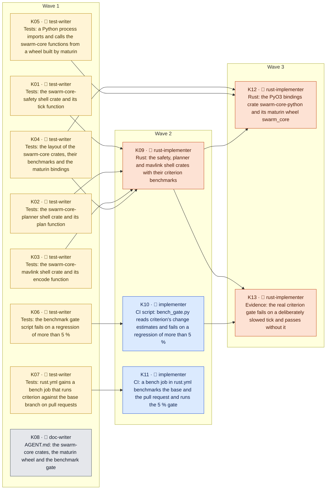

# T0.07: Plan

**Plan:** 🟢 Approved

<!-- ticket:specs -->
## 📚 Specifications

The technical pages, features, use cases and business rules of [TICKET.md](TICKET.md), copied by `python3 .claude/scripts/tickets/ticket_refs.py sync`.

- [🗂️ Architecture: mono-repo](../../specs/technical/01-architecture.md#mono-repo)
- [🔩 Engine and services: flight engine](../../specs/technical/04-engine.md#flight-engine)
- [🏋️ Scalability and performance: load tests](../../specs/technical/07-scalability.md#load-tests)
<!-- /ticket:specs -->

## Summary

T0.07 delivers the swarm-core Rust core in the existing Cargo workspace `packages/rust`, PyO3 bindings that maturin builds as a wheel, and a criterion benchmark gate that runs on pull requests.

1. **Crates.** There are three shell crates under `packages/rust/swarm-core/`: `safety`, `planner` and `mavlink`, named `swarm-core-safety`, `swarm-core-planner` and `swarm-core-mavlink`. Each has one function (`tick`, `plan`, `encode`: the wrapping sum of a `&[u64]`), integration tests and a criterion benchmark.
2. **Bindings.** A PyO3 crate in `packages/rust/swarm-core/python` (Python module `swarm_core`) exposes `safety_tick`, `planner_plan` and `mavlink_encode`. Each releases the GIL. The crate has a maturin `pyproject.toml` and a `.pyi` stub. It is not a member of the uv workspace.
3. **Acceptance criterion 1.** `tests/rust/swarm_core/test_swarm_core_wheel.py` builds the wheel with maturin and installs it into a fresh virtual environment. A Python child process then imports the functions and calls them.
4. **The gate.** `rust.yml` gets a `bench` job that runs only on pull requests, after `check`:
   - criterion benchmarks the base commit into the saved baseline `pr-base`, then benchmarks the pull request against it with `--baseline-lenient`;
   - `.github/scripts/bench_gate.py` reads every `change/estimates.json` and fails the build when a mean point estimate is more than 5 % slower.

   `ci.yml` is unchanged.
5. **Acceptance criterion 2.** The tests of the gate script use criterion-format results and the tests of the workflow check its wiring. A final task also runs the real gate once on a deliberately slowed `tick`, keeps the output as evidence, then reverts the change.
6. **Documentation.** `AGENT.md` gets the commands, the layout and the CI step, in a doc task that runs beside the code.

**Waves:** 13 tasks in 3 waves.

| Wave | Tasks | What they do |
| --- | --- | --- |
| 1 | 8 | 7 test-writers and 1 doc-writer |
| 2 | 3 | The three shell crates with their benchmarks and `Cargo.lock`, the gate script, and the `rust.yml` bench job |
| 3 | 2 | The PyO3 bindings and wheel, and the gate run on a slowed function |

No two tasks of a wave share a file. Only one task per wave owns `packages/rust/Cargo.toml` and `Cargo.lock`.

Specifications applied:
- `docs/specs/technical/01-architecture.md#mono-repo`
- `docs/specs/technical/04-engine.md#flight-engine`
- `docs/specs/technical/07-scalability.md#load-tests`
- `docs/specs/roadmap/01-p0-foundations.md#s02`

## Assumptions

- The roadmap row names no feature, use case or business rule, so the acceptance criteria cite none.
- The row names the load tests section but no budgets row, so the ticket touches no budget.
- Encoder benchmarks are not built: the row lists only the safety, planner and mavlink crates.
- Where the pull request benchmark job lives is not specified beyond the T0.04 workflows; the plan reuses them.
- How a regression is measured against a baseline is not specified; the plan takes the most conservative option and records it.
- The roadmap row names no feature, use case or business rule, so no brief cites one. The briefs apply only the technical pages (01-architecture.md#mono-repo, 04-engine.md#flight-engine, 07-scalability.md#load-tests) and the roadmap row (01-p0-foundations.md#s02).
- **Layout: one Cargo workspace.** The single Cargo workspace stays `packages/rust`, which `tests/conventions/mono_repo` enforces, and is the swarm-core workspace of the ticket.
  - The crates sit under `packages/rust/swarm-core/`, the path the flight-engine section names.
  - The shell crates are `safety`, `planner` and `mavlink`, named `swarm-core-safety`, `swarm-core-planner` and `swarm-core-mavlink`.
  - The PyO3 crate is `python`, named `swarm-core-python` (Python module `swarm_core`).
  - Cargo does not let a crate belong to two workspaces, so no nested workspace is created.
- **The shell functions.** The three are `tick`, `plan` and `encode`. Each has the signature `fn(&[u64]) -> u64`, and returns the wrapping sum of its input, with no allocation and no domain logic. They do measurable, deterministic work, so the benchmarks of 1,000 values are not sub-nanosecond noise. Their names follow the load-tests section: the safety tick, the planner and the encoders.
- **The PyO3 API.** It exposes `safety_tick`, `planner_plan` and `mavlink_encode`.
  - Each releases the GIL (04-engine.md#flight-engine).
  - The wheel ships a `.pyi` stub.
  - abi3 is not used: the wheel targets the interpreter given to maturin.
- **The wheel and acceptance criterion 1.** The bindings are not a uv workspace member, and no service depends on them yet: the flight engine adopts the Rust core in T0.18. So `uv sync` and the existing Python jobs never need to build Rust.
  - Acceptance criterion 1 is proven by `tests/rust/swarm_core/test_swarm_core_wheel.py`. It builds the wheel with maturin, installs it into a fresh virtual environment, and imports and calls the functions from a Python child process.
  - The test lives under `tests/`, so both the python.yml repository job and the verifier's pytest run it.
- **The baseline of the gate.** On each pull request, the gate compares the base commit with the head, run one after the other on the same runner. Nothing is stored between runs: this is the most conservative option.
  - criterion saves the base as the named baseline `pr-base`, which avoids its default name `base`.
  - The head run uses `--baseline-lenient`, so that a benchmark new in the pull request, or a base with no benchmark (this ticket's own pull request), is not compared and does not fail.
- **The regression measure.** A regression is the mean point estimate of criterion's `change/estimates.json`, as a fraction. Only a value strictly above 0.05 fails, because the specification says more than 5 %, so exactly 5 % passes. A missing criterion folder, or a malformed estimate, fails with exit 2.
- **Where the gate runs.** It is a `bench` job in `rust.yml`:
  - it runs only on pull requests, and only after the `check` job passes;
  - `ci.yml` and `detect_changes.py` are unchanged, and the job reuses the T0.04 workflows, as TICKET.md assumes.

  Its tests extend `tests/ci/workflows/test_rust_workflow.py` rather than adding a sixth file to that folder, which would break the five-file rule.
- **The gate script.** It is a standard-library Python script, `.github/scripts/bench_gate.py`, in the style of `detect_changes.py`. Its tests in `tests/ci/bench_gate/` follow the style of `tests/ci/detect_changes/`.
  - The AGENT.md Python layer rules apply to `services/` and `packages/python/`, so they are not applied to `.github/scripts/`.
  - ruff still checks the script, in the repository job.
- **Acceptance criterion 2.** No real pull request can run, because the harness pushes nothing. The criterion is verified in three ways:
  - the gate script's tests on criterion-format results with a slowdown of more than 5 %;
  - the tests of the workflow's wiring;
  - K13, which runs the real criterion gate locally on a deliberately slowed `tick` (expected exit 1) and on unchanged code (expected exit 0), and saves the output in `tests-evidences/`.

  The failing pull request made on purpose is the S02 demo, done by the person.
- **Noise on shared runners.** CI runners can vary by more than 5 %, so the gate can fail on noise alone. The specification sets no noise allowance, so none is added. If K13 or CI shows such failures, they are recorded as a follow-up rather than guessed away.
- **One owner for the workspace files.** In each wave, only one task changes `packages/rust/Cargo.toml` and `Cargo.lock`: K09 in wave 2, K12 in wave 3. So the three shell crates are built by one task. Each new crate opts in to the workspace lints, and the `-D warnings` of CI turns clippy pedantic and `missing_docs` into errors.
- **Order with T0.06.** T0.06, which is approved, also adds members to `packages/rust/Cargo.toml` (`swarm-models-codegen`, `swarm-models`) and text to AGENT.md. T0.07 tasks keep every member and entry already present, whichever ticket merges into develop first.
  - The benchmarks are selected with `cargo bench --bench '*'`, so the lib and binary targets of other crates never receive the criterion arguments.
- No encoder benchmark is built beyond `mavlink_encode`, and no budget is asserted, as TICKET.md says. The safety tick budget waits for real safety code (T0.18).
- **Versions and environment.** The criterion and PyO3 versions are left to the rust-implementer, who picks current releases that support `--save-baseline`, `--baseline-lenient` and the GIL-release API, and reports them. The Rust toolchain, cargo, maturin (already in the uv dev group), uv, and network access to crates.io are assumed to be available. If they are missing, the run stops as an environment failure (TKT-6).
- **No specification change.** The ticket changes no specification page. AGENT.md gets short factual additions in a doc task beside the code (K08): the commands, the layout of the Rust core and the bench job.

<!-- plan:graph -->

> [!NOTE]
> Generated from the json block at the end of this page by `python3 .claude/scripts/tickets/plan.py render`.
> To change a task, edit the json block, then render again: never edit this view by hand.

## Waves

| Wave | Tasks | Agents running at once |
| --- | --- | --- |
| 1 | [K01](#k01), [K02](#k02), [K03](#k03), [K04](#k04), [K05](#k05), [K06](#k06), [K07](#k07), [K08](#k08) | 8 of 8 |
| 2 | [K09](#k09), [K10](#k10), [K11](#k11) | 3 of 3 |
| 3 | [K12](#k12), [K13](#k13) | 2 of 2 |

| Wave | Task | Agent | Depends on | Unblocks |
| --- | --- | --- | --- | --- |
| 1 | [K01](#k01) Tests: the swarm-core-safety shell crate and its tick function | 🧪 test-writer | none | [K09](#k09) |
| 1 | [K02](#k02) Tests: the swarm-core-planner shell crate and its plan function | 🧪 test-writer | none | [K09](#k09) |
| 1 | [K03](#k03) Tests: the swarm-core-mavlink shell crate and its encode function | 🧪 test-writer | none | [K09](#k09) |
| 1 | [K04](#k04) Tests: the layout of the swarm-core crates, their benchmarks and the maturin bindings | 🧪 test-writer | none | [K09](#k09), [K12](#k12) |
| 1 | [K05](#k05) Tests: a Python process imports and calls the swarm-core functions from a wheel built by maturin | 🧪 test-writer | none | [K12](#k12) |
| 1 | [K06](#k06) Tests: the benchmark gate script fails on a regression of more than 5 % | 🧪 test-writer | none | [K10](#k10) |
| 1 | [K07](#k07) Tests: rust.yml gains a bench job that runs criterion against the base branch on pull requests | 🧪 test-writer | none | [K11](#k11) |
| 1 | [K08](#k08) AGENT.md: the swarm-core crates, the maturin wheel and the benchmark gate | 📝 doc-writer | none | none |
| 2 | [K09](#k09) Rust: the safety, planner and mavlink shell crates with their criterion benchmarks | 🦀 rust-implementer | [K01](#k01), [K02](#k02), [K03](#k03), [K04](#k04) | [K12](#k12), [K13](#k13) |
| 2 | [K10](#k10) CI script: bench_gate.py reads criterion's change estimates and fails on a regression of more than 5 % | 🐍 implementer | [K06](#k06) | [K13](#k13) |
| 2 | [K11](#k11) CI: a bench job in rust.yml benchmarks the base and the pull request and runs the 5 % gate | 🐍 implementer | [K07](#k07) | none |
| 3 | [K12](#k12) Rust: the PyO3 bindings crate swarm-core-python and its maturin wheel swarm_core | 🦀 rust-implementer | [K04](#k04), [K05](#k05), [K09](#k09) | none |
| 3 | [K13](#k13) Evidence: the real criterion gate fails on a deliberately slowed tick and passes without it | 🦀 rust-implementer | [K09](#k09), [K10](#k10) | none |

## Dependency graph



## Tasks

### <a id="k01"></a>K01: Tests: the swarm-core-safety shell crate and its tick function

| Agent | Wave | Depends on | Unblocks |
| --- | --- | --- | --- |
| 🧪 test-writer | 1 | none | [K09](#k09) |

**Files** (only this task may change them in its wave):

- `packages/rust/swarm-core/safety/tests/tick.rs`

**Done when:** `rustfmt --edition 2021 --check packages/rust/swarm-core/safety/tests/tick.rs` passes.

**Brief:**

Ticket T0.07 (docs/tickets/T0.07/TICKET.md). It delivers the `swarm-core` crates as empty shells with one function each. Applies:
- docs/specs/technical/01-architecture.md#mono-repo: `packages/rust` holds the swarm-core crates (safety, planner, mavlink), in one Cargo workspace;
- docs/specs/technical/04-engine.md#flight-engine: CPU-heavy steps run in the Rust core, `packages/rust/swarm-core`;
- docs/specs/technical/07-scalability.md#load-tests: criterion benchmarks of the safety tick.

Write the integration tests of the crate that K09 creates:
- folder `packages/rust/swarm-core/safety`, package `swarm-core-safety`, library `swarm_core_safety`;
- the function is `pub fn tick(values: &[u64]) -> u64`, marked `#[must_use]`.

It is a placeholder with no safety logic yet: it returns the wrapping sum of `values` and allocates nothing.

In `packages/rust/swarm-core/safety/tests/tick.rs`, `use swarm_core_safety::tick;` and test:
- an empty slice gives 0;
- `[1, 2, 3]` gives 6;
- `[u64::MAX, 1]` gives 0, because the sum wraps and never panics;
- two calls on the same 1,000 values give the same result, and equal `(0..1000).sum()`.

Test names read as sentences, such as `an_empty_slice_gives_zero`. Start the file with a `//!` doc line. The workspace lints apply under `cargo clippy --all-targets -- -D warnings`: clippy `all` is denied, `pedantic` is warned (so denied in CI), and `missing_docs` is warned. Write idiomatic Rust, use British English, and no em dashes.

The crate's `Cargo.toml` does not exist yet (K09), so the tests cannot compile now.

### <a id="k02"></a>K02: Tests: the swarm-core-planner shell crate and its plan function

| Agent | Wave | Depends on | Unblocks |
| --- | --- | --- | --- |
| 🧪 test-writer | 1 | none | [K09](#k09) |

**Files** (only this task may change them in its wave):

- `packages/rust/swarm-core/planner/tests/plan.rs`

**Done when:** `rustfmt --edition 2021 --check packages/rust/swarm-core/planner/tests/plan.rs` passes.

**Brief:**

Ticket T0.07 (docs/tickets/T0.07/TICKET.md). It delivers the `swarm-core` crates as empty shells with one function each. Applies:
- docs/specs/technical/01-architecture.md#mono-repo: `packages/rust` holds the swarm-core crates (safety, planner, mavlink);
- docs/specs/technical/04-engine.md#flight-engine: the Rust core, `packages/rust/swarm-core`;
- docs/specs/technical/07-scalability.md#load-tests: criterion benchmarks of the planner.

Write the integration tests of the crate that K09 creates:
- folder `packages/rust/swarm-core/planner`, package `swarm-core-planner`, library `swarm_core_planner`;
- the function is `pub fn plan(values: &[u64]) -> u64`, marked `#[must_use]`.

It is a placeholder with no planner logic yet: it returns the wrapping sum of `values` and allocates nothing.

In `packages/rust/swarm-core/planner/tests/plan.rs`, `use swarm_core_planner::plan;` and test:
- an empty slice gives 0;
- `[1, 2, 3]` gives 6;
- `[u64::MAX, 1]` gives 0, because the sum wraps and never panics;
- two calls on the same 1,000 values give the same result, and equal `(0..1000).sum()`.

Test names read as sentences. Start the file with a `//!` doc line. The workspace lints apply under `cargo clippy --all-targets -- -D warnings`: clippy `all` denied, `pedantic` warned (so denied in CI), `missing_docs` warned. Use British English and no em dashes.

The crate's `Cargo.toml` does not exist yet (K09).

### <a id="k03"></a>K03: Tests: the swarm-core-mavlink shell crate and its encode function

| Agent | Wave | Depends on | Unblocks |
| --- | --- | --- | --- |
| 🧪 test-writer | 1 | none | [K09](#k09) |

**Files** (only this task may change them in its wave):

- `packages/rust/swarm-core/mavlink/tests/encode.rs`

**Done when:** `rustfmt --edition 2021 --check packages/rust/swarm-core/mavlink/tests/encode.rs` passes.

**Brief:**

Ticket T0.07 (docs/tickets/T0.07/TICKET.md). It delivers the `swarm-core` crates as empty shells with one function each. Applies:
- docs/specs/technical/01-architecture.md#mono-repo: `packages/rust` holds the swarm-core crates (safety, planner, mavlink);
- docs/specs/technical/04-engine.md#flight-engine: the Rust core, `packages/rust/swarm-core`;
- docs/specs/technical/07-scalability.md#load-tests: criterion benchmarks of the encoders.

Write the integration tests of the crate that K09 creates:
- folder `packages/rust/swarm-core/mavlink`, package `swarm-core-mavlink`, library `swarm_core_mavlink`;
- the function is `pub fn encode(values: &[u64]) -> u64`, marked `#[must_use]`.

It is a placeholder with no MAVLink logic yet (that is out of scope, see T0.13): it returns the wrapping sum of `values` and allocates nothing.

In `packages/rust/swarm-core/mavlink/tests/encode.rs`, `use swarm_core_mavlink::encode;` and test:
- an empty slice gives 0;
- `[1, 2, 3]` gives 6;
- `[u64::MAX, 1]` gives 0, because the sum wraps and never panics;
- two calls on the same 1,000 values give the same result, and equal `(0..1000).sum()`.

Test names read as sentences. Start the file with a `//!` doc line. The workspace lints apply under `cargo clippy --all-targets -- -D warnings`. Use British English and no em dashes.

The crate's `Cargo.toml` does not exist yet (K09).

### <a id="k04"></a>K04: Tests: the layout of the swarm-core crates, their benchmarks and the maturin bindings

| Agent | Wave | Depends on | Unblocks |
| --- | --- | --- | --- |
| 🧪 test-writer | 1 | none | [K09](#k09), [K12](#k12) |

**Files** (only this task may change them in its wave):

- `tests/rust/swarm_core/test_swarm_core_layout.py`

**Done when:** `uv run ruff check tests/rust/swarm_core/test_swarm_core_layout.py` and `uv run ruff format --check tests/rust/swarm_core/test_swarm_core_layout.py` pass. `uv run pytest tests/rust/swarm_core/test_swarm_core_layout.py -q` collects without error, and its tests fail on assertions because the crates do not exist yet.

**Brief:**

Ticket T0.07 (docs/tickets/T0.07/TICKET.md). Applies:
- docs/specs/technical/01-architecture.md#mono-repo: one Cargo workspace in `packages/rust`, with the swarm-core crates (safety, planner, mavlink) and PyO3, and wheels built with maturin;
- docs/specs/technical/04-engine.md#flight-engine: the Rust core is `packages/rust/swarm-core`, with PyO3;
- docs/specs/technical/07-scalability.md#load-tests: criterion benchmarks run per pull request.

Rules: AGENT.md#tests.

Write `tests/rust/swarm_core/test_swarm_core_layout.py`, with one class `TestSwarmCoreLayout`. It reads the TOML files with `tomllib`, from the repository root (`Path(__file__).resolve().parents[3]`). It checks what K09 and K12 create.

**The three shell crates.** Parametrise over (folder, package, bench): (`safety`, `swarm-core-safety`, `tick`), (`planner`, `swarm-core-planner`, `plan`), (`mavlink`, `swarm-core-mavlink`, `encode`). For each one:
- `swarm-core/<folder>` is in `workspace.members` of `packages/rust/Cargo.toml`, and the workspace keeps `resolver = "2"`;
- `packages/rust/swarm-core/<folder>/Cargo.toml` has `package.name` equal to &lt;package>, `package.publish` false, `package.edition` equal to `{workspace = true}`, and `lints` equal to `{workspace = true}`;
- `src/lib.rs` exists;
- `dev-dependencies` has a `criterion` key;
- one `[[bench]]` entry has `name` &lt;bench> and `harness = false`, and `benches/<bench>.rs` exists.

**The PyO3 bindings.** Every test about them has `bindings` in its name, and no other test does, so that K09 can run `-k "not bindings"`. The tests check that:
- `swarm-core/python` is a workspace member;
- `packages/rust/swarm-core/python/Cargo.toml` has `package.name` `swarm-core-python`, `lints = {workspace = true}`, `lib.name` `swarm_core`, and `cdylib` in `lib.crate-type`;
- its dependencies include `pyo3`, `swarm-core-safety`, `swarm-core-planner` and `swarm-core-mavlink`;
- `packages/rust/swarm-core/python/pyproject.toml` has `build-system.build-backend` `maturin`, a `build-system.requires` entry starting with `maturin`, `project.name` `swarm-core`, `project.requires-python` `>=3.12`, and `tool.maturin.module-name` `swarm_core`;
- `packages/rust/swarm-core/python/swarm_core.pyi` exists and declares `def safety_tick`, `def planner_plan` and `def mavlink_encode`;
- the bindings folder matches none of the uv workspace `members` of the root `pyproject.toml` (`services/*`, `packages/python/*`), so that `uv sync` never needs Rust. Use `fnmatch` on the relative path.

Follow AGENT.md#tests:
- one Test class, test names as sentences;
- `pytest.mark.parametrize`, with constants as ClassVar attributes;
- no mocks, no `__init__.py`, no conftest.py;
- `from __future__ import annotations` first, no Any, no nested function;
- British English, no em dashes.

Test basenames must be unique in the repository. Format only your file.

### <a id="k05"></a>K05: Tests: a Python process imports and calls the swarm-core functions from a wheel built by maturin

| Agent | Wave | Depends on | Unblocks |
| --- | --- | --- | --- |
| 🧪 test-writer | 1 | none | [K12](#k12) |

**Files** (only this task may change them in its wave):

- `tests/rust/swarm_core/test_swarm_core_wheel.py`
- `tests/rust/swarm_core/helpers.py`

**Done when:** `uv run ruff check tests/rust/swarm_core/test_swarm_core_wheel.py tests/rust/swarm_core/helpers.py` and `uv run ruff format --check` on both files pass. `uv run pytest tests/rust/swarm_core/test_swarm_core_wheel.py -q` collects without error, and fails because maturin cannot find `packages/rust/swarm-core/python/Cargo.toml`.

**Brief:**

Ticket T0.07 (docs/tickets/T0.07/TICKET.md), acceptance criterion 1: given a Python service, when it imports a Rust function from a wheel built by maturin, then the function is called and returns. Applies:
- docs/specs/technical/01-architecture.md#mono-repo: Cargo workspace in `packages/rust`, wheels built with maturin;
- docs/specs/technical/04-engine.md#flight-engine: the Rust core is called through PyO3 and releases the GIL.

Rules: AGENT.md#tests (real things, no mocks).

K12 builds this contract:
- the crate `packages/rust/swarm-core/python`, with its maturin `pyproject.toml`;
- the Python module `swarm_core`, with the functions `safety_tick(values)`, `planner_plan(values)` and `mavlink_encode(values)`. Each takes a sequence of non-negative ints and returns their wrapping sum as an int, so `[1, 2, 3]` gives 6 and `[]` gives 0. A non-integer value raises `TypeError`;
- the wheel ships the type stub (`swarm_core.pyi`, which maturin packs as a `.pyi` under `swarm_core`).

Write two files.

1) `tests/rust/swarm_core/helpers.py`, with module-level functions only:
- `repo_root() -> Path`;
- `build_wheel(out_dir: Path) -> Path`. It runs maturin as a child process: the `maturin` next to `sys.executable`, or `shutil.which("maturin")`. The arguments are `build --release --manifest-path <root>/packages/rust/swarm-core/python/Cargo.toml --interpreter <sys.executable> --out <out_dir>`. It asserts exit 0, with the output in the message, and returns the only `*.whl` in `out_dir`;
- `make_venv(folder: Path) -> Path`. It runs `uv venv --python <sys.executable> <folder>` (uv found with `shutil.which`) and returns the venv's python, `folder/bin/python`;
- `install(python: Path, wheel: Path) -> None`. It runs `uv pip install --python <python> --no-deps <wheel>` and asserts exit 0;
- `run_python(python: Path, code: str) -> subprocess.CompletedProcess[str]`.

2) `tests/rust/swarm_core/test_swarm_core_wheel.py`, with one class `TestSwarmCoreWheel`:
- A class-scoped fixture (a method decorated with `@pytest.fixture(scope="class")`, using `tmp_path_factory`) builds the wheel once, makes a fresh venv and installs the wheel. It returns the wheel path and the venv python.
- Import the helpers by full path: `from tests.rust.swarm_core.helpers import ...`.
- The tests:
  - maturin builds exactly one wheel, whose name starts with `swarm_core-` and ends with `.whl`;
  - the wheel holds a `.pyi` stub for `swarm_core` (read with `zipfile`);
  - `swarm_core.__file__`, printed by the venv python, lies inside the venv folder, so the module comes from the installed wheel and not from the source tree;
  - parametrised over `safety_tick`, `planner_plan` and `mavlink_encode`: the call with `[1, 2, 3]` prints 6, and the call with `[]` prints 0;
  - a call with `["a"]` raises `TypeError` in the child, which prints the exception type name.

Follow AGENT.md#tests:
- one Test class, test names as sentences;
- parametrize, no mocks, no `__init__.py`, no conftest.py, constants as ClassVars;
- `from __future__ import annotations` first, no Any, no nested function;
- British English, no em dashes.

The build needs cargo and network access to crates.io. A missing cargo is an environment failure, never a skip. Test basenames must be unique. Format only your files.

### <a id="k06"></a>K06: Tests: the benchmark gate script fails on a regression of more than 5 %

| Agent | Wave | Depends on | Unblocks |
| --- | --- | --- | --- |
| 🧪 test-writer | 1 | none | [K10](#k10) |

**Files** (only this task may change them in its wave):

- `tests/ci/bench_gate/test_bench_gate.py`
- `tests/ci/bench_gate/helpers.py`

**Done when:** `uv run ruff check tests/ci/bench_gate` and `uv run ruff format --check tests/ci/bench_gate` pass. `uv run pytest tests/ci/bench_gate -q` collects without error, and fails because `.github/scripts/bench_gate.py` does not exist yet.

**Brief:**

Ticket T0.07 (docs/tickets/T0.07/TICKET.md), acceptance criterion 2: given a function of the swarm-core crates slowed down by more than 5 %, when the criterion benchmark gate runs on a pull request, then the build fails. Applies:
- docs/specs/technical/07-scalability.md#load-tests: per pull request, Rust benchmarks (criterion), and a regression of more than 5 % fails the build;
- docs/specs/roadmap/01-p0-foundations.md#s02: a slowed-down function fails the benchmark gate.

Rules: AGENT.md#tests. Follow the style of `tests/ci/detect_changes/` (helpers.py plus a test file, with the script run as a child process).

K10 writes `.github/scripts/bench_gate.py`. Its contract:
- Usage: `python3 .github/scripts/bench_gate.py --criterion-dir <dir> [--threshold <fraction>]`. The threshold defaults to 0.05.
- It finds every `change/estimates.json` under `<dir>`, recursively. The benchmark id is the POSIX path of the folder holding `change`, relative to `<dir>`.
- It reads `mean.point_estimate`, a fraction: 0.06 means 6 % slower.
- It prints one line per benchmark, sorted by id: `<id>: <change> % regression` when the change is strictly above the threshold, and `<id>: <change> % ok` otherwise. `<change>` is the change times 100, formatted `+.2f`, such as `+6.00` or `-1.50`.
- Then it prints a last line:
  - with at least one regression: `Benchmark gate failed: <n> regression(s) of more than <threshold*100 .2f> %.`, and it exits 1;
  - otherwise: `Benchmark gate passed: <n> benchmark(s) compared.`, and it exits 0;
  - with no change file at all: `No benchmark was compared with a baseline: the gate passes.`, and it exits 0.
- Exit 2, with a message on stderr, when:
  - an argument is unknown, or `--criterion-dir` is missing;
  - the threshold is not a number or is negative;
  - `<dir>` is not a directory;
  - an `estimates.json` is not valid JSON or has no numeric `mean.point_estimate`.

Write two files.

1) `tests/ci/bench_gate/helpers.py`:
- `repo_root()` and `script_path()`;
- `write_change(root: Path, bench_id: str, mean: float) -> None`. It writes `<root>/<bench_id>/change/estimates.json` in criterion's format: `mean` and `median`, each `{"confidence_interval": {"confidence_level": 0.95, "lower_bound": ..., "upper_bound": ...}, "point_estimate": ..., "standard_error": ...}`. It also writes `<root>/<bench_id>/new/estimates.json`, so that the files the gate must ignore are present;
- `run_gate(*args: str) -> subprocess.CompletedProcess[str]`, which runs `sys.executable <script>`.

2) `tests/ci/bench_gate/test_bench_gate.py`, with one class `TestBenchGate`, using `tmp_path`:
- a benchmark 6 % slower (0.06) fails with exit 1, and its line says `regression`;
- a benchmark slowed down by 100 % fails;
- exactly 5 % (0.05) passes, because only more than 5 % fails;
- parametrised passes: 0.0, 0.049 and -0.2;
- with three benchmarks (`safety_tick`, `planner_plan`, `mavlink_encode`) where only one regresses, the run exits 1, prints the lines sorted, and the last line counts 1 regression;
- `--threshold 0.10` lets 0.06 pass;
- no change file prints the no-baseline line and exits 0;
- parametrised exit-2 cases: no arguments, an unknown argument, `--threshold abc`, `--threshold -0.1`, a missing directory, a malformed JSON file, and a JSON without `mean.point_estimate`;
- a nested id such as `group/function/1000` is reported with its full relative path.

Follow AGENT.md#tests:
- one Test class, test names as sentences;
- parametrize, no mocks, no `__init__.py`, no conftest.py, ClassVar constants;
- `from __future__ import annotations` first, no Any, no nested function;
- British English, no em dashes.

Test basenames must be unique. Format only your files.

### <a id="k07"></a>K07: Tests: rust.yml gains a bench job that runs criterion against the base branch on pull requests

| Agent | Wave | Depends on | Unblocks |
| --- | --- | --- | --- |
| 🧪 test-writer | 1 | none | [K11](#k11) |

**Files** (only this task may change them in its wave):

- `tests/ci/workflows/test_rust_workflow.py`

**Done when:** `uv run ruff check tests/ci/workflows/test_rust_workflow.py` and `uv run ruff format --check tests/ci/workflows/test_rust_workflow.py` pass. `uv run pytest tests/ci/workflows/test_rust_workflow.py -q` collects without error. The tests of the existing `check` job pass, and only the new `bench` job tests fail.

**Brief:**

Ticket T0.07 (docs/tickets/T0.07/TICKET.md), acceptance criterion 2. Applies:
- docs/specs/technical/07-scalability.md#load-tests: per pull request, Rust benchmarks (criterion), and a regression of more than 5 % fails the build;
- docs/specs/technical/01-architecture.md#mono-repo: the Cargo workspace in `packages/rust`;
- AGENT.md#ci-cd: each step passes before the next one starts.

Update `tests/ci/workflows/test_rust_workflow.py`, keeping its single class `TestRustWorkflow` and every existing check of the `check` job. Do not add a file: the folder already holds five test files.

Changes:
- `test_it_has_one_check_job_on_ubuntu` becomes `test_it_has_a_check_job_and_a_bench_job_on_ubuntu`: the set of jobs is exactly `{check, bench}`, and both run on `ubuntu-latest`.
- `test_no_run_step_uses_an_expression` now covers the run steps of every job.
- Add helpers that read the `bench` job's steps, run texts and env, the same way as for `check`.

New tests of the `bench` job, which K11 writes:
- `needs` is `check`, or a list containing it;
- its `if` contains `github.event_name == 'pull_request'`;
- `defaults.run.working-directory` is `packages/rust`;
- it checks out with `actions/checkout@...` and `fetch-depth: 0`;
- a step whose `uses` contains `rust-toolchain`, or whose run contains `rustup`, comes before the first step running `cargo `;
- the job env, or a step env, defines `BASE_SHA` as `${{ github.event.pull_request.base.sha }}`, and defines `CARGO_TARGET_DIR`, so that both runs share one criterion folder;
- a run step contains `git worktree add` and `--save-baseline pr-base`;
- a later run step contains `cargo bench --workspace --locked` and `--baseline-lenient pr-base`;
- a later run step runs `.github/scripts/bench_gate.py` with `--criterion-dir`;
- these three steps come in that order;
- the workflow permissions stay `{contents: read}`.

Do not assert that `bench_gate.py` exists: K06 tests the script.

Follow AGENT.md#tests:
- test names as sentences, parametrize, no mocks;
- `from __future__ import annotations` first, no Any, no nested function;
- British English, no em dashes.

Format only your file.

### <a id="k08"></a>K08: AGENT.md: the swarm-core crates, the maturin wheel and the benchmark gate

| Agent | Wave | Depends on | Unblocks |
| --- | --- | --- | --- |
| 📝 doc-writer | 1 | none | none |

**Files** (only this task may change them in its wave):

- `AGENT.md`

**Done when:** `grep -n "bench_gate.py" AGENT.md`, `grep -n "swarm_core" AGENT.md` and `grep -n "maturin build" AGENT.md` each print at least one line, and `grep -c '—' AGENT.md` prints 0.

**Brief:**

Ticket T0.07 (docs/tickets/T0.07/TICKET.md). Update AGENT.md beside the code with short factual additions, and change nothing else. Applies:
- docs/specs/technical/01-architecture.md#mono-repo: `packages/rust` holds the swarm-core crates with PyO3, and wheels are built with maturin;
- docs/specs/technical/04-engine.md#flight-engine: the Rust core releases the GIL;
- docs/specs/technical/07-scalability.md#load-tests: criterion per pull request, and a regression of more than 5 % fails the build.

Keep all text already there, including any T0.06 text about swarm-models. Make these additions.

1) **Commands.**
- Add `cargo test --workspace` to the Rust and TypeScript block, if it is missing.
- Under that block, add one sentence and a bash block:
  - `cargo bench --workspace --bench '*'`, run in `packages/rust`, runs the criterion benchmarks;
  - `uv run maturin build --release --manifest-path packages/rust/swarm-core/python/Cargo.toml --out dist` builds the `swarm_core` wheel.

2) **CI/CD bullets** (the list under the ci.yml bullet). Add one sub-bullet after the Rust one: `rust.yml` has a `bench` job that runs only on pull requests, after `check`. It saves criterion benchmarks of the base commit as the baseline `pr-base`, runs them on the pull request, and `.github/scripts/bench_gate.py` fails the build when a benchmark's mean is more than 5 % slower.

3) **Mono-repo section.** After the sentence `packages/rust/ is a Cargo workspace ...`, add one short paragraph:
- the Rust core is `packages/rust/swarm-core/`;
- it holds the crates `safety`, `planner` and `mavlink` (`swarm-core-safety`, `swarm-core-planner`, `swarm-core-mavlink`), each with its criterion benchmark in `benches/`;
- it also holds the PyO3 bindings `swarm-core/python` (Python module `swarm_core`, which releases the GIL), built as a wheel by maturin;
- the bindings are not a uv workspace member, so `uv sync` never builds Rust;
- `tests/rust/swarm_core/` checks the layout and imports the functions from a wheel it builds.

4) **Numbered CI/CD list, step 2.** Add `cargo bench` with the 5 % gate on pull requests to the Rust part.

Write plain British English, with no em dashes. Keep the existing line width of about 120 characters.

### <a id="k09"></a>K09: Rust: the safety, planner and mavlink shell crates with their criterion benchmarks

| Agent | Wave | Depends on | Unblocks |
| --- | --- | --- | --- |
| 🦀 rust-implementer | 2 | [K01](#k01), [K02](#k02), [K03](#k03), [K04](#k04) | [K12](#k12), [K13](#k13) |

**Files** (only this task may change them in its wave):

- `packages/rust/Cargo.toml`
- `packages/rust/Cargo.lock`
- `packages/rust/swarm-core/safety/Cargo.toml`
- `packages/rust/swarm-core/safety/src/lib.rs`
- `packages/rust/swarm-core/safety/benches/tick.rs`
- `packages/rust/swarm-core/planner/Cargo.toml`
- `packages/rust/swarm-core/planner/src/lib.rs`
- `packages/rust/swarm-core/planner/benches/plan.rs`
- `packages/rust/swarm-core/mavlink/Cargo.toml`
- `packages/rust/swarm-core/mavlink/src/lib.rs`
- `packages/rust/swarm-core/mavlink/benches/encode.rs`

**Done when:** In `packages/rust`, these pass:
- `cargo fmt --all --check`;
- `cargo clippy --workspace --all-targets --locked -- -D warnings`;
- `cargo test --workspace --locked`, including `tick.rs`, `plan.rs` and `encode.rs`;
- `cargo bench --workspace --locked --bench '*' --no-run`.

From the root, `uv run pytest tests/rust/swarm_core/test_swarm_core_layout.py -k "not bindings" -q` passes.

**Brief:**

Ticket T0.07 (docs/tickets/T0.07/TICKET.md). Applies:
- docs/specs/technical/01-architecture.md#mono-repo: the swarm-core crates (safety, planner, mavlink) in the Cargo workspace `packages/rust`, with `Cargo.lock`;
- docs/specs/technical/04-engine.md#flight-engine: the Rust core is `packages/rust/swarm-core`;
- docs/specs/technical/07-scalability.md#load-tests: criterion benchmarks of the safety tick, the planner and the encoders, per pull request.

Out of scope: real safety, planner or MAVLink logic.

Create three crates. Each is an empty shell with one function:

| Folder | Package | Function | Bench |
| --- | --- | --- | --- |
| `packages/rust/swarm-core/safety` | `swarm-core-safety` | `pub fn tick(values: &[u64]) -> u64` | `benches/tick.rs` |
| `packages/rust/swarm-core/planner` | `swarm-core-planner` | `pub fn plan(values: &[u64]) -> u64` | `benches/plan.rs` |
| `packages/rust/swarm-core/mavlink` | `swarm-core-mavlink` | `pub fn encode(values: &[u64]) -> u64` | `benches/encode.rs` |

**The functions.**
- Each is `#[must_use]` and returns the wrapping sum of `values`, with no allocation and no panic.
- Its doc comment says it is a placeholder until the real logic arrives.
- Each crate has a `//!` crate doc.

**Each Cargo.toml:**
- `edition.workspace = true`, `publish = false`, `[lints] workspace = true`;
- the dev-dependency `criterion`, declared once under `[workspace.dependencies]` in `packages/rust/Cargo.toml` and used with `criterion.workspace = true`. Pick a current criterion version that supports `--save-baseline`, `--baseline-lenient` and `--bench '*'` selection. Check with `cargo bench -- --help`, and report the version as an assumption;
- one `[[bench]]` with the name of the table and `harness = false`.

**Each benchmark.** It benches its function on 1,000 values (`0..1000`), passed through `std::hint::black_box`. The criterion ids are `safety_tick`, `planner_plan` and `mavlink_encode`. Start each bench file with a `//!` doc. If criterion's macros trip `missing_docs`, add `#![allow(missing_docs)]` in that bench file only.

**The workspace.** In `packages/rust/Cargo.toml`, add `swarm-core/safety`, `swarm-core/planner` and `swarm-core/mavlink` to `members`. Keep every member already listed, such as T0.06's `swarm-models-codegen` and `swarm-models`, and keep the resolver, `workspace.package` and `workspace.lints` unchanged. Update `Cargo.lock` so that `--locked` passes.

The tests already exist and must pass unchanged:
- `tests/tick.rs` (K01), `tests/plan.rs` (K02) and `tests/encode.rs` (K03);
- `tests/rust/swarm_core/test_swarm_core_layout.py` (K04), except its `bindings` tests, which K12 satisfies.

The workspace lints apply under `-D warnings`: clippy `all`, clippy `pedantic` and `missing_docs`. Use British English and no em dashes.

### <a id="k10"></a>K10: CI script: bench_gate.py reads criterion's change estimates and fails on a regression of more than 5 %

| Agent | Wave | Depends on | Unblocks |
| --- | --- | --- | --- |
| 🐍 implementer | 2 | [K06](#k06) | [K13](#k13) |

**Files** (only this task may change them in its wave):

- `.github/scripts/bench_gate.py`

**Done when:** `uv run pytest tests/ci/bench_gate -n 2` passes. `uv run ruff check .github/scripts/bench_gate.py` and `uv run ruff format --check .github/scripts/bench_gate.py` pass.

**Brief:**

Ticket T0.07 (docs/tickets/T0.07/TICKET.md), acceptance criterion 2. Applies:
- docs/specs/technical/07-scalability.md#load-tests: per pull request, criterion benchmarks, and a regression of more than 5 % fails the build;
- docs/specs/roadmap/01-p0-foundations.md#s02: a slowed-down function fails the benchmark gate.

Write `.github/scripts/bench_gate.py` in the style of `.github/scripts/detect_changes.py`:
- a module docstring with the usage;
- `from __future__ import annotations`;
- typing from `typing`;
- plain functions and a `main(argv: Optional[List[str]] = None) -> int`;
- `if __name__ == "__main__": sys.exit(main())`.

It uses only the standard library, and opens files with `encoding="utf-8"`.

The contract, which the tests of K06 (`tests/ci/bench_gate/`) check and which must pass unchanged:
- Usage: `--criterion-dir <dir> [--threshold <fraction>]`, with a default threshold of 0.05.
- It walks `<dir>` for every `change/estimates.json`. The id is the POSIX path of the folder holding `change`, relative to `<dir>`. It reads `mean.point_estimate`.
- It prints, sorted by id, `<id>: <+.2f of change*100> % regression` when the change is strictly above the threshold, or `... % ok` otherwise.
- Then it prints a last line:
  - `Benchmark gate failed: <n> regression(s) of more than <threshold*100 .2f> %.`, and exits 1;
  - `Benchmark gate passed: <n> benchmark(s) compared.`, and exits 0;
  - with no change file, `No benchmark was compared with a baseline: the gate passes.`, and exits 0.
- Exit 2, with a message on stderr, for:
  - an unknown argument, or a missing `--criterion-dir`;
  - a threshold that is not a number or is negative;
  - a `<dir>` that is not a directory;
  - malformed JSON, or a JSON without a numeric `mean.point_estimate` (refuse bool).

Messages are full sentences in British English, with no em dashes.

### <a id="k11"></a>K11: CI: a bench job in rust.yml benchmarks the base and the pull request and runs the 5 % gate

| Agent | Wave | Depends on | Unblocks |
| --- | --- | --- | --- |
| 🐍 implementer | 2 | [K07](#k07) | none |

**Files** (only this task may change them in its wave):

- `.github/workflows/rust.yml`

**Done when:** `uv run pytest tests/ci/workflows -n 2` passes, and `python3 -c "import yaml,sys; yaml.safe_load(open('.github/workflows/rust.yml', encoding='utf-8'))"` exits 0.

**Brief:**

Ticket T0.07 (docs/tickets/T0.07/TICKET.md), acceptance criterion 2. Applies:
- docs/specs/technical/07-scalability.md#load-tests: per pull request, criterion benchmarks, and a regression of more than 5 % fails the build;
- docs/specs/technical/01-architecture.md#mono-repo: Cargo workspace in `packages/rust`;
- AGENT.md#ci-cd: each step must pass before the next one starts.

Add a second job, `bench`, to `.github/workflows/rust.yml`. Keep the `check` job, the `workflow_call` trigger and the read-only permissions as they are. `ci.yml` is unchanged: it calls `rust.yml` when Rust changes, and `github.event_name` is the caller's event.

The bench job:
- `needs: check`;
- `if: github.event_name == 'pull_request'`;
- `runs-on: ubuntu-latest`;
- `defaults.run.working-directory: packages/rust`;
- job env: `BASE_SHA: ${{ github.event.pull_request.base.sha }}`, and `CARGO_TARGET_DIR: ${{ github.workspace }}/packages/rust/target`, so that both runs write one criterion folder.

Its steps:
1. `actions/checkout@v4` with `fetch-depth: 0`.
2. Install the toolchain of `rust-toolchain.toml` with rustup, as in `check`.
3. `Swatinem/rust-cache@v2` with `workspaces: packages/rust`.
4. Benchmark the base commit:
   - run `git worktree add --detach "$RUNNER_TEMP/base" "$BASE_SHA"`;
   - if `$RUNNER_TEMP/base/packages/rust` holds a `benches/*.rs` file, run `cargo bench --workspace --locked --bench '*' -- --save-baseline pr-base` from that folder;
   - otherwise print `The base commit has no benchmark: nothing to compare.`.
5. Benchmark the pull request: `cargo bench --workspace --locked --bench '*' -- --baseline-lenient pr-base`.
6. Run the gate: `python3 ../../.github/scripts/bench_gate.py --criterion-dir "$CARGO_TARGET_DIR/criterion"`. It exits 1 on a regression of more than 5 %, which fails the build.

No `run` text contains `${{`: values go through env. The tests of K07 (`tests/ci/workflows/test_rust_workflow.py`) must pass unchanged, and so must the other tests in `tests/ci/workflows`.

### <a id="k12"></a>K12: Rust: the PyO3 bindings crate swarm-core-python and its maturin wheel swarm_core

| Agent | Wave | Depends on | Unblocks |
| --- | --- | --- | --- |
| 🦀 rust-implementer | 3 | [K04](#k04), [K05](#k05), [K09](#k09) | none |

**Files** (only this task may change them in its wave):

- `packages/rust/Cargo.toml`
- `packages/rust/Cargo.lock`
- `packages/rust/swarm-core/python/Cargo.toml`
- `packages/rust/swarm-core/python/src/lib.rs`
- `packages/rust/swarm-core/python/pyproject.toml`
- `packages/rust/swarm-core/python/swarm_core.pyi`

**Done when:** In `packages/rust`, `cargo fmt --all --check`, `cargo clippy --workspace --all-targets --locked -- -D warnings` and `cargo test --workspace --locked` pass. From the root:
- `uv run pytest tests/rust/swarm_core -n 2` passes;
- `uv run ruff check packages/rust/swarm-core/python/swarm_core.pyi` and `uv run ruff format --check packages/rust/swarm-core/python/swarm_core.pyi` pass.

**Brief:**

Ticket T0.07 (docs/tickets/T0.07/TICKET.md), acceptance criterion 1: a Python service imports a Rust function from a wheel built by maturin, and the function is called and returns. Applies:
- docs/specs/technical/01-architecture.md#mono-repo: swarm-core crates with PyO3, and wheels built with maturin;
- docs/specs/technical/04-engine.md#flight-engine: CPU-heavy steps run in the Rust core (`packages/rust/swarm-core`, PyO3), which releases the GIL.

Create the crate `packages/rust/swarm-core/python`. Its Cargo.toml:
- package `swarm-core-python`, `edition.workspace = true`, `publish = false`, `[lints] workspace = true`;
- `[lib] name = "swarm_core"`, `crate-type = ["cdylib"]`, `test = false` and `doctest = false`, so that `cargo test --workspace` never links libpython;
- the dependencies `pyo3`, at a current version declared under `[workspace.dependencies]`, plus `swarm-core-safety`, `swarm-core-planner` and `swarm-core-mavlink` by path;
- `pyo3/extension-module` enabled in a way that keeps `cargo clippy --workspace --all-targets` and `cargo test --workspace` passing, for example through `[tool.maturin] features`;
- no abi3.

Add `swarm-core/python` to the workspace `members`, keeping every member already there, and update `Cargo.lock`.

`src/lib.rs`, with a `//!` crate doc and doc comments on every item:
- a `#[pymodule]` named `swarm_core`, with three `#[pyfunction]`s: `safety_tick(values: Vec<u64>) -> u64`, `planner_plan` and `mavlink_encode`;
- each calls `swarm_core_safety::tick`, `swarm_core_planner::plan` or `swarm_core_mavlink::encode` with the GIL released: `Python::allow_threads`, or `detach` in PyO3 versions that renamed it;
- a non-integer value raises `TypeError` through PyO3's extraction.

`pyproject.toml`:
- `[build-system] requires = ["maturin>=1.7,<2"]`, `build-backend = "maturin"`;
- `[project] name = "swarm-core"`, `requires-python = ">=3.12"`, `dynamic = ["version"]`;
- `[tool.maturin] module-name = "swarm_core"`.

It must not become a uv workspace member: do not touch the root `pyproject.toml` or `uv.lock`.

`swarm_core.pyi`:
- `from __future__ import annotations`;
- typed signatures from `typing`, such as `def safety_tick(values: Sequence[int]) -> int: ...`, each with a one-line docstring;
- it passes ruff.

These tests already exist and must pass unchanged:
- `tests/rust/swarm_core/test_swarm_core_layout.py` (K04), all tests;
- `tests/rust/swarm_core/test_swarm_core_wheel.py` (K05): it builds the wheel with `maturin build --release`, installs it into a fresh venv and calls the three functions.

The workspace lints apply under `-D warnings`. Use British English and no em dashes.

### <a id="k13"></a>K13: Evidence: the real criterion gate fails on a deliberately slowed tick and passes without it

| Agent | Wave | Depends on | Unblocks |
| --- | --- | --- | --- |
| 🦀 rust-implementer | 3 | [K09](#k09), [K10](#k10) | none |

**Files** (only this task may change them in its wave):

- `docs/tickets/T0.07/tests-evidences/bench-gate-slowdown.txt`

**Done when:** `docs/tickets/T0.07/tests-evidences/bench-gate-slowdown.txt` exists and records a gate exit code of 1 with a `safety_tick` regression line for the slowed run. `git diff --name-only HEAD~1 HEAD` lists only that file, and `git status --porcelain` is empty after the commit.

**Brief:**

Ticket T0.07 (docs/tickets/T0.07/TICKET.md), acceptance criterion 2: given a function of the swarm-core crates slowed down by more than 5 %, when the criterion benchmark gate runs, then the build fails. Applies:
- docs/specs/technical/07-scalability.md#load-tests: criterion per pull request, and a regression of more than 5 % fails the build;
- docs/specs/roadmap/01-p0-foundations.md#s02: a slowed-down function fails the benchmark gate.

The harness pushes nothing, so no real pull request can run. Run the same commands as the rust.yml `bench` job locally, and record the output. Work in `packages/rust`, with `CARGO_TARGET_DIR` set to a scratch folder outside the repository.

1. Run `cargo bench --workspace --locked --bench '*' -- --save-baseline pr-base`.
2. **Unchanged code.** Run `cargo bench --workspace --locked --bench '*' -- --baseline-lenient pr-base`, then `python3 ../../.github/scripts/bench_gate.py --criterion-dir "$CARGO_TARGET_DIR/criterion"`. Record its output and exit code. Expect exit 0.
   - If noise alone makes it fail, record that honestly and report it as an assumption. Never hide it.
3. **Slowed code.** Temporarily slow down `tick` in `packages/rust/swarm-core/safety/src/lib.rs`. For example, fold the slice twice through `std::hint::black_box` and return the sum of one fold, so that the work at least doubles. Rerun step 2's bench command and the gate. Record the output and exit code. Expect exit 1, with a `safety_tick` regression line.
4. **Revert.** Run `git checkout -- packages/rust/swarm-core/safety/src/lib.rs`, and check that `git status --porcelain` lists only the evidence file.

Write `docs/tickets/T0.07/tests-evidences/bench-gate-slowdown.txt`, with:
- a header line;
- the date, `rustc --version` and the criterion version;
- for each step, the command, the gate output and the exit code.

The file lists no secret and no absolute home path: replace them with `<scratch>`. Commit only this file. The slowdown is never committed.

<!-- /plan:graph -->

## Task graph

<details>
<summary>🤖 Task graph as read by <code>/ticket-run</code> (json)</summary>

```json
[
  {
    "id": "K01",
    "title": "Tests: the swarm-core-safety shell crate and its tick function",
    "agent": "test-writer",
    "depends_on": [],
    "files": [
      "packages/rust/swarm-core/safety/tests/tick.rs"
    ],
    "brief": "Ticket T0.07 (docs/tickets/T0.07/TICKET.md). It delivers the `swarm-core` crates as empty shells with one function each. Applies:\n- docs/specs/technical/01-architecture.md#mono-repo: `packages/rust` holds the swarm-core crates (safety, planner, mavlink), in one Cargo workspace;\n- docs/specs/technical/04-engine.md#flight-engine: CPU-heavy steps run in the Rust core, `packages/rust/swarm-core`;\n- docs/specs/technical/07-scalability.md#load-tests: criterion benchmarks of the safety tick.\n\nWrite the integration tests of the crate that K09 creates:\n- folder `packages/rust/swarm-core/safety`, package `swarm-core-safety`, library `swarm_core_safety`;\n- the function is `pub fn tick(values: &[u64]) -> u64`, marked `#[must_use]`.\n\nIt is a placeholder with no safety logic yet: it returns the wrapping sum of `values` and allocates nothing.\n\nIn `packages/rust/swarm-core/safety/tests/tick.rs`, `use swarm_core_safety::tick;` and test:\n- an empty slice gives 0;\n- `[1, 2, 3]` gives 6;\n- `[u64::MAX, 1]` gives 0, because the sum wraps and never panics;\n- two calls on the same 1,000 values give the same result, and equal `(0..1000).sum()`.\n\nTest names read as sentences, such as `an_empty_slice_gives_zero`. Start the file with a `//!` doc line. The workspace lints apply under `cargo clippy --all-targets -- -D warnings`: clippy `all` is denied, `pedantic` is warned (so denied in CI), and `missing_docs` is warned. Write idiomatic Rust, use British English, and no em dashes.\n\nThe crate's `Cargo.toml` does not exist yet (K09), so the tests cannot compile now.",
    "done_when": "`rustfmt --edition 2021 --check packages/rust/swarm-core/safety/tests/tick.rs` passes.",
    "wave": 1
  },
  {
    "id": "K02",
    "title": "Tests: the swarm-core-planner shell crate and its plan function",
    "agent": "test-writer",
    "depends_on": [],
    "files": [
      "packages/rust/swarm-core/planner/tests/plan.rs"
    ],
    "brief": "Ticket T0.07 (docs/tickets/T0.07/TICKET.md). It delivers the `swarm-core` crates as empty shells with one function each. Applies:\n- docs/specs/technical/01-architecture.md#mono-repo: `packages/rust` holds the swarm-core crates (safety, planner, mavlink);\n- docs/specs/technical/04-engine.md#flight-engine: the Rust core, `packages/rust/swarm-core`;\n- docs/specs/technical/07-scalability.md#load-tests: criterion benchmarks of the planner.\n\nWrite the integration tests of the crate that K09 creates:\n- folder `packages/rust/swarm-core/planner`, package `swarm-core-planner`, library `swarm_core_planner`;\n- the function is `pub fn plan(values: &[u64]) -> u64`, marked `#[must_use]`.\n\nIt is a placeholder with no planner logic yet: it returns the wrapping sum of `values` and allocates nothing.\n\nIn `packages/rust/swarm-core/planner/tests/plan.rs`, `use swarm_core_planner::plan;` and test:\n- an empty slice gives 0;\n- `[1, 2, 3]` gives 6;\n- `[u64::MAX, 1]` gives 0, because the sum wraps and never panics;\n- two calls on the same 1,000 values give the same result, and equal `(0..1000).sum()`.\n\nTest names read as sentences. Start the file with a `//!` doc line. The workspace lints apply under `cargo clippy --all-targets -- -D warnings`: clippy `all` denied, `pedantic` warned (so denied in CI), `missing_docs` warned. Use British English and no em dashes.\n\nThe crate's `Cargo.toml` does not exist yet (K09).",
    "done_when": "`rustfmt --edition 2021 --check packages/rust/swarm-core/planner/tests/plan.rs` passes.",
    "wave": 1
  },
  {
    "id": "K03",
    "title": "Tests: the swarm-core-mavlink shell crate and its encode function",
    "agent": "test-writer",
    "depends_on": [],
    "files": [
      "packages/rust/swarm-core/mavlink/tests/encode.rs"
    ],
    "brief": "Ticket T0.07 (docs/tickets/T0.07/TICKET.md). It delivers the `swarm-core` crates as empty shells with one function each. Applies:\n- docs/specs/technical/01-architecture.md#mono-repo: `packages/rust` holds the swarm-core crates (safety, planner, mavlink);\n- docs/specs/technical/04-engine.md#flight-engine: the Rust core, `packages/rust/swarm-core`;\n- docs/specs/technical/07-scalability.md#load-tests: criterion benchmarks of the encoders.\n\nWrite the integration tests of the crate that K09 creates:\n- folder `packages/rust/swarm-core/mavlink`, package `swarm-core-mavlink`, library `swarm_core_mavlink`;\n- the function is `pub fn encode(values: &[u64]) -> u64`, marked `#[must_use]`.\n\nIt is a placeholder with no MAVLink logic yet (that is out of scope, see T0.13): it returns the wrapping sum of `values` and allocates nothing.\n\nIn `packages/rust/swarm-core/mavlink/tests/encode.rs`, `use swarm_core_mavlink::encode;` and test:\n- an empty slice gives 0;\n- `[1, 2, 3]` gives 6;\n- `[u64::MAX, 1]` gives 0, because the sum wraps and never panics;\n- two calls on the same 1,000 values give the same result, and equal `(0..1000).sum()`.\n\nTest names read as sentences. Start the file with a `//!` doc line. The workspace lints apply under `cargo clippy --all-targets -- -D warnings`. Use British English and no em dashes.\n\nThe crate's `Cargo.toml` does not exist yet (K09).",
    "done_when": "`rustfmt --edition 2021 --check packages/rust/swarm-core/mavlink/tests/encode.rs` passes.",
    "wave": 1
  },
  {
    "id": "K04",
    "title": "Tests: the layout of the swarm-core crates, their benchmarks and the maturin bindings",
    "agent": "test-writer",
    "depends_on": [],
    "files": [
      "tests/rust/swarm_core/test_swarm_core_layout.py"
    ],
    "brief": "Ticket T0.07 (docs/tickets/T0.07/TICKET.md). Applies:\n- docs/specs/technical/01-architecture.md#mono-repo: one Cargo workspace in `packages/rust`, with the swarm-core crates (safety, planner, mavlink) and PyO3, and wheels built with maturin;\n- docs/specs/technical/04-engine.md#flight-engine: the Rust core is `packages/rust/swarm-core`, with PyO3;\n- docs/specs/technical/07-scalability.md#load-tests: criterion benchmarks run per pull request.\n\nRules: AGENT.md#tests.\n\nWrite `tests/rust/swarm_core/test_swarm_core_layout.py`, with one class `TestSwarmCoreLayout`. It reads the TOML files with `tomllib`, from the repository root (`Path(__file__).resolve().parents[3]`). It checks what K09 and K12 create.\n\n**The three shell crates.** Parametrise over (folder, package, bench): (`safety`, `swarm-core-safety`, `tick`), (`planner`, `swarm-core-planner`, `plan`), (`mavlink`, `swarm-core-mavlink`, `encode`). For each one:\n- `swarm-core/<folder>` is in `workspace.members` of `packages/rust/Cargo.toml`, and the workspace keeps `resolver = \"2\"`;\n- `packages/rust/swarm-core/<folder>/Cargo.toml` has `package.name` equal to <package>, `package.publish` false, `package.edition` equal to `{workspace = true}`, and `lints` equal to `{workspace = true}`;\n- `src/lib.rs` exists;\n- `dev-dependencies` has a `criterion` key;\n- one `[[bench]]` entry has `name` <bench> and `harness = false`, and `benches/<bench>.rs` exists.\n\n**The PyO3 bindings.** Every test about them has `bindings` in its name, and no other test does, so that K09 can run `-k \"not bindings\"`. The tests check that:\n- `swarm-core/python` is a workspace member;\n- `packages/rust/swarm-core/python/Cargo.toml` has `package.name` `swarm-core-python`, `lints = {workspace = true}`, `lib.name` `swarm_core`, and `cdylib` in `lib.crate-type`;\n- its dependencies include `pyo3`, `swarm-core-safety`, `swarm-core-planner` and `swarm-core-mavlink`;\n- `packages/rust/swarm-core/python/pyproject.toml` has `build-system.build-backend` `maturin`, a `build-system.requires` entry starting with `maturin`, `project.name` `swarm-core`, `project.requires-python` `>=3.12`, and `tool.maturin.module-name` `swarm_core`;\n- `packages/rust/swarm-core/python/swarm_core.pyi` exists and declares `def safety_tick`, `def planner_plan` and `def mavlink_encode`;\n- the bindings folder matches none of the uv workspace `members` of the root `pyproject.toml` (`services/*`, `packages/python/*`), so that `uv sync` never needs Rust. Use `fnmatch` on the relative path.\n\nFollow AGENT.md#tests:\n- one Test class, test names as sentences;\n- `pytest.mark.parametrize`, with constants as ClassVar attributes;\n- no mocks, no `__init__.py`, no conftest.py;\n- `from __future__ import annotations` first, no Any, no nested function;\n- British English, no em dashes.\n\nTest basenames must be unique in the repository. Format only your file.",
    "done_when": "`uv run ruff check tests/rust/swarm_core/test_swarm_core_layout.py` and `uv run ruff format --check tests/rust/swarm_core/test_swarm_core_layout.py` pass. `uv run pytest tests/rust/swarm_core/test_swarm_core_layout.py -q` collects without error, and its tests fail on assertions because the crates do not exist yet.",
    "wave": 1
  },
  {
    "id": "K05",
    "title": "Tests: a Python process imports and calls the swarm-core functions from a wheel built by maturin",
    "agent": "test-writer",
    "depends_on": [],
    "files": [
      "tests/rust/swarm_core/test_swarm_core_wheel.py",
      "tests/rust/swarm_core/helpers.py"
    ],
    "brief": "Ticket T0.07 (docs/tickets/T0.07/TICKET.md), acceptance criterion 1: given a Python service, when it imports a Rust function from a wheel built by maturin, then the function is called and returns. Applies:\n- docs/specs/technical/01-architecture.md#mono-repo: Cargo workspace in `packages/rust`, wheels built with maturin;\n- docs/specs/technical/04-engine.md#flight-engine: the Rust core is called through PyO3 and releases the GIL.\n\nRules: AGENT.md#tests (real things, no mocks).\n\nK12 builds this contract:\n- the crate `packages/rust/swarm-core/python`, with its maturin `pyproject.toml`;\n- the Python module `swarm_core`, with the functions `safety_tick(values)`, `planner_plan(values)` and `mavlink_encode(values)`. Each takes a sequence of non-negative ints and returns their wrapping sum as an int, so `[1, 2, 3]` gives 6 and `[]` gives 0. A non-integer value raises `TypeError`;\n- the wheel ships the type stub (`swarm_core.pyi`, which maturin packs as a `.pyi` under `swarm_core`).\n\nWrite two files.\n\n1) `tests/rust/swarm_core/helpers.py`, with module-level functions only:\n- `repo_root() -> Path`;\n- `build_wheel(out_dir: Path) -> Path`. It runs maturin as a child process: the `maturin` next to `sys.executable`, or `shutil.which(\"maturin\")`. The arguments are `build --release --manifest-path <root>/packages/rust/swarm-core/python/Cargo.toml --interpreter <sys.executable> --out <out_dir>`. It asserts exit 0, with the output in the message, and returns the only `*.whl` in `out_dir`;\n- `make_venv(folder: Path) -> Path`. It runs `uv venv --python <sys.executable> <folder>` (uv found with `shutil.which`) and returns the venv's python, `folder/bin/python`;\n- `install(python: Path, wheel: Path) -> None`. It runs `uv pip install --python <python> --no-deps <wheel>` and asserts exit 0;\n- `run_python(python: Path, code: str) -> subprocess.CompletedProcess[str]`.\n\n2) `tests/rust/swarm_core/test_swarm_core_wheel.py`, with one class `TestSwarmCoreWheel`:\n- A class-scoped fixture (a method decorated with `@pytest.fixture(scope=\"class\")`, using `tmp_path_factory`) builds the wheel once, makes a fresh venv and installs the wheel. It returns the wheel path and the venv python.\n- Import the helpers by full path: `from tests.rust.swarm_core.helpers import ...`.\n- The tests:\n  - maturin builds exactly one wheel, whose name starts with `swarm_core-` and ends with `.whl`;\n  - the wheel holds a `.pyi` stub for `swarm_core` (read with `zipfile`);\n  - `swarm_core.__file__`, printed by the venv python, lies inside the venv folder, so the module comes from the installed wheel and not from the source tree;\n  - parametrised over `safety_tick`, `planner_plan` and `mavlink_encode`: the call with `[1, 2, 3]` prints 6, and the call with `[]` prints 0;\n  - a call with `[\"a\"]` raises `TypeError` in the child, which prints the exception type name.\n\nFollow AGENT.md#tests:\n- one Test class, test names as sentences;\n- parametrize, no mocks, no `__init__.py`, no conftest.py, constants as ClassVars;\n- `from __future__ import annotations` first, no Any, no nested function;\n- British English, no em dashes.\n\nThe build needs cargo and network access to crates.io. A missing cargo is an environment failure, never a skip. Test basenames must be unique. Format only your files.",
    "done_when": "`uv run ruff check tests/rust/swarm_core/test_swarm_core_wheel.py tests/rust/swarm_core/helpers.py` and `uv run ruff format --check` on both files pass. `uv run pytest tests/rust/swarm_core/test_swarm_core_wheel.py -q` collects without error, and fails because maturin cannot find `packages/rust/swarm-core/python/Cargo.toml`.",
    "wave": 1
  },
  {
    "id": "K06",
    "title": "Tests: the benchmark gate script fails on a regression of more than 5 %",
    "agent": "test-writer",
    "depends_on": [],
    "files": [
      "tests/ci/bench_gate/test_bench_gate.py",
      "tests/ci/bench_gate/helpers.py"
    ],
    "brief": "Ticket T0.07 (docs/tickets/T0.07/TICKET.md), acceptance criterion 2: given a function of the swarm-core crates slowed down by more than 5 %, when the criterion benchmark gate runs on a pull request, then the build fails. Applies:\n- docs/specs/technical/07-scalability.md#load-tests: per pull request, Rust benchmarks (criterion), and a regression of more than 5 % fails the build;\n- docs/specs/roadmap/01-p0-foundations.md#s02: a slowed-down function fails the benchmark gate.\n\nRules: AGENT.md#tests. Follow the style of `tests/ci/detect_changes/` (helpers.py plus a test file, with the script run as a child process).\n\nK10 writes `.github/scripts/bench_gate.py`. Its contract:\n- Usage: `python3 .github/scripts/bench_gate.py --criterion-dir <dir> [--threshold <fraction>]`. The threshold defaults to 0.05.\n- It finds every `change/estimates.json` under `<dir>`, recursively. The benchmark id is the POSIX path of the folder holding `change`, relative to `<dir>`.\n- It reads `mean.point_estimate`, a fraction: 0.06 means 6 % slower.\n- It prints one line per benchmark, sorted by id: `<id>: <change> % regression` when the change is strictly above the threshold, and `<id>: <change> % ok` otherwise. `<change>` is the change times 100, formatted `+.2f`, such as `+6.00` or `-1.50`.\n- Then it prints a last line:\n  - with at least one regression: `Benchmark gate failed: <n> regression(s) of more than <threshold*100 .2f> %.`, and it exits 1;\n  - otherwise: `Benchmark gate passed: <n> benchmark(s) compared.`, and it exits 0;\n  - with no change file at all: `No benchmark was compared with a baseline: the gate passes.`, and it exits 0.\n- Exit 2, with a message on stderr, when:\n  - an argument is unknown, or `--criterion-dir` is missing;\n  - the threshold is not a number or is negative;\n  - `<dir>` is not a directory;\n  - an `estimates.json` is not valid JSON or has no numeric `mean.point_estimate`.\n\nWrite two files.\n\n1) `tests/ci/bench_gate/helpers.py`:\n- `repo_root()` and `script_path()`;\n- `write_change(root: Path, bench_id: str, mean: float) -> None`. It writes `<root>/<bench_id>/change/estimates.json` in criterion's format: `mean` and `median`, each `{\"confidence_interval\": {\"confidence_level\": 0.95, \"lower_bound\": ..., \"upper_bound\": ...}, \"point_estimate\": ..., \"standard_error\": ...}`. It also writes `<root>/<bench_id>/new/estimates.json`, so that the files the gate must ignore are present;\n- `run_gate(*args: str) -> subprocess.CompletedProcess[str]`, which runs `sys.executable <script>`.\n\n2) `tests/ci/bench_gate/test_bench_gate.py`, with one class `TestBenchGate`, using `tmp_path`:\n- a benchmark 6 % slower (0.06) fails with exit 1, and its line says `regression`;\n- a benchmark slowed down by 100 % fails;\n- exactly 5 % (0.05) passes, because only more than 5 % fails;\n- parametrised passes: 0.0, 0.049 and -0.2;\n- with three benchmarks (`safety_tick`, `planner_plan`, `mavlink_encode`) where only one regresses, the run exits 1, prints the lines sorted, and the last line counts 1 regression;\n- `--threshold 0.10` lets 0.06 pass;\n- no change file prints the no-baseline line and exits 0;\n- parametrised exit-2 cases: no arguments, an unknown argument, `--threshold abc`, `--threshold -0.1`, a missing directory, a malformed JSON file, and a JSON without `mean.point_estimate`;\n- a nested id such as `group/function/1000` is reported with its full relative path.\n\nFollow AGENT.md#tests:\n- one Test class, test names as sentences;\n- parametrize, no mocks, no `__init__.py`, no conftest.py, ClassVar constants;\n- `from __future__ import annotations` first, no Any, no nested function;\n- British English, no em dashes.\n\nTest basenames must be unique. Format only your files.",
    "done_when": "`uv run ruff check tests/ci/bench_gate` and `uv run ruff format --check tests/ci/bench_gate` pass. `uv run pytest tests/ci/bench_gate -q` collects without error, and fails because `.github/scripts/bench_gate.py` does not exist yet.",
    "wave": 1
  },
  {
    "id": "K07",
    "title": "Tests: rust.yml gains a bench job that runs criterion against the base branch on pull requests",
    "agent": "test-writer",
    "depends_on": [],
    "files": [
      "tests/ci/workflows/test_rust_workflow.py"
    ],
    "brief": "Ticket T0.07 (docs/tickets/T0.07/TICKET.md), acceptance criterion 2. Applies:\n- docs/specs/technical/07-scalability.md#load-tests: per pull request, Rust benchmarks (criterion), and a regression of more than 5 % fails the build;\n- docs/specs/technical/01-architecture.md#mono-repo: the Cargo workspace in `packages/rust`;\n- AGENT.md#ci-cd: each step passes before the next one starts.\n\nUpdate `tests/ci/workflows/test_rust_workflow.py`, keeping its single class `TestRustWorkflow` and every existing check of the `check` job. Do not add a file: the folder already holds five test files.\n\nChanges:\n- `test_it_has_one_check_job_on_ubuntu` becomes `test_it_has_a_check_job_and_a_bench_job_on_ubuntu`: the set of jobs is exactly `{check, bench}`, and both run on `ubuntu-latest`.\n- `test_no_run_step_uses_an_expression` now covers the run steps of every job.\n- Add helpers that read the `bench` job's steps, run texts and env, the same way as for `check`.\n\nNew tests of the `bench` job, which K11 writes:\n- `needs` is `check`, or a list containing it;\n- its `if` contains `github.event_name == 'pull_request'`;\n- `defaults.run.working-directory` is `packages/rust`;\n- it checks out with `actions/checkout@...` and `fetch-depth: 0`;\n- a step whose `uses` contains `rust-toolchain`, or whose run contains `rustup`, comes before the first step running `cargo `;\n- the job env, or a step env, defines `BASE_SHA` as `${{ github.event.pull_request.base.sha }}`, and defines `CARGO_TARGET_DIR`, so that both runs share one criterion folder;\n- a run step contains `git worktree add` and `--save-baseline pr-base`;\n- a later run step contains `cargo bench --workspace --locked` and `--baseline-lenient pr-base`;\n- a later run step runs `.github/scripts/bench_gate.py` with `--criterion-dir`;\n- these three steps come in that order;\n- the workflow permissions stay `{contents: read}`.\n\nDo not assert that `bench_gate.py` exists: K06 tests the script.\n\nFollow AGENT.md#tests:\n- test names as sentences, parametrize, no mocks;\n- `from __future__ import annotations` first, no Any, no nested function;\n- British English, no em dashes.\n\nFormat only your file.",
    "done_when": "`uv run ruff check tests/ci/workflows/test_rust_workflow.py` and `uv run ruff format --check tests/ci/workflows/test_rust_workflow.py` pass. `uv run pytest tests/ci/workflows/test_rust_workflow.py -q` collects without error. The tests of the existing `check` job pass, and only the new `bench` job tests fail.",
    "wave": 1
  },
  {
    "id": "K08",
    "title": "AGENT.md: the swarm-core crates, the maturin wheel and the benchmark gate",
    "agent": "doc-writer",
    "depends_on": [],
    "files": [
      "AGENT.md"
    ],
    "brief": "Ticket T0.07 (docs/tickets/T0.07/TICKET.md). Update AGENT.md beside the code with short factual additions, and change nothing else. Applies:\n- docs/specs/technical/01-architecture.md#mono-repo: `packages/rust` holds the swarm-core crates with PyO3, and wheels are built with maturin;\n- docs/specs/technical/04-engine.md#flight-engine: the Rust core releases the GIL;\n- docs/specs/technical/07-scalability.md#load-tests: criterion per pull request, and a regression of more than 5 % fails the build.\n\nKeep all text already there, including any T0.06 text about swarm-models. Make these additions.\n\n1) **Commands.**\n- Add `cargo test --workspace` to the Rust and TypeScript block, if it is missing.\n- Under that block, add one sentence and a bash block:\n  - `cargo bench --workspace --bench '*'`, run in `packages/rust`, runs the criterion benchmarks;\n  - `uv run maturin build --release --manifest-path packages/rust/swarm-core/python/Cargo.toml --out dist` builds the `swarm_core` wheel.\n\n2) **CI/CD bullets** (the list under the ci.yml bullet). Add one sub-bullet after the Rust one: `rust.yml` has a `bench` job that runs only on pull requests, after `check`. It saves criterion benchmarks of the base commit as the baseline `pr-base`, runs them on the pull request, and `.github/scripts/bench_gate.py` fails the build when a benchmark's mean is more than 5 % slower.\n\n3) **Mono-repo section.** After the sentence `packages/rust/ is a Cargo workspace ...`, add one short paragraph:\n- the Rust core is `packages/rust/swarm-core/`;\n- it holds the crates `safety`, `planner` and `mavlink` (`swarm-core-safety`, `swarm-core-planner`, `swarm-core-mavlink`), each with its criterion benchmark in `benches/`;\n- it also holds the PyO3 bindings `swarm-core/python` (Python module `swarm_core`, which releases the GIL), built as a wheel by maturin;\n- the bindings are not a uv workspace member, so `uv sync` never builds Rust;\n- `tests/rust/swarm_core/` checks the layout and imports the functions from a wheel it builds.\n\n4) **Numbered CI/CD list, step 2.** Add `cargo bench` with the 5 % gate on pull requests to the Rust part.\n\nWrite plain British English, with no em dashes. Keep the existing line width of about 120 characters.",
    "done_when": "`grep -n \"bench_gate.py\" AGENT.md`, `grep -n \"swarm_core\" AGENT.md` and `grep -n \"maturin build\" AGENT.md` each print at least one line, and `grep -c '—' AGENT.md` prints 0.",
    "wave": 1
  },
  {
    "id": "K09",
    "title": "Rust: the safety, planner and mavlink shell crates with their criterion benchmarks",
    "agent": "rust-implementer",
    "depends_on": [
      "K01",
      "K02",
      "K03",
      "K04"
    ],
    "files": [
      "packages/rust/Cargo.toml",
      "packages/rust/Cargo.lock",
      "packages/rust/swarm-core/safety/Cargo.toml",
      "packages/rust/swarm-core/safety/src/lib.rs",
      "packages/rust/swarm-core/safety/benches/tick.rs",
      "packages/rust/swarm-core/planner/Cargo.toml",
      "packages/rust/swarm-core/planner/src/lib.rs",
      "packages/rust/swarm-core/planner/benches/plan.rs",
      "packages/rust/swarm-core/mavlink/Cargo.toml",
      "packages/rust/swarm-core/mavlink/src/lib.rs",
      "packages/rust/swarm-core/mavlink/benches/encode.rs"
    ],
    "brief": "Ticket T0.07 (docs/tickets/T0.07/TICKET.md). Applies:\n- docs/specs/technical/01-architecture.md#mono-repo: the swarm-core crates (safety, planner, mavlink) in the Cargo workspace `packages/rust`, with `Cargo.lock`;\n- docs/specs/technical/04-engine.md#flight-engine: the Rust core is `packages/rust/swarm-core`;\n- docs/specs/technical/07-scalability.md#load-tests: criterion benchmarks of the safety tick, the planner and the encoders, per pull request.\n\nOut of scope: real safety, planner or MAVLink logic.\n\nCreate three crates. Each is an empty shell with one function:\n\n| Folder | Package | Function | Bench |\n| --- | --- | --- | --- |\n| `packages/rust/swarm-core/safety` | `swarm-core-safety` | `pub fn tick(values: &[u64]) -> u64` | `benches/tick.rs` |\n| `packages/rust/swarm-core/planner` | `swarm-core-planner` | `pub fn plan(values: &[u64]) -> u64` | `benches/plan.rs` |\n| `packages/rust/swarm-core/mavlink` | `swarm-core-mavlink` | `pub fn encode(values: &[u64]) -> u64` | `benches/encode.rs` |\n\n**The functions.**\n- Each is `#[must_use]` and returns the wrapping sum of `values`, with no allocation and no panic.\n- Its doc comment says it is a placeholder until the real logic arrives.\n- Each crate has a `//!` crate doc.\n\n**Each Cargo.toml:**\n- `edition.workspace = true`, `publish = false`, `[lints] workspace = true`;\n- the dev-dependency `criterion`, declared once under `[workspace.dependencies]` in `packages/rust/Cargo.toml` and used with `criterion.workspace = true`. Pick a current criterion version that supports `--save-baseline`, `--baseline-lenient` and `--bench '*'` selection. Check with `cargo bench -- --help`, and report the version as an assumption;\n- one `[[bench]]` with the name of the table and `harness = false`.\n\n**Each benchmark.** It benches its function on 1,000 values (`0..1000`), passed through `std::hint::black_box`. The criterion ids are `safety_tick`, `planner_plan` and `mavlink_encode`. Start each bench file with a `//!` doc. If criterion's macros trip `missing_docs`, add `#![allow(missing_docs)]` in that bench file only.\n\n**The workspace.** In `packages/rust/Cargo.toml`, add `swarm-core/safety`, `swarm-core/planner` and `swarm-core/mavlink` to `members`. Keep every member already listed, such as T0.06's `swarm-models-codegen` and `swarm-models`, and keep the resolver, `workspace.package` and `workspace.lints` unchanged. Update `Cargo.lock` so that `--locked` passes.\n\nThe tests already exist and must pass unchanged:\n- `tests/tick.rs` (K01), `tests/plan.rs` (K02) and `tests/encode.rs` (K03);\n- `tests/rust/swarm_core/test_swarm_core_layout.py` (K04), except its `bindings` tests, which K12 satisfies.\n\nThe workspace lints apply under `-D warnings`: clippy `all`, clippy `pedantic` and `missing_docs`. Use British English and no em dashes.",
    "done_when": "In `packages/rust`, these pass:\n- `cargo fmt --all --check`;\n- `cargo clippy --workspace --all-targets --locked -- -D warnings`;\n- `cargo test --workspace --locked`, including `tick.rs`, `plan.rs` and `encode.rs`;\n- `cargo bench --workspace --locked --bench '*' --no-run`.\n\nFrom the root, `uv run pytest tests/rust/swarm_core/test_swarm_core_layout.py -k \"not bindings\" -q` passes.",
    "wave": 2
  },
  {
    "id": "K10",
    "title": "CI script: bench_gate.py reads criterion's change estimates and fails on a regression of more than 5 %",
    "agent": "implementer",
    "depends_on": [
      "K06"
    ],
    "files": [
      ".github/scripts/bench_gate.py"
    ],
    "brief": "Ticket T0.07 (docs/tickets/T0.07/TICKET.md), acceptance criterion 2. Applies:\n- docs/specs/technical/07-scalability.md#load-tests: per pull request, criterion benchmarks, and a regression of more than 5 % fails the build;\n- docs/specs/roadmap/01-p0-foundations.md#s02: a slowed-down function fails the benchmark gate.\n\nWrite `.github/scripts/bench_gate.py` in the style of `.github/scripts/detect_changes.py`:\n- a module docstring with the usage;\n- `from __future__ import annotations`;\n- typing from `typing`;\n- plain functions and a `main(argv: Optional[List[str]] = None) -> int`;\n- `if __name__ == \"__main__\": sys.exit(main())`.\n\nIt uses only the standard library, and opens files with `encoding=\"utf-8\"`.\n\nThe contract, which the tests of K06 (`tests/ci/bench_gate/`) check and which must pass unchanged:\n- Usage: `--criterion-dir <dir> [--threshold <fraction>]`, with a default threshold of 0.05.\n- It walks `<dir>` for every `change/estimates.json`. The id is the POSIX path of the folder holding `change`, relative to `<dir>`. It reads `mean.point_estimate`.\n- It prints, sorted by id, `<id>: <+.2f of change*100> % regression` when the change is strictly above the threshold, or `... % ok` otherwise.\n- Then it prints a last line:\n  - `Benchmark gate failed: <n> regression(s) of more than <threshold*100 .2f> %.`, and exits 1;\n  - `Benchmark gate passed: <n> benchmark(s) compared.`, and exits 0;\n  - with no change file, `No benchmark was compared with a baseline: the gate passes.`, and exits 0.\n- Exit 2, with a message on stderr, for:\n  - an unknown argument, or a missing `--criterion-dir`;\n  - a threshold that is not a number or is negative;\n  - a `<dir>` that is not a directory;\n  - malformed JSON, or a JSON without a numeric `mean.point_estimate` (refuse bool).\n\nMessages are full sentences in British English, with no em dashes.",
    "done_when": "`uv run pytest tests/ci/bench_gate -n 2` passes. `uv run ruff check .github/scripts/bench_gate.py` and `uv run ruff format --check .github/scripts/bench_gate.py` pass.",
    "wave": 2
  },
  {
    "id": "K11",
    "title": "CI: a bench job in rust.yml benchmarks the base and the pull request and runs the 5 % gate",
    "agent": "implementer",
    "depends_on": [
      "K07"
    ],
    "files": [
      ".github/workflows/rust.yml"
    ],
    "brief": "Ticket T0.07 (docs/tickets/T0.07/TICKET.md), acceptance criterion 2. Applies:\n- docs/specs/technical/07-scalability.md#load-tests: per pull request, criterion benchmarks, and a regression of more than 5 % fails the build;\n- docs/specs/technical/01-architecture.md#mono-repo: Cargo workspace in `packages/rust`;\n- AGENT.md#ci-cd: each step must pass before the next one starts.\n\nAdd a second job, `bench`, to `.github/workflows/rust.yml`. Keep the `check` job, the `workflow_call` trigger and the read-only permissions as they are. `ci.yml` is unchanged: it calls `rust.yml` when Rust changes, and `github.event_name` is the caller's event.\n\nThe bench job:\n- `needs: check`;\n- `if: github.event_name == 'pull_request'`;\n- `runs-on: ubuntu-latest`;\n- `defaults.run.working-directory: packages/rust`;\n- job env: `BASE_SHA: ${{ github.event.pull_request.base.sha }}`, and `CARGO_TARGET_DIR: ${{ github.workspace }}/packages/rust/target`, so that both runs write one criterion folder.\n\nIts steps:\n1. `actions/checkout@v4` with `fetch-depth: 0`.\n2. Install the toolchain of `rust-toolchain.toml` with rustup, as in `check`.\n3. `Swatinem/rust-cache@v2` with `workspaces: packages/rust`.\n4. Benchmark the base commit:\n   - run `git worktree add --detach \"$RUNNER_TEMP/base\" \"$BASE_SHA\"`;\n   - if `$RUNNER_TEMP/base/packages/rust` holds a `benches/*.rs` file, run `cargo bench --workspace --locked --bench '*' -- --save-baseline pr-base` from that folder;\n   - otherwise print `The base commit has no benchmark: nothing to compare.`.\n5. Benchmark the pull request: `cargo bench --workspace --locked --bench '*' -- --baseline-lenient pr-base`.\n6. Run the gate: `python3 ../../.github/scripts/bench_gate.py --criterion-dir \"$CARGO_TARGET_DIR/criterion\"`. It exits 1 on a regression of more than 5 %, which fails the build.\n\nNo `run` text contains `${{`: values go through env. The tests of K07 (`tests/ci/workflows/test_rust_workflow.py`) must pass unchanged, and so must the other tests in `tests/ci/workflows`.",
    "done_when": "`uv run pytest tests/ci/workflows -n 2` passes, and `python3 -c \"import yaml,sys; yaml.safe_load(open('.github/workflows/rust.yml', encoding='utf-8'))\"` exits 0.",
    "wave": 2
  },
  {
    "id": "K12",
    "title": "Rust: the PyO3 bindings crate swarm-core-python and its maturin wheel swarm_core",
    "agent": "rust-implementer",
    "depends_on": [
      "K04",
      "K05",
      "K09"
    ],
    "files": [
      "packages/rust/Cargo.toml",
      "packages/rust/Cargo.lock",
      "packages/rust/swarm-core/python/Cargo.toml",
      "packages/rust/swarm-core/python/src/lib.rs",
      "packages/rust/swarm-core/python/pyproject.toml",
      "packages/rust/swarm-core/python/swarm_core.pyi"
    ],
    "brief": "Ticket T0.07 (docs/tickets/T0.07/TICKET.md), acceptance criterion 1: a Python service imports a Rust function from a wheel built by maturin, and the function is called and returns. Applies:\n- docs/specs/technical/01-architecture.md#mono-repo: swarm-core crates with PyO3, and wheels built with maturin;\n- docs/specs/technical/04-engine.md#flight-engine: CPU-heavy steps run in the Rust core (`packages/rust/swarm-core`, PyO3), which releases the GIL.\n\nCreate the crate `packages/rust/swarm-core/python`. Its Cargo.toml:\n- package `swarm-core-python`, `edition.workspace = true`, `publish = false`, `[lints] workspace = true`;\n- `[lib] name = \"swarm_core\"`, `crate-type = [\"cdylib\"]`, `test = false` and `doctest = false`, so that `cargo test --workspace` never links libpython;\n- the dependencies `pyo3`, at a current version declared under `[workspace.dependencies]`, plus `swarm-core-safety`, `swarm-core-planner` and `swarm-core-mavlink` by path;\n- `pyo3/extension-module` enabled in a way that keeps `cargo clippy --workspace --all-targets` and `cargo test --workspace` passing, for example through `[tool.maturin] features`;\n- no abi3.\n\nAdd `swarm-core/python` to the workspace `members`, keeping every member already there, and update `Cargo.lock`.\n\n`src/lib.rs`, with a `//!` crate doc and doc comments on every item:\n- a `#[pymodule]` named `swarm_core`, with three `#[pyfunction]`s: `safety_tick(values: Vec<u64>) -> u64`, `planner_plan` and `mavlink_encode`;\n- each calls `swarm_core_safety::tick`, `swarm_core_planner::plan` or `swarm_core_mavlink::encode` with the GIL released: `Python::allow_threads`, or `detach` in PyO3 versions that renamed it;\n- a non-integer value raises `TypeError` through PyO3's extraction.\n\n`pyproject.toml`:\n- `[build-system] requires = [\"maturin>=1.7,<2\"]`, `build-backend = \"maturin\"`;\n- `[project] name = \"swarm-core\"`, `requires-python = \">=3.12\"`, `dynamic = [\"version\"]`;\n- `[tool.maturin] module-name = \"swarm_core\"`.\n\nIt must not become a uv workspace member: do not touch the root `pyproject.toml` or `uv.lock`.\n\n`swarm_core.pyi`:\n- `from __future__ import annotations`;\n- typed signatures from `typing`, such as `def safety_tick(values: Sequence[int]) -> int: ...`, each with a one-line docstring;\n- it passes ruff.\n\nThese tests already exist and must pass unchanged:\n- `tests/rust/swarm_core/test_swarm_core_layout.py` (K04), all tests;\n- `tests/rust/swarm_core/test_swarm_core_wheel.py` (K05): it builds the wheel with `maturin build --release`, installs it into a fresh venv and calls the three functions.\n\nThe workspace lints apply under `-D warnings`. Use British English and no em dashes.",
    "done_when": "In `packages/rust`, `cargo fmt --all --check`, `cargo clippy --workspace --all-targets --locked -- -D warnings` and `cargo test --workspace --locked` pass. From the root:\n- `uv run pytest tests/rust/swarm_core -n 2` passes;\n- `uv run ruff check packages/rust/swarm-core/python/swarm_core.pyi` and `uv run ruff format --check packages/rust/swarm-core/python/swarm_core.pyi` pass.",
    "wave": 3
  },
  {
    "id": "K13",
    "title": "Evidence: the real criterion gate fails on a deliberately slowed tick and passes without it",
    "agent": "rust-implementer",
    "depends_on": [
      "K09",
      "K10"
    ],
    "files": [
      "docs/tickets/T0.07/tests-evidences/bench-gate-slowdown.txt"
    ],
    "brief": "Ticket T0.07 (docs/tickets/T0.07/TICKET.md), acceptance criterion 2: given a function of the swarm-core crates slowed down by more than 5 %, when the criterion benchmark gate runs, then the build fails. Applies:\n- docs/specs/technical/07-scalability.md#load-tests: criterion per pull request, and a regression of more than 5 % fails the build;\n- docs/specs/roadmap/01-p0-foundations.md#s02: a slowed-down function fails the benchmark gate.\n\nThe harness pushes nothing, so no real pull request can run. Run the same commands as the rust.yml `bench` job locally, and record the output. Work in `packages/rust`, with `CARGO_TARGET_DIR` set to a scratch folder outside the repository.\n\n1. Run `cargo bench --workspace --locked --bench '*' -- --save-baseline pr-base`.\n2. **Unchanged code.** Run `cargo bench --workspace --locked --bench '*' -- --baseline-lenient pr-base`, then `python3 ../../.github/scripts/bench_gate.py --criterion-dir \"$CARGO_TARGET_DIR/criterion\"`. Record its output and exit code. Expect exit 0.\n   - If noise alone makes it fail, record that honestly and report it as an assumption. Never hide it.\n3. **Slowed code.** Temporarily slow down `tick` in `packages/rust/swarm-core/safety/src/lib.rs`. For example, fold the slice twice through `std::hint::black_box` and return the sum of one fold, so that the work at least doubles. Rerun step 2's bench command and the gate. Record the output and exit code. Expect exit 1, with a `safety_tick` regression line.\n4. **Revert.** Run `git checkout -- packages/rust/swarm-core/safety/src/lib.rs`, and check that `git status --porcelain` lists only the evidence file.\n\nWrite `docs/tickets/T0.07/tests-evidences/bench-gate-slowdown.txt`, with:\n- a header line;\n- the date, `rustc --version` and the criterion version;\n- for each step, the command, the gate output and the exit code.\n\nThe file lists no secret and no absolute home path: replace them with `<scratch>`. Commit only this file. The slowdown is never committed.",
    "done_when": "`docs/tickets/T0.07/tests-evidences/bench-gate-slowdown.txt` exists and records a gate exit code of 1 with a `safety_tick` regression line for the slowed run. `git diff --name-only HEAD~1 HEAD` lists only that file, and `git status --porcelain` is empty after the commit.",
    "wave": 3
  }
]
```

</details>
