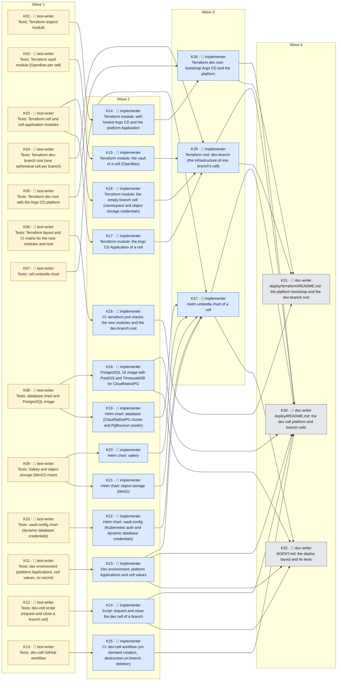

# T0.08: Plan

**Plan:** 🟢 Approved

<!-- ticket:specs -->
## 📚 Specifications

The technical pages, features, use cases and business rules of [TICKET.md](TICKET.md), copied by `python3 .claude/scripts/tickets/ticket_refs.py sync`.

- [🚢 Deployment: delivery](../../specs/technical/09-deployment.md#delivery)
- [🚢 Deployment: providers](../../specs/technical/09-deployment.md#providers)
- [🔑 Security: secrets and keys](../../specs/technical/06-security.md#secrets)
- [🚢 Deployment: environments](../../specs/technical/09-deployment.md#environments)
- [🚢 Deployment: infrastructure as code](../../specs/technical/09-deployment.md#iac)
- [🗄️ Storage: PostgreSQL and PostGIS](../../specs/technical/03-storage.md#postgresql)
<!-- /ticket:specs -->

## Summary

T0.08 is split into 32 tasks over 4 waves. The dev cell of T0.01 is a shared k3s cluster on the fixed P-06 machines, so each branch cell is a namespace on that cluster. Each branch cell has its own CloudNativePG database with PostGIS and TimescaleDB, PgBouncer (a CNPG Pooler in transaction mode), Valkey, MinIO and an OpenBao vault. The cluster-wide operators (Argo CD, the CloudNativePG operator, KEDA and its HTTP add-on) are installed once per cluster and shared by the branch cells.

**Wave 1: 13 test-writers.** They fix every interface first:
- Terraform native tests with mock providers, for the four new modules (argocd, vault, cell, cell-application), the new per-branch root cells/dev-branch and the extended dev root.
- The Terraform layout and CI matrix test.
- pytest tests that parse the Helm charts with pyyaml and render them with `helm template` when helm is installed.
- Tests for the dev environment of Argo CD, the PostgreSQL image, the dev-cell script (in dry-run mode) and the dev-cell GitHub workflow.

**Wave 2: 13 implementers, one per test target.** They write:
- the four Terraform modules;
- the PostgreSQL 16 image (CNPG PostGIS plus TimescaleDB);
- the database, valkey, object-storage and vault-config charts. vault-config is an Argo CD PostSync Job that sets up Kubernetes auth, the database secrets engine and one dynamic role per service schema;
- `deploy/environments/dev` (the platform Applications and the cell values);
- `deploy/scripts/dev-cell.sh` (`up` and `down` for a branch);
- `.github/workflows/dev-cell.yml`: manual creation, and automatic destruction on branch deletion;
- the terraform.yml check matrix.

**Wave 3: the parts that put it all together.**
- The cell umbrella chart.
- The dev root, which bootstraps Argo CD behind `platform_enabled`.
- The dev-branch root, which creates the namespace, its secrets, the vault and the Argo CD Application of the cell with one state per branch.

**Wave 4: documentation.** `deploy/README.md`, the update of `deploy/terraform/README.md`, and AGENT.md.

**How the acceptance criteria are checked.** Criteria 1 and 2 are checked by terraform test, `helm lint`/`helm template` and the script's dry run. The real cell needs the P-06 cluster, so the person runs the first `up`/`down`. Criterion 3 is checked in two ways:
- statically: no values file holds a secret, the vault issues credentials, and the Kubernetes auth roles are bound to each service account;
- by hand: `bao read database/creds/<service>`, documented in `deploy/README.md`.

## Assumptions

- The roadmap row names no feature, use case or business rule, so the acceptance criteria cite none.
- The row names no row of the budgets table, so the ticket touches no budget.
- 'In minutes' is not quantified by the specifications, so no duration is asserted.
- What creates and closes a branch's cell (command, pull request label, workflow) is not specified; the plan takes the most conservative option.
- The row leaves HashiCorp Vault or OpenBao open, so either satisfies it.
- The roadmap names no feature, use case or business rule for T0.08. No Given/when/then criterion of a feature is closed, and the three criteria of TICKET.md are the ones checked.
- A branch's dev cell is a Kubernetes namespace on the shared dev k3s cluster built by T0.01. The P-06 machines are fixed, so Terraform cannot create machines per branch. Each branch cell has its own database, PgBouncer pooler, Valkey, MinIO and vault. The cluster-wide operators are installed once per cluster and shared by all branch cells: Argo CD, the CloudNativePG operator, KEDA and the KEDA HTTP add-on. 'KEDA is installed in every cell' is read as available to every cell.
- One Terraform root, deploy/terraform/cells/dev-branch, serves every branch cell, with one remote state per branch selected by the backend key dev-branch/<cell>.tfstate. 'A new cell is a new root and a pull request' cannot apply to on-demand cells.
- The most conservative trigger was chosen. A cell is created only on demand, by a person running deploy/scripts/dev-cell.sh or the manual workflow_dispatch of .github/workflows/dev-cell.yml. It is destroyed automatically when the branch is deleted (the GitHub delete event), or on demand. There is no automatic creation on push and no pull request label. In this path, apply and destroy use -auto-approve, because the request itself is the person's manual act. The shared dev root stays 'apply manual, after review'.
- The cell name is 'cell-' + the branch slug (lower case, other characters turned into '-', cut to 30 characters) + '-' + 8 hex characters of sha256(branch). It is at most 44 characters, a DNS label and a valid Helm release name (53 at most), and unique per branch.
- 'In minutes' is not quantified. The script waits for the Argo CD Application to be Synced and Healthy, with a configurable timeout of 15 minutes by default, and reports the elapsed time without asserting a duration.
- The vault is OpenBao, which the row allows. It is provisioned by Terraform per cell (09-deployment#iac lists the vault) in dev server mode: in memory, auto-unsealed, with a random root token generated by Terraform and kept in the Terraform state and in a Kubernetes Secret. Branch cells are ephemeral and fly simulated Drones only. A restart of the vault pod loses its configuration until the next Argo CD sync re-runs the configuration Job. Staging and production need a persistent, sealed mode in a later ticket.
- The vault is configured by an Argo CD PostSync Job (chart vault-config), because the database exists only once Argo CD has deployed it. The Job sets up Kubernetes auth, the database secrets engine and, per service, a role, a policy and a Kubernetes auth role bound to the service account named after the service. Dynamic credentials have a default TTL of 1 h and a maximum of 24 h, which the specifications do not give.
- The service schemas are the five of 03-storage#postgresql: missions, fleet, processing, evidence and notifier. Each is owned by a NOLOGIN group role named after the service. Dynamic users join it and SET role to it, so that their objects survive their revocation.
- No service chart exists yet, so acceptance criterion 3 is checked in two ways. Statically: no values file holds a secret, the vault issues dynamic credentials per service, and the auth roles are bound to service accounts. By hand: `bao read database/creds/<service>` on a live cell, documented in deploy/README.md. Service charts will read their credentials from the vault API.
- The database runs PostgreSQL 16 (03-storage). Its image, deploy/images/postgres, is the CloudNativePG PostGIS 16 image plus the TimescaleDB packages. The person builds and pushes it until the image pipeline of T0.10 covers it. Its reference is the Terraform variable database_image, and no registry owner is assumed.
- Dev cells run single instances with small volumes and no replicas. The read replicas of 03-storage apply to production cells, and no size is specified.
- MinIO's root credentials are generated by Terraform into a Kubernetes Secret read by name. Valkey has no password, because the specifications put no Valkey credential in the vault. Both are limited to the pods of the cell's namespace by a NetworkPolicy, which k3s enforces. No bucket is created, because buckets are per Operator and made by the services later.
- Argo CD is bootstrapped by Terraform in the dev root, behind platform_enabled (default false), because the kubeconfig exists only after the first apply. A new cluster therefore needs two applies. Applications are created through the argocd-apps Helm chart rather than kubernetes_manifest, because the Application CRD does not exist when the first plan runs.
- The Git repository URL is a Terraform variable. If the repository is private, the person gives Argo CD its read credentials, outside this repository.
- Chart, image and provider versions are pinned to the current stable releases at implementation time, and never 'latest'.
- Helm 3, kubectl, Terraform >= 1.10 and uvx (for actionlint) are available to the worker agents and the verifier. The pytest tests that render charts with `helm template` skip when helm is missing, and the chart tasks run `helm lint` in their done_when. checks.py has no Helm check.
- The dev-cell workflow must reach the dev cluster API. Its runner comes from the repository variable DEV_CELL_RUNNER (default ubuntu-latest), and the person allows its address or provides a self-hosted runner. Its secrets are TF_BACKEND_CONFIG, DEV_CELL_TFVARS, DEV_CELL_KUBECONFIG, AWS_ACCESS_KEY_ID and AWS_SECRET_ACCESS_KEY.
- A real cell needs the P-06 cluster and the remote state, so agents cannot create one. They prove the work with terraform validate and test using mock providers, helm lint and template, and the script's dry run. The person runs the first real `up` and `down` and records the evidence of acceptance criteria 1 to 3.
- No AGENT.md agent kind exists for infrastructure, so the Terraform, Helm, script and workflow tasks go to the implementer, as in T0.01. The new pytest files follow the AGENT.md and CLAUDE.md test rules, with unique basenames and at most five files per folder.

<!-- plan:graph -->

> [!NOTE]
> Generated from the json block at the end of this page by `python3 .claude/scripts/tickets/plan.py render`.
> To change a task, edit the json block, then render again: never edit this view by hand.

## Waves

| Wave | Tasks | Agents running at once |
| --- | --- | --- |
| 1 | [K01](#k01), [K02](#k02), [K03](#k03), [K04](#k04), [K05](#k05), [K06](#k06), [K07](#k07), [K08](#k08), [K09](#k09), [K10](#k10), [K11](#k11), [K12](#k12), [K13](#k13) | 8 of 13 |
| 2 | [K14](#k14), [K15](#k15), [K16](#k16), [K17](#k17), [K18](#k18), [K19](#k19), [K20](#k20), [K21](#k21), [K22](#k22), [K23](#k23), [K24](#k24), [K25](#k25), [K26](#k26) | 8 of 13 |
| 3 | [K27](#k27), [K28](#k28), [K29](#k29) | 3 of 3 |
| 4 | [K30](#k30), [K31](#k31), [K32](#k32) | 3 of 3 |

| Wave | Task | Agent | Depends on | Unblocks |
| --- | --- | --- | --- | --- |
| 1 | [K01](#k01) Tests: Terraform argocd module | 🧪 test-writer | none | [K14](#k14) |
| 1 | [K02](#k02) Tests: Terraform vault module (OpenBao per cell) | 🧪 test-writer | none | [K15](#k15) |
| 1 | [K03](#k03) Tests: Terraform cell and cell-application modules | 🧪 test-writer | none | [K16](#k16), [K17](#k17) |
| 1 | [K04](#k04) Tests: Terraform dev-branch root (one ephemeral cell per branch) | 🧪 test-writer | none | [K29](#k29) |
| 1 | [K05](#k05) Tests: Terraform dev root with the Argo CD platform | 🧪 test-writer | none | [K28](#k28) |
| 1 | [K06](#k06) Tests: Terraform layout and CI matrix for the new modules and root | 🧪 test-writer | none | [K26](#k26) |
| 1 | [K07](#k07) Tests: cell umbrella chart | 🧪 test-writer | none | [K27](#k27) |
| 1 | [K08](#k08) Tests: database chart and PostgreSQL image | 🧪 test-writer | none | [K18](#k18), [K19](#k19) |
| 1 | [K09](#k09) Tests: Valkey and object storage (MinIO) charts | 🧪 test-writer | none | [K20](#k20), [K21](#k21) |
| 1 | [K10](#k10) Tests: vault-config chart (dynamic database credentials) | 🧪 test-writer | none | [K22](#k22) |
| 1 | [K11](#k11) Tests: dev environment (platform Applications, cell values, no secret) | 🧪 test-writer | none | [K23](#k23) |
| 1 | [K12](#k12) Tests: dev-cell script (request and close a branch cell) | 🧪 test-writer | none | [K24](#k24) |
| 1 | [K13](#k13) Tests: dev-cell GitHub workflow | 🧪 test-writer | none | [K25](#k25) |
| 2 | [K14](#k14) Terraform module: self-hosted Argo CD and the platform Application | 🐍 implementer | [K01](#k01) | [K28](#k28) |
| 2 | [K15](#k15) Terraform module: the vault of a cell (OpenBao) | 🐍 implementer | [K02](#k02) | [K29](#k29) |
| 2 | [K16](#k16) Terraform module: the empty branch cell (namespace and object storage credentials) | 🐍 implementer | [K03](#k03) | [K29](#k29) |
| 2 | [K17](#k17) Terraform module: the Argo CD Application of a cell | 🐍 implementer | [K03](#k03) | [K29](#k29) |
| 2 | [K18](#k18) PostgreSQL 16 image with PostGIS and TimescaleDB for CloudNativePG | 🐍 implementer | [K08](#k08) | [K30](#k30), [K32](#k32) |
| 2 | [K19](#k19) Helm chart: database (CloudNativePG cluster and PgBouncer pooler) | 🐍 implementer | [K08](#k08) | [K27](#k27) |
| 2 | [K20](#k20) Helm chart: valkey | 🐍 implementer | [K09](#k09) | [K27](#k27) |
| 2 | [K21](#k21) Helm chart: object-storage (MinIO) | 🐍 implementer | [K09](#k09) | [K27](#k27) |
| 2 | [K22](#k22) Helm chart: vault-config (Kubernetes auth and dynamic database credentials) | 🐍 implementer | [K10](#k10) | [K27](#k27) |
| 2 | [K23](#k23) Dev environment: platform Applications and cell values | 🐍 implementer | [K11](#k11) | [K27](#k27), [K30](#k30), [K32](#k32) |
| 2 | [K24](#k24) Script: request and close the dev cell of a branch | 🐍 implementer | [K12](#k12) | [K30](#k30), [K32](#k32) |
| 2 | [K25](#k25) CI: dev-cell workflow (on-demand creation, destruction on branch deletion) | 🐍 implementer | [K13](#k13) | [K30](#k30) |
| 2 | [K26](#k26) CI: terraform.yml checks the new modules and the dev-branch root | 🐍 implementer | [K06](#k06) | [K31](#k31) |
| 3 | [K27](#k27) Helm umbrella chart of a cell | 🐍 implementer | [K07](#k07), [K19](#k19), [K20](#k20), [K21](#k21), [K22](#k22), [K23](#k23) | [K30](#k30), [K32](#k32) |
| 3 | [K28](#k28) Terraform dev root: bootstrap Argo CD and the platform | 🐍 implementer | [K05](#k05), [K14](#k14) | [K30](#k30), [K31](#k31) |
| 3 | [K29](#k29) Terraform root: dev-branch (the infrastructure of one branch's cell) | 🐍 implementer | [K04](#k04), [K15](#k15), [K16](#k16), [K17](#k17) | [K30](#k30), [K31](#k31) |
| 4 | [K30](#k30) deploy/README.md: the dev cell platform and branch cells | 📝 doc-writer | [K18](#k18), [K23](#k23), [K24](#k24), [K25](#k25), [K27](#k27), [K28](#k28), [K29](#k29) | none |
| 4 | [K31](#k31) deploy/terraform/README.md: the platform bootstrap and the dev-branch root | 📝 doc-writer | [K26](#k26), [K28](#k28), [K29](#k29) | none |
| 4 | [K32](#k32) AGENT.md: the deploy layout and its tests | 📝 doc-writer | [K18](#k18), [K23](#k23), [K24](#k24), [K27](#k27) | none |

## Dependency graph



## Tasks

### <a id="k01"></a>K01: Tests: Terraform argocd module

| Agent | Wave | Depends on | Unblocks |
| --- | --- | --- | --- |
| 🧪 test-writer | 1 | none | [K14](#k14) |

**Files** (only this task may change them in its wave):

- `deploy/terraform/modules/self-hosted/argocd/tests/argocd.tftest.hcl`

**Done when:** `terraform fmt -check deploy/terraform/modules/self-hosted/argocd/tests/argocd.tftest.hcl` passes, and `terraform test` in deploy/terraform/modules/self-hosted/argocd fails only because the module's configuration is missing.

**Brief:**

Write the Terraform native test (Terraform >= 1.10, `command = plan` only, `mock_provider "helm" {}`) for a new building-block module deploy/terraform/modules/self-hosted/argocd. The module installs Argo CD on the dev k3s cluster and the root Application `platform`, which deploys the cluster-wide operators of the cell. Specs: docs/specs/technical/09-deployment.md#delivery (GitOps with Argo CD, desired state in deploy/environments), docs/specs/technical/09-deployment.md#iac (one module per building block), ticket docs/tickets/T0.08/TICKET.md. The interface below is the contract the implementer follows.

Variables:
- `namespace` (string, default "argocd").
- `chart_version` (string, required, refused when "" or "latest").
- `apps_chart_version` (string, required, same refusal).
- `repository_url` (string, required, refused when "").
- `target_revision` (string, default "develop").
- `platform_path` (string, default "deploy/environments/dev/platform").

Resources:
- `helm_release.argocd`: chart "argo-cd", repository "https://argoproj.github.io/argo-helm", namespace var.namespace, version var.chart_version, create_namespace true.
- `helm_release.platform`: chart "argocd-apps", same repository, namespace var.namespace, version var.apps_chart_version, values[0] a YAML document that holds the Application `platform`.

Outputs: `namespace` and `platform_application` ("platform").

Runs, with fake versions such as "0.0.1" and repository_url "https://git.example.org/swarm.git":
(1) installs_argo_cd_and_the_platform_application: assert the chart, repository, namespace, version and create_namespace of helm_release.argocd. Assert the chart and namespace of helm_release.platform. Assert that strcontains(helm_release.platform.values[0], ...) holds the repository_url, "develop" and "deploy/environments/dev/platform". Assert output.namespace == "argocd" and output.platform_application == "platform".
(2) refuses_a_floating_chart_version: chart_version = "latest", expect_failures = [var.chart_version].
(3) refuses_a_missing_repository: repository_url = "", expect_failures = [var.repository_url].

Use only documentation names (example.org).

### <a id="k02"></a>K02: Tests: Terraform vault module (OpenBao per cell)

| Agent | Wave | Depends on | Unblocks |
| --- | --- | --- | --- |
| 🧪 test-writer | 1 | none | [K15](#k15) |

**Files** (only this task may change them in its wave):

- `deploy/terraform/modules/self-hosted/vault/tests/vault.tftest.hcl`

**Done when:** `terraform fmt -check` passes on the file, and `terraform test` in deploy/terraform/modules/self-hosted/vault fails only because the module's configuration is missing.

**Brief:**

Write the Terraform native test (Terraform >= 1.10, `command = plan`, `mock_provider` "helm", "kubernetes" and "random") for a new module deploy/terraform/modules/self-hosted/vault. It provisions the vault of one cell, OpenBao, in the cell's namespace. Specs:
- docs/specs/technical/06-security.md#secrets: a vault per cell for dynamic database credentials, and configuration holds names, never secrets.
- docs/specs/technical/09-deployment.md#iac: Terraform provisions the vault.
- Ticket docs/tickets/T0.08/TICKET.md.

The contract:
- Variables:
  - `namespace` (string, a DNS-1123 label of at most 53 characters, regex ^[a-z0-9]([-a-z0-9]{0,51}[a-z0-9])?$);
  - `chart_version` (string, refused when "" or "latest");
  - `release_name` (string, default "openbao").
- Resources:
  - `random_password.root_token` (length >= 32, special = false);
  - `kubernetes_secret_v1.root_token`, named "vault-root-token" in var.namespace, with the key "token";
  - `helm_release.vault`: chart "openbao", repository "https://openbao.github.io/openbao-helm", namespace var.namespace, name var.release_name, version var.chart_version.
- Outputs:
  - `address`: "http://&lt;release_name>.&lt;namespace>.svc:8200";
  - `root_token_secret_name`: "vault-root-token".

The root token is never an output.

Runs:
(1) installs_the_vault_of_a_cell, with namespace "cell-feature-x-1a2b3c4d" and chart_version "0.0.1". Assert:
  - the chart, repository, namespace and name of helm_release.vault;
  - the name and namespace of the secret (metadata[0]);
  - random_password.root_token.special == false and length >= 32;
  - output.address == "http://openbao.cell-feature-x-1a2b3c4d.svc:8200";
  - output.root_token_secret_name == "vault-root-token".
(2) refuses_a_namespace_that_is_not_a_label: namespace "Cell_X", expect_failures = [var.namespace].
(3) refuses_a_floating_chart_version: "latest", expect_failures = [var.chart_version].

### <a id="k03"></a>K03: Tests: Terraform cell and cell-application modules

| Agent | Wave | Depends on | Unblocks |
| --- | --- | --- | --- |
| 🧪 test-writer | 1 | none | [K16](#k16), [K17](#k17) |

**Files** (only this task may change them in its wave):

- `deploy/terraform/modules/self-hosted/cell/tests/cell.tftest.hcl`
- `deploy/terraform/modules/self-hosted/cell-application/tests/cell_application.tftest.hcl`

**Done when:** `terraform fmt -check` passes on both files, and `terraform test` in each module folder fails only because the module's configuration is missing.

**Brief:**

Write Terraform native tests (Terraform >= 1.10, `command = plan`, mock providers) for two new building-block modules of an ephemeral branch cell. Specs: docs/specs/technical/09-deployment.md#environments (dev is one ephemeral cell per branch), docs/specs/technical/09-deployment.md#iac (Terraform creates the empty cell, then Helm and Argo CD deploy on it), docs/specs/technical/09-deployment.md#delivery (Argo CD, the umbrella chart per cell, values per environment) and docs/specs/technical/06-security.md#secrets (configuration holds names, never secrets). Ticket: docs/tickets/T0.08/TICKET.md.

(1) cell.tftest.hcl, for modules/self-hosted/cell, with mock_provider "kubernetes" and "random". The module is the empty cell on the shared cluster.
- Variables:
  - `name`: a DNS-1123 label of at most 53 characters, regex ^[a-z0-9]([-a-z0-9]{0,51}[a-z0-9])?$;
  - `branch`: a string that must not be empty.
- Resources:
  - `kubernetes_namespace_v1.cell`, named var.name, with the labels "app.kubernetes.io/part-of" = "swarm" and "swarm-cell" = var.name, and the annotation "swarm-branch" = var.branch;
  - `random_password.object_storage_root` (special false, length >= 32);
  - `kubernetes_secret_v1.object_storage_root`, named "object-storage-root" in the namespace, with the keys MINIO_ROOT_USER and MINIO_ROOT_PASSWORD.
- Outputs: `namespace` and `object_storage_secret_name`.
- Runs:
  - one valid run with name "cell-feature-x-1a2b3c4d" and branch "feature/x", asserting each of the above;
  - expect_failures [var.name] for "Feature_X";
  - expect_failures [var.name] for a 54-character name;
  - expect_failures [var.branch] for "".

(2) cell_application.tftest.hcl, for modules/self-hosted/cell-application, with mock_provider "helm". The module is the Argo CD Application of one cell.
- Variables:
  - `name` (same label rule);
  - `namespace` (the destination namespace);
  - `argocd_namespace` (default "argocd");
  - `repository_url`;
  - `target_revision` (must not be "");
  - `chart_path` (default "deploy/charts/cell");
  - `values_files` (list(string), default ["../../environments/dev/values.yaml"]);
  - `parameters` (map(string), default {});
  - `apps_chart_version` (refused when "" or "latest").
- Resource: `helm_release.application`, named var.name in var.argocd_namespace, chart "argocd-apps", repository "https://argoproj.github.io/argo-helm".
- Output: `application_name` (var.name).
- Runs:
  - one valid run with parameters { "database.imageName" = "registry.example.org/swarm-postgres:16" }. Assert the name, namespace, chart and repository of the release. Assert that values[0] contains each of: the repository_url, the target_revision, "deploy/charts/cell", "../../environments/dev/values.yaml", "resources-finalizer.argocd.argoproj.io", the destination namespace and "database.imageName". Assert output.application_name;
  - expect_failures [var.target_revision] for "";
  - expect_failures [var.apps_chart_version] for "latest".

Use example.org names only.

### <a id="k04"></a>K04: Tests: Terraform dev-branch root (one ephemeral cell per branch)

| Agent | Wave | Depends on | Unblocks |
| --- | --- | --- | --- |
| 🧪 test-writer | 1 | none | [K29](#k29) |

**Files** (only this task may change them in its wave):

- `deploy/terraform/cells/dev-branch/tests/dev_branch.tftest.hcl`

**Done when:** `terraform fmt -check` passes on the file, and `terraform test` in deploy/terraform/cells/dev-branch fails only because the root configuration is missing.

**Brief:**

Write the Terraform native test (Terraform >= 1.10, `command = plan`, mock_provider "kubernetes", "helm" and "random") for a new root deploy/terraform/cells/dev-branch. It creates and destroys the infrastructure of one branch's dev cell on the shared dev k3s cluster, and one state per branch is selected by the backend key. Specs:
- docs/specs/technical/09-deployment.md#environments: one ephemeral cell per branch, created on demand, deleted when the branch closes.
- docs/specs/technical/09-deployment.md#iac: one root per cell in deploy/terraform/cells/&lt;cell>/. Terraform creates the empty cell, then Helm and Argo CD deploy on it.
- docs/specs/technical/09-deployment.md#delivery.
- docs/specs/technical/06-security.md#secrets.
- docs/tickets/T0.08/TICKET.md, acceptance criteria 1 and 2.

Root interface (the contract):
- `branch` (string, must not be "").
- `cell_name` (a DNS-1123 label of at most 53 characters, regex ^[a-z0-9]([-a-z0-9]{0,51}[a-z0-9])?$).
- `kubeconfig_path`.
- `repository_url`.
- `database_image` (must not be "").
- `openbao_chart_version`.
- `argocd_apps_chart_version`.
- `argocd_namespace` (default "argocd").

It calls three modules:
- module.cell (../../modules/self-hosted/cell);
- module.vault (../../modules/self-hosted/vault);
- module.cell_application (../../modules/self-hosted/cell-application), with parameters { "database.imageName" = var.database_image } and target_revision = var.branch.

Outputs: `namespace`, `application_name` and `vault_address`.

Runs. The shared variables use fake paths (/nonexistent/kubeconfig), https://git.example.org/swarm.git and versions "0.0.1".
(1) plans_the_cell_of_a_branch, with branch "feature/x" and cell_name "cell-feature-x-1a2b3c4d". Assert:
  - output.namespace == "cell-feature-x-1a2b3c4d";
  - output.application_name == "cell-feature-x-1a2b3c4d";
  - output.vault_address == "http://openbao.cell-feature-x-1a2b3c4d.svc:8200".
(2) refuses_a_cell_name_that_is_not_a_label: expect_failures [var.cell_name].
(3) refuses_a_cell_without_a_database_image: expect_failures [var.database_image].
(4) refuses_an_empty_branch: expect_failures [var.branch].

### <a id="k05"></a>K05: Tests: Terraform dev root with the Argo CD platform

| Agent | Wave | Depends on | Unblocks |
| --- | --- | --- | --- |
| 🧪 test-writer | 1 | none | [K28](#k28) |

**Files** (only this task may change them in its wave):

- `deploy/terraform/cells/dev/tests/dev.tftest.hcl`

**Done when:** `terraform fmt -check` passes on the file. In deploy/terraform/cells/dev, `terraform test` still passes the three original runs, and fails the new runs only because module.argocd and the new variables do not exist yet.

**Brief:**

Extend the existing native test deploy/terraform/cells/dev/tests/dev.tftest.hcl. The dev root of T0.01 builds the empty k3s cluster (docs/specs/roadmap/11-hardware-and-partners.md#p-06). From this ticket it also bootstraps Argo CD on that cluster, so that Helm and Argo CD deploy the platform: docs/specs/technical/09-deployment.md#iac and docs/specs/technical/09-deployment.md#delivery, ticket docs/tickets/T0.08/TICKET.md. Keep the three existing runs and their assertions unchanged. Add `mock_provider "helm" {}` and `mock_provider "kubernetes" {}`.

New root interface (the contract):
- `platform_enabled` (bool, default false, because the kubeconfig exists only after the first apply).
- `repository_url` (string, default "", refused when platform_enabled is true and it is empty).
- `argocd_chart_version` and `argocd_apps_chart_version` (string, default "", refused when platform_enabled is true and they are empty or "latest").
- `platform_revision` (string, default "develop").
- module.argocd (../../modules/self-hosted/argocd), with count = platform_enabled ? 1 : 0.
- Output `argocd_namespace`: "argocd" when enabled, null otherwise.

Changes:
(a) In plans_an_empty_k3s_cluster_from_nothing, also assert length(module.argocd) == 0.
(b) Add installs_argo_cd_when_the_platform_is_enabled: platform_enabled = true, repository_url "https://git.example.org/swarm.git", fake versions "0.0.1". Assert length(module.argocd) == 1 and output.argocd_namespace == "argocd".
(c) Add refuses_the_platform_without_a_repository: expect_failures [var.repository_url].
(d) Add refuses_the_platform_with_a_floating_chart_version: argocd_chart_version = "latest", expect_failures [var.argocd_chart_version].

### <a id="k06"></a>K06: Tests: Terraform layout and CI matrix for the new modules and root

| Agent | Wave | Depends on | Unblocks |
| --- | --- | --- | --- |
| 🧪 test-writer | 1 | none | [K26](#k26) |

**Files** (only this task may change them in its wave):

- `tests/conventions/mono_repo/test_terraform_layout.py`

**Done when:** `uv run pytest tests/conventions/mono_repo/test_terraform_layout.py` collects without error. The old tests still pass, and the new ones fail only on missing files, matrix entries or the gitignore line. `uv run ruff check` and `uv run ruff format --check` pass on the file.

**Brief:**

Extend tests/conventions/mono_repo/test_terraform_layout.py (class TestTerraformLayout). It enforces the layout of docs/specs/technical/09-deployment.md#iac: one module per building block in deploy/terraform/modules/, and one root per cell in deploy/terraform/cells/&lt;cell>/. Ticket: docs/tickets/T0.08/TICKET.md. Keep every existing test.

Changes:
(1) The module parametrize of test_each_module_has_its_files also covers "argocd", "vault", "cell" and "cell-application".
(2) Add test_the_dev_branch_cell_has_its_files, parametrized over main.tf, variables.tf, outputs.tf, versions.tf, providers.tf, terraform.tfvars.example and .terraform.lock.hcl, under deploy/terraform/cells/dev-branch.
(3) Add test_the_dev_branch_cell_declares_an_empty_partial_backend, with the same regex as the dev test.
(4) Add test_the_check_matrix_covers_every_module_and_root. Parse .github/workflows/terraform.yml with yaml.safe_load. Assert that jobs.check.strategy.matrix.folder holds deploy/terraform/modules/self-hosted/&lt;m> for m in machines, network, k3s, object-storage, dns, argocd, vault, cell and cell-application, plus deploy/terraform/cells/dev and deploy/terraform/cells/dev-branch.
(5) Add "deploy/charts/*/charts/" to the lines of test_gitignore_holds_the_line.

Follow AGENT.md Tests and the CLAUDE.md code rules:
- no `Any` or `object` as a type, and parsed YAML is pydantic's JsonValue;
- no dict with hard-coded keys inside a method;
- the expected folders are an UPPER_CASE ClassVar[List[str]];
- test names are sentences, with no mocks.

### <a id="k07"></a>K07: Tests: cell umbrella chart

| Agent | Wave | Depends on | Unblocks |
| --- | --- | --- | --- |
| 🧪 test-writer | 1 | none | [K27](#k27) |

**Files** (only this task may change them in its wave):

- `tests/deploy/charts/test_cell_chart.py`

**Done when:** `uv run pytest tests/deploy/charts/test_cell_chart.py` collects without error and fails only because deploy/charts/cell does not exist yet. `uv run ruff check` and `uv run ruff format --check` pass on the file.

**Brief:**

Write tests/deploy/charts/test_cell_chart.py (class TestCellChart) for the umbrella chart deploy/charts/cell. It is the one umbrella chart per cell of docs/specs/technical/09-deployment.md#delivery, with values per environment, and it brings the cell's data platform of docs/specs/technical/09-deployment.md#providers and docs/specs/technical/03-storage.md#postgresql. Ticket: docs/tickets/T0.08/TICKET.md.

Structure tests (pyyaml, always run):
- Chart.yaml has apiVersion "v2", name "cell", type "application" and a semver version.
- Its dependencies are exactly four:
  - name "database", repository "file://../database", condition "database.enabled";
  - name "valkey", repository "file://../valkey", condition "valkey.enabled";
  - name "object-storage", alias "objectStorage", repository "file://../object-storage", condition "objectStorage.enabled";
  - name "vault-config", alias "vaultConfig", repository "file://../vault-config", condition "vaultConfig.enabled".
- values.yaml has database.enabled, valkey.enabled, objectStorage.enabled and vaultConfig.enabled all true, and global.services == [].
- deploy/charts/cell/Chart.lock exists and names the four dependencies.

Rendering test, marked pytest.mark.skipif(shutil.which("helm") is None, reason="helm is not installed"):
- Copy deploy/charts and deploy/environments into tmp_path with shutil.copytree, so that the repository is never written.
- Run `helm dependency build` on the copied cell chart.
- Run `helm template cell <copy>/charts/cell --namespace cell-test -f <copy>/environments/dev/values.yaml --set database.imageName=registry.example.org/swarm-postgres:16`.
- Parse the output with yaml.safe_load_all. Assert that it holds:
  - a postgresql.cnpg.io/v1 Cluster named "database" and a Pooler named "database-pooler-rw";
  - StatefulSets named "valkey" and "object-storage";
  - a batch/v1 Job named "vault-config";
  - NetworkPolicies named "valkey" and "object-storage".

Follow AGENT.md Tests and the CLAUDE.md code rules:
- one Test class, sentence names, parametrize for cases of one behaviour;
- no mocks, no __init__.py, no conftest.py;
- no `Any` or `object` as a type, and YAML is pydantic's JsonValue;
- no dict with hard-coded keys inside a method: the expected dependencies are UPPER_CASE ClassVars;
- the repository root is Path(__file__).resolve().parents[3].

### <a id="k08"></a>K08: Tests: database chart and PostgreSQL image

| Agent | Wave | Depends on | Unblocks |
| --- | --- | --- | --- |
| 🧪 test-writer | 1 | none | [K18](#k18), [K19](#k19) |

**Files** (only this task may change them in its wave):

- `tests/deploy/charts/test_database_chart.py`
- `tests/deploy/images/test_postgres_image.py`

**Done when:** `uv run pytest tests/deploy/charts/test_database_chart.py tests/deploy/images/test_postgres_image.py` collects without error and fails only because the chart and the Dockerfile are missing. `uv run ruff check` and `uv run ruff format --check` pass on both files.

**Brief:**

Write two test files. Specs:
- docs/specs/technical/09-deployment.md#providers: PostgreSQL runs through the CloudNativePG operator with PostGIS and TimescaleDB.
- docs/specs/technical/03-storage.md#postgresql: PostgreSQL 16, one schema per service (missions, fleet, processing, evidence, notifier), and PgBouncer in transaction mode in front of each primary.
- docs/specs/technical/06-security.md#secrets: dynamic database credentials come from the vault.
- Ticket docs/tickets/T0.08/TICKET.md.

(1) tests/deploy/charts/test_database_chart.py, class TestDatabaseChart.
Structure tests:
- Chart.yaml has apiVersion v2 and name "database".
- values.yaml has instances 1, imageName "", a storage.size, pooler.instances 1, pooler.poolMode "transaction" and global.services [].
Rendering tests (skipif helm is missing) run `helm template database deploy/charts/database --namespace cell-test --set imageName=registry.example.org/swarm-postgres:16 --set global.services={missions,fleet}` and parse the output with yaml.safe_load_all.
- It holds a postgresql.cnpg.io/v1 Cluster named "database" with:
  - spec.imageName as set and spec.instances 1;
  - enableSuperuserAccess true;
  - "timescaledb" in spec.postgresql.shared_preload_libraries;
  - bootstrap.initdb.database "swarm";
  - postInitApplicationSQL containing "CREATE EXTENSION IF NOT EXISTS postgis" and "CREATE EXTENSION IF NOT EXISTS timescaledb";
  - for each service (parametrize), a statement creating a NOLOGIN role named after it and "CREATE SCHEMA IF NOT EXISTS &lt;service> AUTHORIZATION &lt;service>".
- It holds a Pooler named "database-pooler-rw" with spec.cluster.name "database", spec.type "rw" and spec.pgbouncer.poolMode "transaction".
- Rendering without imageName fails (non-zero exit) with a message naming imageName.

(2) tests/deploy/images/test_postgres_image.py, class TestPostgresImage, for deploy/images/postgres/Dockerfile:
- the file exists;
- its first FROM is an image of ghcr.io/cloudnative-pg/postgis with a tag starting with "16", never "latest";
- it installs the package "timescaledb-2-postgresql-16";
- its last USER instruction is "26", the CloudNativePG postgres user.

Follow AGENT.md Tests and the CLAUDE.md code rules:
- one Test class per file, sentence names, no mocks, no __init__.py;
- JsonValue for parsed YAML, no `Any` or `object` as a type;
- no dict with hard-coded keys inside a method (use ClassVars);
- the repository root is Path(__file__).resolve().parents[3];
- unique basenames.

### <a id="k09"></a>K09: Tests: Valkey and object storage (MinIO) charts

| Agent | Wave | Depends on | Unblocks |
| --- | --- | --- | --- |
| 🧪 test-writer | 1 | none | [K20](#k20), [K21](#k21) |

**Files** (only this task may change them in its wave):

- `tests/deploy/charts/test_valkey_chart.py`
- `tests/deploy/charts/test_object_storage_chart.py`

**Done when:** `uv run pytest tests/deploy/charts/test_valkey_chart.py tests/deploy/charts/test_object_storage_chart.py` collects without error and fails only because the charts are missing. `uv run ruff check` and `uv run ruff format --check` pass on both files.

**Brief:**

Write two test files. Specs:
- docs/specs/technical/09-deployment.md#providers: Valkey as a chart, and MinIO as the object storage of a self-hosted cell.
- docs/specs/technical/09-deployment.md#delivery: Helm charts in deploy/charts.
- docs/specs/technical/06-security.md#secrets: configuration holds names, never secrets.
- Ticket docs/tickets/T0.08/TICKET.md.

(1) tests/deploy/charts/test_valkey_chart.py, class TestValkeyChart.
Structure tests:
- Chart.yaml has apiVersion v2 and name "valkey".
- values.yaml has image.repository "valkey/valkey", an image.tag that is neither empty nor "latest", and a persistence.size.
Rendering tests (skipif helm is missing) run `helm template valkey deploy/charts/valkey --namespace cell-test`. They assert:
- a StatefulSet "valkey" with 1 replica, the image "valkey/valkey:&lt;tag>", container port 6379 and a volumeClaimTemplate;
- a Service "valkey" on port 6379;
- a NetworkPolicy "valkey" with policyTypes ["Ingress"], whose only ingress source is `podSelector: {}`, so that only pods of the same namespace are allowed.

(2) tests/deploy/charts/test_object_storage_chart.py, class TestObjectStorageChart.
Structure tests:
- Chart.yaml has name "object-storage".
- values.yaml has image.repository "quay.io/minio/minio", an image.tag starting with "RELEASE.", a persistence.size and rootCredentialsSecret "object-storage-root".
Rendering tests (skipif helm is missing) assert:
- a StatefulSet "object-storage" whose container args are ["server", "/data"], whose envFrom has the secretRef "object-storage-root", and whose port is 9000;
- a Service "object-storage" on port 9000;
- a NetworkPolicy "object-storage" limited to the same namespace;
- no container env entry named MINIO_ROOT_USER or MINIO_ROOT_PASSWORD with a literal `value`.

Follow AGENT.md Tests and the CLAUDE.md code rules:
- one Test class per file, sentence names, no mocks, no __init__.py;
- JsonValue for YAML, no `Any` or `object` as a type;
- no dict with hard-coded keys inside a method;
- the repository root is Path(__file__).resolve().parents[3].

### <a id="k10"></a>K10: Tests: vault-config chart (dynamic database credentials)

| Agent | Wave | Depends on | Unblocks |
| --- | --- | --- | --- |
| 🧪 test-writer | 1 | none | [K22](#k22) |

**Files** (only this task may change them in its wave):

- `tests/deploy/charts/test_vault_config_chart.py`

**Done when:** `uv run pytest tests/deploy/charts/test_vault_config_chart.py` collects without error and fails only because the chart is missing. `uv run ruff check` and `uv run ruff format --check` pass on the file.

**Brief:**

Write tests/deploy/charts/test_vault_config_chart.py (class TestVaultConfigChart) for deploy/charts/vault-config. The chart holds an Argo CD PostSync Job that configures the cell's vault (OpenBao) so that services get dynamic database credentials. Each service authenticates with its Kubernetes service account and never reads a credential from a file. Specs: docs/specs/technical/06-security.md#secrets, docs/specs/technical/03-storage.md#postgresql (one schema per service) and docs/specs/technical/09-deployment.md#delivery. Ticket docs/tickets/T0.08/TICKET.md, acceptance criterion 3.

Structure tests: Chart.yaml has name "vault-config". values.yaml has:
- address "http://openbao:8200" and rootTokenSecret "vault-root-token";
- database.host "database-rw", database.port 5432, database.name "swarm" and database.superuserSecret "database-superuser";
- ttl "1h" and maxTtl "24h";
- image.repository "quay.io/openbao/openbao" with a tag that is neither empty nor "latest";
- global.services [].

Rendering tests (skipif helm is missing) run `helm template vault-config deploy/charts/vault-config --namespace cell-test --set global.services={missions,fleet}`.
- A batch/v1 Job "vault-config" has the annotations argocd.argoproj.io/hook "PostSync" and argocd.argoproj.io/hook-delete-policy "BeforeHookCreation". Its container env has:
  - BAO_ADDR equal to the address;
  - BAO_TOKEN from secretKeyRef vault-root-token/token;
  - the database user name and password from secretKeyRef database-superuser, keys username and password.
- A ConfigMap "vault-config" holds the script. The script contains:
  - "auth/kubernetes";
  - "secrets enable" with "database";
  - "database/config/swarm" and "postgresql-database-plugin".
- For each service (parametrize), the script contains:
  - "database/roles/&lt;service>";
  - 'IN ROLE "&lt;service>"';
  - "REASSIGN OWNED BY";
  - a policy "&lt;service>" that reads "database/creds/&lt;service>";
  - "auth/kubernetes/role/&lt;service>" bound to the service account "&lt;service>".
- No rendered env entry carries a literal `value` for a token or a password.

Follow AGENT.md Tests and the CLAUDE.md code rules:
- one Test class, sentence names, no mocks, no __init__.py;
- JsonValue for YAML, no `Any` or `object` as a type;
- no dict with hard-coded keys inside a method;
- the repository root is Path(__file__).resolve().parents[3].

### <a id="k11"></a>K11: Tests: dev environment (platform Applications, cell values, no secret)

| Agent | Wave | Depends on | Unblocks |
| --- | --- | --- | --- |
| 🧪 test-writer | 1 | none | [K23](#k23) |

**Files** (only this task may change them in its wave):

- `tests/deploy/environments/test_dev_environment.py`

**Done when:** `uv run pytest tests/deploy/environments/test_dev_environment.py` collects without error and fails only because deploy/environments/dev is missing. `uv run ruff check` and `uv run ruff format --check` pass on the file.

**Brief:**

Write tests/deploy/environments/test_dev_environment.py (class TestDevEnvironment) for deploy/environments/dev. It holds the desired state of the dev cells that Argo CD applies. Specs:
- docs/specs/technical/09-deployment.md#delivery: GitOps with Argo CD, the desired state in deploy/environments, values per environment, and KEDA in every cell with its HTTP add-on.
- docs/specs/technical/09-deployment.md#providers: the CloudNativePG operator.
- docs/specs/technical/09-deployment.md#environments.
- docs/specs/technical/03-storage.md#postgresql: the five service schemas.
- docs/specs/technical/06-security.md#secrets: configuration holds names, never secrets.
- Ticket docs/tickets/T0.08/TICKET.md.

Tests:
(1) Parametrized over the platform Applications:
- (cloudnative-pg.yaml, chart "cloudnative-pg", repoURL "https://cloudnative-pg.github.io/charts", destination namespace "cnpg-system");
- (keda.yaml, "keda", "https://kedacore.github.io/charts", "keda");
- (keda-http-add-on.yaml, "keda-add-ons-http", "https://kedacore.github.io/charts", "keda").
Each deploy/environments/dev/platform/&lt;file> is:
- an argoproj.io/v1alpha1 Application in metadata.namespace "argocd";
- with spec.source.chart and repoURL as listed;
- with a targetRevision matching a pinned semver (digits and dots, never "*" or "latest");
- with destination.namespace as listed;
- with syncPolicy.automated set;
- with "CreateNamespace=true" in syncPolicy.syncOptions.
(2) cloudnative-pg.yaml also has "ServerSideApply=true".
(3) deploy/environments/dev/values.yaml:
- global.services == ["missions", "fleet", "processing", "evidence", "notifier"];
- database.instances == 1;
- no imageName key, because Terraform passes it as a parameter;
- its top-level keys are a subset of global, database, valkey, objectStorage and vaultConfig.
(4) test_no_values_file_holds_a_secret: walk every deploy/charts/*/values.yaml and deploy/environments/**/*.yaml. Assert that no mapping key (case-insensitive) is one of password, rootpassword, token, roottoken, devroottoken, secretkey or accesskey. Keys that name a Secret, ending in "Secret", are allowed.

Follow AGENT.md Tests and the CLAUDE.md code rules:
- one Test class, sentence names, parametrize;
- JsonValue for YAML, no `Any` or `object` as a type;
- no dict with hard-coded keys inside a method (the expected Applications are UPPER_CASE ClassVars);
- the repository root is Path(__file__).resolve().parents[3].

### <a id="k12"></a>K12: Tests: dev-cell script (request and close a branch cell)

| Agent | Wave | Depends on | Unblocks |
| --- | --- | --- | --- |
| 🧪 test-writer | 1 | none | [K24](#k24) |

**Files** (only this task may change them in its wave):

- `tests/deploy/scripts/test_dev_cell_script.py`

**Done when:** `uv run pytest tests/deploy/scripts/test_dev_cell_script.py` collects without error and fails only because deploy/scripts/dev-cell.sh is missing. `uv run ruff check` and `uv run ruff format --check` pass on the file.

**Brief:**

Write tests/deploy/scripts/test_dev_cell_script.py (class TestDevCellScript) for deploy/scripts/dev-cell.sh. The script requests and closes the ephemeral dev cell of a branch:
- `up` creates its infrastructure with Terraform, then waits for Argo CD to deploy the platform;
- `down` destroys the infrastructure with Terraform.

Specs: docs/specs/technical/09-deployment.md#environments, docs/specs/technical/09-deployment.md#iac and docs/specs/technical/09-deployment.md#delivery. Ticket docs/tickets/T0.08/TICKET.md, acceptance criteria 1 and 2.

Run the script for real with subprocess (`bash deploy/scripts/dev-cell.sh --dry-run <action> <branch>`, cwd at the repository root). In dry-run mode it prints each command it would run, one per line, starting with "+ " and with its arguments separated by single spaces, and runs none. Set DEV_CELL_BACKEND_CONFIG=/nonexistent/backend.tfbackend and DEV_CELL_VAR_FILE=/nonexistent/dev-branch.tfvars in the env.

The cell name contract is "cell-" + slug + "-" + the first 8 hex characters of sha256(branch as UTF-8, with no newline), where:
- the slug is the branch in lower case, with every run of characters outside [a-z0-9] replaced by "-";
- it is cut to 30 characters;
- it is trimmed of "-" at both ends.

The tests compute the expected name with hashlib. Tests:
(1) For "feature/Add_Thing", `up` prints these lines, in order:
  - a terraform line with -chdir=deploy/terraform/cells/dev-branch, init, -backend-config=/nonexistent/backend.tfbackend and -backend-config=key=dev-branch/&lt;cell>.tfstate;
  - a terraform apply line with -auto-approve, -var-file=/nonexistent/dev-branch.tfvars, -var=branch=feature/Add_Thing and -var=cell_name=&lt;cell>;
  - kubectl wait lines on application/&lt;cell> in namespace argocd for Synced and for Healthy, with --timeout=15m by default, or --timeout=&lt;DEV_CELL_TIMEOUT> when it is set.
(2) `down` prints the same init, then terraform destroy with -auto-approve and the same -var arguments, and no kubectl line.
(3) A 200-character branch gives a name of at most 44 characters that matches ^[a-z0-9]([-a-z0-9]{0,51}[a-z0-9])?$.
(4) "feature/a_b" and "feature/a-b" give different names.
(5) A missing action, a missing branch or an unknown action exits with code 2 and prints a usage line on stderr.
(6) A missing DEV_CELL_BACKEND_CONFIG or DEV_CELL_VAR_FILE exits with code 2, and stderr names the variable.

Follow AGENT.md Tests and the CLAUDE.md code rules:
- one Test class, sentence names, parametrize;
- no mocks;
- no `Any` or `object` as a type;
- no dict with hard-coded keys inside a method: environment variable names are UPPER_CASE ClassVars, and the env is built from os.environ plus those keys;
- the repository root is Path(__file__).resolve().parents[3].

### <a id="k13"></a>K13: Tests: dev-cell GitHub workflow

| Agent | Wave | Depends on | Unblocks |
| --- | --- | --- | --- |
| 🧪 test-writer | 1 | none | [K25](#k25) |

**Files** (only this task may change them in its wave):

- `tests/ci/dev_cell/test_dev_cell_workflow.py`

**Done when:** `uv run pytest tests/ci/dev_cell/test_dev_cell_workflow.py` collects without error and fails only because the workflow is missing. `uv run ruff check` and `uv run ruff format --check` pass on the file.

**Brief:**

Write tests/ci/dev_cell/test_dev_cell_workflow.py (class TestDevCellWorkflow) for .github/workflows/dev-cell.yml. The workflow requests a branch's dev cell on demand and destroys it when the branch is deleted. Specs: docs/specs/technical/09-deployment.md#environments (created on demand, deleted when the branch closes) and docs/specs/technical/09-deployment.md#iac. Ticket docs/tickets/T0.08/TICKET.md, acceptance criteria 1 and 2. Follow the style of tests/ci/workflows/test_rust_workflow.py: load the file with yaml.safe_load, and read the trigger with `data.get("on", data.get(True))`.

Tests:
(1) The triggers are workflow_dispatch and delete. workflow_dispatch has the inputs:
  - `action`, of type choice, with options ["up", "down"], required;
  - `branch`, of type string.
(2) permissions == {"contents": "read"}.
(3) concurrency.group contains "dev-cell" and cancel-in-progress is false.
(4) There is exactly one job, `cell`. Its `if` contains "github.event.ref_type == 'branch'", so that tag deletions are ignored.
(5) The job env defines:
  - ACTION and BRANCH, where the delete event maps to "down" and to github.event.ref;
  - TF_BACKEND_CONFIG, DEV_CELL_TFVARS and DEV_CELL_KUBECONFIG from secrets of the same names;
  - AWS_ACCESS_KEY_ID and AWS_SECRET_ACCESS_KEY from secrets.
(6) The steps include:
  - actions/checkout;
  - hashicorp/setup-terraform with terraform_wrapper false;
  - a run step that writes the three files under $RUNNER_TEMP and prints "::error::" when a secret is empty;
  - a run step containing `bash deploy/scripts/dev-cell.sh "$ACTION" "$BRANCH"`, whose env sets DEV_CELL_BACKEND_CONFIG, DEV_CELL_VAR_FILE and KUBECONFIG.
(7) No run step contains "${{", because the branch name must never be interpolated into a shell.

Follow AGENT.md Tests and the CLAUDE.md code rules:
- one Test class, sentence names;
- JsonValue for YAML, no `Any` or `object` as a type;
- no dict with hard-coded keys inside a method (ClassVars);
- the repository root is Path(__file__).resolve().parents[3].

### <a id="k14"></a>K14: Terraform module: self-hosted Argo CD and the platform Application

| Agent | Wave | Depends on | Unblocks |
| --- | --- | --- | --- |
| 🐍 implementer | 2 | [K01](#k01) | [K28](#k28) |

**Files** (only this task may change them in its wave):

- `deploy/terraform/modules/self-hosted/argocd/main.tf`
- `deploy/terraform/modules/self-hosted/argocd/variables.tf`
- `deploy/terraform/modules/self-hosted/argocd/outputs.tf`
- `deploy/terraform/modules/self-hosted/argocd/versions.tf`

**Done when:** In deploy/terraform/modules/self-hosted/argocd, `terraform init -backend=false`, `terraform validate` and `terraform test` pass, and `terraform fmt -check -recursive deploy/terraform` passes.

**Brief:**

Write the building block that installs Argo CD on the dev k3s cluster. It also creates the root Application `platform`, which points at deploy/environments/dev/platform so that Argo CD deploys the cluster-wide operators. Specs: docs/specs/technical/09-deployment.md#delivery (GitOps with Argo CD, desired state in deploy/environments) and docs/specs/technical/09-deployment.md#iac (one module per building block). Ticket docs/tickets/T0.08/TICKET.md.

Follow exactly the interface in deploy/terraform/modules/self-hosted/argocd/tests/argocd.tftest.hcl, and do not edit it.

- helm_release.argocd installs the chart argo-cd from https://argoproj.github.io/argo-helm at var.chart_version, in var.namespace, with create_namespace.
- helm_release.platform installs the argocd-apps chart from the same repository, depends_on helm_release.argocd. It defines one Application `platform` in var.namespace, through `values = [yamlencode(...)]` in the format of the pinned argocd-apps major version:
  - project default;
  - source repoURL var.repository_url, targetRevision var.target_revision, path var.platform_path;
  - destination https://kubernetes.default.svc, namespace var.namespace;
  - syncPolicy automated with prune and selfHeal.

The argocd-apps chart is used instead of kubernetes_manifest because the Application CRD does not exist when the first plan runs. Validations: chart versions are neither "" nor "latest", and repository_url is not empty. versions.tf has required_version ">= 1.10" and hashicorp/helm constrained to its current major version, and configures no provider. Describe every variable and output.

### <a id="k15"></a>K15: Terraform module: the vault of a cell (OpenBao)

| Agent | Wave | Depends on | Unblocks |
| --- | --- | --- | --- |
| 🐍 implementer | 2 | [K02](#k02) | [K29](#k29) |

**Files** (only this task may change them in its wave):

- `deploy/terraform/modules/self-hosted/vault/main.tf`
- `deploy/terraform/modules/self-hosted/vault/variables.tf`
- `deploy/terraform/modules/self-hosted/vault/outputs.tf`
- `deploy/terraform/modules/self-hosted/vault/versions.tf`

**Done when:** In deploy/terraform/modules/self-hosted/vault, `terraform init -backend=false`, `terraform validate` and `terraform test` pass, and `terraform fmt -check -recursive deploy/terraform` passes.

**Brief:**

Write the vault building block. It installs OpenBao (HashiCorp Vault or OpenBao, docs/specs/technical/06-security.md#secrets) in one cell's namespace. Terraform provisions the vault, as docs/specs/technical/09-deployment.md#iac says. Ticket docs/tickets/T0.08/TICKET.md.

Follow exactly the interface in deploy/terraform/modules/self-hosted/vault/tests/vault.tftest.hcl, and do not edit it.
- random_password.root_token: length 32 or more, no special characters.
- kubernetes_secret_v1.root_token: "vault-root-token" in var.namespace, with the key "token".
- helm_release.vault: chart openbao from https://openbao.github.io/openbao-helm at var.chart_version, name var.release_name, in var.namespace. Values:
  - server.dev.enabled true;
  - the root token passed only through set_sensitive on server.dev.devRootToken;
  - injector.enabled false and ui.enabled false;
  - server.authDelegator enabled, so that the Kubernetes auth method can review service account tokens.

Dev server mode is the documented choice for ephemeral dev cells with simulated Drones only (docs/specs/technical/09-deployment.md#environments). Say in a comment that staging and production need a persistent, sealed mode.

The root token is never an output and never a plain value. Outputs: address ("http://&lt;release_name>.&lt;namespace>.svc:8200") and root_token_secret_name. Validations: namespace is a DNS-1123 label of at most 53 characters, and chart_version is neither "" nor "latest". versions.tf has required_version ">= 1.10", and hashicorp/helm, hashicorp/kubernetes and hashicorp/random each constrained to its current major version, with no provider configuration.

### <a id="k16"></a>K16: Terraform module: the empty branch cell (namespace and object storage credentials)

| Agent | Wave | Depends on | Unblocks |
| --- | --- | --- | --- |
| 🐍 implementer | 2 | [K03](#k03) | [K29](#k29) |

**Files** (only this task may change them in its wave):

- `deploy/terraform/modules/self-hosted/cell/main.tf`
- `deploy/terraform/modules/self-hosted/cell/variables.tf`
- `deploy/terraform/modules/self-hosted/cell/outputs.tf`
- `deploy/terraform/modules/self-hosted/cell/versions.tf`

**Done when:** In deploy/terraform/modules/self-hosted/cell, `terraform init -backend=false`, `terraform validate` and `terraform test` pass, and `terraform fmt -check -recursive deploy/terraform` passes.

**Brief:**

Write the cell building block: the empty cell of one branch on the shared dev k3s cluster (docs/specs/technical/09-deployment.md#environments, docs/specs/technical/09-deployment.md#iac). Ticket docs/tickets/T0.08/TICKET.md.

Follow exactly the interface in deploy/terraform/modules/self-hosted/cell/tests/cell.tftest.hcl, and do not edit it.
- kubernetes_namespace_v1.cell is named var.name, with the labels app.kubernetes.io/part-of=swarm and swarm-cell=&lt;name>, and the annotation swarm-branch=&lt;branch>. The branch goes in an annotation because label values cannot hold "/".
- random_password.object_storage_root: 32 characters or more, no special characters.
- kubernetes_secret_v1.object_storage_root, "object-storage-root" in the namespace, holds MINIO_ROOT_USER (a fixed administrator name) and MINIO_ROOT_PASSWORD (the random password). The MinIO chart reads it by name, so that configuration holds names, never secrets (docs/specs/technical/06-security.md#secrets).

Validations: name is a DNS-1123 label of at most 53 characters (regex ^[a-z0-9]([-a-z0-9]{0,51}[a-z0-9])?$), and branch is not empty. Outputs: namespace and object_storage_secret_name. versions.tf has required_version ">= 1.10", and hashicorp/kubernetes and hashicorp/random each constrained to its current major version, with no provider configuration. Describe every variable and output.

### <a id="k17"></a>K17: Terraform module: the Argo CD Application of a cell

| Agent | Wave | Depends on | Unblocks |
| --- | --- | --- | --- |
| 🐍 implementer | 2 | [K03](#k03) | [K29](#k29) |

**Files** (only this task may change them in its wave):

- `deploy/terraform/modules/self-hosted/cell-application/main.tf`
- `deploy/terraform/modules/self-hosted/cell-application/variables.tf`
- `deploy/terraform/modules/self-hosted/cell-application/outputs.tf`
- `deploy/terraform/modules/self-hosted/cell-application/versions.tf`

**Done when:** In deploy/terraform/modules/self-hosted/cell-application, `terraform init -backend=false`, `terraform validate` and `terraform test` pass, and `terraform fmt -check -recursive deploy/terraform` passes.

**Brief:**

Write the cell-application building block: the Argo CD Application through which Argo CD deploys one cell's platform from the umbrella chart deploy/charts/cell, with the values of deploy/environments/dev. Specs: docs/specs/technical/09-deployment.md#delivery (one umbrella chart per cell, values per provider and environment, GitOps with Argo CD) and docs/specs/technical/09-deployment.md#environments. Ticket docs/tickets/T0.08/TICKET.md, acceptance criteria 1 and 2.

Follow exactly the interface in deploy/terraform/modules/self-hosted/cell-application/tests/cell_application.tftest.hcl, and do not edit it.

helm_release.application installs the chart argocd-apps from https://argoproj.github.io/argo-helm at var.apps_chart_version. The release is named var.name, in var.argocd_namespace. Its values (`values = [yamlencode(...)]`, in the format of the pinned argocd-apps major version) define one Application named var.name with:
- the finalizer resources-finalizer.argocd.argoproj.io, so that deleting the Application deletes everything Argo CD deployed for the cell;
- project default;
- source repoURL var.repository_url, targetRevision var.target_revision, path var.chart_path;
- helm.valueFiles var.values_files, and helm.parameters built from var.parameters (name and value);
- destination server https://kubernetes.default.svc, namespace var.namespace;
- syncPolicy automated with prune and selfHeal.

Validations:
- name is a DNS-1123 label of at most 53 characters, because a Helm release name is limited to 53;
- target_revision is not empty;
- apps_chart_version is neither "" nor "latest".

Output: application_name. versions.tf has required_version ">= 1.10" and hashicorp/helm constrained to its current major version, with no provider configuration.

### <a id="k18"></a>K18: PostgreSQL 16 image with PostGIS and TimescaleDB for CloudNativePG

| Agent | Wave | Depends on | Unblocks |
| --- | --- | --- | --- |
| 🐍 implementer | 2 | [K08](#k08) | [K30](#k30), [K32](#k32) |

**Files** (only this task may change them in its wave):

- `deploy/images/postgres/Dockerfile`

**Done when:** `uv run pytest tests/deploy/images/test_postgres_image.py` passes. Where Docker is available, `docker build deploy/images/postgres` succeeds.

**Brief:**

Write deploy/images/postgres/Dockerfile, the PostgreSQL image of every cell. It is CloudNativePG-compatible, with PostGIS and TimescaleDB. Specs: docs/specs/technical/09-deployment.md#providers and docs/specs/technical/03-storage.md#postgresql (PostgreSQL 16 with PostGIS, and TimescaleDB in the same PostgreSQL). Ticket docs/tickets/T0.08/TICKET.md.

Steps:
- Start FROM ghcr.io/cloudnative-pg/postgis with a pinned tag of PostgreSQL 16, the current stable PostGIS 3 tag, never latest.
- Switch to USER root.
- Add the Timescale apt repository for the image's Debian release, with its signing key in /usr/share/keyrings and a signed-by source line.
- Install timescaledb-2-postgresql-16 with --no-install-recommends.
- Clean the apt lists.
- End with USER 26, the CloudNativePG postgres user.

Keep it a short, single-purpose image, with no secret and no ADD from a URL. This image is not a service or front-end image, so the AGENT.md rule of one image per service does not apply. It is built and pushed by the person until the image pipeline (T0.10) covers it. Its reference reaches the database chart through the Terraform variable database_image.

### <a id="k19"></a>K19: Helm chart: database (CloudNativePG cluster and PgBouncer pooler)

| Agent | Wave | Depends on | Unblocks |
| --- | --- | --- | --- |
| 🐍 implementer | 2 | [K08](#k08) | [K27](#k27) |

**Files** (only this task may change them in its wave):

- `deploy/charts/database/Chart.yaml`
- `deploy/charts/database/values.yaml`
- `deploy/charts/database/templates/cluster.yaml`
- `deploy/charts/database/templates/pooler.yaml`
- `deploy/charts/database/templates/_helpers.tpl`

**Done when:** `uv run pytest tests/deploy/charts/test_database_chart.py` passes with helm installed. `helm lint deploy/charts/database --set imageName=registry.example.org/swarm-postgres:16` passes.

**Brief:**

Write the Helm chart deploy/charts/database, the PostgreSQL of one cell. Specs:
- docs/specs/technical/09-deployment.md#providers: CloudNativePG with PostGIS and TimescaleDB.
- docs/specs/technical/03-storage.md#postgresql: one schema per service, and PgBouncer in transaction mode in front of each primary.
- docs/specs/technical/06-security.md#secrets: services get dynamic credentials from the vault.
- Ticket docs/tickets/T0.08/TICKET.md.

Follow exactly the contract of tests/deploy/charts/test_database_chart.py, and do not edit it.

Chart.yaml: apiVersion v2, name database, type application, version 0.1.0.

values.yaml, with every default written out:
- instances 1;
- imageName "";
- storage.size and storage.storageClass "" (the cluster default);
- pooler.instances 1 and pooler.poolMode transaction;
- global.services [].

templates/cluster.yaml renders a postgresql.cnpg.io/v1 Cluster named database with:
- imageName through `required` with a message naming imageName;
- instances;
- storage;
- enableSuperuserAccess true, because the vault's database secrets engine connects with the superuser Secret database-superuser that CloudNativePG generates in the cluster, never a file;
- postgresql.shared_preload_libraries [timescaledb];
- bootstrap.initdb with database swarm, owner swarm, and postInitApplicationSQL:
  - CREATE EXTENSION IF NOT EXISTS postgis;
  - CREATE EXTENSION IF NOT EXISTS timescaledb;
  - for each of .Values.global.services, a NOLOGIN group role named after the service, created only if it does not exist (a DO block), then CREATE SCHEMA IF NOT EXISTS &lt;service> AUTHORIZATION &lt;service>.

templates/pooler.yaml renders a Pooler named database-pooler-rw, with cluster.name database, type rw, instances, and pgbouncer.poolMode from the values.

_helpers.tpl may hold the common labels. No password or token in any file.

### <a id="k20"></a>K20: Helm chart: valkey

| Agent | Wave | Depends on | Unblocks |
| --- | --- | --- | --- |
| 🐍 implementer | 2 | [K09](#k09) | [K27](#k27) |

**Files** (only this task may change them in its wave):

- `deploy/charts/valkey/Chart.yaml`
- `deploy/charts/valkey/values.yaml`
- `deploy/charts/valkey/templates/statefulset.yaml`
- `deploy/charts/valkey/templates/service.yaml`
- `deploy/charts/valkey/templates/networkpolicy.yaml`

**Done when:** `uv run pytest tests/deploy/charts/test_valkey_chart.py` passes with helm installed, and `helm lint deploy/charts/valkey` passes.

**Brief:**

Write the Helm chart deploy/charts/valkey, the Valkey of one cell. Specs:
- docs/specs/technical/09-deployment.md#providers: Valkey as a chart, the same software everywhere.
- docs/specs/technical/03-storage.md#postgresql: the storage page, where Valkey holds caches and ephemeral state.
- Ticket docs/tickets/T0.08/TICKET.md.

Follow exactly the contract of tests/deploy/charts/test_valkey_chart.py, and do not edit it.
- Chart.yaml: apiVersion v2, name valkey, version 0.1.0.
- values.yaml: image.repository valkey/valkey, image.tag pinned to the current stable release, persistence.size, and resources with small requests.
- statefulset.yaml: the StatefulSet valkey, 1 replica, port 6379, a volumeClaimTemplate data mounted at /data, and readiness and liveness probes using `valkey-cli ping`.
- service.yaml: the Service valkey on 6379.
- networkpolicy.yaml: the NetworkPolicy valkey, selecting the Valkey pods, with policyTypes [Ingress] and ingress only from `podSelector: {}`, which means pods of the same namespace.

Valkey has no password in dev, because the specifications put no Valkey credential in the vault. The NetworkPolicy is the access control, and it is an assumption reported by this task. No secret in any file.

### <a id="k21"></a>K21: Helm chart: object-storage (MinIO)

| Agent | Wave | Depends on | Unblocks |
| --- | --- | --- | --- |
| 🐍 implementer | 2 | [K09](#k09) | [K27](#k27) |

**Files** (only this task may change them in its wave):

- `deploy/charts/object-storage/Chart.yaml`
- `deploy/charts/object-storage/values.yaml`
- `deploy/charts/object-storage/templates/statefulset.yaml`
- `deploy/charts/object-storage/templates/service.yaml`
- `deploy/charts/object-storage/templates/networkpolicy.yaml`

**Done when:** `uv run pytest tests/deploy/charts/test_object_storage_chart.py` passes with helm installed, and `helm lint deploy/charts/object-storage` passes.

**Brief:**

Write the Helm chart deploy/charts/object-storage, the MinIO of one self-hosted cell. Specs:
- docs/specs/technical/09-deployment.md#providers: the self-hosted object storage is MinIO.
- docs/specs/technical/06-security.md#secrets: configuration holds names, never secrets.
- Ticket docs/tickets/T0.08/TICKET.md.

Follow exactly the contract of tests/deploy/charts/test_object_storage_chart.py, and do not edit it.
- Chart.yaml: apiVersion v2, name object-storage, version 0.1.0.
- values.yaml:
  - image.repository quay.io/minio/minio;
  - image.tag pinned to a RELEASE.* tag;
  - persistence.size;
  - rootCredentialsSecret object-storage-root, the Secret the Terraform cell module creates, with keys MINIO_ROOT_USER and MINIO_ROOT_PASSWORD.
- statefulset.yaml: the StatefulSet object-storage, 1 replica, args [server, /data], envFrom secretRef from rootCredentialsSecret, port 9000, a data volumeClaimTemplate, and readiness and liveness probes on /minio/health/ready and /minio/health/live.
- service.yaml: the Service object-storage on 9000.
- networkpolicy.yaml: ingress only from pods of the same namespace.

Create no bucket: the specifications give one bucket per Operator, created by the services in later tickets. No credential literal in any file.

### <a id="k22"></a>K22: Helm chart: vault-config (Kubernetes auth and dynamic database credentials)

| Agent | Wave | Depends on | Unblocks |
| --- | --- | --- | --- |
| 🐍 implementer | 2 | [K10](#k10) | [K27](#k27) |

**Files** (only this task may change them in its wave):

- `deploy/charts/vault-config/Chart.yaml`
- `deploy/charts/vault-config/values.yaml`
- `deploy/charts/vault-config/templates/configmap.yaml`
- `deploy/charts/vault-config/templates/job.yaml`
- `deploy/charts/vault-config/templates/_helpers.tpl`

**Done when:** `uv run pytest tests/deploy/charts/test_vault_config_chart.py` passes with helm installed, and `helm lint deploy/charts/vault-config --set global.services={missions}` passes.

**Brief:**

Write the Helm chart deploy/charts/vault-config. It configures the cell's vault (OpenBao, installed by Terraform) once Argo CD has deployed the database, so that a service gets its database credential from the vault and never from a file. Specs: docs/specs/technical/06-security.md#secrets (dynamic database credentials, configuration holds names) and docs/specs/technical/03-storage.md#postgresql (one schema per service). Ticket docs/tickets/T0.08/TICKET.md, acceptance criterion 3.

Follow exactly the contract of tests/deploy/charts/test_vault_config_chart.py, and do not edit it.

values.yaml, every default written out:
- address http://openbao:8200 and rootTokenSecret vault-root-token;
- database.host database-rw, database.port 5432, database.name swarm and database.superuserSecret database-superuser;
- ttl 1h and maxTtl 24h;
- image.repository quay.io/openbao/openbao with a pinned tag;
- global.services [].

configmap.yaml holds a POSIX sh script, run with `set -eu`. It is idempotent, because it reruns on every sync. It:
(1) waits, with a bounded retry loop, for `bao status`;
(2) enables the kubernetes auth method if absent, and writes auth/kubernetes/config with kubernetes_host=https://kubernetes.default.svc;
(3) enables the database secrets engine at database/ if absent;
(4) writes database/config/swarm with plugin_name=postgresql-database-plugin, the connection_url postgresql://{{username}}:{{password}}@&lt;host>:&lt;port>/&lt;name>, username and password from the env, and allowed_roles the services. It retries until the database accepts the connection.
(5) Then, for each service, it writes:
  - database/roles/&lt;service>, with default_ttl and max_ttl from the values and creation_statements: CREATE ROLE "{{name}}" WITH LOGIN PASSWORD '{{password}}' VALID UNTIL '{{expiration}}' IN ROLE "&lt;service>"; ALTER ROLE "{{name}}" SET role = '&lt;service>';
  - its revocation_statements: REASSIGN OWNED BY "{{name}}" TO "&lt;service>"; DROP OWNED BY "{{name}}"; DROP ROLE IF EXISTS "{{name}}";
  - a policy &lt;service> allowing read on database/creds/&lt;service>;
  - auth/kubernetes/role/&lt;service>, bound to service account &lt;service> in the release namespace, with token_policies &lt;service>.

job.yaml is a batch/v1 Job vault-config:
- annotations argocd.argoproj.io/hook PostSync and argocd.argoproj.io/hook-delete-policy BeforeHookCreation;
- backoffLimit small;
- runs the script from the ConfigMap with the OpenBao image;
- env BAO_ADDR from the values, BAO_TOKEN from secretKeyRef &lt;rootTokenSecret>/token, and the database user name and password from secretKeyRef &lt;superuserSecret>, keys username and password.

No literal secret anywhere. Never echo a token or a password in the script.

### <a id="k23"></a>K23: Dev environment: platform Applications and cell values

| Agent | Wave | Depends on | Unblocks |
| --- | --- | --- | --- |
| 🐍 implementer | 2 | [K11](#k11) | [K27](#k27), [K30](#k30), [K32](#k32) |

**Files** (only this task may change them in its wave):

- `deploy/environments/dev/platform/cloudnative-pg.yaml`
- `deploy/environments/dev/platform/keda.yaml`
- `deploy/environments/dev/platform/keda-http-add-on.yaml`
- `deploy/environments/dev/values.yaml`

**Done when:** `uv run pytest tests/deploy/environments/test_dev_environment.py -k "not holds_a_secret"` passes. Every file parses with `python3 -c "import yaml,sys; [yaml.safe_load(open(f, encoding='utf-8')) for f in sys.argv[1:]]" deploy/environments/dev/platform/*.yaml deploy/environments/dev/values.yaml`.

**Brief:**

Write the desired state of the dev environment in deploy/environments/dev. Specs:
- docs/specs/technical/09-deployment.md#delivery: the desired state of every cell in deploy/environments, and KEDA in every cell with its HTTP add-on, its NATS JetStream and Prometheus scalers being built into KEDA.
- docs/specs/technical/09-deployment.md#providers: the CloudNativePG operator.
- docs/specs/technical/09-deployment.md#environments: dev, simulated Drones only.
- docs/specs/technical/03-storage.md#postgresql.
- Ticket docs/tickets/T0.08/TICKET.md.

Follow exactly the contract of tests/deploy/environments/test_dev_environment.py, and do not edit it.

(1) platform/cloudnative-pg.yaml, platform/keda.yaml and platform/keda-http-add-on.yaml are Argo CD Applications (argoproj.io/v1alpha1) in namespace argocd. Each has:
- project default;
- source repoURL and chart: cloudnative-pg from https://cloudnative-pg.github.io/charts, keda and keda-add-ons-http from https://kedacore.github.io/charts;
- targetRevision pinned to the current stable chart version;
- destination https://kubernetes.default.svc, namespace cnpg-system, keda and keda;
- syncPolicy automated (prune, selfHeal) and syncOptions [CreateNamespace=true]. cloudnative-pg also has ServerSideApply=true, because its CRDs are too large for client-side apply.

These operators are installed once per cluster and shared by every branch cell. The root Application `platform`, made by the Terraform argocd module, applies this folder.

(2) values.yaml holds the dev values of the umbrella chart deploy/charts/cell. The top-level keys are global, database, valkey, objectStorage and vaultConfig. It sets:
- global.services [missions, fleet, processing, evidence, notifier];
- database.instances 1, with small storage sizes for an ephemeral cell;
- no imageName, because Terraform passes database.imageName as an Argo CD parameter;
- no password, token or key, only Secret names.

### <a id="k24"></a>K24: Script: request and close the dev cell of a branch

| Agent | Wave | Depends on | Unblocks |
| --- | --- | --- | --- |
| 🐍 implementer | 2 | [K12](#k12) | [K30](#k30), [K32](#k32) |

**Files** (only this task may change them in its wave):

- `deploy/scripts/dev-cell.sh`

**Done when:** `uv run pytest tests/deploy/scripts/test_dev_cell_script.py` passes, and `bash -n deploy/scripts/dev-cell.sh` passes. Where shellcheck is available, `shellcheck deploy/scripts/dev-cell.sh` passes.

**Brief:**

Write deploy/scripts/dev-cell.sh (bash, executable, `set -euo pipefail`). It is the on-demand entry point of the ephemeral dev cells. Specs:
- docs/specs/technical/09-deployment.md#environments: one ephemeral cell per branch, created on demand, deleted when the branch closes.
- docs/specs/technical/09-deployment.md#iac: Terraform creates the empty cell.
- docs/specs/technical/09-deployment.md#delivery: Argo CD deploys the platform.
- Ticket docs/tickets/T0.08/TICKET.md, acceptance criteria 1 and 2.

Follow exactly the contract of tests/deploy/scripts/test_dev_cell_script.py, and do not edit it.

Usage: `dev-cell.sh [--dry-run] up|down <branch>`.

Inputs from the environment:
- DEV_CELL_BACKEND_CONFIG (required): the path of the backend configuration file, kept outside the repository;
- DEV_CELL_VAR_FILE (required): the path of the dev-branch variables file, kept outside the repository;
- DEV_CELL_TIMEOUT (default 15m);
- KUBECONFIG, used by kubectl.

The cell name is "cell-" + slug + "-" + the first 8 hex characters of the sha256 of the branch, printed with printf '%s'. Use sha256sum, or shasum -a 256 when sha256sum is missing. The slug is:
- the branch in lower case;
- with runs of characters outside [a-z0-9] turned into "-";
- cut to 30 characters;
- with "-" trimmed at both ends.

The result is at most 44 characters, a DNS label and a valid Helm release name. The state key is dev-branch/&lt;cell>.tfstate.

`up` runs:
- `terraform -chdir=deploy/terraform/cells/dev-branch init -input=false -reconfigure -backend-config=<file> -backend-config=key=<key>`;
- `terraform -chdir=... apply -input=false -auto-approve -var-file=<file> -var=branch=<branch> -var=cell_name=<cell>`;
- `kubectl wait --namespace argocd --for=jsonpath={.status.sync.status}=Synced application/<cell> --timeout=<timeout>`, then the same for {.status.health.status}=Healthy;
- then it prints the elapsed seconds.

`down` runs the same init, then `terraform ... destroy` with the same arguments.

With --dry-run, every command is printed as "+ " followed by its arguments separated by single spaces, and nothing runs. Usage errors and missing variables exit 2 with a message on stderr naming the problem. Quote every expansion, so that a branch name is never split or evaluated. Run from the repository root by resolving the script's own location.

### <a id="k25"></a>K25: CI: dev-cell workflow (on-demand creation, destruction on branch deletion)

| Agent | Wave | Depends on | Unblocks |
| --- | --- | --- | --- |
| 🐍 implementer | 2 | [K13](#k13) | [K30](#k30) |

**Files** (only this task may change them in its wave):

- `.github/workflows/dev-cell.yml`

**Done when:** `uv run pytest tests/ci/dev_cell/test_dev_cell_workflow.py` passes, and `uvx --from actionlint-py actionlint .github/workflows/dev-cell.yml` exits 0.

**Brief:**

Write .github/workflows/dev-cell.yml. It requests a branch's dev cell on demand and destroys it when the branch is deleted. Specs: docs/specs/technical/09-deployment.md#environments (created on demand, deleted when the branch closes) and docs/specs/technical/09-deployment.md#iac. Ticket docs/tickets/T0.08/TICKET.md, acceptance criteria 1 and 2.

Follow exactly the contract of tests/ci/dev_cell/test_dev_cell_workflow.py, and do not edit it.

Triggers:
- workflow_dispatch, with the inputs action (choice up/down, required) and branch (string, defaults to the dispatching ref);
- delete.

Settings:
- permissions: contents: read;
- concurrency group dev-cell-&lt;branch>, with cancel-in-progress false.

One job, `cell`:
- `if: github.event_name == 'workflow_dispatch' || github.event.ref_type == 'branch'`;
- runs-on `${{ vars.DEV_CELL_RUNNER || 'ubuntu-latest' }}`, because the runner must reach the dev cluster API.

Job env:
- ACTION: "down" for delete, otherwise inputs.action;
- BRANCH: github.event.ref for delete, otherwise inputs.branch or github.ref_name;
- TF_BACKEND_CONFIG, DEV_CELL_TFVARS and DEV_CELL_KUBECONFIG from secrets of the same names;
- AWS_ACCESS_KEY_ID and AWS_SECRET_ACCESS_KEY from secrets.

Steps:
- actions/checkout;
- hashicorp/setup-terraform (Terraform >= 1.10, terraform_wrapper false);
- a step that writes the three secrets to files under $RUNNER_TEMP with umask 077, and fails with an ::error:: naming any secret that is missing or empty;
- `bash deploy/scripts/dev-cell.sh "$ACTION" "$BRANCH"`, with env DEV_CELL_BACKEND_CONFIG, DEV_CELL_VAR_FILE and KUBECONFIG pointing at those files.

No run step may contain "${{". Never print a secret.

### <a id="k26"></a>K26: CI: terraform.yml checks the new modules and the dev-branch root

| Agent | Wave | Depends on | Unblocks |
| --- | --- | --- | --- |
| 🐍 implementer | 2 | [K06](#k06) | [K31](#k31) |

**Files** (only this task may change them in its wave):

- `.github/workflows/terraform.yml`

**Done when:** `uv run pytest tests/conventions/mono_repo/test_terraform_layout.py -k matrix` passes, and `uvx --from actionlint-py actionlint .github/workflows/terraform.yml` exits 0.

**Brief:**

Extend the check matrix of .github/workflows/terraform.yml. `terraform fmt`, `init -backend=false`, `validate` and `test` must also run for the new modules and root of this ticket, as docs/specs/technical/09-deployment.md#iac requires on every change under deploy/terraform/. The new folders are:
- deploy/terraform/modules/self-hosted/argocd;
- deploy/terraform/modules/self-hosted/vault;
- deploy/terraform/modules/self-hosted/cell;
- deploy/terraform/modules/self-hosted/cell-application;
- deploy/terraform/cells/dev-branch.

Keep the plan job as it is: it plans the dev root only, with platform_enabled left at its default false, so it needs no kubeconfig. Change nothing else. Ticket docs/tickets/T0.08/TICKET.md.

### <a id="k27"></a>K27: Helm umbrella chart of a cell

| Agent | Wave | Depends on | Unblocks |
| --- | --- | --- | --- |
| 🐍 implementer | 3 | [K07](#k07), [K19](#k19), [K20](#k20), [K21](#k21), [K22](#k22), [K23](#k23) | [K30](#k30), [K32](#k32) |

**Files** (only this task may change them in its wave):

- `deploy/charts/cell/Chart.yaml`
- `deploy/charts/cell/Chart.lock`
- `deploy/charts/cell/values.yaml`
- `.gitignore`

**Done when:** `uv run pytest tests/deploy/charts/test_cell_chart.py tests/deploy/environments/test_dev_environment.py` passes with helm installed. After `helm dependency build deploy/charts/cell`, `helm lint deploy/charts/cell -f deploy/environments/dev/values.yaml --set database.imageName=registry.example.org/swarm-postgres:16` passes. `git status --porcelain deploy/charts/cell/charts` shows nothing. `uv run pytest tests/conventions/mono_repo/test_terraform_layout.py -k gitignore` passes.

**Brief:**

Write the umbrella chart deploy/charts/cell: one umbrella chart per cell, with values per environment, as docs/specs/technical/09-deployment.md#delivery requires. It brings the data platform of docs/specs/technical/09-deployment.md#providers and docs/specs/technical/03-storage.md#postgresql, and the vault configuration of docs/specs/technical/06-security.md#secrets. Ticket docs/tickets/T0.08/TICKET.md.

Follow exactly the contract of tests/deploy/charts/test_cell_chart.py, and do not edit it.

Chart.yaml: apiVersion v2, name cell, type application, version 0.1.0. Its dependencies:
- database: file://../database, condition database.enabled;
- valkey: file://../valkey, condition valkey.enabled;
- object-storage: alias objectStorage, file://../object-storage, condition objectStorage.enabled;
- vault-config: alias vaultConfig, file://../vault-config, condition vaultConfig.enabled.
Each dependency's version matches the subchart's.

values.yaml: each section with enabled true, and global.services []. The defaults stay in the subcharts, and the dev values in deploy/environments/dev/values.yaml.

Generate Chart.lock with `helm dependency update deploy/charts/cell`, and commit it. Add `deploy/charts/*/charts/` to the root .gitignore, under a Helm comment, so that the packaged dependencies are never committed. Keep every existing line.

No service chart exists yet, so the umbrella holds no ScaledObject. Each future service chart ships its own (docs/specs/technical/09-deployment.md#delivery).

### <a id="k28"></a>K28: Terraform dev root: bootstrap Argo CD and the platform

| Agent | Wave | Depends on | Unblocks |
| --- | --- | --- | --- |
| 🐍 implementer | 3 | [K05](#k05), [K14](#k14) | [K30](#k30), [K31](#k31) |

**Files** (only this task may change them in its wave):

- `deploy/terraform/cells/dev/main.tf`
- `deploy/terraform/cells/dev/variables.tf`
- `deploy/terraform/cells/dev/outputs.tf`
- `deploy/terraform/cells/dev/versions.tf`
- `deploy/terraform/cells/dev/providers.tf`
- `deploy/terraform/cells/dev/terraform.tfvars.example`
- `deploy/terraform/cells/dev/.terraform.lock.hcl`

**Done when:** In deploy/terraform/cells/dev, `terraform init -backend=false`, `terraform validate` and `terraform test` pass, and `terraform fmt -check -recursive deploy/terraform` passes. With an uncommitted, git-ignored backend_override.tf that sets a local backend, `terraform plan -var-file=terraform.tfvars.example` succeeds, and the override is then deleted. `uv run pytest tests/conventions/mono_repo/test_terraform_layout.py -k dev_cell` passes.

**Brief:**

Extend the dev root deploy/terraform/cells/dev of T0.01. It installs Argo CD and the root Application platform on the k3s cluster it builds, so that Helm and Argo CD deploy the platform. Specs: docs/specs/technical/09-deployment.md#iac (Terraform creates the empty cell, then Helm and Argo CD deploy on it) and docs/specs/technical/09-deployment.md#delivery. Machines: docs/specs/roadmap/11-hardware-and-partners.md#p-06. Ticket docs/tickets/T0.08/TICKET.md.

Follow exactly deploy/terraform/cells/dev/tests/dev.tftest.hcl, and do not edit it. Keep every existing variable, module, output and behaviour.

Add these variables:
- platform_enabled (bool, default false);
- repository_url (default "");
- argocd_chart_version and argocd_apps_chart_version (default "");
- platform_revision (default "develop").
Add validations that refuse an empty repository_url, and empty or "latest" chart versions, when platform_enabled is true. Cross-variable validation is available from Terraform 1.9.

Add module "argocd" (../../modules/self-hosted/argocd), with count = var.platform_enabled ? 1 : 0, depends_on module.k3s, target_revision var.platform_revision, and the platform_path default.

versions.tf adds hashicorp/helm and hashicorp/kubernetes, with the same major constraints as the modules.

providers.tf configures helm and kubernetes from var.kubeconfig_path. Neither provider may fail, or read the file, when platform_enabled is false: the first apply builds the cluster and writes the kubeconfig, and a second apply with platform_enabled = true installs Argo CD. The CI plan job runs with placeholder paths.

Add output argocd_namespace: module.argocd[0].namespace when enabled, null otherwise. terraform.tfvars.example gains the new variables, with platform_enabled false and example.org values. Regenerate .terraform.lock.hcl with `terraform providers lock -platform=linux_amd64 -platform=linux_arm64 -platform=darwin_arm64`.

### <a id="k29"></a>K29: Terraform root: dev-branch (the infrastructure of one branch's cell)

| Agent | Wave | Depends on | Unblocks |
| --- | --- | --- | --- |
| 🐍 implementer | 3 | [K04](#k04), [K15](#k15), [K16](#k16), [K17](#k17) | [K30](#k30), [K31](#k31) |

**Files** (only this task may change them in its wave):

- `deploy/terraform/cells/dev-branch/main.tf`
- `deploy/terraform/cells/dev-branch/variables.tf`
- `deploy/terraform/cells/dev-branch/outputs.tf`
- `deploy/terraform/cells/dev-branch/versions.tf`
- `deploy/terraform/cells/dev-branch/providers.tf`
- `deploy/terraform/cells/dev-branch/terraform.tfvars.example`
- `deploy/terraform/cells/dev-branch/.terraform.lock.hcl`

**Done when:** In deploy/terraform/cells/dev-branch, `terraform init -backend=false`, `terraform validate` and `terraform test` pass, and `terraform fmt -check -recursive deploy/terraform` passes. `uv run pytest tests/conventions/mono_repo/test_terraform_layout.py` passes.

**Brief:**

Write the root deploy/terraform/cells/dev-branch. It creates and destroys the infrastructure of one branch's ephemeral dev cell on the shared dev k3s cluster, then leaves the platform to Argo CD. Specs:
- docs/specs/technical/09-deployment.md#environments;
- docs/specs/technical/09-deployment.md#iac: one root per cell, the state kept remotely with locking;
- docs/specs/technical/09-deployment.md#delivery;
- docs/specs/technical/06-security.md#secrets.
Ticket docs/tickets/T0.08/TICKET.md, acceptance criteria 1 to 3. One root serves every branch: deploy/scripts/dev-cell.sh selects one state per branch with the backend key dev-branch/&lt;cell>.tfstate.

Follow exactly deploy/terraform/cells/dev-branch/tests/dev_branch.tftest.hcl, and do not edit it.

versions.tf:
- required_version ">= 1.10";
- hashicorp/kubernetes, hashicorp/helm and hashicorp/random, with the same major constraints as the modules;
- an empty partial backend `backend "s3" {}`.

variables.tf:
- branch (not empty);
- cell_name (a DNS-1123 label of at most 53 characters);
- kubeconfig_path;
- repository_url;
- database_image (not empty);
- openbao_chart_version;
- argocd_apps_chart_version;
- argocd_namespace (default argocd).
Describe each one.

main.tf calls:
- module cell (name cell_name, branch);
- module vault (namespace module.cell.namespace);
- module cell_application, depends_on module.vault, with:
  - name cell_name and namespace module.cell.namespace;
  - repository_url, target_revision var.branch;
  - chart_path deploy/charts/cell and values_files ["../../environments/dev/values.yaml"];
  - parameters { "database.imageName" = var.database_image };
  - apps_chart_version.
On destroy, the Application, with its finalizer, is removed before the vault and the namespace.

providers.tf configures kubernetes and helm from var.kubeconfig_path.

outputs.tf: namespace, application_name and vault_address.

terraform.tfvars.example: example.org repository, placeholder paths outside the repository, and pinned chart versions. It has no branch or cell_name, because the script passes them.

Generate .terraform.lock.hcl with `terraform providers lock -platform=linux_amd64 -platform=linux_arm64 -platform=darwin_arm64`.

### <a id="k30"></a>K30: deploy/README.md: the dev cell platform and branch cells

| Agent | Wave | Depends on | Unblocks |
| --- | --- | --- | --- |
| 📝 doc-writer | 4 | [K18](#k18), [K23](#k23), [K24](#k24), [K25](#k25), [K27](#k27), [K28](#k28), [K29](#k29) | none |

**Files** (only this task may change them in its wave):

- `deploy/README.md`

**Done when:** Every command, path and variable in deploy/README.md matches the files of deploy/ and .github/workflows/dev-cell.yml. Every relative link resolves to an existing file and anchor. `python3 .claude/skills/write-specs/scripts/specs.py check` prints nothing.

**Brief:**

Write deploy/README.md for the person who runs the dev cells. Ticket docs/tickets/T0.08/TICKET.md. Link the specification sections by relative path:
- docs/specs/technical/09-deployment.md#providers, #iac, #delivery and #environments;
- docs/specs/technical/06-security.md#secrets;
- docs/specs/technical/03-storage.md#postgresql;
- docs/specs/roadmap/11-hardware-and-partners.md#p-06.

Sections:
(1) Layout: what each part of deploy/ holds. The parts are terraform (link deploy/terraform/README.md), charts (cell umbrella, database, valkey, object-storage, vault-config), environments/dev (platform Applications and cell values), images/postgres, and scripts/dev-cell.sh.
(2) Prerequisites: Terraform >= 1.10, helm 3, kubectl, Docker for the image, the kubeconfig of the T0.01 dev root, and a backend configuration file and variables files kept outside the repository.
(3) Bootstrap once per cluster:
- apply the dev root (T0.01);
- apply again with platform_enabled = true, repository_url and the chart versions, which installs Argo CD and the Application platform, then the CloudNativePG operator, KEDA and the KEDA HTTP add-on;
- check with `kubectl -n argocd get applications`;
- give Argo CD read access to a private repository outside this repository.
(4) The PostgreSQL image: build and push deploy/images/postgres, and set database_image in the dev-branch variables file, until the image pipeline of T0.10 does it.
(5) Request a branch cell with `deploy/scripts/dev-cell.sh up <branch>` (DEV_CELL_BACKEND_CONFIG, DEV_CELL_VAR_FILE, DEV_CELL_TIMEOUT, KUBECONFIG, --dry-run), or with the dev-cell workflow (workflow_dispatch). Explain:
- the cell name;
- what a cell holds: a namespace, an OpenBao vault, a CloudNativePG database with PostGIS and TimescaleDB, a PgBouncer pooler in transaction mode, Valkey and MinIO.
(6) Close it: automatically when the branch is deleted, or with `down`. Terraform destroys everything, so the cell is lost.
(7) Credentials: configuration holds Secret names only. Explain:
- how a service gets a database credential from the vault: the Kubernetes auth role &lt;service>, then database/creds/&lt;service>, with a 1 h TTL and 24 h at most;
- how to check it with `kubectl exec` and `bao read database/creds/missions`;
- that the vault runs in dev server mode, so a restart of its pod needs `argocd app sync <cell>` to configure it again.
(8) The workflow's secrets and variables:
- secrets TF_BACKEND_CONFIG, DEV_CELL_TFVARS, DEV_CELL_KUBECONFIG, AWS_ACCESS_KEY_ID and AWS_SECRET_ACCESS_KEY;
- the variable DEV_CELL_RUNNER;
- that the runner must reach the cluster API.
(9) How each acceptance criterion of the ticket is checked.

Every name, path and variable must match the files as written. Use plain British English, no em dashes, no secret or real address, and lines wrapped at 120 characters.

### <a id="k31"></a>K31: deploy/terraform/README.md: the platform bootstrap and the dev-branch root

| Agent | Wave | Depends on | Unblocks |
| --- | --- | --- | --- |
| 📝 doc-writer | 4 | [K26](#k26), [K28](#k28), [K29](#k29) | none |

**Files** (only this task may change them in its wave):

- `deploy/terraform/README.md`

**Done when:** Every variable, path and command in deploy/terraform/README.md matches deploy/terraform and .github/workflows/terraform.yml. Every relative link resolves to an existing file and anchor. `python3 .claude/skills/write-specs/scripts/specs.py check` prints nothing.

**Brief:**

Update deploy/terraform/README.md for this ticket. Ticket docs/tickets/T0.08/TICKET.md. Specs: docs/specs/technical/09-deployment.md#iac, docs/specs/technical/09-deployment.md#delivery and docs/specs/technical/09-deployment.md#environments. Keep the existing sections and change only what this ticket changes.

- Layout: add rows for:
  - modules/self-hosted/argocd (Argo CD and the platform Application);
  - modules/self-hosted/vault (the OpenBao of a cell);
  - modules/self-hosted/cell (the namespace and object storage credentials of a branch cell);
  - modules/self-hosted/cell-application (the Argo CD Application of a cell);
  - cells/dev-branch (one root for every branch cell, one state per branch through the backend key dev-branch/&lt;cell>.tfstate).
- First apply: add the second apply with platform_enabled, repository_url, argocd_chart_version, argocd_apps_chart_version and platform_revision, and the output argocd_namespace.
- Add a short section on the dev-branch root: its variables, that deploy/scripts/dev-cell.sh drives it, and a link to deploy/README.md.
- Tokens and secrets: the vault root token and the MinIO root credentials are generated by Terraform. They are kept in the state and in Kubernetes Secrets, never in a file of the repository.
- Continuous integration: the check matrix now covers the new modules and root.
- Replace the T0.08 item in What comes next with what follows: NATS in T0.09, and signed images in T0.10.

Use relative links, plain British English, no em dashes, and lines wrapped at 120 characters.

### <a id="k32"></a>K32: AGENT.md: the deploy layout and its tests

| Agent | Wave | Depends on | Unblocks |
| --- | --- | --- | --- |
| 📝 doc-writer | 4 | [K18](#k18), [K23](#k23), [K24](#k24), [K27](#k27) | none |

**Files** (only this task may change them in its wave):

- `AGENT.md`

**Done when:** AGENT.md has the four new rows and the two new sentences, and is otherwise unchanged (`git diff AGENT.md` shows only those additions). `python3 .claude/skills/write-specs/scripts/specs.py check` prints nothing.

**Brief:**

Update AGENT.md for the deploy layout of this ticket, and change nothing else. Ticket docs/tickets/T0.08/TICKET.md. Specs: docs/specs/technical/09-deployment.md#delivery and docs/specs/technical/09-deployment.md#environments.

- In the Mono-repo table, after the deploy/terraform/ row, add these rows:
  - `deploy/charts/`: the Helm charts, one per building block of a cell, and the `cell` umbrella chart;
  - `deploy/environments/`: the desired state of each environment that Argo CD applies;
  - `deploy/images/`: the images that are not a service or a front end, such as the PostgreSQL image;
  - `deploy/scripts/`: the scripts that request and close a branch's dev cell.
- In the paragraph under the Mono-repo heading, add one sentence: `tests/deploy/` checks the charts, the dev environment, the PostgreSQL image and the dev-cell script, and `tests/ci/dev_cell/` checks the dev-cell workflow.
- In Commands, next to the bullet saying that terraform.yml checks deploy/terraform/ on its own, add that `.github/workflows/dev-cell.yml` creates a branch's dev cell on demand and destroys it when the branch is deleted.

Use plain British English, no em dashes, and lines wrapped at 120 characters as in the rest of the file.

<!-- /plan:graph -->

## Task graph

<details>
<summary>🤖 Task graph as read by <code>/ticket-run</code> (json)</summary>

```json
[
  {
    "id": "K01",
    "title": "Tests: Terraform argocd module",
    "agent": "test-writer",
    "depends_on": [],
    "files": [
      "deploy/terraform/modules/self-hosted/argocd/tests/argocd.tftest.hcl"
    ],
    "brief": "Write the Terraform native test (Terraform >= 1.10, `command = plan` only, `mock_provider \"helm\" {}`) for a new building-block module deploy/terraform/modules/self-hosted/argocd. The module installs Argo CD on the dev k3s cluster and the root Application `platform`, which deploys the cluster-wide operators of the cell. Specs: docs/specs/technical/09-deployment.md#delivery (GitOps with Argo CD, desired state in deploy/environments), docs/specs/technical/09-deployment.md#iac (one module per building block), ticket docs/tickets/T0.08/TICKET.md. The interface below is the contract the implementer follows.\n\nVariables:\n- `namespace` (string, default \"argocd\").\n- `chart_version` (string, required, refused when \"\" or \"latest\").\n- `apps_chart_version` (string, required, same refusal).\n- `repository_url` (string, required, refused when \"\").\n- `target_revision` (string, default \"develop\").\n- `platform_path` (string, default \"deploy/environments/dev/platform\").\n\nResources:\n- `helm_release.argocd`: chart \"argo-cd\", repository \"https://argoproj.github.io/argo-helm\", namespace var.namespace, version var.chart_version, create_namespace true.\n- `helm_release.platform`: chart \"argocd-apps\", same repository, namespace var.namespace, version var.apps_chart_version, values[0] a YAML document that holds the Application `platform`.\n\nOutputs: `namespace` and `platform_application` (\"platform\").\n\nRuns, with fake versions such as \"0.0.1\" and repository_url \"https://git.example.org/swarm.git\":\n(1) installs_argo_cd_and_the_platform_application: assert the chart, repository, namespace, version and create_namespace of helm_release.argocd. Assert the chart and namespace of helm_release.platform. Assert that strcontains(helm_release.platform.values[0], ...) holds the repository_url, \"develop\" and \"deploy/environments/dev/platform\". Assert output.namespace == \"argocd\" and output.platform_application == \"platform\".\n(2) refuses_a_floating_chart_version: chart_version = \"latest\", expect_failures = [var.chart_version].\n(3) refuses_a_missing_repository: repository_url = \"\", expect_failures = [var.repository_url].\n\nUse only documentation names (example.org).",
    "done_when": "`terraform fmt -check deploy/terraform/modules/self-hosted/argocd/tests/argocd.tftest.hcl` passes, and `terraform test` in deploy/terraform/modules/self-hosted/argocd fails only because the module's configuration is missing.",
    "wave": 1
  },
  {
    "id": "K02",
    "title": "Tests: Terraform vault module (OpenBao per cell)",
    "agent": "test-writer",
    "depends_on": [],
    "files": [
      "deploy/terraform/modules/self-hosted/vault/tests/vault.tftest.hcl"
    ],
    "brief": "Write the Terraform native test (Terraform >= 1.10, `command = plan`, `mock_provider` \"helm\", \"kubernetes\" and \"random\") for a new module deploy/terraform/modules/self-hosted/vault. It provisions the vault of one cell, OpenBao, in the cell's namespace. Specs:\n- docs/specs/technical/06-security.md#secrets: a vault per cell for dynamic database credentials, and configuration holds names, never secrets.\n- docs/specs/technical/09-deployment.md#iac: Terraform provisions the vault.\n- Ticket docs/tickets/T0.08/TICKET.md.\n\nThe contract:\n- Variables:\n  - `namespace` (string, a DNS-1123 label of at most 53 characters, regex ^[a-z0-9]([-a-z0-9]{0,51}[a-z0-9])?$);\n  - `chart_version` (string, refused when \"\" or \"latest\");\n  - `release_name` (string, default \"openbao\").\n- Resources:\n  - `random_password.root_token` (length >= 32, special = false);\n  - `kubernetes_secret_v1.root_token`, named \"vault-root-token\" in var.namespace, with the key \"token\";\n  - `helm_release.vault`: chart \"openbao\", repository \"https://openbao.github.io/openbao-helm\", namespace var.namespace, name var.release_name, version var.chart_version.\n- Outputs:\n  - `address`: \"http://<release_name>.<namespace>.svc:8200\";\n  - `root_token_secret_name`: \"vault-root-token\".\n\nThe root token is never an output.\n\nRuns:\n(1) installs_the_vault_of_a_cell, with namespace \"cell-feature-x-1a2b3c4d\" and chart_version \"0.0.1\". Assert:\n  - the chart, repository, namespace and name of helm_release.vault;\n  - the name and namespace of the secret (metadata[0]);\n  - random_password.root_token.special == false and length >= 32;\n  - output.address == \"http://openbao.cell-feature-x-1a2b3c4d.svc:8200\";\n  - output.root_token_secret_name == \"vault-root-token\".\n(2) refuses_a_namespace_that_is_not_a_label: namespace \"Cell_X\", expect_failures = [var.namespace].\n(3) refuses_a_floating_chart_version: \"latest\", expect_failures = [var.chart_version].",
    "done_when": "`terraform fmt -check` passes on the file, and `terraform test` in deploy/terraform/modules/self-hosted/vault fails only because the module's configuration is missing.",
    "wave": 1
  },
  {
    "id": "K03",
    "title": "Tests: Terraform cell and cell-application modules",
    "agent": "test-writer",
    "depends_on": [],
    "files": [
      "deploy/terraform/modules/self-hosted/cell/tests/cell.tftest.hcl",
      "deploy/terraform/modules/self-hosted/cell-application/tests/cell_application.tftest.hcl"
    ],
    "brief": "Write Terraform native tests (Terraform >= 1.10, `command = plan`, mock providers) for two new building-block modules of an ephemeral branch cell. Specs: docs/specs/technical/09-deployment.md#environments (dev is one ephemeral cell per branch), docs/specs/technical/09-deployment.md#iac (Terraform creates the empty cell, then Helm and Argo CD deploy on it), docs/specs/technical/09-deployment.md#delivery (Argo CD, the umbrella chart per cell, values per environment) and docs/specs/technical/06-security.md#secrets (configuration holds names, never secrets). Ticket: docs/tickets/T0.08/TICKET.md.\n\n(1) cell.tftest.hcl, for modules/self-hosted/cell, with mock_provider \"kubernetes\" and \"random\". The module is the empty cell on the shared cluster.\n- Variables:\n  - `name`: a DNS-1123 label of at most 53 characters, regex ^[a-z0-9]([-a-z0-9]{0,51}[a-z0-9])?$;\n  - `branch`: a string that must not be empty.\n- Resources:\n  - `kubernetes_namespace_v1.cell`, named var.name, with the labels \"app.kubernetes.io/part-of\" = \"swarm\" and \"swarm-cell\" = var.name, and the annotation \"swarm-branch\" = var.branch;\n  - `random_password.object_storage_root` (special false, length >= 32);\n  - `kubernetes_secret_v1.object_storage_root`, named \"object-storage-root\" in the namespace, with the keys MINIO_ROOT_USER and MINIO_ROOT_PASSWORD.\n- Outputs: `namespace` and `object_storage_secret_name`.\n- Runs:\n  - one valid run with name \"cell-feature-x-1a2b3c4d\" and branch \"feature/x\", asserting each of the above;\n  - expect_failures [var.name] for \"Feature_X\";\n  - expect_failures [var.name] for a 54-character name;\n  - expect_failures [var.branch] for \"\".\n\n(2) cell_application.tftest.hcl, for modules/self-hosted/cell-application, with mock_provider \"helm\". The module is the Argo CD Application of one cell.\n- Variables:\n  - `name` (same label rule);\n  - `namespace` (the destination namespace);\n  - `argocd_namespace` (default \"argocd\");\n  - `repository_url`;\n  - `target_revision` (must not be \"\");\n  - `chart_path` (default \"deploy/charts/cell\");\n  - `values_files` (list(string), default [\"../../environments/dev/values.yaml\"]);\n  - `parameters` (map(string), default {});\n  - `apps_chart_version` (refused when \"\" or \"latest\").\n- Resource: `helm_release.application`, named var.name in var.argocd_namespace, chart \"argocd-apps\", repository \"https://argoproj.github.io/argo-helm\".\n- Output: `application_name` (var.name).\n- Runs:\n  - one valid run with parameters { \"database.imageName\" = \"registry.example.org/swarm-postgres:16\" }. Assert the name, namespace, chart and repository of the release. Assert that values[0] contains each of: the repository_url, the target_revision, \"deploy/charts/cell\", \"../../environments/dev/values.yaml\", \"resources-finalizer.argocd.argoproj.io\", the destination namespace and \"database.imageName\". Assert output.application_name;\n  - expect_failures [var.target_revision] for \"\";\n  - expect_failures [var.apps_chart_version] for \"latest\".\n\nUse example.org names only.",
    "done_when": "`terraform fmt -check` passes on both files, and `terraform test` in each module folder fails only because the module's configuration is missing.",
    "wave": 1
  },
  {
    "id": "K04",
    "title": "Tests: Terraform dev-branch root (one ephemeral cell per branch)",
    "agent": "test-writer",
    "depends_on": [],
    "files": [
      "deploy/terraform/cells/dev-branch/tests/dev_branch.tftest.hcl"
    ],
    "brief": "Write the Terraform native test (Terraform >= 1.10, `command = plan`, mock_provider \"kubernetes\", \"helm\" and \"random\") for a new root deploy/terraform/cells/dev-branch. It creates and destroys the infrastructure of one branch's dev cell on the shared dev k3s cluster, and one state per branch is selected by the backend key. Specs:\n- docs/specs/technical/09-deployment.md#environments: one ephemeral cell per branch, created on demand, deleted when the branch closes.\n- docs/specs/technical/09-deployment.md#iac: one root per cell in deploy/terraform/cells/<cell>/. Terraform creates the empty cell, then Helm and Argo CD deploy on it.\n- docs/specs/technical/09-deployment.md#delivery.\n- docs/specs/technical/06-security.md#secrets.\n- docs/tickets/T0.08/TICKET.md, acceptance criteria 1 and 2.\n\nRoot interface (the contract):\n- `branch` (string, must not be \"\").\n- `cell_name` (a DNS-1123 label of at most 53 characters, regex ^[a-z0-9]([-a-z0-9]{0,51}[a-z0-9])?$).\n- `kubeconfig_path`.\n- `repository_url`.\n- `database_image` (must not be \"\").\n- `openbao_chart_version`.\n- `argocd_apps_chart_version`.\n- `argocd_namespace` (default \"argocd\").\n\nIt calls three modules:\n- module.cell (../../modules/self-hosted/cell);\n- module.vault (../../modules/self-hosted/vault);\n- module.cell_application (../../modules/self-hosted/cell-application), with parameters { \"database.imageName\" = var.database_image } and target_revision = var.branch.\n\nOutputs: `namespace`, `application_name` and `vault_address`.\n\nRuns. The shared variables use fake paths (/nonexistent/kubeconfig), https://git.example.org/swarm.git and versions \"0.0.1\".\n(1) plans_the_cell_of_a_branch, with branch \"feature/x\" and cell_name \"cell-feature-x-1a2b3c4d\". Assert:\n  - output.namespace == \"cell-feature-x-1a2b3c4d\";\n  - output.application_name == \"cell-feature-x-1a2b3c4d\";\n  - output.vault_address == \"http://openbao.cell-feature-x-1a2b3c4d.svc:8200\".\n(2) refuses_a_cell_name_that_is_not_a_label: expect_failures [var.cell_name].\n(3) refuses_a_cell_without_a_database_image: expect_failures [var.database_image].\n(4) refuses_an_empty_branch: expect_failures [var.branch].",
    "done_when": "`terraform fmt -check` passes on the file, and `terraform test` in deploy/terraform/cells/dev-branch fails only because the root configuration is missing.",
    "wave": 1
  },
  {
    "id": "K05",
    "title": "Tests: Terraform dev root with the Argo CD platform",
    "agent": "test-writer",
    "depends_on": [],
    "files": [
      "deploy/terraform/cells/dev/tests/dev.tftest.hcl"
    ],
    "brief": "Extend the existing native test deploy/terraform/cells/dev/tests/dev.tftest.hcl. The dev root of T0.01 builds the empty k3s cluster (docs/specs/roadmap/11-hardware-and-partners.md#p-06). From this ticket it also bootstraps Argo CD on that cluster, so that Helm and Argo CD deploy the platform: docs/specs/technical/09-deployment.md#iac and docs/specs/technical/09-deployment.md#delivery, ticket docs/tickets/T0.08/TICKET.md. Keep the three existing runs and their assertions unchanged. Add `mock_provider \"helm\" {}` and `mock_provider \"kubernetes\" {}`.\n\nNew root interface (the contract):\n- `platform_enabled` (bool, default false, because the kubeconfig exists only after the first apply).\n- `repository_url` (string, default \"\", refused when platform_enabled is true and it is empty).\n- `argocd_chart_version` and `argocd_apps_chart_version` (string, default \"\", refused when platform_enabled is true and they are empty or \"latest\").\n- `platform_revision` (string, default \"develop\").\n- module.argocd (../../modules/self-hosted/argocd), with count = platform_enabled ? 1 : 0.\n- Output `argocd_namespace`: \"argocd\" when enabled, null otherwise.\n\nChanges:\n(a) In plans_an_empty_k3s_cluster_from_nothing, also assert length(module.argocd) == 0.\n(b) Add installs_argo_cd_when_the_platform_is_enabled: platform_enabled = true, repository_url \"https://git.example.org/swarm.git\", fake versions \"0.0.1\". Assert length(module.argocd) == 1 and output.argocd_namespace == \"argocd\".\n(c) Add refuses_the_platform_without_a_repository: expect_failures [var.repository_url].\n(d) Add refuses_the_platform_with_a_floating_chart_version: argocd_chart_version = \"latest\", expect_failures [var.argocd_chart_version].",
    "done_when": "`terraform fmt -check` passes on the file. In deploy/terraform/cells/dev, `terraform test` still passes the three original runs, and fails the new runs only because module.argocd and the new variables do not exist yet.",
    "wave": 1
  },
  {
    "id": "K06",
    "title": "Tests: Terraform layout and CI matrix for the new modules and root",
    "agent": "test-writer",
    "depends_on": [],
    "files": [
      "tests/conventions/mono_repo/test_terraform_layout.py"
    ],
    "brief": "Extend tests/conventions/mono_repo/test_terraform_layout.py (class TestTerraformLayout). It enforces the layout of docs/specs/technical/09-deployment.md#iac: one module per building block in deploy/terraform/modules/, and one root per cell in deploy/terraform/cells/<cell>/. Ticket: docs/tickets/T0.08/TICKET.md. Keep every existing test.\n\nChanges:\n(1) The module parametrize of test_each_module_has_its_files also covers \"argocd\", \"vault\", \"cell\" and \"cell-application\".\n(2) Add test_the_dev_branch_cell_has_its_files, parametrized over main.tf, variables.tf, outputs.tf, versions.tf, providers.tf, terraform.tfvars.example and .terraform.lock.hcl, under deploy/terraform/cells/dev-branch.\n(3) Add test_the_dev_branch_cell_declares_an_empty_partial_backend, with the same regex as the dev test.\n(4) Add test_the_check_matrix_covers_every_module_and_root. Parse .github/workflows/terraform.yml with yaml.safe_load. Assert that jobs.check.strategy.matrix.folder holds deploy/terraform/modules/self-hosted/<m> for m in machines, network, k3s, object-storage, dns, argocd, vault, cell and cell-application, plus deploy/terraform/cells/dev and deploy/terraform/cells/dev-branch.\n(5) Add \"deploy/charts/*/charts/\" to the lines of test_gitignore_holds_the_line.\n\nFollow AGENT.md Tests and the CLAUDE.md code rules:\n- no `Any` or `object` as a type, and parsed YAML is pydantic's JsonValue;\n- no dict with hard-coded keys inside a method;\n- the expected folders are an UPPER_CASE ClassVar[List[str]];\n- test names are sentences, with no mocks.",
    "done_when": "`uv run pytest tests/conventions/mono_repo/test_terraform_layout.py` collects without error. The old tests still pass, and the new ones fail only on missing files, matrix entries or the gitignore line. `uv run ruff check` and `uv run ruff format --check` pass on the file.",
    "wave": 1
  },
  {
    "id": "K07",
    "title": "Tests: cell umbrella chart",
    "agent": "test-writer",
    "depends_on": [],
    "files": [
      "tests/deploy/charts/test_cell_chart.py"
    ],
    "brief": "Write tests/deploy/charts/test_cell_chart.py (class TestCellChart) for the umbrella chart deploy/charts/cell. It is the one umbrella chart per cell of docs/specs/technical/09-deployment.md#delivery, with values per environment, and it brings the cell's data platform of docs/specs/technical/09-deployment.md#providers and docs/specs/technical/03-storage.md#postgresql. Ticket: docs/tickets/T0.08/TICKET.md.\n\nStructure tests (pyyaml, always run):\n- Chart.yaml has apiVersion \"v2\", name \"cell\", type \"application\" and a semver version.\n- Its dependencies are exactly four:\n  - name \"database\", repository \"file://../database\", condition \"database.enabled\";\n  - name \"valkey\", repository \"file://../valkey\", condition \"valkey.enabled\";\n  - name \"object-storage\", alias \"objectStorage\", repository \"file://../object-storage\", condition \"objectStorage.enabled\";\n  - name \"vault-config\", alias \"vaultConfig\", repository \"file://../vault-config\", condition \"vaultConfig.enabled\".\n- values.yaml has database.enabled, valkey.enabled, objectStorage.enabled and vaultConfig.enabled all true, and global.services == [].\n- deploy/charts/cell/Chart.lock exists and names the four dependencies.\n\nRendering test, marked pytest.mark.skipif(shutil.which(\"helm\") is None, reason=\"helm is not installed\"):\n- Copy deploy/charts and deploy/environments into tmp_path with shutil.copytree, so that the repository is never written.\n- Run `helm dependency build` on the copied cell chart.\n- Run `helm template cell <copy>/charts/cell --namespace cell-test -f <copy>/environments/dev/values.yaml --set database.imageName=registry.example.org/swarm-postgres:16`.\n- Parse the output with yaml.safe_load_all. Assert that it holds:\n  - a postgresql.cnpg.io/v1 Cluster named \"database\" and a Pooler named \"database-pooler-rw\";\n  - StatefulSets named \"valkey\" and \"object-storage\";\n  - a batch/v1 Job named \"vault-config\";\n  - NetworkPolicies named \"valkey\" and \"object-storage\".\n\nFollow AGENT.md Tests and the CLAUDE.md code rules:\n- one Test class, sentence names, parametrize for cases of one behaviour;\n- no mocks, no __init__.py, no conftest.py;\n- no `Any` or `object` as a type, and YAML is pydantic's JsonValue;\n- no dict with hard-coded keys inside a method: the expected dependencies are UPPER_CASE ClassVars;\n- the repository root is Path(__file__).resolve().parents[3].",
    "done_when": "`uv run pytest tests/deploy/charts/test_cell_chart.py` collects without error and fails only because deploy/charts/cell does not exist yet. `uv run ruff check` and `uv run ruff format --check` pass on the file.",
    "wave": 1
  },
  {
    "id": "K08",
    "title": "Tests: database chart and PostgreSQL image",
    "agent": "test-writer",
    "depends_on": [],
    "files": [
      "tests/deploy/charts/test_database_chart.py",
      "tests/deploy/images/test_postgres_image.py"
    ],
    "brief": "Write two test files. Specs:\n- docs/specs/technical/09-deployment.md#providers: PostgreSQL runs through the CloudNativePG operator with PostGIS and TimescaleDB.\n- docs/specs/technical/03-storage.md#postgresql: PostgreSQL 16, one schema per service (missions, fleet, processing, evidence, notifier), and PgBouncer in transaction mode in front of each primary.\n- docs/specs/technical/06-security.md#secrets: dynamic database credentials come from the vault.\n- Ticket docs/tickets/T0.08/TICKET.md.\n\n(1) tests/deploy/charts/test_database_chart.py, class TestDatabaseChart.\nStructure tests:\n- Chart.yaml has apiVersion v2 and name \"database\".\n- values.yaml has instances 1, imageName \"\", a storage.size, pooler.instances 1, pooler.poolMode \"transaction\" and global.services [].\nRendering tests (skipif helm is missing) run `helm template database deploy/charts/database --namespace cell-test --set imageName=registry.example.org/swarm-postgres:16 --set global.services={missions,fleet}` and parse the output with yaml.safe_load_all.\n- It holds a postgresql.cnpg.io/v1 Cluster named \"database\" with:\n  - spec.imageName as set and spec.instances 1;\n  - enableSuperuserAccess true;\n  - \"timescaledb\" in spec.postgresql.shared_preload_libraries;\n  - bootstrap.initdb.database \"swarm\";\n  - postInitApplicationSQL containing \"CREATE EXTENSION IF NOT EXISTS postgis\" and \"CREATE EXTENSION IF NOT EXISTS timescaledb\";\n  - for each service (parametrize), a statement creating a NOLOGIN role named after it and \"CREATE SCHEMA IF NOT EXISTS <service> AUTHORIZATION <service>\".\n- It holds a Pooler named \"database-pooler-rw\" with spec.cluster.name \"database\", spec.type \"rw\" and spec.pgbouncer.poolMode \"transaction\".\n- Rendering without imageName fails (non-zero exit) with a message naming imageName.\n\n(2) tests/deploy/images/test_postgres_image.py, class TestPostgresImage, for deploy/images/postgres/Dockerfile:\n- the file exists;\n- its first FROM is an image of ghcr.io/cloudnative-pg/postgis with a tag starting with \"16\", never \"latest\";\n- it installs the package \"timescaledb-2-postgresql-16\";\n- its last USER instruction is \"26\", the CloudNativePG postgres user.\n\nFollow AGENT.md Tests and the CLAUDE.md code rules:\n- one Test class per file, sentence names, no mocks, no __init__.py;\n- JsonValue for parsed YAML, no `Any` or `object` as a type;\n- no dict with hard-coded keys inside a method (use ClassVars);\n- the repository root is Path(__file__).resolve().parents[3];\n- unique basenames.",
    "done_when": "`uv run pytest tests/deploy/charts/test_database_chart.py tests/deploy/images/test_postgres_image.py` collects without error and fails only because the chart and the Dockerfile are missing. `uv run ruff check` and `uv run ruff format --check` pass on both files.",
    "wave": 1
  },
  {
    "id": "K09",
    "title": "Tests: Valkey and object storage (MinIO) charts",
    "agent": "test-writer",
    "depends_on": [],
    "files": [
      "tests/deploy/charts/test_valkey_chart.py",
      "tests/deploy/charts/test_object_storage_chart.py"
    ],
    "brief": "Write two test files. Specs:\n- docs/specs/technical/09-deployment.md#providers: Valkey as a chart, and MinIO as the object storage of a self-hosted cell.\n- docs/specs/technical/09-deployment.md#delivery: Helm charts in deploy/charts.\n- docs/specs/technical/06-security.md#secrets: configuration holds names, never secrets.\n- Ticket docs/tickets/T0.08/TICKET.md.\n\n(1) tests/deploy/charts/test_valkey_chart.py, class TestValkeyChart.\nStructure tests:\n- Chart.yaml has apiVersion v2 and name \"valkey\".\n- values.yaml has image.repository \"valkey/valkey\", an image.tag that is neither empty nor \"latest\", and a persistence.size.\nRendering tests (skipif helm is missing) run `helm template valkey deploy/charts/valkey --namespace cell-test`. They assert:\n- a StatefulSet \"valkey\" with 1 replica, the image \"valkey/valkey:<tag>\", container port 6379 and a volumeClaimTemplate;\n- a Service \"valkey\" on port 6379;\n- a NetworkPolicy \"valkey\" with policyTypes [\"Ingress\"], whose only ingress source is `podSelector: {}`, so that only pods of the same namespace are allowed.\n\n(2) tests/deploy/charts/test_object_storage_chart.py, class TestObjectStorageChart.\nStructure tests:\n- Chart.yaml has name \"object-storage\".\n- values.yaml has image.repository \"quay.io/minio/minio\", an image.tag starting with \"RELEASE.\", a persistence.size and rootCredentialsSecret \"object-storage-root\".\nRendering tests (skipif helm is missing) assert:\n- a StatefulSet \"object-storage\" whose container args are [\"server\", \"/data\"], whose envFrom has the secretRef \"object-storage-root\", and whose port is 9000;\n- a Service \"object-storage\" on port 9000;\n- a NetworkPolicy \"object-storage\" limited to the same namespace;\n- no container env entry named MINIO_ROOT_USER or MINIO_ROOT_PASSWORD with a literal `value`.\n\nFollow AGENT.md Tests and the CLAUDE.md code rules:\n- one Test class per file, sentence names, no mocks, no __init__.py;\n- JsonValue for YAML, no `Any` or `object` as a type;\n- no dict with hard-coded keys inside a method;\n- the repository root is Path(__file__).resolve().parents[3].",
    "done_when": "`uv run pytest tests/deploy/charts/test_valkey_chart.py tests/deploy/charts/test_object_storage_chart.py` collects without error and fails only because the charts are missing. `uv run ruff check` and `uv run ruff format --check` pass on both files.",
    "wave": 1
  },
  {
    "id": "K10",
    "title": "Tests: vault-config chart (dynamic database credentials)",
    "agent": "test-writer",
    "depends_on": [],
    "files": [
      "tests/deploy/charts/test_vault_config_chart.py"
    ],
    "brief": "Write tests/deploy/charts/test_vault_config_chart.py (class TestVaultConfigChart) for deploy/charts/vault-config. The chart holds an Argo CD PostSync Job that configures the cell's vault (OpenBao) so that services get dynamic database credentials. Each service authenticates with its Kubernetes service account and never reads a credential from a file. Specs: docs/specs/technical/06-security.md#secrets, docs/specs/technical/03-storage.md#postgresql (one schema per service) and docs/specs/technical/09-deployment.md#delivery. Ticket docs/tickets/T0.08/TICKET.md, acceptance criterion 3.\n\nStructure tests: Chart.yaml has name \"vault-config\". values.yaml has:\n- address \"http://openbao:8200\" and rootTokenSecret \"vault-root-token\";\n- database.host \"database-rw\", database.port 5432, database.name \"swarm\" and database.superuserSecret \"database-superuser\";\n- ttl \"1h\" and maxTtl \"24h\";\n- image.repository \"quay.io/openbao/openbao\" with a tag that is neither empty nor \"latest\";\n- global.services [].\n\nRendering tests (skipif helm is missing) run `helm template vault-config deploy/charts/vault-config --namespace cell-test --set global.services={missions,fleet}`.\n- A batch/v1 Job \"vault-config\" has the annotations argocd.argoproj.io/hook \"PostSync\" and argocd.argoproj.io/hook-delete-policy \"BeforeHookCreation\". Its container env has:\n  - BAO_ADDR equal to the address;\n  - BAO_TOKEN from secretKeyRef vault-root-token/token;\n  - the database user name and password from secretKeyRef database-superuser, keys username and password.\n- A ConfigMap \"vault-config\" holds the script. The script contains:\n  - \"auth/kubernetes\";\n  - \"secrets enable\" with \"database\";\n  - \"database/config/swarm\" and \"postgresql-database-plugin\".\n- For each service (parametrize), the script contains:\n  - \"database/roles/<service>\";\n  - 'IN ROLE \"<service>\"';\n  - \"REASSIGN OWNED BY\";\n  - a policy \"<service>\" that reads \"database/creds/<service>\";\n  - \"auth/kubernetes/role/<service>\" bound to the service account \"<service>\".\n- No rendered env entry carries a literal `value` for a token or a password.\n\nFollow AGENT.md Tests and the CLAUDE.md code rules:\n- one Test class, sentence names, no mocks, no __init__.py;\n- JsonValue for YAML, no `Any` or `object` as a type;\n- no dict with hard-coded keys inside a method;\n- the repository root is Path(__file__).resolve().parents[3].",
    "done_when": "`uv run pytest tests/deploy/charts/test_vault_config_chart.py` collects without error and fails only because the chart is missing. `uv run ruff check` and `uv run ruff format --check` pass on the file.",
    "wave": 1
  },
  {
    "id": "K11",
    "title": "Tests: dev environment (platform Applications, cell values, no secret)",
    "agent": "test-writer",
    "depends_on": [],
    "files": [
      "tests/deploy/environments/test_dev_environment.py"
    ],
    "brief": "Write tests/deploy/environments/test_dev_environment.py (class TestDevEnvironment) for deploy/environments/dev. It holds the desired state of the dev cells that Argo CD applies. Specs:\n- docs/specs/technical/09-deployment.md#delivery: GitOps with Argo CD, the desired state in deploy/environments, values per environment, and KEDA in every cell with its HTTP add-on.\n- docs/specs/technical/09-deployment.md#providers: the CloudNativePG operator.\n- docs/specs/technical/09-deployment.md#environments.\n- docs/specs/technical/03-storage.md#postgresql: the five service schemas.\n- docs/specs/technical/06-security.md#secrets: configuration holds names, never secrets.\n- Ticket docs/tickets/T0.08/TICKET.md.\n\nTests:\n(1) Parametrized over the platform Applications:\n- (cloudnative-pg.yaml, chart \"cloudnative-pg\", repoURL \"https://cloudnative-pg.github.io/charts\", destination namespace \"cnpg-system\");\n- (keda.yaml, \"keda\", \"https://kedacore.github.io/charts\", \"keda\");\n- (keda-http-add-on.yaml, \"keda-add-ons-http\", \"https://kedacore.github.io/charts\", \"keda\").\nEach deploy/environments/dev/platform/<file> is:\n- an argoproj.io/v1alpha1 Application in metadata.namespace \"argocd\";\n- with spec.source.chart and repoURL as listed;\n- with a targetRevision matching a pinned semver (digits and dots, never \"*\" or \"latest\");\n- with destination.namespace as listed;\n- with syncPolicy.automated set;\n- with \"CreateNamespace=true\" in syncPolicy.syncOptions.\n(2) cloudnative-pg.yaml also has \"ServerSideApply=true\".\n(3) deploy/environments/dev/values.yaml:\n- global.services == [\"missions\", \"fleet\", \"processing\", \"evidence\", \"notifier\"];\n- database.instances == 1;\n- no imageName key, because Terraform passes it as a parameter;\n- its top-level keys are a subset of global, database, valkey, objectStorage and vaultConfig.\n(4) test_no_values_file_holds_a_secret: walk every deploy/charts/*/values.yaml and deploy/environments/**/*.yaml. Assert that no mapping key (case-insensitive) is one of password, rootpassword, token, roottoken, devroottoken, secretkey or accesskey. Keys that name a Secret, ending in \"Secret\", are allowed.\n\nFollow AGENT.md Tests and the CLAUDE.md code rules:\n- one Test class, sentence names, parametrize;\n- JsonValue for YAML, no `Any` or `object` as a type;\n- no dict with hard-coded keys inside a method (the expected Applications are UPPER_CASE ClassVars);\n- the repository root is Path(__file__).resolve().parents[3].",
    "done_when": "`uv run pytest tests/deploy/environments/test_dev_environment.py` collects without error and fails only because deploy/environments/dev is missing. `uv run ruff check` and `uv run ruff format --check` pass on the file.",
    "wave": 1
  },
  {
    "id": "K12",
    "title": "Tests: dev-cell script (request and close a branch cell)",
    "agent": "test-writer",
    "depends_on": [],
    "files": [
      "tests/deploy/scripts/test_dev_cell_script.py"
    ],
    "brief": "Write tests/deploy/scripts/test_dev_cell_script.py (class TestDevCellScript) for deploy/scripts/dev-cell.sh. The script requests and closes the ephemeral dev cell of a branch:\n- `up` creates its infrastructure with Terraform, then waits for Argo CD to deploy the platform;\n- `down` destroys the infrastructure with Terraform.\n\nSpecs: docs/specs/technical/09-deployment.md#environments, docs/specs/technical/09-deployment.md#iac and docs/specs/technical/09-deployment.md#delivery. Ticket docs/tickets/T0.08/TICKET.md, acceptance criteria 1 and 2.\n\nRun the script for real with subprocess (`bash deploy/scripts/dev-cell.sh --dry-run <action> <branch>`, cwd at the repository root). In dry-run mode it prints each command it would run, one per line, starting with \"+ \" and with its arguments separated by single spaces, and runs none. Set DEV_CELL_BACKEND_CONFIG=/nonexistent/backend.tfbackend and DEV_CELL_VAR_FILE=/nonexistent/dev-branch.tfvars in the env.\n\nThe cell name contract is \"cell-\" + slug + \"-\" + the first 8 hex characters of sha256(branch as UTF-8, with no newline), where:\n- the slug is the branch in lower case, with every run of characters outside [a-z0-9] replaced by \"-\";\n- it is cut to 30 characters;\n- it is trimmed of \"-\" at both ends.\n\nThe tests compute the expected name with hashlib. Tests:\n(1) For \"feature/Add_Thing\", `up` prints these lines, in order:\n  - a terraform line with -chdir=deploy/terraform/cells/dev-branch, init, -backend-config=/nonexistent/backend.tfbackend and -backend-config=key=dev-branch/<cell>.tfstate;\n  - a terraform apply line with -auto-approve, -var-file=/nonexistent/dev-branch.tfvars, -var=branch=feature/Add_Thing and -var=cell_name=<cell>;\n  - kubectl wait lines on application/<cell> in namespace argocd for Synced and for Healthy, with --timeout=15m by default, or --timeout=<DEV_CELL_TIMEOUT> when it is set.\n(2) `down` prints the same init, then terraform destroy with -auto-approve and the same -var arguments, and no kubectl line.\n(3) A 200-character branch gives a name of at most 44 characters that matches ^[a-z0-9]([-a-z0-9]{0,51}[a-z0-9])?$.\n(4) \"feature/a_b\" and \"feature/a-b\" give different names.\n(5) A missing action, a missing branch or an unknown action exits with code 2 and prints a usage line on stderr.\n(6) A missing DEV_CELL_BACKEND_CONFIG or DEV_CELL_VAR_FILE exits with code 2, and stderr names the variable.\n\nFollow AGENT.md Tests and the CLAUDE.md code rules:\n- one Test class, sentence names, parametrize;\n- no mocks;\n- no `Any` or `object` as a type;\n- no dict with hard-coded keys inside a method: environment variable names are UPPER_CASE ClassVars, and the env is built from os.environ plus those keys;\n- the repository root is Path(__file__).resolve().parents[3].",
    "done_when": "`uv run pytest tests/deploy/scripts/test_dev_cell_script.py` collects without error and fails only because deploy/scripts/dev-cell.sh is missing. `uv run ruff check` and `uv run ruff format --check` pass on the file.",
    "wave": 1
  },
  {
    "id": "K13",
    "title": "Tests: dev-cell GitHub workflow",
    "agent": "test-writer",
    "depends_on": [],
    "files": [
      "tests/ci/dev_cell/test_dev_cell_workflow.py"
    ],
    "brief": "Write tests/ci/dev_cell/test_dev_cell_workflow.py (class TestDevCellWorkflow) for .github/workflows/dev-cell.yml. The workflow requests a branch's dev cell on demand and destroys it when the branch is deleted. Specs: docs/specs/technical/09-deployment.md#environments (created on demand, deleted when the branch closes) and docs/specs/technical/09-deployment.md#iac. Ticket docs/tickets/T0.08/TICKET.md, acceptance criteria 1 and 2. Follow the style of tests/ci/workflows/test_rust_workflow.py: load the file with yaml.safe_load, and read the trigger with `data.get(\"on\", data.get(True))`.\n\nTests:\n(1) The triggers are workflow_dispatch and delete. workflow_dispatch has the inputs:\n  - `action`, of type choice, with options [\"up\", \"down\"], required;\n  - `branch`, of type string.\n(2) permissions == {\"contents\": \"read\"}.\n(3) concurrency.group contains \"dev-cell\" and cancel-in-progress is false.\n(4) There is exactly one job, `cell`. Its `if` contains \"github.event.ref_type == 'branch'\", so that tag deletions are ignored.\n(5) The job env defines:\n  - ACTION and BRANCH, where the delete event maps to \"down\" and to github.event.ref;\n  - TF_BACKEND_CONFIG, DEV_CELL_TFVARS and DEV_CELL_KUBECONFIG from secrets of the same names;\n  - AWS_ACCESS_KEY_ID and AWS_SECRET_ACCESS_KEY from secrets.\n(6) The steps include:\n  - actions/checkout;\n  - hashicorp/setup-terraform with terraform_wrapper false;\n  - a run step that writes the three files under $RUNNER_TEMP and prints \"::error::\" when a secret is empty;\n  - a run step containing `bash deploy/scripts/dev-cell.sh \"$ACTION\" \"$BRANCH\"`, whose env sets DEV_CELL_BACKEND_CONFIG, DEV_CELL_VAR_FILE and KUBECONFIG.\n(7) No run step contains \"${{\", because the branch name must never be interpolated into a shell.\n\nFollow AGENT.md Tests and the CLAUDE.md code rules:\n- one Test class, sentence names;\n- JsonValue for YAML, no `Any` or `object` as a type;\n- no dict with hard-coded keys inside a method (ClassVars);\n- the repository root is Path(__file__).resolve().parents[3].",
    "done_when": "`uv run pytest tests/ci/dev_cell/test_dev_cell_workflow.py` collects without error and fails only because the workflow is missing. `uv run ruff check` and `uv run ruff format --check` pass on the file.",
    "wave": 1
  },
  {
    "id": "K14",
    "title": "Terraform module: self-hosted Argo CD and the platform Application",
    "agent": "implementer",
    "depends_on": [
      "K01"
    ],
    "files": [
      "deploy/terraform/modules/self-hosted/argocd/main.tf",
      "deploy/terraform/modules/self-hosted/argocd/variables.tf",
      "deploy/terraform/modules/self-hosted/argocd/outputs.tf",
      "deploy/terraform/modules/self-hosted/argocd/versions.tf"
    ],
    "brief": "Write the building block that installs Argo CD on the dev k3s cluster. It also creates the root Application `platform`, which points at deploy/environments/dev/platform so that Argo CD deploys the cluster-wide operators. Specs: docs/specs/technical/09-deployment.md#delivery (GitOps with Argo CD, desired state in deploy/environments) and docs/specs/technical/09-deployment.md#iac (one module per building block). Ticket docs/tickets/T0.08/TICKET.md.\n\nFollow exactly the interface in deploy/terraform/modules/self-hosted/argocd/tests/argocd.tftest.hcl, and do not edit it.\n\n- helm_release.argocd installs the chart argo-cd from https://argoproj.github.io/argo-helm at var.chart_version, in var.namespace, with create_namespace.\n- helm_release.platform installs the argocd-apps chart from the same repository, depends_on helm_release.argocd. It defines one Application `platform` in var.namespace, through `values = [yamlencode(...)]` in the format of the pinned argocd-apps major version:\n  - project default;\n  - source repoURL var.repository_url, targetRevision var.target_revision, path var.platform_path;\n  - destination https://kubernetes.default.svc, namespace var.namespace;\n  - syncPolicy automated with prune and selfHeal.\n\nThe argocd-apps chart is used instead of kubernetes_manifest because the Application CRD does not exist when the first plan runs. Validations: chart versions are neither \"\" nor \"latest\", and repository_url is not empty. versions.tf has required_version \">= 1.10\" and hashicorp/helm constrained to its current major version, and configures no provider. Describe every variable and output.",
    "done_when": "In deploy/terraform/modules/self-hosted/argocd, `terraform init -backend=false`, `terraform validate` and `terraform test` pass, and `terraform fmt -check -recursive deploy/terraform` passes.",
    "wave": 2
  },
  {
    "id": "K15",
    "title": "Terraform module: the vault of a cell (OpenBao)",
    "agent": "implementer",
    "depends_on": [
      "K02"
    ],
    "files": [
      "deploy/terraform/modules/self-hosted/vault/main.tf",
      "deploy/terraform/modules/self-hosted/vault/variables.tf",
      "deploy/terraform/modules/self-hosted/vault/outputs.tf",
      "deploy/terraform/modules/self-hosted/vault/versions.tf"
    ],
    "brief": "Write the vault building block. It installs OpenBao (HashiCorp Vault or OpenBao, docs/specs/technical/06-security.md#secrets) in one cell's namespace. Terraform provisions the vault, as docs/specs/technical/09-deployment.md#iac says. Ticket docs/tickets/T0.08/TICKET.md.\n\nFollow exactly the interface in deploy/terraform/modules/self-hosted/vault/tests/vault.tftest.hcl, and do not edit it.\n- random_password.root_token: length 32 or more, no special characters.\n- kubernetes_secret_v1.root_token: \"vault-root-token\" in var.namespace, with the key \"token\".\n- helm_release.vault: chart openbao from https://openbao.github.io/openbao-helm at var.chart_version, name var.release_name, in var.namespace. Values:\n  - server.dev.enabled true;\n  - the root token passed only through set_sensitive on server.dev.devRootToken;\n  - injector.enabled false and ui.enabled false;\n  - server.authDelegator enabled, so that the Kubernetes auth method can review service account tokens.\n\nDev server mode is the documented choice for ephemeral dev cells with simulated Drones only (docs/specs/technical/09-deployment.md#environments). Say in a comment that staging and production need a persistent, sealed mode.\n\nThe root token is never an output and never a plain value. Outputs: address (\"http://<release_name>.<namespace>.svc:8200\") and root_token_secret_name. Validations: namespace is a DNS-1123 label of at most 53 characters, and chart_version is neither \"\" nor \"latest\". versions.tf has required_version \">= 1.10\", and hashicorp/helm, hashicorp/kubernetes and hashicorp/random each constrained to its current major version, with no provider configuration.",
    "done_when": "In deploy/terraform/modules/self-hosted/vault, `terraform init -backend=false`, `terraform validate` and `terraform test` pass, and `terraform fmt -check -recursive deploy/terraform` passes.",
    "wave": 2
  },
  {
    "id": "K16",
    "title": "Terraform module: the empty branch cell (namespace and object storage credentials)",
    "agent": "implementer",
    "depends_on": [
      "K03"
    ],
    "files": [
      "deploy/terraform/modules/self-hosted/cell/main.tf",
      "deploy/terraform/modules/self-hosted/cell/variables.tf",
      "deploy/terraform/modules/self-hosted/cell/outputs.tf",
      "deploy/terraform/modules/self-hosted/cell/versions.tf"
    ],
    "brief": "Write the cell building block: the empty cell of one branch on the shared dev k3s cluster (docs/specs/technical/09-deployment.md#environments, docs/specs/technical/09-deployment.md#iac). Ticket docs/tickets/T0.08/TICKET.md.\n\nFollow exactly the interface in deploy/terraform/modules/self-hosted/cell/tests/cell.tftest.hcl, and do not edit it.\n- kubernetes_namespace_v1.cell is named var.name, with the labels app.kubernetes.io/part-of=swarm and swarm-cell=<name>, and the annotation swarm-branch=<branch>. The branch goes in an annotation because label values cannot hold \"/\".\n- random_password.object_storage_root: 32 characters or more, no special characters.\n- kubernetes_secret_v1.object_storage_root, \"object-storage-root\" in the namespace, holds MINIO_ROOT_USER (a fixed administrator name) and MINIO_ROOT_PASSWORD (the random password). The MinIO chart reads it by name, so that configuration holds names, never secrets (docs/specs/technical/06-security.md#secrets).\n\nValidations: name is a DNS-1123 label of at most 53 characters (regex ^[a-z0-9]([-a-z0-9]{0,51}[a-z0-9])?$), and branch is not empty. Outputs: namespace and object_storage_secret_name. versions.tf has required_version \">= 1.10\", and hashicorp/kubernetes and hashicorp/random each constrained to its current major version, with no provider configuration. Describe every variable and output.",
    "done_when": "In deploy/terraform/modules/self-hosted/cell, `terraform init -backend=false`, `terraform validate` and `terraform test` pass, and `terraform fmt -check -recursive deploy/terraform` passes.",
    "wave": 2
  },
  {
    "id": "K17",
    "title": "Terraform module: the Argo CD Application of a cell",
    "agent": "implementer",
    "depends_on": [
      "K03"
    ],
    "files": [
      "deploy/terraform/modules/self-hosted/cell-application/main.tf",
      "deploy/terraform/modules/self-hosted/cell-application/variables.tf",
      "deploy/terraform/modules/self-hosted/cell-application/outputs.tf",
      "deploy/terraform/modules/self-hosted/cell-application/versions.tf"
    ],
    "brief": "Write the cell-application building block: the Argo CD Application through which Argo CD deploys one cell's platform from the umbrella chart deploy/charts/cell, with the values of deploy/environments/dev. Specs: docs/specs/technical/09-deployment.md#delivery (one umbrella chart per cell, values per provider and environment, GitOps with Argo CD) and docs/specs/technical/09-deployment.md#environments. Ticket docs/tickets/T0.08/TICKET.md, acceptance criteria 1 and 2.\n\nFollow exactly the interface in deploy/terraform/modules/self-hosted/cell-application/tests/cell_application.tftest.hcl, and do not edit it.\n\nhelm_release.application installs the chart argocd-apps from https://argoproj.github.io/argo-helm at var.apps_chart_version. The release is named var.name, in var.argocd_namespace. Its values (`values = [yamlencode(...)]`, in the format of the pinned argocd-apps major version) define one Application named var.name with:\n- the finalizer resources-finalizer.argocd.argoproj.io, so that deleting the Application deletes everything Argo CD deployed for the cell;\n- project default;\n- source repoURL var.repository_url, targetRevision var.target_revision, path var.chart_path;\n- helm.valueFiles var.values_files, and helm.parameters built from var.parameters (name and value);\n- destination server https://kubernetes.default.svc, namespace var.namespace;\n- syncPolicy automated with prune and selfHeal.\n\nValidations:\n- name is a DNS-1123 label of at most 53 characters, because a Helm release name is limited to 53;\n- target_revision is not empty;\n- apps_chart_version is neither \"\" nor \"latest\".\n\nOutput: application_name. versions.tf has required_version \">= 1.10\" and hashicorp/helm constrained to its current major version, with no provider configuration.",
    "done_when": "In deploy/terraform/modules/self-hosted/cell-application, `terraform init -backend=false`, `terraform validate` and `terraform test` pass, and `terraform fmt -check -recursive deploy/terraform` passes.",
    "wave": 2
  },
  {
    "id": "K18",
    "title": "PostgreSQL 16 image with PostGIS and TimescaleDB for CloudNativePG",
    "agent": "implementer",
    "depends_on": [
      "K08"
    ],
    "files": [
      "deploy/images/postgres/Dockerfile"
    ],
    "brief": "Write deploy/images/postgres/Dockerfile, the PostgreSQL image of every cell. It is CloudNativePG-compatible, with PostGIS and TimescaleDB. Specs: docs/specs/technical/09-deployment.md#providers and docs/specs/technical/03-storage.md#postgresql (PostgreSQL 16 with PostGIS, and TimescaleDB in the same PostgreSQL). Ticket docs/tickets/T0.08/TICKET.md.\n\nSteps:\n- Start FROM ghcr.io/cloudnative-pg/postgis with a pinned tag of PostgreSQL 16, the current stable PostGIS 3 tag, never latest.\n- Switch to USER root.\n- Add the Timescale apt repository for the image's Debian release, with its signing key in /usr/share/keyrings and a signed-by source line.\n- Install timescaledb-2-postgresql-16 with --no-install-recommends.\n- Clean the apt lists.\n- End with USER 26, the CloudNativePG postgres user.\n\nKeep it a short, single-purpose image, with no secret and no ADD from a URL. This image is not a service or front-end image, so the AGENT.md rule of one image per service does not apply. It is built and pushed by the person until the image pipeline (T0.10) covers it. Its reference reaches the database chart through the Terraform variable database_image.",
    "done_when": "`uv run pytest tests/deploy/images/test_postgres_image.py` passes. Where Docker is available, `docker build deploy/images/postgres` succeeds.",
    "wave": 2
  },
  {
    "id": "K19",
    "title": "Helm chart: database (CloudNativePG cluster and PgBouncer pooler)",
    "agent": "implementer",
    "depends_on": [
      "K08"
    ],
    "files": [
      "deploy/charts/database/Chart.yaml",
      "deploy/charts/database/values.yaml",
      "deploy/charts/database/templates/cluster.yaml",
      "deploy/charts/database/templates/pooler.yaml",
      "deploy/charts/database/templates/_helpers.tpl"
    ],
    "brief": "Write the Helm chart deploy/charts/database, the PostgreSQL of one cell. Specs:\n- docs/specs/technical/09-deployment.md#providers: CloudNativePG with PostGIS and TimescaleDB.\n- docs/specs/technical/03-storage.md#postgresql: one schema per service, and PgBouncer in transaction mode in front of each primary.\n- docs/specs/technical/06-security.md#secrets: services get dynamic credentials from the vault.\n- Ticket docs/tickets/T0.08/TICKET.md.\n\nFollow exactly the contract of tests/deploy/charts/test_database_chart.py, and do not edit it.\n\nChart.yaml: apiVersion v2, name database, type application, version 0.1.0.\n\nvalues.yaml, with every default written out:\n- instances 1;\n- imageName \"\";\n- storage.size and storage.storageClass \"\" (the cluster default);\n- pooler.instances 1 and pooler.poolMode transaction;\n- global.services [].\n\ntemplates/cluster.yaml renders a postgresql.cnpg.io/v1 Cluster named database with:\n- imageName through `required` with a message naming imageName;\n- instances;\n- storage;\n- enableSuperuserAccess true, because the vault's database secrets engine connects with the superuser Secret database-superuser that CloudNativePG generates in the cluster, never a file;\n- postgresql.shared_preload_libraries [timescaledb];\n- bootstrap.initdb with database swarm, owner swarm, and postInitApplicationSQL:\n  - CREATE EXTENSION IF NOT EXISTS postgis;\n  - CREATE EXTENSION IF NOT EXISTS timescaledb;\n  - for each of .Values.global.services, a NOLOGIN group role named after the service, created only if it does not exist (a DO block), then CREATE SCHEMA IF NOT EXISTS <service> AUTHORIZATION <service>.\n\ntemplates/pooler.yaml renders a Pooler named database-pooler-rw, with cluster.name database, type rw, instances, and pgbouncer.poolMode from the values.\n\n_helpers.tpl may hold the common labels. No password or token in any file.",
    "done_when": "`uv run pytest tests/deploy/charts/test_database_chart.py` passes with helm installed. `helm lint deploy/charts/database --set imageName=registry.example.org/swarm-postgres:16` passes.",
    "wave": 2
  },
  {
    "id": "K20",
    "title": "Helm chart: valkey",
    "agent": "implementer",
    "depends_on": [
      "K09"
    ],
    "files": [
      "deploy/charts/valkey/Chart.yaml",
      "deploy/charts/valkey/values.yaml",
      "deploy/charts/valkey/templates/statefulset.yaml",
      "deploy/charts/valkey/templates/service.yaml",
      "deploy/charts/valkey/templates/networkpolicy.yaml"
    ],
    "brief": "Write the Helm chart deploy/charts/valkey, the Valkey of one cell. Specs:\n- docs/specs/technical/09-deployment.md#providers: Valkey as a chart, the same software everywhere.\n- docs/specs/technical/03-storage.md#postgresql: the storage page, where Valkey holds caches and ephemeral state.\n- Ticket docs/tickets/T0.08/TICKET.md.\n\nFollow exactly the contract of tests/deploy/charts/test_valkey_chart.py, and do not edit it.\n- Chart.yaml: apiVersion v2, name valkey, version 0.1.0.\n- values.yaml: image.repository valkey/valkey, image.tag pinned to the current stable release, persistence.size, and resources with small requests.\n- statefulset.yaml: the StatefulSet valkey, 1 replica, port 6379, a volumeClaimTemplate data mounted at /data, and readiness and liveness probes using `valkey-cli ping`.\n- service.yaml: the Service valkey on 6379.\n- networkpolicy.yaml: the NetworkPolicy valkey, selecting the Valkey pods, with policyTypes [Ingress] and ingress only from `podSelector: {}`, which means pods of the same namespace.\n\nValkey has no password in dev, because the specifications put no Valkey credential in the vault. The NetworkPolicy is the access control, and it is an assumption reported by this task. No secret in any file.",
    "done_when": "`uv run pytest tests/deploy/charts/test_valkey_chart.py` passes with helm installed, and `helm lint deploy/charts/valkey` passes.",
    "wave": 2
  },
  {
    "id": "K21",
    "title": "Helm chart: object-storage (MinIO)",
    "agent": "implementer",
    "depends_on": [
      "K09"
    ],
    "files": [
      "deploy/charts/object-storage/Chart.yaml",
      "deploy/charts/object-storage/values.yaml",
      "deploy/charts/object-storage/templates/statefulset.yaml",
      "deploy/charts/object-storage/templates/service.yaml",
      "deploy/charts/object-storage/templates/networkpolicy.yaml"
    ],
    "brief": "Write the Helm chart deploy/charts/object-storage, the MinIO of one self-hosted cell. Specs:\n- docs/specs/technical/09-deployment.md#providers: the self-hosted object storage is MinIO.\n- docs/specs/technical/06-security.md#secrets: configuration holds names, never secrets.\n- Ticket docs/tickets/T0.08/TICKET.md.\n\nFollow exactly the contract of tests/deploy/charts/test_object_storage_chart.py, and do not edit it.\n- Chart.yaml: apiVersion v2, name object-storage, version 0.1.0.\n- values.yaml:\n  - image.repository quay.io/minio/minio;\n  - image.tag pinned to a RELEASE.* tag;\n  - persistence.size;\n  - rootCredentialsSecret object-storage-root, the Secret the Terraform cell module creates, with keys MINIO_ROOT_USER and MINIO_ROOT_PASSWORD.\n- statefulset.yaml: the StatefulSet object-storage, 1 replica, args [server, /data], envFrom secretRef from rootCredentialsSecret, port 9000, a data volumeClaimTemplate, and readiness and liveness probes on /minio/health/ready and /minio/health/live.\n- service.yaml: the Service object-storage on 9000.\n- networkpolicy.yaml: ingress only from pods of the same namespace.\n\nCreate no bucket: the specifications give one bucket per Operator, created by the services in later tickets. No credential literal in any file.",
    "done_when": "`uv run pytest tests/deploy/charts/test_object_storage_chart.py` passes with helm installed, and `helm lint deploy/charts/object-storage` passes.",
    "wave": 2
  },
  {
    "id": "K22",
    "title": "Helm chart: vault-config (Kubernetes auth and dynamic database credentials)",
    "agent": "implementer",
    "depends_on": [
      "K10"
    ],
    "files": [
      "deploy/charts/vault-config/Chart.yaml",
      "deploy/charts/vault-config/values.yaml",
      "deploy/charts/vault-config/templates/configmap.yaml",
      "deploy/charts/vault-config/templates/job.yaml",
      "deploy/charts/vault-config/templates/_helpers.tpl"
    ],
    "brief": "Write the Helm chart deploy/charts/vault-config. It configures the cell's vault (OpenBao, installed by Terraform) once Argo CD has deployed the database, so that a service gets its database credential from the vault and never from a file. Specs: docs/specs/technical/06-security.md#secrets (dynamic database credentials, configuration holds names) and docs/specs/technical/03-storage.md#postgresql (one schema per service). Ticket docs/tickets/T0.08/TICKET.md, acceptance criterion 3.\n\nFollow exactly the contract of tests/deploy/charts/test_vault_config_chart.py, and do not edit it.\n\nvalues.yaml, every default written out:\n- address http://openbao:8200 and rootTokenSecret vault-root-token;\n- database.host database-rw, database.port 5432, database.name swarm and database.superuserSecret database-superuser;\n- ttl 1h and maxTtl 24h;\n- image.repository quay.io/openbao/openbao with a pinned tag;\n- global.services [].\n\nconfigmap.yaml holds a POSIX sh script, run with `set -eu`. It is idempotent, because it reruns on every sync. It:\n(1) waits, with a bounded retry loop, for `bao status`;\n(2) enables the kubernetes auth method if absent, and writes auth/kubernetes/config with kubernetes_host=https://kubernetes.default.svc;\n(3) enables the database secrets engine at database/ if absent;\n(4) writes database/config/swarm with plugin_name=postgresql-database-plugin, the connection_url postgresql://{{username}}:{{password}}@<host>:<port>/<name>, username and password from the env, and allowed_roles the services. It retries until the database accepts the connection.\n(5) Then, for each service, it writes:\n  - database/roles/<service>, with default_ttl and max_ttl from the values and creation_statements: CREATE ROLE \"{{name}}\" WITH LOGIN PASSWORD '{{password}}' VALID UNTIL '{{expiration}}' IN ROLE \"<service>\"; ALTER ROLE \"{{name}}\" SET role = '<service>';\n  - its revocation_statements: REASSIGN OWNED BY \"{{name}}\" TO \"<service>\"; DROP OWNED BY \"{{name}}\"; DROP ROLE IF EXISTS \"{{name}}\";\n  - a policy <service> allowing read on database/creds/<service>;\n  - auth/kubernetes/role/<service>, bound to service account <service> in the release namespace, with token_policies <service>.\n\njob.yaml is a batch/v1 Job vault-config:\n- annotations argocd.argoproj.io/hook PostSync and argocd.argoproj.io/hook-delete-policy BeforeHookCreation;\n- backoffLimit small;\n- runs the script from the ConfigMap with the OpenBao image;\n- env BAO_ADDR from the values, BAO_TOKEN from secretKeyRef <rootTokenSecret>/token, and the database user name and password from secretKeyRef <superuserSecret>, keys username and password.\n\nNo literal secret anywhere. Never echo a token or a password in the script.",
    "done_when": "`uv run pytest tests/deploy/charts/test_vault_config_chart.py` passes with helm installed, and `helm lint deploy/charts/vault-config --set global.services={missions}` passes.",
    "wave": 2
  },
  {
    "id": "K23",
    "title": "Dev environment: platform Applications and cell values",
    "agent": "implementer",
    "depends_on": [
      "K11"
    ],
    "files": [
      "deploy/environments/dev/platform/cloudnative-pg.yaml",
      "deploy/environments/dev/platform/keda.yaml",
      "deploy/environments/dev/platform/keda-http-add-on.yaml",
      "deploy/environments/dev/values.yaml"
    ],
    "brief": "Write the desired state of the dev environment in deploy/environments/dev. Specs:\n- docs/specs/technical/09-deployment.md#delivery: the desired state of every cell in deploy/environments, and KEDA in every cell with its HTTP add-on, its NATS JetStream and Prometheus scalers being built into KEDA.\n- docs/specs/technical/09-deployment.md#providers: the CloudNativePG operator.\n- docs/specs/technical/09-deployment.md#environments: dev, simulated Drones only.\n- docs/specs/technical/03-storage.md#postgresql.\n- Ticket docs/tickets/T0.08/TICKET.md.\n\nFollow exactly the contract of tests/deploy/environments/test_dev_environment.py, and do not edit it.\n\n(1) platform/cloudnative-pg.yaml, platform/keda.yaml and platform/keda-http-add-on.yaml are Argo CD Applications (argoproj.io/v1alpha1) in namespace argocd. Each has:\n- project default;\n- source repoURL and chart: cloudnative-pg from https://cloudnative-pg.github.io/charts, keda and keda-add-ons-http from https://kedacore.github.io/charts;\n- targetRevision pinned to the current stable chart version;\n- destination https://kubernetes.default.svc, namespace cnpg-system, keda and keda;\n- syncPolicy automated (prune, selfHeal) and syncOptions [CreateNamespace=true]. cloudnative-pg also has ServerSideApply=true, because its CRDs are too large for client-side apply.\n\nThese operators are installed once per cluster and shared by every branch cell. The root Application `platform`, made by the Terraform argocd module, applies this folder.\n\n(2) values.yaml holds the dev values of the umbrella chart deploy/charts/cell. The top-level keys are global, database, valkey, objectStorage and vaultConfig. It sets:\n- global.services [missions, fleet, processing, evidence, notifier];\n- database.instances 1, with small storage sizes for an ephemeral cell;\n- no imageName, because Terraform passes database.imageName as an Argo CD parameter;\n- no password, token or key, only Secret names.",
    "done_when": "`uv run pytest tests/deploy/environments/test_dev_environment.py -k \"not holds_a_secret\"` passes. Every file parses with `python3 -c \"import yaml,sys; [yaml.safe_load(open(f, encoding='utf-8')) for f in sys.argv[1:]]\" deploy/environments/dev/platform/*.yaml deploy/environments/dev/values.yaml`.",
    "wave": 2
  },
  {
    "id": "K24",
    "title": "Script: request and close the dev cell of a branch",
    "agent": "implementer",
    "depends_on": [
      "K12"
    ],
    "files": [
      "deploy/scripts/dev-cell.sh"
    ],
    "brief": "Write deploy/scripts/dev-cell.sh (bash, executable, `set -euo pipefail`). It is the on-demand entry point of the ephemeral dev cells. Specs:\n- docs/specs/technical/09-deployment.md#environments: one ephemeral cell per branch, created on demand, deleted when the branch closes.\n- docs/specs/technical/09-deployment.md#iac: Terraform creates the empty cell.\n- docs/specs/technical/09-deployment.md#delivery: Argo CD deploys the platform.\n- Ticket docs/tickets/T0.08/TICKET.md, acceptance criteria 1 and 2.\n\nFollow exactly the contract of tests/deploy/scripts/test_dev_cell_script.py, and do not edit it.\n\nUsage: `dev-cell.sh [--dry-run] up|down <branch>`.\n\nInputs from the environment:\n- DEV_CELL_BACKEND_CONFIG (required): the path of the backend configuration file, kept outside the repository;\n- DEV_CELL_VAR_FILE (required): the path of the dev-branch variables file, kept outside the repository;\n- DEV_CELL_TIMEOUT (default 15m);\n- KUBECONFIG, used by kubectl.\n\nThe cell name is \"cell-\" + slug + \"-\" + the first 8 hex characters of the sha256 of the branch, printed with printf '%s'. Use sha256sum, or shasum -a 256 when sha256sum is missing. The slug is:\n- the branch in lower case;\n- with runs of characters outside [a-z0-9] turned into \"-\";\n- cut to 30 characters;\n- with \"-\" trimmed at both ends.\n\nThe result is at most 44 characters, a DNS label and a valid Helm release name. The state key is dev-branch/<cell>.tfstate.\n\n`up` runs:\n- `terraform -chdir=deploy/terraform/cells/dev-branch init -input=false -reconfigure -backend-config=<file> -backend-config=key=<key>`;\n- `terraform -chdir=... apply -input=false -auto-approve -var-file=<file> -var=branch=<branch> -var=cell_name=<cell>`;\n- `kubectl wait --namespace argocd --for=jsonpath={.status.sync.status}=Synced application/<cell> --timeout=<timeout>`, then the same for {.status.health.status}=Healthy;\n- then it prints the elapsed seconds.\n\n`down` runs the same init, then `terraform ... destroy` with the same arguments.\n\nWith --dry-run, every command is printed as \"+ \" followed by its arguments separated by single spaces, and nothing runs. Usage errors and missing variables exit 2 with a message on stderr naming the problem. Quote every expansion, so that a branch name is never split or evaluated. Run from the repository root by resolving the script's own location.",
    "done_when": "`uv run pytest tests/deploy/scripts/test_dev_cell_script.py` passes, and `bash -n deploy/scripts/dev-cell.sh` passes. Where shellcheck is available, `shellcheck deploy/scripts/dev-cell.sh` passes.",
    "wave": 2
  },
  {
    "id": "K25",
    "title": "CI: dev-cell workflow (on-demand creation, destruction on branch deletion)",
    "agent": "implementer",
    "depends_on": [
      "K13"
    ],
    "files": [
      ".github/workflows/dev-cell.yml"
    ],
    "brief": "Write .github/workflows/dev-cell.yml. It requests a branch's dev cell on demand and destroys it when the branch is deleted. Specs: docs/specs/technical/09-deployment.md#environments (created on demand, deleted when the branch closes) and docs/specs/technical/09-deployment.md#iac. Ticket docs/tickets/T0.08/TICKET.md, acceptance criteria 1 and 2.\n\nFollow exactly the contract of tests/ci/dev_cell/test_dev_cell_workflow.py, and do not edit it.\n\nTriggers:\n- workflow_dispatch, with the inputs action (choice up/down, required) and branch (string, defaults to the dispatching ref);\n- delete.\n\nSettings:\n- permissions: contents: read;\n- concurrency group dev-cell-<branch>, with cancel-in-progress false.\n\nOne job, `cell`:\n- `if: github.event_name == 'workflow_dispatch' || github.event.ref_type == 'branch'`;\n- runs-on `${{ vars.DEV_CELL_RUNNER || 'ubuntu-latest' }}`, because the runner must reach the dev cluster API.\n\nJob env:\n- ACTION: \"down\" for delete, otherwise inputs.action;\n- BRANCH: github.event.ref for delete, otherwise inputs.branch or github.ref_name;\n- TF_BACKEND_CONFIG, DEV_CELL_TFVARS and DEV_CELL_KUBECONFIG from secrets of the same names;\n- AWS_ACCESS_KEY_ID and AWS_SECRET_ACCESS_KEY from secrets.\n\nSteps:\n- actions/checkout;\n- hashicorp/setup-terraform (Terraform >= 1.10, terraform_wrapper false);\n- a step that writes the three secrets to files under $RUNNER_TEMP with umask 077, and fails with an ::error:: naming any secret that is missing or empty;\n- `bash deploy/scripts/dev-cell.sh \"$ACTION\" \"$BRANCH\"`, with env DEV_CELL_BACKEND_CONFIG, DEV_CELL_VAR_FILE and KUBECONFIG pointing at those files.\n\nNo run step may contain \"${{\". Never print a secret.",
    "done_when": "`uv run pytest tests/ci/dev_cell/test_dev_cell_workflow.py` passes, and `uvx --from actionlint-py actionlint .github/workflows/dev-cell.yml` exits 0.",
    "wave": 2
  },
  {
    "id": "K26",
    "title": "CI: terraform.yml checks the new modules and the dev-branch root",
    "agent": "implementer",
    "depends_on": [
      "K06"
    ],
    "files": [
      ".github/workflows/terraform.yml"
    ],
    "brief": "Extend the check matrix of .github/workflows/terraform.yml. `terraform fmt`, `init -backend=false`, `validate` and `test` must also run for the new modules and root of this ticket, as docs/specs/technical/09-deployment.md#iac requires on every change under deploy/terraform/. The new folders are:\n- deploy/terraform/modules/self-hosted/argocd;\n- deploy/terraform/modules/self-hosted/vault;\n- deploy/terraform/modules/self-hosted/cell;\n- deploy/terraform/modules/self-hosted/cell-application;\n- deploy/terraform/cells/dev-branch.\n\nKeep the plan job as it is: it plans the dev root only, with platform_enabled left at its default false, so it needs no kubeconfig. Change nothing else. Ticket docs/tickets/T0.08/TICKET.md.",
    "done_when": "`uv run pytest tests/conventions/mono_repo/test_terraform_layout.py -k matrix` passes, and `uvx --from actionlint-py actionlint .github/workflows/terraform.yml` exits 0.",
    "wave": 2
  },
  {
    "id": "K27",
    "title": "Helm umbrella chart of a cell",
    "agent": "implementer",
    "depends_on": [
      "K07",
      "K19",
      "K20",
      "K21",
      "K22",
      "K23"
    ],
    "files": [
      "deploy/charts/cell/Chart.yaml",
      "deploy/charts/cell/Chart.lock",
      "deploy/charts/cell/values.yaml",
      ".gitignore"
    ],
    "brief": "Write the umbrella chart deploy/charts/cell: one umbrella chart per cell, with values per environment, as docs/specs/technical/09-deployment.md#delivery requires. It brings the data platform of docs/specs/technical/09-deployment.md#providers and docs/specs/technical/03-storage.md#postgresql, and the vault configuration of docs/specs/technical/06-security.md#secrets. Ticket docs/tickets/T0.08/TICKET.md.\n\nFollow exactly the contract of tests/deploy/charts/test_cell_chart.py, and do not edit it.\n\nChart.yaml: apiVersion v2, name cell, type application, version 0.1.0. Its dependencies:\n- database: file://../database, condition database.enabled;\n- valkey: file://../valkey, condition valkey.enabled;\n- object-storage: alias objectStorage, file://../object-storage, condition objectStorage.enabled;\n- vault-config: alias vaultConfig, file://../vault-config, condition vaultConfig.enabled.\nEach dependency's version matches the subchart's.\n\nvalues.yaml: each section with enabled true, and global.services []. The defaults stay in the subcharts, and the dev values in deploy/environments/dev/values.yaml.\n\nGenerate Chart.lock with `helm dependency update deploy/charts/cell`, and commit it. Add `deploy/charts/*/charts/` to the root .gitignore, under a Helm comment, so that the packaged dependencies are never committed. Keep every existing line.\n\nNo service chart exists yet, so the umbrella holds no ScaledObject. Each future service chart ships its own (docs/specs/technical/09-deployment.md#delivery).",
    "done_when": "`uv run pytest tests/deploy/charts/test_cell_chart.py tests/deploy/environments/test_dev_environment.py` passes with helm installed. After `helm dependency build deploy/charts/cell`, `helm lint deploy/charts/cell -f deploy/environments/dev/values.yaml --set database.imageName=registry.example.org/swarm-postgres:16` passes. `git status --porcelain deploy/charts/cell/charts` shows nothing. `uv run pytest tests/conventions/mono_repo/test_terraform_layout.py -k gitignore` passes.",
    "wave": 3
  },
  {
    "id": "K28",
    "title": "Terraform dev root: bootstrap Argo CD and the platform",
    "agent": "implementer",
    "depends_on": [
      "K05",
      "K14"
    ],
    "files": [
      "deploy/terraform/cells/dev/main.tf",
      "deploy/terraform/cells/dev/variables.tf",
      "deploy/terraform/cells/dev/outputs.tf",
      "deploy/terraform/cells/dev/versions.tf",
      "deploy/terraform/cells/dev/providers.tf",
      "deploy/terraform/cells/dev/terraform.tfvars.example",
      "deploy/terraform/cells/dev/.terraform.lock.hcl"
    ],
    "brief": "Extend the dev root deploy/terraform/cells/dev of T0.01. It installs Argo CD and the root Application platform on the k3s cluster it builds, so that Helm and Argo CD deploy the platform. Specs: docs/specs/technical/09-deployment.md#iac (Terraform creates the empty cell, then Helm and Argo CD deploy on it) and docs/specs/technical/09-deployment.md#delivery. Machines: docs/specs/roadmap/11-hardware-and-partners.md#p-06. Ticket docs/tickets/T0.08/TICKET.md.\n\nFollow exactly deploy/terraform/cells/dev/tests/dev.tftest.hcl, and do not edit it. Keep every existing variable, module, output and behaviour.\n\nAdd these variables:\n- platform_enabled (bool, default false);\n- repository_url (default \"\");\n- argocd_chart_version and argocd_apps_chart_version (default \"\");\n- platform_revision (default \"develop\").\nAdd validations that refuse an empty repository_url, and empty or \"latest\" chart versions, when platform_enabled is true. Cross-variable validation is available from Terraform 1.9.\n\nAdd module \"argocd\" (../../modules/self-hosted/argocd), with count = var.platform_enabled ? 1 : 0, depends_on module.k3s, target_revision var.platform_revision, and the platform_path default.\n\nversions.tf adds hashicorp/helm and hashicorp/kubernetes, with the same major constraints as the modules.\n\nproviders.tf configures helm and kubernetes from var.kubeconfig_path. Neither provider may fail, or read the file, when platform_enabled is false: the first apply builds the cluster and writes the kubeconfig, and a second apply with platform_enabled = true installs Argo CD. The CI plan job runs with placeholder paths.\n\nAdd output argocd_namespace: module.argocd[0].namespace when enabled, null otherwise. terraform.tfvars.example gains the new variables, with platform_enabled false and example.org values. Regenerate .terraform.lock.hcl with `terraform providers lock -platform=linux_amd64 -platform=linux_arm64 -platform=darwin_arm64`.",
    "done_when": "In deploy/terraform/cells/dev, `terraform init -backend=false`, `terraform validate` and `terraform test` pass, and `terraform fmt -check -recursive deploy/terraform` passes. With an uncommitted, git-ignored backend_override.tf that sets a local backend, `terraform plan -var-file=terraform.tfvars.example` succeeds, and the override is then deleted. `uv run pytest tests/conventions/mono_repo/test_terraform_layout.py -k dev_cell` passes.",
    "wave": 3
  },
  {
    "id": "K29",
    "title": "Terraform root: dev-branch (the infrastructure of one branch's cell)",
    "agent": "implementer",
    "depends_on": [
      "K04",
      "K15",
      "K16",
      "K17"
    ],
    "files": [
      "deploy/terraform/cells/dev-branch/main.tf",
      "deploy/terraform/cells/dev-branch/variables.tf",
      "deploy/terraform/cells/dev-branch/outputs.tf",
      "deploy/terraform/cells/dev-branch/versions.tf",
      "deploy/terraform/cells/dev-branch/providers.tf",
      "deploy/terraform/cells/dev-branch/terraform.tfvars.example",
      "deploy/terraform/cells/dev-branch/.terraform.lock.hcl"
    ],
    "brief": "Write the root deploy/terraform/cells/dev-branch. It creates and destroys the infrastructure of one branch's ephemeral dev cell on the shared dev k3s cluster, then leaves the platform to Argo CD. Specs:\n- docs/specs/technical/09-deployment.md#environments;\n- docs/specs/technical/09-deployment.md#iac: one root per cell, the state kept remotely with locking;\n- docs/specs/technical/09-deployment.md#delivery;\n- docs/specs/technical/06-security.md#secrets.\nTicket docs/tickets/T0.08/TICKET.md, acceptance criteria 1 to 3. One root serves every branch: deploy/scripts/dev-cell.sh selects one state per branch with the backend key dev-branch/<cell>.tfstate.\n\nFollow exactly deploy/terraform/cells/dev-branch/tests/dev_branch.tftest.hcl, and do not edit it.\n\nversions.tf:\n- required_version \">= 1.10\";\n- hashicorp/kubernetes, hashicorp/helm and hashicorp/random, with the same major constraints as the modules;\n- an empty partial backend `backend \"s3\" {}`.\n\nvariables.tf:\n- branch (not empty);\n- cell_name (a DNS-1123 label of at most 53 characters);\n- kubeconfig_path;\n- repository_url;\n- database_image (not empty);\n- openbao_chart_version;\n- argocd_apps_chart_version;\n- argocd_namespace (default argocd).\nDescribe each one.\n\nmain.tf calls:\n- module cell (name cell_name, branch);\n- module vault (namespace module.cell.namespace);\n- module cell_application, depends_on module.vault, with:\n  - name cell_name and namespace module.cell.namespace;\n  - repository_url, target_revision var.branch;\n  - chart_path deploy/charts/cell and values_files [\"../../environments/dev/values.yaml\"];\n  - parameters { \"database.imageName\" = var.database_image };\n  - apps_chart_version.\nOn destroy, the Application, with its finalizer, is removed before the vault and the namespace.\n\nproviders.tf configures kubernetes and helm from var.kubeconfig_path.\n\noutputs.tf: namespace, application_name and vault_address.\n\nterraform.tfvars.example: example.org repository, placeholder paths outside the repository, and pinned chart versions. It has no branch or cell_name, because the script passes them.\n\nGenerate .terraform.lock.hcl with `terraform providers lock -platform=linux_amd64 -platform=linux_arm64 -platform=darwin_arm64`.",
    "done_when": "In deploy/terraform/cells/dev-branch, `terraform init -backend=false`, `terraform validate` and `terraform test` pass, and `terraform fmt -check -recursive deploy/terraform` passes. `uv run pytest tests/conventions/mono_repo/test_terraform_layout.py` passes.",
    "wave": 3
  },
  {
    "id": "K30",
    "title": "deploy/README.md: the dev cell platform and branch cells",
    "agent": "doc-writer",
    "depends_on": [
      "K18",
      "K23",
      "K24",
      "K25",
      "K27",
      "K28",
      "K29"
    ],
    "files": [
      "deploy/README.md"
    ],
    "brief": "Write deploy/README.md for the person who runs the dev cells. Ticket docs/tickets/T0.08/TICKET.md. Link the specification sections by relative path:\n- docs/specs/technical/09-deployment.md#providers, #iac, #delivery and #environments;\n- docs/specs/technical/06-security.md#secrets;\n- docs/specs/technical/03-storage.md#postgresql;\n- docs/specs/roadmap/11-hardware-and-partners.md#p-06.\n\nSections:\n(1) Layout: what each part of deploy/ holds. The parts are terraform (link deploy/terraform/README.md), charts (cell umbrella, database, valkey, object-storage, vault-config), environments/dev (platform Applications and cell values), images/postgres, and scripts/dev-cell.sh.\n(2) Prerequisites: Terraform >= 1.10, helm 3, kubectl, Docker for the image, the kubeconfig of the T0.01 dev root, and a backend configuration file and variables files kept outside the repository.\n(3) Bootstrap once per cluster:\n- apply the dev root (T0.01);\n- apply again with platform_enabled = true, repository_url and the chart versions, which installs Argo CD and the Application platform, then the CloudNativePG operator, KEDA and the KEDA HTTP add-on;\n- check with `kubectl -n argocd get applications`;\n- give Argo CD read access to a private repository outside this repository.\n(4) The PostgreSQL image: build and push deploy/images/postgres, and set database_image in the dev-branch variables file, until the image pipeline of T0.10 does it.\n(5) Request a branch cell with `deploy/scripts/dev-cell.sh up <branch>` (DEV_CELL_BACKEND_CONFIG, DEV_CELL_VAR_FILE, DEV_CELL_TIMEOUT, KUBECONFIG, --dry-run), or with the dev-cell workflow (workflow_dispatch). Explain:\n- the cell name;\n- what a cell holds: a namespace, an OpenBao vault, a CloudNativePG database with PostGIS and TimescaleDB, a PgBouncer pooler in transaction mode, Valkey and MinIO.\n(6) Close it: automatically when the branch is deleted, or with `down`. Terraform destroys everything, so the cell is lost.\n(7) Credentials: configuration holds Secret names only. Explain:\n- how a service gets a database credential from the vault: the Kubernetes auth role <service>, then database/creds/<service>, with a 1 h TTL and 24 h at most;\n- how to check it with `kubectl exec` and `bao read database/creds/missions`;\n- that the vault runs in dev server mode, so a restart of its pod needs `argocd app sync <cell>` to configure it again.\n(8) The workflow's secrets and variables:\n- secrets TF_BACKEND_CONFIG, DEV_CELL_TFVARS, DEV_CELL_KUBECONFIG, AWS_ACCESS_KEY_ID and AWS_SECRET_ACCESS_KEY;\n- the variable DEV_CELL_RUNNER;\n- that the runner must reach the cluster API.\n(9) How each acceptance criterion of the ticket is checked.\n\nEvery name, path and variable must match the files as written. Use plain British English, no em dashes, no secret or real address, and lines wrapped at 120 characters.",
    "done_when": "Every command, path and variable in deploy/README.md matches the files of deploy/ and .github/workflows/dev-cell.yml. Every relative link resolves to an existing file and anchor. `python3 .claude/skills/write-specs/scripts/specs.py check` prints nothing.",
    "wave": 4
  },
  {
    "id": "K31",
    "title": "deploy/terraform/README.md: the platform bootstrap and the dev-branch root",
    "agent": "doc-writer",
    "depends_on": [
      "K26",
      "K28",
      "K29"
    ],
    "files": [
      "deploy/terraform/README.md"
    ],
    "brief": "Update deploy/terraform/README.md for this ticket. Ticket docs/tickets/T0.08/TICKET.md. Specs: docs/specs/technical/09-deployment.md#iac, docs/specs/technical/09-deployment.md#delivery and docs/specs/technical/09-deployment.md#environments. Keep the existing sections and change only what this ticket changes.\n\n- Layout: add rows for:\n  - modules/self-hosted/argocd (Argo CD and the platform Application);\n  - modules/self-hosted/vault (the OpenBao of a cell);\n  - modules/self-hosted/cell (the namespace and object storage credentials of a branch cell);\n  - modules/self-hosted/cell-application (the Argo CD Application of a cell);\n  - cells/dev-branch (one root for every branch cell, one state per branch through the backend key dev-branch/<cell>.tfstate).\n- First apply: add the second apply with platform_enabled, repository_url, argocd_chart_version, argocd_apps_chart_version and platform_revision, and the output argocd_namespace.\n- Add a short section on the dev-branch root: its variables, that deploy/scripts/dev-cell.sh drives it, and a link to deploy/README.md.\n- Tokens and secrets: the vault root token and the MinIO root credentials are generated by Terraform. They are kept in the state and in Kubernetes Secrets, never in a file of the repository.\n- Continuous integration: the check matrix now covers the new modules and root.\n- Replace the T0.08 item in What comes next with what follows: NATS in T0.09, and signed images in T0.10.\n\nUse relative links, plain British English, no em dashes, and lines wrapped at 120 characters.",
    "done_when": "Every variable, path and command in deploy/terraform/README.md matches deploy/terraform and .github/workflows/terraform.yml. Every relative link resolves to an existing file and anchor. `python3 .claude/skills/write-specs/scripts/specs.py check` prints nothing.",
    "wave": 4
  },
  {
    "id": "K32",
    "title": "AGENT.md: the deploy layout and its tests",
    "agent": "doc-writer",
    "depends_on": [
      "K18",
      "K23",
      "K24",
      "K27"
    ],
    "files": [
      "AGENT.md"
    ],
    "brief": "Update AGENT.md for the deploy layout of this ticket, and change nothing else. Ticket docs/tickets/T0.08/TICKET.md. Specs: docs/specs/technical/09-deployment.md#delivery and docs/specs/technical/09-deployment.md#environments.\n\n- In the Mono-repo table, after the deploy/terraform/ row, add these rows:\n  - `deploy/charts/`: the Helm charts, one per building block of a cell, and the `cell` umbrella chart;\n  - `deploy/environments/`: the desired state of each environment that Argo CD applies;\n  - `deploy/images/`: the images that are not a service or a front end, such as the PostgreSQL image;\n  - `deploy/scripts/`: the scripts that request and close a branch's dev cell.\n- In the paragraph under the Mono-repo heading, add one sentence: `tests/deploy/` checks the charts, the dev environment, the PostgreSQL image and the dev-cell script, and `tests/ci/dev_cell/` checks the dev-cell workflow.\n- In Commands, next to the bullet saying that terraform.yml checks deploy/terraform/ on its own, add that `.github/workflows/dev-cell.yml` creates a branch's dev cell on demand and destroys it when the branch is deleted.\n\nUse plain British English, no em dashes, and lines wrapped at 120 characters as in the rest of the file.",
    "done_when": "AGENT.md has the four new rows and the two new sentences, and is otherwise unchanged (`git diff AGENT.md` shows only those additions). `python3 .claude/skills/write-specs/scripts/specs.py check` prints nothing.",
    "wave": 4
  }
]
```

</details>
