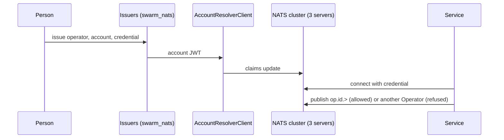

# T0.09: NATS JetStream and Operator accounts

**Status:** ✅ Done · **Ticket:** [TICKET.md](TICKET.md) · **Choices and trade-offs:** [IMPLEMENTATION.md](IMPLEMENTATION.md) · **Review:** [REVIEW.md](REVIEW.md)

## 🔭 What it does

- Each cell runs a NATS cluster of 3 servers with JetStream replicas 3, deployed by Helm and wired into the cell chart.
- Each Operator gets its own NATS account. Every credential issued in it may only use that Operator's subjects, plus the internal NATS subjects.
- Simulated Squads use credentials of their own, separate from the credentials of real ones.
- An edge has a leaf node chart that links to the core over mTLS with a revocable credential, and its messages are replayed in order after a cut.
- A new shared package gives Python services the NATS connection, request-reply with a deadline and an idempotency key, a responder, a durable consumer, a JetStream admin client and an event publisher.

## ⚙️ How it works

1. **The cell runs the cluster.** The umbrella chart depends on the `nats` chart, enabled by a condition, in [`deploy/charts/cell/Chart.yaml:21-23`](../../../deploy/charts/cell/Chart.yaml#L21-L23). The chart has 3 replicas and the JetStream domain `cell` in [`deploy/charts/nats/values.yaml:1-15`](../../../deploy/charts/nats/values.yaml#L1-L15).
2. **The servers trust one Operator.** The server config enables JetStream with its domain at [`deploy/charts/nats/templates/configmap.yaml:14-18`](../../../deploy/charts/nats/templates/configmap.yaml#L14-L18) and a `full` resolver with the preloaded system account at [`deploy/charts/nats/templates/configmap.yaml:34-40`](../../../deploy/charts/nats/templates/configmap.yaml#L34-L40). Terraform passes only the public operator JWT, system account key and system account JWT, as Helm parameters, in [`deploy/terraform/cells/dev-branch/main.tf:5-7`](../../../deploy/terraform/cells/dev-branch/main.tf#L5-L7).
3. **An Operator is issued once.** `OperatorIssuer.issue` makes the operator key pair and its JWT, in [`packages/python/swarm-nats/src/swarm_nats/service/accounts/operator_issuer.py:73`](../../../packages/python/swarm-nats/src/swarm_nats/service/accounts/operator_issuer.py#L73). The nkey and JWT encoding is written by hand in [`NatsJwtSigner.sign`](../../../packages/python/swarm-nats/src/swarm_nats/service/accounts/nats_jwt_signer.py#L174) and checked by [`decode`](../../../packages/python/swarm-nats/src/swarm_nats/service/accounts/nats_jwt_signer.py#L197).
4. **Each Operator gets an account.** `AccountIssuer.issue` creates an account named after the Operator's UUID and signs it with the operator key, in [`packages/python/swarm-nats/src/swarm_nats/service/accounts/account_issuer.py:110`](../../../packages/python/swarm-nats/src/swarm_nats/service/accounts/account_issuer.py#L110).
5. **The account is pushed to the servers.** `AccountResolverClient.push` sends the JWT on the claims update subject, in [`packages/python/swarm-nats/src/swarm_nats/clients/account_resolver_client.py:58`](../../../packages/python/swarm-nats/src/swarm_nats/clients/account_resolver_client.py#L58). A timeout, another NATS error, a reply that is not JSON or a reply with an `error` key all raise `SENatsAccountPushRefusedError` ([`:70`](../../../packages/python/swarm-nats/src/swarm_nats/clients/account_resolver_client.py#L70), [`:84`](../../../packages/python/swarm-nats/src/swarm_nats/clients/account_resolver_client.py#L84), [`:90`](../../../packages/python/swarm-nats/src/swarm_nats/clients/account_resolver_client.py#L90)).
6. **A credential is confined to its Operator.** `CredentialIssuer.issue` refuses the system kind and an account that is not the Operator's, then allows only `op.<operator_id>.>` plus `MECHANISM_SUBJECTS`: [`credential_issuer.py:160-188`](../../../packages/python/swarm-nats/src/swarm_nats/service/accounts/credential_issuer.py#L160-L188), with the constant at [`:69`](../../../packages/python/swarm-nats/src/swarm_nats/service/accounts/credential_issuer.py#L69). Simulated credentials are the same call with the `SIMULATED` kind, which gives their own key and tag. The system credential has its own method, [`issue_system`](../../../packages/python/swarm-nats/src/swarm_nats/service/accounts/credential_issuer.py#L190).
7. **A credential is revoked.** `AccountIssuer.revoke` returns the account with a new operator-signed JWT holding the revoked user keys, in [`account_issuer.py:134`](../../../packages/python/swarm-nats/src/swarm_nats/service/accounts/account_issuer.py#L134). Pushing it again makes the servers refuse that key.
8. **An edge links to the core.** The leaf chart gives the edge its own JetStream domain ([`deploy/charts/nats-leaf/templates/configmap.yaml:12-14`](../../../deploy/charts/nats-leaf/templates/configmap.yaml#L12-L14)) and one remote with a credential file and mTLS ([`:16-24`](../../../deploy/charts/nats-leaf/templates/configmap.yaml#L16-L24)). The core listener, off by default, requires client certificates: [`deploy/charts/nats/templates/configmap.yaml:43-51`](../../../deploy/charts/nats/templates/configmap.yaml#L43-L51). The core copies the edge stream through a `StreamSource`, created by [`JetStreamAdmin.ensure_stream`](../../../packages/python/swarm-nats/src/swarm_nats/clients/jetstream_admin.py#L135).
9. **A service connects and calls.** [`NatsConnector.connect`](../../../packages/python/swarm-nats/src/swarm_nats/clients/nats_connector.py#L75) opens the connection. [`NatsRequester.request`](../../../packages/python/swarm-nats/src/swarm_nats/clients/nats_requester.py#L95) validates the key and deadline, sends the absolute UTC deadline and the idempotency key as headers, and never retries.
10. **A responder answers once.** `NatsResponder._answer` ([`nats_responder.py:198`](../../../packages/python/swarm-nats/src/swarm_nats/api/bus/nats_responder.py#L198)) refuses a bad key or deadline, drops a request whose deadline has passed without a reply, replays a stored reply, or calls the handler and stores the reply in a key-value bucket. A failed reply is not stored. [`initialize`](../../../packages/python/swarm-nats/src/swarm_nats/api/bus/nats_responder.py#L262) opens the bucket and subscribes in a queue group.
11. **Events are published and consumed.** [`EventPublisher.publish`](../../../packages/python/swarm-nats/src/swarm_nats/clients/event_publisher.py#L48) sets `Nats-Msg-Id` for de-duplication. [`DurableConsumer`](../../../packages/python/swarm-nats/src/swarm_nats/api/bus/durable_consumer.py#L69) pulls with explicit acks: ack after the handler, nak on failure.



## 🧱 Files and lines changed

<!-- changes -->
| File | Change | Lines in the new version | Added | Removed |
| --- | --- | --- | --- | --- |
| [`.github/workflows/python.yml`](../../../.github/workflows/python.yml) | Modified | [66-67](../../../.github/workflows/python.yml#L66), [76-86](../../../.github/workflows/python.yml#L76), [97-98](../../../.github/workflows/python.yml#L97), [107-117](../../../.github/workflows/python.yml#L107) | +26 | −0 |
| [`AGENT.md`](../../../AGENT.md) | Modified | [128-133](../../../AGENT.md#L128) | +6 | −2 |
| [`README.md`](../../../README.md) | Modified | [178-179](../../../README.md#L178) | +2 | −2 |
| [`deploy/README.md`](../../../deploy/README.md) | Modified | [29-30](../../../deploy/README.md#L29), [132](../../../deploy/README.md#L132), [188-256](../../../deploy/README.md#L188), [297-311](../../../deploy/README.md#L297) | +87 | −0 |
| [`deploy/charts/cell/Chart.lock`](../../../deploy/charts/cell/Chart.lock) | Modified | [14-17](../../../deploy/charts/cell/Chart.lock#L14) | +4 | −1 |
| [`deploy/charts/cell/Chart.yaml`](../../../deploy/charts/cell/Chart.yaml) | Modified | [3](../../../deploy/charts/cell/Chart.yaml#L3), [21-23](../../../deploy/charts/cell/Chart.yaml#L21) | +4 | −1 |
| [`deploy/charts/cell/values.yaml`](../../../deploy/charts/cell/values.yaml) | Modified | [12-13](../../../deploy/charts/cell/values.yaml#L12) | +2 | −0 |
| [`deploy/charts/nats-leaf/Chart.yaml`](../../../deploy/charts/nats-leaf/Chart.yaml) | Added | [1-6](../../../deploy/charts/nats-leaf/Chart.yaml#L1) | +6 | −0 |
| [`deploy/charts/nats-leaf/templates/_helpers.tpl`](../../../deploy/charts/nats-leaf/templates/_helpers.tpl) | Added | [1-15](../../../deploy/charts/nats-leaf/templates/_helpers.tpl#L1) | +15 | −0 |
| [`deploy/charts/nats-leaf/templates/configmap.yaml`](../../../deploy/charts/nats-leaf/templates/configmap.yaml) | Added | [1-28](../../../deploy/charts/nats-leaf/templates/configmap.yaml#L1) | +28 | −0 |
| [`deploy/charts/nats-leaf/templates/networkpolicy.yaml`](../../../deploy/charts/nats-leaf/templates/networkpolicy.yaml) | Added | [1-18](../../../deploy/charts/nats-leaf/templates/networkpolicy.yaml#L1) | +18 | −0 |
| [`deploy/charts/nats-leaf/templates/service.yaml`](../../../deploy/charts/nats-leaf/templates/service.yaml) | Added | [1-13](../../../deploy/charts/nats-leaf/templates/service.yaml#L1) | +13 | −0 |
| [`deploy/charts/nats-leaf/templates/statefulset.yaml`](../../../deploy/charts/nats-leaf/templates/statefulset.yaml) | Added | [1-78](../../../deploy/charts/nats-leaf/templates/statefulset.yaml#L1) | +78 | −0 |
| [`deploy/charts/nats-leaf/values.yaml`](../../../deploy/charts/nats-leaf/values.yaml) | Added | [1-16](../../../deploy/charts/nats-leaf/values.yaml#L1) | +16 | −0 |
| [`deploy/charts/nats/Chart.yaml`](../../../deploy/charts/nats/Chart.yaml) | Added | [1-6](../../../deploy/charts/nats/Chart.yaml#L1) | +6 | −0 |
| [`deploy/charts/nats/templates/_helpers.tpl`](../../../deploy/charts/nats/templates/_helpers.tpl) | Added | [1-11](../../../deploy/charts/nats/templates/_helpers.tpl#L1) | +11 | −0 |
| [`deploy/charts/nats/templates/configmap.yaml`](../../../deploy/charts/nats/templates/configmap.yaml) | Added | [1-54](../../../deploy/charts/nats/templates/configmap.yaml#L1) | +54 | −0 |
| [`deploy/charts/nats/templates/networkpolicy.yaml`](../../../deploy/charts/nats/templates/networkpolicy.yaml) | Added | [1-32](../../../deploy/charts/nats/templates/networkpolicy.yaml#L1) | +32 | −0 |
| [`deploy/charts/nats/templates/pdb.yaml`](../../../deploy/charts/nats/templates/pdb.yaml) | Added | [1-11](../../../deploy/charts/nats/templates/pdb.yaml#L1) | +11 | −0 |
| [`deploy/charts/nats/templates/service-headless.yaml`](../../../deploy/charts/nats/templates/service-headless.yaml) | Added | [1-21](../../../deploy/charts/nats/templates/service-headless.yaml#L1) | +21 | −0 |
| [`deploy/charts/nats/templates/service.yaml`](../../../deploy/charts/nats/templates/service.yaml) | Added | [1-18](../../../deploy/charts/nats/templates/service.yaml#L1) | +18 | −0 |
| [`deploy/charts/nats/templates/statefulset.yaml`](../../../deploy/charts/nats/templates/statefulset.yaml) | Added | [1-82](../../../deploy/charts/nats/templates/statefulset.yaml#L1) | +82 | −0 |
| [`deploy/charts/nats/values.yaml`](../../../deploy/charts/nats/values.yaml) | Added | [1-32](../../../deploy/charts/nats/values.yaml#L1) | +32 | −0 |
| [`deploy/environments/dev/values.yaml`](../../../deploy/environments/dev/values.yaml) | Modified | [23-27](../../../deploy/environments/dev/values.yaml#L23) | +5 | −0 |
| [`deploy/terraform/cells/dev-branch/main.tf`](../../../deploy/terraform/cells/dev-branch/main.tf) | Modified | [1-10](../../../deploy/terraform/cells/dev-branch/main.tf#L1), [37](../../../deploy/terraform/cells/dev-branch/main.tf#L37) | +11 | −1 |
| [`deploy/terraform/cells/dev-branch/outputs.tf`](../../../deploy/terraform/cells/dev-branch/outputs.tf) | Modified | [15-19](../../../deploy/terraform/cells/dev-branch/outputs.tf#L15) | +5 | −0 |
| [`deploy/terraform/cells/dev-branch/terraform.tfvars.example`](../../../deploy/terraform/cells/dev-branch/terraform.tfvars.example) | Modified | [9-14](../../../deploy/terraform/cells/dev-branch/terraform.tfvars.example#L9) | +6 | −0 |
| [`deploy/terraform/cells/dev-branch/tests/dev_branch.tftest.hcl`](../../../deploy/terraform/cells/dev-branch/tests/dev_branch.tftest.hcl) | Modified | [11-14](../../../deploy/terraform/cells/dev-branch/tests/dev_branch.tftest.hcl#L11), [39-48](../../../deploy/terraform/cells/dev-branch/tests/dev_branch.tftest.hcl#L39), [84-119](../../../deploy/terraform/cells/dev-branch/tests/dev_branch.tftest.hcl#L84) | +50 | −0 |
| [`deploy/terraform/cells/dev-branch/variables.tf`](../../../deploy/terraform/cells/dev-branch/variables.tf) | Modified | [56-85](../../../deploy/terraform/cells/dev-branch/variables.tf#L56) | +30 | −0 |
| [`packages/python/swarm-nats/pyproject.toml`](../../../packages/python/swarm-nats/pyproject.toml) | Added | [1-24](../../../packages/python/swarm-nats/pyproject.toml#L1) | +24 | −0 |
| [`packages/python/swarm-nats/src/swarm_nats/__init__.py`](../../../packages/python/swarm-nats/src/swarm_nats/__init__.py) | Added | [1](../../../packages/python/swarm-nats/src/swarm_nats/__init__.py#L1) | +1 | −0 |
| [`packages/python/swarm-nats/src/swarm_nats/api/__init__.py`](../../../packages/python/swarm-nats/src/swarm_nats/api/__init__.py) | Added | [1](../../../packages/python/swarm-nats/src/swarm_nats/api/__init__.py#L1) | +1 | −0 |
| [`packages/python/swarm-nats/src/swarm_nats/api/bus/__init__.py`](../../../packages/python/swarm-nats/src/swarm_nats/api/bus/__init__.py) | Added | [1](../../../packages/python/swarm-nats/src/swarm_nats/api/bus/__init__.py#L1) | +1 | −0 |
| [`packages/python/swarm-nats/src/swarm_nats/api/bus/durable_consumer.py`](../../../packages/python/swarm-nats/src/swarm_nats/api/bus/durable_consumer.py) | Added | [1-141](../../../packages/python/swarm-nats/src/swarm_nats/api/bus/durable_consumer.py#L1) | +141 | −0 |
| [`packages/python/swarm-nats/src/swarm_nats/api/bus/nats_responder.py`](../../../packages/python/swarm-nats/src/swarm_nats/api/bus/nats_responder.py) | Added | [1-287](../../../packages/python/swarm-nats/src/swarm_nats/api/bus/nats_responder.py#L1) | +287 | −0 |
| [`packages/python/swarm-nats/src/swarm_nats/api/factories/__init__.py`](../../../packages/python/swarm-nats/src/swarm_nats/api/factories/__init__.py) | Added | [1](../../../packages/python/swarm-nats/src/swarm_nats/api/factories/__init__.py#L1) | +1 | −0 |
| [`packages/python/swarm-nats/src/swarm_nats/api/factories/bus/__init__.py`](../../../packages/python/swarm-nats/src/swarm_nats/api/factories/bus/__init__.py) | Added | [1](../../../packages/python/swarm-nats/src/swarm_nats/api/factories/bus/__init__.py#L1) | +1 | −0 |
| [`packages/python/swarm-nats/src/swarm_nats/api/factories/bus/durable_consumer_factory.py`](../../../packages/python/swarm-nats/src/swarm_nats/api/factories/bus/durable_consumer_factory.py) | Added | [1-60](../../../packages/python/swarm-nats/src/swarm_nats/api/factories/bus/durable_consumer_factory.py#L1) | +60 | −0 |
| [`packages/python/swarm-nats/src/swarm_nats/api/factories/bus/nats_responder_factory.py`](../../../packages/python/swarm-nats/src/swarm_nats/api/factories/bus/nats_responder_factory.py) | Added | [1-62](../../../packages/python/swarm-nats/src/swarm_nats/api/factories/bus/nats_responder_factory.py#L1) | +62 | −0 |
| [`packages/python/swarm-nats/src/swarm_nats/api/factories/bus_runnable_factory.py`](../../../packages/python/swarm-nats/src/swarm_nats/api/factories/bus_runnable_factory.py) | Added | [1-16](../../../packages/python/swarm-nats/src/swarm_nats/api/factories/bus_runnable_factory.py#L1) | +16 | −0 |
| [`packages/python/swarm-nats/src/swarm_nats/clients/__init__.py`](../../../packages/python/swarm-nats/src/swarm_nats/clients/__init__.py) | Added | [1](../../../packages/python/swarm-nats/src/swarm_nats/clients/__init__.py#L1) | +1 | −0 |
| [`packages/python/swarm-nats/src/swarm_nats/clients/account_resolver_client.py`](../../../packages/python/swarm-nats/src/swarm_nats/clients/account_resolver_client.py) | Added | [1-93](../../../packages/python/swarm-nats/src/swarm_nats/clients/account_resolver_client.py#L1) | +93 | −0 |
| [`packages/python/swarm-nats/src/swarm_nats/clients/event_publisher.py`](../../../packages/python/swarm-nats/src/swarm_nats/clients/event_publisher.py) | Added | [1-73](../../../packages/python/swarm-nats/src/swarm_nats/clients/event_publisher.py#L1) | +73 | −0 |
| [`packages/python/swarm-nats/src/swarm_nats/clients/jetstream_admin.py`](../../../packages/python/swarm-nats/src/swarm_nats/clients/jetstream_admin.py) | Added | [1-163](../../../packages/python/swarm-nats/src/swarm_nats/clients/jetstream_admin.py#L1) | +163 | −0 |
| [`packages/python/swarm-nats/src/swarm_nats/clients/nats_connector.py`](../../../packages/python/swarm-nats/src/swarm_nats/clients/nats_connector.py) | Added | [1-126](../../../packages/python/swarm-nats/src/swarm_nats/clients/nats_connector.py#L1) | +126 | −0 |
| [`packages/python/swarm-nats/src/swarm_nats/clients/nats_requester.py`](../../../packages/python/swarm-nats/src/swarm_nats/clients/nats_requester.py) | Added | [1-157](../../../packages/python/swarm-nats/src/swarm_nats/clients/nats_requester.py#L1) | +157 | −0 |
| [`packages/python/swarm-nats/src/swarm_nats/models/__init__.py`](../../../packages/python/swarm-nats/src/swarm_nats/models/__init__.py) | Added | [1](../../../packages/python/swarm-nats/src/swarm_nats/models/__init__.py#L1) | +1 | −0 |
| [`packages/python/swarm-nats/src/swarm_nats/models/accounts/__init__.py`](../../../packages/python/swarm-nats/src/swarm_nats/models/accounts/__init__.py) | Added | ➖ | +0 | −0 |
| [`packages/python/swarm-nats/src/swarm_nats/models/accounts/exceptions/__init__.py`](../../../packages/python/swarm-nats/src/swarm_nats/models/accounts/exceptions/__init__.py) | Added | [1-59](../../../packages/python/swarm-nats/src/swarm_nats/models/accounts/exceptions/__init__.py#L1) | +59 | −0 |
| [`packages/python/swarm-nats/src/swarm_nats/models/accounts/exceptions/errors/__init__.py`](../../../packages/python/swarm-nats/src/swarm_nats/models/accounts/exceptions/errors/__init__.py) | Added | [1-17](../../../packages/python/swarm-nats/src/swarm_nats/models/accounts/exceptions/errors/__init__.py#L1) | +17 | −0 |
| [`packages/python/swarm-nats/src/swarm_nats/models/accounts/exceptions/errors/se_credential_issuer_account_mismatch_error.py`](../../../packages/python/swarm-nats/src/swarm_nats/models/accounts/exceptions/errors/se_credential_issuer_account_mismatch_error.py) | Added | [1-7](../../../packages/python/swarm-nats/src/swarm_nats/models/accounts/exceptions/errors/se_credential_issuer_account_mismatch_error.py#L1) | +7 | −0 |
| [`packages/python/swarm-nats/src/swarm_nats/models/accounts/exceptions/errors/se_credential_issuer_invalid_kind_error.py`](../../../packages/python/swarm-nats/src/swarm_nats/models/accounts/exceptions/errors/se_credential_issuer_invalid_kind_error.py) | Added | [1-7](../../../packages/python/swarm-nats/src/swarm_nats/models/accounts/exceptions/errors/se_credential_issuer_invalid_kind_error.py#L1) | +7 | −0 |
| [`packages/python/swarm-nats/src/swarm_nats/models/accounts/exceptions/errors/se_nats_accounts_error.py`](../../../packages/python/swarm-nats/src/swarm_nats/models/accounts/exceptions/errors/se_nats_accounts_error.py) | Added | [1-5](../../../packages/python/swarm-nats/src/swarm_nats/models/accounts/exceptions/errors/se_nats_accounts_error.py#L1) | +5 | −0 |
| [`packages/python/swarm-nats/src/swarm_nats/models/accounts/exceptions/errors/se_nats_jwt_invalid_error.py`](../../../packages/python/swarm-nats/src/swarm_nats/models/accounts/exceptions/errors/se_nats_jwt_invalid_error.py) | Added | [1-7](../../../packages/python/swarm-nats/src/swarm_nats/models/accounts/exceptions/errors/se_nats_jwt_invalid_error.py#L1) | +7 | −0 |
| [`packages/python/swarm-nats/src/swarm_nats/models/accounts/exceptions/errors/se_nkey_invalid_seed_error.py`](../../../packages/python/swarm-nats/src/swarm_nats/models/accounts/exceptions/errors/se_nkey_invalid_seed_error.py) | Added | [1-7](../../../packages/python/swarm-nats/src/swarm_nats/models/accounts/exceptions/errors/se_nkey_invalid_seed_error.py#L1) | +7 | −0 |
| [`packages/python/swarm-nats/src/swarm_nats/models/accounts/exceptions/issued_account/__init__.py`](../../../packages/python/swarm-nats/src/swarm_nats/models/accounts/exceptions/issued_account/__init__.py) | Added | [1-21](../../../packages/python/swarm-nats/src/swarm_nats/models/accounts/exceptions/issued_account/__init__.py#L1) | +21 | −0 |
| [`packages/python/swarm-nats/src/swarm_nats/models/accounts/exceptions/issued_account/se_invalid_issued_account_exception.py`](../../../packages/python/swarm-nats/src/swarm_nats/models/accounts/exceptions/issued_account/se_invalid_issued_account_exception.py) | Added | [1-5](../../../packages/python/swarm-nats/src/swarm_nats/models/accounts/exceptions/issued_account/se_invalid_issued_account_exception.py#L1) | +5 | −0 |
| [`packages/python/swarm-nats/src/swarm_nats/models/accounts/exceptions/issued_account/se_issued_account_invalid_jwt.py`](../../../packages/python/swarm-nats/src/swarm_nats/models/accounts/exceptions/issued_account/se_issued_account_invalid_jwt.py) | Added | [1-9](../../../packages/python/swarm-nats/src/swarm_nats/models/accounts/exceptions/issued_account/se_issued_account_invalid_jwt.py#L1) | +9 | −0 |
| [`packages/python/swarm-nats/src/swarm_nats/models/accounts/exceptions/issued_account/se_issued_account_invalid_name.py`](../../../packages/python/swarm-nats/src/swarm_nats/models/accounts/exceptions/issued_account/se_issued_account_invalid_name.py) | Added | [1-9](../../../packages/python/swarm-nats/src/swarm_nats/models/accounts/exceptions/issued_account/se_issued_account_invalid_name.py#L1) | +9 | −0 |
| [`packages/python/swarm-nats/src/swarm_nats/models/accounts/exceptions/issued_account/se_issued_account_invalid_public_key.py`](../../../packages/python/swarm-nats/src/swarm_nats/models/accounts/exceptions/issued_account/se_issued_account_invalid_public_key.py) | Added | [1-9](../../../packages/python/swarm-nats/src/swarm_nats/models/accounts/exceptions/issued_account/se_issued_account_invalid_public_key.py#L1) | +9 | −0 |
| [`packages/python/swarm-nats/src/swarm_nats/models/accounts/exceptions/issued_account/se_issued_account_invalid_seed.py`](../../../packages/python/swarm-nats/src/swarm_nats/models/accounts/exceptions/issued_account/se_issued_account_invalid_seed.py) | Added | [1-9](../../../packages/python/swarm-nats/src/swarm_nats/models/accounts/exceptions/issued_account/se_issued_account_invalid_seed.py#L1) | +9 | −0 |
| [`packages/python/swarm-nats/src/swarm_nats/models/accounts/exceptions/issued_credential/__init__.py`](../../../packages/python/swarm-nats/src/swarm_nats/models/accounts/exceptions/issued_credential/__init__.py) | Added | [1-27](../../../packages/python/swarm-nats/src/swarm_nats/models/accounts/exceptions/issued_credential/__init__.py#L1) | +27 | −0 |
| [`packages/python/swarm-nats/src/swarm_nats/models/accounts/exceptions/issued_credential/identity/__init__.py`](../../../packages/python/swarm-nats/src/swarm_nats/models/accounts/exceptions/issued_credential/identity/__init__.py) | Added | [1-11](../../../packages/python/swarm-nats/src/swarm_nats/models/accounts/exceptions/issued_credential/identity/__init__.py#L1) | +11 | −0 |
| [`packages/python/swarm-nats/src/swarm_nats/models/accounts/exceptions/issued_credential/identity/se_issued_credential_invalid_kind.py`](../../../packages/python/swarm-nats/src/swarm_nats/models/accounts/exceptions/issued_credential/identity/se_issued_credential_invalid_kind.py) | Added | [1-9](../../../packages/python/swarm-nats/src/swarm_nats/models/accounts/exceptions/issued_credential/identity/se_issued_credential_invalid_kind.py#L1) | +9 | −0 |
| [`packages/python/swarm-nats/src/swarm_nats/models/accounts/exceptions/issued_credential/identity/se_issued_credential_invalid_name.py`](../../../packages/python/swarm-nats/src/swarm_nats/models/accounts/exceptions/issued_credential/identity/se_issued_credential_invalid_name.py) | Added | [1-9](../../../packages/python/swarm-nats/src/swarm_nats/models/accounts/exceptions/issued_credential/identity/se_issued_credential_invalid_name.py#L1) | +9 | −0 |
| [`packages/python/swarm-nats/src/swarm_nats/models/accounts/exceptions/issued_credential/identity/se_issued_credential_invalid_operator_id.py`](../../../packages/python/swarm-nats/src/swarm_nats/models/accounts/exceptions/issued_credential/identity/se_issued_credential_invalid_operator_id.py) | Added | [1-9](../../../packages/python/swarm-nats/src/swarm_nats/models/accounts/exceptions/issued_credential/identity/se_issued_credential_invalid_operator_id.py#L1) | +9 | −0 |
| [`packages/python/swarm-nats/src/swarm_nats/models/accounts/exceptions/issued_credential/proof/__init__.py`](../../../packages/python/swarm-nats/src/swarm_nats/models/accounts/exceptions/issued_credential/proof/__init__.py) | Added | [1-11](../../../packages/python/swarm-nats/src/swarm_nats/models/accounts/exceptions/issued_credential/proof/__init__.py#L1) | +11 | −0 |
| [`packages/python/swarm-nats/src/swarm_nats/models/accounts/exceptions/issued_credential/proof/se_issued_credential_invalid_jwt.py`](../../../packages/python/swarm-nats/src/swarm_nats/models/accounts/exceptions/issued_credential/proof/se_issued_credential_invalid_jwt.py) | Added | [1-9](../../../packages/python/swarm-nats/src/swarm_nats/models/accounts/exceptions/issued_credential/proof/se_issued_credential_invalid_jwt.py#L1) | +9 | −0 |
| [`packages/python/swarm-nats/src/swarm_nats/models/accounts/exceptions/issued_credential/proof/se_issued_credential_invalid_public_key.py`](../../../packages/python/swarm-nats/src/swarm_nats/models/accounts/exceptions/issued_credential/proof/se_issued_credential_invalid_public_key.py) | Added | [1-9](../../../packages/python/swarm-nats/src/swarm_nats/models/accounts/exceptions/issued_credential/proof/se_issued_credential_invalid_public_key.py#L1) | +9 | −0 |
| [`packages/python/swarm-nats/src/swarm_nats/models/accounts/exceptions/issued_credential/proof/se_issued_credential_invalid_seed.py`](../../../packages/python/swarm-nats/src/swarm_nats/models/accounts/exceptions/issued_credential/proof/se_issued_credential_invalid_seed.py) | Added | [1-9](../../../packages/python/swarm-nats/src/swarm_nats/models/accounts/exceptions/issued_credential/proof/se_issued_credential_invalid_seed.py#L1) | +9 | −0 |
| [`packages/python/swarm-nats/src/swarm_nats/models/accounts/exceptions/issued_credential/se_invalid_issued_credential_exception.py`](../../../packages/python/swarm-nats/src/swarm_nats/models/accounts/exceptions/issued_credential/se_invalid_issued_credential_exception.py) | Added | [1-5](../../../packages/python/swarm-nats/src/swarm_nats/models/accounts/exceptions/issued_credential/se_invalid_issued_credential_exception.py#L1) | +5 | −0 |
| [`packages/python/swarm-nats/src/swarm_nats/models/accounts/exceptions/issued_credential/se_issued_credential_inconsistent_kind.py`](../../../packages/python/swarm-nats/src/swarm_nats/models/accounts/exceptions/issued_credential/se_issued_credential_inconsistent_kind.py) | Added | [1-9](../../../packages/python/swarm-nats/src/swarm_nats/models/accounts/exceptions/issued_credential/se_issued_credential_inconsistent_kind.py#L1) | +9 | −0 |
| [`packages/python/swarm-nats/src/swarm_nats/models/accounts/exceptions/issued_operator/__init__.py`](../../../packages/python/swarm-nats/src/swarm_nats/models/accounts/exceptions/issued_operator/__init__.py) | Added | [1-21](../../../packages/python/swarm-nats/src/swarm_nats/models/accounts/exceptions/issued_operator/__init__.py#L1) | +21 | −0 |
| [`packages/python/swarm-nats/src/swarm_nats/models/accounts/exceptions/issued_operator/identity/__init__.py`](../../../packages/python/swarm-nats/src/swarm_nats/models/accounts/exceptions/issued_operator/identity/__init__.py) | Added | [1-8](../../../packages/python/swarm-nats/src/swarm_nats/models/accounts/exceptions/issued_operator/identity/__init__.py#L1) | +8 | −0 |
| [`packages/python/swarm-nats/src/swarm_nats/models/accounts/exceptions/issued_operator/identity/se_issued_operator_invalid_name.py`](../../../packages/python/swarm-nats/src/swarm_nats/models/accounts/exceptions/issued_operator/identity/se_issued_operator_invalid_name.py) | Added | [1-9](../../../packages/python/swarm-nats/src/swarm_nats/models/accounts/exceptions/issued_operator/identity/se_issued_operator_invalid_name.py#L1) | +9 | −0 |
| [`packages/python/swarm-nats/src/swarm_nats/models/accounts/exceptions/issued_operator/identity/se_issued_operator_invalid_system_account.py`](../../../packages/python/swarm-nats/src/swarm_nats/models/accounts/exceptions/issued_operator/identity/se_issued_operator_invalid_system_account.py) | Added | [1-9](../../../packages/python/swarm-nats/src/swarm_nats/models/accounts/exceptions/issued_operator/identity/se_issued_operator_invalid_system_account.py#L1) | +9 | −0 |
| [`packages/python/swarm-nats/src/swarm_nats/models/accounts/exceptions/issued_operator/proof/__init__.py`](../../../packages/python/swarm-nats/src/swarm_nats/models/accounts/exceptions/issued_operator/proof/__init__.py) | Added | [1-11](../../../packages/python/swarm-nats/src/swarm_nats/models/accounts/exceptions/issued_operator/proof/__init__.py#L1) | +11 | −0 |
| [`packages/python/swarm-nats/src/swarm_nats/models/accounts/exceptions/issued_operator/proof/se_issued_operator_invalid_jwt.py`](../../../packages/python/swarm-nats/src/swarm_nats/models/accounts/exceptions/issued_operator/proof/se_issued_operator_invalid_jwt.py) | Added | [1-9](../../../packages/python/swarm-nats/src/swarm_nats/models/accounts/exceptions/issued_operator/proof/se_issued_operator_invalid_jwt.py#L1) | +9 | −0 |
| [`packages/python/swarm-nats/src/swarm_nats/models/accounts/exceptions/issued_operator/proof/se_issued_operator_invalid_public_key.py`](../../../packages/python/swarm-nats/src/swarm_nats/models/accounts/exceptions/issued_operator/proof/se_issued_operator_invalid_public_key.py) | Added | [1-9](../../../packages/python/swarm-nats/src/swarm_nats/models/accounts/exceptions/issued_operator/proof/se_issued_operator_invalid_public_key.py#L1) | +9 | −0 |
| [`packages/python/swarm-nats/src/swarm_nats/models/accounts/exceptions/issued_operator/proof/se_issued_operator_invalid_seed.py`](../../../packages/python/swarm-nats/src/swarm_nats/models/accounts/exceptions/issued_operator/proof/se_issued_operator_invalid_seed.py) | Added | [1-9](../../../packages/python/swarm-nats/src/swarm_nats/models/accounts/exceptions/issued_operator/proof/se_issued_operator_invalid_seed.py#L1) | +9 | −0 |
| [`packages/python/swarm-nats/src/swarm_nats/models/accounts/exceptions/issued_operator/se_invalid_issued_operator_exception.py`](../../../packages/python/swarm-nats/src/swarm_nats/models/accounts/exceptions/issued_operator/se_invalid_issued_operator_exception.py) | Added | [1-5](../../../packages/python/swarm-nats/src/swarm_nats/models/accounts/exceptions/issued_operator/se_invalid_issued_operator_exception.py#L1) | +5 | −0 |
| [`packages/python/swarm-nats/src/swarm_nats/models/accounts/issued_account.py`](../../../packages/python/swarm-nats/src/swarm_nats/models/accounts/issued_account.py) | Added | [1-129](../../../packages/python/swarm-nats/src/swarm_nats/models/accounts/issued_account.py#L1) | +129 | −0 |
| [`packages/python/swarm-nats/src/swarm_nats/models/accounts/issued_credential.py`](../../../packages/python/swarm-nats/src/swarm_nats/models/accounts/issued_credential.py) | Added | [1-206](../../../packages/python/swarm-nats/src/swarm_nats/models/accounts/issued_credential.py#L1) | +206 | −0 |
| [`packages/python/swarm-nats/src/swarm_nats/models/accounts/issued_operator.py`](../../../packages/python/swarm-nats/src/swarm_nats/models/accounts/issued_operator.py) | Added | [1-158](../../../packages/python/swarm-nats/src/swarm_nats/models/accounts/issued_operator.py#L1) | +158 | −0 |
| [`packages/python/swarm-nats/src/swarm_nats/models/bus/__init__.py`](../../../packages/python/swarm-nats/src/swarm_nats/models/bus/__init__.py) | Added | [1](../../../packages/python/swarm-nats/src/swarm_nats/models/bus/__init__.py#L1) | +1 | −0 |
| [`packages/python/swarm-nats/src/swarm_nats/models/bus/exceptions/__init__.py`](../../../packages/python/swarm-nats/src/swarm_nats/models/bus/exceptions/__init__.py) | Added | [1-32](../../../packages/python/swarm-nats/src/swarm_nats/models/bus/exceptions/__init__.py#L1) | +32 | −0 |
| [`packages/python/swarm-nats/src/swarm_nats/models/bus/exceptions/connection/__init__.py`](../../../packages/python/swarm-nats/src/swarm_nats/models/bus/exceptions/connection/__init__.py) | Added | [1-5](../../../packages/python/swarm-nats/src/swarm_nats/models/bus/exceptions/connection/__init__.py#L1) | +5 | −0 |
| [`packages/python/swarm-nats/src/swarm_nats/models/bus/exceptions/connection/se_nats_connection_error.py`](../../../packages/python/swarm-nats/src/swarm_nats/models/bus/exceptions/connection/se_nats_connection_error.py) | Added | [1-8](../../../packages/python/swarm-nats/src/swarm_nats/models/bus/exceptions/connection/se_nats_connection_error.py#L1) | +8 | −0 |
| [`packages/python/swarm-nats/src/swarm_nats/models/bus/exceptions/requests/__init__.py`](../../../packages/python/swarm-nats/src/swarm_nats/models/bus/exceptions/requests/__init__.py) | Added | [1-17](../../../packages/python/swarm-nats/src/swarm_nats/models/bus/exceptions/requests/__init__.py#L1) | +17 | −0 |
| [`packages/python/swarm-nats/src/swarm_nats/models/bus/exceptions/requests/se_nats_no_responder_error.py`](../../../packages/python/swarm-nats/src/swarm_nats/models/bus/exceptions/requests/se_nats_no_responder_error.py) | Added | [1-8](../../../packages/python/swarm-nats/src/swarm_nats/models/bus/exceptions/requests/se_nats_no_responder_error.py#L1) | +8 | −0 |
| [`packages/python/swarm-nats/src/swarm_nats/models/bus/exceptions/requests/se_nats_reply_invalid_error.py`](../../../packages/python/swarm-nats/src/swarm_nats/models/bus/exceptions/requests/se_nats_reply_invalid_error.py) | Added | [1-8](../../../packages/python/swarm-nats/src/swarm_nats/models/bus/exceptions/requests/se_nats_reply_invalid_error.py#L1) | +8 | −0 |
| [`packages/python/swarm-nats/src/swarm_nats/models/bus/exceptions/requests/se_nats_request_deadline_exceeded_error.py`](../../../packages/python/swarm-nats/src/swarm_nats/models/bus/exceptions/requests/se_nats_request_deadline_exceeded_error.py) | Added | [1-8](../../../packages/python/swarm-nats/src/swarm_nats/models/bus/exceptions/requests/se_nats_request_deadline_exceeded_error.py#L1) | +8 | −0 |
| [`packages/python/swarm-nats/src/swarm_nats/models/bus/exceptions/requests/se_nats_request_failed_error.py`](../../../packages/python/swarm-nats/src/swarm_nats/models/bus/exceptions/requests/se_nats_request_failed_error.py) | Added | [1-8](../../../packages/python/swarm-nats/src/swarm_nats/models/bus/exceptions/requests/se_nats_request_failed_error.py#L1) | +8 | −0 |
| [`packages/python/swarm-nats/src/swarm_nats/models/bus/exceptions/requests/se_nats_request_invalid_error.py`](../../../packages/python/swarm-nats/src/swarm_nats/models/bus/exceptions/requests/se_nats_request_invalid_error.py) | Added | [1-8](../../../packages/python/swarm-nats/src/swarm_nats/models/bus/exceptions/requests/se_nats_request_invalid_error.py#L1) | +8 | −0 |
| [`packages/python/swarm-nats/src/swarm_nats/models/bus/exceptions/se_nats_error.py`](../../../packages/python/swarm-nats/src/swarm_nats/models/bus/exceptions/se_nats_error.py) | Added | [1-5](../../../packages/python/swarm-nats/src/swarm_nats/models/bus/exceptions/se_nats_error.py#L1) | +5 | −0 |
| [`packages/python/swarm-nats/src/swarm_nats/models/bus/exceptions/streams/__init__.py`](../../../packages/python/swarm-nats/src/swarm_nats/models/bus/exceptions/streams/__init__.py) | Added | [1-7](../../../packages/python/swarm-nats/src/swarm_nats/models/bus/exceptions/streams/__init__.py#L1) | +7 | −0 |
| [`packages/python/swarm-nats/src/swarm_nats/models/bus/exceptions/streams/se_nats_account_push_refused_error.py`](../../../packages/python/swarm-nats/src/swarm_nats/models/bus/exceptions/streams/se_nats_account_push_refused_error.py) | Added | [1-8](../../../packages/python/swarm-nats/src/swarm_nats/models/bus/exceptions/streams/se_nats_account_push_refused_error.py#L1) | +8 | −0 |
| [`packages/python/swarm-nats/src/swarm_nats/models/bus/exceptions/streams/se_nats_publish_error.py`](../../../packages/python/swarm-nats/src/swarm_nats/models/bus/exceptions/streams/se_nats_publish_error.py) | Added | [1-8](../../../packages/python/swarm-nats/src/swarm_nats/models/bus/exceptions/streams/se_nats_publish_error.py#L1) | +8 | −0 |
| [`packages/python/swarm-nats/src/swarm_nats/models/bus/exceptions/streams/se_nats_stream_error.py`](../../../packages/python/swarm-nats/src/swarm_nats/models/bus/exceptions/streams/se_nats_stream_error.py) | Added | [1-8](../../../packages/python/swarm-nats/src/swarm_nats/models/bus/exceptions/streams/se_nats_stream_error.py#L1) | +8 | −0 |
| [`packages/python/swarm-nats/src/swarm_nats/models/bus/exceptions/validation/__init__.py`](../../../packages/python/swarm-nats/src/swarm_nats/models/bus/exceptions/validation/__init__.py) | Added | [1-8](../../../packages/python/swarm-nats/src/swarm_nats/models/bus/exceptions/validation/__init__.py#L1) | +8 | −0 |
| [`packages/python/swarm-nats/src/swarm_nats/models/bus/exceptions/validation/se_nats_invalid_deadline_error.py`](../../../packages/python/swarm-nats/src/swarm_nats/models/bus/exceptions/validation/se_nats_invalid_deadline_error.py) | Added | [1-8](../../../packages/python/swarm-nats/src/swarm_nats/models/bus/exceptions/validation/se_nats_invalid_deadline_error.py#L1) | +8 | −0 |
| [`packages/python/swarm-nats/src/swarm_nats/models/bus/exceptions/validation/se_nats_invalid_idempotency_key_error.py`](../../../packages/python/swarm-nats/src/swarm_nats/models/bus/exceptions/validation/se_nats_invalid_idempotency_key_error.py) | Added | [1-8](../../../packages/python/swarm-nats/src/swarm_nats/models/bus/exceptions/validation/se_nats_invalid_idempotency_key_error.py#L1) | +8 | −0 |
| [`packages/python/swarm-nats/src/swarm_nats/models/bus/nats_headers.py`](../../../packages/python/swarm-nats/src/swarm_nats/models/bus/nats_headers.py) | Added | [1-25](../../../packages/python/swarm-nats/src/swarm_nats/models/bus/nats_headers.py#L1) | +25 | −0 |
| [`packages/python/swarm-nats/src/swarm_nats/models/config/__init__.py`](../../../packages/python/swarm-nats/src/swarm_nats/models/config/__init__.py) | Added | [1](../../../packages/python/swarm-nats/src/swarm_nats/models/config/__init__.py#L1) | +1 | −0 |
| [`packages/python/swarm-nats/src/swarm_nats/models/config/durable_consumer_config.py`](../../../packages/python/swarm-nats/src/swarm_nats/models/config/durable_consumer_config.py) | Added | [1-275](../../../packages/python/swarm-nats/src/swarm_nats/models/config/durable_consumer_config.py#L1) | +275 | −0 |
| [`packages/python/swarm-nats/src/swarm_nats/models/config/exceptions/__init__.py`](../../../packages/python/swarm-nats/src/swarm_nats/models/config/exceptions/__init__.py) | Added | [1-95](../../../packages/python/swarm-nats/src/swarm_nats/models/config/exceptions/__init__.py#L1) | +95 | −0 |
| [`packages/python/swarm-nats/src/swarm_nats/models/config/exceptions/durable_consumer_config/__init__.py`](../../../packages/python/swarm-nats/src/swarm_nats/models/config/exceptions/durable_consumer_config/__init__.py) | Added | ➖ | +0 | −0 |
| [`packages/python/swarm-nats/src/swarm_nats/models/config/exceptions/durable_consumer_config/batching/__init__.py`](../../../packages/python/swarm-nats/src/swarm_nats/models/config/exceptions/durable_consumer_config/batching/__init__.py) | Added | ➖ | +0 | −0 |
| [`packages/python/swarm-nats/src/swarm_nats/models/config/exceptions/durable_consumer_config/batching/se_durable_consumer_config_invalid_ack_wait.py`](../../../packages/python/swarm-nats/src/swarm_nats/models/config/exceptions/durable_consumer_config/batching/se_durable_consumer_config_invalid_ack_wait.py) | Added | [1-10](../../../packages/python/swarm-nats/src/swarm_nats/models/config/exceptions/durable_consumer_config/batching/se_durable_consumer_config_invalid_ack_wait.py#L1) | +10 | −0 |
| [`packages/python/swarm-nats/src/swarm_nats/models/config/exceptions/durable_consumer_config/batching/se_durable_consumer_config_invalid_batch_size.py`](../../../packages/python/swarm-nats/src/swarm_nats/models/config/exceptions/durable_consumer_config/batching/se_durable_consumer_config_invalid_batch_size.py) | Added | [1-10](../../../packages/python/swarm-nats/src/swarm_nats/models/config/exceptions/durable_consumer_config/batching/se_durable_consumer_config_invalid_batch_size.py#L1) | +10 | −0 |
| [`packages/python/swarm-nats/src/swarm_nats/models/config/exceptions/durable_consumer_config/batching/se_durable_consumer_config_invalid_fetch_timeout.py`](../../../packages/python/swarm-nats/src/swarm_nats/models/config/exceptions/durable_consumer_config/batching/se_durable_consumer_config_invalid_fetch_timeout.py) | Added | [1-10](../../../packages/python/swarm-nats/src/swarm_nats/models/config/exceptions/durable_consumer_config/batching/se_durable_consumer_config_invalid_fetch_timeout.py#L1) | +10 | −0 |
| [`packages/python/swarm-nats/src/swarm_nats/models/config/exceptions/durable_consumer_config/delivery/__init__.py`](../../../packages/python/swarm-nats/src/swarm_nats/models/config/exceptions/durable_consumer_config/delivery/__init__.py) | Added | ➖ | +0 | −0 |
| [`packages/python/swarm-nats/src/swarm_nats/models/config/exceptions/durable_consumer_config/delivery/se_durable_consumer_config_invalid_max_deliver.py`](../../../packages/python/swarm-nats/src/swarm_nats/models/config/exceptions/durable_consumer_config/delivery/se_durable_consumer_config_invalid_max_deliver.py) | Added | [1-10](../../../packages/python/swarm-nats/src/swarm_nats/models/config/exceptions/durable_consumer_config/delivery/se_durable_consumer_config_invalid_max_deliver.py#L1) | +10 | −0 |
| [`packages/python/swarm-nats/src/swarm_nats/models/config/exceptions/durable_consumer_config/delivery/se_durable_consumer_config_invalid_status_interval.py`](../../../packages/python/swarm-nats/src/swarm_nats/models/config/exceptions/durable_consumer_config/delivery/se_durable_consumer_config_invalid_status_interval.py) | Added | [1-10](../../../packages/python/swarm-nats/src/swarm_nats/models/config/exceptions/durable_consumer_config/delivery/se_durable_consumer_config_invalid_status_interval.py#L1) | +10 | −0 |
| [`packages/python/swarm-nats/src/swarm_nats/models/config/exceptions/durable_consumer_config/identity/__init__.py`](../../../packages/python/swarm-nats/src/swarm_nats/models/config/exceptions/durable_consumer_config/identity/__init__.py) | Added | ➖ | +0 | −0 |
| [`packages/python/swarm-nats/src/swarm_nats/models/config/exceptions/durable_consumer_config/identity/se_durable_consumer_config_invalid_durable_name.py`](../../../packages/python/swarm-nats/src/swarm_nats/models/config/exceptions/durable_consumer_config/identity/se_durable_consumer_config_invalid_durable_name.py) | Added | [1-10](../../../packages/python/swarm-nats/src/swarm_nats/models/config/exceptions/durable_consumer_config/identity/se_durable_consumer_config_invalid_durable_name.py#L1) | +10 | −0 |
| [`packages/python/swarm-nats/src/swarm_nats/models/config/exceptions/durable_consumer_config/identity/se_durable_consumer_config_invalid_filter_subject.py`](../../../packages/python/swarm-nats/src/swarm_nats/models/config/exceptions/durable_consumer_config/identity/se_durable_consumer_config_invalid_filter_subject.py) | Added | [1-10](../../../packages/python/swarm-nats/src/swarm_nats/models/config/exceptions/durable_consumer_config/identity/se_durable_consumer_config_invalid_filter_subject.py#L1) | +10 | −0 |
| [`packages/python/swarm-nats/src/swarm_nats/models/config/exceptions/durable_consumer_config/identity/se_durable_consumer_config_invalid_stream.py`](../../../packages/python/swarm-nats/src/swarm_nats/models/config/exceptions/durable_consumer_config/identity/se_durable_consumer_config_invalid_stream.py) | Added | [1-10](../../../packages/python/swarm-nats/src/swarm_nats/models/config/exceptions/durable_consumer_config/identity/se_durable_consumer_config_invalid_stream.py#L1) | +10 | −0 |
| [`packages/python/swarm-nats/src/swarm_nats/models/config/exceptions/durable_consumer_config/se_invalid_durable_consumer_config_exception.py`](../../../packages/python/swarm-nats/src/swarm_nats/models/config/exceptions/durable_consumer_config/se_invalid_durable_consumer_config_exception.py) | Added | [1-5](../../../packages/python/swarm-nats/src/swarm_nats/models/config/exceptions/durable_consumer_config/se_invalid_durable_consumer_config_exception.py#L1) | +5 | −0 |
| [`packages/python/swarm-nats/src/swarm_nats/models/config/exceptions/nats_client_config/__init__.py`](../../../packages/python/swarm-nats/src/swarm_nats/models/config/exceptions/nats_client_config/__init__.py) | Added | ➖ | +0 | −0 |
| [`packages/python/swarm-nats/src/swarm_nats/models/config/exceptions/nats_client_config/connection/__init__.py`](../../../packages/python/swarm-nats/src/swarm_nats/models/config/exceptions/nats_client_config/connection/__init__.py) | Added | ➖ | +0 | −0 |
| [`packages/python/swarm-nats/src/swarm_nats/models/config/exceptions/nats_client_config/connection/se_nats_client_config_invalid_credentials_path.py`](../../../packages/python/swarm-nats/src/swarm_nats/models/config/exceptions/nats_client_config/connection/se_nats_client_config_invalid_credentials_path.py) | Added | [1-10](../../../packages/python/swarm-nats/src/swarm_nats/models/config/exceptions/nats_client_config/connection/se_nats_client_config_invalid_credentials_path.py#L1) | +10 | −0 |
| [`packages/python/swarm-nats/src/swarm_nats/models/config/exceptions/nats_client_config/connection/se_nats_client_config_invalid_name.py`](../../../packages/python/swarm-nats/src/swarm_nats/models/config/exceptions/nats_client_config/connection/se_nats_client_config_invalid_name.py) | Added | [1-10](../../../packages/python/swarm-nats/src/swarm_nats/models/config/exceptions/nats_client_config/connection/se_nats_client_config_invalid_name.py#L1) | +10 | −0 |
| [`packages/python/swarm-nats/src/swarm_nats/models/config/exceptions/nats_client_config/connection/se_nats_client_config_invalid_servers.py`](../../../packages/python/swarm-nats/src/swarm_nats/models/config/exceptions/nats_client_config/connection/se_nats_client_config_invalid_servers.py) | Added | [1-10](../../../packages/python/swarm-nats/src/swarm_nats/models/config/exceptions/nats_client_config/connection/se_nats_client_config_invalid_servers.py#L1) | +10 | −0 |
| [`packages/python/swarm-nats/src/swarm_nats/models/config/exceptions/nats_client_config/se_invalid_nats_client_config_exception.py`](../../../packages/python/swarm-nats/src/swarm_nats/models/config/exceptions/nats_client_config/se_invalid_nats_client_config_exception.py) | Added | [1-5](../../../packages/python/swarm-nats/src/swarm_nats/models/config/exceptions/nats_client_config/se_invalid_nats_client_config_exception.py#L1) | +5 | −0 |
| [`packages/python/swarm-nats/src/swarm_nats/models/config/exceptions/nats_client_config/timing/__init__.py`](../../../packages/python/swarm-nats/src/swarm_nats/models/config/exceptions/nats_client_config/timing/__init__.py) | Added | ➖ | +0 | −0 |
| [`packages/python/swarm-nats/src/swarm_nats/models/config/exceptions/nats_client_config/timing/se_nats_client_config_invalid_connect_timeout.py`](../../../packages/python/swarm-nats/src/swarm_nats/models/config/exceptions/nats_client_config/timing/se_nats_client_config_invalid_connect_timeout.py) | Added | [1-10](../../../packages/python/swarm-nats/src/swarm_nats/models/config/exceptions/nats_client_config/timing/se_nats_client_config_invalid_connect_timeout.py#L1) | +10 | −0 |
| [`packages/python/swarm-nats/src/swarm_nats/models/config/exceptions/nats_client_config/timing/se_nats_client_config_invalid_reconnect_wait.py`](../../../packages/python/swarm-nats/src/swarm_nats/models/config/exceptions/nats_client_config/timing/se_nats_client_config_invalid_reconnect_wait.py) | Added | [1-10](../../../packages/python/swarm-nats/src/swarm_nats/models/config/exceptions/nats_client_config/timing/se_nats_client_config_invalid_reconnect_wait.py#L1) | +10 | −0 |
| [`packages/python/swarm-nats/src/swarm_nats/models/config/exceptions/nats_client_config/timing/se_nats_client_config_invalid_request_deadline.py`](../../../packages/python/swarm-nats/src/swarm_nats/models/config/exceptions/nats_client_config/timing/se_nats_client_config_invalid_request_deadline.py) | Added | [1-10](../../../packages/python/swarm-nats/src/swarm_nats/models/config/exceptions/nats_client_config/timing/se_nats_client_config_invalid_request_deadline.py#L1) | +10 | −0 |
| [`packages/python/swarm-nats/src/swarm_nats/models/config/exceptions/nats_responder_config/__init__.py`](../../../packages/python/swarm-nats/src/swarm_nats/models/config/exceptions/nats_responder_config/__init__.py) | Added | ➖ | +0 | −0 |
| [`packages/python/swarm-nats/src/swarm_nats/models/config/exceptions/nats_responder_config/limits/__init__.py`](../../../packages/python/swarm-nats/src/swarm_nats/models/config/exceptions/nats_responder_config/limits/__init__.py) | Added | ➖ | +0 | −0 |
| [`packages/python/swarm-nats/src/swarm_nats/models/config/exceptions/nats_responder_config/limits/se_nats_responder_config_invalid_idempotency_ttl.py`](../../../packages/python/swarm-nats/src/swarm_nats/models/config/exceptions/nats_responder_config/limits/se_nats_responder_config_invalid_idempotency_ttl.py) | Added | [1-10](../../../packages/python/swarm-nats/src/swarm_nats/models/config/exceptions/nats_responder_config/limits/se_nats_responder_config_invalid_idempotency_ttl.py#L1) | +10 | −0 |
| [`packages/python/swarm-nats/src/swarm_nats/models/config/exceptions/nats_responder_config/limits/se_nats_responder_config_invalid_replicas.py`](../../../packages/python/swarm-nats/src/swarm_nats/models/config/exceptions/nats_responder_config/limits/se_nats_responder_config_invalid_replicas.py) | Added | [1-10](../../../packages/python/swarm-nats/src/swarm_nats/models/config/exceptions/nats_responder_config/limits/se_nats_responder_config_invalid_replicas.py#L1) | +10 | −0 |
| [`packages/python/swarm-nats/src/swarm_nats/models/config/exceptions/nats_responder_config/limits/se_nats_responder_config_invalid_status_interval.py`](../../../packages/python/swarm-nats/src/swarm_nats/models/config/exceptions/nats_responder_config/limits/se_nats_responder_config_invalid_status_interval.py) | Added | [1-10](../../../packages/python/swarm-nats/src/swarm_nats/models/config/exceptions/nats_responder_config/limits/se_nats_responder_config_invalid_status_interval.py#L1) | +10 | −0 |
| [`packages/python/swarm-nats/src/swarm_nats/models/config/exceptions/nats_responder_config/naming/__init__.py`](../../../packages/python/swarm-nats/src/swarm_nats/models/config/exceptions/nats_responder_config/naming/__init__.py) | Added | ➖ | +0 | −0 |
| [`packages/python/swarm-nats/src/swarm_nats/models/config/exceptions/nats_responder_config/naming/se_nats_responder_config_invalid_idempotency_bucket.py`](../../../packages/python/swarm-nats/src/swarm_nats/models/config/exceptions/nats_responder_config/naming/se_nats_responder_config_invalid_idempotency_bucket.py) | Added | [1-10](../../../packages/python/swarm-nats/src/swarm_nats/models/config/exceptions/nats_responder_config/naming/se_nats_responder_config_invalid_idempotency_bucket.py#L1) | +10 | −0 |
| [`packages/python/swarm-nats/src/swarm_nats/models/config/exceptions/nats_responder_config/naming/se_nats_responder_config_invalid_queue_group.py`](../../../packages/python/swarm-nats/src/swarm_nats/models/config/exceptions/nats_responder_config/naming/se_nats_responder_config_invalid_queue_group.py) | Added | [1-10](../../../packages/python/swarm-nats/src/swarm_nats/models/config/exceptions/nats_responder_config/naming/se_nats_responder_config_invalid_queue_group.py#L1) | +10 | −0 |
| [`packages/python/swarm-nats/src/swarm_nats/models/config/exceptions/nats_responder_config/naming/se_nats_responder_config_invalid_subject.py`](../../../packages/python/swarm-nats/src/swarm_nats/models/config/exceptions/nats_responder_config/naming/se_nats_responder_config_invalid_subject.py) | Added | [1-10](../../../packages/python/swarm-nats/src/swarm_nats/models/config/exceptions/nats_responder_config/naming/se_nats_responder_config_invalid_subject.py#L1) | +10 | −0 |
| [`packages/python/swarm-nats/src/swarm_nats/models/config/exceptions/nats_responder_config/se_invalid_nats_responder_config_exception.py`](../../../packages/python/swarm-nats/src/swarm_nats/models/config/exceptions/nats_responder_config/se_invalid_nats_responder_config_exception.py) | Added | [1-5](../../../packages/python/swarm-nats/src/swarm_nats/models/config/exceptions/nats_responder_config/se_invalid_nats_responder_config_exception.py#L1) | +5 | −0 |
| [`packages/python/swarm-nats/src/swarm_nats/models/config/nats_client_config.py`](../../../packages/python/swarm-nats/src/swarm_nats/models/config/nats_client_config.py) | Added | [1-218](../../../packages/python/swarm-nats/src/swarm_nats/models/config/nats_client_config.py#L1) | +218 | −0 |
| [`packages/python/swarm-nats/src/swarm_nats/models/config/nats_responder_config.py`](../../../packages/python/swarm-nats/src/swarm_nats/models/config/nats_responder_config.py) | Added | [1-211](../../../packages/python/swarm-nats/src/swarm_nats/models/config/nats_responder_config.py#L1) | +211 | −0 |
| [`packages/python/swarm-nats/src/swarm_nats/models/enums.py`](../../../packages/python/swarm-nats/src/swarm_nats/models/enums.py) | Added | [1-64](../../../packages/python/swarm-nats/src/swarm_nats/models/enums.py#L1) | +64 | −0 |
| [`packages/python/swarm-nats/src/swarm_nats/models/streams/__init__.py`](../../../packages/python/swarm-nats/src/swarm_nats/models/streams/__init__.py) | Added | [1](../../../packages/python/swarm-nats/src/swarm_nats/models/streams/__init__.py#L1) | +1 | −0 |
| [`packages/python/swarm-nats/src/swarm_nats/models/streams/exceptions/__init__.py`](../../../packages/python/swarm-nats/src/swarm_nats/models/streams/exceptions/__init__.py) | Added | [1-55](../../../packages/python/swarm-nats/src/swarm_nats/models/streams/exceptions/__init__.py#L1) | +55 | −0 |
| [`packages/python/swarm-nats/src/swarm_nats/models/streams/exceptions/stream_source/se_invalid_stream_source_exception.py`](../../../packages/python/swarm-nats/src/swarm_nats/models/streams/exceptions/stream_source/se_invalid_stream_source_exception.py) | Added | [1-5](../../../packages/python/swarm-nats/src/swarm_nats/models/streams/exceptions/stream_source/se_invalid_stream_source_exception.py#L1) | +5 | −0 |
| [`packages/python/swarm-nats/src/swarm_nats/models/streams/exceptions/stream_source/se_stream_source_invalid_domain.py`](../../../packages/python/swarm-nats/src/swarm_nats/models/streams/exceptions/stream_source/se_stream_source_invalid_domain.py) | Added | [1-9](../../../packages/python/swarm-nats/src/swarm_nats/models/streams/exceptions/stream_source/se_stream_source_invalid_domain.py#L1) | +9 | −0 |
| [`packages/python/swarm-nats/src/swarm_nats/models/streams/exceptions/stream_source/se_stream_source_invalid_filter_subject.py`](../../../packages/python/swarm-nats/src/swarm_nats/models/streams/exceptions/stream_source/se_stream_source_invalid_filter_subject.py) | Added | [1-9](../../../packages/python/swarm-nats/src/swarm_nats/models/streams/exceptions/stream_source/se_stream_source_invalid_filter_subject.py#L1) | +9 | −0 |
| [`packages/python/swarm-nats/src/swarm_nats/models/streams/exceptions/stream_source/se_stream_source_invalid_name.py`](../../../packages/python/swarm-nats/src/swarm_nats/models/streams/exceptions/stream_source/se_stream_source_invalid_name.py) | Added | [1-9](../../../packages/python/swarm-nats/src/swarm_nats/models/streams/exceptions/stream_source/se_stream_source_invalid_name.py#L1) | +9 | −0 |
| [`packages/python/swarm-nats/src/swarm_nats/models/streams/exceptions/stream_spec/identity/se_stream_spec_invalid_name.py`](../../../packages/python/swarm-nats/src/swarm_nats/models/streams/exceptions/stream_spec/identity/se_stream_spec_invalid_name.py) | Added | [1-9](../../../packages/python/swarm-nats/src/swarm_nats/models/streams/exceptions/stream_spec/identity/se_stream_spec_invalid_name.py#L1) | +9 | −0 |
| [`packages/python/swarm-nats/src/swarm_nats/models/streams/exceptions/stream_spec/identity/se_stream_spec_invalid_sources.py`](../../../packages/python/swarm-nats/src/swarm_nats/models/streams/exceptions/stream_spec/identity/se_stream_spec_invalid_sources.py) | Added | [1-9](../../../packages/python/swarm-nats/src/swarm_nats/models/streams/exceptions/stream_spec/identity/se_stream_spec_invalid_sources.py#L1) | +9 | −0 |
| [`packages/python/swarm-nats/src/swarm_nats/models/streams/exceptions/stream_spec/identity/se_stream_spec_invalid_subjects.py`](../../../packages/python/swarm-nats/src/swarm_nats/models/streams/exceptions/stream_spec/identity/se_stream_spec_invalid_subjects.py) | Added | [1-9](../../../packages/python/swarm-nats/src/swarm_nats/models/streams/exceptions/stream_spec/identity/se_stream_spec_invalid_subjects.py#L1) | +9 | −0 |
| [`packages/python/swarm-nats/src/swarm_nats/models/streams/exceptions/stream_spec/se_invalid_stream_spec_exception.py`](../../../packages/python/swarm-nats/src/swarm_nats/models/streams/exceptions/stream_spec/se_invalid_stream_spec_exception.py) | Added | [1-5](../../../packages/python/swarm-nats/src/swarm_nats/models/streams/exceptions/stream_spec/se_invalid_stream_spec_exception.py#L1) | +5 | −0 |
| [`packages/python/swarm-nats/src/swarm_nats/models/streams/exceptions/stream_spec/se_stream_spec_no_subjects_nor_sources.py`](../../../packages/python/swarm-nats/src/swarm_nats/models/streams/exceptions/stream_spec/se_stream_spec_no_subjects_nor_sources.py) | Added | [1-9](../../../packages/python/swarm-nats/src/swarm_nats/models/streams/exceptions/stream_spec/se_stream_spec_no_subjects_nor_sources.py#L1) | +9 | −0 |
| [`packages/python/swarm-nats/src/swarm_nats/models/streams/exceptions/stream_spec/settings/se_stream_spec_invalid_duplicate_window.py`](../../../packages/python/swarm-nats/src/swarm_nats/models/streams/exceptions/stream_spec/settings/se_stream_spec_invalid_duplicate_window.py) | Added | [1-9](../../../packages/python/swarm-nats/src/swarm_nats/models/streams/exceptions/stream_spec/settings/se_stream_spec_invalid_duplicate_window.py#L1) | +9 | −0 |
| [`packages/python/swarm-nats/src/swarm_nats/models/streams/exceptions/stream_spec/settings/se_stream_spec_invalid_replicas.py`](../../../packages/python/swarm-nats/src/swarm_nats/models/streams/exceptions/stream_spec/settings/se_stream_spec_invalid_replicas.py) | Added | [1-9](../../../packages/python/swarm-nats/src/swarm_nats/models/streams/exceptions/stream_spec/settings/se_stream_spec_invalid_replicas.py#L1) | +9 | −0 |
| [`packages/python/swarm-nats/src/swarm_nats/models/streams/exceptions/stream_spec/settings/se_stream_spec_invalid_retention.py`](../../../packages/python/swarm-nats/src/swarm_nats/models/streams/exceptions/stream_spec/settings/se_stream_spec_invalid_retention.py) | Added | [1-9](../../../packages/python/swarm-nats/src/swarm_nats/models/streams/exceptions/stream_spec/settings/se_stream_spec_invalid_retention.py#L1) | +9 | −0 |
| [`packages/python/swarm-nats/src/swarm_nats/models/streams/exceptions/stream_spec/settings/se_stream_spec_invalid_storage.py`](../../../packages/python/swarm-nats/src/swarm_nats/models/streams/exceptions/stream_spec/settings/se_stream_spec_invalid_storage.py) | Added | [1-9](../../../packages/python/swarm-nats/src/swarm_nats/models/streams/exceptions/stream_spec/settings/se_stream_spec_invalid_storage.py#L1) | +9 | −0 |
| [`packages/python/swarm-nats/src/swarm_nats/models/streams/stream_source.py`](../../../packages/python/swarm-nats/src/swarm_nats/models/streams/stream_source.py) | Added | [1-112](../../../packages/python/swarm-nats/src/swarm_nats/models/streams/stream_source.py#L1) | +112 | −0 |
| [`packages/python/swarm-nats/src/swarm_nats/models/streams/stream_spec.py`](../../../packages/python/swarm-nats/src/swarm_nats/models/streams/stream_spec.py) | Added | [1-250](../../../packages/python/swarm-nats/src/swarm_nats/models/streams/stream_spec.py#L1) | +250 | −0 |
| [`packages/python/swarm-nats/src/swarm_nats/models/subjects/__init__.py`](../../../packages/python/swarm-nats/src/swarm_nats/models/subjects/__init__.py) | Added | [1](../../../packages/python/swarm-nats/src/swarm_nats/models/subjects/__init__.py#L1) | +1 | −0 |
| [`packages/python/swarm-nats/src/swarm_nats/models/subjects/exceptions/__init__.py`](../../../packages/python/swarm-nats/src/swarm_nats/models/subjects/exceptions/__init__.py) | Added | [1-23](../../../packages/python/swarm-nats/src/swarm_nats/models/subjects/exceptions/__init__.py#L1) | +23 | −0 |
| [`packages/python/swarm-nats/src/swarm_nats/models/subjects/exceptions/se_invalid_operator_subjects_exception.py`](../../../packages/python/swarm-nats/src/swarm_nats/models/subjects/exceptions/se_invalid_operator_subjects_exception.py) | Added | [1-5](../../../packages/python/swarm-nats/src/swarm_nats/models/subjects/exceptions/se_invalid_operator_subjects_exception.py#L1) | +5 | −0 |
| [`packages/python/swarm-nats/src/swarm_nats/models/subjects/exceptions/se_operator_subjects_invalid_event.py`](../../../packages/python/swarm-nats/src/swarm_nats/models/subjects/exceptions/se_operator_subjects_invalid_event.py) | Added | [1-9](../../../packages/python/swarm-nats/src/swarm_nats/models/subjects/exceptions/se_operator_subjects_invalid_event.py#L1) | +9 | −0 |
| [`packages/python/swarm-nats/src/swarm_nats/models/subjects/exceptions/se_operator_subjects_invalid_mission_id.py`](../../../packages/python/swarm-nats/src/swarm_nats/models/subjects/exceptions/se_operator_subjects_invalid_mission_id.py) | Added | [1-9](../../../packages/python/swarm-nats/src/swarm_nats/models/subjects/exceptions/se_operator_subjects_invalid_mission_id.py#L1) | +9 | −0 |
| [`packages/python/swarm-nats/src/swarm_nats/models/subjects/exceptions/se_operator_subjects_invalid_operator_id.py`](../../../packages/python/swarm-nats/src/swarm_nats/models/subjects/exceptions/se_operator_subjects_invalid_operator_id.py) | Added | [1-9](../../../packages/python/swarm-nats/src/swarm_nats/models/subjects/exceptions/se_operator_subjects_invalid_operator_id.py#L1) | +9 | −0 |
| [`packages/python/swarm-nats/src/swarm_nats/models/subjects/exceptions/se_operator_subjects_operator_mismatch.py`](../../../packages/python/swarm-nats/src/swarm_nats/models/subjects/exceptions/se_operator_subjects_operator_mismatch.py) | Added | [1-9](../../../packages/python/swarm-nats/src/swarm_nats/models/subjects/exceptions/se_operator_subjects_operator_mismatch.py#L1) | +9 | −0 |
| [`packages/python/swarm-nats/src/swarm_nats/models/subjects/operator_subjects.py`](../../../packages/python/swarm-nats/src/swarm_nats/models/subjects/operator_subjects.py) | Added | [1-163](../../../packages/python/swarm-nats/src/swarm_nats/models/subjects/operator_subjects.py#L1) | +163 | −0 |
| [`packages/python/swarm-nats/src/swarm_nats/py.typed`](../../../packages/python/swarm-nats/src/swarm_nats/py.typed) | Added | ➖ | +0 | −0 |
| [`packages/python/swarm-nats/src/swarm_nats/service/__init__.py`](../../../packages/python/swarm-nats/src/swarm_nats/service/__init__.py) | Added | [1](../../../packages/python/swarm-nats/src/swarm_nats/service/__init__.py#L1) | +1 | −0 |
| [`packages/python/swarm-nats/src/swarm_nats/service/accounts/__init__.py`](../../../packages/python/swarm-nats/src/swarm_nats/service/accounts/__init__.py) | Added | [1](../../../packages/python/swarm-nats/src/swarm_nats/service/accounts/__init__.py#L1) | +1 | −0 |
| [`packages/python/swarm-nats/src/swarm_nats/service/accounts/account_issuer.py`](../../../packages/python/swarm-nats/src/swarm_nats/service/accounts/account_issuer.py) | Added | [1-179](../../../packages/python/swarm-nats/src/swarm_nats/service/accounts/account_issuer.py#L1) | +179 | −0 |
| [`packages/python/swarm-nats/src/swarm_nats/service/accounts/credential_issuer.py`](../../../packages/python/swarm-nats/src/swarm_nats/service/accounts/credential_issuer.py) | Added | [1-215](../../../packages/python/swarm-nats/src/swarm_nats/service/accounts/credential_issuer.py#L1) | +215 | −0 |
| [`packages/python/swarm-nats/src/swarm_nats/service/accounts/nats_jwt_signer.py`](../../../packages/python/swarm-nats/src/swarm_nats/service/accounts/nats_jwt_signer.py) | Added | [1-232](../../../packages/python/swarm-nats/src/swarm_nats/service/accounts/nats_jwt_signer.py#L1) | +232 | −0 |
| [`packages/python/swarm-nats/src/swarm_nats/service/accounts/nkey_factory.py`](../../../packages/python/swarm-nats/src/swarm_nats/service/accounts/nkey_factory.py) | Added | [1-110](../../../packages/python/swarm-nats/src/swarm_nats/service/accounts/nkey_factory.py#L1) | +110 | −0 |
| [`packages/python/swarm-nats/src/swarm_nats/service/accounts/operator_issuer.py`](../../../packages/python/swarm-nats/src/swarm_nats/service/accounts/operator_issuer.py) | Added | [1-121](../../../packages/python/swarm-nats/src/swarm_nats/service/accounts/operator_issuer.py#L1) | +121 | −0 |
| [`packages/python/swarm-nats/tests/api/bus/test_durable_consumer.py`](../../../packages/python/swarm-nats/tests/api/bus/test_durable_consumer.py) | Added | [1-176](../../../packages/python/swarm-nats/tests/api/bus/test_durable_consumer.py#L1) | +176 | −0 |
| [`packages/python/swarm-nats/tests/api/bus/test_nats_responder.py`](../../../packages/python/swarm-nats/tests/api/bus/test_nats_responder.py) | Added | [1-209](../../../packages/python/swarm-nats/tests/api/bus/test_nats_responder.py#L1) | +209 | −0 |
| [`packages/python/swarm-nats/tests/api/factories/bus/test_durable_consumer_factory.py`](../../../packages/python/swarm-nats/tests/api/factories/bus/test_durable_consumer_factory.py) | Added | [1-40](../../../packages/python/swarm-nats/tests/api/factories/bus/test_durable_consumer_factory.py#L1) | +40 | −0 |
| [`packages/python/swarm-nats/tests/api/factories/bus/test_nats_responder_factory.py`](../../../packages/python/swarm-nats/tests/api/factories/bus/test_nats_responder_factory.py) | Added | [1-44](../../../packages/python/swarm-nats/tests/api/factories/bus/test_nats_responder_factory.py#L1) | +44 | −0 |
| [`packages/python/swarm-nats/tests/clients/test_event_publisher.py`](../../../packages/python/swarm-nats/tests/clients/test_event_publisher.py) | Added | [1-91](../../../packages/python/swarm-nats/tests/clients/test_event_publisher.py#L1) | +91 | −0 |
| [`packages/python/swarm-nats/tests/clients/test_jetstream_admin.py`](../../../packages/python/swarm-nats/tests/clients/test_jetstream_admin.py) | Added | [1-152](../../../packages/python/swarm-nats/tests/clients/test_jetstream_admin.py#L1) | +152 | −0 |
| [`packages/python/swarm-nats/tests/clients/test_nats_connector.py`](../../../packages/python/swarm-nats/tests/clients/test_nats_connector.py) | Added | [1-51](../../../packages/python/swarm-nats/tests/clients/test_nats_connector.py#L1) | +51 | −0 |
| [`packages/python/swarm-nats/tests/clients/test_nats_requester.py`](../../../packages/python/swarm-nats/tests/clients/test_nats_requester.py) | Added | [1-130](../../../packages/python/swarm-nats/tests/clients/test_nats_requester.py#L1) | +130 | −0 |
| [`packages/python/swarm-nats/tests/conftest.py`](../../../packages/python/swarm-nats/tests/conftest.py) | Added | [1-64](../../../packages/python/swarm-nats/tests/conftest.py#L1) | +64 | −0 |
| [`packages/python/swarm-nats/tests/models/accounts/test_issued_account.py`](../../../packages/python/swarm-nats/tests/models/accounts/test_issued_account.py) | Added | [1-144](../../../packages/python/swarm-nats/tests/models/accounts/test_issued_account.py#L1) | +144 | −0 |
| [`packages/python/swarm-nats/tests/models/accounts/test_issued_credential.py`](../../../packages/python/swarm-nats/tests/models/accounts/test_issued_credential.py) | Added | [1-202](../../../packages/python/swarm-nats/tests/models/accounts/test_issued_credential.py#L1) | +202 | −0 |
| [`packages/python/swarm-nats/tests/models/accounts/test_issued_operator.py`](../../../packages/python/swarm-nats/tests/models/accounts/test_issued_operator.py) | Added | [1-174](../../../packages/python/swarm-nats/tests/models/accounts/test_issued_operator.py#L1) | +174 | −0 |
| [`packages/python/swarm-nats/tests/models/config/test_durable_consumer_config.py`](../../../packages/python/swarm-nats/tests/models/config/test_durable_consumer_config.py) | Added | [1-161](../../../packages/python/swarm-nats/tests/models/config/test_durable_consumer_config.py#L1) | +161 | −0 |
| [`packages/python/swarm-nats/tests/models/config/test_nats_client_config.py`](../../../packages/python/swarm-nats/tests/models/config/test_nats_client_config.py) | Added | [1-121](../../../packages/python/swarm-nats/tests/models/config/test_nats_client_config.py#L1) | +121 | −0 |
| [`packages/python/swarm-nats/tests/models/config/test_nats_responder_config.py`](../../../packages/python/swarm-nats/tests/models/config/test_nats_responder_config.py) | Added | [1-132](../../../packages/python/swarm-nats/tests/models/config/test_nats_responder_config.py#L1) | +132 | −0 |
| [`packages/python/swarm-nats/tests/models/streams/test_stream_source.py`](../../../packages/python/swarm-nats/tests/models/streams/test_stream_source.py) | Added | [1-89](../../../packages/python/swarm-nats/tests/models/streams/test_stream_source.py#L1) | +89 | −0 |
| [`packages/python/swarm-nats/tests/models/streams/test_stream_spec.py`](../../../packages/python/swarm-nats/tests/models/streams/test_stream_spec.py) | Added | [1-189](../../../packages/python/swarm-nats/tests/models/streams/test_stream_spec.py#L1) | +189 | −0 |
| [`packages/python/swarm-nats/tests/models/subjects/test_operator_subjects.py`](../../../packages/python/swarm-nats/tests/models/subjects/test_operator_subjects.py) | Added | [1-144](../../../packages/python/swarm-nats/tests/models/subjects/test_operator_subjects.py#L1) | +144 | −0 |
| [`packages/python/swarm-nats/tests/models/test_swarm_nats_enums.py`](../../../packages/python/swarm-nats/tests/models/test_swarm_nats_enums.py) | Added | [1-29](../../../packages/python/swarm-nats/tests/models/test_swarm_nats_enums.py#L1) | +29 | −0 |
| [`packages/python/swarm-nats/tests/service/accounts/test_account_issuer.py`](../../../packages/python/swarm-nats/tests/service/accounts/test_account_issuer.py) | Added | [1-132](../../../packages/python/swarm-nats/tests/service/accounts/test_account_issuer.py#L1) | +132 | −0 |
| [`packages/python/swarm-nats/tests/service/accounts/test_credential_issuer.py`](../../../packages/python/swarm-nats/tests/service/accounts/test_credential_issuer.py) | Added | [1-178](../../../packages/python/swarm-nats/tests/service/accounts/test_credential_issuer.py#L1) | +178 | −0 |
| [`packages/python/swarm-nats/tests/service/accounts/test_nats_jwt_signer.py`](../../../packages/python/swarm-nats/tests/service/accounts/test_nats_jwt_signer.py) | Added | [1-103](../../../packages/python/swarm-nats/tests/service/accounts/test_nats_jwt_signer.py#L1) | +103 | −0 |
| [`packages/python/swarm-nats/tests/service/accounts/test_nkey_factory.py`](../../../packages/python/swarm-nats/tests/service/accounts/test_nkey_factory.py) | Added | [1-61](../../../packages/python/swarm-nats/tests/service/accounts/test_nkey_factory.py#L1) | +61 | −0 |
| [`packages/python/swarm-nats/tests/service/accounts/test_operator_issuer.py`](../../../packages/python/swarm-nats/tests/service/accounts/test_operator_issuer.py) | Added | [1-82](../../../packages/python/swarm-nats/tests/service/accounts/test_operator_issuer.py#L1) | +82 | −0 |
| [`pyproject.toml`](../../../pyproject.toml) | Modified | [29](../../../pyproject.toml#L29), [44](../../../pyproject.toml#L44), [54](../../../pyproject.toml#L54), [62](../../../pyproject.toml#L62) | +4 | −1 |
| [`tests/ci/workflows/test_python_workflow.py`](../../../tests/ci/workflows/test_python_workflow.py) | Modified | [3](../../../tests/ci/workflows/test_python_workflow.py#L3), [14-15](../../../tests/ci/workflows/test_python_workflow.py#L14), [188-209](../../../tests/ci/workflows/test_python_workflow.py#L188) | +25 | −0 |
| [`tests/deploy/charts/nats/test_nats_chart.py`](../../../tests/deploy/charts/nats/test_nats_chart.py) | Added | [1-270](../../../tests/deploy/charts/nats/test_nats_chart.py#L1) | +270 | −0 |
| [`tests/deploy/charts/nats/test_nats_leaf_chart.py`](../../../tests/deploy/charts/nats/test_nats_leaf_chart.py) | Added | [1-187](../../../tests/deploy/charts/nats/test_nats_leaf_chart.py#L1) | +187 | −0 |
| [`tests/deploy/charts/test_cell_chart.py`](../../../tests/deploy/charts/test_cell_chart.py) | Modified | [40-44](../../../tests/deploy/charts/test_cell_chart.py#L40), [46](../../../tests/deploy/charts/test_cell_chart.py#L46), [55-60](../../../tests/deploy/charts/test_cell_chart.py#L55), [62-64](../../../tests/deploy/charts/test_cell_chart.py#L62), [90](../../../tests/deploy/charts/test_cell_chart.py#L90), [94-100](../../../tests/deploy/charts/test_cell_chart.py#L94), [114](../../../tests/deploy/charts/test_cell_chart.py#L114), [140-145](../../../tests/deploy/charts/test_cell_chart.py#L140) | +30 | −3 |
| [`tests/deploy/environments/test_dev_environment.py`](../../../tests/deploy/environments/test_dev_environment.py) | Modified | [36](../../../tests/deploy/environments/test_dev_environment.py#L36), [45-47](../../../tests/deploy/environments/test_dev_environment.py#L45), [49](../../../tests/deploy/environments/test_dev_environment.py#L49), [119-130](../../../tests/deploy/environments/test_dev_environment.py#L119) | +17 | −1 |
| [`tests/deploy/nats/helpers.py`](../../../tests/deploy/nats/helpers.py) | Added | [1-170](../../../tests/deploy/nats/helpers.py#L1) | +170 | −0 |
| [`tests/deploy/nats/leaf/link_proxy.py`](../../../tests/deploy/nats/leaf/link_proxy.py) | Added | [1-98](../../../tests/deploy/nats/leaf/link_proxy.py#L1) | +98 | −0 |
| [`tests/deploy/nats/leaf/test_leaf_node_replay.py`](../../../tests/deploy/nats/leaf/test_leaf_node_replay.py) | Added | [1-168](../../../tests/deploy/nats/leaf/test_leaf_node_replay.py#L1) | +168 | −0 |
| [`tests/deploy/nats/nats_server_process.py`](../../../tests/deploy/nats/nats_server_process.py) | Added | [1-83](../../../tests/deploy/nats/nats_server_process.py#L1) | +83 | −0 |
| [`tests/deploy/nats/resolver/test_account_registration.py`](../../../tests/deploy/nats/resolver/test_account_registration.py) | Added | [1-68](../../../tests/deploy/nats/resolver/test_account_registration.py#L1) | +68 | −0 |
| [`tests/deploy/nats/resolver/test_edge_credential_revocation.py`](../../../tests/deploy/nats/resolver/test_edge_credential_revocation.py) | Added | [1-70](../../../tests/deploy/nats/resolver/test_edge_credential_revocation.py#L1) | +70 | −0 |
| [`tests/deploy/nats/test_operator_isolation.py`](../../../tests/deploy/nats/test_operator_isolation.py) | Added | [1-101](../../../tests/deploy/nats/test_operator_isolation.py#L1) | +101 | −0 |
| [`tests/deploy/nats/test_simulated_credentials.py`](../../../tests/deploy/nats/test_simulated_credentials.py) | Added | [1-92](../../../tests/deploy/nats/test_simulated_credentials.py#L1) | +92 | −0 |
| [`uv.lock`](../../../uv.lock) | Modified | [16](../../../uv.lock#L16), [127-211](../../../uv.lock#L127), [451-473](../../../uv.lock#L451), [589-597](../../../uv.lock#L589), [731-765](../../../uv.lock#L731), [957-977](../../../uv.lock#L957) | +174 | −0 |
| **214 files** | | | **+10095** | **−12** |
<!-- /changes -->

- [`deploy/charts/nats/`](../../../deploy/charts/nats/Chart.yaml): the cell NATS chart (StatefulSet of 3, services, network policy, disruption budget, config with the full resolver and the optional mTLS leaf listener). Added by [`deploy/charts/cell/Chart.yaml:21-23`](../../../deploy/charts/cell/Chart.yaml#L21-L23) as the fifth sub-chart, with matching changes to [`deploy/charts/cell/values.yaml`](../../../deploy/charts/cell/values.yaml) and [`deploy/environments/dev/values.yaml`](../../../deploy/environments/dev/values.yaml).
- [`deploy/charts/nats-leaf/`](../../../deploy/charts/nats-leaf/Chart.yaml): the edge leaf node chart, with its own JetStream domain and a remote with credentials and mTLS.
- [`deploy/terraform/cells/dev-branch/variables.tf:57-85`](../../../deploy/terraform/cells/dev-branch/variables.tf#L57-L85): the three new required variables, passed to Helm in [`main.tf:5-7`](../../../deploy/terraform/cells/dev-branch/main.tf#L5-L7). The outputs, the example tfvars and the Terraform test change with them.
- [`packages/python/swarm-nats/`](../../../packages/python/swarm-nats/pyproject.toml): the new package, with its clients, responder and consumer with factories, accounts and credentials issuers, models, enums and exceptions, and its tests.
- [`tests/deploy/nats/`](../../../tests/deploy/nats/helpers.py): the acceptance tests against a real `nats-server` (isolation, registration, revocation, simulated credentials, leaf node replay). [`tests/deploy/charts/nats/`](../../../tests/deploy/charts/nats/test_nats_chart.py) tests the rendered charts, and [`tests/deploy/charts/test_cell_chart.py`](../../../tests/deploy/charts/test_cell_chart.py) and [`tests/deploy/environments/test_dev_environment.py`](../../../tests/deploy/environments/test_dev_environment.py) cover the cell wiring.
- [`.github/workflows/python.yml:67`](../../../.github/workflows/python.yml#L67) and [`:98`](../../../.github/workflows/python.yml#L98): install `nats-server` 2.15.3, checked with its SHA256SUMS, so the tests run against a real server. [`tests/ci/workflows/test_python_workflow.py`](../../../tests/ci/workflows/test_python_workflow.py) follows.
- [`pyproject.toml`](../../../pyproject.toml) and [`uv.lock`](../../../uv.lock): the package joins the workspace, its tests and its sources.
- [`deploy/README.md`](../../../deploy/README.md): sections on the NATS of a cell (188), the leaf node of an edge (234) and the T0.09 criteria (298), and rows in the Layout table.
- [`AGENT.md:126-133`](../../../AGENT.md#L126-L133) and [`README.md:178-179`](../../../README.md#L178-L179): `swarm-nats` is added to the package list and the mypy and pytest commands.

## 🧪 How to test it

```bash
uv run pytest packages/python/swarm-nats/tests -n 2
uv run pytest tests/deploy/nats
uv run pytest tests/deploy/charts/nats tests/deploy/charts/test_cell_chart.py tests/deploy/environments
uv run mypy packages/python/swarm-nats/src
```

The NATS tests need `nats-server` on `PATH` and skip without it. The leaf test cuts the link for 60 seconds, so it is slow.

## 🔗 Evidence

- [pytest](tests-evidences/pytest.txt): 2093 passed.
- [mypy](tests-evidences/mypy.txt), [ruff check](tests-evidences/ruff-check.txt), [ruff format](tests-evidences/ruff-format.txt).
- [specs check](tests-evidences/specs-check.txt), [ticket references](tests-evidences/ticket-refs.txt), [plan view](tests-evidences/plan-view.txt).
- [terraform fmt](tests-evidences/terraform-fmt.txt), [init](tests-evidences/terraform-init-deploy-terraform-cells-dev-branch.txt), [validate](tests-evidences/terraform-validate-deploy-terraform-cells-dev-branch.txt), [test](tests-evidences/terraform-test-deploy-terraform-cells-dev-branch.txt).

## 📝 Assumptions accepted

- K14: nats-server 2.15.3 accepts (200) a push of an account signed by an untrusted operator. The test checks the observable effect, that its users cannot connect, which proves Operator isolation for BR-008.
- K33: a refusal is the `error` key of the claims-update reply, a reply without it counts as accepted (the success payload differs between versions, a stricter check is a follow-up), and any other `NatsError` is reported as `SENatsAccountPushRefusedError`.
- K34: the Secrets `nats-leaf-credentials` and `nats-leaf-tls` go in the edge's namespace, and their keys (`tls.crt`, `tls.key`, `ca.crt`, `edge.creds`) match the leaf chart.
- K34: the full resolver is in the cell chart, a stream survives the loss of one server (replicas 3, quorum 2), and `AccountIssuer.revoke` returns the same account with a new operator-signed JWT.
- K35: `python.yml` pins nats-server 2.15.3 and verifies it with SHA256SUMS, and the `swarm-nats` description matches its [`pyproject.toml`](../../../packages/python/swarm-nats/pyproject.toml) and modules.

## 🔜 Follow-ups

| File | What to change |
| --- | --- |
| [`packages/python/swarm-nats/src/swarm_nats/clients/account_resolver_client.py:58-91`](../../../packages/python/swarm-nats/src/swarm_nats/clients/account_resolver_client.py#L58-L91) | The refusal paths (error reply, timeout, reply not JSON, other `NatsError`) have no test since K14 dropped the refused-push case. Add `packages/python/swarm-nats/tests/clients/test_account_resolver_client.py` with a stand-in responder on the claims update subject. |
| [`tests/deploy/nats/test_simulated_credentials.py:67`](../../../tests/deploy/nats/test_simulated_credentials.py#L67) | The simulated credential is compared with a service credential. Real Squads reach NATS through an edge, so also compare with an EDGE credential. |
| [`tests/deploy/nats/leaf/test_leaf_node_replay.py:99`](../../../tests/deploy/nats/leaf/test_leaf_node_replay.py#L99) | The replay test uses its own leaf config without TLS, not the one rendered by `deploy/charts/nats-leaf`. Test or compare the shipped block. |
| [`deploy/charts/nats/values.yaml:5`](../../../deploy/charts/nats/values.yaml#L5) | The cell runs nats 2.11.6, the leaf 2.11.8 and CI 2.15.3. Pin one version in all three. |
| [`packages/python/swarm-nats/src/swarm_nats/api/bus/durable_consumer.py:121`](../../../packages/python/swarm-nats/src/swarm_nats/api/bus/durable_consumer.py#L121) | `run()` raises the builtin `RuntimeError`. Raise an SE exception. |
| [`packages/python/swarm-nats/src/swarm_nats/api/bus/nats_responder.py:109-125`](../../../packages/python/swarm-nats/src/swarm_nats/api/bus/nats_responder.py#L109-L125) and [`:198-245`](../../../packages/python/swarm-nats/src/swarm_nats/api/bus/nats_responder.py#L198-L245) | The `if error is not None` body of `_reply`, and the `except` blocks for the key and the deadline in `_answer`, do not log. Add a DEBUG line. |
| [`packages/python/swarm-nats/tests/models/subjects/test_operator_subjects.py`](../../../packages/python/swarm-nats/tests/models/subjects/test_operator_subjects.py) | Inline dicts with hard-coded keys in test methods (lines 54, 68, 76). Use `OperatorSubjects.OPERATOR_ID_FIELD` or a `ClassVar`. |
| [`tests/deploy/nats/helpers.py:31-34`](../../../tests/deploy/nats/helpers.py#L31-L34) | `POLL_INTERVAL_S` and `VIOLATION_TEXT` are defined twice. Remove the duplicates. |
| [`packages/python/swarm-nats/src/swarm_nats/models/streams/exceptions/stream_source/se_invalid_stream_source_exception.py`](../../../packages/python/swarm-nats/src/swarm_nats/models/streams/exceptions/stream_source/se_invalid_stream_source_exception.py) | The `stream_source`, `stream_spec` and its `identity` and `settings` sub-folders have no `__init__.py`. Add empty ones. |
| [`packages/python/swarm-nats/src/swarm_nats/clients/nats_connector.py:39`](../../../packages/python/swarm-nats/src/swarm_nats/clients/nats_connector.py#L39) | `RECONNECT_ATTEMPTS = 60` should come from `NatsClientConfig` with its default written out. |
| [`deploy/terraform/cells/dev-branch/variables.tf:57-85`](../../../deploy/terraform/cells/dev-branch/variables.tf#L57-L85) | The three new variables have no default. Add them to the `DEV_CELL_TFVARS` secret before the next dev-cell run, and say so in the secrets table of [`deploy/README.md`](../../../deploy/README.md). |
