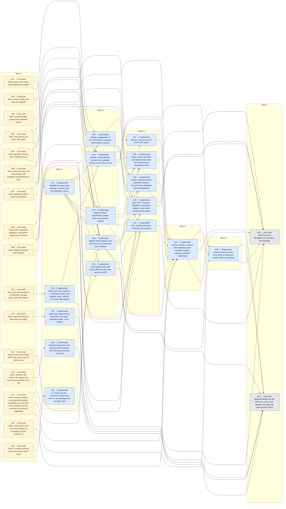

# T0.09: Plan

**Plan:** 🟢 Approved

**Push:** 🟢 Approved

<!-- ticket:specs -->
## 📚 Specifications

The technical pages, features, use cases and business rules of [TICKET.md](TICKET.md), copied by `python3 .claude/scripts/ticket_refs.py sync`.

- [🔲 Architecture: cells and the global layer](../../specs/technical/01-architecture.md#cells)
- [🗄️ Storage: overview](../../specs/technical/03-storage.md#overview)
- [👥 Security: roles and Operator isolation](../../specs/technical/06-security.md#authorisation)
- [📨 Data models: events and proposals](../../specs/technical/02-data-models.md#events)
- [🕹️ Engine and services: simulator](../../specs/technical/04-engine.md#simulator)
- [🌐 Architecture: edge and core](../../specs/technical/01-architecture.md#edge-and-core)
- [📡 Security: links](../../specs/technical/06-security.md#links)
- [🔁 API layer: internal calls](../../specs/technical/05-api.md#internal)
- [📏 BR-008: Operator isolation](../../specs/functional/business-rules/BR-008-operator-isolation.md)
- [📏 BR-014: Simulation isolation](../../specs/functional/business-rules/BR-014-simulation-isolation.md)
- [🌐 Storage: the edge store and synchronisation](../../specs/technical/03-storage.md#edge-store)
<!-- /ticket:specs -->

## 🧭 Summary

T0.09 is split into 35 tasks over 7 waves. It adds two things: a NATS cluster of 3 with JetStream in each cell, and a new shared package, `packages/python/swarm-nats` (module `swarm_nats`).

**How Operator isolation works.** The cell's NATS runs in decentralised JWT mode (operator mode) with a full resolver:

- Each Operator gets one account. Its JWT is signed by the cell's operator key.
- Every credential issued in that account may only publish and subscribe on its own `op.<operator_id>.>` subjects, plus the inbox, JetStream and key-value subjects, which stay inside the account. A publication on another Operator's subject is therefore refused twice: by the account boundary and by the permissions.
- Simulated Squads, edge nodes and services each get their own credentials, tagged `simulated`, `edge` or `service`.
- An edge credential can be revoked through the account's revocation list, which is pushed to the resolver.
- Configuration only ever holds public JWTs and public keys, never seeds.

**Wave 1: 16 test-writers.** They fix every interface first:

- the configuration, stream, subject and issued-account models;
- the nkey factory and the JWT signer, and the operator, account and credential issuers;
- the connector, the request-reply client with deadlines and idempotency keys, the JetStream admin client and the event publisher;
- the responder and the durable consumer, with their factories;
- the `nats` and `nats-leaf` Helm charts, and the updates to the cell chart and the dev environment;
- the Terraform dev-branch root, which passes the operator JWTs to the chart;
- the CI step that installs a pinned nats-server;
- the acceptance tests in `tests/deploy/nats`, against real nats-server processes:
  - criterion 1, Operator isolation;
  - criterion 3, separate simulated credentials;
  - revocation and account registration;
  - criterion 2, a leaf node whose link goes through a TCP proxy that is cut for 60 s, then checked for replay in order.

**Wave 2:**

- the package skeleton, its enums and the workspace entries;
- the two charts, the Terraform root and the CI step.

**Wave 3:**

- the model packages, each with its own exceptions;
- the cell umbrella chart, which gains `nats` as its fifth sub-chart.

**Wave 4:**

- the nkey factory and the JWT signer;
- the four NATS clients;
- the responder and the consumer, each an AsyncRunnable with its factory.

**Wave 5:** the three issuers. This task must make acceptance criteria 1 to 3 pass against a real nats-server.

**Wave 6:** the account resolver client, with the registration and revocation tests.

**Wave 7:** documentation in `deploy/README.md`, AGENT.md and README.md.

**What the person checks on a real cluster.** The cell's leaf node listener uses mTLS and is off by default until certificates exist. The person runs the first real cell and edge.

## 🧪 Assumptions

- The roadmap row names no feature, use case or business rule; BR-008 and BR-014 are linked as the rules the accounts and simulated credentials serve.
- The row names no budget row, so no budget is touched.
- The row gives no mechanism for creating accounts, so the plan picks the most conservative option and records it.
- Only the one minute leaf node cut is quantified; no other duration is asserted.
- The tests-evidences folder holds a .gitkeep so it exists in git.
- NATS accounts per Operator use decentralised JWT authentication: operator mode with the full resolver. Operators are created at run time (UC-029), so a static server configuration would need a restart for each new Operator. Edge credentials must also be revocable. Configuration holds only the public operator JWT, the system account public key and its JWT, never a seed (06-security#secrets).
- No Python library issues NATS JWTs, so swarm_nats writes the nkey and JWT encoding itself on top of the nkeys library (and PyNaCl only where nkeys lacks a function). The acceptance tests prove the encoding against a real nats-server.
- Every credential of an Operator's account may publish and subscribe on its own op.<operator_id>.> subjects, plus the inbox, JetStream and key-value subjects (_INBOX.>, $JS.>, $KV.>). Those three stay inside the account, so the account boundary and the subject permissions keep other Operators out. A publication on another Operator's subject is refused with a permissions violation.
- 'Separate credentials for simulated Squads' means a separate user credential: its own key pair and JWT, tagged simulated, issued in the Operator's account and limited to that Operator's subjects. Refusing a command to a real Drone belongs to the adapter registry of T0.13, which is out of scope.
- Edge credentials are user credentials tagged edge, one per edge node. Revocation adds the user key to the account JWT's revocation list, which is pushed to the resolver again. The Back office screen for revoking comes in a later ticket.
- The dev operator and its SYS account are created once by the person, for example with nsc. Their public values reach a branch cell through three new Terraform variables of the dev-branch var file, kept outside the repository, and are passed as Helm parameters. The seeds stay in the person's vault. Operator accounts are pushed at run time by the Operator creation of T0.16, through AccountIssuer and AccountResolverClient. No command line is added in this ticket.
- The cell's leaf node listener uses mTLS (verify true) and is off by default (leafnodes.enabled false). The dev cell has no certificate authority yet, and a listener without client certificates must not be exposed. The person enables it with a TLS Secret when an edge connects.
- The edge's leaf node is a separate chart, deploy/charts/nats-leaf, for an edge running Kubernetes (k3s). It has a single server with a JetStream domain unique per edge, and a tls:// remote bound to the Operator's account by the edge credential. Local edge clients connect without credentials. Packaging the edge appliance without Kubernetes is later.
- Replay in order uses a JetStream stream on the edge, sourced by a cell stream through the edge's JetStream domain API ($JS.<domain>.API). Criterion 2 is tested locally: a hub and a leaf nats-server, a TCP proxy cut for 60 s, then the order and count of the messages are checked. mTLS is not exercised in that test (no certificate tooling); the chart tests check it structurally.
- Request and reply payloads are JSON (Pydantic model_dump_json). MessagePack is specified for frames and WebSocket messages only (decision T23).
- Request-reply headers: Swarm-Idempotency-Key; Swarm-Deadline, the absolute UTC deadline in ISO 8601; and Swarm-Error, the class name of the failure. Events carry Nats-Msg-Id = the event id, for JetStream deduplication.
- Idempotent replies are stored in a JetStream key-value bucket of the account, with a 24 h TTL by default. Handler errors are not stored, so the caller can retry with the same key. The requester never retries: the caller owns the retry, as 05-api#internal says that one layer owns each retry.
- In event subjects, <event> is the Event's type unchanged. A Mission subject is used when the event has a mission_id, and a fleet subject otherwise.
- Durable consumers pull with explicit ack after the handler, nak on a handler failure, and terminate a message that does not decode. Delivery is at least once, idempotency on the bus comes from the deduplication by event id at publish, and handlers in later tickets are idempotent by event id.
- The specifications give no defaults for the configuration models. NATS defaults are used where they exist: ack wait 30 s, unlimited max deliver, duplicate window 2 min. The others are picked and documented in the field descriptions: request deadline 5 s, connect timeout 2 s, status interval 5 s, batch size 100, idempotency TTL 24 h.
- Streams default to 3 replicas (03-storage#overview and 07-scalability), bounded by NATS to 1 to 5. The chart refuses fewer than 3 servers, because JetStream replicas 3 need a cluster of 3.
- Operator ids are version 7 UUIDs, as the data model conventions require.
- TLS between services inside the cell, and encryption at rest of NATS streams (06-security#privacy), are not named by the T0.09 roadmap row. They are left as follow-ups.
- The NATS server version, the image tag and the nats-py and nkeys versions are pinned to the current stable releases at implementation time, never 'latest'.
- nats-server is available to the worker agents and to the verifier. Tests that need it skip when it is missing, so CI installs a pinned version checked against the release's SHA256SUMS. Helm is needed for the chart rendering tests, which skip without it, as in T0.08.
- The repository acceptance tests in tests/deploy/nats import swarm_nats, as tests/rust imports swarm_core. Test file basenames are unique, and no test folder holds more than five Python files.
- Test-writers run in wave 1, before swarm_nats is a known first-party module. They therefore check import order with ruff's --config override that adds swarm_nats to known-first-party, and the scaffold task adds it to the root pyproject.toml.
- No AGENT.md agent kind exists for infrastructure, so the Helm, Terraform and CI tasks go to the implementer, as in T0.01 and T0.08. The real dev cell and edge need the P-06 cluster, so the person runs the first real deployment and records the evidence.

<!-- plan:graph -->

> [!NOTE]
> Generated from the json block at the end of this page by `python3 .claude/scripts/plan.py render`.
> To change a task, edit the json block, then render again: never edit this view by hand.

## Waves

| Wave | Tasks | Agents running at once |
| --- | --- | --- |
| 1 | [K01](#k01), [K02](#k02), [K03](#k03), [K04](#k04), [K05](#k05), [K06](#k06), [K07](#k07), [K08](#k08), [K09](#k09), [K10](#k10), [K11](#k11), [K12](#k12), [K13](#k13), [K14](#k14), [K15](#k15), [K16](#k16) | 8 of 16 |
| 2 | [K17](#k17), [K18](#k18), [K19](#k19), [K20](#k20), [K21](#k21) | 5 of 5 |
| 3 | [K22](#k22), [K23](#k23), [K24](#k24), [K25](#k25), [K26](#k26) | 5 of 5 |
| 4 | [K27](#k27), [K28](#k28), [K29](#k29), [K30](#k30), [K31](#k31) | 5 of 5 |
| 5 | [K32](#k32) | 1 of 1 |
| 6 | [K33](#k33) | 1 of 1 |
| 7 | [K34](#k34), [K35](#k35) | 2 of 2 |

| Wave | Task | Agent | Depends on | Unblocks |
| --- | --- | --- | --- | --- |
| 1 | [K01](#k01) Tests: swarm_nats enums and configuration models | 🧪 test-writer | none | [K17](#k17), [K22](#k22) |
| 1 | [K02](#k02) Tests: stream models and Operator subjects | 🧪 test-writer | none | [K23](#k23) |
| 1 | [K03](#k03) Tests: issued operator, account and credential models | 🧪 test-writer | none | [K24](#k24) |
| 1 | [K04](#k04) Tests: nkey factory and NATS JWT signer | 🧪 test-writer | none | [K24](#k24), [K27](#k27) |
| 1 | [K05](#k05) Tests: operator, account and credential issuers | 🧪 test-writer | none | [K24](#k24), [K32](#k32) |
| 1 | [K06](#k06) Tests: NATS connector and request-reply with deadlines and idempotency keys | 🧪 test-writer | none | [K25](#k25), [K28](#k28) |
| 1 | [K07](#k07) Tests: JetStream admin and event publisher | 🧪 test-writer | none | [K25](#k25), [K29](#k29) |
| 1 | [K08](#k08) Tests: NATS responder (deadlines, idempotent replies) and its factory | 🧪 test-writer | none | [K25](#k25), [K30](#k30) |
| 1 | [K09](#k09) Tests: durable consumer and its factory | 🧪 test-writer | none | [K25](#k25), [K31](#k31) |
| 1 | [K10](#k10) Tests: nats chart (cluster of 3, JetStream, operator mode, leaf node listener) | 🧪 test-writer | none | [K18](#k18) |
| 1 | [K11](#k11) Tests: nats-leaf chart (the leaf node of an edge) | 🧪 test-writer | none | [K19](#k19) |
| 1 | [K12](#k12) Tests: the cell chart brings NATS; dev values hold no NATS secret | 🧪 test-writer | none | [K26](#k26) |
| 1 | [K13](#k13) Tests: Terraform dev-branch root passes the NATS operator JWTs to the cell | 🧪 test-writer | none | [K20](#k20) |
| 1 | [K14](#k14) Tests: Operator isolation and separate simulated credentials on a real nats-server (criteria 1 and 3), revocation and account registration | 🧪 test-writer | none | [K25](#k25), [K32](#k32), [K33](#k33) |
| 1 | [K15](#k15) Tests: a leaf node cut for one minute replays its messages in order (criterion 2) | 🧪 test-writer | none | [K32](#k32) |
| 1 | [K16](#k16) Tests: CI installs a pinned nats-server for the NATS tests | 🧪 test-writer | none | [K21](#k21) |
| 2 | [K17](#k17) Scaffold the swarm-nats package, its enums and the workspace entries | 🐍 implementer | [K01](#k01) | [K22](#k22), [K23](#k23), [K24](#k24), [K25](#k25), [K30](#k30), [K31](#k31), [K35](#k35) |
| 2 | [K18](#k18) Helm chart: nats (cluster of 3, JetStream domain cell, operator mode, optional mTLS leaf node listener) | 🐍 implementer | [K10](#k10) | [K26](#k26), [K34](#k34) |
| 2 | [K19](#k19) Helm chart: nats-leaf (the leaf node of an edge, JetStream buffer, mTLS remote) | 🐍 implementer | [K11](#k11) | [K34](#k34) |
| 2 | [K20](#k20) Terraform dev-branch root: pass the NATS operator JWT and system account to the cell | 🐍 implementer | [K13](#k13) | [K34](#k34) |
| 2 | [K21](#k21) CI: install a pinned, checksum-verified nats-server in the packages and repository jobs | 🐍 implementer | [K16](#k16) | none |
| 3 | [K22](#k22) Models: configuration of the NATS client, responder and durable consumer | 🐍 implementer | [K01](#k01), [K17](#k17) | [K28](#k28), [K30](#k30), [K31](#k31) |
| 3 | [K23](#k23) Models: stream specification, stream source and Operator subjects | 🐍 implementer | [K02](#k02), [K17](#k17) | [K28](#k28), [K29](#k29), [K30](#k30), [K32](#k32) |
| 3 | [K24](#k24) Models: issued operator, account and credential, and the errors of the issuers | 🐍 implementer | [K03](#k03), [K04](#k04), [K05](#k05), [K17](#k17) | [K27](#k27), [K32](#k32), [K33](#k33) |
| 3 | [K25](#k25) Models: NATS headers and the errors of the clients and bus runnables | 🐍 implementer | [K06](#k06), [K07](#k07), [K08](#k08), [K09](#k09), [K14](#k14), [K17](#k17) | [K28](#k28), [K29](#k29), [K30](#k30), [K31](#k31), [K33](#k33) |
| 3 | [K26](#k26) Cell umbrella chart: add nats as fifth sub-chart; dev values for NATS | 🐍 implementer | [K12](#k12), [K18](#k18) | [K34](#k34) |
| 4 | [K27](#k27) Service: nkey factory and NATS JWT signer | 🐍 implementer | [K04](#k04), [K24](#k24) | [K32](#k32) |
| 4 | [K28](#k28) Clients: NATS connector and request-reply client with deadlines and idempotency keys | 🐍 implementer | [K06](#k06), [K22](#k22), [K23](#k23), [K25](#k25) | [K35](#k35) |
| 4 | [K29](#k29) Clients: JetStream admin (replicated streams, sources across domains) and event publisher | 🐍 implementer | [K07](#k07), [K23](#k23), [K25](#k25) | [K32](#k32), [K35](#k35) |
| 4 | [K30](#k30) Bus: NATS responder (deadlines, idempotent replies in a key-value bucket) and its factory | 🐍 implementer | [K08](#k08), [K17](#k17), [K22](#k22), [K23](#k23), [K25](#k25) | [K35](#k35) |
| 4 | [K31](#k31) Bus: durable JetStream consumer and its factory | 🐍 implementer | [K09](#k09), [K17](#k17), [K22](#k22), [K25](#k25) | [K35](#k35) |
| 5 | [K32](#k32) Service: operator, account and credential issuers (Operator isolation, separate simulated credentials) | 🐍 implementer | [K05](#k05), [K14](#k14), [K15](#k15), [K23](#k23), [K24](#k24), [K27](#k27), [K29](#k29) | [K33](#k33), [K34](#k34), [K35](#k35) |
| 6 | [K33](#k33) Clients: account resolver client (push an Operator's account JWT, revocations) | 🐍 implementer | [K14](#k14), [K24](#k24), [K25](#k25), [K32](#k32) | [K34](#k34), [K35](#k35) |
| 7 | [K34](#k34) deploy/README.md: the NATS of a cell, the dev operator, the edge leaf node and the criteria | 📝 doc-writer | [K18](#k18), [K19](#k19), [K20](#k20), [K26](#k26), [K32](#k32), [K33](#k33) | none |
| 7 | [K35](#k35) AGENT.md and README.md: the swarm-nats package | 📝 doc-writer | [K17](#k17), [K28](#k28), [K29](#k29), [K30](#k30), [K31](#k31), [K32](#k32), [K33](#k33) | none |

## Dependency graph



## Tasks

### <a id="k01"></a>K01: Tests: swarm_nats enums and configuration models

| Agent | Wave | Depends on | Unblocks |
| --- | --- | --- | --- |
| 🧪 test-writer | 1 | none | [K17](#k17), [K22](#k22) |

**Files** (only this task may change them in its wave):

- `packages/python/swarm-nats/tests/models/test_swarm_nats_enums.py`
- `packages/python/swarm-nats/tests/models/config/test_nats_client_config.py`
- `packages/python/swarm-nats/tests/models/config/test_nats_responder_config.py`
- `packages/python/swarm-nats/tests/models/config/test_durable_consumer_config.py`

**Done when:** `uv run ruff format --check` passes on the four files. `uv run ruff check --config "lint.isort.known-first-party = ['tests', 'gateway', 'swarm_catalog', 'swarm_lifecycle', 'swarm_logging', 'swarm_models', 'swarm_nats']"` also passes on them. `uv run pytest` on them fails only because the swarm_nats module does not exist yet.

**Brief:**

Write the tests of the enums and configuration models of the new package packages/python/swarm-nats (module swarm_nats), the shared async NATS client of ticket T0.09 (docs/tickets/T0.09/TICKET.md).
Specs applied:
- docs/specs/technical/05-api.md#internal: request-reply with Pydantic payloads, deadlines and idempotency keys; durable, idempotent consumers.
- docs/specs/technical/03-storage.md#overview: events and work queues on replicated JetStream streams.
- docs/specs/technical/04-engine.md#simulator and docs/specs/technical/06-security.md#links: separate credentials for simulated Squads and for each edge node.
- docs/specs/technical/01-architecture.md#layers: models only load and validate.

(1) tests/models/test_swarm_nats_enums.py, class TestSwarmNatsEnums, for swarm_nats.models.enums. The contract:
- CredentialKind: SERVICE 'service', EDGE 'edge', SIMULATED 'simulated', SYSTEM 'system'.
- NatsClaimType: OPERATOR 'operator', ACCOUNT 'account', USER 'user'.
- StreamStorage: FILE 'file', MEMORY 'memory'.
- StreamRetention: LIMITS 'limits', INTEREST 'interest', WORK_QUEUE 'work_queue'.
Assert, parametrized over the four enums:
- the exact members and values, held in an UPPER_CASE ClassVar expectation table;
- that each enum is a StrEnum;
- that no value contains a hyphen.

(2) One file per configuration model in tests/models/config/. Each has the AGENT.md model set: test_defaults, test_full_valid_construction, test_none_becomes_the_default, test_rejects_bad_values, test_rejects_unknown_keys and test_round_trip.
Exceptions:
- They are imported from swarm_nats.models.config.exceptions.
- Each field raises SE&lt;Model>Invalid&lt;Field>, where &lt;Field> is the field name in CamelCase without its unit suffix: connect_timeout_s gives SENatsClientConfigInvalidConnectTimeout.
- Each model has a base SEInvalid&lt;Model>Exception. Assert with issubclass that every field exception subclasses it.
Common rules: these are configuration sections, so unknown keys are refused, bool is refused where a number is expected, and strings are stripped with empty ones refused. Bounds are read from the model's ClassVars, never repeated.

The models:
- NatsClientConfig (swarm_nats.models.config.nats_client_config):
  - servers: List[str], default ['nats://127.0.0.1:4222']. Non-empty, and each entry matches ^(nats|tls)://[^\s/]+$.
  - name: str, default 'swarm'.
  - credentials_path: Optional[str], default None. The path of a creds file, never its content.
  - connect_timeout_s: float, default 2.0, > 0.
  - reconnect_wait_s: float, default 2.0, > 0.
  - request_deadline_s: float, default 5.0, > 0.
- NatsResponderConfig (...nats_responder_config):
  - subject: str, required. No whitespace and no empty token; the wildcards * and > are allowed.
  - queue_group: str, required, no whitespace.
  - idempotency_bucket: str, default 'idempotency', matching ^[A-Za-z0-9_-]+$.
  - idempotency_ttl_s: float, default 86400.0, > 0.
  - replicas: int, default 3, within [REPLICAS_MIN 1, REPLICAS_MAX 5].
  - status_interval_s: float, default 5.0, > 0.
- DurableConsumerConfig (...durable_consumer_config):
  - stream: str, required, matching ^[A-Za-z0-9_-]+$.
  - durable_name: str, required, same pattern.
  - filter_subject: Optional[str], default None. No whitespace and no empty token.
  - batch_size: int, default 100, >= BATCH_SIZE_MIN 1.
  - fetch_timeout_s: float, default 1.0, > 0.
  - ack_wait_s: float, default 30.0, > 0.
  - max_deliver: int, default -1. Either -1 (unlimited, the NATS default) or >= 1.
  - status_interval_s: float, default 5.0, > 0.

Test rules (AGENT.md Tests and the CLAUDE.md code rules, which hold in tests/ too):
- one Test&lt;Subject> class per file, test names as sentences, pytest.mark.parametrize for the cases of one behaviour, and pytest.raises with the specific exception;
- no mocks, no __init__.py, and no Pydantic model defined in a test;
- no Any or object as a type: raw values are pydantic's JsonValue;
- no dict with hard-coded keys inside a method: use UPPER_CASE ClassVars;
- no nested function, and every try has an except;
- compare with enum members and ClassVar constants;
- put the swarm_nats imports in their own first-party block, after the third-party block.

### <a id="k02"></a>K02: Tests: stream models and Operator subjects

| Agent | Wave | Depends on | Unblocks |
| --- | --- | --- | --- |
| 🧪 test-writer | 1 | none | [K23](#k23) |

**Files** (only this task may change them in its wave):

- `packages/python/swarm-nats/tests/models/streams/test_stream_source.py`
- `packages/python/swarm-nats/tests/models/streams/test_stream_spec.py`
- `packages/python/swarm-nats/tests/models/subjects/test_operator_subjects.py`

**Done when:** `uv run ruff format --check` passes on the three files. `uv run ruff check --config "lint.isort.known-first-party = ['tests', 'gateway', 'swarm_catalog', 'swarm_lifecycle', 'swarm_logging', 'swarm_models', 'swarm_nats']"` also passes on them. `uv run pytest` on them fails only because swarm_nats does not exist yet.

**Brief:**

Write the tests of the stream models and of the Operator subjects of swarm_nats (ticket docs/tickets/T0.09/TICKET.md).
Specs applied:
- docs/specs/technical/02-data-models.md#events: subjects follow op.&lt;operator_id>.mission.&lt;mission_id>.&lt;event> and op.&lt;operator_id>.fleet.&lt;event>, so permissions and streams split by Operator.
- docs/specs/technical/03-storage.md#overview: replicated JetStream streams.
- docs/specs/technical/03-storage.md#edge-store and docs/specs/technical/01-architecture.md#edge-and-core: the leaf node buffers and replays in order, through a stream the core sources from the edge's JetStream domain.
- docs/specs/functional/business-rules/BR-008-operator-isolation.md.

(1) tests/models/streams/test_stream_source.py, class TestStreamSource, for swarm_nats.models.streams.stream_source.StreamSource. The model is frozen with extra forbid. Fields:
- name: str, required, matching ^[A-Za-z0-9_-]+$.
- domain: Optional[str], default None, same pattern. It is the JetStream domain of the source stream, such as an edge's.
- filter_subject: Optional[str], default None. No whitespace and no empty token.
Write the AGENT.md model set. Also assert that assigning a field raises pydantic ValidationError, since the model is frozen.

(2) tests/models/streams/test_stream_spec.py, class TestStreamSpec, for swarm_nats.models.streams.stream_spec.StreamSpec. The model is frozen with extra forbid. Fields:
- name: same pattern as above.
- subjects: List[str], default []. Each entry has no whitespace and no empty token.
- replicas: int, default 3, within [REPLICAS_MIN 1, REPLICAS_MAX 5].
- storage: StreamStorage, default FILE. The member or its value is accepted.
- retention: StreamRetention, default LIMITS.
- duplicate_window_s: float, default 120.0, > 0.
- sources: List[StreamSource], default []. Mappings become StreamSource, and their errors are raised unchanged.
Model rule: a spec with neither subjects nor sources raises SEStreamSpecNoSubjectsNorSources.
Give the default of 3 replicas its own test, test_streams_are_replicated_three_times_by_default.
Exceptions come from swarm_nats.models.streams.exceptions:
- SEInvalidStreamSourceException, with SEStreamSourceInvalidName, SEStreamSourceInvalidDomain and SEStreamSourceInvalidFilterSubject;
- SEInvalidStreamSpecException, with SEStreamSpecInvalidName, SEStreamSpecInvalidSubjects, SEStreamSpecInvalidReplicas, SEStreamSpecInvalidStorage, SEStreamSpecInvalidRetention, SEStreamSpecInvalidDuplicateWindow, SEStreamSpecInvalidSources and SEStreamSpecNoSubjectsNorSources.
Each field exception subclasses the base of its model.

(3) tests/models/subjects/test_operator_subjects.py, class TestOperatorSubjects, for swarm_nats.models.subjects.operator_subjects.OperatorSubjects. It is a frozen subclass of swarm_models.models.base.swarm_model.SwarmModel. Field: operator_id, a version 7 UUID, required. Use fixed v7 constants such as 0190a5b2-7c3e-7d4f-8a1b-2c3d4e5f6a7b.
Methods:
- all() returns 'op.&lt;operator_id>.>'.
- mission(mission_id: UUID, event: str) returns 'op.&lt;operator_id>.mission.&lt;mission_id>.&lt;event>'.
- fleet(event: str) returns 'op.&lt;operator_id>.fleet.&lt;event>'.
- for_event(event) takes a swarm_models Event. It returns the mission subject with event.type when event.mission_id is set, and the fleet subject with event.type otherwise.
Refusals:
- An event name that does not match ^[a-z][a-z0-9_]*(\.[a-z][a-z0-9_]*)*$ raises SEOperatorSubjectsInvalidEvent. Parametrize over '', 'Mission.Planned', 'mission.*', '>', 'a b' and 'mission..x'.
- An event of another Operator raises SEOperatorSubjectsOperatorMismatch.
- An operator_id that is not a version 7 UUID raises SEOperatorSubjectsInvalidOperatorId.
- A mission_id that is not a UUID raises SEOperatorSubjectsInvalidMissionId.
These exceptions come from swarm_nats.models.subjects.exceptions, with the base SEInvalidOperatorSubjectsException.
Build Events with swarm_models.models.events.event.Event and its Actor; read packages/python/swarm-models/tests/models/events for a valid Actor.

Test rules (AGENT.md Tests and the CLAUDE.md code rules, which hold in tests/ too):
- one Test&lt;Subject> class per file, sentence names, parametrize, and pytest.raises with the specific exception;
- no mocks, no __init__.py, and no Pydantic model defined in a test;
- no Any or object as a type (JsonValue for raw values);
- no dict with hard-coded keys inside a method (UPPER_CASE ClassVars);
- no nested function, and every try has an except;
- put the swarm_nats and swarm_models imports in their own first-party block, after the third-party block.

### <a id="k03"></a>K03: Tests: issued operator, account and credential models

| Agent | Wave | Depends on | Unblocks |
| --- | --- | --- | --- |
| 🧪 test-writer | 1 | none | [K24](#k24) |

**Files** (only this task may change them in its wave):

- `packages/python/swarm-nats/tests/models/accounts/test_issued_operator.py`
- `packages/python/swarm-nats/tests/models/accounts/test_issued_account.py`
- `packages/python/swarm-nats/tests/models/accounts/test_issued_credential.py`

**Done when:** `uv run ruff format --check` passes on the three files. `uv run ruff check --config "lint.isort.known-first-party = ['tests', 'gateway', 'swarm_catalog', 'swarm_lifecycle', 'swarm_logging', 'swarm_models', 'swarm_nats']"` also passes on them. `uv run pytest` on them fails only because swarm_nats does not exist yet.

**Brief:**

Write the tests of the models that hold what the NATS issuers produce (ticket docs/tickets/T0.09/TICKET.md).
Specs applied:
- docs/specs/technical/06-security.md#authorisation: one NATS account per Operator.
- docs/specs/technical/06-security.md#links: credentials per edge node, revocable.
- docs/specs/technical/04-engine.md#simulator: simulated Squads use separate NATS credentials.
- docs/specs/technical/06-security.md#secrets: a seed is a secret, never shown or logged.
- docs/specs/functional/business-rules/BR-008-operator-isolation.md and docs/specs/functional/business-rules/BR-014-simulation-isolation.md.

Each model lives in swarm_nats.models.accounts, is a frozen subclass of swarm_models SwarmModel with extra forbid, and has the AGENT.md model set:

(1) tests/models/accounts/test_issued_account.py, class TestIssuedAccount, for issued_account.IssuedAccount:
- name: str, required, stripped and non-empty. It holds the Operator id as text for an Operator's account, and 'SYS' for the system account.
- public_key: matches ^A[A-Z2-7]{55}$.
- jwt: matches ^[A-Za-z0-9_-]+\.[A-Za-z0-9_-]+\.[A-Za-z0-9_-]+$.
- seed: a SecretStr whose value matches ^SA[A-Z2-7]{56}$. A str or a SecretStr is accepted.

(2) tests/models/accounts/test_issued_operator.py, class TestIssuedOperator, for issued_operator.IssuedOperator:
- name;
- public_key: matches ^O[A-Z2-7]{55}$;
- jwt;
- seed: matches ^SO[A-Z2-7]{56}$;
- system_account: an IssuedAccount. A mapping becomes one, and its errors are raised unchanged. A value of another type raises SEIssuedOperatorInvalidSystemAccount.

(3) tests/models/accounts/test_issued_credential.py, class TestIssuedCredential, for issued_credential.IssuedCredential:
- operator_id: Optional[UUID], a version 7 UUID;
- kind: CredentialKind;
- name: non-empty, no whitespace;
- public_key: matches ^U[A-Z2-7]{55}$;
- jwt;
- seed: matches ^SU[A-Z2-7]{56}$.
Model rule: kind is SYSTEM if and only if operator_id is None. Otherwise SEIssuedCredentialInconsistentKind is raised.

For every model, also test:
- the round trip through model_dump() in python mode, which keeps the SecretStr;
- that repr() and str() of the model never contain the seed value.
Use syntactically valid sample values held in ClassVars: 'O' + 'A' * 55, 'SO' + 'A' * 56, 'a.b.c' for a JWT, and fixed v7 UUIDs.

Exceptions come from swarm_nats.models.accounts.exceptions:
- SEInvalidIssuedAccountException, with SEIssuedAccountInvalidName, SEIssuedAccountInvalidPublicKey, SEIssuedAccountInvalidJwt and SEIssuedAccountInvalidSeed;
- SEInvalidIssuedOperatorException, with SEIssuedOperatorInvalidName, SEIssuedOperatorInvalidPublicKey, SEIssuedOperatorInvalidJwt, SEIssuedOperatorInvalidSeed and SEIssuedOperatorInvalidSystemAccount;
- SEInvalidIssuedCredentialException, with SEIssuedCredentialInvalidOperatorId, SEIssuedCredentialInvalidKind, SEIssuedCredentialInvalidName, SEIssuedCredentialInvalidPublicKey, SEIssuedCredentialInvalidJwt, SEIssuedCredentialInvalidSeed and SEIssuedCredentialInconsistentKind.
Each field exception subclasses its model's base.

Test rules (AGENT.md Tests and the CLAUDE.md code rules):
- one Test class per file, sentence names, parametrize, and the specific exception in pytest.raises;
- no mocks, no __init__.py, and no model defined in a test;
- no Any or object as a type (JsonValue);
- no dict with hard-coded keys inside a method;
- no nested function;
- put swarm_nats in its own first-party block, after the third-party block.

### <a id="k04"></a>K04: Tests: nkey factory and NATS JWT signer

| Agent | Wave | Depends on | Unblocks |
| --- | --- | --- | --- |
| 🧪 test-writer | 1 | none | [K24](#k24), [K27](#k27) |

**Files** (only this task may change them in its wave):

- `packages/python/swarm-nats/tests/service/accounts/test_nkey_factory.py`
- `packages/python/swarm-nats/tests/service/accounts/test_nats_jwt_signer.py`

**Done when:** `uv run ruff format --check` passes on both files. `uv run ruff check --config "lint.isort.known-first-party = ['tests', 'gateway', 'swarm_catalog', 'swarm_lifecycle', 'swarm_logging', 'swarm_models', 'swarm_nats']"` also passes on them. `uv run pytest` on them fails only because swarm_nats does not exist yet.

**Brief:**

Write the tests of the two building blocks of decentralised NATS authentication in swarm_nats (ticket docs/tickets/T0.09/TICKET.md).
Specs applied:
- docs/specs/technical/06-security.md#authorisation: NATS accounts per Operator.
- docs/specs/technical/06-security.md#links: per-edge credentials, revocable.
- docs/specs/technical/06-security.md#secrets: seeds are secrets.
- docs/specs/functional/business-rules/BR-008-operator-isolation.md.
NATS operator mode identifies operators, accounts and users by nkeys, which are ed25519 keys encoded by the nkeys library: public keys of 56 characters, seeds of 58. They are bound together by JWTs signed with ed25519, whose header is {"typ": "JWT", "alg": "ed25519-nkey"}.

(1) tests/service/accounts/test_nkey_factory.py, class TestNkeyFactory, for swarm_nats.service.accounts.nkey_factory.NkeyFactory. Its constructor takes an optional logger. Its methods:
- create(kind: NatsClaimType) returns an nkeys KeyPair;
- from_seed(seed: str) returns a KeyPair;
- public_key(pair) returns str;
- seed(pair) returns str.
Tests, parametrized over OPERATOR, ACCOUNT and USER where it applies:
- the public key starts with 'O', 'A' or 'U' and is 56 characters long;
- the seed starts with 'SO', 'SA' or 'SU' and is 58 characters long;
- from_seed(seed) gives back the same public key;
- two calls to create return different keys;
- a malformed seed raises SENkeyInvalidSeedError, from swarm_nats.models.accounts.exceptions.

(2) tests/service/accounts/test_nats_jwt_signer.py, class TestNatsJwtSigner, for swarm_nats.service.accounts.nats_jwt_signer.NatsJwtSigner. Its constructor takes an optional logger. Its methods:
- sign(claims: Dict[str, JsonValue], issuer: KeyPair) returns a JWT. It sets iss to the issuer's public key, iat to the current Unix time in whole seconds, and jti to a non-empty hash of the claims.
- decode(token: str) returns Dict[str, JsonValue]. It verifies the signature against the public key in iss.
Tests:
- the decoded header (base64url, no padding, of the first part) equals {'typ': 'JWT', 'alg': 'ed25519-nkey'};
- the claims round-trip (sub, name, and a nested nats mapping);
- iss is the issuer's public key;
- iat is an int within 5 s of time.time();
- jti is a non-empty str;
- a payload changed by one character raises SENatsJwtInvalidError;
- a token signed by one key whose iss was replaced by another key raises SENatsJwtInvalidError;
- a token without three parts raises SENatsJwtInvalidError.
Build key pairs with NkeyFactory, and keep the claim keys as UPPER_CASE ClassVar constants.

Test rules (AGENT.md Tests and the CLAUDE.md code rules):
- one Test class per file, sentence names, parametrize, and specific exceptions;
- no mocks, no __init__.py, and no model defined in a test;
- no Any or object as a type (JsonValue);
- no dict with hard-coded keys inside a method: claims are built from ClassVar keys;
- no nested function;
- put swarm_nats in its own first-party block.

### <a id="k05"></a>K05: Tests: operator, account and credential issuers

| Agent | Wave | Depends on | Unblocks |
| --- | --- | --- | --- |
| 🧪 test-writer | 1 | none | [K24](#k24), [K32](#k32) |

**Files** (only this task may change them in its wave):

- `packages/python/swarm-nats/tests/service/accounts/test_operator_issuer.py`
- `packages/python/swarm-nats/tests/service/accounts/test_account_issuer.py`
- `packages/python/swarm-nats/tests/service/accounts/test_credential_issuer.py`

**Done when:** `uv run ruff format --check` passes on the three files. `uv run ruff check --config "lint.isort.known-first-party = ['tests', 'gateway', 'swarm_catalog', 'swarm_lifecycle', 'swarm_logging', 'swarm_models', 'swarm_nats']"` also passes on them. `uv run pytest` on them fails only because swarm_nats does not exist yet.

**Brief:**

Write the tests of the three issuers that create one NATS account per Operator and the credentials that use it (ticket docs/tickets/T0.09/TICKET.md).
Specs applied:
- docs/specs/technical/06-security.md#authorisation: 'NATS accounts per Operator: a service acting for one Operator can only publish and subscribe on op.&lt;operator_id>.…'.
- docs/specs/technical/02-data-models.md#events.
- docs/specs/technical/06-security.md#links: credentials per edge node, revocable.
- docs/specs/technical/04-engine.md#simulator: simulated Squads use separate NATS credentials.
- docs/specs/functional/business-rules/BR-008-operator-isolation.md and docs/specs/functional/business-rules/BR-014-simulation-isolation.md.
Every issuer is built as X(NkeyFactory(), NatsJwtSigner(), logger=None), from swarm_nats.service.accounts.*. Inspect JWTs with NatsJwtSigner().decode. Claims follow NATS JWT version 2: the NATS-specific part sits under the 'nats' key.

(1) tests/service/accounts/test_operator_issuer.py, class TestOperatorIssuer, for operator_issuer.OperatorIssuer. issue(name: str) returns an IssuedOperator.
The operator JWT:
- sub == iss == operator.public_key;
- name == name;
- nats.type == 'operator' and nats.version == 2;
- nats.system_account == operator.system_account.public_key.
The system account JWT:
- iss == operator.public_key and sub == system_account.public_key;
- name 'SYS';
- nats.type 'account'.
Also test:
- two calls give different keys;
- issue('') raises SEIssuedOperatorInvalidName.

(2) tests/service/accounts/test_account_issuer.py, class TestAccountIssuer, for account_issuer.AccountIssuer.
issue(operator: IssuedOperator, operator_id: UUID) returns an IssuedAccount named str(operator_id). Its JWT has:
- iss == operator.public_key and sub == account.public_key;
- name str(operator_id);
- nats.type 'account' and nats.version 2;
- nats.limits mem_storage, disk_storage, conn and leaf all -1, so JetStream is enabled without a limit;
- no revocations.
Also test that two Operators get different account keys.
revoke(operator, account, user_public_keys: List[str]) returns an IssuedAccount with the same public_key and seed. Its new JWT holds nats.revocations, mapping each user key to an int time >= that user JWT's iat. Revoking a second key keeps the first one. Revoking with an operator that did not sign the account raises SENatsJwtInvalidError.

(3) tests/service/accounts/test_credential_issuer.py, class TestCredentialIssuer, for credential_issuer.CredentialIssuer.
issue(account: IssuedAccount, operator_id: UUID, kind: CredentialKind, name: str) returns an IssuedCredential. Parametrize over SERVICE, EDGE and SIMULATED. Expect:
- the credential's operator_id, kind and name are those given;
- JWT iss == account.public_key and sub == credential.public_key;
- JWT name, nats.type 'user' and nats.version 2;
- set(nats.pub.allow) == {OperatorSubjects(operator_id=...).all()} | set(CredentialIssuer.MECHANISM_SUBJECTS), and the same for nats.sub.allow;
- MECHANISM_SUBJECTS contains '_INBOX.>', '$JS.>' and '$KV.>';
- no allow entry is '>' and none is an 'op.' subject of another Operator;
- nats.tags == [kind.value].
Also test:
- a simulated and a service credential of the same Operator have different public keys and seeds (separate credentials, BR-014);
- kind SYSTEM raises SECredentialIssuerInvalidKindError;
- an operator_id that is not the account's name raises SECredentialIssuerAccountMismatchError.
issue_system(operator: IssuedOperator, name: str) returns a credential with kind SYSTEM, operator_id None, JWT iss == operator.system_account.public_key, no pub and no sub allow list, and tags ['system'].
creds_file(credential) returns the creds text, holding in this order:
- '-----BEGIN NATS USER JWT-----';
- the JWT on its own line;
- '------END NATS USER JWT------';
- '-----BEGIN USER NKEY SEED-----';
- the seed;
- '------END USER NKEY SEED------'.
Exceptions come from swarm_nats.models.accounts.exceptions. OperatorSubjects comes from swarm_nats.models.subjects.operator_subjects. Use fixed v7 UUIDs.

Test rules (AGENT.md Tests and the CLAUDE.md code rules):
- one Test class per file, sentence names, parametrize, and specific exceptions;
- no mocks, no __init__.py, and no model defined in a test;
- no Any or object as a type (JsonValue for decoded claims);
- no dict with hard-coded keys inside a method;
- no nested function;
- put swarm_nats in its own first-party block.

### <a id="k06"></a>K06: Tests: NATS connector and request-reply with deadlines and idempotency keys

| Agent | Wave | Depends on | Unblocks |
| --- | --- | --- | --- |
| 🧪 test-writer | 1 | none | [K25](#k25), [K28](#k28) |

**Files** (only this task may change them in its wave):

- `packages/python/swarm-nats/tests/conftest.py`
- `packages/python/swarm-nats/tests/clients/test_nats_connector.py`
- `packages/python/swarm-nats/tests/clients/test_nats_requester.py`

**Done when:** `uv run ruff format --check` passes on the three files. `uv run ruff check --config "lint.isort.known-first-party = ['tests', 'gateway', 'swarm_catalog', 'swarm_lifecycle', 'swarm_logging', 'swarm_models', 'swarm_nats']"` also passes on them. `uv run pytest` on the two test files fails only because swarm_nats does not exist yet.

**Brief:**

Write the shared server fixtures of the package tests, and the tests of the connector and of the request-reply client (ticket docs/tickets/T0.09/TICKET.md).
Specs applied:
- docs/specs/technical/05-api.md#internal: 'Request-reply over NATS for commands and queries between services, with Pydantic payloads, deadlines and idempotency keys; one layer owns each retry'.
- docs/specs/technical/01-architecture.md#layers: calls to other services live in clients/.

(1) packages/python/swarm-nats/tests/conftest.py, with two fixtures used by every client and bus test of the package.
The contract other test-writers rely on:
- nats_url(tmp_path) -> Iterator[str]:
  - calls pytest.skip('nats-server is not installed') when shutil.which('nats-server') is None;
  - otherwise binds a free TCP port on 127.0.0.1;
  - starts the real binary with subprocess.Popen: nats-server -a 127.0.0.1 -p &lt;port> -js -sd &lt;tmp_path>/js;
  - waits up to 10 s until the port accepts a connection;
  - yields 'nats://127.0.0.1:&lt;port>', then terminates the process and waits for it.
- nats_client(nats_url) -> AsyncIterator[nats.aio.client.Client]: a raw nats-py client connected to nats_url, closed after the test.
Use no try without an except. The cleanup after yield needs no try.

(2) tests/clients/test_nats_connector.py, class TestNatsConnector, for swarm_nats.clients.nats_connector.NatsConnector(config: NatsClientConfig, logger=None).
Its methods:
- async connect() -> nats.aio.client.Client connects to config.servers with config.name, connect_timeout_s and reconnect_wait_s, and with config.credentials_path as the user credentials when set;
- async disconnect(client) drains and closes the client.
Tests:
- connecting to nats_url gives a connected client;
- disconnect leaves it closed;
- a free port with no server raises SENatsConnectionError within a few seconds (connect_timeout_s 0.5);
- a credentials_path that does not exist raises SENatsConnectionError.

(3) tests/clients/test_nats_requester.py, class TestNatsRequester, for swarm_nats.clients.nats_requester.NatsRequester(connection: Client, config: NatsClientConfig, logger=None).
Its method: async request(subject, payload: BaseModel, reply_type: Type[R], idempotency_key: str, deadline_s: Optional[float] = None) -> R.
The contract:
- The body is payload.model_dump_json() in UTF-8.
- Header NatsHeaders.IDEMPOTENCY_KEY carries the key.
- Header NatsHeaders.DEADLINE carries the absolute deadline, now + deadline_s, as a UTC ISO 8601 datetime with microseconds. deadline_s defaults to config.request_deadline_s.
- The reply is decoded with reply_type.model_validate_json.
- NatsHeaders comes from swarm_nats.models.bus.nats_headers. Use the constants: IDEMPOTENCY_KEY, DEADLINE, ERROR and IDEMPOTENCY_KEY_PATTERN.
The test plays the responder through a raw subscription on nats_client, whose callback is a method of the test class (no nested function). Use swarm_nats.models.streams.stream_source.StreamSource as both payload and reply model, never a model defined in a test.
Tests:
- the responder receives the JSON body and the two headers, the key equal to the one given, and the deadline within 1 s of now + deadline_s;
- the reply is decoded into reply_type;
- with deadline_s None, the deadline uses config.request_deadline_s;
- a responder that never answers raises SENatsRequestDeadlineExceededError, after about deadline_s (0.2) and before 2 s;
- no subscriber raises SENatsNoResponderError;
- a reply carrying the header NatsHeaders.ERROR raises SENatsRequestFailedError;
- a reply body that does not decode raises SENatsReplyInvalidError;
- an idempotency key of '', 'a b' or 'a.b' raises SENatsInvalidIdempotencyKeyError and sends nothing;
- a deadline_s of 0 or -1 raises SENatsInvalidDeadlineError.
Exceptions come from swarm_nats.models.bus.exceptions. Config comes from swarm_nats.models.config.nats_client_config.

Test rules (AGENT.md Tests and the CLAUDE.md code rules):
- one Test class per file, sentence names, parametrize, and specific exceptions;
- no mocks (a real nats-server);
- no __init__.py;
- no Any or object as a type;
- no dict with hard-coded keys inside a method (ClassVars);
- no nested function;
- every try has an except;
- async tests need no marker;
- put swarm_nats in its own first-party block.

### <a id="k07"></a>K07: Tests: JetStream admin and event publisher

| Agent | Wave | Depends on | Unblocks |
| --- | --- | --- | --- |
| 🧪 test-writer | 1 | none | [K25](#k25), [K29](#k29) |

**Files** (only this task may change them in its wave):

- `packages/python/swarm-nats/tests/clients/test_jetstream_admin.py`
- `packages/python/swarm-nats/tests/clients/test_event_publisher.py`

**Done when:** `uv run ruff format --check` passes on both files. `uv run ruff check --config "lint.isort.known-first-party = ['tests', 'gateway', 'swarm_catalog', 'swarm_lifecycle', 'swarm_logging', 'swarm_models', 'swarm_nats']"` also passes on them. `uv run pytest` on them fails only because swarm_nats (or the conftest of the same wave) does not exist yet.

**Brief:**

Write the tests of the JetStream admin client and of the event publisher (ticket docs/tickets/T0.09/TICKET.md).
Specs applied:
- docs/specs/technical/03-storage.md#overview: events and work queues on replicated NATS JetStream streams.
- docs/specs/technical/03-storage.md#edge-store and docs/specs/technical/01-architecture.md#edge-and-core: the leaf node buffers and replays in order.
- docs/specs/technical/02-data-models.md#events: the Event envelope, and the subjects op.&lt;operator_id>.mission.&lt;mission_id>.&lt;event> and op.&lt;operator_id>.fleet.&lt;event>.
- docs/specs/technical/05-api.md#internal: events on JetStream subjects op.&lt;operator_id>.…, consumers durable and idempotent.
Use the fixtures nats_url and nats_client of packages/python/swarm-nats/tests/conftest.py, written by another task of this wave:
- nats_url skips when nats-server is missing and yields the URL of a single local server with JetStream;
- nats_client is a raw connected nats-py client.
A single server only accepts replicas=1.

(1) tests/clients/test_jetstream_admin.py, class TestJetStreamAdmin, for swarm_nats.clients.jetstream_admin.JetStreamAdmin(connection: Client, logger=None).
Its method: async ensure_stream(spec: StreamSpec) creates the stream, or updates it when it exists.
The mapping:
- StreamStorage and StreamRetention map to the NATS storage and retention;
- duplicate_window_s maps to the duplicate window;
- each StreamSource maps to a source. A source with a domain has its external API prefix set to '$JS.&lt;domain>.API'.
Tests, read back through nats_client.jetstream().stream_info:
- a stream is created with its subjects, replicas 1, file storage and limits retention;
- calling it again with one more subject updates the stream;
- a stream ORIGIN on 'op.x.>' and a stream COPY whose only source is StreamSource(name='ORIGIN'): 3 messages published on ORIGIN reach COPY in the same order (poll up to 5 s);
- a source with domain 'edge' is stored with the external API '$JS.edge.API';
- a spec with replicas 3 on this single server raises SENatsStreamError.

(2) tests/clients/test_event_publisher.py, class TestEventPublisher, for swarm_nats.clients.event_publisher.EventPublisher(connection: Client, logger=None).
Its method: async publish(event: Event) -> int publishes to JetStream and returns the stream sequence.
The contract:
- The subject is OperatorSubjects(operator_id=event.operator_id).for_event(event).
- Header NatsHeaders.MSG_ID ('Nats-Msg-Id') is str(event.id).
- The body is event.model_dump_json().
Create a stream 'OPS' on 'op.>' with nats_client first. Tests:
- a Mission event lands on 'op.&lt;operator>.mission.&lt;mission>.&lt;type>', and its body validates back to an equal Event;
- a fleet event, with no mission_id, lands on 'op.&lt;operator>.fleet.&lt;type>';
- the same event published twice leaves one message in the stream, and both calls return the same sequence;
- an event whose subject no stream captures raises SENatsPublishError.
Build Events with swarm_models.models.events.event.Event and its Actor; read packages/python/swarm-models/tests/models/events. Exceptions come from swarm_nats.models.bus.exceptions, and StreamSpec and StreamSource from swarm_nats.models.streams.

Test rules (AGENT.md Tests and the CLAUDE.md code rules):
- one Test class per file, sentence names, parametrize, and specific exceptions;
- no mocks, no __init__.py, and no model defined in a test;
- no Any or object as a type;
- no dict with hard-coded keys inside a method;
- no nested function;
- every try has an except;
- put swarm_nats and swarm_models in their own first-party block.

### <a id="k08"></a>K08: Tests: NATS responder (deadlines, idempotent replies) and its factory

| Agent | Wave | Depends on | Unblocks |
| --- | --- | --- | --- |
| 🧪 test-writer | 1 | none | [K25](#k25), [K30](#k30) |

**Files** (only this task may change them in its wave):

- `packages/python/swarm-nats/tests/api/bus/test_nats_responder.py`
- `packages/python/swarm-nats/tests/api/factories/bus/test_nats_responder_factory.py`

**Done when:** `uv run ruff format --check` passes on both files. `uv run ruff check --config "lint.isort.known-first-party = ['tests', 'gateway', 'swarm_catalog', 'swarm_lifecycle', 'swarm_logging', 'swarm_models', 'swarm_nats']"` also passes on them. `uv run pytest` on them fails only because swarm_nats does not exist yet.

**Brief:**

Write the tests of the responder side of request-reply (ticket docs/tickets/T0.09/TICKET.md).
Specs applied:
- docs/specs/technical/05-api.md#internal: request-reply with Pydantic payloads, deadlines and idempotency keys; one layer owns each retry.
- docs/specs/technical/01-architecture.md#layers: api/bus holds the NATS handlers.
- AGENT.md, Lifecycle and factories: a long-running async task is an AsyncRunnable whose execute() yields its status.
Use the fixtures nats_url and nats_client of packages/python/swarm-nats/tests/conftest.py, written by another task of this wave.

(1) tests/api/bus/test_nats_responder.py, class TestNatsResponder, for swarm_nats.api.bus.nats_responder.NatsResponder[Q, R].
It is an AsyncRunnable built as NatsResponder(connection, config: NatsResponderConfig, request_type: Type[Q], handler: Callable[[Q], Awaitable[R]], logger=None), with status_interval_s taken from config.
- initialize() creates the JetStream key-value bucket config.idempotency_bucket, with config.idempotency_ttl_s and config.replicas, and subscribes to config.subject in config.queue_group.
- run() serves until it is cancelled.
- close() unsubscribes, and is safe after a partial initialize.
Drive it with `async for status in responder.execute()` in an asyncio task. The reading coroutine is a method of the test class, and cancelling it ends the responder. Use config replicas=1 and a status interval of 0.05.
Send requests with the raw nats_client, setting the headers NatsHeaders.IDEMPOTENCY_KEY and NatsHeaders.DEADLINE (a UTC ISO 8601 datetime). NatsHeaders comes from swarm_nats.models.bus.nats_headers.
The handler is a test-class method that records its calls. Use swarm_nats.models.streams.stream_source.StreamSource as request and reply model.
Tests:
- a valid request gets the handler's reply as JSON, and the handler is called once;
- the same idempotency key sent twice calls the handler once, and both replies are equal;
- a request without an idempotency key, or with 'a b', gets header NatsHeaders.ERROR == 'SENatsInvalidIdempotencyKeyError', and the handler is not called;
- a missing or malformed deadline gets ERROR 'SENatsInvalidDeadlineError';
- a deadline already past gets no reply (the raw request times out), and the handler is not called;
- a body that is not a valid request gets ERROR 'SENatsRequestInvalidError';
- a handler raising ValueError gets ERROR 'ValueError', and a retry with the same key calls the handler again, because errors are not stored;
- the bucket exists after initialize, with its TTL;
- two responders in the same queue group handle each request once in total;
- execute() yields RunnableStatus.RUNNING (from swarm_lifecycle.models.enums) while serving.

(2) tests/api/factories/bus/test_nats_responder_factory.py, class TestNatsResponderFactory, for swarm_nats.api.factories.bus.nats_responder_factory.NatsResponderFactory. It is built with the same arguments as the responder, and subclasses swarm_nats.api.factories.bus_runnable_factory.BusRunnableFactory.
Tests:
- create() returns a NatsResponder whose status is RunnableStatus.NOT_STARTED and whose status_interval_s equals config.status_interval_s;
- two calls return two distinct instances;
- the factory is a BusRunnableFactory.
This file needs no server: pass an unconnected nats.aio.client.Client().

Test rules (AGENT.md Tests and the CLAUDE.md code rules):
- one Test class per file, sentence names, and parametrize;
- no mocks, no __init__.py, and no model defined in a test;
- no Any or object as a type;
- no dict with hard-coded keys inside a method: headers are built from ClassVar keys;
- no nested function;
- every try has an except;
- put swarm_nats and swarm_lifecycle in their own first-party block.

### <a id="k09"></a>K09: Tests: durable consumer and its factory

| Agent | Wave | Depends on | Unblocks |
| --- | --- | --- | --- |
| 🧪 test-writer | 1 | none | [K25](#k25), [K31](#k31) |

**Files** (only this task may change them in its wave):

- `packages/python/swarm-nats/tests/api/bus/test_durable_consumer.py`
- `packages/python/swarm-nats/tests/api/factories/bus/test_durable_consumer_factory.py`

**Done when:** `uv run ruff format --check` passes on both files. `uv run ruff check --config "lint.isort.known-first-party = ['tests', 'gateway', 'swarm_catalog', 'swarm_lifecycle', 'swarm_logging', 'swarm_models', 'swarm_nats']"` also passes on them. `uv run pytest` on them fails only because swarm_nats does not exist yet.

**Brief:**

Write the tests of the durable JetStream consumer (ticket docs/tickets/T0.09/TICKET.md).
Specs applied:
- docs/specs/technical/05-api.md#internal: 'Events on JetStream subjects op.&lt;operator_id>.…; consumers are durable and idempotent'.
- docs/specs/technical/03-storage.md#overview: JetStream streams and work queues.
- AGENT.md, Lifecycle and factories: an AsyncRunnable yields its status.
Use the fixtures nats_url and nats_client of packages/python/swarm-nats/tests/conftest.py, written by another task of this wave.

(1) tests/api/bus/test_durable_consumer.py, class TestDurableConsumer, for swarm_nats.api.bus.durable_consumer.DurableConsumer[M].
It is an AsyncRunnable built as DurableConsumer(connection, config: DurableConsumerConfig, message_type: Type[M], handler: Callable[[M], Awaitable[None]], logger=None), with status_interval_s from config.
- initialize() binds a durable pull consumer named config.durable_name on config.stream, with explicit acknowledgement, config.ack_wait_s, config.max_deliver and the optional filter_subject.
- run() fetches batches of config.batch_size, waiting config.fetch_timeout_s, until cancelled. For each message: it decodes it with message_type.model_validate_json and calls the handler. It acknowledges when the handler returns, naks when the handler raises, and terminates a message that does not decode, so it is never redelivered.
- close() leaves the durable consumer on the server.
Create the stream with the raw nats_client (subjects 'op.>', replicas 1). Publish swarm_models Events as JSON, with the header 'Nats-Msg-Id' set to the event id. Drive the consumer with `async for status in consumer.execute()` in a task, reading through a test-class method, and stop it by cancelling. The handler is a test-class method that records events.
Tests:
- three events are handled in publication order, and all are acknowledged (consumer_info num_ack_pending 0);
- after the consumer is closed, two more events are published, and a new consumer with the same durable_name receives only those two;
- a handler that raises on the first delivery of an event receives it again (ack_wait_s 1) and handles it once successfully;
- a message that is not an Event never reaches the handler and is not redelivered;
- execute() yields RunnableStatus.RUNNING while consuming.

(2) tests/api/factories/bus/test_durable_consumer_factory.py, class TestDurableConsumerFactory, for swarm_nats.api.factories.bus.durable_consumer_factory.DurableConsumerFactory. It is built with the consumer's arguments and subclasses BusRunnableFactory.
Tests:
- create() returns a DurableConsumer that is NOT_STARTED, with config.status_interval_s;
- two calls return distinct instances.
This file needs no server: pass an unconnected nats.aio.client.Client().
Config comes from swarm_nats.models.config.durable_consumer_config. Build Events as in packages/python/swarm-models/tests/models/events.

Test rules (AGENT.md Tests and the CLAUDE.md code rules):
- one Test class per file, sentence names, and parametrize;
- no mocks, no __init__.py, and no model defined in a test;
- no Any or object as a type;
- no dict with hard-coded keys inside a method;
- no nested function;
- every try has an except;
- put swarm_nats, swarm_models and swarm_lifecycle in their own first-party block.

### <a id="k10"></a>K10: Tests: nats chart (cluster of 3, JetStream, operator mode, leaf node listener)

| Agent | Wave | Depends on | Unblocks |
| --- | --- | --- | --- |
| 🧪 test-writer | 1 | none | [K18](#k18) |

**Files** (only this task may change them in its wave):

- `tests/deploy/charts/nats/test_nats_chart.py`

**Done when:** `uv run ruff check` and `uv run ruff format --check` pass on the file. `uv run pytest tests/deploy/charts/nats/test_nats_chart.py` collects, and fails only because deploy/charts/nats does not exist yet.

**Brief:**

Write tests/deploy/charts/nats/test_nats_chart.py, class TestNatsChart, for a new Helm chart deploy/charts/nats: the NATS of a cell (ticket docs/tickets/T0.09/TICKET.md).
Specs applied:
- docs/specs/technical/01-architecture.md#cells: a cell holds its NATS cluster.
- docs/specs/technical/03-storage.md#overview: NATS JetStream with replicated streams.
- docs/specs/technical/06-security.md#authorisation: NATS accounts per Operator.
- docs/specs/technical/06-security.md#links: edge to cell is a NATS leaf node over mTLS.
- docs/specs/technical/06-security.md#secrets: configuration holds names, never secrets.
- docs/specs/technical/09-deployment.md#delivery: Helm charts in deploy/charts.
Model the file on tests/deploy/charts/test_valkey_chart.py and test_cell_chart.py:
- the repository root is Path(__file__).resolve().parents[4];
- pyyaml parses, and the YAML is pydantic's JsonValue;
- rendering tests are marked pytest.mark.skipif(shutil.which('helm') is None, reason='helm is not installed');
- the chart is copied into tmp_path before rendering, so the repository is never written.

Structure tests, which always run:
- Chart.yaml: apiVersion v2, name 'nats', type 'application', a semver version, and an appVersion that is neither empty nor 'latest'.
- values.yaml:
  - replicas 3;
  - image.repository 'nats', and image.tag neither empty nor 'latest';
  - jetstream.domain 'cell', and a non-empty jetstream.fileStorage.size;
  - auth.operatorJwt, auth.systemAccount and auth.systemAccountJwt all '';
  - leafnodes.enabled false, and leafnodes.tls.secretName 'nats-leafnodes-tls';
  - ports.client 4222, ports.cluster 6222, ports.leafnodes 7422 and ports.monitor 8222.

Rendering tests. Run helm template nats &lt;copy> --namespace cell-test with --set auth.operatorJwt=&lt;FAKE_JWT>, --set auth.systemAccount=&lt;FAKE_ACCOUNT> and --set auth.systemAccountJwt=&lt;FAKE_JWT>. FAKE_JWT is any three-part base64url string; FAKE_ACCOUNT is 'A' + 'B' * 55. The output must hold:
- A StatefulSet 'nats':
  - replicas 3 and serviceName 'nats-headless';
  - a volumeClaimTemplate requesting the values' fileStorage.size;
  - container ports 4222, 6222 and 8222;
  - args that pass --config.
- A ConfigMap 'nats-config' whose 'nats.conf' contains:
  - a jetstream block with the domain cell;
  - routes to nats-0.nats-headless, nats-1.nats-headless and nats-2.nats-headless on 6222;
  - 'operator' with FAKE_JWT, and 'system_account' with FAKE_ACCOUNT;
  - a resolver of type full (regex type:\s*full);
  - resolver_preload naming FAKE_ACCOUNT;
  - no 'leafnodes' block.
- Services 'nats' (port 4222) and 'nats-headless' (clusterIP None).
- A policy/v1 PodDisruptionBudget 'nats' with maxUnavailable 1.
- A NetworkPolicy 'nats' allowing 4222 and 6222.
With --set leafnodes.enabled=true as well:
- nats.conf holds a leafnodes block on 7422 with tls, 'verify: true' and the files tls.crt, tls.key and ca.crt;
- the StatefulSet mounts the Secret 'nats-leafnodes-tls';
- the Service 'nats' exposes 7422;
- the NetworkPolicy allows 7422.
The rendering must fail (non-zero exit, message naming the value) in these cases (parametrize):
- without auth.operatorJwt;
- without auth.systemAccount;
- without auth.systemAccountJwt;
- with --set replicas=1, the message naming replicas.
No rendered document contains 'password', or a string matching S[OAU][A-Z2-7]{56} (an nkey seed).

Test rules (AGENT.md Tests and the CLAUDE.md code rules):
- one Test class, sentence names, and parametrize;
- no mocks, no __init__.py and no conftest;
- no Any or object as a type;
- no dict with hard-coded keys inside a method: expected resources and keys are UPPER_CASE ClassVars;
- no nested function;
- every try has an except.

### <a id="k11"></a>K11: Tests: nats-leaf chart (the leaf node of an edge)

| Agent | Wave | Depends on | Unblocks |
| --- | --- | --- | --- |
| 🧪 test-writer | 1 | none | [K19](#k19) |

**Files** (only this task may change them in its wave):

- `tests/deploy/charts/nats/test_nats_leaf_chart.py`

**Done when:** `uv run ruff check` and `uv run ruff format --check` pass on the file. `uv run pytest tests/deploy/charts/nats/test_nats_leaf_chart.py` collects, and fails only because deploy/charts/nats-leaf does not exist yet.

**Brief:**

Write tests/deploy/charts/nats/test_nats_leaf_chart.py, class TestNatsLeafChart, for a new Helm chart deploy/charts/nats-leaf: the NATS leaf node of an edge (ticket docs/tickets/T0.09/TICKET.md).
Specs applied:
- docs/specs/technical/01-architecture.md#edge-and-core: the edge holds a NATS leaf node. When the edge loses the core, it buffers its messages in JetStream and replays them in order when the link returns.
- docs/specs/technical/03-storage.md#edge-store: the leaf node buffers while the core is unreachable and replays in order.
- docs/specs/technical/06-security.md#links: edge to cell over mTLS, with credentials per edge node.
- docs/specs/technical/06-security.md#secrets: configuration holds names, never secrets.
Model the file on tests/deploy/charts/test_valkey_chart.py:
- the root is Path(__file__).resolve().parents[4];
- the YAML is pydantic's JsonValue;
- rendering tests skip when helm is missing;
- the chart is copied into tmp_path before rendering.

Structure tests:
- Chart.yaml: apiVersion v2, name 'nats-leaf', type application, a semver version.
- values.yaml:
  - image.repository 'nats', and image.tag neither empty nor 'latest';
  - jetstream.domain '';
  - a non-empty jetstream.fileStorage.size;
  - remote.url '';
  - remote.credentialsSecret 'nats-leaf-credentials';
  - remote.tlsSecret 'nats-leaf-tls';
  - ports.client 4222.
- deploy/charts/cell/Chart.yaml does not list nats-leaf, because the leaf node runs at the edge, not in a cell.

Rendering tests. Run helm template edge &lt;copy> --namespace edge-test --set jetstream.domain=edge-test --set remote.url=tls://cell.example.org:7422. The output must hold:
- A StatefulSet 'nats-leaf' with replicas 1 and a volumeClaimTemplate.
- Volumes from the Secrets 'nats-leaf-credentials' and 'nats-leaf-tls'.
- A ConfigMap 'nats-leaf-config' whose 'nats.conf' contains:
  - a jetstream block with the domain edge-test;
  - a leafnodes block with remotes and the url;
  - 'credentials' with the path '/etc/nats-leaf-credentials/edge.creds';
  - tls with tls.crt, tls.key and ca.crt;
  - no 'cluster' block.
- A Service 'nats-leaf' on 4222.
- A NetworkPolicy 'nats-leaf'.
The rendering fails (non-zero exit, message naming the value) in these cases (parametrize):
- without remote.url;
- with remote.url=nats://cell.example.org:7422 (mTLS is mandatory, so only tls:// is accepted);
- without jetstream.domain;
- with jetstream.domain=cell (it must differ from the cell's domain).
No rendered document contains 'password' or an nkey seed (S[OAU][A-Z2-7]{56}). Use example.org names only.

Test rules (AGENT.md Tests and the CLAUDE.md code rules):
- one Test class, sentence names, and parametrize;
- no mocks and no __init__.py;
- no Any or object as a type;
- no dict with hard-coded keys inside a method;
- no nested function.

### <a id="k12"></a>K12: Tests: the cell chart brings NATS; dev values hold no NATS secret

| Agent | Wave | Depends on | Unblocks |
| --- | --- | --- | --- |
| 🧪 test-writer | 1 | none | [K26](#k26) |

**Files** (only this task may change them in its wave):

- `tests/deploy/charts/test_cell_chart.py`
- `tests/deploy/environments/test_dev_environment.py`

**Done when:** `uv run ruff check` and `uv run ruff format --check` pass on both files. `uv run pytest` on them collects. The only failures are the new expectations: the nats dependency, the nats values section and, when helm is installed, the nats resources.

**Brief:**

Extend two existing test files for ticket docs/tickets/T0.09/TICKET.md. The cell umbrella chart now brings the NATS cluster of the cell.
Specs applied:
- docs/specs/technical/01-architecture.md#cells: a cell holds 'its NATS cluster, databases, Valkey and object storage buckets'.
- docs/specs/technical/03-storage.md#overview.
- docs/specs/technical/06-security.md#secrets: configuration holds names, never secrets.
- docs/specs/technical/09-deployment.md#delivery: one umbrella chart per cell, with values per environment.
Keep every existing test unless a change is listed below.

(1) tests/deploy/charts/test_cell_chart.py, class TestCellChart:
- Append a fifth expected dependency {name 'nats', repository 'file://../nats', condition 'nats.enabled'}, rename the test of the four sub-charts to five, and add 'nats' to TOGGLES.
- The Chart.lock test expects the five names.
- New test: no dependency is named 'nats-leaf'.
- In the rendering test, also pass --set nats.auth.operatorJwt=&lt;FAKE_JWT>, --set nats.auth.systemAccount=&lt;FAKE_ACCOUNT> and --set nats.auth.systemAccountJwt=&lt;FAKE_JWT>. FAKE_JWT is any three-part base64url string held in a ClassVar; FAKE_ACCOUNT is 'A' + 'B' * 55.
- Add these resources to EXPECTED_RESOURCES:
  - ('apps/v1', 'StatefulSet', 'nats');
  - ('v1', 'ConfigMap', 'nats-config');
  - ('v1', 'Service', 'nats');
  - ('v1', 'Service', 'nats-headless');
  - ('policy/v1', 'PodDisruptionBudget', 'nats');
  - ('networking.k8s.io/v1', 'NetworkPolicy', 'nats').

(2) tests/deploy/environments/test_dev_environment.py, class TestDevEnvironment:
- Add 'nats' to ALLOWED_TOP_KEYS.
- Add 'seed', 'nkey' and 'creds' to FORBIDDEN_KEYS.
- New test: the dev values hold a 'nats' section with a non-empty jetstream.fileStorage.size.
- New test: the dev values leave the NATS operator JWTs to Terraform, so none of the keys operatorJwt, systemAccount or systemAccountJwt appears in keys_of(the dev values).

Test rules (AGENT.md Tests and the CLAUDE.md code rules):
- one Test class per file and sentence names;
- no mocks;
- no Any or object as a type;
- no dict with hard-coded keys inside a method: expected entries are UPPER_CASE ClassVars;
- no nested function.

### <a id="k13"></a>K13: Tests: Terraform dev-branch root passes the NATS operator JWTs to the cell

| Agent | Wave | Depends on | Unblocks |
| --- | --- | --- | --- |
| 🧪 test-writer | 1 | none | [K20](#k20) |

**Files** (only this task may change them in its wave):

- `deploy/terraform/cells/dev-branch/tests/dev_branch.tftest.hcl`

**Done when:** `terraform fmt -check deploy/terraform/cells/dev-branch/tests/dev_branch.tftest.hcl` passes. `terraform test` in deploy/terraform/cells/dev-branch fails only because the new variables and the new output do not exist yet.

**Brief:**

Extend the Terraform native test deploy/terraform/cells/dev-branch/tests/dev_branch.tftest.hcl for ticket docs/tickets/T0.09/TICKET.md. The root now hands the cell's NATS its operator JWT and system account through the Argo CD Application's Helm parameters.
Specs applied:
- docs/specs/technical/06-security.md#authorisation: NATS accounts per Operator. The server trusts one operator, whose JWT is public.
- docs/specs/technical/06-security.md#secrets: configuration holds names, never secrets. The JWTs and the account public key are public, and the seeds never enter Terraform.
- docs/specs/technical/01-architecture.md#cells.
Keep the four existing runs and their assertions.
Add to the shared variables block:
- nats_operator_jwt: any three-part base64url string;
- nats_system_account: 'A' followed by 55 characters of A-Z or 2-7;
- nats_system_account_jwt: another three-part string.
The contract of the root:
- New variables:
  - nats_operator_jwt: string, must not be empty;
  - nats_system_account: string, matching ^A[A-Z2-7]{55}$;
  - nats_system_account_jwt: string, must not be empty.
- A new output, cell_parameter_names: the sorted keys of the Helm parameters passed to module.cell_application.
Changes:
(a) In plans_the_cell_of_a_branch, assert jsonencode(output.cell_parameter_names) == jsonencode(["database.imageName", "nats.auth.operatorJwt", "nats.auth.systemAccount", "nats.auth.systemAccountJwt"]).
(b) Add three runs, each with command = plan:
- refuses_an_empty_nats_operator_jwt: expect_failures [var.nats_operator_jwt];
- refuses_a_system_account_that_is_not_an_account_key: value 'not-a-key', expect_failures [var.nats_system_account];
- refuses_an_empty_system_account_jwt: expect_failures [var.nats_system_account_jwt].
Use documentation names only (example.org).

### <a id="k14"></a>K14: Tests: Operator isolation and separate simulated credentials on a real nats-server (criteria 1 and 3), revocation and account registration

| Agent | Wave | Depends on | Unblocks |
| --- | --- | --- | --- |
| 🧪 test-writer | 1 | none | [K25](#k25), [K32](#k32), [K33](#k33) |

**Files** (only this task may change them in its wave):

- `tests/deploy/nats/helpers.py`
- `tests/deploy/nats/nats_server_process.py`
- `tests/deploy/nats/test_operator_isolation.py`
- `tests/deploy/nats/test_simulated_credentials.py`
- `tests/deploy/nats/resolver/test_account_registration.py`
- `tests/deploy/nats/resolver/test_edge_credential_revocation.py`

**Done when:** `uv run ruff format --check` passes on the six files. `uv run ruff check --config "lint.isort.known-first-party = ['tests', 'gateway', 'swarm_catalog', 'swarm_lifecycle', 'swarm_logging', 'swarm_models', 'swarm_nats']"` also passes on them. `uv run pytest tests/deploy/nats --ignore=tests/deploy/nats/leaf` fails only because swarm_nats does not exist yet.

**Brief:**

Write the acceptance tests of ticket docs/tickets/T0.09/TICKET.md that run real nats-server processes in operator mode, configured as the cell's chart configures them.
Specs applied:
- docs/specs/technical/06-security.md#authorisation: 'NATS accounts per Operator: a service acting for one Operator can only publish and subscribe on op.&lt;operator_id>.…'.
- docs/specs/technical/02-data-models.md#events.
- docs/specs/technical/04-engine.md#simulator: 'simulated Squads use separate NATS credentials'.
- docs/specs/technical/06-security.md#links: credentials per edge node, revocable.
- docs/specs/functional/business-rules/BR-008-operator-isolation.md: criterion 1.
- docs/specs/functional/business-rules/BR-014-simulation-isolation.md: criterion 3.
The code under test lives in swarm_nats, written by later tasks:
- OperatorIssuer.issue(name) returns an IssuedOperator, with its system_account an IssuedAccount;
- AccountIssuer.issue(operator, operator_id) and AccountIssuer.revoke(operator, account, user_public_keys);
- CredentialIssuer.issue(account, operator_id, kind, name), CredentialIssuer.issue_system(operator, name) and CredentialIssuer.creds_file(credential);
- each issuer is built as X(NkeyFactory(), NatsJwtSigner()), from swarm_nats.service.accounts.*;
- AccountResolverClient(connection, timeout_s, logger=None).push(account), from swarm_nats.clients.account_resolver_client, which raises SENatsAccountPushRefusedError (from swarm_nats.models.bus.exceptions);
- CredentialKind and OperatorSubjects.
Tests talk to the server with raw nats-py clients (nats.connect(url, user_credentials=&lt;creds path>, error_cb=&lt;test method>)), so that they prove the server and the credentials, not the client code.
Every test class is marked pytest.mark.skipif(shutil.which('nats-server') is None, reason='nats-server is not installed').

(1) tests/deploy/nats/nats_server_process.py, the class NatsServerProcess, a stand-in server helper. Another task of this wave imports it as `from tests.deploy.nats.nats_server_process import NatsServerProcess`, so keep this contract:
- __init__(self, workdir: Path, config: str, port: int);
- spawn() writes workdir/nats.conf, starts nats-server -c with it through subprocess.Popen, and waits up to READY_TIMEOUT_S = 10.0 until the port accepts. Otherwise it raises AssertionError with the server's output.
- kill() terminates the process and waits for it;
- the property url returns 'nats://127.0.0.1:&lt;port>'.
No methods named start, stop or run.

(2) tests/deploy/nats/helpers.py: module-level functions and constants, also imported by another task as tests.deploy.nats.helpers. The contract:
- free_port() -> int;
- issuers() -> Tuple[OperatorIssuer, AccountIssuer, CredentialIssuer];
- operator_mode_config(port: int, monitor_port: int, operator: IssuedOperator, accounts: List[IssuedAccount], store_dir: Optional[Path] = None, domain: Optional[str] = None, leafnode_port: Optional[int] = None, server_name: str = 'cell') -> str. It builds a nats.conf with:
  - host 127.0.0.1, port and http_port;
  - operator: &lt;operator jwt> and system_account: &lt;system public key>;
  - resolver: MEMORY, with resolver_preload holding the system account and every given account;
  - a jetstream block with store_dir and the domain when they are given;
  - a leafnodes block on leafnode_port when it is given.
- full_resolver_config(port: int, monitor_port: int, operator: IssuedOperator, resolver_dir: Path) -> str: the same, with resolver { type: full, dir: &lt;resolver_dir> } and only the system account preloaded.
- write_creds(directory: Path, credential: IssuedCredential, issuer: CredentialIssuer) -> Path writes &lt;name>.creds with mode 0o600.

(3) test_operator_isolation.py, class TestOperatorIsolation (criterion 1). Two Operators A and B, with fixed v7 UUIDs, each get an account. A service credential is issued for A and one for B. The server uses operator_mode_config.
Tests:
- a publication by A's credential on OperatorSubjects(B).fleet('position') is refused: the error callback receives an error whose text contains 'permissions violation' (case-insensitive) within 2 s;
- B's subscriber on OperatorSubjects(B).all() receives nothing within 1 s;
- A's subscription to OperatorSubjects(B).all() is refused with a permissions violation;
- a publication by A on its own subject reaches A's subscriber (the control case).

(4) test_simulated_credentials.py, class TestSimulatedCredentials (criterion 3). For one Operator, a SIMULATED and a SERVICE credential.
Tests:
- they have different public keys, seeds and JWTs, and their decoded nats.tags are ['simulated'] and ['service'] (use NatsJwtSigner().decode);
- both connect, and the monitoring endpoint http://127.0.0.1:&lt;monitor_port>/connz?auth=true, read with urllib, lists two connections whose authorized_user values are the two public keys;
- the simulated credential is limited to its Operator: its publication on another Operator's subject is refused.

(5) resolver/test_account_registration.py, class TestAccountRegistration. The server uses full_resolver_config with a tmp resolver_dir. The system user comes from issue_system, and its connection is passed to AccountResolverClient.
Tests:
- before the push, a service credential of the Operator cannot connect;
- after push(account), it connects;
- an account signed by another operator makes push raise SENatsAccountPushRefusedError.

(6) resolver/test_edge_credential_revocation.py, class TestEdgeCredentialRevocation. Same server. Push the account, issue two EDGE credentials, revoke the first with AccountIssuer.revoke, then push again.
Tests:
- a new connection with the revoked credential is refused;
- the other edge credential still connects.

Test rules (AGENT.md Tests and the CLAUDE.md code rules):
- one Test class per test file, sentence names;
- the helper class in its own file;
- no mocks (real processes, real files);
- no __init__.py;
- no Pydantic model defined in a test;
- no Any or object as a type (JsonValue for connz);
- no dict with hard-coded keys inside a method: config templates and expected values are UPPER_CASE ClassVars, or module constants in helpers.py;
- no nested function;
- every try has an except (log or assert, then a bare raise);
- callbacks are methods;
- at most five Python files per folder;
- put swarm_nats in its own first-party block.

### <a id="k15"></a>K15: Tests: a leaf node cut for one minute replays its messages in order (criterion 2)

| Agent | Wave | Depends on | Unblocks |
| --- | --- | --- | --- |
| 🧪 test-writer | 1 | none | [K32](#k32) |

**Files** (only this task may change them in its wave):

- `tests/deploy/nats/leaf/link_proxy.py`
- `tests/deploy/nats/leaf/test_leaf_node_replay.py`

**Done when:** `uv run ruff format --check` passes on both files. `uv run ruff check --config "lint.isort.known-first-party = ['tests', 'gateway', 'swarm_catalog', 'swarm_lifecycle', 'swarm_logging', 'swarm_models', 'swarm_nats']"` also passes on them. `uv run pytest tests/deploy/nats/leaf` fails only because swarm_nats or the helpers of the same wave do not exist yet.

**Brief:**

Write acceptance criterion 2 of ticket docs/tickets/T0.09/TICKET.md: given a leaf node of an edge, when its link is cut for one minute and then restored, its messages are replayed in order.
Specs applied:
- docs/specs/technical/01-architecture.md#edge-and-core: 'When the edge loses the core, it keeps flying, buffers its messages in JetStream ... and replays them in order when the link returns'.
- docs/specs/technical/03-storage.md#edge-store: 'The leaf node buffers while the core is unreachable and replays in order'.
- docs/specs/technical/06-security.md#links: credentials per edge node.
- docs/specs/functional/business-rules/BR-008-operator-isolation.md: the leaf binds to one Operator's account.

(1) tests/deploy/nats/leaf/link_proxy.py, the class LinkProxy: a real TCP proxy that stands in for the network link. It is built on asyncio streams. The contract:
- __init__(self, target_port: int);
- async listen() -> int returns the listening port on 127.0.0.1;
- async cut() closes every open pair of connections, and closes new ones at once while the link is cut;
- async restore() accepts and pipes again;
- async close() releases everything.
No start, stop or run methods. Every try has an except.

(2) tests/deploy/nats/leaf/test_leaf_node_replay.py, class TestLeafNodeReplay, marked skipif nats-server is missing.
It reuses, from another task of this wave:
- NatsServerProcess(workdir, config, port), with spawn(), kill() and url, imported from tests.deploy.nats.nats_server_process;
- from tests.deploy.nats.helpers: free_port(), issuers(), operator_mode_config(port, monitor_port, operator, accounts, store_dir=None, domain=None, leafnode_port=None, server_name='cell') and write_creds(directory, credential, issuer).
The topology:
- The hub (the cell) runs in operator mode, with the account of Operator A (a fixed v7 UUID), JetStream store_dir and domain 'cell', and a leafnode_port.
- The leaf (the edge) is a second nats-server whose config is a ClassVar template of this class, with:
  - server_name 'edge';
  - a jetstream block with its own store_dir and domain 'edge';
  - leafnodes { remotes: [ { url: 'nats-leaf://127.0.0.1:&lt;proxy port>', credentials: &lt;path of an EDGE credential of A> } ] }.
- The LinkProxy sits between the leaf and the hub's leafnode port.
- The streams are created with swarm_nats.clients.jetstream_admin.JetStreamAdmin.ensure_stream, written by a later task:
  - on the leaf, through a client without credentials: StreamSpec(name='EDGE_BUFFER', subjects=[OperatorSubjects(A).fleet('position')], replicas=1);
  - on the hub, through a client with a SERVICE credential of A: StreamSpec(name='FLEET_FROM_EDGE', subjects=[], replicas=1, sources=[StreamSource(name='EDGE_BUFFER', domain='edge')]).
The test:
1. Publish 10 messages through JetStream on the leaf, with bodies '1' to '10'. Poll until the hub stream holds 10 (up to 30 s).
2. await proxy.cut(). Publish 10 more ('11' to '20') on the leaf: they succeed locally.
3. Sleep CUT_DURATION_S = 60.0, a ClassVar quoting the one minute of the criterion. Assert the hub stream still holds 10.
4. await proxy.restore(). Poll until it holds 20 (up to 60 s).
5. Read the hub stream from sequence 1 to 20, and assert the bodies are '1' to '20' in this order, with no gap and no duplicate.
Split the steps into methods of the class (no nested function). Clean up the processes and the proxy at the end.

Test rules (AGENT.md Tests and the CLAUDE.md code rules):
- one Test class, sentence names;
- no mocks;
- no __init__.py;
- no model defined in a test;
- no Any or object as a type;
- no dict with hard-coded keys inside a method;
- every try has an except;
- put swarm_nats in its own first-party block.

### <a id="k16"></a>K16: Tests: CI installs a pinned nats-server for the NATS tests

| Agent | Wave | Depends on | Unblocks |
| --- | --- | --- | --- |
| 🧪 test-writer | 1 | none | [K21](#k21) |

**Files** (only this task may change them in its wave):

- `tests/ci/workflows/test_python_workflow.py`

**Done when:** `uv run ruff check` and `uv run ruff format --check` pass on the file. `uv run pytest tests/ci/workflows/test_python_workflow.py` passes the old tests, and fails only the new ones.

**Brief:**

Extend tests/ci/workflows/test_python_workflow.py, class TestPythonWorkflow, for ticket docs/tickets/T0.09/TICKET.md. Without a nats-server binary in CI, the NATS tests skip, and the acceptance criteria would never be checked. The criteria are those of docs/specs/functional/business-rules/BR-008-operator-isolation.md and docs/specs/functional/business-rules/BR-014-simulation-isolation.md, and the leaf node replay of docs/specs/technical/03-storage.md#edge-store. The CI rules are those of AGENT.md (CI/CD).
Keep every existing test. Add these, parametrized over the jobs 'packages' and 'repository':
- test_the_job_pins_the_nats_server_version: the job's env holds NATS_SERVER_VERSION matching ^\d+\.\d+\.\d+$.
- test_the_job_installs_nats_server_after_the_sync_and_before_the_tests: a run step contains 'nats-server'. Its index is after 'uv sync --locked' and before 'uv run pytest'.
- test_the_nats_server_download_is_checked: that run contains 'sha256sum' and '$NATS_SERVER_VERSION', and writes to "$GITHUB_PATH".
- test_the_repository_job_never_expands_an_expression_inside_a_run: the same check that already exists for packages and services.
The services job is not changed.
Test rules (AGENT.md Tests and the CLAUDE.md code rules):
- sentence names and parametrize;
- no Any or object as a type (JsonValue);
- no dict with hard-coded keys inside a method;
- no nested function.

### <a id="k17"></a>K17: Scaffold the swarm-nats package, its enums and the workspace entries

| Agent | Wave | Depends on | Unblocks |
| --- | --- | --- | --- |
| 🐍 implementer | 2 | [K01](#k01) | [K22](#k22), [K23](#k23), [K24](#k24), [K25](#k25), [K30](#k30), [K31](#k31), [K35](#k35) |

**Files** (only this task may change them in its wave):

- `packages/python/swarm-nats/pyproject.toml`
- `packages/python/swarm-nats/src/swarm_nats/__init__.py`
- `packages/python/swarm-nats/src/swarm_nats/py.typed`
- `packages/python/swarm-nats/src/swarm_nats/models/__init__.py`
- `packages/python/swarm-nats/src/swarm_nats/models/enums.py`
- `packages/python/swarm-nats/src/swarm_nats/service/__init__.py`
- `packages/python/swarm-nats/src/swarm_nats/service/accounts/__init__.py`
- `packages/python/swarm-nats/src/swarm_nats/clients/__init__.py`
- `packages/python/swarm-nats/src/swarm_nats/api/__init__.py`
- `packages/python/swarm-nats/src/swarm_nats/api/bus/__init__.py`
- `packages/python/swarm-nats/src/swarm_nats/api/factories/__init__.py`
- `packages/python/swarm-nats/src/swarm_nats/api/factories/bus_runnable_factory.py`
- `packages/python/swarm-nats/src/swarm_nats/api/factories/bus/__init__.py`
- `pyproject.toml`
- `uv.lock`

**Done when:** `uv sync` succeeds, and `uv run python -c "import swarm_nats, nats, nkeys"` succeeds. `uv run pytest packages/python/swarm-nats/tests/models/test_swarm_nats_enums.py` passes. `uv run mypy packages/python/swarm-nats/src` passes. `uv run ruff check packages/python/swarm-nats/src packages/python/swarm-nats/tests/models/test_swarm_nats_enums.py` passes. `uv run pytest tests/conventions -q` passes.

**Brief:**

Create the package packages/python/swarm-nats (module swarm_nats): the shared async NATS client of docs/specs/technical/05-api.md#internal, and the issuers of the NATS accounts of docs/specs/technical/06-security.md#authorisation. Ticket: docs/tickets/T0.09/TICKET.md.
Specs applied:
- docs/specs/technical/01-architecture.md#mono-repo: shared Python in packages/python, including the NATS client, with one uv.lock.
- docs/specs/technical/01-architecture.md#layers: the package has the layers api, service, clients and models, and the convention tests check its imports.

1) packages/python/swarm-nats/pyproject.toml, modelled on packages/python/swarm-models/pyproject.toml and services/gateway/pyproject.toml:
- name 'swarm-nats', version '0.1.0';
- description 'The shared async NATS client of Swarm, and the issuers of its NATS accounts and credentials.';
- readme '../../../README.md', and requires-python '>=3.12';
- dependencies, pinned with >= to the current stable releases: nats-py with its nkeys extra, nkeys, pydantic>=2.14.3, swarm-lifecycle and swarm-models;
- [tool.uv.sources] swarm-lifecycle and swarm-models with { workspace = true };
- [tool.uv.build-backend] module-name 'swarm_nats', and the same uv_build build-system.

2) Root pyproject.toml. Keep every entry, and add:
- packages/python/swarm-nats/tests to pytest testpaths;
- packages/python/swarm-nats/src to mypy files and mypy_path;
- swarm_nats to [tool.ruff.lint.isort] known-first-party;
- if nkeys or nats ship no type information, a [[tool.mypy.overrides]] with ignore_missing_imports = true for those modules only.
Then run uv lock and uv sync.

3) src/swarm_nats/models/enums.py holds only enums, each a @unique StrEnum with its members under Attributes:, exactly as tests/models/test_swarm_nats_enums.py expects:
- CredentialKind: SERVICE, EDGE, SIMULATED, SYSTEM;
- NatsClaimType: OPERATOR, ACCOUNT, USER;
- StreamStorage: FILE, MEMORY;
- StreamRetention: LIMITS, INTEREST, WORK_QUEUE = 'work_queue'.
Values are lower snake case.

4) Package __init__.py files with a module docstring each, and an empty py.typed. The files are: swarm_nats, models, service, service/accounts, clients, api, api/bus, api/factories and api/factories/bus. Later tasks add the modules, and the sub-packages models/config, streams, subjects, accounts and bus.

5) api/factories/bus_runnable_factory.py: BusRunnableFactory[A: AsyncRunnable](AsyncRunnableFactory[A], ABC). It is the abstract factory of the api layer for the bus runnables (responders and consumers), with a Google docstring. Its concrete factories go in api/factories/bus/. AsyncRunnable is swarm_lifecycle.runnables.async_runnable.AsyncRunnable, and AsyncRunnableFactory is swarm_lifecycle.factories.async_runnable_factory.AsyncRunnableFactory.

Rules: AGENT.md (Mono-repo, Layout, File shape, Imports, Typing, Docstrings and comments, Data and enums) and the CLAUDE.md code rules:
- one class per file;
- all enums in models/enums.py, without hyphens;
- no Any or object as a type;
- no module-level constants;
- `from __future__ import annotations` first;
- British English.
Format only your files.

### <a id="k18"></a>K18: Helm chart: nats (cluster of 3, JetStream domain cell, operator mode, optional mTLS leaf node listener)

| Agent | Wave | Depends on | Unblocks |
| --- | --- | --- | --- |
| 🐍 implementer | 2 | [K10](#k10) | [K26](#k26), [K34](#k34) |

**Files** (only this task may change them in its wave):

- `deploy/charts/nats/Chart.yaml`
- `deploy/charts/nats/values.yaml`
- `deploy/charts/nats/templates/_helpers.tpl`
- `deploy/charts/nats/templates/configmap.yaml`
- `deploy/charts/nats/templates/statefulset.yaml`
- `deploy/charts/nats/templates/service.yaml`
- `deploy/charts/nats/templates/service-headless.yaml`
- `deploy/charts/nats/templates/pdb.yaml`
- `deploy/charts/nats/templates/networkpolicy.yaml`

**Done when:** `uv run pytest tests/deploy/charts/nats/test_nats_chart.py` passes; its rendering tests run when helm is installed. When helm is installed, `helm lint deploy/charts/nats --set auth.operatorJwt=a.b.c --set auth.systemAccount=ABBBBBBBBBBBBBBBBBBBBBBBBBBBBBBBBBBBBBBBBBBBBBBBBBBBBBBB --set auth.systemAccountJwt=a.b.c` also passes. `uv run pytest tests/deploy/environments/test_dev_environment.py -k secret` passes.

**Brief:**

Write the Helm chart deploy/charts/nats: the NATS of a cell, as tests/deploy/charts/nats/test_nats_chart.py expects. Ticket: docs/tickets/T0.09/TICKET.md.
Specs applied:
- docs/specs/technical/01-architecture.md#cells: 'its NATS cluster'.
- docs/specs/technical/03-storage.md#overview: NATS JetStream with replicated streams.
- docs/specs/technical/06-security.md#authorisation: NATS accounts per Operator.
- docs/specs/technical/06-security.md#links: edge to cell is a NATS leaf node over mTLS.
- docs/specs/technical/06-security.md#secrets: configuration holds names, never secrets.
- docs/specs/technical/09-deployment.md#delivery: charts in deploy/charts, and Argo CD.
Model the style on deploy/charts/valkey: fixed resource names, and the label app.kubernetes.io/name: nats.

What the chart holds:
- Chart.yaml: apiVersion v2, name nats, type application, version 0.1.0, and appVersion set to the NATS server version you pin.
- values.yaml:
  - replicas: 3;
  - image: repository nats, a pinned tag of the current stable NATS server (never latest), pullPolicy IfNotPresent;
  - ports: client 4222, cluster 6222, leafnodes 7422, monitor 8222;
  - jetstream: domain cell, fileStorage.size 10Gi, memoryStorage.size 256Mi;
  - auth: operatorJwt '', systemAccount '', systemAccountJwt '';
  - leafnodes: enabled false, tls.secretName nats-leafnodes-tls;
  - resources: {}.
- templates/configmap.yaml: a ConfigMap nats-config with nats.conf, holding:
  - server_name from the pod name;
  - the ports and http_port;
  - jetstream { store_dir on the volume, max_file_store, max_memory_store, domain };
  - cluster { name nats, port, routes to nats-&lt;i>.nats-headless.&lt;namespace>.svc:6222 for every replica };
  - operator: &lt;auth.operatorJwt> and system_account: &lt;auth.systemAccount>;
  - resolver { type: full, dir on the volume, allow_delete: false };
  - resolver_preload { &lt;systemAccount>: &lt;systemAccountJwt> };
  - when leafnodes.enabled, leafnodes { port, tls { cert_file, key_file, ca_file under /etc/nats-leafnodes-tls, verify: true } }.
- templates/statefulset.yaml: the StatefulSet nats, with:
  - replicas from values, serviceName nats-headless, podManagementPolicy Parallel;
  - args --config pointing at nats.conf;
  - the client, cluster and monitor ports, and leafnodes when enabled;
  - readiness and liveness on the monitor port;
  - the config mounted, and the TLS Secret mounted when leafnodes are enabled;
  - a volumeClaimTemplate sized by fileStorage.size.
- Services nats (client, plus leafnodes when enabled) and nats-headless (clusterIP None, publishNotReadyAddresses true).
- A policy/v1 PodDisruptionBudget nats with maxUnavailable 1.
- A NetworkPolicy nats:
  - client and monitor ports from any pod of the namespace;
  - the cluster port from the nats pods only;
  - leafnodes from anywhere, when enabled.
- templates/_helpers.tpl: `required` checks with messages naming auth.operatorJwt, auth.systemAccount and auth.systemAccountJwt, and a fail naming replicas when replicas &lt; 3. JetStream replicas 3 need three servers.
The chart holds no secret: the JWTs and the account key are public. Operator accounts are pushed to the full resolver at run time.

### <a id="k19"></a>K19: Helm chart: nats-leaf (the leaf node of an edge, JetStream buffer, mTLS remote)

| Agent | Wave | Depends on | Unblocks |
| --- | --- | --- | --- |
| 🐍 implementer | 2 | [K11](#k11) | [K34](#k34) |

**Files** (only this task may change them in its wave):

- `deploy/charts/nats-leaf/Chart.yaml`
- `deploy/charts/nats-leaf/values.yaml`
- `deploy/charts/nats-leaf/templates/_helpers.tpl`
- `deploy/charts/nats-leaf/templates/configmap.yaml`
- `deploy/charts/nats-leaf/templates/statefulset.yaml`
- `deploy/charts/nats-leaf/templates/service.yaml`
- `deploy/charts/nats-leaf/templates/networkpolicy.yaml`

**Done when:** `uv run pytest tests/deploy/charts/nats/test_nats_leaf_chart.py` passes; its rendering tests run when helm is installed. When helm is installed, `helm lint deploy/charts/nats-leaf --set jetstream.domain=edge-test --set remote.url=tls://cell.example.org:7422` also passes. `uv run pytest tests/deploy/environments/test_dev_environment.py -k secret` passes.

**Brief:**

Write the Helm chart deploy/charts/nats-leaf, the leaf node configuration for an edge, as tests/deploy/charts/nats/test_nats_leaf_chart.py expects. Ticket: docs/tickets/T0.09/TICKET.md.
Specs applied:
- docs/specs/technical/01-architecture.md#edge-and-core: the edge holds a NATS leaf node, buffers its messages in JetStream while the core is unreachable, and replays them in order.
- docs/specs/technical/03-storage.md#edge-store.
- docs/specs/technical/06-security.md#links: 'Edge to cell: NATS leaf node over mTLS, credentials per edge node, revocable from the Back office'.
- docs/specs/technical/06-security.md#secrets: values hold Secret names, never secrets.
Model the style on deploy/charts/valkey and the new deploy/charts/nats (same pinned image).

What the chart holds:
- Chart.yaml: name nats-leaf, type application, version 0.1.0, and appVersion set to the pinned NATS version.
- values.yaml:
  - image: the same as the nats chart;
  - ports: client 4222, monitor 8222;
  - jetstream: domain '' (unique per edge) and fileStorage.size 5Gi;
  - remote: url '', credentialsSecret nats-leaf-credentials (key edge.creds), tlsSecret nats-leaf-tls (keys tls.crt, tls.key and ca.crt);
  - resources: {}.
- configmap.yaml: a ConfigMap nats-leaf-config with nats.conf, holding:
  - server_name, port and http_port;
  - jetstream { store_dir, domain };
  - leafnodes { remotes: [ { url, credentials: /etc/nats-leaf-credentials/edge.creds, tls { cert_file, key_file, ca_file under /etc/nats-leaf-tls } } ] };
  - no cluster block.
  Local clients of the edge connect without credentials. The remote binds the leaf to its Operator's account through the edge credential.
- statefulset.yaml: nats-leaf with replicas 1, the two Secrets mounted read-only, the config, probes on the monitor port, and a volumeClaimTemplate.
- service.yaml: nats-leaf on 4222.
- networkpolicy.yaml: nats-leaf, allowing the client port from pods of the namespace.
- _helpers.tpl:
  - fail with a message naming remote.url when it is empty or does not start with tls://;
  - fail with a message naming jetstream.domain when it is empty or equals cell.
The chart is not a dependency of the cell chart.

### <a id="k20"></a>K20: Terraform dev-branch root: pass the NATS operator JWT and system account to the cell

| Agent | Wave | Depends on | Unblocks |
| --- | --- | --- | --- |
| 🐍 implementer | 2 | [K13](#k13) | [K34](#k34) |

**Files** (only this task may change them in its wave):

- `deploy/terraform/cells/dev-branch/variables.tf`
- `deploy/terraform/cells/dev-branch/main.tf`
- `deploy/terraform/cells/dev-branch/outputs.tf`
- `deploy/terraform/cells/dev-branch/terraform.tfvars.example`

**Done when:** `terraform fmt -check -recursive deploy/terraform/cells/dev-branch` passes. In deploy/terraform/cells/dev-branch, `terraform validate` and `terraform test` pass. `uv run pytest tests/conventions/mono_repo/test_terraform_layout.py` passes.

**Brief:**

Extend the Terraform root deploy/terraform/cells/dev-branch, as deploy/terraform/cells/dev-branch/tests/dev_branch.tftest.hcl expects, so that a branch cell's NATS trusts the dev operator. Ticket: docs/tickets/T0.09/TICKET.md.
Specs applied:
- docs/specs/technical/06-security.md#authorisation: NATS accounts per Operator. The server trusts one operator.
- docs/specs/technical/06-security.md#secrets: configuration holds names, never secrets. The operator JWT, the system account public key and its JWT are public, and the operator and account seeds never enter Terraform.
- docs/specs/technical/01-architecture.md#cells.
Changes:
- variables.tf: three new variables, each with a description and validation:
  - nats_operator_jwt: string, not empty after trimspace;
  - nats_system_account: string, can(regex("^A[A-Z2-7]{55}$", ...));
  - nats_system_account_jwt: string, not empty.
- main.tf: a local cell_parameters = { "database.imageName" = var.database_image, "nats.auth.operatorJwt" = var.nats_operator_jwt, "nats.auth.systemAccount" = var.nats_system_account, "nats.auth.systemAccountJwt" = var.nats_system_account_jwt }, passed as parameters to module.cell_application.
- outputs.tf: output cell_parameter_names = sort(keys(local.cell_parameters)), with a description.
- terraform.tfvars.example: the three variables, with placeholder values and a comment. The comment says they are public, and are copied from the dev operator created once by the person.
Keep every existing variable, output and comment.

### <a id="k21"></a>K21: CI: install a pinned, checksum-verified nats-server in the packages and repository jobs

| Agent | Wave | Depends on | Unblocks |
| --- | --- | --- | --- |
| 🐍 implementer | 2 | [K16](#k16) | none |

**Files** (only this task may change them in its wave):

- `.github/workflows/python.yml`

**Done when:** `uv run pytest tests/ci/workflows/test_python_workflow.py tests/ci/workflows/test_ci_workflow.py` passes. If uvx is available, `uvx actionlint .github/workflows/python.yml` passes.

**Brief:**

Change .github/workflows/python.yml as tests/ci/workflows/test_python_workflow.py expects, so that the NATS tests of ticket docs/tickets/T0.09/TICKET.md run in CI instead of skipping. These are the tests of docs/specs/functional/business-rules/BR-008-operator-isolation.md, docs/specs/functional/business-rules/BR-014-simulation-isolation.md and docs/specs/technical/03-storage.md#edge-store. CI rules: AGENT.md (CI/CD).
In the jobs packages and repository:
- Add env NATS_SERVER_VERSION: the current stable NATS server release, x.y.z, never latest.
- Add a step 'Install nats-server', after 'Install the workspace' (uv sync --locked) and before the tests. It:
  - downloads nats-server-v$NATS_SERVER_VERSION-linux-amd64.tar.gz and the SHA256SUMS file of the same GitHub release of nats-io/nats-server;
  - verifies the archive with sha256sum --check --ignore-missing;
  - extracts the binary into $HOME/.local/bin;
  - appends that folder to "$GITHUB_PATH";
  - prints nats-server --version.
The run never expands a ${{ }} expression; it uses the env var. The services job is not changed. Keep every existing step and order.

### <a id="k22"></a>K22: Models: configuration of the NATS client, responder and durable consumer

| Agent | Wave | Depends on | Unblocks |
| --- | --- | --- | --- |
| 🐍 implementer | 3 | [K01](#k01), [K17](#k17) | [K28](#k28), [K30](#k30), [K31](#k31) |

**Files** (only this task may change them in its wave):

- `packages/python/swarm-nats/src/swarm_nats/models/config/__init__.py`
- `packages/python/swarm-nats/src/swarm_nats/models/config/nats_client_config.py`
- `packages/python/swarm-nats/src/swarm_nats/models/config/nats_responder_config.py`
- `packages/python/swarm-nats/src/swarm_nats/models/config/durable_consumer_config.py`
- `packages/python/swarm-nats/src/swarm_nats/models/config/exceptions/`

**Done when:** `uv run pytest packages/python/swarm-nats/tests/models/config -n 2` passes. `uv run mypy packages/python/swarm-nats/src` passes. `uv run ruff check packages/python/swarm-nats` passes. `uv run pytest tests/conventions -q` passes.

**Brief:**

Write the three configuration models of swarm_nats, and their exceptions (every file under models/config/exceptions/), exactly as packages/python/swarm-nats/tests/models/config/ expects: NatsClientConfig, NatsResponderConfig and DurableConsumerConfig, with their fields, defaults, bounds and exception names. Ticket: docs/tickets/T0.09/TICKET.md.
Specs applied:
- docs/specs/technical/05-api.md#internal: deadlines, idempotency keys, durable consumers.
- docs/specs/technical/03-storage.md#overview: replicated streams, so replicas default to 3.
- docs/specs/technical/06-security.md#secrets: credentials_path names a file and never holds a secret.
- docs/specs/technical/01-architecture.md#layers: models only load and validate, and never log.
Where a default exists in NATS (ack_wait 30 s, max_deliver -1 for unlimited, duplicate window 2 min), the defaults match NATS. Document each default in the field description.
Model rules (AGENT.md Pydantic models):
- every field has a Field(description=...) and a validator validate_&lt;field> in mode=before, using the BEFORE ClassVar typed Literal['before'], that raises the field's own exception;
- fields with the same rule may share a validator;
- None becomes the default;
- bool is refused where a number is expected;
- strings are stripped and empty ones refused;
- ConfigDict(extra='forbid', validate_default=True);
- bounds are &lt;FIELD>_MIN and &lt;FIELD>_MAX ClassVars, and patterns and field names are UPPER_CASE ClassVars;
- messages read `Invalid <field>: {value!r}.` then `Must be ...`, one sentence per source line, with # noqa: E501 on the first.
Exceptions:
- one file each, named after the class in snake case;
- split into sub-folders by model (and further when needed), so that no folder holds more than five Python files;
- each exceptions package's __init__.py re-exports everything under it through a sorted __all__, so callers import from swarm_nats.models.config.exceptions.
Follow AGENT.md and the CLAUDE.md code rules: no Any or object as a type (JsonValue for raw input), no raw string, Google docstrings with every attribute and constant listed, and British English. Use the exception-and-log-messages skill. Format only your files.

### <a id="k23"></a>K23: Models: stream specification, stream source and Operator subjects

| Agent | Wave | Depends on | Unblocks |
| --- | --- | --- | --- |
| 🐍 implementer | 3 | [K02](#k02), [K17](#k17) | [K28](#k28), [K29](#k29), [K30](#k30), [K32](#k32) |

**Files** (only this task may change them in its wave):

- `packages/python/swarm-nats/src/swarm_nats/models/streams/__init__.py`
- `packages/python/swarm-nats/src/swarm_nats/models/streams/stream_spec.py`
- `packages/python/swarm-nats/src/swarm_nats/models/streams/stream_source.py`
- `packages/python/swarm-nats/src/swarm_nats/models/streams/exceptions/`
- `packages/python/swarm-nats/src/swarm_nats/models/subjects/__init__.py`
- `packages/python/swarm-nats/src/swarm_nats/models/subjects/operator_subjects.py`
- `packages/python/swarm-nats/src/swarm_nats/models/subjects/exceptions/`

**Done when:** `uv run pytest packages/python/swarm-nats/tests/models/streams packages/python/swarm-nats/tests/models/subjects -n 2` passes. `uv run mypy packages/python/swarm-nats/src` passes. `uv run ruff check packages/python/swarm-nats` passes. `uv run pytest tests/conventions -q` passes.

**Brief:**

Write StreamSource, StreamSpec and OperatorSubjects, and their exceptions (every file under the two exceptions/ folders), exactly as packages/python/swarm-nats/tests/models/streams/ and tests/models/subjects/ expect. Ticket: docs/tickets/T0.09/TICKET.md.
Specs applied:
- docs/specs/technical/02-data-models.md#events: 'NATS subjects follow op.&lt;operator_id>.mission.&lt;mission_id>.&lt;event> and op.&lt;operator_id>.fleet.&lt;event>, so permissions and streams split by Operator'.
- docs/specs/technical/03-storage.md#overview: streams replicated three times inside the cell.
- docs/specs/technical/03-storage.md#edge-store and docs/specs/technical/01-architecture.md#edge-and-core: a cell stream sources the edge's stream from the edge's JetStream domain, and replays in order.
- docs/specs/functional/business-rules/BR-008-operator-isolation.md.
Details:
- StreamSource and StreamSpec are frozen with extra forbid. StreamSpec defaults to replicas 3, with REPLICAS_MIN 1 and REPLICAS_MAX 5. A model_validator(mode='after') raises SEStreamSpecNoSubjectsNorSources.
- OperatorSubjects subclasses swarm_models.models.base.swarm_model.SwarmModel and reuses its parse_uuid7. It is frozen. Its constants are UPPER_CASE ClassVars: PREFIX 'op', MISSION 'mission', FLEET 'fleet', ALL '>', SEPARATOR '.' and EVENT_PATTERN. Its methods:
  - all();
  - mission(mission_id, event);
  - fleet(event);
  - for_event(event), taking a swarm_models.models.events.event.Event.
  The methods validate their arguments and raise the model's exceptions. The &lt;event> token is the Event's type, unchanged.
Model rules (AGENT.md Pydantic models): Field descriptions; validate_&lt;field> validators in mode=before, each raising its own exception; None becomes the default; strings stripped; patterns as ClassVars; messages `Invalid <field>: {value!r}.` then `Must be ...`; models never log.
Exceptions: one file each, in sub-folders of at most five Python files, re-exported through a sorted __all__ in each exceptions/__init__.py.
Follow AGENT.md and the CLAUDE.md code rules: no Any or object as a type, no raw string, enums from swarm_nats.models.enums, Google docstrings, and British English. Use the exception-and-log-messages skill. Format only your files.

### <a id="k24"></a>K24: Models: issued operator, account and credential, and the errors of the issuers

| Agent | Wave | Depends on | Unblocks |
| --- | --- | --- | --- |
| 🐍 implementer | 3 | [K03](#k03), [K04](#k04), [K05](#k05), [K17](#k17) | [K27](#k27), [K32](#k32), [K33](#k33) |

**Files** (only this task may change them in its wave):

- `packages/python/swarm-nats/src/swarm_nats/models/accounts/__init__.py`
- `packages/python/swarm-nats/src/swarm_nats/models/accounts/issued_operator.py`
- `packages/python/swarm-nats/src/swarm_nats/models/accounts/issued_account.py`
- `packages/python/swarm-nats/src/swarm_nats/models/accounts/issued_credential.py`
- `packages/python/swarm-nats/src/swarm_nats/models/accounts/exceptions/`

**Done when:** `uv run pytest packages/python/swarm-nats/tests/models/accounts -n 2` passes. `uv run mypy packages/python/swarm-nats/src` passes. `uv run ruff check packages/python/swarm-nats` passes. `uv run pytest tests/conventions -q` passes. `uv run python -c "from swarm_nats.models.accounts.exceptions import SENatsAccountsError, SENkeyInvalidSeedError, SENatsJwtInvalidError, SECredentialIssuerAccountMismatchError, SECredentialIssuerInvalidKindError"` succeeds.

**Brief:**

Write IssuedOperator, IssuedAccount and IssuedCredential, exactly as packages/python/swarm-nats/tests/models/accounts/ expects, and every exception under models/accounts/exceptions/. Ticket: docs/tickets/T0.09/TICKET.md.
Specs applied:
- docs/specs/technical/06-security.md#authorisation: one account per Operator.
- docs/specs/technical/06-security.md#links: credentials per edge node.
- docs/specs/technical/04-engine.md#simulator: separate credentials for simulated Squads.
- docs/specs/technical/06-security.md#secrets: seeds are secrets, so they are SecretStr and never appear in repr, str or logs.
- docs/specs/functional/business-rules/BR-008-operator-isolation.md and docs/specs/functional/business-rules/BR-014-simulation-isolation.md.

The models are frozen subclasses of swarm_models SwarmModel with extra forbid. Keys, seeds and JWT patterns are ClassVars. A seed validator accepts a str or a SecretStr; its value type is Union[JsonValue, SecretStr]. IssuedCredential's model_validator(mode='after') enforces 'kind SYSTEM if and only if operator_id is None'.

The exceptions folder also holds the layer errors of the issuers, which tests/service/accounts/ imports from swarm_nats.models.accounts.exceptions:
- SENatsAccountsError, the base: 'Base class for every error raised while issuing NATS accounts and credentials.';
- SENkeyInvalidSeedError;
- SENatsJwtInvalidError;
- SECredentialIssuerAccountMismatchError;
- SECredentialIssuerInvalidKindError.
Each of the four subclasses SENatsAccountsError, with the AGENT.md docstrings: 'Raised when ...'.

Model rules (AGENT.md Pydantic models): Field descriptions, validate_&lt;field> validators in mode=before raising their own exception, None becomes the default, strings stripped, and messages `Invalid <field>: {value!r}.` then `Must be ...`. A message never quotes a seed: for a seed, say what is wrong without the value. Models never log.
Exceptions: one file each, in sub-folders of at most five Python files (for example by model, and errors/ for the layer errors), re-exported through sorted __all__ lists up to models/accounts/exceptions/__init__.py.
Follow AGENT.md and the CLAUDE.md code rules: no Any or object as a type, no raw string, Google docstrings, and British English. Use the exception-and-log-messages skill. Format only your files.

### <a id="k25"></a>K25: Models: NATS headers and the errors of the clients and bus runnables

| Agent | Wave | Depends on | Unblocks |
| --- | --- | --- | --- |
| 🐍 implementer | 3 | [K06](#k06), [K07](#k07), [K08](#k08), [K09](#k09), [K14](#k14), [K17](#k17) | [K28](#k28), [K29](#k29), [K30](#k30), [K31](#k31), [K33](#k33) |

**Files** (only this task may change them in its wave):

- `packages/python/swarm-nats/src/swarm_nats/models/bus/__init__.py`
- `packages/python/swarm-nats/src/swarm_nats/models/bus/nats_headers.py`
- `packages/python/swarm-nats/src/swarm_nats/models/bus/exceptions/`

**Done when:** `uv run mypy packages/python/swarm-nats/src` passes. `uv run ruff check packages/python/swarm-nats/src` passes. `uv run pytest tests/conventions -q` passes. `uv run python -c "from swarm_nats.models.bus.nats_headers import NatsHeaders; from swarm_nats.models.bus.exceptions import SENatsError, SENatsConnectionError, SENatsRequestDeadlineExceededError, SENatsNoResponderError, SENatsRequestFailedError, SENatsReplyInvalidError, SENatsRequestInvalidError, SENatsInvalidIdempotencyKeyError, SENatsInvalidDeadlineError, SENatsPublishError, SENatsStreamError, SENatsAccountPushRefusedError"` succeeds.

**Brief:**

Write the shared constants and the layer errors used by the clients and the bus runnables of swarm_nats. Ticket: docs/tickets/T0.09/TICKET.md.
Specs applied:
- docs/specs/technical/05-api.md#internal: request-reply with deadlines and idempotency keys; durable, idempotent consumers.
- docs/specs/technical/02-data-models.md#events: events carry a UUIDv7 id, used for JetStream deduplication.
- docs/specs/technical/01-architecture.md#layers: constants and exceptions live in models.

1) models/bus/nats_headers.py: class NatsHeaders, a plain class of UPPER_CASE ClassVar[str] constants with a Google docstring listing each one. It is not a Pydantic model and holds no method. The constants:
- IDEMPOTENCY_KEY = 'Swarm-Idempotency-Key';
- DEADLINE = 'Swarm-Deadline': the absolute UTC deadline, ISO 8601 with microseconds;
- ERROR = 'Swarm-Error': the class name of the error that failed a request;
- MSG_ID = 'Nats-Msg-Id': the JetStream deduplication header;
- IDEMPOTENCY_KEY_PATTERN = r'^[A-Za-z0-9_=-]+$'. The key is also a JetStream key-value key, so dots and spaces are refused.
Check these names against the tests in packages/python/swarm-nats/tests/clients and tests/api/bus.

2) models/bus/exceptions/:
- SENatsError, the base: 'Base class for every error raised while talking to NATS.';
- SENatsConnectionError;
- SENatsRequestDeadlineExceededError;
- SENatsNoResponderError;
- SENatsRequestFailedError;
- SENatsReplyInvalidError;
- SENatsRequestInvalidError;
- SENatsInvalidIdempotencyKeyError;
- SENatsInvalidDeadlineError;
- SENatsPublishError;
- SENatsStreamError;
- SENatsAccountPushRefusedError.
Each subclasses SENatsError and has its 'Raised when ...' docstring. Use one file each, in sub-folders of at most five Python files (for example connection/, requests/, streams/), re-exported through sorted __all__ lists up to models/bus/exceptions/__init__.py. Check the names against packages/python/swarm-nats/tests/clients, tests/api/bus and tests/deploy/nats/resolver.
Follow AGENT.md (File shape, Exceptions, Docstrings) and the CLAUDE.md code rules: no Any or object, no module-level constant, and British English. Format only your files.

### <a id="k26"></a>K26: Cell umbrella chart: add nats as fifth sub-chart; dev values for NATS

| Agent | Wave | Depends on | Unblocks |
| --- | --- | --- | --- |
| 🐍 implementer | 3 | [K12](#k12), [K18](#k18) | [K34](#k34) |

**Files** (only this task may change them in its wave):

- `deploy/charts/cell/Chart.yaml`
- `deploy/charts/cell/values.yaml`
- `deploy/charts/cell/Chart.lock`
- `deploy/environments/dev/values.yaml`

**Done when:** `uv run pytest tests/deploy/charts/test_cell_chart.py tests/deploy/environments/test_dev_environment.py` passes; the rendering test runs when helm is installed. `uv run pytest tests/deploy -q -k 'not nats'` still passes.

**Brief:**

Make the cell's umbrella chart bring the cell's NATS cluster, as tests/deploy/charts/test_cell_chart.py and tests/deploy/environments/test_dev_environment.py expect. Ticket: docs/tickets/T0.09/TICKET.md.
Specs applied:
- docs/specs/technical/01-architecture.md#cells: a cell holds 'its NATS cluster, databases, Valkey and object storage buckets'.
- docs/specs/technical/03-storage.md#overview.
- docs/specs/technical/09-deployment.md#delivery: one umbrella chart per cell, with values per environment.
- docs/specs/technical/06-security.md#secrets: no secret in values.
Changes:
- deploy/charts/cell/Chart.yaml: append the dependency { name: nats, repository: file://../nats, condition: nats.enabled }, and update the description to name NATS.
- deploy/charts/cell/values.yaml: add nats.enabled: true.
- deploy/charts/cell/Chart.lock: the five dependencies. When helm is installed, regenerate it with `helm dependency update deploy/charts/cell`, then remove any downloaded charts/ folder (it is git-ignored). Without helm, write it in the same format as now and report that the digest needs `helm dependency update`.
- deploy/environments/dev/values.yaml: add a nats section with jetstream.fileStorage.size: 1Gi. No auth key: the operator JWT and the system account come from Terraform as Helm parameters (deploy/terraform/cells/dev-branch).
Nats-leaf is not a dependency: it runs at the edge.

### <a id="k27"></a>K27: Service: nkey factory and NATS JWT signer

| Agent | Wave | Depends on | Unblocks |
| --- | --- | --- | --- |
| 🐍 implementer | 4 | [K04](#k04), [K24](#k24) | [K32](#k32) |

**Files** (only this task may change them in its wave):

- `packages/python/swarm-nats/src/swarm_nats/service/accounts/nkey_factory.py`
- `packages/python/swarm-nats/src/swarm_nats/service/accounts/nats_jwt_signer.py`

**Done when:** `uv run pytest packages/python/swarm-nats/tests/service/accounts/test_nkey_factory.py packages/python/swarm-nats/tests/service/accounts/test_nats_jwt_signer.py -n 2` passes. `uv run mypy packages/python/swarm-nats/src` passes. `uv run ruff check packages/python/swarm-nats` passes. `uv run pytest tests/conventions -q` passes.

**Brief:**

Write NkeyFactory and NatsJwtSigner in swarm_nats/service/accounts/, exactly as packages/python/swarm-nats/tests/service/accounts/test_nkey_factory.py and test_nats_jwt_signer.py expect. Ticket: docs/tickets/T0.09/TICKET.md.
Specs applied:
- docs/specs/technical/06-security.md#authorisation: NATS accounts per Operator, through decentralised NATS authentication with an operator, accounts and users.
- docs/specs/technical/06-security.md#links.
- docs/specs/technical/06-security.md#secrets: seeds never logged.
- docs/specs/technical/01-architecture.md#layers: service holds the logic and imports models only here.

NkeyFactory(logger=None):
- create(kind: NatsClaimType) makes a new ed25519 seed from the secrets module. It encodes it in the nkeys seed format: base32 without padding of the seed prefix byte combined with the role prefix (operator, account, user), the 32 raw bytes, and a little-endian CRC16. It then returns nkeys.from_seed(...). Prefer an nkeys function if your installed version has one.
- from_seed(seed) wraps nkeys errors in SENkeyInvalidSeedError, raised from the error.
- public_key(pair) and seed(pair) return str.
The role prefixes and the CRC16 are UPPER_CASE ClassVars or methods.

NatsJwtSigner(logger=None):
- sign(claims, issuer) copies the claims and sets iat (int seconds), iss (the issuer's public key) and jti. jti is the base32 (no padding) SHA-256 of the claims serialised without jti. It writes header and claims as compact JSON in base64url without padding, and the signature as issuer.sign(header.payload) in base64url without padding.
- decode(token) splits, decodes and checks the header. It verifies the signature with the public key named by iss, through nkeys, or PyNaCl if nkeys cannot verify from a public key alone. It raises SENatsJwtInvalidError, from the cause, on any failure.
The header and claim keys are ClassVar constants, and the header mapping is a ClassVar copied before use.

Log what was created or signed at DEBUG, never a seed or a token. Log refusals at ERROR before raising. Every branch logs.
Rules:
- AGENT.md (File shape, Imports, Typing, Naming, Docstrings, Exceptions, Messages, Logging, Data and enums);
- the CLAUDE.md code rules: no Any or object (JsonValue for claims), every try has an except, no dict with hard-coded keys inside a method, no raw string, every branch logs;
- one class per file, no @staticmethod, no attribute starting with an underscore, the logger as last constructor argument;
- Google docstrings with Notes explaining the NATS JWT format, and British English.
Use the exception-and-log-messages skill. Format only your files. Report the choice between nkeys and PyNaCl for verification, with its alternative.

### <a id="k28"></a>K28: Clients: NATS connector and request-reply client with deadlines and idempotency keys

| Agent | Wave | Depends on | Unblocks |
| --- | --- | --- | --- |
| 🐍 implementer | 4 | [K06](#k06), [K22](#k22), [K23](#k23), [K25](#k25) | [K35](#k35) |

**Files** (only this task may change them in its wave):

- `packages/python/swarm-nats/src/swarm_nats/clients/nats_connector.py`
- `packages/python/swarm-nats/src/swarm_nats/clients/nats_requester.py`

**Done when:** With nats-server on PATH, `uv run pytest packages/python/swarm-nats/tests/clients/test_nats_connector.py packages/python/swarm-nats/tests/clients/test_nats_requester.py -n 2 -rs` passes with no skipped test. `uv run mypy packages/python/swarm-nats/src` passes. `uv run ruff check packages/python/swarm-nats` passes. `uv run pytest tests/conventions -q` passes.

**Brief:**

Write NatsConnector and NatsRequester in swarm_nats/clients/, exactly as packages/python/swarm-nats/tests/clients/test_nats_connector.py and test_nats_requester.py expect. They run against a real nats-server through the fixtures of packages/python/swarm-nats/tests/conftest.py. Ticket: docs/tickets/T0.09/TICKET.md.
Specs applied:
- docs/specs/technical/05-api.md#internal: 'Request-reply over NATS for commands and queries between services, with Pydantic payloads, deadlines and idempotency keys; one layer owns each retry'.
- docs/specs/technical/01-architecture.md#layers: clients/ holds calls to other services, and imports only clients and models.
- docs/specs/technical/06-security.md#secrets: the credentials path is a name, and the creds content is never logged.

NatsConnector(config: NatsClientConfig, logger=None):
- async connect() -> nats.aio.client.Client connects with servers, name, connect_timeout, reconnect_time_wait and user_credentials when credentials_path is set. It registers error, disconnected and reconnected callbacks that log, at ERROR, WARNING and INFO.
- Any failure becomes SENatsConnectionError, raised from the cause after an ERROR log with type(error).__name__.
- async disconnect(client) drains and closes.

NatsRequester(connection, config: NatsClientConfig, logger=None):
- async request(subject, payload, reply_type, idempotency_key, deadline_s=None) works as follows:
  - It validates the key against NatsHeaders.IDEMPOTENCY_KEY_PATTERN, raising SENatsInvalidIdempotencyKeyError, and deadline_s > 0, raising SENatsInvalidDeadlineError. Both checks come before sending.
  - It builds the headers from NatsHeaders constants: the key, and the absolute UTC deadline as ISO 8601 with microseconds.
  - The body is payload.model_dump_json() in UTF-8; the encoding is a ClassVar.
  - The timeout is deadline_s.
  - It maps the nats-py timeout to SENatsRequestDeadlineExceededError, no responders to SENatsNoResponderError, a reply with NatsHeaders.ERROR to SENatsRequestFailedError (the message names the error class), and a reply that fails reply_type.model_validate_json to SENatsReplyInvalidError.
  - It never retries: the caller owns the retry, with the same key.
Log each request at DEBUG (subject, deadline) and each failure at ERROR before raising. Never log a payload or a key's secret material.
Rules:
- AGENT.md and the CLAUDE.md code rules: no Any or object (generics with a BaseModel bound, Python 3.12 syntax), every try has an except with a specific type, no dict with hard-coded keys inside a method (headers built from ClassVar keys), no raw string, every branch logs;
- the logger as last argument, Google docstrings with Notes on why the deadline is absolute, and British English.
Use the exception-and-log-messages skill. Format only your files.

### <a id="k29"></a>K29: Clients: JetStream admin (replicated streams, sources across domains) and event publisher

| Agent | Wave | Depends on | Unblocks |
| --- | --- | --- | --- |
| 🐍 implementer | 4 | [K07](#k07), [K23](#k23), [K25](#k25) | [K32](#k32), [K35](#k35) |

**Files** (only this task may change them in its wave):

- `packages/python/swarm-nats/src/swarm_nats/clients/jetstream_admin.py`
- `packages/python/swarm-nats/src/swarm_nats/clients/event_publisher.py`

**Done when:** With nats-server on PATH, `uv run pytest packages/python/swarm-nats/tests/clients/test_jetstream_admin.py packages/python/swarm-nats/tests/clients/test_event_publisher.py -n 2 -rs` passes with no skipped test. `uv run mypy packages/python/swarm-nats/src` passes. `uv run ruff check packages/python/swarm-nats` passes. `uv run pytest tests/conventions -q` passes.

**Brief:**

Write JetStreamAdmin and EventPublisher in swarm_nats/clients/, exactly as packages/python/swarm-nats/tests/clients/test_jetstream_admin.py and test_event_publisher.py expect. The leaf node replay test, tests/deploy/nats/leaf/test_leaf_node_replay.py, also uses JetStreamAdmin. Ticket: docs/tickets/T0.09/TICKET.md.
Specs applied:
- docs/specs/technical/03-storage.md#overview: events and work queues on NATS JetStream, with replicated streams.
- docs/specs/technical/03-storage.md#edge-store and docs/specs/technical/01-architecture.md#edge-and-core: the edge buffers in JetStream, and the cell sources the edge stream across the leaf node in order.
- docs/specs/technical/02-data-models.md#events: the subjects op.&lt;operator_id>.mission.&lt;mission_id>.&lt;event> and op.&lt;operator_id>.fleet.&lt;event>.
- docs/specs/technical/05-api.md#internal: events on op.&lt;operator_id>.…, idempotent.
- docs/specs/technical/01-architecture.md#layers: clients import clients and models only.

JetStreamAdmin(connection, logger=None):
- async ensure_stream(spec: StreamSpec) maps the spec to the nats-py StreamConfig: name, subjects, num_replicas, storage, retention and duplicate_window. Map StreamStorage and StreamRetention with match/case.
- Each StreamSource becomes a source with an optional filter subject. With a domain, it gets external.api '$JS.&lt;domain>.API'; the template is a ClassVar.
- It adds the stream, or updates it when it exists.
- A NATS API error becomes SENatsStreamError.

EventPublisher(connection, logger=None):
- async publish(event: Event) -> int publishes on OperatorSubjects(operator_id=event.operator_id).for_event(event).
- It sends header NatsHeaders.MSG_ID = str(event.id) and body event.model_dump_json(), through JetStream.
- It returns the ack's sequence, and logs a duplicate (same id) at DEBUG.
- No stream or a publish error becomes SENatsPublishError.
The header mapping is built from ClassVar keys.
Rules: AGENT.md and the CLAUDE.md code rules (no Any or object, every try has an except, no hard-coded dict keys, no raw string, every branch logs, match/case on enums, the logger as last argument, Google docstrings, British English). Use the exception-and-log-messages skill. Format only your files.

### <a id="k30"></a>K30: Bus: NATS responder (deadlines, idempotent replies in a key-value bucket) and its factory

| Agent | Wave | Depends on | Unblocks |
| --- | --- | --- | --- |
| 🐍 implementer | 4 | [K08](#k08), [K17](#k17), [K22](#k22), [K23](#k23), [K25](#k25) | [K35](#k35) |

**Files** (only this task may change them in its wave):

- `packages/python/swarm-nats/src/swarm_nats/api/bus/nats_responder.py`
- `packages/python/swarm-nats/src/swarm_nats/api/factories/bus/nats_responder_factory.py`

**Done when:** With nats-server on PATH, `uv run pytest packages/python/swarm-nats/tests/api/bus/test_nats_responder.py packages/python/swarm-nats/tests/api/factories/bus/test_nats_responder_factory.py -n 2 -rs` passes with no skipped test. `uv run mypy packages/python/swarm-nats/src` passes. `uv run ruff check packages/python/swarm-nats` passes. `uv run pytest tests/conventions -q` passes.

**Brief:**

Write NatsResponder and NatsResponderFactory, exactly as packages/python/swarm-nats/tests/api/bus/test_nats_responder.py and tests/api/factories/bus/test_nats_responder_factory.py expect. Ticket: docs/tickets/T0.09/TICKET.md.
Specs applied:
- docs/specs/technical/05-api.md#internal: request-reply with Pydantic payloads, deadlines and idempotency keys; one layer owns each retry.
- docs/specs/technical/01-architecture.md#layers: api/bus holds the NATS handlers. Api imports service and models only, and uses the nats-py library directly.
- AGENT.md, Lifecycle and factories: an AsyncRunnable built by a factory, which yields its status.

NatsResponder[Q: BaseModel, R: BaseModel](AsyncRunnable):
- The constructor takes (connection, config: NatsResponderConfig, request_type, handler, logger=None) and calls super().__init__(config.status_interval_s, logger).
- initialize() creates or binds the key-value bucket config.idempotency_bucket, with ttl config.idempotency_ttl_s, replicas config.replicas and history 1, then subscribes to config.subject in config.queue_group.
- run() waits until it is cancelled.
- close() unsubscribes, and is safe after a partial initialize.
For each message, in a private method:
- A missing or invalid key gets the reply header NatsHeaders.ERROR 'SENatsInvalidIdempotencyKeyError'.
- A missing or invalid deadline gets 'SENatsInvalidDeadlineError'.
- A past deadline is dropped without a reply, logged at WARNING.
- A key already stored gets the stored reply bytes again, without calling the handler.
- A body that does not validate gets 'SENatsRequestInvalidError'.
- When the handler raises, the reply carries type(error).__name__, after an ERROR log, and nothing is stored.
- On success, the reply bytes are stored under the key, then sent.
Error names come from the exception classes' __name__, never typed as literals.

NatsResponderFactory[Q, R](BusRunnableFactory[NatsResponder[Q, R]]) in api/factories/bus/: its constructor stores the same inputs, and _build returns a new NatsResponder, logged at DEBUG.
Rules: AGENT.md and the CLAUDE.md code rules:
- no Any or object;
- every try has an except with specific types, except the handler call, which must report any failure (log ERROR, then reply the error name);
- no hard-coded dict keys, and no raw string;
- every branch logs, at DEBUG in the per-message path;
- no attribute starting with an underscore;
- the logger as last argument, Google docstrings with Notes on why errors are not stored, and British English.
Use the exception-and-log-messages skill. Format only your files.

### <a id="k31"></a>K31: Bus: durable JetStream consumer and its factory

| Agent | Wave | Depends on | Unblocks |
| --- | --- | --- | --- |
| 🐍 implementer | 4 | [K09](#k09), [K17](#k17), [K22](#k22), [K25](#k25) | [K35](#k35) |

**Files** (only this task may change them in its wave):

- `packages/python/swarm-nats/src/swarm_nats/api/bus/durable_consumer.py`
- `packages/python/swarm-nats/src/swarm_nats/api/factories/bus/durable_consumer_factory.py`

**Done when:** With nats-server on PATH, `uv run pytest packages/python/swarm-nats/tests/api/bus/test_durable_consumer.py packages/python/swarm-nats/tests/api/factories/bus/test_durable_consumer_factory.py -n 2 -rs` passes with no skipped test. `uv run mypy packages/python/swarm-nats/src` passes. `uv run ruff check packages/python/swarm-nats` passes. `uv run pytest tests/conventions -q` passes.

**Brief:**

Write DurableConsumer and DurableConsumerFactory, exactly as packages/python/swarm-nats/tests/api/bus/test_durable_consumer.py and tests/api/factories/bus/test_durable_consumer_factory.py expect. Ticket: docs/tickets/T0.09/TICKET.md.
Specs applied:
- docs/specs/technical/05-api.md#internal: 'Events on JetStream subjects op.&lt;operator_id>.…; consumers are durable and idempotent'.
- docs/specs/technical/03-storage.md#overview: JetStream streams and work queues.
- docs/specs/technical/01-architecture.md#layers: api/bus holds the consumers.
- AGENT.md, Lifecycle and factories.

DurableConsumer[M: BaseModel](AsyncRunnable):
- The constructor takes (connection, config: DurableConsumerConfig, message_type, handler, logger=None) and calls super().__init__(config.status_interval_s, logger).
- initialize() creates or binds a durable pull consumer config.durable_name on config.stream, with explicit ack policy, ack_wait config.ack_wait_s, max_deliver config.max_deliver and the optional filter_subject.
- run() loops until cancelled, fetching config.batch_size messages with timeout config.fetch_timeout_s. A fetch timeout is logged at DEBUG and the loop continues. For each message:
  - it decodes with message_type.model_validate_json; a message that does not decode is logged at ERROR and terminated, so it is never redelivered;
  - it calls the handler;
  - it acks on success;
  - on any handler failure, it logs at ERROR with type(error).__name__ and naks, so the message is redelivered.
- close() unsubscribes and keeps the durable consumer on the server, so a new consumer with the same name resumes after the last ack. It is safe after a partial initialize.
Idempotency on the bus comes from the publisher's Nats-Msg-Id deduplication and the explicit ack after the handler. Write this in Notes: delivery is at least once, and handlers are idempotent by event id.

DurableConsumerFactory[M](BusRunnableFactory[DurableConsumer[M]]) in api/factories/bus/: _build returns a new DurableConsumer.
Rules: AGENT.md and the CLAUDE.md code rules:
- no Any or object;
- every try has an except, a broad one only around the handler, to report any failure;
- no hard-coded dict keys, and no raw string;
- every branch logs (DEBUG per message);
- no attribute starting with an underscore;
- Google docstrings and British English.
Use the exception-and-log-messages skill. Format only your files.

### <a id="k32"></a>K32: Service: operator, account and credential issuers (Operator isolation, separate simulated credentials)

| Agent | Wave | Depends on | Unblocks |
| --- | --- | --- | --- |
| 🐍 implementer | 5 | [K05](#k05), [K14](#k14), [K15](#k15), [K23](#k23), [K24](#k24), [K27](#k27), [K29](#k29) | [K33](#k33), [K34](#k34), [K35](#k35) |

**Files** (only this task may change them in its wave):

- `packages/python/swarm-nats/src/swarm_nats/service/accounts/operator_issuer.py`
- `packages/python/swarm-nats/src/swarm_nats/service/accounts/account_issuer.py`
- `packages/python/swarm-nats/src/swarm_nats/service/accounts/credential_issuer.py`
- `packages/python/swarm-nats/src/swarm_nats/service/accounts/nkey_factory.py`
- `packages/python/swarm-nats/src/swarm_nats/service/accounts/nats_jwt_signer.py`

**Done when:** `uv run pytest packages/python/swarm-nats/tests/service -n 2` passes. The real-server acceptance tests of tests/deploy/nats import AccountResolverClient, which K33 writes, so K33's done-when runs them (changed with the person's approval on 2026-11-20). `uv run mypy packages/python/swarm-nats/src` passes. `uv run ruff check packages/python/swarm-nats` passes. `uv run pytest tests/conventions -q` passes.

**Brief:**

Write OperatorIssuer, AccountIssuer and CredentialIssuer in swarm_nats/service/accounts/, exactly as packages/python/swarm-nats/tests/service/accounts/test_operator_issuer.py, test_account_issuer.py and test_credential_issuer.py expect. Then make the acceptance tests on a real nats-server pass:
- tests/deploy/nats/test_operator_isolation.py (criterion 1);
- tests/deploy/nats/test_simulated_credentials.py (criterion 3);
- tests/deploy/nats/leaf/test_leaf_node_replay.py (criterion 2).
You may fix nkey_factory.py and nats_jwt_signer.py of the previous wave if the real server refuses their output. Never change a test. Ticket: docs/tickets/T0.09/TICKET.md.
Specs applied:
- docs/specs/technical/06-security.md#authorisation: 'NATS accounts per Operator: a service acting for one Operator can only publish and subscribe on op.&lt;operator_id>.…'.
- docs/specs/technical/02-data-models.md#events.
- docs/specs/technical/06-security.md#links: credentials per edge node, revocable.
- docs/specs/technical/04-engine.md#simulator: simulated Squads use separate NATS credentials.
- docs/specs/technical/01-architecture.md#edge-and-core and docs/specs/technical/03-storage.md#edge-store.
- docs/specs/functional/business-rules/BR-008-operator-isolation.md and docs/specs/functional/business-rules/BR-014-simulation-isolation.md.
Each issuer is built as X(nkeys: NkeyFactory, signer: NatsJwtSigner, logger=None). Claims follow NATS JWT version 2; every claim key, value type and limit is an UPPER_CASE ClassVar.

OperatorIssuer.issue(name):
- creates an operator key and a system account key;
- signs the system account JWT ('SYS', type account) with the operator key;
- signs the operator JWT itself, with nats.system_account set.

AccountIssuer:
- issue(operator, operator_id) gives the account named str(operator_id). Its limits set JetStream mem_storage and disk_storage to -1, and subs, data, payload, imports, exports, conn and leaf to -1, with wildcards true.
- revoke(operator, account, user_public_keys) decodes the current account JWT and checks its iss is the operator, raising SENatsJwtInvalidError otherwise. It keeps the existing revocations, adds each key with the current time, and re-signs with the same account key.

CredentialIssuer:
- MECHANISM_SUBJECTS: ClassVar[List[str]] = ['_INBOX.>', '$JS.>', '$KV.>']. These subjects stay inside the account, so they keep the Operator isolation.
- issue(account, operator_id, kind, name):
  - refuses SYSTEM with SECredentialIssuerInvalidKindError;
  - refuses an account whose name is not str(operator_id) with SECredentialIssuerAccountMismatchError;
  - otherwise signs, with the account key, a user JWT whose pub.allow and sub.allow are OperatorSubjects(operator_id).all() plus MECHANISM_SUBJECTS, with tags [kind.value].
- issue_system(operator, name) signs, with the system account key, a user with no subject restriction and tags ['system'].
- creds_file(credential) renders the standard NATS creds text: the JWT block, then the seed block, with the warning lines between them.
If the real server needs another mechanism subject, for example for leaf node sourcing, add it to MECHANISM_SUBJECTS with a Notes line on why. Never add '>' or an 'op.' subject other than the Operator's own.
Log what was issued at INFO: kind, name and public key, never a seed or a JWT. Log refusals at ERROR before raising.
Rules:
- AGENT.md and the CLAUDE.md code rules: no Any or object (JsonValue claims), every try has an except, no dict with hard-coded keys inside a method (claims built from ClassVar keys, or ClassVar templates copied), no raw string, every branch logs;
- no attribute starting with an underscore, Google docstrings with Notes on the NATS claim layout, and British English.
Use the exception-and-log-messages skill. Format only your files. Report every decision where an alternative existed, such as the limits and the mechanism subjects.

### <a id="k33"></a>K33: Clients: account resolver client (push an Operator's account JWT, revocations)

| Agent | Wave | Depends on | Unblocks |
| --- | --- | --- | --- |
| 🐍 implementer | 6 | [K14](#k14), [K24](#k24), [K25](#k25), [K32](#k32) | [K34](#k34), [K35](#k35) |

**Files** (only this task may change them in its wave):

- `packages/python/swarm-nats/src/swarm_nats/clients/account_resolver_client.py`

**Done when:** With nats-server on PATH, `uv run pytest tests/deploy/nats/resolver -rs` passes with no skipped test, and so does `uv run pytest tests/deploy/nats -n 2 -rs`. `uv run mypy packages/python/swarm-nats/src` passes. `uv run ruff check packages/python/swarm-nats` passes. `uv run pytest tests/conventions -q` passes.

**Brief:**

Write AccountResolverClient in swarm_nats/clients/, as tests/deploy/nats/resolver/test_account_registration.py and test_edge_credential_revocation.py expect. These tests run a real nats-server with the full resolver that the chart deploy/charts/nats configures. Ticket: docs/tickets/T0.09/TICKET.md.
Specs applied:
- docs/specs/technical/06-security.md#authorisation: one NATS account per Operator. An Operator's account reaches the cell's servers when it is pushed to their resolver.
- docs/specs/technical/06-security.md#links: per-edge credentials, revocable from the Back office. A revocation is a new account JWT pushed the same way.
- docs/specs/functional/business-rules/BR-008-operator-isolation.md.
- docs/specs/technical/01-architecture.md#layers: clients import clients and models only.

AccountResolverClient(connection, timeout_s: float, logger=None):
- The connection is a client connected with a system account credential (CredentialIssuer.issue_system).
- async push(account: IssuedAccount) sends account.jwt to the NATS claims update subject of the system account ('$SYS.REQ.CLAIMS.UPDATE', a ClassVar) as a request with timeout_s.
- It parses the JSON reply and raises SENatsAccountPushRefusedError, after an ERROR log, when the reply holds an error, when nothing answers in time, or when the reply is not JSON. The reply keys are ClassVars.
- It logs the pushed account's name and public key at INFO, never the JWT.
Rules: AGENT.md and the CLAUDE.md code rules (no Any or object, JsonValue for the reply, every try has an except with specific types, no hard-coded dict keys, no raw string, every branch logs, the logger as last argument, Google docstrings with Notes on the full resolver, British English). Use the exception-and-log-messages skill. Format only your file.

### <a id="k34"></a>K34: deploy/README.md: the NATS of a cell, the dev operator, the edge leaf node and the criteria

| Agent | Wave | Depends on | Unblocks |
| --- | --- | --- | --- |
| 📝 doc-writer | 7 | [K18](#k18), [K19](#k19), [K20](#k20), [K26](#k26), [K32](#k32), [K33](#k33) | none |

**Files** (only this task may change them in its wave):

- `deploy/README.md`

**Done when:** deploy/README.md holds the sections above. Every relative link resolves to an existing file, and every anchor to an existing anchor, by reading. `grep -n 'nats' deploy/README.md` shows the new sections.

**Brief:**

Update deploy/README.md for ticket docs/tickets/T0.09/TICKET.md. Describe only what this ticket built: read deploy/charts/nats, deploy/charts/nats-leaf, deploy/charts/cell, deploy/environments/dev/values.yaml, deploy/terraform/cells/dev-branch, packages/python/swarm-nats and tests/deploy/nats. Keep every existing section.
Link, as relative paths, these pages, which the text applies:
- docs/specs/technical/01-architecture.md#cells;
- docs/specs/technical/01-architecture.md#edge-and-core;
- docs/specs/technical/03-storage.md#overview;
- docs/specs/technical/03-storage.md#edge-store;
- docs/specs/technical/06-security.md#authorisation;
- docs/specs/technical/06-security.md#links;
- docs/specs/technical/04-engine.md#simulator;
- docs/specs/functional/business-rules/BR-008-operator-isolation.md;
- docs/specs/functional/business-rules/BR-014-simulation-isolation.md.
Add or extend:
(1) Layout: the nats and nats-leaf charts.
(2) A section 'NATS of a cell':
- the cluster of 3, JetStream domain cell, streams replicated 3 times by the clients;
- operator mode with the full resolver;
- one account per Operator, limited to op.&lt;operator_id>.…;
- simulated, edge and service credentials kept separate;
- the leaf node listener over mTLS, off until leafnodes.enabled and its TLS Secret exist.
(3) A section 'Create the dev operator once':
- the person creates the operator and its SYS account once, for example with nsc (`nsc add operator --generate-signing-key --sys --name swarm-dev`);
- they copy the operator JWT, the SYS account public key and the SYS JWT into the three Terraform variables nats_operator_jwt, nats_system_account and nats_system_account_jwt of the dev-branch var file;
- they keep the seeds in the vault, never in the repository;
- Operator accounts are pushed at run time through swarm_nats (AccountIssuer and AccountResolverClient).
Add a > [!CAUTION] for the seeds.
(4) A section 'Leaf node of an edge':
- the nats-leaf chart and its values;
- the two Secrets to create: nats-leaf-credentials with edge.creds, from CredentialIssuer with kind edge, and nats-leaf-tls;
- the JetStream domain, unique per edge;
- revocation through AccountIssuer.revoke and a new push.
(5) In 'How each acceptance criterion is checked', the three criteria of TICKET.md with the test that checks each one and its command:
- uv run pytest tests/deploy/nats/test_operator_isolation.py;
- uv run pytest tests/deploy/nats/test_simulated_credentials.py;
- uv run pytest tests/deploy/nats/leaf.
Say that they need nats-server on PATH and skip otherwise, and that CI installs a pinned nats-server.
Plain British English, short sentences, no em dash, no invented fact.

### <a id="k35"></a>K35: AGENT.md and README.md: the swarm-nats package

| Agent | Wave | Depends on | Unblocks |
| --- | --- | --- | --- |
| 📝 doc-writer | 7 | [K17](#k17), [K28](#k28), [K29](#k29), [K30](#k30), [K31](#k31), [K32](#k32), [K33](#k33) | none |

**Files** (only this task may change them in its wave):

- `AGENT.md`
- `README.md`

**Done when:** AGENT.md and README.md mention swarm-nats as described, and `grep -n 'swarm-nats' AGENT.md README.md` shows the lines. `python3 .claude/skills/write-specs/scripts/specs.py check` prints nothing.

**Brief:**

Document the new package packages/python/swarm-nats for ticket docs/tickets/T0.09/TICKET.md. It applies docs/specs/technical/05-api.md#internal and docs/specs/technical/06-security.md#authorisation, and the mono-repo layout of docs/specs/technical/01-architecture.md#mono-repo. Describe only what exists: read packages/python/swarm-nats/pyproject.toml and its src/swarm_nats tree.
(1) AGENT.md, section Mono-repo, in the paragraph listing the packages of packages/python/, add `swarm-nats` (`swarm_nats`). It holds:
- the async NATS client: the connector, request-reply with deadlines and idempotency keys, the JetStream admin, the event publisher, and the AsyncRunnable responder and durable consumer with their factories;
- the issuers of the NATS operator, the per-Operator accounts and the credentials (service, edge, simulated, system).
Add one sentence: the NATS tests need a nats-server binary on PATH and skip without it, and CI installs a pinned one.
(2) README.md: where the package commands list the packages (the mypy and pytest lines that name swarm-lifecycle, swarm-catalog and swarm-logging), add packages/python/swarm-nats/src and packages/python/swarm-nats/tests.
Change nothing else. Plain British English, no em dash.

<!-- /plan:graph -->

## Task graph

<details>
<summary>🤖 Task graph as read by <code>/ticket-run</code> (json)</summary>

```json
[
  {
    "id": "K01",
    "title": "Tests: swarm_nats enums and configuration models",
    "agent": "test-writer",
    "depends_on": [],
    "files": [
      "packages/python/swarm-nats/tests/models/test_swarm_nats_enums.py",
      "packages/python/swarm-nats/tests/models/config/test_nats_client_config.py",
      "packages/python/swarm-nats/tests/models/config/test_nats_responder_config.py",
      "packages/python/swarm-nats/tests/models/config/test_durable_consumer_config.py"
    ],
    "brief": "Write the tests of the enums and configuration models of the new package packages/python/swarm-nats (module swarm_nats), the shared async NATS client of ticket T0.09 (docs/tickets/T0.09/TICKET.md).\nSpecs applied:\n- docs/specs/technical/05-api.md#internal: request-reply with Pydantic payloads, deadlines and idempotency keys; durable, idempotent consumers.\n- docs/specs/technical/03-storage.md#overview: events and work queues on replicated JetStream streams.\n- docs/specs/technical/04-engine.md#simulator and docs/specs/technical/06-security.md#links: separate credentials for simulated Squads and for each edge node.\n- docs/specs/technical/01-architecture.md#layers: models only load and validate.\n\n(1) tests/models/test_swarm_nats_enums.py, class TestSwarmNatsEnums, for swarm_nats.models.enums. The contract:\n- CredentialKind: SERVICE 'service', EDGE 'edge', SIMULATED 'simulated', SYSTEM 'system'.\n- NatsClaimType: OPERATOR 'operator', ACCOUNT 'account', USER 'user'.\n- StreamStorage: FILE 'file', MEMORY 'memory'.\n- StreamRetention: LIMITS 'limits', INTEREST 'interest', WORK_QUEUE 'work_queue'.\nAssert, parametrized over the four enums:\n- the exact members and values, held in an UPPER_CASE ClassVar expectation table;\n- that each enum is a StrEnum;\n- that no value contains a hyphen.\n\n(2) One file per configuration model in tests/models/config/. Each has the AGENT.md model set: test_defaults, test_full_valid_construction, test_none_becomes_the_default, test_rejects_bad_values, test_rejects_unknown_keys and test_round_trip.\nExceptions:\n- They are imported from swarm_nats.models.config.exceptions.\n- Each field raises SE<Model>Invalid<Field>, where <Field> is the field name in CamelCase without its unit suffix: connect_timeout_s gives SENatsClientConfigInvalidConnectTimeout.\n- Each model has a base SEInvalid<Model>Exception. Assert with issubclass that every field exception subclasses it.\nCommon rules: these are configuration sections, so unknown keys are refused, bool is refused where a number is expected, and strings are stripped with empty ones refused. Bounds are read from the model's ClassVars, never repeated.\n\nThe models:\n- NatsClientConfig (swarm_nats.models.config.nats_client_config):\n  - servers: List[str], default ['nats://127.0.0.1:4222']. Non-empty, and each entry matches ^(nats|tls)://[^\\s/]+$.\n  - name: str, default 'swarm'.\n  - credentials_path: Optional[str], default None. The path of a creds file, never its content.\n  - connect_timeout_s: float, default 2.0, > 0.\n  - reconnect_wait_s: float, default 2.0, > 0.\n  - request_deadline_s: float, default 5.0, > 0.\n- NatsResponderConfig (...nats_responder_config):\n  - subject: str, required. No whitespace and no empty token; the wildcards * and > are allowed.\n  - queue_group: str, required, no whitespace.\n  - idempotency_bucket: str, default 'idempotency', matching ^[A-Za-z0-9_-]+$.\n  - idempotency_ttl_s: float, default 86400.0, > 0.\n  - replicas: int, default 3, within [REPLICAS_MIN 1, REPLICAS_MAX 5].\n  - status_interval_s: float, default 5.0, > 0.\n- DurableConsumerConfig (...durable_consumer_config):\n  - stream: str, required, matching ^[A-Za-z0-9_-]+$.\n  - durable_name: str, required, same pattern.\n  - filter_subject: Optional[str], default None. No whitespace and no empty token.\n  - batch_size: int, default 100, >= BATCH_SIZE_MIN 1.\n  - fetch_timeout_s: float, default 1.0, > 0.\n  - ack_wait_s: float, default 30.0, > 0.\n  - max_deliver: int, default -1. Either -1 (unlimited, the NATS default) or >= 1.\n  - status_interval_s: float, default 5.0, > 0.\n\nTest rules (AGENT.md Tests and the CLAUDE.md code rules, which hold in tests/ too):\n- one Test<Subject> class per file, test names as sentences, pytest.mark.parametrize for the cases of one behaviour, and pytest.raises with the specific exception;\n- no mocks, no __init__.py, and no Pydantic model defined in a test;\n- no Any or object as a type: raw values are pydantic's JsonValue;\n- no dict with hard-coded keys inside a method: use UPPER_CASE ClassVars;\n- no nested function, and every try has an except;\n- compare with enum members and ClassVar constants;\n- put the swarm_nats imports in their own first-party block, after the third-party block.",
    "done_when": "`uv run ruff format --check` passes on the four files. `uv run ruff check --config \"lint.isort.known-first-party = ['tests', 'gateway', 'swarm_catalog', 'swarm_lifecycle', 'swarm_logging', 'swarm_models', 'swarm_nats']\"` also passes on them. `uv run pytest` on them fails only because the swarm_nats module does not exist yet.",
    "wave": 1
  },
  {
    "id": "K02",
    "title": "Tests: stream models and Operator subjects",
    "agent": "test-writer",
    "depends_on": [],
    "files": [
      "packages/python/swarm-nats/tests/models/streams/test_stream_source.py",
      "packages/python/swarm-nats/tests/models/streams/test_stream_spec.py",
      "packages/python/swarm-nats/tests/models/subjects/test_operator_subjects.py"
    ],
    "brief": "Write the tests of the stream models and of the Operator subjects of swarm_nats (ticket docs/tickets/T0.09/TICKET.md).\nSpecs applied:\n- docs/specs/technical/02-data-models.md#events: subjects follow op.<operator_id>.mission.<mission_id>.<event> and op.<operator_id>.fleet.<event>, so permissions and streams split by Operator.\n- docs/specs/technical/03-storage.md#overview: replicated JetStream streams.\n- docs/specs/technical/03-storage.md#edge-store and docs/specs/technical/01-architecture.md#edge-and-core: the leaf node buffers and replays in order, through a stream the core sources from the edge's JetStream domain.\n- docs/specs/functional/business-rules/BR-008-operator-isolation.md.\n\n(1) tests/models/streams/test_stream_source.py, class TestStreamSource, for swarm_nats.models.streams.stream_source.StreamSource. The model is frozen with extra forbid. Fields:\n- name: str, required, matching ^[A-Za-z0-9_-]+$.\n- domain: Optional[str], default None, same pattern. It is the JetStream domain of the source stream, such as an edge's.\n- filter_subject: Optional[str], default None. No whitespace and no empty token.\nWrite the AGENT.md model set. Also assert that assigning a field raises pydantic ValidationError, since the model is frozen.\n\n(2) tests/models/streams/test_stream_spec.py, class TestStreamSpec, for swarm_nats.models.streams.stream_spec.StreamSpec. The model is frozen with extra forbid. Fields:\n- name: same pattern as above.\n- subjects: List[str], default []. Each entry has no whitespace and no empty token.\n- replicas: int, default 3, within [REPLICAS_MIN 1, REPLICAS_MAX 5].\n- storage: StreamStorage, default FILE. The member or its value is accepted.\n- retention: StreamRetention, default LIMITS.\n- duplicate_window_s: float, default 120.0, > 0.\n- sources: List[StreamSource], default []. Mappings become StreamSource, and their errors are raised unchanged.\nModel rule: a spec with neither subjects nor sources raises SEStreamSpecNoSubjectsNorSources.\nGive the default of 3 replicas its own test, test_streams_are_replicated_three_times_by_default.\nExceptions come from swarm_nats.models.streams.exceptions:\n- SEInvalidStreamSourceException, with SEStreamSourceInvalidName, SEStreamSourceInvalidDomain and SEStreamSourceInvalidFilterSubject;\n- SEInvalidStreamSpecException, with SEStreamSpecInvalidName, SEStreamSpecInvalidSubjects, SEStreamSpecInvalidReplicas, SEStreamSpecInvalidStorage, SEStreamSpecInvalidRetention, SEStreamSpecInvalidDuplicateWindow, SEStreamSpecInvalidSources and SEStreamSpecNoSubjectsNorSources.\nEach field exception subclasses the base of its model.\n\n(3) tests/models/subjects/test_operator_subjects.py, class TestOperatorSubjects, for swarm_nats.models.subjects.operator_subjects.OperatorSubjects. It is a frozen subclass of swarm_models.models.base.swarm_model.SwarmModel. Field: operator_id, a version 7 UUID, required. Use fixed v7 constants such as 0190a5b2-7c3e-7d4f-8a1b-2c3d4e5f6a7b.\nMethods:\n- all() returns 'op.<operator_id>.>'.\n- mission(mission_id: UUID, event: str) returns 'op.<operator_id>.mission.<mission_id>.<event>'.\n- fleet(event: str) returns 'op.<operator_id>.fleet.<event>'.\n- for_event(event) takes a swarm_models Event. It returns the mission subject with event.type when event.mission_id is set, and the fleet subject with event.type otherwise.\nRefusals:\n- An event name that does not match ^[a-z][a-z0-9_]*(\\.[a-z][a-z0-9_]*)*$ raises SEOperatorSubjectsInvalidEvent. Parametrize over '', 'Mission.Planned', 'mission.*', '>', 'a b' and 'mission..x'.\n- An event of another Operator raises SEOperatorSubjectsOperatorMismatch.\n- An operator_id that is not a version 7 UUID raises SEOperatorSubjectsInvalidOperatorId.\n- A mission_id that is not a UUID raises SEOperatorSubjectsInvalidMissionId.\nThese exceptions come from swarm_nats.models.subjects.exceptions, with the base SEInvalidOperatorSubjectsException.\nBuild Events with swarm_models.models.events.event.Event and its Actor; read packages/python/swarm-models/tests/models/events for a valid Actor.\n\nTest rules (AGENT.md Tests and the CLAUDE.md code rules, which hold in tests/ too):\n- one Test<Subject> class per file, sentence names, parametrize, and pytest.raises with the specific exception;\n- no mocks, no __init__.py, and no Pydantic model defined in a test;\n- no Any or object as a type (JsonValue for raw values);\n- no dict with hard-coded keys inside a method (UPPER_CASE ClassVars);\n- no nested function, and every try has an except;\n- put the swarm_nats and swarm_models imports in their own first-party block, after the third-party block.",
    "done_when": "`uv run ruff format --check` passes on the three files. `uv run ruff check --config \"lint.isort.known-first-party = ['tests', 'gateway', 'swarm_catalog', 'swarm_lifecycle', 'swarm_logging', 'swarm_models', 'swarm_nats']\"` also passes on them. `uv run pytest` on them fails only because swarm_nats does not exist yet.",
    "wave": 1
  },
  {
    "id": "K03",
    "title": "Tests: issued operator, account and credential models",
    "agent": "test-writer",
    "depends_on": [],
    "files": [
      "packages/python/swarm-nats/tests/models/accounts/test_issued_operator.py",
      "packages/python/swarm-nats/tests/models/accounts/test_issued_account.py",
      "packages/python/swarm-nats/tests/models/accounts/test_issued_credential.py"
    ],
    "brief": "Write the tests of the models that hold what the NATS issuers produce (ticket docs/tickets/T0.09/TICKET.md).\nSpecs applied:\n- docs/specs/technical/06-security.md#authorisation: one NATS account per Operator.\n- docs/specs/technical/06-security.md#links: credentials per edge node, revocable.\n- docs/specs/technical/04-engine.md#simulator: simulated Squads use separate NATS credentials.\n- docs/specs/technical/06-security.md#secrets: a seed is a secret, never shown or logged.\n- docs/specs/functional/business-rules/BR-008-operator-isolation.md and docs/specs/functional/business-rules/BR-014-simulation-isolation.md.\n\nEach model lives in swarm_nats.models.accounts, is a frozen subclass of swarm_models SwarmModel with extra forbid, and has the AGENT.md model set:\n\n(1) tests/models/accounts/test_issued_account.py, class TestIssuedAccount, for issued_account.IssuedAccount:\n- name: str, required, stripped and non-empty. It holds the Operator id as text for an Operator's account, and 'SYS' for the system account.\n- public_key: matches ^A[A-Z2-7]{55}$.\n- jwt: matches ^[A-Za-z0-9_-]+\\.[A-Za-z0-9_-]+\\.[A-Za-z0-9_-]+$.\n- seed: a SecretStr whose value matches ^SA[A-Z2-7]{56}$. A str or a SecretStr is accepted.\n\n(2) tests/models/accounts/test_issued_operator.py, class TestIssuedOperator, for issued_operator.IssuedOperator:\n- name;\n- public_key: matches ^O[A-Z2-7]{55}$;\n- jwt;\n- seed: matches ^SO[A-Z2-7]{56}$;\n- system_account: an IssuedAccount. A mapping becomes one, and its errors are raised unchanged. A value of another type raises SEIssuedOperatorInvalidSystemAccount.\n\n(3) tests/models/accounts/test_issued_credential.py, class TestIssuedCredential, for issued_credential.IssuedCredential:\n- operator_id: Optional[UUID], a version 7 UUID;\n- kind: CredentialKind;\n- name: non-empty, no whitespace;\n- public_key: matches ^U[A-Z2-7]{55}$;\n- jwt;\n- seed: matches ^SU[A-Z2-7]{56}$.\nModel rule: kind is SYSTEM if and only if operator_id is None. Otherwise SEIssuedCredentialInconsistentKind is raised.\n\nFor every model, also test:\n- the round trip through model_dump() in python mode, which keeps the SecretStr;\n- that repr() and str() of the model never contain the seed value.\nUse syntactically valid sample values held in ClassVars: 'O' + 'A' * 55, 'SO' + 'A' * 56, 'a.b.c' for a JWT, and fixed v7 UUIDs.\n\nExceptions come from swarm_nats.models.accounts.exceptions:\n- SEInvalidIssuedAccountException, with SEIssuedAccountInvalidName, SEIssuedAccountInvalidPublicKey, SEIssuedAccountInvalidJwt and SEIssuedAccountInvalidSeed;\n- SEInvalidIssuedOperatorException, with SEIssuedOperatorInvalidName, SEIssuedOperatorInvalidPublicKey, SEIssuedOperatorInvalidJwt, SEIssuedOperatorInvalidSeed and SEIssuedOperatorInvalidSystemAccount;\n- SEInvalidIssuedCredentialException, with SEIssuedCredentialInvalidOperatorId, SEIssuedCredentialInvalidKind, SEIssuedCredentialInvalidName, SEIssuedCredentialInvalidPublicKey, SEIssuedCredentialInvalidJwt, SEIssuedCredentialInvalidSeed and SEIssuedCredentialInconsistentKind.\nEach field exception subclasses its model's base.\n\nTest rules (AGENT.md Tests and the CLAUDE.md code rules):\n- one Test class per file, sentence names, parametrize, and the specific exception in pytest.raises;\n- no mocks, no __init__.py, and no model defined in a test;\n- no Any or object as a type (JsonValue);\n- no dict with hard-coded keys inside a method;\n- no nested function;\n- put swarm_nats in its own first-party block, after the third-party block.",
    "done_when": "`uv run ruff format --check` passes on the three files. `uv run ruff check --config \"lint.isort.known-first-party = ['tests', 'gateway', 'swarm_catalog', 'swarm_lifecycle', 'swarm_logging', 'swarm_models', 'swarm_nats']\"` also passes on them. `uv run pytest` on them fails only because swarm_nats does not exist yet.",
    "wave": 1
  },
  {
    "id": "K04",
    "title": "Tests: nkey factory and NATS JWT signer",
    "agent": "test-writer",
    "depends_on": [],
    "files": [
      "packages/python/swarm-nats/tests/service/accounts/test_nkey_factory.py",
      "packages/python/swarm-nats/tests/service/accounts/test_nats_jwt_signer.py"
    ],
    "brief": "Write the tests of the two building blocks of decentralised NATS authentication in swarm_nats (ticket docs/tickets/T0.09/TICKET.md).\nSpecs applied:\n- docs/specs/technical/06-security.md#authorisation: NATS accounts per Operator.\n- docs/specs/technical/06-security.md#links: per-edge credentials, revocable.\n- docs/specs/technical/06-security.md#secrets: seeds are secrets.\n- docs/specs/functional/business-rules/BR-008-operator-isolation.md.\nNATS operator mode identifies operators, accounts and users by nkeys, which are ed25519 keys encoded by the nkeys library: public keys of 56 characters, seeds of 58. They are bound together by JWTs signed with ed25519, whose header is {\"typ\": \"JWT\", \"alg\": \"ed25519-nkey\"}.\n\n(1) tests/service/accounts/test_nkey_factory.py, class TestNkeyFactory, for swarm_nats.service.accounts.nkey_factory.NkeyFactory. Its constructor takes an optional logger. Its methods:\n- create(kind: NatsClaimType) returns an nkeys KeyPair;\n- from_seed(seed: str) returns a KeyPair;\n- public_key(pair) returns str;\n- seed(pair) returns str.\nTests, parametrized over OPERATOR, ACCOUNT and USER where it applies:\n- the public key starts with 'O', 'A' or 'U' and is 56 characters long;\n- the seed starts with 'SO', 'SA' or 'SU' and is 58 characters long;\n- from_seed(seed) gives back the same public key;\n- two calls to create return different keys;\n- a malformed seed raises SENkeyInvalidSeedError, from swarm_nats.models.accounts.exceptions.\n\n(2) tests/service/accounts/test_nats_jwt_signer.py, class TestNatsJwtSigner, for swarm_nats.service.accounts.nats_jwt_signer.NatsJwtSigner. Its constructor takes an optional logger. Its methods:\n- sign(claims: Dict[str, JsonValue], issuer: KeyPair) returns a JWT. It sets iss to the issuer's public key, iat to the current Unix time in whole seconds, and jti to a non-empty hash of the claims.\n- decode(token: str) returns Dict[str, JsonValue]. It verifies the signature against the public key in iss.\nTests:\n- the decoded header (base64url, no padding, of the first part) equals {'typ': 'JWT', 'alg': 'ed25519-nkey'};\n- the claims round-trip (sub, name, and a nested nats mapping);\n- iss is the issuer's public key;\n- iat is an int within 5 s of time.time();\n- jti is a non-empty str;\n- a payload changed by one character raises SENatsJwtInvalidError;\n- a token signed by one key whose iss was replaced by another key raises SENatsJwtInvalidError;\n- a token without three parts raises SENatsJwtInvalidError.\nBuild key pairs with NkeyFactory, and keep the claim keys as UPPER_CASE ClassVar constants.\n\nTest rules (AGENT.md Tests and the CLAUDE.md code rules):\n- one Test class per file, sentence names, parametrize, and specific exceptions;\n- no mocks, no __init__.py, and no model defined in a test;\n- no Any or object as a type (JsonValue);\n- no dict with hard-coded keys inside a method: claims are built from ClassVar keys;\n- no nested function;\n- put swarm_nats in its own first-party block.",
    "done_when": "`uv run ruff format --check` passes on both files. `uv run ruff check --config \"lint.isort.known-first-party = ['tests', 'gateway', 'swarm_catalog', 'swarm_lifecycle', 'swarm_logging', 'swarm_models', 'swarm_nats']\"` also passes on them. `uv run pytest` on them fails only because swarm_nats does not exist yet.",
    "wave": 1
  },
  {
    "id": "K05",
    "title": "Tests: operator, account and credential issuers",
    "agent": "test-writer",
    "depends_on": [],
    "files": [
      "packages/python/swarm-nats/tests/service/accounts/test_operator_issuer.py",
      "packages/python/swarm-nats/tests/service/accounts/test_account_issuer.py",
      "packages/python/swarm-nats/tests/service/accounts/test_credential_issuer.py"
    ],
    "brief": "Write the tests of the three issuers that create one NATS account per Operator and the credentials that use it (ticket docs/tickets/T0.09/TICKET.md).\nSpecs applied:\n- docs/specs/technical/06-security.md#authorisation: 'NATS accounts per Operator: a service acting for one Operator can only publish and subscribe on op.<operator_id>.…'.\n- docs/specs/technical/02-data-models.md#events.\n- docs/specs/technical/06-security.md#links: credentials per edge node, revocable.\n- docs/specs/technical/04-engine.md#simulator: simulated Squads use separate NATS credentials.\n- docs/specs/functional/business-rules/BR-008-operator-isolation.md and docs/specs/functional/business-rules/BR-014-simulation-isolation.md.\nEvery issuer is built as X(NkeyFactory(), NatsJwtSigner(), logger=None), from swarm_nats.service.accounts.*. Inspect JWTs with NatsJwtSigner().decode. Claims follow NATS JWT version 2: the NATS-specific part sits under the 'nats' key.\n\n(1) tests/service/accounts/test_operator_issuer.py, class TestOperatorIssuer, for operator_issuer.OperatorIssuer. issue(name: str) returns an IssuedOperator.\nThe operator JWT:\n- sub == iss == operator.public_key;\n- name == name;\n- nats.type == 'operator' and nats.version == 2;\n- nats.system_account == operator.system_account.public_key.\nThe system account JWT:\n- iss == operator.public_key and sub == system_account.public_key;\n- name 'SYS';\n- nats.type 'account'.\nAlso test:\n- two calls give different keys;\n- issue('') raises SEIssuedOperatorInvalidName.\n\n(2) tests/service/accounts/test_account_issuer.py, class TestAccountIssuer, for account_issuer.AccountIssuer.\nissue(operator: IssuedOperator, operator_id: UUID) returns an IssuedAccount named str(operator_id). Its JWT has:\n- iss == operator.public_key and sub == account.public_key;\n- name str(operator_id);\n- nats.type 'account' and nats.version 2;\n- nats.limits mem_storage, disk_storage, conn and leaf all -1, so JetStream is enabled without a limit;\n- no revocations.\nAlso test that two Operators get different account keys.\nrevoke(operator, account, user_public_keys: List[str]) returns an IssuedAccount with the same public_key and seed. Its new JWT holds nats.revocations, mapping each user key to an int time >= that user JWT's iat. Revoking a second key keeps the first one. Revoking with an operator that did not sign the account raises SENatsJwtInvalidError.\n\n(3) tests/service/accounts/test_credential_issuer.py, class TestCredentialIssuer, for credential_issuer.CredentialIssuer.\nissue(account: IssuedAccount, operator_id: UUID, kind: CredentialKind, name: str) returns an IssuedCredential. Parametrize over SERVICE, EDGE and SIMULATED. Expect:\n- the credential's operator_id, kind and name are those given;\n- JWT iss == account.public_key and sub == credential.public_key;\n- JWT name, nats.type 'user' and nats.version 2;\n- set(nats.pub.allow) == {OperatorSubjects(operator_id=...).all()} | set(CredentialIssuer.MECHANISM_SUBJECTS), and the same for nats.sub.allow;\n- MECHANISM_SUBJECTS contains '_INBOX.>', '$JS.>' and '$KV.>';\n- no allow entry is '>' and none is an 'op.' subject of another Operator;\n- nats.tags == [kind.value].\nAlso test:\n- a simulated and a service credential of the same Operator have different public keys and seeds (separate credentials, BR-014);\n- kind SYSTEM raises SECredentialIssuerInvalidKindError;\n- an operator_id that is not the account's name raises SECredentialIssuerAccountMismatchError.\nissue_system(operator: IssuedOperator, name: str) returns a credential with kind SYSTEM, operator_id None, JWT iss == operator.system_account.public_key, no pub and no sub allow list, and tags ['system'].\ncreds_file(credential) returns the creds text, holding in this order:\n- '-----BEGIN NATS USER JWT-----';\n- the JWT on its own line;\n- '------END NATS USER JWT------';\n- '-----BEGIN USER NKEY SEED-----';\n- the seed;\n- '------END USER NKEY SEED------'.\nExceptions come from swarm_nats.models.accounts.exceptions. OperatorSubjects comes from swarm_nats.models.subjects.operator_subjects. Use fixed v7 UUIDs.\n\nTest rules (AGENT.md Tests and the CLAUDE.md code rules):\n- one Test class per file, sentence names, parametrize, and specific exceptions;\n- no mocks, no __init__.py, and no model defined in a test;\n- no Any or object as a type (JsonValue for decoded claims);\n- no dict with hard-coded keys inside a method;\n- no nested function;\n- put swarm_nats in its own first-party block.",
    "done_when": "`uv run ruff format --check` passes on the three files. `uv run ruff check --config \"lint.isort.known-first-party = ['tests', 'gateway', 'swarm_catalog', 'swarm_lifecycle', 'swarm_logging', 'swarm_models', 'swarm_nats']\"` also passes on them. `uv run pytest` on them fails only because swarm_nats does not exist yet.",
    "wave": 1
  },
  {
    "id": "K06",
    "title": "Tests: NATS connector and request-reply with deadlines and idempotency keys",
    "agent": "test-writer",
    "depends_on": [],
    "files": [
      "packages/python/swarm-nats/tests/conftest.py",
      "packages/python/swarm-nats/tests/clients/test_nats_connector.py",
      "packages/python/swarm-nats/tests/clients/test_nats_requester.py"
    ],
    "brief": "Write the shared server fixtures of the package tests, and the tests of the connector and of the request-reply client (ticket docs/tickets/T0.09/TICKET.md).\nSpecs applied:\n- docs/specs/technical/05-api.md#internal: 'Request-reply over NATS for commands and queries between services, with Pydantic payloads, deadlines and idempotency keys; one layer owns each retry'.\n- docs/specs/technical/01-architecture.md#layers: calls to other services live in clients/.\n\n(1) packages/python/swarm-nats/tests/conftest.py, with two fixtures used by every client and bus test of the package.\nThe contract other test-writers rely on:\n- nats_url(tmp_path) -> Iterator[str]:\n  - calls pytest.skip('nats-server is not installed') when shutil.which('nats-server') is None;\n  - otherwise binds a free TCP port on 127.0.0.1;\n  - starts the real binary with subprocess.Popen: nats-server -a 127.0.0.1 -p <port> -js -sd <tmp_path>/js;\n  - waits up to 10 s until the port accepts a connection;\n  - yields 'nats://127.0.0.1:<port>', then terminates the process and waits for it.\n- nats_client(nats_url) -> AsyncIterator[nats.aio.client.Client]: a raw nats-py client connected to nats_url, closed after the test.\nUse no try without an except. The cleanup after yield needs no try.\n\n(2) tests/clients/test_nats_connector.py, class TestNatsConnector, for swarm_nats.clients.nats_connector.NatsConnector(config: NatsClientConfig, logger=None).\nIts methods:\n- async connect() -> nats.aio.client.Client connects to config.servers with config.name, connect_timeout_s and reconnect_wait_s, and with config.credentials_path as the user credentials when set;\n- async disconnect(client) drains and closes the client.\nTests:\n- connecting to nats_url gives a connected client;\n- disconnect leaves it closed;\n- a free port with no server raises SENatsConnectionError within a few seconds (connect_timeout_s 0.5);\n- a credentials_path that does not exist raises SENatsConnectionError.\n\n(3) tests/clients/test_nats_requester.py, class TestNatsRequester, for swarm_nats.clients.nats_requester.NatsRequester(connection: Client, config: NatsClientConfig, logger=None).\nIts method: async request(subject, payload: BaseModel, reply_type: Type[R], idempotency_key: str, deadline_s: Optional[float] = None) -> R.\nThe contract:\n- The body is payload.model_dump_json() in UTF-8.\n- Header NatsHeaders.IDEMPOTENCY_KEY carries the key.\n- Header NatsHeaders.DEADLINE carries the absolute deadline, now + deadline_s, as a UTC ISO 8601 datetime with microseconds. deadline_s defaults to config.request_deadline_s.\n- The reply is decoded with reply_type.model_validate_json.\n- NatsHeaders comes from swarm_nats.models.bus.nats_headers. Use the constants: IDEMPOTENCY_KEY, DEADLINE, ERROR and IDEMPOTENCY_KEY_PATTERN.\nThe test plays the responder through a raw subscription on nats_client, whose callback is a method of the test class (no nested function). Use swarm_nats.models.streams.stream_source.StreamSource as both payload and reply model, never a model defined in a test.\nTests:\n- the responder receives the JSON body and the two headers, the key equal to the one given, and the deadline within 1 s of now + deadline_s;\n- the reply is decoded into reply_type;\n- with deadline_s None, the deadline uses config.request_deadline_s;\n- a responder that never answers raises SENatsRequestDeadlineExceededError, after about deadline_s (0.2) and before 2 s;\n- no subscriber raises SENatsNoResponderError;\n- a reply carrying the header NatsHeaders.ERROR raises SENatsRequestFailedError;\n- a reply body that does not decode raises SENatsReplyInvalidError;\n- an idempotency key of '', 'a b' or 'a.b' raises SENatsInvalidIdempotencyKeyError and sends nothing;\n- a deadline_s of 0 or -1 raises SENatsInvalidDeadlineError.\nExceptions come from swarm_nats.models.bus.exceptions. Config comes from swarm_nats.models.config.nats_client_config.\n\nTest rules (AGENT.md Tests and the CLAUDE.md code rules):\n- one Test class per file, sentence names, parametrize, and specific exceptions;\n- no mocks (a real nats-server);\n- no __init__.py;\n- no Any or object as a type;\n- no dict with hard-coded keys inside a method (ClassVars);\n- no nested function;\n- every try has an except;\n- async tests need no marker;\n- put swarm_nats in its own first-party block.",
    "done_when": "`uv run ruff format --check` passes on the three files. `uv run ruff check --config \"lint.isort.known-first-party = ['tests', 'gateway', 'swarm_catalog', 'swarm_lifecycle', 'swarm_logging', 'swarm_models', 'swarm_nats']\"` also passes on them. `uv run pytest` on the two test files fails only because swarm_nats does not exist yet.",
    "wave": 1
  },
  {
    "id": "K07",
    "title": "Tests: JetStream admin and event publisher",
    "agent": "test-writer",
    "depends_on": [],
    "files": [
      "packages/python/swarm-nats/tests/clients/test_jetstream_admin.py",
      "packages/python/swarm-nats/tests/clients/test_event_publisher.py"
    ],
    "brief": "Write the tests of the JetStream admin client and of the event publisher (ticket docs/tickets/T0.09/TICKET.md).\nSpecs applied:\n- docs/specs/technical/03-storage.md#overview: events and work queues on replicated NATS JetStream streams.\n- docs/specs/technical/03-storage.md#edge-store and docs/specs/technical/01-architecture.md#edge-and-core: the leaf node buffers and replays in order.\n- docs/specs/technical/02-data-models.md#events: the Event envelope, and the subjects op.<operator_id>.mission.<mission_id>.<event> and op.<operator_id>.fleet.<event>.\n- docs/specs/technical/05-api.md#internal: events on JetStream subjects op.<operator_id>.…, consumers durable and idempotent.\nUse the fixtures nats_url and nats_client of packages/python/swarm-nats/tests/conftest.py, written by another task of this wave:\n- nats_url skips when nats-server is missing and yields the URL of a single local server with JetStream;\n- nats_client is a raw connected nats-py client.\nA single server only accepts replicas=1.\n\n(1) tests/clients/test_jetstream_admin.py, class TestJetStreamAdmin, for swarm_nats.clients.jetstream_admin.JetStreamAdmin(connection: Client, logger=None).\nIts method: async ensure_stream(spec: StreamSpec) creates the stream, or updates it when it exists.\nThe mapping:\n- StreamStorage and StreamRetention map to the NATS storage and retention;\n- duplicate_window_s maps to the duplicate window;\n- each StreamSource maps to a source. A source with a domain has its external API prefix set to '$JS.<domain>.API'.\nTests, read back through nats_client.jetstream().stream_info:\n- a stream is created with its subjects, replicas 1, file storage and limits retention;\n- calling it again with one more subject updates the stream;\n- a stream ORIGIN on 'op.x.>' and a stream COPY whose only source is StreamSource(name='ORIGIN'): 3 messages published on ORIGIN reach COPY in the same order (poll up to 5 s);\n- a source with domain 'edge' is stored with the external API '$JS.edge.API';\n- a spec with replicas 3 on this single server raises SENatsStreamError.\n\n(2) tests/clients/test_event_publisher.py, class TestEventPublisher, for swarm_nats.clients.event_publisher.EventPublisher(connection: Client, logger=None).\nIts method: async publish(event: Event) -> int publishes to JetStream and returns the stream sequence.\nThe contract:\n- The subject is OperatorSubjects(operator_id=event.operator_id).for_event(event).\n- Header NatsHeaders.MSG_ID ('Nats-Msg-Id') is str(event.id).\n- The body is event.model_dump_json().\nCreate a stream 'OPS' on 'op.>' with nats_client first. Tests:\n- a Mission event lands on 'op.<operator>.mission.<mission>.<type>', and its body validates back to an equal Event;\n- a fleet event, with no mission_id, lands on 'op.<operator>.fleet.<type>';\n- the same event published twice leaves one message in the stream, and both calls return the same sequence;\n- an event whose subject no stream captures raises SENatsPublishError.\nBuild Events with swarm_models.models.events.event.Event and its Actor; read packages/python/swarm-models/tests/models/events. Exceptions come from swarm_nats.models.bus.exceptions, and StreamSpec and StreamSource from swarm_nats.models.streams.\n\nTest rules (AGENT.md Tests and the CLAUDE.md code rules):\n- one Test class per file, sentence names, parametrize, and specific exceptions;\n- no mocks, no __init__.py, and no model defined in a test;\n- no Any or object as a type;\n- no dict with hard-coded keys inside a method;\n- no nested function;\n- every try has an except;\n- put swarm_nats and swarm_models in their own first-party block.",
    "done_when": "`uv run ruff format --check` passes on both files. `uv run ruff check --config \"lint.isort.known-first-party = ['tests', 'gateway', 'swarm_catalog', 'swarm_lifecycle', 'swarm_logging', 'swarm_models', 'swarm_nats']\"` also passes on them. `uv run pytest` on them fails only because swarm_nats (or the conftest of the same wave) does not exist yet.",
    "wave": 1
  },
  {
    "id": "K08",
    "title": "Tests: NATS responder (deadlines, idempotent replies) and its factory",
    "agent": "test-writer",
    "depends_on": [],
    "files": [
      "packages/python/swarm-nats/tests/api/bus/test_nats_responder.py",
      "packages/python/swarm-nats/tests/api/factories/bus/test_nats_responder_factory.py"
    ],
    "brief": "Write the tests of the responder side of request-reply (ticket docs/tickets/T0.09/TICKET.md).\nSpecs applied:\n- docs/specs/technical/05-api.md#internal: request-reply with Pydantic payloads, deadlines and idempotency keys; one layer owns each retry.\n- docs/specs/technical/01-architecture.md#layers: api/bus holds the NATS handlers.\n- AGENT.md, Lifecycle and factories: a long-running async task is an AsyncRunnable whose execute() yields its status.\nUse the fixtures nats_url and nats_client of packages/python/swarm-nats/tests/conftest.py, written by another task of this wave.\n\n(1) tests/api/bus/test_nats_responder.py, class TestNatsResponder, for swarm_nats.api.bus.nats_responder.NatsResponder[Q, R].\nIt is an AsyncRunnable built as NatsResponder(connection, config: NatsResponderConfig, request_type: Type[Q], handler: Callable[[Q], Awaitable[R]], logger=None), with status_interval_s taken from config.\n- initialize() creates the JetStream key-value bucket config.idempotency_bucket, with config.idempotency_ttl_s and config.replicas, and subscribes to config.subject in config.queue_group.\n- run() serves until it is cancelled.\n- close() unsubscribes, and is safe after a partial initialize.\nDrive it with `async for status in responder.execute()` in an asyncio task. The reading coroutine is a method of the test class, and cancelling it ends the responder. Use config replicas=1 and a status interval of 0.05.\nSend requests with the raw nats_client, setting the headers NatsHeaders.IDEMPOTENCY_KEY and NatsHeaders.DEADLINE (a UTC ISO 8601 datetime). NatsHeaders comes from swarm_nats.models.bus.nats_headers.\nThe handler is a test-class method that records its calls. Use swarm_nats.models.streams.stream_source.StreamSource as request and reply model.\nTests:\n- a valid request gets the handler's reply as JSON, and the handler is called once;\n- the same idempotency key sent twice calls the handler once, and both replies are equal;\n- a request without an idempotency key, or with 'a b', gets header NatsHeaders.ERROR == 'SENatsInvalidIdempotencyKeyError', and the handler is not called;\n- a missing or malformed deadline gets ERROR 'SENatsInvalidDeadlineError';\n- a deadline already past gets no reply (the raw request times out), and the handler is not called;\n- a body that is not a valid request gets ERROR 'SENatsRequestInvalidError';\n- a handler raising ValueError gets ERROR 'ValueError', and a retry with the same key calls the handler again, because errors are not stored;\n- the bucket exists after initialize, with its TTL;\n- two responders in the same queue group handle each request once in total;\n- execute() yields RunnableStatus.RUNNING (from swarm_lifecycle.models.enums) while serving.\n\n(2) tests/api/factories/bus/test_nats_responder_factory.py, class TestNatsResponderFactory, for swarm_nats.api.factories.bus.nats_responder_factory.NatsResponderFactory. It is built with the same arguments as the responder, and subclasses swarm_nats.api.factories.bus_runnable_factory.BusRunnableFactory.\nTests:\n- create() returns a NatsResponder whose status is RunnableStatus.NOT_STARTED and whose status_interval_s equals config.status_interval_s;\n- two calls return two distinct instances;\n- the factory is a BusRunnableFactory.\nThis file needs no server: pass an unconnected nats.aio.client.Client().\n\nTest rules (AGENT.md Tests and the CLAUDE.md code rules):\n- one Test class per file, sentence names, and parametrize;\n- no mocks, no __init__.py, and no model defined in a test;\n- no Any or object as a type;\n- no dict with hard-coded keys inside a method: headers are built from ClassVar keys;\n- no nested function;\n- every try has an except;\n- put swarm_nats and swarm_lifecycle in their own first-party block.",
    "done_when": "`uv run ruff format --check` passes on both files. `uv run ruff check --config \"lint.isort.known-first-party = ['tests', 'gateway', 'swarm_catalog', 'swarm_lifecycle', 'swarm_logging', 'swarm_models', 'swarm_nats']\"` also passes on them. `uv run pytest` on them fails only because swarm_nats does not exist yet.",
    "wave": 1
  },
  {
    "id": "K09",
    "title": "Tests: durable consumer and its factory",
    "agent": "test-writer",
    "depends_on": [],
    "files": [
      "packages/python/swarm-nats/tests/api/bus/test_durable_consumer.py",
      "packages/python/swarm-nats/tests/api/factories/bus/test_durable_consumer_factory.py"
    ],
    "brief": "Write the tests of the durable JetStream consumer (ticket docs/tickets/T0.09/TICKET.md).\nSpecs applied:\n- docs/specs/technical/05-api.md#internal: 'Events on JetStream subjects op.<operator_id>.…; consumers are durable and idempotent'.\n- docs/specs/technical/03-storage.md#overview: JetStream streams and work queues.\n- AGENT.md, Lifecycle and factories: an AsyncRunnable yields its status.\nUse the fixtures nats_url and nats_client of packages/python/swarm-nats/tests/conftest.py, written by another task of this wave.\n\n(1) tests/api/bus/test_durable_consumer.py, class TestDurableConsumer, for swarm_nats.api.bus.durable_consumer.DurableConsumer[M].\nIt is an AsyncRunnable built as DurableConsumer(connection, config: DurableConsumerConfig, message_type: Type[M], handler: Callable[[M], Awaitable[None]], logger=None), with status_interval_s from config.\n- initialize() binds a durable pull consumer named config.durable_name on config.stream, with explicit acknowledgement, config.ack_wait_s, config.max_deliver and the optional filter_subject.\n- run() fetches batches of config.batch_size, waiting config.fetch_timeout_s, until cancelled. For each message: it decodes it with message_type.model_validate_json and calls the handler. It acknowledges when the handler returns, naks when the handler raises, and terminates a message that does not decode, so it is never redelivered.\n- close() leaves the durable consumer on the server.\nCreate the stream with the raw nats_client (subjects 'op.>', replicas 1). Publish swarm_models Events as JSON, with the header 'Nats-Msg-Id' set to the event id. Drive the consumer with `async for status in consumer.execute()` in a task, reading through a test-class method, and stop it by cancelling. The handler is a test-class method that records events.\nTests:\n- three events are handled in publication order, and all are acknowledged (consumer_info num_ack_pending 0);\n- after the consumer is closed, two more events are published, and a new consumer with the same durable_name receives only those two;\n- a handler that raises on the first delivery of an event receives it again (ack_wait_s 1) and handles it once successfully;\n- a message that is not an Event never reaches the handler and is not redelivered;\n- execute() yields RunnableStatus.RUNNING while consuming.\n\n(2) tests/api/factories/bus/test_durable_consumer_factory.py, class TestDurableConsumerFactory, for swarm_nats.api.factories.bus.durable_consumer_factory.DurableConsumerFactory. It is built with the consumer's arguments and subclasses BusRunnableFactory.\nTests:\n- create() returns a DurableConsumer that is NOT_STARTED, with config.status_interval_s;\n- two calls return distinct instances.\nThis file needs no server: pass an unconnected nats.aio.client.Client().\nConfig comes from swarm_nats.models.config.durable_consumer_config. Build Events as in packages/python/swarm-models/tests/models/events.\n\nTest rules (AGENT.md Tests and the CLAUDE.md code rules):\n- one Test class per file, sentence names, and parametrize;\n- no mocks, no __init__.py, and no model defined in a test;\n- no Any or object as a type;\n- no dict with hard-coded keys inside a method;\n- no nested function;\n- every try has an except;\n- put swarm_nats, swarm_models and swarm_lifecycle in their own first-party block.",
    "done_when": "`uv run ruff format --check` passes on both files. `uv run ruff check --config \"lint.isort.known-first-party = ['tests', 'gateway', 'swarm_catalog', 'swarm_lifecycle', 'swarm_logging', 'swarm_models', 'swarm_nats']\"` also passes on them. `uv run pytest` on them fails only because swarm_nats does not exist yet.",
    "wave": 1
  },
  {
    "id": "K10",
    "title": "Tests: nats chart (cluster of 3, JetStream, operator mode, leaf node listener)",
    "agent": "test-writer",
    "depends_on": [],
    "files": [
      "tests/deploy/charts/nats/test_nats_chart.py"
    ],
    "brief": "Write tests/deploy/charts/nats/test_nats_chart.py, class TestNatsChart, for a new Helm chart deploy/charts/nats: the NATS of a cell (ticket docs/tickets/T0.09/TICKET.md).\nSpecs applied:\n- docs/specs/technical/01-architecture.md#cells: a cell holds its NATS cluster.\n- docs/specs/technical/03-storage.md#overview: NATS JetStream with replicated streams.\n- docs/specs/technical/06-security.md#authorisation: NATS accounts per Operator.\n- docs/specs/technical/06-security.md#links: edge to cell is a NATS leaf node over mTLS.\n- docs/specs/technical/06-security.md#secrets: configuration holds names, never secrets.\n- docs/specs/technical/09-deployment.md#delivery: Helm charts in deploy/charts.\nModel the file on tests/deploy/charts/test_valkey_chart.py and test_cell_chart.py:\n- the repository root is Path(__file__).resolve().parents[4];\n- pyyaml parses, and the YAML is pydantic's JsonValue;\n- rendering tests are marked pytest.mark.skipif(shutil.which('helm') is None, reason='helm is not installed');\n- the chart is copied into tmp_path before rendering, so the repository is never written.\n\nStructure tests, which always run:\n- Chart.yaml: apiVersion v2, name 'nats', type 'application', a semver version, and an appVersion that is neither empty nor 'latest'.\n- values.yaml:\n  - replicas 3;\n  - image.repository 'nats', and image.tag neither empty nor 'latest';\n  - jetstream.domain 'cell', and a non-empty jetstream.fileStorage.size;\n  - auth.operatorJwt, auth.systemAccount and auth.systemAccountJwt all '';\n  - leafnodes.enabled false, and leafnodes.tls.secretName 'nats-leafnodes-tls';\n  - ports.client 4222, ports.cluster 6222, ports.leafnodes 7422 and ports.monitor 8222.\n\nRendering tests. Run helm template nats <copy> --namespace cell-test with --set auth.operatorJwt=<FAKE_JWT>, --set auth.systemAccount=<FAKE_ACCOUNT> and --set auth.systemAccountJwt=<FAKE_JWT>. FAKE_JWT is any three-part base64url string; FAKE_ACCOUNT is 'A' + 'B' * 55. The output must hold:\n- A StatefulSet 'nats':\n  - replicas 3 and serviceName 'nats-headless';\n  - a volumeClaimTemplate requesting the values' fileStorage.size;\n  - container ports 4222, 6222 and 8222;\n  - args that pass --config.\n- A ConfigMap 'nats-config' whose 'nats.conf' contains:\n  - a jetstream block with the domain cell;\n  - routes to nats-0.nats-headless, nats-1.nats-headless and nats-2.nats-headless on 6222;\n  - 'operator' with FAKE_JWT, and 'system_account' with FAKE_ACCOUNT;\n  - a resolver of type full (regex type:\\s*full);\n  - resolver_preload naming FAKE_ACCOUNT;\n  - no 'leafnodes' block.\n- Services 'nats' (port 4222) and 'nats-headless' (clusterIP None).\n- A policy/v1 PodDisruptionBudget 'nats' with maxUnavailable 1.\n- A NetworkPolicy 'nats' allowing 4222 and 6222.\nWith --set leafnodes.enabled=true as well:\n- nats.conf holds a leafnodes block on 7422 with tls, 'verify: true' and the files tls.crt, tls.key and ca.crt;\n- the StatefulSet mounts the Secret 'nats-leafnodes-tls';\n- the Service 'nats' exposes 7422;\n- the NetworkPolicy allows 7422.\nThe rendering must fail (non-zero exit, message naming the value) in these cases (parametrize):\n- without auth.operatorJwt;\n- without auth.systemAccount;\n- without auth.systemAccountJwt;\n- with --set replicas=1, the message naming replicas.\nNo rendered document contains 'password', or a string matching S[OAU][A-Z2-7]{56} (an nkey seed).\n\nTest rules (AGENT.md Tests and the CLAUDE.md code rules):\n- one Test class, sentence names, and parametrize;\n- no mocks, no __init__.py and no conftest;\n- no Any or object as a type;\n- no dict with hard-coded keys inside a method: expected resources and keys are UPPER_CASE ClassVars;\n- no nested function;\n- every try has an except.",
    "done_when": "`uv run ruff check` and `uv run ruff format --check` pass on the file. `uv run pytest tests/deploy/charts/nats/test_nats_chart.py` collects, and fails only because deploy/charts/nats does not exist yet.",
    "wave": 1
  },
  {
    "id": "K11",
    "title": "Tests: nats-leaf chart (the leaf node of an edge)",
    "agent": "test-writer",
    "depends_on": [],
    "files": [
      "tests/deploy/charts/nats/test_nats_leaf_chart.py"
    ],
    "brief": "Write tests/deploy/charts/nats/test_nats_leaf_chart.py, class TestNatsLeafChart, for a new Helm chart deploy/charts/nats-leaf: the NATS leaf node of an edge (ticket docs/tickets/T0.09/TICKET.md).\nSpecs applied:\n- docs/specs/technical/01-architecture.md#edge-and-core: the edge holds a NATS leaf node. When the edge loses the core, it buffers its messages in JetStream and replays them in order when the link returns.\n- docs/specs/technical/03-storage.md#edge-store: the leaf node buffers while the core is unreachable and replays in order.\n- docs/specs/technical/06-security.md#links: edge to cell over mTLS, with credentials per edge node.\n- docs/specs/technical/06-security.md#secrets: configuration holds names, never secrets.\nModel the file on tests/deploy/charts/test_valkey_chart.py:\n- the root is Path(__file__).resolve().parents[4];\n- the YAML is pydantic's JsonValue;\n- rendering tests skip when helm is missing;\n- the chart is copied into tmp_path before rendering.\n\nStructure tests:\n- Chart.yaml: apiVersion v2, name 'nats-leaf', type application, a semver version.\n- values.yaml:\n  - image.repository 'nats', and image.tag neither empty nor 'latest';\n  - jetstream.domain '';\n  - a non-empty jetstream.fileStorage.size;\n  - remote.url '';\n  - remote.credentialsSecret 'nats-leaf-credentials';\n  - remote.tlsSecret 'nats-leaf-tls';\n  - ports.client 4222.\n- deploy/charts/cell/Chart.yaml does not list nats-leaf, because the leaf node runs at the edge, not in a cell.\n\nRendering tests. Run helm template edge <copy> --namespace edge-test --set jetstream.domain=edge-test --set remote.url=tls://cell.example.org:7422. The output must hold:\n- A StatefulSet 'nats-leaf' with replicas 1 and a volumeClaimTemplate.\n- Volumes from the Secrets 'nats-leaf-credentials' and 'nats-leaf-tls'.\n- A ConfigMap 'nats-leaf-config' whose 'nats.conf' contains:\n  - a jetstream block with the domain edge-test;\n  - a leafnodes block with remotes and the url;\n  - 'credentials' with the path '/etc/nats-leaf-credentials/edge.creds';\n  - tls with tls.crt, tls.key and ca.crt;\n  - no 'cluster' block.\n- A Service 'nats-leaf' on 4222.\n- A NetworkPolicy 'nats-leaf'.\nThe rendering fails (non-zero exit, message naming the value) in these cases (parametrize):\n- without remote.url;\n- with remote.url=nats://cell.example.org:7422 (mTLS is mandatory, so only tls:// is accepted);\n- without jetstream.domain;\n- with jetstream.domain=cell (it must differ from the cell's domain).\nNo rendered document contains 'password' or an nkey seed (S[OAU][A-Z2-7]{56}). Use example.org names only.\n\nTest rules (AGENT.md Tests and the CLAUDE.md code rules):\n- one Test class, sentence names, and parametrize;\n- no mocks and no __init__.py;\n- no Any or object as a type;\n- no dict with hard-coded keys inside a method;\n- no nested function.",
    "done_when": "`uv run ruff check` and `uv run ruff format --check` pass on the file. `uv run pytest tests/deploy/charts/nats/test_nats_leaf_chart.py` collects, and fails only because deploy/charts/nats-leaf does not exist yet.",
    "wave": 1
  },
  {
    "id": "K12",
    "title": "Tests: the cell chart brings NATS; dev values hold no NATS secret",
    "agent": "test-writer",
    "depends_on": [],
    "files": [
      "tests/deploy/charts/test_cell_chart.py",
      "tests/deploy/environments/test_dev_environment.py"
    ],
    "brief": "Extend two existing test files for ticket docs/tickets/T0.09/TICKET.md. The cell umbrella chart now brings the NATS cluster of the cell.\nSpecs applied:\n- docs/specs/technical/01-architecture.md#cells: a cell holds 'its NATS cluster, databases, Valkey and object storage buckets'.\n- docs/specs/technical/03-storage.md#overview.\n- docs/specs/technical/06-security.md#secrets: configuration holds names, never secrets.\n- docs/specs/technical/09-deployment.md#delivery: one umbrella chart per cell, with values per environment.\nKeep every existing test unless a change is listed below.\n\n(1) tests/deploy/charts/test_cell_chart.py, class TestCellChart:\n- Append a fifth expected dependency {name 'nats', repository 'file://../nats', condition 'nats.enabled'}, rename the test of the four sub-charts to five, and add 'nats' to TOGGLES.\n- The Chart.lock test expects the five names.\n- New test: no dependency is named 'nats-leaf'.\n- In the rendering test, also pass --set nats.auth.operatorJwt=<FAKE_JWT>, --set nats.auth.systemAccount=<FAKE_ACCOUNT> and --set nats.auth.systemAccountJwt=<FAKE_JWT>. FAKE_JWT is any three-part base64url string held in a ClassVar; FAKE_ACCOUNT is 'A' + 'B' * 55.\n- Add these resources to EXPECTED_RESOURCES:\n  - ('apps/v1', 'StatefulSet', 'nats');\n  - ('v1', 'ConfigMap', 'nats-config');\n  - ('v1', 'Service', 'nats');\n  - ('v1', 'Service', 'nats-headless');\n  - ('policy/v1', 'PodDisruptionBudget', 'nats');\n  - ('networking.k8s.io/v1', 'NetworkPolicy', 'nats').\n\n(2) tests/deploy/environments/test_dev_environment.py, class TestDevEnvironment:\n- Add 'nats' to ALLOWED_TOP_KEYS.\n- Add 'seed', 'nkey' and 'creds' to FORBIDDEN_KEYS.\n- New test: the dev values hold a 'nats' section with a non-empty jetstream.fileStorage.size.\n- New test: the dev values leave the NATS operator JWTs to Terraform, so none of the keys operatorJwt, systemAccount or systemAccountJwt appears in keys_of(the dev values).\n\nTest rules (AGENT.md Tests and the CLAUDE.md code rules):\n- one Test class per file and sentence names;\n- no mocks;\n- no Any or object as a type;\n- no dict with hard-coded keys inside a method: expected entries are UPPER_CASE ClassVars;\n- no nested function.",
    "done_when": "`uv run ruff check` and `uv run ruff format --check` pass on both files. `uv run pytest` on them collects. The only failures are the new expectations: the nats dependency, the nats values section and, when helm is installed, the nats resources.",
    "wave": 1
  },
  {
    "id": "K13",
    "title": "Tests: Terraform dev-branch root passes the NATS operator JWTs to the cell",
    "agent": "test-writer",
    "depends_on": [],
    "files": [
      "deploy/terraform/cells/dev-branch/tests/dev_branch.tftest.hcl"
    ],
    "brief": "Extend the Terraform native test deploy/terraform/cells/dev-branch/tests/dev_branch.tftest.hcl for ticket docs/tickets/T0.09/TICKET.md. The root now hands the cell's NATS its operator JWT and system account through the Argo CD Application's Helm parameters.\nSpecs applied:\n- docs/specs/technical/06-security.md#authorisation: NATS accounts per Operator. The server trusts one operator, whose JWT is public.\n- docs/specs/technical/06-security.md#secrets: configuration holds names, never secrets. The JWTs and the account public key are public, and the seeds never enter Terraform.\n- docs/specs/technical/01-architecture.md#cells.\nKeep the four existing runs and their assertions.\nAdd to the shared variables block:\n- nats_operator_jwt: any three-part base64url string;\n- nats_system_account: 'A' followed by 55 characters of A-Z or 2-7;\n- nats_system_account_jwt: another three-part string.\nThe contract of the root:\n- New variables:\n  - nats_operator_jwt: string, must not be empty;\n  - nats_system_account: string, matching ^A[A-Z2-7]{55}$;\n  - nats_system_account_jwt: string, must not be empty.\n- A new output, cell_parameter_names: the sorted keys of the Helm parameters passed to module.cell_application.\nChanges:\n(a) In plans_the_cell_of_a_branch, assert jsonencode(output.cell_parameter_names) == jsonencode([\"database.imageName\", \"nats.auth.operatorJwt\", \"nats.auth.systemAccount\", \"nats.auth.systemAccountJwt\"]).\n(b) Add three runs, each with command = plan:\n- refuses_an_empty_nats_operator_jwt: expect_failures [var.nats_operator_jwt];\n- refuses_a_system_account_that_is_not_an_account_key: value 'not-a-key', expect_failures [var.nats_system_account];\n- refuses_an_empty_system_account_jwt: expect_failures [var.nats_system_account_jwt].\nUse documentation names only (example.org).",
    "done_when": "`terraform fmt -check deploy/terraform/cells/dev-branch/tests/dev_branch.tftest.hcl` passes. `terraform test` in deploy/terraform/cells/dev-branch fails only because the new variables and the new output do not exist yet.",
    "wave": 1
  },
  {
    "id": "K14",
    "title": "Tests: Operator isolation and separate simulated credentials on a real nats-server (criteria 1 and 3), revocation and account registration",
    "agent": "test-writer",
    "depends_on": [],
    "files": [
      "tests/deploy/nats/helpers.py",
      "tests/deploy/nats/nats_server_process.py",
      "tests/deploy/nats/test_operator_isolation.py",
      "tests/deploy/nats/test_simulated_credentials.py",
      "tests/deploy/nats/resolver/test_account_registration.py",
      "tests/deploy/nats/resolver/test_edge_credential_revocation.py"
    ],
    "brief": "Write the acceptance tests of ticket docs/tickets/T0.09/TICKET.md that run real nats-server processes in operator mode, configured as the cell's chart configures them.\nSpecs applied:\n- docs/specs/technical/06-security.md#authorisation: 'NATS accounts per Operator: a service acting for one Operator can only publish and subscribe on op.<operator_id>.…'.\n- docs/specs/technical/02-data-models.md#events.\n- docs/specs/technical/04-engine.md#simulator: 'simulated Squads use separate NATS credentials'.\n- docs/specs/technical/06-security.md#links: credentials per edge node, revocable.\n- docs/specs/functional/business-rules/BR-008-operator-isolation.md: criterion 1.\n- docs/specs/functional/business-rules/BR-014-simulation-isolation.md: criterion 3.\nThe code under test lives in swarm_nats, written by later tasks:\n- OperatorIssuer.issue(name) returns an IssuedOperator, with its system_account an IssuedAccount;\n- AccountIssuer.issue(operator, operator_id) and AccountIssuer.revoke(operator, account, user_public_keys);\n- CredentialIssuer.issue(account, operator_id, kind, name), CredentialIssuer.issue_system(operator, name) and CredentialIssuer.creds_file(credential);\n- each issuer is built as X(NkeyFactory(), NatsJwtSigner()), from swarm_nats.service.accounts.*;\n- AccountResolverClient(connection, timeout_s, logger=None).push(account), from swarm_nats.clients.account_resolver_client, which raises SENatsAccountPushRefusedError (from swarm_nats.models.bus.exceptions);\n- CredentialKind and OperatorSubjects.\nTests talk to the server with raw nats-py clients (nats.connect(url, user_credentials=<creds path>, error_cb=<test method>)), so that they prove the server and the credentials, not the client code.\nEvery test class is marked pytest.mark.skipif(shutil.which('nats-server') is None, reason='nats-server is not installed').\n\n(1) tests/deploy/nats/nats_server_process.py, the class NatsServerProcess, a stand-in server helper. Another task of this wave imports it as `from tests.deploy.nats.nats_server_process import NatsServerProcess`, so keep this contract:\n- __init__(self, workdir: Path, config: str, port: int);\n- spawn() writes workdir/nats.conf, starts nats-server -c with it through subprocess.Popen, and waits up to READY_TIMEOUT_S = 10.0 until the port accepts. Otherwise it raises AssertionError with the server's output.\n- kill() terminates the process and waits for it;\n- the property url returns 'nats://127.0.0.1:<port>'.\nNo methods named start, stop or run.\n\n(2) tests/deploy/nats/helpers.py: module-level functions and constants, also imported by another task as tests.deploy.nats.helpers. The contract:\n- free_port() -> int;\n- issuers() -> Tuple[OperatorIssuer, AccountIssuer, CredentialIssuer];\n- operator_mode_config(port: int, monitor_port: int, operator: IssuedOperator, accounts: List[IssuedAccount], store_dir: Optional[Path] = None, domain: Optional[str] = None, leafnode_port: Optional[int] = None, server_name: str = 'cell') -> str. It builds a nats.conf with:\n  - host 127.0.0.1, port and http_port;\n  - operator: <operator jwt> and system_account: <system public key>;\n  - resolver: MEMORY, with resolver_preload holding the system account and every given account;\n  - a jetstream block with store_dir and the domain when they are given;\n  - a leafnodes block on leafnode_port when it is given.\n- full_resolver_config(port: int, monitor_port: int, operator: IssuedOperator, resolver_dir: Path) -> str: the same, with resolver { type: full, dir: <resolver_dir> } and only the system account preloaded.\n- write_creds(directory: Path, credential: IssuedCredential, issuer: CredentialIssuer) -> Path writes <name>.creds with mode 0o600.\n\n(3) test_operator_isolation.py, class TestOperatorIsolation (criterion 1). Two Operators A and B, with fixed v7 UUIDs, each get an account. A service credential is issued for A and one for B. The server uses operator_mode_config.\nTests:\n- a publication by A's credential on OperatorSubjects(B).fleet('position') is refused: the error callback receives an error whose text contains 'permissions violation' (case-insensitive) within 2 s;\n- B's subscriber on OperatorSubjects(B).all() receives nothing within 1 s;\n- A's subscription to OperatorSubjects(B).all() is refused with a permissions violation;\n- a publication by A on its own subject reaches A's subscriber (the control case).\n\n(4) test_simulated_credentials.py, class TestSimulatedCredentials (criterion 3). For one Operator, a SIMULATED and a SERVICE credential.\nTests:\n- they have different public keys, seeds and JWTs, and their decoded nats.tags are ['simulated'] and ['service'] (use NatsJwtSigner().decode);\n- both connect, and the monitoring endpoint http://127.0.0.1:<monitor_port>/connz?auth=true, read with urllib, lists two connections whose authorized_user values are the two public keys;\n- the simulated credential is limited to its Operator: its publication on another Operator's subject is refused.\n\n(5) resolver/test_account_registration.py, class TestAccountRegistration. The server uses full_resolver_config with a tmp resolver_dir. The system user comes from issue_system, and its connection is passed to AccountResolverClient.\nTests:\n- before the push, a service credential of the Operator cannot connect;\n- after push(account), it connects;\n- an account signed by another operator makes push raise SENatsAccountPushRefusedError.\n\n(6) resolver/test_edge_credential_revocation.py, class TestEdgeCredentialRevocation. Same server. Push the account, issue two EDGE credentials, revoke the first with AccountIssuer.revoke, then push again.\nTests:\n- a new connection with the revoked credential is refused;\n- the other edge credential still connects.\n\nTest rules (AGENT.md Tests and the CLAUDE.md code rules):\n- one Test class per test file, sentence names;\n- the helper class in its own file;\n- no mocks (real processes, real files);\n- no __init__.py;\n- no Pydantic model defined in a test;\n- no Any or object as a type (JsonValue for connz);\n- no dict with hard-coded keys inside a method: config templates and expected values are UPPER_CASE ClassVars, or module constants in helpers.py;\n- no nested function;\n- every try has an except (log or assert, then a bare raise);\n- callbacks are methods;\n- at most five Python files per folder;\n- put swarm_nats in its own first-party block.",
    "done_when": "`uv run ruff format --check` passes on the six files. `uv run ruff check --config \"lint.isort.known-first-party = ['tests', 'gateway', 'swarm_catalog', 'swarm_lifecycle', 'swarm_logging', 'swarm_models', 'swarm_nats']\"` also passes on them. `uv run pytest tests/deploy/nats --ignore=tests/deploy/nats/leaf` fails only because swarm_nats does not exist yet.",
    "wave": 1
  },
  {
    "id": "K15",
    "title": "Tests: a leaf node cut for one minute replays its messages in order (criterion 2)",
    "agent": "test-writer",
    "depends_on": [],
    "files": [
      "tests/deploy/nats/leaf/link_proxy.py",
      "tests/deploy/nats/leaf/test_leaf_node_replay.py"
    ],
    "brief": "Write acceptance criterion 2 of ticket docs/tickets/T0.09/TICKET.md: given a leaf node of an edge, when its link is cut for one minute and then restored, its messages are replayed in order.\nSpecs applied:\n- docs/specs/technical/01-architecture.md#edge-and-core: 'When the edge loses the core, it keeps flying, buffers its messages in JetStream ... and replays them in order when the link returns'.\n- docs/specs/technical/03-storage.md#edge-store: 'The leaf node buffers while the core is unreachable and replays in order'.\n- docs/specs/technical/06-security.md#links: credentials per edge node.\n- docs/specs/functional/business-rules/BR-008-operator-isolation.md: the leaf binds to one Operator's account.\n\n(1) tests/deploy/nats/leaf/link_proxy.py, the class LinkProxy: a real TCP proxy that stands in for the network link. It is built on asyncio streams. The contract:\n- __init__(self, target_port: int);\n- async listen() -> int returns the listening port on 127.0.0.1;\n- async cut() closes every open pair of connections, and closes new ones at once while the link is cut;\n- async restore() accepts and pipes again;\n- async close() releases everything.\nNo start, stop or run methods. Every try has an except.\n\n(2) tests/deploy/nats/leaf/test_leaf_node_replay.py, class TestLeafNodeReplay, marked skipif nats-server is missing.\nIt reuses, from another task of this wave:\n- NatsServerProcess(workdir, config, port), with spawn(), kill() and url, imported from tests.deploy.nats.nats_server_process;\n- from tests.deploy.nats.helpers: free_port(), issuers(), operator_mode_config(port, monitor_port, operator, accounts, store_dir=None, domain=None, leafnode_port=None, server_name='cell') and write_creds(directory, credential, issuer).\nThe topology:\n- The hub (the cell) runs in operator mode, with the account of Operator A (a fixed v7 UUID), JetStream store_dir and domain 'cell', and a leafnode_port.\n- The leaf (the edge) is a second nats-server whose config is a ClassVar template of this class, with:\n  - server_name 'edge';\n  - a jetstream block with its own store_dir and domain 'edge';\n  - leafnodes { remotes: [ { url: 'nats-leaf://127.0.0.1:<proxy port>', credentials: <path of an EDGE credential of A> } ] }.\n- The LinkProxy sits between the leaf and the hub's leafnode port.\n- The streams are created with swarm_nats.clients.jetstream_admin.JetStreamAdmin.ensure_stream, written by a later task:\n  - on the leaf, through a client without credentials: StreamSpec(name='EDGE_BUFFER', subjects=[OperatorSubjects(A).fleet('position')], replicas=1);\n  - on the hub, through a client with a SERVICE credential of A: StreamSpec(name='FLEET_FROM_EDGE', subjects=[], replicas=1, sources=[StreamSource(name='EDGE_BUFFER', domain='edge')]).\nThe test:\n1. Publish 10 messages through JetStream on the leaf, with bodies '1' to '10'. Poll until the hub stream holds 10 (up to 30 s).\n2. await proxy.cut(). Publish 10 more ('11' to '20') on the leaf: they succeed locally.\n3. Sleep CUT_DURATION_S = 60.0, a ClassVar quoting the one minute of the criterion. Assert the hub stream still holds 10.\n4. await proxy.restore(). Poll until it holds 20 (up to 60 s).\n5. Read the hub stream from sequence 1 to 20, and assert the bodies are '1' to '20' in this order, with no gap and no duplicate.\nSplit the steps into methods of the class (no nested function). Clean up the processes and the proxy at the end.\n\nTest rules (AGENT.md Tests and the CLAUDE.md code rules):\n- one Test class, sentence names;\n- no mocks;\n- no __init__.py;\n- no model defined in a test;\n- no Any or object as a type;\n- no dict with hard-coded keys inside a method;\n- every try has an except;\n- put swarm_nats in its own first-party block.",
    "done_when": "`uv run ruff format --check` passes on both files. `uv run ruff check --config \"lint.isort.known-first-party = ['tests', 'gateway', 'swarm_catalog', 'swarm_lifecycle', 'swarm_logging', 'swarm_models', 'swarm_nats']\"` also passes on them. `uv run pytest tests/deploy/nats/leaf` fails only because swarm_nats or the helpers of the same wave do not exist yet.",
    "wave": 1
  },
  {
    "id": "K16",
    "title": "Tests: CI installs a pinned nats-server for the NATS tests",
    "agent": "test-writer",
    "depends_on": [],
    "files": [
      "tests/ci/workflows/test_python_workflow.py"
    ],
    "brief": "Extend tests/ci/workflows/test_python_workflow.py, class TestPythonWorkflow, for ticket docs/tickets/T0.09/TICKET.md. Without a nats-server binary in CI, the NATS tests skip, and the acceptance criteria would never be checked. The criteria are those of docs/specs/functional/business-rules/BR-008-operator-isolation.md and docs/specs/functional/business-rules/BR-014-simulation-isolation.md, and the leaf node replay of docs/specs/technical/03-storage.md#edge-store. The CI rules are those of AGENT.md (CI/CD).\nKeep every existing test. Add these, parametrized over the jobs 'packages' and 'repository':\n- test_the_job_pins_the_nats_server_version: the job's env holds NATS_SERVER_VERSION matching ^\\d+\\.\\d+\\.\\d+$.\n- test_the_job_installs_nats_server_after_the_sync_and_before_the_tests: a run step contains 'nats-server'. Its index is after 'uv sync --locked' and before 'uv run pytest'.\n- test_the_nats_server_download_is_checked: that run contains 'sha256sum' and '$NATS_SERVER_VERSION', and writes to \"$GITHUB_PATH\".\n- test_the_repository_job_never_expands_an_expression_inside_a_run: the same check that already exists for packages and services.\nThe services job is not changed.\nTest rules (AGENT.md Tests and the CLAUDE.md code rules):\n- sentence names and parametrize;\n- no Any or object as a type (JsonValue);\n- no dict with hard-coded keys inside a method;\n- no nested function.",
    "done_when": "`uv run ruff check` and `uv run ruff format --check` pass on the file. `uv run pytest tests/ci/workflows/test_python_workflow.py` passes the old tests, and fails only the new ones.",
    "wave": 1
  },
  {
    "id": "K17",
    "title": "Scaffold the swarm-nats package, its enums and the workspace entries",
    "agent": "implementer",
    "depends_on": [
      "K01"
    ],
    "files": [
      "packages/python/swarm-nats/pyproject.toml",
      "packages/python/swarm-nats/src/swarm_nats/__init__.py",
      "packages/python/swarm-nats/src/swarm_nats/py.typed",
      "packages/python/swarm-nats/src/swarm_nats/models/__init__.py",
      "packages/python/swarm-nats/src/swarm_nats/models/enums.py",
      "packages/python/swarm-nats/src/swarm_nats/service/__init__.py",
      "packages/python/swarm-nats/src/swarm_nats/service/accounts/__init__.py",
      "packages/python/swarm-nats/src/swarm_nats/clients/__init__.py",
      "packages/python/swarm-nats/src/swarm_nats/api/__init__.py",
      "packages/python/swarm-nats/src/swarm_nats/api/bus/__init__.py",
      "packages/python/swarm-nats/src/swarm_nats/api/factories/__init__.py",
      "packages/python/swarm-nats/src/swarm_nats/api/factories/bus_runnable_factory.py",
      "packages/python/swarm-nats/src/swarm_nats/api/factories/bus/__init__.py",
      "pyproject.toml",
      "uv.lock"
    ],
    "brief": "Create the package packages/python/swarm-nats (module swarm_nats): the shared async NATS client of docs/specs/technical/05-api.md#internal, and the issuers of the NATS accounts of docs/specs/technical/06-security.md#authorisation. Ticket: docs/tickets/T0.09/TICKET.md.\nSpecs applied:\n- docs/specs/technical/01-architecture.md#mono-repo: shared Python in packages/python, including the NATS client, with one uv.lock.\n- docs/specs/technical/01-architecture.md#layers: the package has the layers api, service, clients and models, and the convention tests check its imports.\n\n1) packages/python/swarm-nats/pyproject.toml, modelled on packages/python/swarm-models/pyproject.toml and services/gateway/pyproject.toml:\n- name 'swarm-nats', version '0.1.0';\n- description 'The shared async NATS client of Swarm, and the issuers of its NATS accounts and credentials.';\n- readme '../../../README.md', and requires-python '>=3.12';\n- dependencies, pinned with >= to the current stable releases: nats-py with its nkeys extra, nkeys, pydantic>=2.14.3, swarm-lifecycle and swarm-models;\n- [tool.uv.sources] swarm-lifecycle and swarm-models with { workspace = true };\n- [tool.uv.build-backend] module-name 'swarm_nats', and the same uv_build build-system.\n\n2) Root pyproject.toml. Keep every entry, and add:\n- packages/python/swarm-nats/tests to pytest testpaths;\n- packages/python/swarm-nats/src to mypy files and mypy_path;\n- swarm_nats to [tool.ruff.lint.isort] known-first-party;\n- if nkeys or nats ship no type information, a [[tool.mypy.overrides]] with ignore_missing_imports = true for those modules only.\nThen run uv lock and uv sync.\n\n3) src/swarm_nats/models/enums.py holds only enums, each a @unique StrEnum with its members under Attributes:, exactly as tests/models/test_swarm_nats_enums.py expects:\n- CredentialKind: SERVICE, EDGE, SIMULATED, SYSTEM;\n- NatsClaimType: OPERATOR, ACCOUNT, USER;\n- StreamStorage: FILE, MEMORY;\n- StreamRetention: LIMITS, INTEREST, WORK_QUEUE = 'work_queue'.\nValues are lower snake case.\n\n4) Package __init__.py files with a module docstring each, and an empty py.typed. The files are: swarm_nats, models, service, service/accounts, clients, api, api/bus, api/factories and api/factories/bus. Later tasks add the modules, and the sub-packages models/config, streams, subjects, accounts and bus.\n\n5) api/factories/bus_runnable_factory.py: BusRunnableFactory[A: AsyncRunnable](AsyncRunnableFactory[A], ABC). It is the abstract factory of the api layer for the bus runnables (responders and consumers), with a Google docstring. Its concrete factories go in api/factories/bus/. AsyncRunnable is swarm_lifecycle.runnables.async_runnable.AsyncRunnable, and AsyncRunnableFactory is swarm_lifecycle.factories.async_runnable_factory.AsyncRunnableFactory.\n\nRules: AGENT.md (Mono-repo, Layout, File shape, Imports, Typing, Docstrings and comments, Data and enums) and the CLAUDE.md code rules:\n- one class per file;\n- all enums in models/enums.py, without hyphens;\n- no Any or object as a type;\n- no module-level constants;\n- `from __future__ import annotations` first;\n- British English.\nFormat only your files.",
    "done_when": "`uv sync` succeeds, and `uv run python -c \"import swarm_nats, nats, nkeys\"` succeeds. `uv run pytest packages/python/swarm-nats/tests/models/test_swarm_nats_enums.py` passes. `uv run mypy packages/python/swarm-nats/src` passes. `uv run ruff check packages/python/swarm-nats/src packages/python/swarm-nats/tests/models/test_swarm_nats_enums.py` passes. `uv run pytest tests/conventions -q` passes.",
    "wave": 2
  },
  {
    "id": "K18",
    "title": "Helm chart: nats (cluster of 3, JetStream domain cell, operator mode, optional mTLS leaf node listener)",
    "agent": "implementer",
    "depends_on": [
      "K10"
    ],
    "files": [
      "deploy/charts/nats/Chart.yaml",
      "deploy/charts/nats/values.yaml",
      "deploy/charts/nats/templates/_helpers.tpl",
      "deploy/charts/nats/templates/configmap.yaml",
      "deploy/charts/nats/templates/statefulset.yaml",
      "deploy/charts/nats/templates/service.yaml",
      "deploy/charts/nats/templates/service-headless.yaml",
      "deploy/charts/nats/templates/pdb.yaml",
      "deploy/charts/nats/templates/networkpolicy.yaml"
    ],
    "brief": "Write the Helm chart deploy/charts/nats: the NATS of a cell, as tests/deploy/charts/nats/test_nats_chart.py expects. Ticket: docs/tickets/T0.09/TICKET.md.\nSpecs applied:\n- docs/specs/technical/01-architecture.md#cells: 'its NATS cluster'.\n- docs/specs/technical/03-storage.md#overview: NATS JetStream with replicated streams.\n- docs/specs/technical/06-security.md#authorisation: NATS accounts per Operator.\n- docs/specs/technical/06-security.md#links: edge to cell is a NATS leaf node over mTLS.\n- docs/specs/technical/06-security.md#secrets: configuration holds names, never secrets.\n- docs/specs/technical/09-deployment.md#delivery: charts in deploy/charts, and Argo CD.\nModel the style on deploy/charts/valkey: fixed resource names, and the label app.kubernetes.io/name: nats.\n\nWhat the chart holds:\n- Chart.yaml: apiVersion v2, name nats, type application, version 0.1.0, and appVersion set to the NATS server version you pin.\n- values.yaml:\n  - replicas: 3;\n  - image: repository nats, a pinned tag of the current stable NATS server (never latest), pullPolicy IfNotPresent;\n  - ports: client 4222, cluster 6222, leafnodes 7422, monitor 8222;\n  - jetstream: domain cell, fileStorage.size 10Gi, memoryStorage.size 256Mi;\n  - auth: operatorJwt '', systemAccount '', systemAccountJwt '';\n  - leafnodes: enabled false, tls.secretName nats-leafnodes-tls;\n  - resources: {}.\n- templates/configmap.yaml: a ConfigMap nats-config with nats.conf, holding:\n  - server_name from the pod name;\n  - the ports and http_port;\n  - jetstream { store_dir on the volume, max_file_store, max_memory_store, domain };\n  - cluster { name nats, port, routes to nats-<i>.nats-headless.<namespace>.svc:6222 for every replica };\n  - operator: <auth.operatorJwt> and system_account: <auth.systemAccount>;\n  - resolver { type: full, dir on the volume, allow_delete: false };\n  - resolver_preload { <systemAccount>: <systemAccountJwt> };\n  - when leafnodes.enabled, leafnodes { port, tls { cert_file, key_file, ca_file under /etc/nats-leafnodes-tls, verify: true } }.\n- templates/statefulset.yaml: the StatefulSet nats, with:\n  - replicas from values, serviceName nats-headless, podManagementPolicy Parallel;\n  - args --config pointing at nats.conf;\n  - the client, cluster and monitor ports, and leafnodes when enabled;\n  - readiness and liveness on the monitor port;\n  - the config mounted, and the TLS Secret mounted when leafnodes are enabled;\n  - a volumeClaimTemplate sized by fileStorage.size.\n- Services nats (client, plus leafnodes when enabled) and nats-headless (clusterIP None, publishNotReadyAddresses true).\n- A policy/v1 PodDisruptionBudget nats with maxUnavailable 1.\n- A NetworkPolicy nats:\n  - client and monitor ports from any pod of the namespace;\n  - the cluster port from the nats pods only;\n  - leafnodes from anywhere, when enabled.\n- templates/_helpers.tpl: `required` checks with messages naming auth.operatorJwt, auth.systemAccount and auth.systemAccountJwt, and a fail naming replicas when replicas < 3. JetStream replicas 3 need three servers.\nThe chart holds no secret: the JWTs and the account key are public. Operator accounts are pushed to the full resolver at run time.",
    "done_when": "`uv run pytest tests/deploy/charts/nats/test_nats_chart.py` passes; its rendering tests run when helm is installed. When helm is installed, `helm lint deploy/charts/nats --set auth.operatorJwt=a.b.c --set auth.systemAccount=ABBBBBBBBBBBBBBBBBBBBBBBBBBBBBBBBBBBBBBBBBBBBBBBBBBBBBBB --set auth.systemAccountJwt=a.b.c` also passes. `uv run pytest tests/deploy/environments/test_dev_environment.py -k secret` passes.",
    "wave": 2
  },
  {
    "id": "K19",
    "title": "Helm chart: nats-leaf (the leaf node of an edge, JetStream buffer, mTLS remote)",
    "agent": "implementer",
    "depends_on": [
      "K11"
    ],
    "files": [
      "deploy/charts/nats-leaf/Chart.yaml",
      "deploy/charts/nats-leaf/values.yaml",
      "deploy/charts/nats-leaf/templates/_helpers.tpl",
      "deploy/charts/nats-leaf/templates/configmap.yaml",
      "deploy/charts/nats-leaf/templates/statefulset.yaml",
      "deploy/charts/nats-leaf/templates/service.yaml",
      "deploy/charts/nats-leaf/templates/networkpolicy.yaml"
    ],
    "brief": "Write the Helm chart deploy/charts/nats-leaf, the leaf node configuration for an edge, as tests/deploy/charts/nats/test_nats_leaf_chart.py expects. Ticket: docs/tickets/T0.09/TICKET.md.\nSpecs applied:\n- docs/specs/technical/01-architecture.md#edge-and-core: the edge holds a NATS leaf node, buffers its messages in JetStream while the core is unreachable, and replays them in order.\n- docs/specs/technical/03-storage.md#edge-store.\n- docs/specs/technical/06-security.md#links: 'Edge to cell: NATS leaf node over mTLS, credentials per edge node, revocable from the Back office'.\n- docs/specs/technical/06-security.md#secrets: values hold Secret names, never secrets.\nModel the style on deploy/charts/valkey and the new deploy/charts/nats (same pinned image).\n\nWhat the chart holds:\n- Chart.yaml: name nats-leaf, type application, version 0.1.0, and appVersion set to the pinned NATS version.\n- values.yaml:\n  - image: the same as the nats chart;\n  - ports: client 4222, monitor 8222;\n  - jetstream: domain '' (unique per edge) and fileStorage.size 5Gi;\n  - remote: url '', credentialsSecret nats-leaf-credentials (key edge.creds), tlsSecret nats-leaf-tls (keys tls.crt, tls.key and ca.crt);\n  - resources: {}.\n- configmap.yaml: a ConfigMap nats-leaf-config with nats.conf, holding:\n  - server_name, port and http_port;\n  - jetstream { store_dir, domain };\n  - leafnodes { remotes: [ { url, credentials: /etc/nats-leaf-credentials/edge.creds, tls { cert_file, key_file, ca_file under /etc/nats-leaf-tls } } ] };\n  - no cluster block.\n  Local clients of the edge connect without credentials. The remote binds the leaf to its Operator's account through the edge credential.\n- statefulset.yaml: nats-leaf with replicas 1, the two Secrets mounted read-only, the config, probes on the monitor port, and a volumeClaimTemplate.\n- service.yaml: nats-leaf on 4222.\n- networkpolicy.yaml: nats-leaf, allowing the client port from pods of the namespace.\n- _helpers.tpl:\n  - fail with a message naming remote.url when it is empty or does not start with tls://;\n  - fail with a message naming jetstream.domain when it is empty or equals cell.\nThe chart is not a dependency of the cell chart.",
    "done_when": "`uv run pytest tests/deploy/charts/nats/test_nats_leaf_chart.py` passes; its rendering tests run when helm is installed. When helm is installed, `helm lint deploy/charts/nats-leaf --set jetstream.domain=edge-test --set remote.url=tls://cell.example.org:7422` also passes. `uv run pytest tests/deploy/environments/test_dev_environment.py -k secret` passes.",
    "wave": 2
  },
  {
    "id": "K20",
    "title": "Terraform dev-branch root: pass the NATS operator JWT and system account to the cell",
    "agent": "implementer",
    "depends_on": [
      "K13"
    ],
    "files": [
      "deploy/terraform/cells/dev-branch/variables.tf",
      "deploy/terraform/cells/dev-branch/main.tf",
      "deploy/terraform/cells/dev-branch/outputs.tf",
      "deploy/terraform/cells/dev-branch/terraform.tfvars.example"
    ],
    "brief": "Extend the Terraform root deploy/terraform/cells/dev-branch, as deploy/terraform/cells/dev-branch/tests/dev_branch.tftest.hcl expects, so that a branch cell's NATS trusts the dev operator. Ticket: docs/tickets/T0.09/TICKET.md.\nSpecs applied:\n- docs/specs/technical/06-security.md#authorisation: NATS accounts per Operator. The server trusts one operator.\n- docs/specs/technical/06-security.md#secrets: configuration holds names, never secrets. The operator JWT, the system account public key and its JWT are public, and the operator and account seeds never enter Terraform.\n- docs/specs/technical/01-architecture.md#cells.\nChanges:\n- variables.tf: three new variables, each with a description and validation:\n  - nats_operator_jwt: string, not empty after trimspace;\n  - nats_system_account: string, can(regex(\"^A[A-Z2-7]{55}$\", ...));\n  - nats_system_account_jwt: string, not empty.\n- main.tf: a local cell_parameters = { \"database.imageName\" = var.database_image, \"nats.auth.operatorJwt\" = var.nats_operator_jwt, \"nats.auth.systemAccount\" = var.nats_system_account, \"nats.auth.systemAccountJwt\" = var.nats_system_account_jwt }, passed as parameters to module.cell_application.\n- outputs.tf: output cell_parameter_names = sort(keys(local.cell_parameters)), with a description.\n- terraform.tfvars.example: the three variables, with placeholder values and a comment. The comment says they are public, and are copied from the dev operator created once by the person.\nKeep every existing variable, output and comment.",
    "done_when": "`terraform fmt -check -recursive deploy/terraform/cells/dev-branch` passes. In deploy/terraform/cells/dev-branch, `terraform validate` and `terraform test` pass. `uv run pytest tests/conventions/mono_repo/test_terraform_layout.py` passes.",
    "wave": 2
  },
  {
    "id": "K21",
    "title": "CI: install a pinned, checksum-verified nats-server in the packages and repository jobs",
    "agent": "implementer",
    "depends_on": [
      "K16"
    ],
    "files": [
      ".github/workflows/python.yml"
    ],
    "brief": "Change .github/workflows/python.yml as tests/ci/workflows/test_python_workflow.py expects, so that the NATS tests of ticket docs/tickets/T0.09/TICKET.md run in CI instead of skipping. These are the tests of docs/specs/functional/business-rules/BR-008-operator-isolation.md, docs/specs/functional/business-rules/BR-014-simulation-isolation.md and docs/specs/technical/03-storage.md#edge-store. CI rules: AGENT.md (CI/CD).\nIn the jobs packages and repository:\n- Add env NATS_SERVER_VERSION: the current stable NATS server release, x.y.z, never latest.\n- Add a step 'Install nats-server', after 'Install the workspace' (uv sync --locked) and before the tests. It:\n  - downloads nats-server-v$NATS_SERVER_VERSION-linux-amd64.tar.gz and the SHA256SUMS file of the same GitHub release of nats-io/nats-server;\n  - verifies the archive with sha256sum --check --ignore-missing;\n  - extracts the binary into $HOME/.local/bin;\n  - appends that folder to \"$GITHUB_PATH\";\n  - prints nats-server --version.\nThe run never expands a ${{ }} expression; it uses the env var. The services job is not changed. Keep every existing step and order.",
    "done_when": "`uv run pytest tests/ci/workflows/test_python_workflow.py tests/ci/workflows/test_ci_workflow.py` passes. If uvx is available, `uvx actionlint .github/workflows/python.yml` passes.",
    "wave": 2
  },
  {
    "id": "K22",
    "title": "Models: configuration of the NATS client, responder and durable consumer",
    "agent": "implementer",
    "depends_on": [
      "K01",
      "K17"
    ],
    "files": [
      "packages/python/swarm-nats/src/swarm_nats/models/config/__init__.py",
      "packages/python/swarm-nats/src/swarm_nats/models/config/nats_client_config.py",
      "packages/python/swarm-nats/src/swarm_nats/models/config/nats_responder_config.py",
      "packages/python/swarm-nats/src/swarm_nats/models/config/durable_consumer_config.py",
      "packages/python/swarm-nats/src/swarm_nats/models/config/exceptions/"
    ],
    "brief": "Write the three configuration models of swarm_nats, and their exceptions (every file under models/config/exceptions/), exactly as packages/python/swarm-nats/tests/models/config/ expects: NatsClientConfig, NatsResponderConfig and DurableConsumerConfig, with their fields, defaults, bounds and exception names. Ticket: docs/tickets/T0.09/TICKET.md.\nSpecs applied:\n- docs/specs/technical/05-api.md#internal: deadlines, idempotency keys, durable consumers.\n- docs/specs/technical/03-storage.md#overview: replicated streams, so replicas default to 3.\n- docs/specs/technical/06-security.md#secrets: credentials_path names a file and never holds a secret.\n- docs/specs/technical/01-architecture.md#layers: models only load and validate, and never log.\nWhere a default exists in NATS (ack_wait 30 s, max_deliver -1 for unlimited, duplicate window 2 min), the defaults match NATS. Document each default in the field description.\nModel rules (AGENT.md Pydantic models):\n- every field has a Field(description=...) and a validator validate_<field> in mode=before, using the BEFORE ClassVar typed Literal['before'], that raises the field's own exception;\n- fields with the same rule may share a validator;\n- None becomes the default;\n- bool is refused where a number is expected;\n- strings are stripped and empty ones refused;\n- ConfigDict(extra='forbid', validate_default=True);\n- bounds are <FIELD>_MIN and <FIELD>_MAX ClassVars, and patterns and field names are UPPER_CASE ClassVars;\n- messages read `Invalid <field>: {value!r}.` then `Must be ...`, one sentence per source line, with # noqa: E501 on the first.\nExceptions:\n- one file each, named after the class in snake case;\n- split into sub-folders by model (and further when needed), so that no folder holds more than five Python files;\n- each exceptions package's __init__.py re-exports everything under it through a sorted __all__, so callers import from swarm_nats.models.config.exceptions.\nFollow AGENT.md and the CLAUDE.md code rules: no Any or object as a type (JsonValue for raw input), no raw string, Google docstrings with every attribute and constant listed, and British English. Use the exception-and-log-messages skill. Format only your files.",
    "done_when": "`uv run pytest packages/python/swarm-nats/tests/models/config -n 2` passes. `uv run mypy packages/python/swarm-nats/src` passes. `uv run ruff check packages/python/swarm-nats` passes. `uv run pytest tests/conventions -q` passes.",
    "wave": 3
  },
  {
    "id": "K23",
    "title": "Models: stream specification, stream source and Operator subjects",
    "agent": "implementer",
    "depends_on": [
      "K02",
      "K17"
    ],
    "files": [
      "packages/python/swarm-nats/src/swarm_nats/models/streams/__init__.py",
      "packages/python/swarm-nats/src/swarm_nats/models/streams/stream_spec.py",
      "packages/python/swarm-nats/src/swarm_nats/models/streams/stream_source.py",
      "packages/python/swarm-nats/src/swarm_nats/models/streams/exceptions/",
      "packages/python/swarm-nats/src/swarm_nats/models/subjects/__init__.py",
      "packages/python/swarm-nats/src/swarm_nats/models/subjects/operator_subjects.py",
      "packages/python/swarm-nats/src/swarm_nats/models/subjects/exceptions/"
    ],
    "brief": "Write StreamSource, StreamSpec and OperatorSubjects, and their exceptions (every file under the two exceptions/ folders), exactly as packages/python/swarm-nats/tests/models/streams/ and tests/models/subjects/ expect. Ticket: docs/tickets/T0.09/TICKET.md.\nSpecs applied:\n- docs/specs/technical/02-data-models.md#events: 'NATS subjects follow op.<operator_id>.mission.<mission_id>.<event> and op.<operator_id>.fleet.<event>, so permissions and streams split by Operator'.\n- docs/specs/technical/03-storage.md#overview: streams replicated three times inside the cell.\n- docs/specs/technical/03-storage.md#edge-store and docs/specs/technical/01-architecture.md#edge-and-core: a cell stream sources the edge's stream from the edge's JetStream domain, and replays in order.\n- docs/specs/functional/business-rules/BR-008-operator-isolation.md.\nDetails:\n- StreamSource and StreamSpec are frozen with extra forbid. StreamSpec defaults to replicas 3, with REPLICAS_MIN 1 and REPLICAS_MAX 5. A model_validator(mode='after') raises SEStreamSpecNoSubjectsNorSources.\n- OperatorSubjects subclasses swarm_models.models.base.swarm_model.SwarmModel and reuses its parse_uuid7. It is frozen. Its constants are UPPER_CASE ClassVars: PREFIX 'op', MISSION 'mission', FLEET 'fleet', ALL '>', SEPARATOR '.' and EVENT_PATTERN. Its methods:\n  - all();\n  - mission(mission_id, event);\n  - fleet(event);\n  - for_event(event), taking a swarm_models.models.events.event.Event.\n  The methods validate their arguments and raise the model's exceptions. The <event> token is the Event's type, unchanged.\nModel rules (AGENT.md Pydantic models): Field descriptions; validate_<field> validators in mode=before, each raising its own exception; None becomes the default; strings stripped; patterns as ClassVars; messages `Invalid <field>: {value!r}.` then `Must be ...`; models never log.\nExceptions: one file each, in sub-folders of at most five Python files, re-exported through a sorted __all__ in each exceptions/__init__.py.\nFollow AGENT.md and the CLAUDE.md code rules: no Any or object as a type, no raw string, enums from swarm_nats.models.enums, Google docstrings, and British English. Use the exception-and-log-messages skill. Format only your files.",
    "done_when": "`uv run pytest packages/python/swarm-nats/tests/models/streams packages/python/swarm-nats/tests/models/subjects -n 2` passes. `uv run mypy packages/python/swarm-nats/src` passes. `uv run ruff check packages/python/swarm-nats` passes. `uv run pytest tests/conventions -q` passes.",
    "wave": 3
  },
  {
    "id": "K24",
    "title": "Models: issued operator, account and credential, and the errors of the issuers",
    "agent": "implementer",
    "depends_on": [
      "K03",
      "K04",
      "K05",
      "K17"
    ],
    "files": [
      "packages/python/swarm-nats/src/swarm_nats/models/accounts/__init__.py",
      "packages/python/swarm-nats/src/swarm_nats/models/accounts/issued_operator.py",
      "packages/python/swarm-nats/src/swarm_nats/models/accounts/issued_account.py",
      "packages/python/swarm-nats/src/swarm_nats/models/accounts/issued_credential.py",
      "packages/python/swarm-nats/src/swarm_nats/models/accounts/exceptions/"
    ],
    "brief": "Write IssuedOperator, IssuedAccount and IssuedCredential, exactly as packages/python/swarm-nats/tests/models/accounts/ expects, and every exception under models/accounts/exceptions/. Ticket: docs/tickets/T0.09/TICKET.md.\nSpecs applied:\n- docs/specs/technical/06-security.md#authorisation: one account per Operator.\n- docs/specs/technical/06-security.md#links: credentials per edge node.\n- docs/specs/technical/04-engine.md#simulator: separate credentials for simulated Squads.\n- docs/specs/technical/06-security.md#secrets: seeds are secrets, so they are SecretStr and never appear in repr, str or logs.\n- docs/specs/functional/business-rules/BR-008-operator-isolation.md and docs/specs/functional/business-rules/BR-014-simulation-isolation.md.\n\nThe models are frozen subclasses of swarm_models SwarmModel with extra forbid. Keys, seeds and JWT patterns are ClassVars. A seed validator accepts a str or a SecretStr; its value type is Union[JsonValue, SecretStr]. IssuedCredential's model_validator(mode='after') enforces 'kind SYSTEM if and only if operator_id is None'.\n\nThe exceptions folder also holds the layer errors of the issuers, which tests/service/accounts/ imports from swarm_nats.models.accounts.exceptions:\n- SENatsAccountsError, the base: 'Base class for every error raised while issuing NATS accounts and credentials.';\n- SENkeyInvalidSeedError;\n- SENatsJwtInvalidError;\n- SECredentialIssuerAccountMismatchError;\n- SECredentialIssuerInvalidKindError.\nEach of the four subclasses SENatsAccountsError, with the AGENT.md docstrings: 'Raised when ...'.\n\nModel rules (AGENT.md Pydantic models): Field descriptions, validate_<field> validators in mode=before raising their own exception, None becomes the default, strings stripped, and messages `Invalid <field>: {value!r}.` then `Must be ...`. A message never quotes a seed: for a seed, say what is wrong without the value. Models never log.\nExceptions: one file each, in sub-folders of at most five Python files (for example by model, and errors/ for the layer errors), re-exported through sorted __all__ lists up to models/accounts/exceptions/__init__.py.\nFollow AGENT.md and the CLAUDE.md code rules: no Any or object as a type, no raw string, Google docstrings, and British English. Use the exception-and-log-messages skill. Format only your files.",
    "done_when": "`uv run pytest packages/python/swarm-nats/tests/models/accounts -n 2` passes. `uv run mypy packages/python/swarm-nats/src` passes. `uv run ruff check packages/python/swarm-nats` passes. `uv run pytest tests/conventions -q` passes. `uv run python -c \"from swarm_nats.models.accounts.exceptions import SENatsAccountsError, SENkeyInvalidSeedError, SENatsJwtInvalidError, SECredentialIssuerAccountMismatchError, SECredentialIssuerInvalidKindError\"` succeeds.",
    "wave": 3
  },
  {
    "id": "K25",
    "title": "Models: NATS headers and the errors of the clients and bus runnables",
    "agent": "implementer",
    "depends_on": [
      "K06",
      "K07",
      "K08",
      "K09",
      "K14",
      "K17"
    ],
    "files": [
      "packages/python/swarm-nats/src/swarm_nats/models/bus/__init__.py",
      "packages/python/swarm-nats/src/swarm_nats/models/bus/nats_headers.py",
      "packages/python/swarm-nats/src/swarm_nats/models/bus/exceptions/"
    ],
    "brief": "Write the shared constants and the layer errors used by the clients and the bus runnables of swarm_nats. Ticket: docs/tickets/T0.09/TICKET.md.\nSpecs applied:\n- docs/specs/technical/05-api.md#internal: request-reply with deadlines and idempotency keys; durable, idempotent consumers.\n- docs/specs/technical/02-data-models.md#events: events carry a UUIDv7 id, used for JetStream deduplication.\n- docs/specs/technical/01-architecture.md#layers: constants and exceptions live in models.\n\n1) models/bus/nats_headers.py: class NatsHeaders, a plain class of UPPER_CASE ClassVar[str] constants with a Google docstring listing each one. It is not a Pydantic model and holds no method. The constants:\n- IDEMPOTENCY_KEY = 'Swarm-Idempotency-Key';\n- DEADLINE = 'Swarm-Deadline': the absolute UTC deadline, ISO 8601 with microseconds;\n- ERROR = 'Swarm-Error': the class name of the error that failed a request;\n- MSG_ID = 'Nats-Msg-Id': the JetStream deduplication header;\n- IDEMPOTENCY_KEY_PATTERN = r'^[A-Za-z0-9_=-]+$'. The key is also a JetStream key-value key, so dots and spaces are refused.\nCheck these names against the tests in packages/python/swarm-nats/tests/clients and tests/api/bus.\n\n2) models/bus/exceptions/:\n- SENatsError, the base: 'Base class for every error raised while talking to NATS.';\n- SENatsConnectionError;\n- SENatsRequestDeadlineExceededError;\n- SENatsNoResponderError;\n- SENatsRequestFailedError;\n- SENatsReplyInvalidError;\n- SENatsRequestInvalidError;\n- SENatsInvalidIdempotencyKeyError;\n- SENatsInvalidDeadlineError;\n- SENatsPublishError;\n- SENatsStreamError;\n- SENatsAccountPushRefusedError.\nEach subclasses SENatsError and has its 'Raised when ...' docstring. Use one file each, in sub-folders of at most five Python files (for example connection/, requests/, streams/), re-exported through sorted __all__ lists up to models/bus/exceptions/__init__.py. Check the names against packages/python/swarm-nats/tests/clients, tests/api/bus and tests/deploy/nats/resolver.\nFollow AGENT.md (File shape, Exceptions, Docstrings) and the CLAUDE.md code rules: no Any or object, no module-level constant, and British English. Format only your files.",
    "done_when": "`uv run mypy packages/python/swarm-nats/src` passes. `uv run ruff check packages/python/swarm-nats/src` passes. `uv run pytest tests/conventions -q` passes. `uv run python -c \"from swarm_nats.models.bus.nats_headers import NatsHeaders; from swarm_nats.models.bus.exceptions import SENatsError, SENatsConnectionError, SENatsRequestDeadlineExceededError, SENatsNoResponderError, SENatsRequestFailedError, SENatsReplyInvalidError, SENatsRequestInvalidError, SENatsInvalidIdempotencyKeyError, SENatsInvalidDeadlineError, SENatsPublishError, SENatsStreamError, SENatsAccountPushRefusedError\"` succeeds.",
    "wave": 3
  },
  {
    "id": "K26",
    "title": "Cell umbrella chart: add nats as fifth sub-chart; dev values for NATS",
    "agent": "implementer",
    "depends_on": [
      "K12",
      "K18"
    ],
    "files": [
      "deploy/charts/cell/Chart.yaml",
      "deploy/charts/cell/values.yaml",
      "deploy/charts/cell/Chart.lock",
      "deploy/environments/dev/values.yaml"
    ],
    "brief": "Make the cell's umbrella chart bring the cell's NATS cluster, as tests/deploy/charts/test_cell_chart.py and tests/deploy/environments/test_dev_environment.py expect. Ticket: docs/tickets/T0.09/TICKET.md.\nSpecs applied:\n- docs/specs/technical/01-architecture.md#cells: a cell holds 'its NATS cluster, databases, Valkey and object storage buckets'.\n- docs/specs/technical/03-storage.md#overview.\n- docs/specs/technical/09-deployment.md#delivery: one umbrella chart per cell, with values per environment.\n- docs/specs/technical/06-security.md#secrets: no secret in values.\nChanges:\n- deploy/charts/cell/Chart.yaml: append the dependency { name: nats, repository: file://../nats, condition: nats.enabled }, and update the description to name NATS.\n- deploy/charts/cell/values.yaml: add nats.enabled: true.\n- deploy/charts/cell/Chart.lock: the five dependencies. When helm is installed, regenerate it with `helm dependency update deploy/charts/cell`, then remove any downloaded charts/ folder (it is git-ignored). Without helm, write it in the same format as now and report that the digest needs `helm dependency update`.\n- deploy/environments/dev/values.yaml: add a nats section with jetstream.fileStorage.size: 1Gi. No auth key: the operator JWT and the system account come from Terraform as Helm parameters (deploy/terraform/cells/dev-branch).\nNats-leaf is not a dependency: it runs at the edge.",
    "done_when": "`uv run pytest tests/deploy/charts/test_cell_chart.py tests/deploy/environments/test_dev_environment.py` passes; the rendering test runs when helm is installed. `uv run pytest tests/deploy -q -k 'not nats'` still passes.",
    "wave": 3
  },
  {
    "id": "K27",
    "title": "Service: nkey factory and NATS JWT signer",
    "agent": "implementer",
    "depends_on": [
      "K04",
      "K24"
    ],
    "files": [
      "packages/python/swarm-nats/src/swarm_nats/service/accounts/nkey_factory.py",
      "packages/python/swarm-nats/src/swarm_nats/service/accounts/nats_jwt_signer.py"
    ],
    "brief": "Write NkeyFactory and NatsJwtSigner in swarm_nats/service/accounts/, exactly as packages/python/swarm-nats/tests/service/accounts/test_nkey_factory.py and test_nats_jwt_signer.py expect. Ticket: docs/tickets/T0.09/TICKET.md.\nSpecs applied:\n- docs/specs/technical/06-security.md#authorisation: NATS accounts per Operator, through decentralised NATS authentication with an operator, accounts and users.\n- docs/specs/technical/06-security.md#links.\n- docs/specs/technical/06-security.md#secrets: seeds never logged.\n- docs/specs/technical/01-architecture.md#layers: service holds the logic and imports models only here.\n\nNkeyFactory(logger=None):\n- create(kind: NatsClaimType) makes a new ed25519 seed from the secrets module. It encodes it in the nkeys seed format: base32 without padding of the seed prefix byte combined with the role prefix (operator, account, user), the 32 raw bytes, and a little-endian CRC16. It then returns nkeys.from_seed(...). Prefer an nkeys function if your installed version has one.\n- from_seed(seed) wraps nkeys errors in SENkeyInvalidSeedError, raised from the error.\n- public_key(pair) and seed(pair) return str.\nThe role prefixes and the CRC16 are UPPER_CASE ClassVars or methods.\n\nNatsJwtSigner(logger=None):\n- sign(claims, issuer) copies the claims and sets iat (int seconds), iss (the issuer's public key) and jti. jti is the base32 (no padding) SHA-256 of the claims serialised without jti. It writes header and claims as compact JSON in base64url without padding, and the signature as issuer.sign(header.payload) in base64url without padding.\n- decode(token) splits, decodes and checks the header. It verifies the signature with the public key named by iss, through nkeys, or PyNaCl if nkeys cannot verify from a public key alone. It raises SENatsJwtInvalidError, from the cause, on any failure.\nThe header and claim keys are ClassVar constants, and the header mapping is a ClassVar copied before use.\n\nLog what was created or signed at DEBUG, never a seed or a token. Log refusals at ERROR before raising. Every branch logs.\nRules:\n- AGENT.md (File shape, Imports, Typing, Naming, Docstrings, Exceptions, Messages, Logging, Data and enums);\n- the CLAUDE.md code rules: no Any or object (JsonValue for claims), every try has an except, no dict with hard-coded keys inside a method, no raw string, every branch logs;\n- one class per file, no @staticmethod, no attribute starting with an underscore, the logger as last constructor argument;\n- Google docstrings with Notes explaining the NATS JWT format, and British English.\nUse the exception-and-log-messages skill. Format only your files. Report the choice between nkeys and PyNaCl for verification, with its alternative.",
    "done_when": "`uv run pytest packages/python/swarm-nats/tests/service/accounts/test_nkey_factory.py packages/python/swarm-nats/tests/service/accounts/test_nats_jwt_signer.py -n 2` passes. `uv run mypy packages/python/swarm-nats/src` passes. `uv run ruff check packages/python/swarm-nats` passes. `uv run pytest tests/conventions -q` passes.",
    "wave": 4
  },
  {
    "id": "K28",
    "title": "Clients: NATS connector and request-reply client with deadlines and idempotency keys",
    "agent": "implementer",
    "depends_on": [
      "K06",
      "K22",
      "K23",
      "K25"
    ],
    "files": [
      "packages/python/swarm-nats/src/swarm_nats/clients/nats_connector.py",
      "packages/python/swarm-nats/src/swarm_nats/clients/nats_requester.py"
    ],
    "brief": "Write NatsConnector and NatsRequester in swarm_nats/clients/, exactly as packages/python/swarm-nats/tests/clients/test_nats_connector.py and test_nats_requester.py expect. They run against a real nats-server through the fixtures of packages/python/swarm-nats/tests/conftest.py. Ticket: docs/tickets/T0.09/TICKET.md.\nSpecs applied:\n- docs/specs/technical/05-api.md#internal: 'Request-reply over NATS for commands and queries between services, with Pydantic payloads, deadlines and idempotency keys; one layer owns each retry'.\n- docs/specs/technical/01-architecture.md#layers: clients/ holds calls to other services, and imports only clients and models.\n- docs/specs/technical/06-security.md#secrets: the credentials path is a name, and the creds content is never logged.\n\nNatsConnector(config: NatsClientConfig, logger=None):\n- async connect() -> nats.aio.client.Client connects with servers, name, connect_timeout, reconnect_time_wait and user_credentials when credentials_path is set. It registers error, disconnected and reconnected callbacks that log, at ERROR, WARNING and INFO.\n- Any failure becomes SENatsConnectionError, raised from the cause after an ERROR log with type(error).__name__.\n- async disconnect(client) drains and closes.\n\nNatsRequester(connection, config: NatsClientConfig, logger=None):\n- async request(subject, payload, reply_type, idempotency_key, deadline_s=None) works as follows:\n  - It validates the key against NatsHeaders.IDEMPOTENCY_KEY_PATTERN, raising SENatsInvalidIdempotencyKeyError, and deadline_s > 0, raising SENatsInvalidDeadlineError. Both checks come before sending.\n  - It builds the headers from NatsHeaders constants: the key, and the absolute UTC deadline as ISO 8601 with microseconds.\n  - The body is payload.model_dump_json() in UTF-8; the encoding is a ClassVar.\n  - The timeout is deadline_s.\n  - It maps the nats-py timeout to SENatsRequestDeadlineExceededError, no responders to SENatsNoResponderError, a reply with NatsHeaders.ERROR to SENatsRequestFailedError (the message names the error class), and a reply that fails reply_type.model_validate_json to SENatsReplyInvalidError.\n  - It never retries: the caller owns the retry, with the same key.\nLog each request at DEBUG (subject, deadline) and each failure at ERROR before raising. Never log a payload or a key's secret material.\nRules:\n- AGENT.md and the CLAUDE.md code rules: no Any or object (generics with a BaseModel bound, Python 3.12 syntax), every try has an except with a specific type, no dict with hard-coded keys inside a method (headers built from ClassVar keys), no raw string, every branch logs;\n- the logger as last argument, Google docstrings with Notes on why the deadline is absolute, and British English.\nUse the exception-and-log-messages skill. Format only your files.",
    "done_when": "With nats-server on PATH, `uv run pytest packages/python/swarm-nats/tests/clients/test_nats_connector.py packages/python/swarm-nats/tests/clients/test_nats_requester.py -n 2 -rs` passes with no skipped test. `uv run mypy packages/python/swarm-nats/src` passes. `uv run ruff check packages/python/swarm-nats` passes. `uv run pytest tests/conventions -q` passes.",
    "wave": 4
  },
  {
    "id": "K29",
    "title": "Clients: JetStream admin (replicated streams, sources across domains) and event publisher",
    "agent": "implementer",
    "depends_on": [
      "K07",
      "K23",
      "K25"
    ],
    "files": [
      "packages/python/swarm-nats/src/swarm_nats/clients/jetstream_admin.py",
      "packages/python/swarm-nats/src/swarm_nats/clients/event_publisher.py"
    ],
    "brief": "Write JetStreamAdmin and EventPublisher in swarm_nats/clients/, exactly as packages/python/swarm-nats/tests/clients/test_jetstream_admin.py and test_event_publisher.py expect. The leaf node replay test, tests/deploy/nats/leaf/test_leaf_node_replay.py, also uses JetStreamAdmin. Ticket: docs/tickets/T0.09/TICKET.md.\nSpecs applied:\n- docs/specs/technical/03-storage.md#overview: events and work queues on NATS JetStream, with replicated streams.\n- docs/specs/technical/03-storage.md#edge-store and docs/specs/technical/01-architecture.md#edge-and-core: the edge buffers in JetStream, and the cell sources the edge stream across the leaf node in order.\n- docs/specs/technical/02-data-models.md#events: the subjects op.<operator_id>.mission.<mission_id>.<event> and op.<operator_id>.fleet.<event>.\n- docs/specs/technical/05-api.md#internal: events on op.<operator_id>.…, idempotent.\n- docs/specs/technical/01-architecture.md#layers: clients import clients and models only.\n\nJetStreamAdmin(connection, logger=None):\n- async ensure_stream(spec: StreamSpec) maps the spec to the nats-py StreamConfig: name, subjects, num_replicas, storage, retention and duplicate_window. Map StreamStorage and StreamRetention with match/case.\n- Each StreamSource becomes a source with an optional filter subject. With a domain, it gets external.api '$JS.<domain>.API'; the template is a ClassVar.\n- It adds the stream, or updates it when it exists.\n- A NATS API error becomes SENatsStreamError.\n\nEventPublisher(connection, logger=None):\n- async publish(event: Event) -> int publishes on OperatorSubjects(operator_id=event.operator_id).for_event(event).\n- It sends header NatsHeaders.MSG_ID = str(event.id) and body event.model_dump_json(), through JetStream.\n- It returns the ack's sequence, and logs a duplicate (same id) at DEBUG.\n- No stream or a publish error becomes SENatsPublishError.\nThe header mapping is built from ClassVar keys.\nRules: AGENT.md and the CLAUDE.md code rules (no Any or object, every try has an except, no hard-coded dict keys, no raw string, every branch logs, match/case on enums, the logger as last argument, Google docstrings, British English). Use the exception-and-log-messages skill. Format only your files.",
    "done_when": "With nats-server on PATH, `uv run pytest packages/python/swarm-nats/tests/clients/test_jetstream_admin.py packages/python/swarm-nats/tests/clients/test_event_publisher.py -n 2 -rs` passes with no skipped test. `uv run mypy packages/python/swarm-nats/src` passes. `uv run ruff check packages/python/swarm-nats` passes. `uv run pytest tests/conventions -q` passes.",
    "wave": 4
  },
  {
    "id": "K30",
    "title": "Bus: NATS responder (deadlines, idempotent replies in a key-value bucket) and its factory",
    "agent": "implementer",
    "depends_on": [
      "K08",
      "K17",
      "K22",
      "K23",
      "K25"
    ],
    "files": [
      "packages/python/swarm-nats/src/swarm_nats/api/bus/nats_responder.py",
      "packages/python/swarm-nats/src/swarm_nats/api/factories/bus/nats_responder_factory.py"
    ],
    "brief": "Write NatsResponder and NatsResponderFactory, exactly as packages/python/swarm-nats/tests/api/bus/test_nats_responder.py and tests/api/factories/bus/test_nats_responder_factory.py expect. Ticket: docs/tickets/T0.09/TICKET.md.\nSpecs applied:\n- docs/specs/technical/05-api.md#internal: request-reply with Pydantic payloads, deadlines and idempotency keys; one layer owns each retry.\n- docs/specs/technical/01-architecture.md#layers: api/bus holds the NATS handlers. Api imports service and models only, and uses the nats-py library directly.\n- AGENT.md, Lifecycle and factories: an AsyncRunnable built by a factory, which yields its status.\n\nNatsResponder[Q: BaseModel, R: BaseModel](AsyncRunnable):\n- The constructor takes (connection, config: NatsResponderConfig, request_type, handler, logger=None) and calls super().__init__(config.status_interval_s, logger).\n- initialize() creates or binds the key-value bucket config.idempotency_bucket, with ttl config.idempotency_ttl_s, replicas config.replicas and history 1, then subscribes to config.subject in config.queue_group.\n- run() waits until it is cancelled.\n- close() unsubscribes, and is safe after a partial initialize.\nFor each message, in a private method:\n- A missing or invalid key gets the reply header NatsHeaders.ERROR 'SENatsInvalidIdempotencyKeyError'.\n- A missing or invalid deadline gets 'SENatsInvalidDeadlineError'.\n- A past deadline is dropped without a reply, logged at WARNING.\n- A key already stored gets the stored reply bytes again, without calling the handler.\n- A body that does not validate gets 'SENatsRequestInvalidError'.\n- When the handler raises, the reply carries type(error).__name__, after an ERROR log, and nothing is stored.\n- On success, the reply bytes are stored under the key, then sent.\nError names come from the exception classes' __name__, never typed as literals.\n\nNatsResponderFactory[Q, R](BusRunnableFactory[NatsResponder[Q, R]]) in api/factories/bus/: its constructor stores the same inputs, and _build returns a new NatsResponder, logged at DEBUG.\nRules: AGENT.md and the CLAUDE.md code rules:\n- no Any or object;\n- every try has an except with specific types, except the handler call, which must report any failure (log ERROR, then reply the error name);\n- no hard-coded dict keys, and no raw string;\n- every branch logs, at DEBUG in the per-message path;\n- no attribute starting with an underscore;\n- the logger as last argument, Google docstrings with Notes on why errors are not stored, and British English.\nUse the exception-and-log-messages skill. Format only your files.",
    "done_when": "With nats-server on PATH, `uv run pytest packages/python/swarm-nats/tests/api/bus/test_nats_responder.py packages/python/swarm-nats/tests/api/factories/bus/test_nats_responder_factory.py -n 2 -rs` passes with no skipped test. `uv run mypy packages/python/swarm-nats/src` passes. `uv run ruff check packages/python/swarm-nats` passes. `uv run pytest tests/conventions -q` passes.",
    "wave": 4
  },
  {
    "id": "K31",
    "title": "Bus: durable JetStream consumer and its factory",
    "agent": "implementer",
    "depends_on": [
      "K09",
      "K17",
      "K22",
      "K25"
    ],
    "files": [
      "packages/python/swarm-nats/src/swarm_nats/api/bus/durable_consumer.py",
      "packages/python/swarm-nats/src/swarm_nats/api/factories/bus/durable_consumer_factory.py"
    ],
    "brief": "Write DurableConsumer and DurableConsumerFactory, exactly as packages/python/swarm-nats/tests/api/bus/test_durable_consumer.py and tests/api/factories/bus/test_durable_consumer_factory.py expect. Ticket: docs/tickets/T0.09/TICKET.md.\nSpecs applied:\n- docs/specs/technical/05-api.md#internal: 'Events on JetStream subjects op.<operator_id>.…; consumers are durable and idempotent'.\n- docs/specs/technical/03-storage.md#overview: JetStream streams and work queues.\n- docs/specs/technical/01-architecture.md#layers: api/bus holds the consumers.\n- AGENT.md, Lifecycle and factories.\n\nDurableConsumer[M: BaseModel](AsyncRunnable):\n- The constructor takes (connection, config: DurableConsumerConfig, message_type, handler, logger=None) and calls super().__init__(config.status_interval_s, logger).\n- initialize() creates or binds a durable pull consumer config.durable_name on config.stream, with explicit ack policy, ack_wait config.ack_wait_s, max_deliver config.max_deliver and the optional filter_subject.\n- run() loops until cancelled, fetching config.batch_size messages with timeout config.fetch_timeout_s. A fetch timeout is logged at DEBUG and the loop continues. For each message:\n  - it decodes with message_type.model_validate_json; a message that does not decode is logged at ERROR and terminated, so it is never redelivered;\n  - it calls the handler;\n  - it acks on success;\n  - on any handler failure, it logs at ERROR with type(error).__name__ and naks, so the message is redelivered.\n- close() unsubscribes and keeps the durable consumer on the server, so a new consumer with the same name resumes after the last ack. It is safe after a partial initialize.\nIdempotency on the bus comes from the publisher's Nats-Msg-Id deduplication and the explicit ack after the handler. Write this in Notes: delivery is at least once, and handlers are idempotent by event id.\n\nDurableConsumerFactory[M](BusRunnableFactory[DurableConsumer[M]]) in api/factories/bus/: _build returns a new DurableConsumer.\nRules: AGENT.md and the CLAUDE.md code rules:\n- no Any or object;\n- every try has an except, a broad one only around the handler, to report any failure;\n- no hard-coded dict keys, and no raw string;\n- every branch logs (DEBUG per message);\n- no attribute starting with an underscore;\n- Google docstrings and British English.\nUse the exception-and-log-messages skill. Format only your files.",
    "done_when": "With nats-server on PATH, `uv run pytest packages/python/swarm-nats/tests/api/bus/test_durable_consumer.py packages/python/swarm-nats/tests/api/factories/bus/test_durable_consumer_factory.py -n 2 -rs` passes with no skipped test. `uv run mypy packages/python/swarm-nats/src` passes. `uv run ruff check packages/python/swarm-nats` passes. `uv run pytest tests/conventions -q` passes.",
    "wave": 4
  },
  {
    "id": "K32",
    "title": "Service: operator, account and credential issuers (Operator isolation, separate simulated credentials)",
    "agent": "implementer",
    "depends_on": [
      "K05",
      "K14",
      "K15",
      "K23",
      "K24",
      "K27",
      "K29"
    ],
    "files": [
      "packages/python/swarm-nats/src/swarm_nats/service/accounts/operator_issuer.py",
      "packages/python/swarm-nats/src/swarm_nats/service/accounts/account_issuer.py",
      "packages/python/swarm-nats/src/swarm_nats/service/accounts/credential_issuer.py",
      "packages/python/swarm-nats/src/swarm_nats/service/accounts/nkey_factory.py",
      "packages/python/swarm-nats/src/swarm_nats/service/accounts/nats_jwt_signer.py"
    ],
    "brief": "Write OperatorIssuer, AccountIssuer and CredentialIssuer in swarm_nats/service/accounts/, exactly as packages/python/swarm-nats/tests/service/accounts/test_operator_issuer.py, test_account_issuer.py and test_credential_issuer.py expect. Then make the acceptance tests on a real nats-server pass:\n- tests/deploy/nats/test_operator_isolation.py (criterion 1);\n- tests/deploy/nats/test_simulated_credentials.py (criterion 3);\n- tests/deploy/nats/leaf/test_leaf_node_replay.py (criterion 2).\nYou may fix nkey_factory.py and nats_jwt_signer.py of the previous wave if the real server refuses their output. Never change a test. Ticket: docs/tickets/T0.09/TICKET.md.\nSpecs applied:\n- docs/specs/technical/06-security.md#authorisation: 'NATS accounts per Operator: a service acting for one Operator can only publish and subscribe on op.<operator_id>.…'.\n- docs/specs/technical/02-data-models.md#events.\n- docs/specs/technical/06-security.md#links: credentials per edge node, revocable.\n- docs/specs/technical/04-engine.md#simulator: simulated Squads use separate NATS credentials.\n- docs/specs/technical/01-architecture.md#edge-and-core and docs/specs/technical/03-storage.md#edge-store.\n- docs/specs/functional/business-rules/BR-008-operator-isolation.md and docs/specs/functional/business-rules/BR-014-simulation-isolation.md.\nEach issuer is built as X(nkeys: NkeyFactory, signer: NatsJwtSigner, logger=None). Claims follow NATS JWT version 2; every claim key, value type and limit is an UPPER_CASE ClassVar.\n\nOperatorIssuer.issue(name):\n- creates an operator key and a system account key;\n- signs the system account JWT ('SYS', type account) with the operator key;\n- signs the operator JWT itself, with nats.system_account set.\n\nAccountIssuer:\n- issue(operator, operator_id) gives the account named str(operator_id). Its limits set JetStream mem_storage and disk_storage to -1, and subs, data, payload, imports, exports, conn and leaf to -1, with wildcards true.\n- revoke(operator, account, user_public_keys) decodes the current account JWT and checks its iss is the operator, raising SENatsJwtInvalidError otherwise. It keeps the existing revocations, adds each key with the current time, and re-signs with the same account key.\n\nCredentialIssuer:\n- MECHANISM_SUBJECTS: ClassVar[List[str]] = ['_INBOX.>', '$JS.>', '$KV.>']. These subjects stay inside the account, so they keep the Operator isolation.\n- issue(account, operator_id, kind, name):\n  - refuses SYSTEM with SECredentialIssuerInvalidKindError;\n  - refuses an account whose name is not str(operator_id) with SECredentialIssuerAccountMismatchError;\n  - otherwise signs, with the account key, a user JWT whose pub.allow and sub.allow are OperatorSubjects(operator_id).all() plus MECHANISM_SUBJECTS, with tags [kind.value].\n- issue_system(operator, name) signs, with the system account key, a user with no subject restriction and tags ['system'].\n- creds_file(credential) renders the standard NATS creds text: the JWT block, then the seed block, with the warning lines between them.\nIf the real server needs another mechanism subject, for example for leaf node sourcing, add it to MECHANISM_SUBJECTS with a Notes line on why. Never add '>' or an 'op.' subject other than the Operator's own.\nLog what was issued at INFO: kind, name and public key, never a seed or a JWT. Log refusals at ERROR before raising.\nRules:\n- AGENT.md and the CLAUDE.md code rules: no Any or object (JsonValue claims), every try has an except, no dict with hard-coded keys inside a method (claims built from ClassVar keys, or ClassVar templates copied), no raw string, every branch logs;\n- no attribute starting with an underscore, Google docstrings with Notes on the NATS claim layout, and British English.\nUse the exception-and-log-messages skill. Format only your files. Report every decision where an alternative existed, such as the limits and the mechanism subjects.",
    "done_when": "`uv run pytest packages/python/swarm-nats/tests/service -n 2` passes. The real-server acceptance tests of tests/deploy/nats import AccountResolverClient, which K33 writes, so K33's done-when runs them (changed with the person's approval on 2026-11-20). `uv run mypy packages/python/swarm-nats/src` passes. `uv run ruff check packages/python/swarm-nats` passes. `uv run pytest tests/conventions -q` passes.",
    "wave": 5
  },
  {
    "id": "K33",
    "title": "Clients: account resolver client (push an Operator's account JWT, revocations)",
    "agent": "implementer",
    "depends_on": [
      "K14",
      "K24",
      "K25",
      "K32"
    ],
    "files": [
      "packages/python/swarm-nats/src/swarm_nats/clients/account_resolver_client.py"
    ],
    "brief": "Write AccountResolverClient in swarm_nats/clients/, as tests/deploy/nats/resolver/test_account_registration.py and test_edge_credential_revocation.py expect. These tests run a real nats-server with the full resolver that the chart deploy/charts/nats configures. Ticket: docs/tickets/T0.09/TICKET.md.\nSpecs applied:\n- docs/specs/technical/06-security.md#authorisation: one NATS account per Operator. An Operator's account reaches the cell's servers when it is pushed to their resolver.\n- docs/specs/technical/06-security.md#links: per-edge credentials, revocable from the Back office. A revocation is a new account JWT pushed the same way.\n- docs/specs/functional/business-rules/BR-008-operator-isolation.md.\n- docs/specs/technical/01-architecture.md#layers: clients import clients and models only.\n\nAccountResolverClient(connection, timeout_s: float, logger=None):\n- The connection is a client connected with a system account credential (CredentialIssuer.issue_system).\n- async push(account: IssuedAccount) sends account.jwt to the NATS claims update subject of the system account ('$SYS.REQ.CLAIMS.UPDATE', a ClassVar) as a request with timeout_s.\n- It parses the JSON reply and raises SENatsAccountPushRefusedError, after an ERROR log, when the reply holds an error, when nothing answers in time, or when the reply is not JSON. The reply keys are ClassVars.\n- It logs the pushed account's name and public key at INFO, never the JWT.\nRules: AGENT.md and the CLAUDE.md code rules (no Any or object, JsonValue for the reply, every try has an except with specific types, no hard-coded dict keys, no raw string, every branch logs, the logger as last argument, Google docstrings with Notes on the full resolver, British English). Use the exception-and-log-messages skill. Format only your file.",
    "done_when": "With nats-server on PATH, `uv run pytest tests/deploy/nats/resolver -rs` passes with no skipped test, and so does `uv run pytest tests/deploy/nats -n 2 -rs`. `uv run mypy packages/python/swarm-nats/src` passes. `uv run ruff check packages/python/swarm-nats` passes. `uv run pytest tests/conventions -q` passes.",
    "wave": 6
  },
  {
    "id": "K34",
    "title": "deploy/README.md: the NATS of a cell, the dev operator, the edge leaf node and the criteria",
    "agent": "doc-writer",
    "depends_on": [
      "K18",
      "K19",
      "K20",
      "K26",
      "K32",
      "K33"
    ],
    "files": [
      "deploy/README.md"
    ],
    "brief": "Update deploy/README.md for ticket docs/tickets/T0.09/TICKET.md. Describe only what this ticket built: read deploy/charts/nats, deploy/charts/nats-leaf, deploy/charts/cell, deploy/environments/dev/values.yaml, deploy/terraform/cells/dev-branch, packages/python/swarm-nats and tests/deploy/nats. Keep every existing section.\nLink, as relative paths, these pages, which the text applies:\n- docs/specs/technical/01-architecture.md#cells;\n- docs/specs/technical/01-architecture.md#edge-and-core;\n- docs/specs/technical/03-storage.md#overview;\n- docs/specs/technical/03-storage.md#edge-store;\n- docs/specs/technical/06-security.md#authorisation;\n- docs/specs/technical/06-security.md#links;\n- docs/specs/technical/04-engine.md#simulator;\n- docs/specs/functional/business-rules/BR-008-operator-isolation.md;\n- docs/specs/functional/business-rules/BR-014-simulation-isolation.md.\nAdd or extend:\n(1) Layout: the nats and nats-leaf charts.\n(2) A section 'NATS of a cell':\n- the cluster of 3, JetStream domain cell, streams replicated 3 times by the clients;\n- operator mode with the full resolver;\n- one account per Operator, limited to op.<operator_id>.…;\n- simulated, edge and service credentials kept separate;\n- the leaf node listener over mTLS, off until leafnodes.enabled and its TLS Secret exist.\n(3) A section 'Create the dev operator once':\n- the person creates the operator and its SYS account once, for example with nsc (`nsc add operator --generate-signing-key --sys --name swarm-dev`);\n- they copy the operator JWT, the SYS account public key and the SYS JWT into the three Terraform variables nats_operator_jwt, nats_system_account and nats_system_account_jwt of the dev-branch var file;\n- they keep the seeds in the vault, never in the repository;\n- Operator accounts are pushed at run time through swarm_nats (AccountIssuer and AccountResolverClient).\nAdd a > [!CAUTION] for the seeds.\n(4) A section 'Leaf node of an edge':\n- the nats-leaf chart and its values;\n- the two Secrets to create: nats-leaf-credentials with edge.creds, from CredentialIssuer with kind edge, and nats-leaf-tls;\n- the JetStream domain, unique per edge;\n- revocation through AccountIssuer.revoke and a new push.\n(5) In 'How each acceptance criterion is checked', the three criteria of TICKET.md with the test that checks each one and its command:\n- uv run pytest tests/deploy/nats/test_operator_isolation.py;\n- uv run pytest tests/deploy/nats/test_simulated_credentials.py;\n- uv run pytest tests/deploy/nats/leaf.\nSay that they need nats-server on PATH and skip otherwise, and that CI installs a pinned nats-server.\nPlain British English, short sentences, no em dash, no invented fact.",
    "done_when": "deploy/README.md holds the sections above. Every relative link resolves to an existing file, and every anchor to an existing anchor, by reading. `grep -n 'nats' deploy/README.md` shows the new sections.",
    "wave": 7
  },
  {
    "id": "K35",
    "title": "AGENT.md and README.md: the swarm-nats package",
    "agent": "doc-writer",
    "depends_on": [
      "K17",
      "K28",
      "K29",
      "K30",
      "K31",
      "K32",
      "K33"
    ],
    "files": [
      "AGENT.md",
      "README.md"
    ],
    "brief": "Document the new package packages/python/swarm-nats for ticket docs/tickets/T0.09/TICKET.md. It applies docs/specs/technical/05-api.md#internal and docs/specs/technical/06-security.md#authorisation, and the mono-repo layout of docs/specs/technical/01-architecture.md#mono-repo. Describe only what exists: read packages/python/swarm-nats/pyproject.toml and its src/swarm_nats tree.\n(1) AGENT.md, section Mono-repo, in the paragraph listing the packages of packages/python/, add `swarm-nats` (`swarm_nats`). It holds:\n- the async NATS client: the connector, request-reply with deadlines and idempotency keys, the JetStream admin, the event publisher, and the AsyncRunnable responder and durable consumer with their factories;\n- the issuers of the NATS operator, the per-Operator accounts and the credentials (service, edge, simulated, system).\nAdd one sentence: the NATS tests need a nats-server binary on PATH and skip without it, and CI installs a pinned one.\n(2) README.md: where the package commands list the packages (the mypy and pytest lines that name swarm-lifecycle, swarm-catalog and swarm-logging), add packages/python/swarm-nats/src and packages/python/swarm-nats/tests.\nChange nothing else. Plain British English, no em dash.",
    "done_when": "AGENT.md and README.md mention swarm-nats as described, and `grep -n 'swarm-nats' AGENT.md README.md` shows the lines. `python3 .claude/skills/write-specs/scripts/specs.py check` prints nothing.",
    "wave": 7
  }
]
```

</details>
