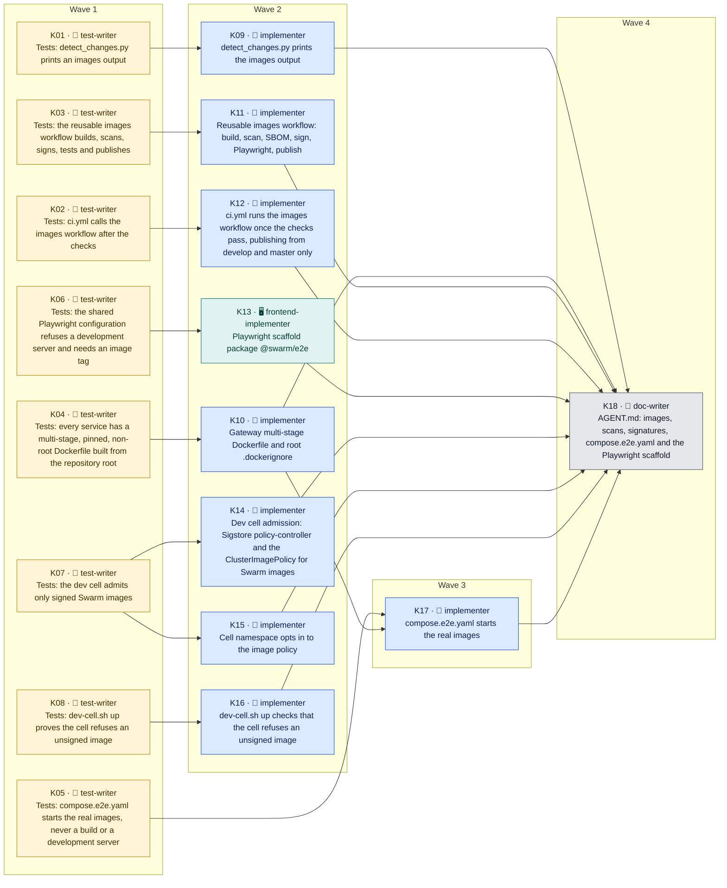

# T0.10: Plan

**Plan:** 🟢 Approved

**Push:** 🟢 Approved

<!-- ticket:specs -->
## 📚 Specifications

The technical pages, features, use cases and business rules of [TICKET.md](TICKET.md), copied by `python3 .claude/scripts/ticket_refs.py sync`.

- [🧰 Deployment: CI/CD](../../specs/technical/09-deployment.md#ci)
- [🛡️ Security: supply chain and testing](../../specs/technical/06-security.md#supply-chain)
- [🚢 Deployment: delivery](../../specs/technical/09-deployment.md#delivery)
- [🌱 Deployment: environments](../../specs/technical/09-deployment.md#environments)
<!-- /ticket:specs -->

## Summary

T0.10 builds steps 3 to 6 of the CI/CD pipeline in [🧰 Deployment: CI/CD](../../specs/technical/09-deployment.md#ci). A new `images` output of `detect_changes.py` selects every changed service or front end that has a Dockerfile. A reusable `.github/workflows/images.yml`, called by `ci.yml` once the step 2 checks pass, does the following:

- runs OSV-Scanner on the lock files;
- builds one multi-stage image per selected folder, with the repository root as context and the BuildKit remote cache;
- scans each image with Trivy, makes its CycloneDX SBOM, pushes it to GHCR under a run tag, and signs and attests it keylessly with cosign;
- runs the Playwright scaffold against the real images started by `compose.e2e.yaml`, and uploads the HTML report when a test fails;
- tags the signed digests with the commit SHA, only on pushes to `develop` and `master`.

The gateway gets its Dockerfile and the repository gets a root `.dockerignore`. The Playwright scaffold is a new pnpm package, `packages/ts/e2e` (`@swarm/e2e`). Its shared configuration refuses a `webServer` and requires `SWARM_IMAGE_TAG`, and its smoke spec runs the gateway image through compose.

The dev cell refuses unsigned Swarm images in three ways:

- a Sigstore policy-controller Argo CD Application and an enforcing ClusterImagePolicy, both in `deploy/environments/dev/platform`;
- the policy-controller opt-in label on the cell namespace, set by the Terraform cell module;
- a server dry-run probe at the end of `dev-cell.sh up`, which fails the script if the cell accepts an unsigned image.

The plan has 18 tasks in 4 waves:

- Wave 1: 8 test-writer tasks.
- Wave 2: 8 implementation tasks.
- Wave 3: `compose.e2e.yaml`, which needs the gateway Dockerfile.
- Wave 4: the AGENT.md update.

The ticket changes no front end and lists no screen, so the plan has no capture task.

## Assumptions

1. The roadmap row names no feature, use case or business rule, so the acceptance criteria cite none and the ticket links the technical page sections that settle what it builds.
2. The roadmap has no per-ticket anchor, so the ticket link points to the sprint section `#s02`, as the other tickets of the phase do.
3. The row names no row of the budgets table, so the ticket touches no budget.
4. The row gives no admission mechanism for refusing an unsigned image (the security page only says Kubernetes admission accepts only signed images), so the plan chooses the most conservative option and records it.
5. The row names no front end screen, so the ticket touches no screen.
6. `tests-evidences/` holds a `.gitkeep` so the empty folder exists in git. `check_ticket.py` was not run by the planner; the workflow runs it.
7. No front end exists yet: T0.14, which runs alongside, creates them and owns `frontends/`. So T0.10 writes only the gateway's Dockerfile. The pipeline builds any `frontends/<name>/Dockerfile` it finds, and front-end Dockerfiles and their `compose.e2e.yaml` entries come with the tickets that create the front ends (follow-up).
8. `AGENT.md` puts Playwright tests in `frontends/<frontend>/e2e/`, and no front end exists yet. So the scaffold is the shared package `@swarm/e2e` in `packages/ts/e2e`: its `defineE2eConfig` and a smoke spec. The front ends will reuse it.
9. The gateway is a command-line service with no HTTP endpoint. So the Playwright smoke spec checks compose's resolved configuration (image tags, no build) and runs the real gateway image through `docker compose run`, which must exit 0. Browser tests come with the front ends. No gateway source is changed, to stay out of the T0.11 and T0.16 areas.
10. Image names are `ghcr.io/gpbcom/swarm/<folder name>`. Every pipeline run pushes its images to GHCR under `run-<run id>-<attempt>` and signs them, pull requests included. Only pushes to `develop` and `master` add the commit SHA tag, on the same signed digest. This is read as the line between step 4 "push to GHCR" and step 6 "Publish ... tagged with the commit SHA, from `develop` and `master` only".
11. Signing is keyless cosign through GitHub's OIDC token (no key to store), with a CycloneDX SBOM made by Trivy and attached with `cosign attest`. The dev cell's ClusterImagePolicy requires the certificate identity of `.github/workflows/images.yml` in `gpbcom/swarm`.
12. The admission mechanism is the Sigstore policy-controller, an Argo CD Application in `deploy/environments/dev/platform`, together with the opt-in namespace label set by Terraform. The ticket left the mechanism open. The policy-controller is cosign's own verifier, and installing it follows the existing platform pattern.
13. The policy enforces signatures on Swarm's own images (`ghcr.io/gpbcom/swarm/**`). Third-party images (CloudNativePG PostGIS, Valkey, MinIO, OpenBao, NATS) only produce a warning (`no-match-policy: warn`), so that the dev cell delivered by T0.08 keeps running. Extending signature checks to third-party images, and building and signing `deploy/images/postgres`, are follow-ups.
14. `dev-cell.sh up` checks the refusal live with a server dry-run of a Pod whose image is under `ghcr.io/gpbcom/swarm/` and never signed (`DEV_CELL_UNSIGNED_IMAGE`). A refusal because no valid signature can be found counts as refusing an unsigned image.
15. Remote caches are BuildKit's GitHub Actions cache (`type=gha`, one scope per image, `mode=max`), with each Dockerfile's dependency layers (uv sync, and later Cargo and pnpm/Turborepo) ordered on the lock files. No Turborepo remote cache server is set up, because the specifications name none (follow-up).
16. Thresholds: Trivy fails on HIGH and CRITICAL vulnerabilities that have a fix (`--ignore-unfixed`), and OSV-Scanner fails on any known vulnerability in `uv.lock`, `pnpm-lock.yaml` and `packages/rust/Cargo.lock`. The specifications give no threshold.
17. Base images, action versions and chart versions (Python 3.12 slim, uv 0.12.x, Trivy, OSV-Scanner, cosign-installer, the policy-controller chart) are picked by the workers and may not have been checked against a registry. Each is recorded, to be confirmed on the first real run, as T0.08 did.
18. When a run builds only some images, the e2e job builds the other images of `compose.e2e.yaml` locally from the same commit with the shared cache, so that Playwright always runs against real images of this commit.
19. New Python tests go in new folders (`tests/ci/images/`, `tests/ci/e2e/`) and in `tests/deploy/images/`, because `tests/ci/workflows/` and `tests/conventions/mono_repo/` already reach the five-file limit.
20. `pnpm-lock.yaml` is owned by K13. T0.14 may change it at the same time in the shared checkout, and the integrator resolves any conflict. Changes to the ticket's area outside `.github` (`services/gateway/Dockerfile`, `deploy/`, `packages/ts/e2e`) are not covered by the area lock, whose computed area for T0.10 is `.github` only.
21. Pull requests from Dependabot or forks get a read-only token and cannot push images. The repository is private and has no such pull requests today (follow-up if that changes).
22. The ticket changes no front end and lists no screen, so the plan has no screen capture task (TKT-21).

<!-- plan:graph -->

> [!NOTE]
> Generated from the json block at the end of this page by `python3 .claude/scripts/plan.py render`.
> To change a task, edit the json block, then render again: never edit this view by hand.

## Waves

| Wave | Tasks | Agents running at once |
| --- | --- | --- |
| 1 | [K01](#k01), [K02](#k02), [K03](#k03), [K04](#k04), [K05](#k05), [K06](#k06), [K07](#k07), [K08](#k08) | 8 of 8 |
| 2 | [K09](#k09), [K10](#k10), [K11](#k11), [K12](#k12), [K13](#k13), [K14](#k14), [K15](#k15), [K16](#k16) | 8 of 8 |
| 3 | [K17](#k17) | 1 of 1 |
| 4 | [K18](#k18) | 1 of 1 |

| Wave | Task | Agent | Depends on | Unblocks |
| --- | --- | --- | --- | --- |
| 1 | [K01](#k01) Tests: detect_changes.py prints an images output | 🧪 test-writer | none | [K09](#k09) |
| 1 | [K02](#k02) Tests: ci.yml calls the images workflow after the checks | 🧪 test-writer | none | [K12](#k12) |
| 1 | [K03](#k03) Tests: the reusable images workflow builds, scans, signs, tests and publishes | 🧪 test-writer | none | [K11](#k11) |
| 1 | [K04](#k04) Tests: every service has a multi-stage, pinned, non-root Dockerfile built from the repository root | 🧪 test-writer | none | [K10](#k10) |
| 1 | [K05](#k05) Tests: compose.e2e.yaml starts the real images, never a build or a development server | 🧪 test-writer | none | [K17](#k17) |
| 1 | [K06](#k06) Tests: the shared Playwright configuration refuses a development server and needs an image tag | 🧪 test-writer | none | [K13](#k13) |
| 1 | [K07](#k07) Tests: the dev cell admits only signed Swarm images | 🧪 test-writer | none | [K14](#k14), [K15](#k15) |
| 1 | [K08](#k08) Tests: dev-cell.sh up proves the cell refuses an unsigned image | 🧪 test-writer | none | [K16](#k16) |
| 2 | [K09](#k09) detect_changes.py prints the images output | 🐍 implementer | [K01](#k01) | [K18](#k18) |
| 2 | [K10](#k10) Gateway multi-stage Dockerfile and root .dockerignore | 🐍 implementer | [K04](#k04) | [K17](#k17), [K18](#k18) |
| 2 | [K11](#k11) Reusable images workflow: build, scan, SBOM, sign, Playwright, publish | 🐍 implementer | [K03](#k03) | [K18](#k18) |
| 2 | [K12](#k12) ci.yml runs the images workflow once the checks pass, publishing from develop and master only | 🐍 implementer | [K02](#k02) | [K18](#k18) |
| 2 | [K13](#k13) Playwright scaffold package @swarm/e2e | 🖥️ frontend-implementer | [K06](#k06) | [K18](#k18) |
| 2 | [K14](#k14) Dev cell admission: Sigstore policy-controller and the ClusterImagePolicy for Swarm images | 🐍 implementer | [K07](#k07) | [K18](#k18) |
| 2 | [K15](#k15) Cell namespace opts in to the image policy | 🐍 implementer | [K07](#k07) | [K18](#k18) |
| 2 | [K16](#k16) dev-cell.sh up checks that the cell refuses an unsigned image | 🐍 implementer | [K08](#k08) | [K18](#k18) |
| 3 | [K17](#k17) compose.e2e.yaml starts the real images | 🐍 implementer | [K05](#k05), [K10](#k10) | [K18](#k18) |
| 4 | [K18](#k18) AGENT.md: images, scans, signatures, compose.e2e.yaml and the Playwright scaffold | 📝 doc-writer | [K09](#k09), [K10](#k10), [K11](#k11), [K12](#k12), [K13](#k13), [K14](#k14), [K15](#k15), [K16](#k16), [K17](#k17) | none |

## Dependency graph



## Tasks

### <a id="k01"></a>K01: Tests: detect_changes.py prints an images output

| Agent | Wave | Depends on | Unblocks |
| --- | --- | --- | --- |
| 🧪 test-writer | 1 | none | [K09](#k09) |

**Files** (only this task may change them in its wave):

- `tests/ci/detect_changes/helpers.py`
- `tests/ci/detect_changes/test_detect_changes.py`
- `tests/ci/detect_changes/test_shared_changes.py`
- `tests/ci/detect_changes/test_images.py`

**Done when:** `uv run pytest tests/ci/detect_changes -n 2` collects without error and fails only on the missing `images` line. `uv run ruff check tests/ci/detect_changes` and `uv run ruff format --check tests/ci/detect_changes` pass.

**Brief:**

Write the failing tests for a sixth output line of `.github/scripts/detect_changes.py`: `images=<compact JSON array>`. It lists the image folders to build in step 3 of [docs/specs/technical/09-deployment.md#ci](docs/specs/technical/09-deployment.md#ci) ("Build one image per changed service and front end"). Ticket: [docs/tickets/T0.10/TICKET.md](docs/tickets/T0.10/TICKET.md).

The contract the implementer (K09) follows:
- The output becomes exactly six lines, in this order: `services`, `typescript`, `rust`, `repository`, `specs`, `images`.
- An image folder is `services/<name>` (a discovered service) or `frontends/<name>` (any direct sub-folder not starting with `.` or `_`) that holds a file named `Dockerfile`.
- `images` is the sorted JSON array, without duplicates and with compact separators, of the image folders that a changed path falls under (`services/<name>/...` or `frontends/<name>/...`).
- A selected service without a Dockerfile is not listed in `images`, but is still listed in `services`.
- A front end with a Dockerfile is listed in `images` even when it has no `package.json`.
- Every shared path selects every image folder. The shared paths are the existing ones plus three new ones: `.github/workflows/images.yml`, `compose.e2e.yaml` and `.dockerignore`. Each of these three also selects everything else, like the other pipeline files.
- `--all` lists every image folder.
- `.github/workflows/terraform.yml` still selects nothing.

What to change:
- `helpers.py`: add `IMAGES_KEY = "images"` and an `ALL_IMAGES` constant. Add `services/alpha/Dockerfile` and `frontends/ground-control/Dockerfile` to `REPO_FILES`, and also a `frontends/notes/Dockerfile`, or decide the notes case explicitly. Keep `services/beta` without a Dockerfile.
- `test_detect_changes.py`: the `NOTHING` dict gains `"images": "[]"`, and the five-line order test becomes a six-line test.
- `test_shared_changes.py`: `EVERYTHING` gains `images`, and the shared-path parametrisation gains the three new paths.
- `test_images.py` (new, class `TestImages`): the selection rules above. Cover:
  - a service with a Dockerfile;
  - a service without one;
  - a front end with a Dockerfile;
  - a change to the Dockerfile itself;
  - two folders, sorted;
  - `--all`.

Follow the AGENT.md Tests section and the CLAUDE.md code rules: one `Test<Subject>` class per file, constants as `ClassVar` or module-level constants in `helpers.py`, no `Any` or `object`, no dict with hard-coded keys inside a method, and comparisons against constants.

### <a id="k02"></a>K02: Tests: ci.yml calls the images workflow after the checks

| Agent | Wave | Depends on | Unblocks |
| --- | --- | --- | --- |
| 🧪 test-writer | 1 | none | [K12](#k12) |

**Files** (only this task may change them in its wave):

- `tests/ci/workflows/test_ci_workflow.py`

**Done when:** `uv run pytest tests/ci/workflows/test_ci_workflow.py -n 2` collects without error and fails only on the missing `images` job and output. Ruff check and format check pass on the file.

**Brief:**

Update `tests/ci/workflows/test_ci_workflow.py` for steps 3 to 6 of [docs/specs/technical/09-deployment.md#ci](docs/specs/technical/09-deployment.md#ci): "each step passing before the next", and publication "from `develop` and `master` only". Ticket: [docs/tickets/T0.10/TICKET.md](docs/tickets/T0.10/TICKET.md), acceptance criterion 4.

The contract for `.github/workflows/ci.yml` (implemented by K12):
- `JOBS` becomes `{changes, python, rust, typescript, specs, images, result}`.
- `OUTPUT_KEYS` gains `images`, taken from `${{ steps.detect.outputs.images }}`.
- The `images` job:
  - `uses: ./.github/workflows/images.yml`;
  - `needs` contains `changes`, `python`, `rust`, `typescript` and `specs`;
  - its `if` contains `!cancelled()`, a check that no needed job failed (`contains(needs.*.result, 'failure')` negated), and `needs.changes.outputs.images != '[]'`;
  - `with.images == '${{ needs.changes.outputs.images }}'`;
  - `with.publish` is an expression containing `github.event_name == 'push'`, `refs/heads/develop` and `refs/heads/master`;
  - its job-level `permissions` are exactly `{contents: read, packages: write, id-token: write}`.
- The top-level `permissions` stay `{contents: read}`.
- The `result` job's `needs` are the five check jobs plus `images`.
- Remove `test_steps_three_to_six_are_not_built_yet`, which T0.04 wrote as a placeholder.
- Keep `test_no_step_uses_a_docker_action`, since ci.yml itself still runs no docker action, and keep `test_no_script_interpolates_event_values_directly`.
- Keep the existing trigger and concurrency tests unchanged.

Follow the AGENT.md Tests section and the CLAUDE.md code rules: `ClassVar` constants, no `Any` or `object`, and no hard-coded dict inside a method.

### <a id="k03"></a>K03: Tests: the reusable images workflow builds, scans, signs, tests and publishes

| Agent | Wave | Depends on | Unblocks |
| --- | --- | --- | --- |
| 🧪 test-writer | 1 | none | [K11](#k11) |

**Files** (only this task may change them in its wave):

- `tests/ci/images/test_images_workflow.py`

**Done when:** `uv run pytest tests/ci/images -n 2` collects without error and fails only because `.github/workflows/images.yml` is missing. Ruff check and format check pass on the file.

**Brief:**

Write `tests/ci/images/test_images_workflow.py` (class `TestImagesWorkflow`). It loads `.github/workflows/images.yml` with `yaml.safe_load` and checks the following specifications:
- steps 3 to 6 of [docs/specs/technical/09-deployment.md#ci](docs/specs/technical/09-deployment.md#ci);
- the signing and SBOM rules of [docs/specs/technical/06-security.md#supply-chain](docs/specs/technical/06-security.md#supply-chain);
- [docs/specs/technical/09-deployment.md#delivery](docs/specs/technical/09-deployment.md#delivery): images are what Argo CD takes, by tag.

Ticket: [docs/tickets/T0.10/TICKET.md](docs/tickets/T0.10/TICKET.md), acceptance criteria 2 to 4. The folder `tests/ci/images/` is new because `tests/ci/workflows/` already holds more than five files.

The contract K11 implements:

1. Triggers and permissions.
   - The trigger is `on.workflow_call` only.
   - Inputs: `images` (type string, required) and `publish` (type boolean, not required, default false).
   - The top-level `permissions` are `{contents: read}`.
   - The jobs that push or sign (`image`, `publish`) have job-level `permissions` `{contents: read, packages: write, id-token: write}`.

2. Jobs: exactly `scan-dependencies`, `image`, `e2e` and `publish`.
   - `image` needs `scan-dependencies`.
   - `e2e` needs `image`.
   - `publish` needs `e2e`, and its `if` references `inputs.publish`.

3. `scan-dependencies` runs OSV-Scanner, either through a `google/osv-scanner-action` step or a `run` containing `osv-scanner`, on `uv.lock`, `pnpm-lock.yaml` and `packages/rust/Cargo.lock`.

4. `image`:
   - It has a matrix over `fromJSON(inputs.images)`.
   - Its steps include `docker/setup-buildx-action` and `docker/login-action` with registry `ghcr.io`.
   - A `docker/build-push-action` step uses `context: .`, a `file` ending in `/Dockerfile`, and `cache-from` and `cache-to` containing `type=gha`; `cache-to` also contains `mode=max`. This is the remote cache.
   - A Trivy step (`aquasecurity/trivy-action`, or a run containing `trivy image`) has a severity covering `HIGH` and `CRITICAL` and exit code 1.
   - An SBOM is produced in CycloneDX format.
   - A `sigstore/cosign-installer` step is present.
   - Runs contain `cosign sign --yes`, signing a reference with `@` (a digest), and `cosign attest` with `--type cyclonedx`.
   - A `cosign verify` names `--certificate-oidc-issuer https://token.actions.githubusercontent.com`.
   - The order of steps is build, then Trivy, then the push, then cosign sign.
   - No step of `image` uses `github.sha` or `GITHUB_SHA` in a tag. The run tag contains `github.run_id` or `GITHUB_RUN_ID`.

5. `e2e`:
   - Its runs reference `compose.e2e.yaml` and set `SWARM_IMAGE_TAG`.
   - Playwright runs through pnpm on `./packages/ts/e2e` with the script `e2e`.
   - An `actions/upload-artifact` step has `if` containing `failure()` and a path containing `playwright-report`.
   - A step containing `docker compose` and `down` runs with `if` containing `always()`.

6. `publish` tags with `github.sha` or `GITHUB_SHA` and runs `cosign verify`.

7. Repository-wide rules for this workflow:
   - No `run` contains `${{ github.event`, `${{ inputs.` or `${{ matrix.`: values go through `env`.
   - Every `uses` is pinned to a version (`@v<digit>` or a 40-hex SHA), never `@main` or `@master`.

Tests must accept equivalent spellings where noted. Follow the AGENT.md Tests section and the CLAUDE.md code rules: `ClassVar` constants, no `Any` or `object`, `JsonValue` for the parsed YAML, and no hard-coded dict inside a method.

### <a id="k04"></a>K04: Tests: every service has a multi-stage, pinned, non-root Dockerfile built from the repository root

| Agent | Wave | Depends on | Unblocks |
| --- | --- | --- | --- |
| 🧪 test-writer | 1 | none | [K10](#k10) |

**Files** (only this task may change them in its wave):

- `tests/deploy/images/test_service_images.py`

**Done when:** `uv run pytest tests/deploy/images/test_service_images.py -n 2` collects without error and fails only because `services/gateway/Dockerfile` and `.dockerignore` are missing. Ruff check and format check pass on the file.

**Brief:**

Write `tests/deploy/images/test_service_images.py` (class `TestServiceImages`) for step 3 of [docs/specs/technical/09-deployment.md#ci](docs/specs/technical/09-deployment.md#ci): "one image per changed service and front end (multi-stage, repository root as context)". It also covers "images built from minimal bases" from [docs/specs/technical/06-security.md#supply-chain](docs/specs/technical/06-security.md#supply-chain), and the AGENT.md Mono-repo section (Docker images). Ticket: [docs/tickets/T0.10/TICKET.md](docs/tickets/T0.10/TICKET.md). Model the parsing on `tests/deploy/images/test_postgres_image.py`.

The contract K10 implements:

1. Every direct sub-folder of `services/` not starting with `.` or `_` has a `Dockerfile`. Parametrise over the discovered services; today that is `gateway`.

2. Every `Dockerfile` found at `services/*/Dockerfile` or `frontends/*/Dockerfile`, parametrised:
   - it has at least two `FROM` instructions (multi-stage);
   - every external base of a `FROM` has a tag or digest that is not `latest`. A `FROM <stage name>` that refers to an earlier `AS` stage is allowed;
   - the final stage has a `USER` that is neither `root` nor `0`;
   - the final stage has an `ENTRYPOINT` or a `CMD`;
   - its `COPY` sources are repository-root relative, so that the build context is the root: a service Dockerfile copies `uv.lock` and a path starting with its own `services/<name>`.

3. The gateway's final `ENTRYPOINT` or `CMD` runs `swarm-gateway`.

4. A root `.dockerignore` exists and holds patterns excluding `.git`, `node_modules`, `.venv`, `target` and `.env` files. Match these as substrings of its lines.

Do not require Dockerfiles for front ends: the front ends arrive with T0.14 and later tickets. Follow the AGENT.md Tests section and the CLAUDE.md code rules: `ClassVar` constants, no `Any` or `object`, and no hard-coded dict inside a method.

### <a id="k05"></a>K05: Tests: compose.e2e.yaml starts the real images, never a build or a development server

| Agent | Wave | Depends on | Unblocks |
| --- | --- | --- | --- |
| 🧪 test-writer | 1 | none | [K17](#k17) |

**Files** (only this task may change them in its wave):

- `tests/ci/e2e/test_compose_e2e.py`

**Done when:** `uv run pytest tests/ci/e2e -n 2` collects without error and fails only because `compose.e2e.yaml` is missing. Ruff check and format check pass on the file.

**Brief:**

Write `tests/ci/e2e/test_compose_e2e.py` (class `TestComposeE2e`). It checks `compose.e2e.yaml` at the repository root against the following:
- step 5 of [docs/specs/technical/09-deployment.md#ci](docs/specs/technical/09-deployment.md#ci): "Playwright against the real images started by `compose.e2e.yaml`";
- AGENT.md's Front-end tests rule: "They run against the real images started by `compose.e2e.yaml`, never a development server".

Ticket: [docs/tickets/T0.10/TICKET.md](docs/tickets/T0.10/TICKET.md), acceptance criterion 2.

The contract K17 implements:
- The file parses with `yaml.safe_load` and has a non-empty `services` mapping that contains `gateway`.
- No service has a `build` key.
- Every service's `image` matches `^\$\{SWARM_IMAGE_REGISTRY:-ghcr\.io/gpbcom/swarm\}/<name>:\$\{SWARM_IMAGE_TAG:\?[^}]+\}$`, where `<name>` is the service key. That name must be a folder `services/<name>` or `frontends/<name>` that holds a `Dockerfile`.
- No service mounts a source folder: no volume whose source starts with `./services`, `./frontends`, `./packages` or `.`, or is the repository root.
- No service `command` or `entrypoint` contains a development-server word: `--reload`, `vite`, `pnpm dev`, `npm run dev` or `uvicorn --reload`.

Follow the AGENT.md Tests section and the CLAUDE.md code rules: `ClassVar` constants, `JsonValue` for parsed YAML, no `Any` or `object`, and no hard-coded dict inside a method.

### <a id="k06"></a>K06: Tests: the shared Playwright configuration refuses a development server and needs an image tag

| Agent | Wave | Depends on | Unblocks |
| --- | --- | --- | --- |
| 🧪 test-writer | 1 | none | [K13](#k13) |

**Files** (only this task may change them in its wave):

- `packages/ts/e2e/test/define-e2e-config.test.ts`

**Done when:** The test file exists. Running it with `node --experimental-strip-types --test packages/ts/e2e/test/define-e2e-config.test.ts` fails only because `packages/ts/e2e/src/define-e2e-config.ts` does not exist yet.

**Brief:**

Write `packages/ts/e2e/test/define-e2e-config.test.ts`, using `node:test` and `node:assert/strict` as `packages/ts/live` does (run with `node --experimental-strip-types --test test/*.test.ts`). It tests the Playwright scaffold's shared configuration helper against:
- step 5 of [docs/specs/technical/09-deployment.md#ci](docs/specs/technical/09-deployment.md#ci): "Playwright against the real images started by `compose.e2e.yaml`";
- AGENT.md's Front-end tests rule ("never a development server").

Ticket: [docs/tickets/T0.10/TICKET.md](docs/tickets/T0.10/TICKET.md), acceptance criteria 2 and 3.

The contract K13 implements, in package `@swarm/e2e` (`packages/ts/e2e`):
- The test imports `defineE2eConfig` from `../src/define-e2e-config.ts`.
- Signature: `defineE2eConfig(options: { testDir: string; webServer?: unknown }, env: Record<string, string | undefined> = process.env)`. It returns a Playwright config object.

Cases to test:
1. With `env.SWARM_IMAGE_TAG` set, the config has `testDir` as given, `webServer` undefined, and a `reporter` array containing `['html', { outputFolder: 'playwright-report', open: 'never' }]`.
2. `use.baseURL` equals `env.SWARM_E2E_BASE_URL` when it is set, and is undefined otherwise.
3. A missing or blank `SWARM_IMAGE_TAG` throws an `Error` whose message names `SWARM_IMAGE_TAG`.
4. Options with a `webServer` throw an `Error` whose message says a development server is refused.
5. With `env.CI` set, `forbidOnly` is true.

Write strict TypeScript that passes `@swarm/config`'s eslint and tsconfig, with no `any`.

### <a id="k07"></a>K07: Tests: the dev cell admits only signed Swarm images

| Agent | Wave | Depends on | Unblocks |
| --- | --- | --- | --- |
| 🧪 test-writer | 1 | none | [K14](#k14), [K15](#k15) |

**Files** (only this task may change them in its wave):

- `tests/deploy/environments/test_image_admission.py`
- `deploy/terraform/modules/self-hosted/cell/tests/cell.tftest.hcl`

**Done when:** `uv run pytest tests/deploy/environments/test_image_admission.py -n 2` collects without error and fails only because the two platform files are missing. Ruff check and format check pass. `terraform -chdir=deploy/terraform/modules/self-hosted/cell test` fails only on the new label assertion (not applicable when terraform is not installed).

**Brief:**

Write the tests for the following:
- "Kubernetes admission accepts only signed images", from [docs/specs/technical/06-security.md#supply-chain](docs/specs/technical/06-security.md#supply-chain);
- the dev environment of [docs/specs/technical/09-deployment.md#environments](docs/specs/technical/09-deployment.md#environments), one ephemeral cell per branch;
- GitOps through `deploy/environments`, from [docs/specs/technical/09-deployment.md#delivery](docs/specs/technical/09-deployment.md#delivery).

Ticket: [docs/tickets/T0.10/TICKET.md](docs/tickets/T0.10/TICKET.md), acceptance criterion 1. Model the Python tests on `tests/deploy/environments/test_dev_environment.py`.

1. `tests/deploy/environments/test_image_admission.py` (class `TestImageAdmission`):
   - `deploy/environments/dev/platform/policy-controller.yaml` is an Argo CD Application:
     - `apiVersion argoproj.io/v1alpha1`, `kind Application`, `metadata.namespace argocd`;
     - `source.repoURL https://sigstore.github.io/helm-charts`, `source.chart policy-controller`, a semver `targetRevision`;
     - destination namespace `cosign-system`;
     - automated sync and `CreateNamespace=true`;
     - its Helm values (`source.helm.valuesObject`) set `webhook.configData.no-match-policy` to `warn`.
   - `deploy/environments/dev/platform/cluster-image-policy.yaml` is a ClusterImagePolicy:
     - `apiVersion policy.sigstore.dev/v1beta1`, `kind ClusterImagePolicy`;
     - `spec.mode == enforce`;
     - `spec.images` contains the glob `ghcr.io/gpbcom/swarm/**`;
     - an authority with `keyless.url https://fulcio.sigstore.dev` and an identity with issuer `https://token.actions.githubusercontent.com`;
     - the identity's `subjectRegExp` starts with `^https://github\.com/gpbcom/swarm/\.github/workflows/images\.yml@`;
     - the annotation `argocd.argoproj.io/sync-options` contains `SkipDryRunOnMissingResource=true`;
     - an `argocd.argoproj.io/sync-wave` annotation is greater than the Application's, or the Application has none.
   - Neither file holds a `key`, `data` or `secret` value with key material.

2. `deploy/terraform/modules/self-hosted/cell/tests/cell.tftest.hcl`: in the `creates_the_empty_cell` run, add an assertion that `kubernetes_namespace_v1.cell.metadata[0].labels["policy.sigstore.dev/include"] == "true"`. This is the opt-in label of the policy-controller. Keep every existing assertion.

Follow the AGENT.md Tests section and the CLAUDE.md code rules: `ClassVar` constants, `JsonValue`, no `Any` or `object`, and no hard-coded dict inside a method.

### <a id="k08"></a>K08: Tests: dev-cell.sh up proves the cell refuses an unsigned image

| Agent | Wave | Depends on | Unblocks |
| --- | --- | --- | --- |
| 🧪 test-writer | 1 | none | [K16](#k16) |

**Files** (only this task may change them in its wave):

- `tests/deploy/scripts/test_dev_cell_script.py`

**Done when:** `uv run pytest tests/deploy/scripts/test_dev_cell_script.py -n 2` collects without error and fails only on the new probe behaviour. Ruff check and format check pass on the file.

**Brief:**

Extend `tests/deploy/scripts/test_dev_cell_script.py` (class `TestDevCellScript`) so that the dev cell's refusal of an unsigned image is checked each time a cell comes up. Specifications:
- [docs/specs/technical/06-security.md#supply-chain](docs/specs/technical/06-security.md#supply-chain): "Kubernetes admission accepts only signed images";
- [docs/specs/technical/09-deployment.md#environments](docs/specs/technical/09-deployment.md#environments).

Ticket: [docs/tickets/T0.10/TICKET.md](docs/tickets/T0.10/TICKET.md), acceptance criterion 1.

The contract K16 implements in `deploy/scripts/dev-cell.sh`:

1. In `--dry-run up`, after the two `kubectl wait` lines, the script prints exactly one more line. It starts with `+ kubectl run` and contains:
   - `--namespace <cell>`;
   - `--dry-run=server`;
   - `--restart=Never`;
   - `--image=<probe>`.

2. The probe image is `$DEV_CELL_UNSIGNED_IMAGE` when that is set. Otherwise it is a default starting with `ghcr.io/gpbcom/swarm/`.

3. `down` prints no `kubectl` line, as today.

4. Without `--dry-run`, use fake `terraform` and `kubectl` executables written to `tmp_path` and put first on `PATH`. Both exit 0 for everything, except that `kubectl run` exits with a code the test chooses.
   - When the fake `kubectl run` exits 0 (the cell accepted the unsigned image), `up` exits non-zero and its stderr says the cell accepted an unsigned image.
   - When it exits 1 (refused), `up` exits 0.

Update the existing tests that count the kubectl lines, `test_up_initialises_applies_then_waits_for_argo_cd` and `test_the_wait_timeout_can_be_set`, so that they select the `wait` lines only. Keep every other test. Follow the AGENT.md Tests section and the CLAUDE.md code rules.

### <a id="k09"></a>K09: detect_changes.py prints the images output

| Agent | Wave | Depends on | Unblocks |
| --- | --- | --- | --- |
| 🐍 implementer | 2 | [K01](#k01) | [K18](#k18) |

**Files** (only this task may change them in its wave):

- `.github/scripts/detect_changes.py`

**Done when:** `uv run pytest tests/ci/detect_changes -n 2` passes. `uv run ruff check .github/scripts` and `uv run ruff format --check .github/scripts/detect_changes.py` pass.

**Brief:**

Make `.github/scripts/detect_changes.py` print a sixth line, `images=<compact JSON array>`, following the contract and tests of K01 (`tests/ci/detect_changes/`). This is step 3 of [docs/specs/technical/09-deployment.md#ci](docs/specs/technical/09-deployment.md#ci): "Build one image per changed service and front end". Ticket: [docs/tickets/T0.10/TICKET.md](docs/tickets/T0.10/TICKET.md).

- Add the discovery of image folders: `services/<service>` for a discovered service, and `frontends/<name>` for any direct sub-folder not starting with `.` or `_`, in both cases holding a `Dockerfile`.
- Select an image folder when a changed path falls under it. Select all of them on a shared path or `--all`.
- Add `.github/workflows/images.yml`, `compose.e2e.yaml` and `.dockerignore` to `SHARED_FILES`.
- Update the module docstring: six lines, and what `images` holds.

Keep the script's existing style (a standalone CI script from T0.04, with module-level functions and stdlib only), its exit codes and its usage line. Run ruff format on the file only.

### <a id="k10"></a>K10: Gateway multi-stage Dockerfile and root .dockerignore

| Agent | Wave | Depends on | Unblocks |
| --- | --- | --- | --- |
| 🐍 implementer | 2 | [K04](#k04) | [K17](#k17), [K18](#k18) |

**Files** (only this task may change them in its wave):

- `services/gateway/Dockerfile`
- `.dockerignore`

**Done when:** `uv run pytest tests/deploy/images -n 2` passes. When docker is available, `docker build -f services/gateway/Dockerfile -t swarm-gateway:local .` succeeds from the repository root and `docker run --rm swarm-gateway:local` exits 0 as a non-root user. Record the output in your result.

**Brief:**

Write `services/gateway/Dockerfile` and the root `.dockerignore`, following K04's tests (`tests/deploy/images/test_service_images.py`). Specifications:
- step 3 of [docs/specs/technical/09-deployment.md#ci](docs/specs/technical/09-deployment.md#ci): "multi-stage, repository root as context", with remote caches;
- [docs/specs/technical/06-security.md#supply-chain](docs/specs/technical/06-security.md#supply-chain): "Images built from minimal bases";
- the AGENT.md Docker images rules: one image per service, a multi-stage `Dockerfile` in its own folder, and the repository root as build context because the shared `uv.lock` is there.

Ticket: [docs/tickets/T0.10/TICKET.md](docs/tickets/T0.10/TICKET.md).

The build stage:
- Use a pinned Python 3.12 slim base, and copy a pinned `uv` binary from `ghcr.io/astral-sh/uv:<version>`, a 0.12.x release matching `uv_build>=0.12.21,<0.13` in `services/gateway/pyproject.toml`.
- Copy the workspace metadata first: root `pyproject.toml`, `uv.lock`, and the `pyproject.toml` of every workspace member the gateway needs. Watch out: `COPY` globs flatten folders, so copy whole folders or use bind mounts. This keeps the dependency layer cacheable.
- Run `uv sync --frozen --no-dev --no-editable --package swarm-gateway` with `--mount=type=cache` on the uv cache.
- Copy `services/gateway` and the `packages/python` members it uses, then sync again so the project itself is installed.

The runtime stage:
- Use the same pinned slim base and copy only the virtual environment.
- Run as a non-root user with a fixed UID, whose working directory is writable, because the reference `logger.yaml` writes `logs/`.
- Use `ENTRYPOINT ["swarm-gateway"]`, with the venv's `bin` on `PATH`.

No `latest` tag anywhere. Record every chosen tag as an assumption, unverified against the registry unless you can pull it.

The `.dockerignore` excludes:
- `.git`, `**/node_modules`, `**/.venv`, `**/__pycache__`, `**/target`, `**/.env` and `*.env`;
- `logs`, `.claude` and `deploy/terraform/**/.terraform`;
- `dist` and `playwright-report`.

Do not exclude `docs/`, because a later front-end build may need the generated tokens.

### <a id="k11"></a>K11: Reusable images workflow: build, scan, SBOM, sign, Playwright, publish

| Agent | Wave | Depends on | Unblocks |
| --- | --- | --- | --- |
| 🐍 implementer | 2 | [K03](#k03) | [K18](#k18) |

**Files** (only this task may change them in its wave):

- `.github/workflows/images.yml`

**Done when:** `uv run pytest tests/ci/images -n 2` passes. When `actionlint` is installed, `actionlint .github/workflows/images.yml` prints nothing.

**Brief:**

Write `.github/workflows/images.yml`, a reusable workflow (`on: workflow_call`) for steps 3 to 6 of [docs/specs/technical/09-deployment.md#ci](docs/specs/technical/09-deployment.md#ci). It applies [docs/specs/technical/06-security.md#supply-chain](docs/specs/technical/06-security.md#supply-chain) (OSV-Scanner, Trivy, an SBOM, a cosign signature) and [docs/specs/technical/09-deployment.md#delivery](docs/specs/technical/09-deployment.md#delivery) (images tagged for Argo CD). Ticket: [docs/tickets/T0.10/TICKET.md](docs/tickets/T0.10/TICKET.md), acceptance criteria 2 to 4. Follow K03's tests in `tests/ci/images/test_images_workflow.py` exactly.

Inputs: `images`, the JSON array of folders such as `services/gateway`, and `publish` (boolean, default false). The image name is the folder's last part, in the repository `ghcr.io/<lower-cased github.repository>/<name>`, which gives `ghcr.io/gpbcom/swarm/gateway`. The run tag is `run-<GITHUB_RUN_ID>-<GITHUB_RUN_ATTEMPT>`.

Jobs:

1. `scan-dependencies`: OSV-Scanner on `uv.lock`, `pnpm-lock.yaml` and `packages/rust/Cargo.lock`. A known vulnerability fails the job.

2. `image`. It has a matrix over the folders and permissions `contents: read`, `packages: write` and `id-token: write`. Steps:
   - checkout, buildx, and a GHCR login with `github.actor` and `GITHUB_TOKEN`;
   - `docker/build-push-action` with `context: .`, `file: <folder>/Dockerfile`, `load: true`, the run tag, and `cache-from`/`cache-to` `type=gha,scope=<name>` (`mode=max` on `cache-to`). This is the remote cache: it reuses the uv, Cargo and pnpm dependency layers across runs;
   - Trivy on the loaded image, `--severity HIGH,CRITICAL --ignore-unfixed --exit-code 1`;
   - a CycloneDX SBOM of the image (Trivy `--format cyclonedx`), uploaded as an artifact;
   - `docker push` of the run tag, reading back the pushed digest;
   - `sigstore/cosign-installer`;
   - keyless `cosign sign --yes <repo>@<digest>`, then `cosign attest --yes --type cyclonedx --predicate <sbom> <repo>@<digest>`;
   - `cosign verify` with `--certificate-oidc-issuer https://token.actions.githubusercontent.com` and `--certificate-identity-regexp '^https://github\.com/gpbcom/swarm/\.github/workflows/images\.yml@'`. This is the identity the dev cell's ClusterImagePolicy (K14) requires.

3. `e2e`, which needs `image`:
   - Set `SWARM_IMAGE_TAG` to the run tag and `SWARM_IMAGE_REGISTRY` to the repository.
   - For each service of `compose.e2e.yaml` that this run did not build, build it locally from the same commit, with the same gha cache and `load: true`, and tag it with the run tag, so that compose always starts real images of this commit.
   - Pull the images built by the run.
   - Set up pnpm and Node 22, run `pnpm install --frozen-lockfile`, and install Playwright Chromium with its dependencies.
   - Run `pnpm --filter ./packages/ts/e2e run e2e`.
   - On `if: failure()`, upload `packages/ts/e2e/playwright-report/` with `actions/upload-artifact`.
   - Always run `docker compose -f compose.e2e.yaml down --volumes`.

4. `publish`. It needs `e2e`, and its `if` uses `inputs.publish`, with the same permissions as `image`. For each image of the run, add the commit SHA tag to the same digest (`docker buildx imagetools create --tag <repo>:<GITHUB_SHA> <repo>:<run tag>`), check that the digest is unchanged, then `cosign verify` the SHA tag.

Rules for every step:
- Pin every action to a version.
- Pass every expression to `run` through `env`: no `${{ ... }}` of inputs, matrix or event inside `run`.
- Record the action versions and tool versions as assumptions.

### <a id="k12"></a>K12: ci.yml runs the images workflow once the checks pass, publishing from develop and master only

| Agent | Wave | Depends on | Unblocks |
| --- | --- | --- | --- |
| 🐍 implementer | 2 | [K02](#k02) | [K18](#k18) |

**Files** (only this task may change them in its wave):

- `.github/workflows/ci.yml`

**Done when:** `uv run pytest tests/ci/workflows/test_ci_workflow.py -n 2` passes once K09 is integrated. Until then, only `test_the_outputs_match_the_keys_the_detector_prints` may fail. When `actionlint` is installed, `actionlint .github/workflows/ci.yml` prints nothing.

**Brief:**

Change `.github/workflows/ci.yml` following K02's tests (`tests/ci/workflows/test_ci_workflow.py`). Specifications:
- [docs/specs/technical/09-deployment.md#ci](docs/specs/technical/09-deployment.md#ci): "each step passing before the next", and "Publish images tagged with the commit SHA, from `develop` and `master` only";
- [docs/specs/technical/09-deployment.md#delivery](docs/specs/technical/09-deployment.md#delivery).

Ticket: [docs/tickets/T0.10/TICKET.md](docs/tickets/T0.10/TICKET.md), acceptance criterion 4.

1. Add the `images` output to the `changes` job, taken from `${{ steps.detect.outputs.images }}`. This is the sixth line K09 adds to `detect_changes.py`.

2. Add the job `images`:
   - `needs: [changes, python, rust, typescript, specs]`;
   - `if: ${{ !cancelled() && !contains(needs.*.result, 'failure') && needs.changes.outputs.images != '[]' }}`;
   - `uses: ./.github/workflows/images.yml`;
   - `with.images: ${{ needs.changes.outputs.images }}`;
   - `with.publish: ${{ github.event_name == 'push' && (github.ref == 'refs/heads/develop' || github.ref == 'refs/heads/master') }}`;
   - `permissions: {contents: read, packages: write, id-token: write}`.

3. Add `images` to the `needs` of `result`.

Keep the top-level `permissions: contents: read`, the triggers and the concurrency unchanged. The interface of `images.yml` (inputs `images` string and `publish` boolean) is written by K11 in parallel.

### <a id="k13"></a>K13: Playwright scaffold package @swarm/e2e

| Agent | Wave | Depends on | Unblocks |
| --- | --- | --- | --- |
| 🖥️ frontend-implementer | 2 | [K06](#k06) | [K18](#k18) |

**Files** (only this task may change them in its wave):

- `packages/ts/e2e/package.json`
- `packages/ts/e2e/tsconfig.json`
- `packages/ts/e2e/eslint.config.js`
- `packages/ts/e2e/playwright.config.ts`
- `packages/ts/e2e/src/define-e2e-config.ts`
- `packages/ts/e2e/src/index.ts`
- `packages/ts/e2e/e2e/images.spec.ts`
- `packages/ts/e2e/.gitignore`
- `pnpm-lock.yaml`

**Done when:** From the repository root, `pnpm --filter ./packages/ts/e2e run lint`, `pnpm --filter ./packages/ts/e2e run typecheck` and `pnpm --filter ./packages/ts/e2e run test` pass. `SWARM_IMAGE_TAG=x pnpm --filter ./packages/ts/e2e exec playwright test --list` lists `images.spec.ts`, and the same command without `SWARM_IMAGE_TAG` fails, naming it.

**Brief:**

Create the Playwright scaffold as the pnpm package `@swarm/e2e` in `packages/ts/e2e`. It applies step 5 of [docs/specs/technical/09-deployment.md#ci](docs/specs/technical/09-deployment.md#ci), "Playwright against the real images started by `compose.e2e.yaml`", and AGENT.md's Front-end tests rules. Ticket: [docs/tickets/T0.10/TICKET.md](docs/tickets/T0.10/TICKET.md), acceptance criteria 2 and 3. Follow K06's test `packages/ts/e2e/test/define-e2e-config.test.ts` and do not change it.

Files:

1. `package.json`:
   - private, `type: module`, `exports` `./src/index.ts`;
   - scripts:
     - `lint`: `eslint .`;
     - `typecheck`: `tsc --noEmit -p tsconfig.json`;
     - `test`: `node --experimental-strip-types --test test/*.test.ts`, the unit test only, so the TypeScript CI job needs no images;
     - `e2e`: `playwright test`;
   - devDependencies pinned like `packages/ts/live`: `@playwright/test`, `@swarm/config` (`workspace:*`), `@types/node`, `eslint`, `@eslint/js`, `typescript` and `typescript-eslint`.

2. `tsconfig.json` and `eslint.config.js` extend `@swarm/config`, as `packages/ts/live` does.

3. `src/define-e2e-config.ts` holds `defineE2eConfig(options, env = process.env)`, wrapping Playwright's `defineConfig`. It:
   - throws when `SWARM_IMAGE_TAG` is missing or blank, with a message naming it;
   - throws when `options.webServer` is given, saying that a development server is refused;
   - never sets `webServer`;
   - uses the reporters `list` and `['html', { outputFolder: 'playwright-report', open: 'never' }]`;
   - sets `use.baseURL` from `SWARM_E2E_BASE_URL` when it is set, and `forbidOnly` when `CI` is set.

4. `src/index.ts` re-exports `defineE2eConfig`, for the front ends' `frontends/<name>/e2e/` configs later.

5. `playwright.config.ts`: `defineE2eConfig({ testDir: './e2e' })`.

6. `e2e/images.spec.ts` is the smoke test of the real images. It resolves the repository root, then runs `docker compose -f compose.e2e.yaml config --format json` and asserts:
   - every service's `image` ends with `:` followed by `SWARM_IMAGE_TAG`;
   - no service has a `build`.

   It then runs `docker compose -f compose.e2e.yaml run --rm --no-deps gateway` and expects exit code 0. Use `node:child_process` with argument arrays, never a shell string.

7. `.gitignore` ignores `playwright-report/` and `test-results/`.

8. Run `pnpm install` to update `pnpm-lock.yaml`. Only this package's entries may change.

Use strict TypeScript with no `any`.

### <a id="k14"></a>K14: Dev cell admission: Sigstore policy-controller and the ClusterImagePolicy for Swarm images

| Agent | Wave | Depends on | Unblocks |
| --- | --- | --- | --- |
| 🐍 implementer | 2 | [K07](#k07) | [K18](#k18) |

**Files** (only this task may change them in its wave):

- `deploy/environments/dev/platform/policy-controller.yaml`
- `deploy/environments/dev/platform/cluster-image-policy.yaml`

**Done when:** `uv run pytest tests/deploy/environments -n 2` passes, including the existing `test_dev_environment.py`.

**Brief:**

Add the admission control that makes the dev cell refuse unsigned Swarm images. Specifications:
- [docs/specs/technical/06-security.md#supply-chain](docs/specs/technical/06-security.md#supply-chain): "signed with cosign ... Kubernetes admission accepts only signed images";
- [docs/specs/technical/09-deployment.md#environments](docs/specs/technical/09-deployment.md#environments), the dev cell;
- [docs/specs/technical/09-deployment.md#delivery](docs/specs/technical/09-deployment.md#delivery), Argo CD applying `deploy/environments`.

Ticket: [docs/tickets/T0.10/TICKET.md](docs/tickets/T0.10/TICKET.md), acceptance criterion 1. Follow K07's tests in `tests/deploy/environments/test_image_admission.py`, and the style of `deploy/environments/dev/platform/keda.yaml`. The Argo CD `platform` app of `deploy/terraform/modules/self-hosted/argocd` applies this folder.

1. `policy-controller.yaml` is an Argo CD Application in namespace `argocd`:
   - chart `policy-controller` from `https://sigstore.github.io/helm-charts`, at a pinned version;
   - destination namespace `cosign-system`;
   - automated prune and selfHeal, `CreateNamespace=true`;
   - `source.helm.valuesObject.webhook.configData.no-match-policy: warn`, so that third-party images not covered by a policy are logged and not refused (see the assumptions).

2. `cluster-image-policy.yaml` is a ClusterImagePolicy `swarm-images-signed`, `policy.sigstore.dev/v1beta1`:
   - `spec.mode: enforce`;
   - `images: [{glob: "ghcr.io/gpbcom/swarm/**"}]`;
   - one keyless authority with `url: https://fulcio.sigstore.dev`, and identities `issuer: https://token.actions.githubusercontent.com` and `subjectRegExp: ^https://github\.com/gpbcom/swarm/\.github/workflows/images\.yml@refs/.*$`. This is the certificate identity of the reusable workflow K11 signs with;
   - annotations `argocd.argoproj.io/sync-options: SkipDryRunOnMissingResource=true` and an `argocd.argoproj.io/sync-wave` after the controller's.

No key material. Record the chart version as an assumption, unverified against the chart repository.

### <a id="k15"></a>K15: Cell namespace opts in to the image policy

| Agent | Wave | Depends on | Unblocks |
| --- | --- | --- | --- |
| 🐍 implementer | 2 | [K07](#k07) | [K18](#k18) |

**Files** (only this task may change them in its wave):

- `deploy/terraform/modules/self-hosted/cell/main.tf`

**Done when:** `terraform fmt -check -recursive deploy/terraform` passes. `terraform -chdir=deploy/terraform/modules/self-hosted/cell init -backend=false` then `terraform -chdir=deploy/terraform/modules/self-hosted/cell test` pass (not applicable when terraform is not installed).

**Brief:**

In `deploy/terraform/modules/self-hosted/cell/main.tf`, add the label `"policy.sigstore.dev/include" = "true"` to `kubernetes_namespace_v1.cell`. It is the opt-in of the Sigstore policy-controller, so that admission checks every Pod of the branch's cell. Specifications:
- [docs/specs/technical/06-security.md#supply-chain](docs/specs/technical/06-security.md#supply-chain): "Kubernetes admission accepts only signed images";
- [docs/specs/technical/09-deployment.md#environments](docs/specs/technical/09-deployment.md#environments): the dev environment is one ephemeral cell per branch.

Ticket: [docs/tickets/T0.10/TICKET.md](docs/tickets/T0.10/TICKET.md), acceptance criterion 1. Keep the existing labels and annotations, and follow K07's assertion in `deploy/terraform/modules/self-hosted/cell/tests/cell.tftest.hcl`.

### <a id="k16"></a>K16: dev-cell.sh up checks that the cell refuses an unsigned image

| Agent | Wave | Depends on | Unblocks |
| --- | --- | --- | --- |
| 🐍 implementer | 2 | [K08](#k08) | [K18](#k18) |

**Files** (only this task may change them in its wave):

- `deploy/scripts/dev-cell.sh`

**Done when:** `uv run pytest tests/deploy/scripts/test_dev_cell_script.py tests/ci/dev_cell -n 2` passes. When shellcheck is installed, `shellcheck deploy/scripts/dev-cell.sh` passes.

**Brief:**

Extend `deploy/scripts/dev-cell.sh` following K08's tests (`tests/deploy/scripts/test_dev_cell_script.py`). Specifications:
- [docs/specs/technical/06-security.md#supply-chain](docs/specs/technical/06-security.md#supply-chain): "Kubernetes admission accepts only signed images";
- [docs/specs/technical/09-deployment.md#environments](docs/specs/technical/09-deployment.md#environments).

Ticket: [docs/tickets/T0.10/TICKET.md](docs/tickets/T0.10/TICKET.md), acceptance criterion 1.

- After the two Argo CD waits of `up`, run `kubectl run swarm-unsigned-probe --namespace <cell> --image=<probe> --restart=Never --dry-run=server`. A server dry-run goes through the admission webhooks and creates nothing.
- The probe is `${DEV_CELL_UNSIGNED_IMAGE}` when set. Otherwise it is a `readonly` default under `ghcr.io/gpbcom/swarm/` that CI never signs, such as `ghcr.io/gpbcom/swarm/unsigned-probe:never-signed`.
- If the command succeeds, print to stderr that the cell accepted an unsigned image, and exit 1.
- If it fails, print that the cell refused the unsigned image, and go on to the ready line.
- In `--dry-run`, print the command through the existing `run` wrapper without judging it.
- Document `DEV_CELL_UNSIGNED_IMAGE` in the header comment.

Keep `set -euo pipefail`, the readonly constants and the existing behaviour of `down`.

### <a id="k17"></a>K17: compose.e2e.yaml starts the real images

| Agent | Wave | Depends on | Unblocks |
| --- | --- | --- | --- |
| 🐍 implementer | 3 | [K05](#k05), [K10](#k10) | [K18](#k18) |

**Files** (only this task may change them in its wave):

- `compose.e2e.yaml`

**Done when:** `uv run pytest tests/ci/e2e -n 2` passes. When docker is available, `SWARM_IMAGE_TAG=local docker compose -f compose.e2e.yaml config` succeeds, and without `SWARM_IMAGE_TAG` it fails, naming the variable.

**Brief:**

Write `compose.e2e.yaml` at the repository root, following K05's tests (`tests/ci/e2e/test_compose_e2e.py`). Specifications:
- step 5 of [docs/specs/technical/09-deployment.md#ci](docs/specs/technical/09-deployment.md#ci): "Playwright against the real images started by `compose.e2e.yaml`";
- AGENT.md's Front-end tests rule: "never a development server".

Ticket: [docs/tickets/T0.10/TICKET.md](docs/tickets/T0.10/TICKET.md), acceptance criterion 2.

The file has one service per image of the repository. Today that is only `gateway`:
- `image: ${SWARM_IMAGE_REGISTRY:-ghcr.io/gpbcom/swarm}/gateway:${SWARM_IMAGE_TAG:?SWARM_IMAGE_TAG names the images of a pipeline run}`;
- `pull_policy: missing`, because the e2e job of `images.yml` (K11) pulls or builds every image beforehand;
- `restart: "no"`;
- no `build` key, no source bind mounts and no development-server command.

The gateway is a command-line service that runs and exits 0, which the smoke spec of `@swarm/e2e` (K13) checks with `docker compose run --rm --no-deps gateway`. Add a short comment at the top: front ends add their service here with the same image pattern when they get their Dockerfile.

### <a id="k18"></a>K18: AGENT.md: images, scans, signatures, compose.e2e.yaml and the Playwright scaffold

| Agent | Wave | Depends on | Unblocks |
| --- | --- | --- | --- |
| 📝 doc-writer | 4 | [K09](#k09), [K10](#k10), [K11](#k11), [K12](#k12), [K13](#k13), [K14](#k14), [K15](#k15), [K16](#k16), [K17](#k17) | none |

**Files** (only this task may change them in its wave):

- `AGENT.md`

**Done when:** `AGENT.md` describes each item above with the exact paths and names used in the delivered files. `grep -n 'not tested yet' AGENT.md` no longer mentions the Docker rules. `python3 .claude/skills/write-specs/scripts/specs.py check` prints nothing.

**Brief:**

Update `AGENT.md` to describe what T0.10 delivered. Specifications:
- steps 3 to 6 of [docs/specs/technical/09-deployment.md#ci](docs/specs/technical/09-deployment.md#ci);
- [docs/specs/technical/06-security.md#supply-chain](docs/specs/technical/06-security.md#supply-chain);
- [docs/specs/technical/09-deployment.md#environments](docs/specs/technical/09-deployment.md#environments);
- [docs/specs/technical/09-deployment.md#delivery](docs/specs/technical/09-deployment.md#delivery).

Ticket: [docs/tickets/T0.10/TICKET.md](docs/tickets/T0.10/TICKET.md). Read only the delivered files: `.github/workflows/images.yml`, `.github/workflows/ci.yml`, `.github/scripts/detect_changes.py`, `services/gateway/Dockerfile`, `.dockerignore`, `compose.e2e.yaml`, `packages/ts/e2e/`, `deploy/environments/dev/platform/policy-controller.yaml`, `deploy/environments/dev/platform/cluster-image-policy.yaml` and `deploy/scripts/dev-cell.sh`.

Changes:

1. Commands section: how to build and run an image locally, `docker build -f services/<service>/Dockerfile -t <name>:local .` from the root, and how to run the scaffold, `SWARM_IMAGE_TAG=<tag> pnpm --filter ./packages/ts/e2e run e2e`.

2. CI list:
   - `detect_changes.py` now prints six lines, including `images`;
   - after step 2, `images.yml` runs OSV-Scanner, the build with the gha remote cache, Trivy, the SBOM, the push to `ghcr.io/gpbcom/swarm/<name>` under `run-<id>-<attempt>`, the keyless cosign signature and attestation, then Playwright through `compose.e2e.yaml` with the HTML report uploaded on a failure;
   - the commit SHA tag is added only on pushes to `develop` and `master`.

3. Mono-repo section:
   - replace "The Docker and front-end rules are not tested yet" with what is tested now: `tests/deploy/images/test_service_images.py` for the Dockerfiles, and `tests/ci/e2e/` for compose;
   - say that the shared Playwright configuration is `@swarm/e2e` in `packages/ts/e2e`, which refuses a `webServer` and needs `SWARM_IMAGE_TAG`;
   - say that the dev cell refuses unsigned `ghcr.io/gpbcom/swarm/**` images through the Sigstore policy-controller, checked by `dev-cell.sh up`.

Use plain British English, no em dash, and keep the existing structure and tone.

<!-- /plan:graph -->

## Task graph

<details>
<summary>🤖 Task graph as read by <code>/ticket-run</code> (json)</summary>

```json
[
  {
    "id": "K01",
    "title": "Tests: detect_changes.py prints an images output",
    "agent": "test-writer",
    "depends_on": [],
    "files": [
      "tests/ci/detect_changes/helpers.py",
      "tests/ci/detect_changes/test_detect_changes.py",
      "tests/ci/detect_changes/test_shared_changes.py",
      "tests/ci/detect_changes/test_images.py"
    ],
    "brief": "Write the failing tests for a sixth output line of `.github/scripts/detect_changes.py`: `images=<compact JSON array>`. It lists the image folders to build in step 3 of [docs/specs/technical/09-deployment.md#ci](docs/specs/technical/09-deployment.md#ci) (\"Build one image per changed service and front end\"). Ticket: [docs/tickets/T0.10/TICKET.md](docs/tickets/T0.10/TICKET.md).\n\nThe contract the implementer (K09) follows:\n- The output becomes exactly six lines, in this order: `services`, `typescript`, `rust`, `repository`, `specs`, `images`.\n- An image folder is `services/<name>` (a discovered service) or `frontends/<name>` (any direct sub-folder not starting with `.` or `_`) that holds a file named `Dockerfile`.\n- `images` is the sorted JSON array, without duplicates and with compact separators, of the image folders that a changed path falls under (`services/<name>/...` or `frontends/<name>/...`).\n- A selected service without a Dockerfile is not listed in `images`, but is still listed in `services`.\n- A front end with a Dockerfile is listed in `images` even when it has no `package.json`.\n- Every shared path selects every image folder. The shared paths are the existing ones plus three new ones: `.github/workflows/images.yml`, `compose.e2e.yaml` and `.dockerignore`. Each of these three also selects everything else, like the other pipeline files.\n- `--all` lists every image folder.\n- `.github/workflows/terraform.yml` still selects nothing.\n\nWhat to change:\n- `helpers.py`: add `IMAGES_KEY = \"images\"` and an `ALL_IMAGES` constant. Add `services/alpha/Dockerfile` and `frontends/ground-control/Dockerfile` to `REPO_FILES`, and also a `frontends/notes/Dockerfile`, or decide the notes case explicitly. Keep `services/beta` without a Dockerfile.\n- `test_detect_changes.py`: the `NOTHING` dict gains `\"images\": \"[]\"`, and the five-line order test becomes a six-line test.\n- `test_shared_changes.py`: `EVERYTHING` gains `images`, and the shared-path parametrisation gains the three new paths.\n- `test_images.py` (new, class `TestImages`): the selection rules above. Cover:\n  - a service with a Dockerfile;\n  - a service without one;\n  - a front end with a Dockerfile;\n  - a change to the Dockerfile itself;\n  - two folders, sorted;\n  - `--all`.\n\nFollow the AGENT.md Tests section and the CLAUDE.md code rules: one `Test<Subject>` class per file, constants as `ClassVar` or module-level constants in `helpers.py`, no `Any` or `object`, no dict with hard-coded keys inside a method, and comparisons against constants.",
    "done_when": "`uv run pytest tests/ci/detect_changes -n 2` collects without error and fails only on the missing `images` line. `uv run ruff check tests/ci/detect_changes` and `uv run ruff format --check tests/ci/detect_changes` pass.",
    "wave": 1
  },
  {
    "id": "K02",
    "title": "Tests: ci.yml calls the images workflow after the checks",
    "agent": "test-writer",
    "depends_on": [],
    "files": [
      "tests/ci/workflows/test_ci_workflow.py"
    ],
    "brief": "Update `tests/ci/workflows/test_ci_workflow.py` for steps 3 to 6 of [docs/specs/technical/09-deployment.md#ci](docs/specs/technical/09-deployment.md#ci): \"each step passing before the next\", and publication \"from `develop` and `master` only\". Ticket: [docs/tickets/T0.10/TICKET.md](docs/tickets/T0.10/TICKET.md), acceptance criterion 4.\n\nThe contract for `.github/workflows/ci.yml` (implemented by K12):\n- `JOBS` becomes `{changes, python, rust, typescript, specs, images, result}`.\n- `OUTPUT_KEYS` gains `images`, taken from `${{ steps.detect.outputs.images }}`.\n- The `images` job:\n  - `uses: ./.github/workflows/images.yml`;\n  - `needs` contains `changes`, `python`, `rust`, `typescript` and `specs`;\n  - its `if` contains `!cancelled()`, a check that no needed job failed (`contains(needs.*.result, 'failure')` negated), and `needs.changes.outputs.images != '[]'`;\n  - `with.images == '${{ needs.changes.outputs.images }}'`;\n  - `with.publish` is an expression containing `github.event_name == 'push'`, `refs/heads/develop` and `refs/heads/master`;\n  - its job-level `permissions` are exactly `{contents: read, packages: write, id-token: write}`.\n- The top-level `permissions` stay `{contents: read}`.\n- The `result` job's `needs` are the five check jobs plus `images`.\n- Remove `test_steps_three_to_six_are_not_built_yet`, which T0.04 wrote as a placeholder.\n- Keep `test_no_step_uses_a_docker_action`, since ci.yml itself still runs no docker action, and keep `test_no_script_interpolates_event_values_directly`.\n- Keep the existing trigger and concurrency tests unchanged.\n\nFollow the AGENT.md Tests section and the CLAUDE.md code rules: `ClassVar` constants, no `Any` or `object`, and no hard-coded dict inside a method.",
    "done_when": "`uv run pytest tests/ci/workflows/test_ci_workflow.py -n 2` collects without error and fails only on the missing `images` job and output. Ruff check and format check pass on the file.",
    "wave": 1
  },
  {
    "id": "K03",
    "title": "Tests: the reusable images workflow builds, scans, signs, tests and publishes",
    "agent": "test-writer",
    "depends_on": [],
    "files": [
      "tests/ci/images/test_images_workflow.py"
    ],
    "brief": "Write `tests/ci/images/test_images_workflow.py` (class `TestImagesWorkflow`). It loads `.github/workflows/images.yml` with `yaml.safe_load` and checks the following specifications:\n- steps 3 to 6 of [docs/specs/technical/09-deployment.md#ci](docs/specs/technical/09-deployment.md#ci);\n- the signing and SBOM rules of [docs/specs/technical/06-security.md#supply-chain](docs/specs/technical/06-security.md#supply-chain);\n- [docs/specs/technical/09-deployment.md#delivery](docs/specs/technical/09-deployment.md#delivery): images are what Argo CD takes, by tag.\n\nTicket: [docs/tickets/T0.10/TICKET.md](docs/tickets/T0.10/TICKET.md), acceptance criteria 2 to 4. The folder `tests/ci/images/` is new because `tests/ci/workflows/` already holds more than five files.\n\nThe contract K11 implements:\n\n1. Triggers and permissions.\n   - The trigger is `on.workflow_call` only.\n   - Inputs: `images` (type string, required) and `publish` (type boolean, not required, default false).\n   - The top-level `permissions` are `{contents: read}`.\n   - The jobs that push or sign (`image`, `publish`) have job-level `permissions` `{contents: read, packages: write, id-token: write}`.\n\n2. Jobs: exactly `scan-dependencies`, `image`, `e2e` and `publish`.\n   - `image` needs `scan-dependencies`.\n   - `e2e` needs `image`.\n   - `publish` needs `e2e`, and its `if` references `inputs.publish`.\n\n3. `scan-dependencies` runs OSV-Scanner, either through a `google/osv-scanner-action` step or a `run` containing `osv-scanner`, on `uv.lock`, `pnpm-lock.yaml` and `packages/rust/Cargo.lock`.\n\n4. `image`:\n   - It has a matrix over `fromJSON(inputs.images)`.\n   - Its steps include `docker/setup-buildx-action` and `docker/login-action` with registry `ghcr.io`.\n   - A `docker/build-push-action` step uses `context: .`, a `file` ending in `/Dockerfile`, and `cache-from` and `cache-to` containing `type=gha`; `cache-to` also contains `mode=max`. This is the remote cache.\n   - A Trivy step (`aquasecurity/trivy-action`, or a run containing `trivy image`) has a severity covering `HIGH` and `CRITICAL` and exit code 1.\n   - An SBOM is produced in CycloneDX format.\n   - A `sigstore/cosign-installer` step is present.\n   - Runs contain `cosign sign --yes`, signing a reference with `@` (a digest), and `cosign attest` with `--type cyclonedx`.\n   - A `cosign verify` names `--certificate-oidc-issuer https://token.actions.githubusercontent.com`.\n   - The order of steps is build, then Trivy, then the push, then cosign sign.\n   - No step of `image` uses `github.sha` or `GITHUB_SHA` in a tag. The run tag contains `github.run_id` or `GITHUB_RUN_ID`.\n\n5. `e2e`:\n   - Its runs reference `compose.e2e.yaml` and set `SWARM_IMAGE_TAG`.\n   - Playwright runs through pnpm on `./packages/ts/e2e` with the script `e2e`.\n   - An `actions/upload-artifact` step has `if` containing `failure()` and a path containing `playwright-report`.\n   - A step containing `docker compose` and `down` runs with `if` containing `always()`.\n\n6. `publish` tags with `github.sha` or `GITHUB_SHA` and runs `cosign verify`.\n\n7. Repository-wide rules for this workflow:\n   - No `run` contains `${{ github.event`, `${{ inputs.` or `${{ matrix.`: values go through `env`.\n   - Every `uses` is pinned to a version (`@v<digit>` or a 40-hex SHA), never `@main` or `@master`.\n\nTests must accept equivalent spellings where noted. Follow the AGENT.md Tests section and the CLAUDE.md code rules: `ClassVar` constants, no `Any` or `object`, `JsonValue` for the parsed YAML, and no hard-coded dict inside a method.",
    "done_when": "`uv run pytest tests/ci/images -n 2` collects without error and fails only because `.github/workflows/images.yml` is missing. Ruff check and format check pass on the file.",
    "wave": 1
  },
  {
    "id": "K04",
    "title": "Tests: every service has a multi-stage, pinned, non-root Dockerfile built from the repository root",
    "agent": "test-writer",
    "depends_on": [],
    "files": [
      "tests/deploy/images/test_service_images.py"
    ],
    "brief": "Write `tests/deploy/images/test_service_images.py` (class `TestServiceImages`) for step 3 of [docs/specs/technical/09-deployment.md#ci](docs/specs/technical/09-deployment.md#ci): \"one image per changed service and front end (multi-stage, repository root as context)\". It also covers \"images built from minimal bases\" from [docs/specs/technical/06-security.md#supply-chain](docs/specs/technical/06-security.md#supply-chain), and the AGENT.md Mono-repo section (Docker images). Ticket: [docs/tickets/T0.10/TICKET.md](docs/tickets/T0.10/TICKET.md). Model the parsing on `tests/deploy/images/test_postgres_image.py`.\n\nThe contract K10 implements:\n\n1. Every direct sub-folder of `services/` not starting with `.` or `_` has a `Dockerfile`. Parametrise over the discovered services; today that is `gateway`.\n\n2. Every `Dockerfile` found at `services/*/Dockerfile` or `frontends/*/Dockerfile`, parametrised:\n   - it has at least two `FROM` instructions (multi-stage);\n   - every external base of a `FROM` has a tag or digest that is not `latest`. A `FROM <stage name>` that refers to an earlier `AS` stage is allowed;\n   - the final stage has a `USER` that is neither `root` nor `0`;\n   - the final stage has an `ENTRYPOINT` or a `CMD`;\n   - its `COPY` sources are repository-root relative, so that the build context is the root: a service Dockerfile copies `uv.lock` and a path starting with its own `services/<name>`.\n\n3. The gateway's final `ENTRYPOINT` or `CMD` runs `swarm-gateway`.\n\n4. A root `.dockerignore` exists and holds patterns excluding `.git`, `node_modules`, `.venv`, `target` and `.env` files. Match these as substrings of its lines.\n\nDo not require Dockerfiles for front ends: the front ends arrive with T0.14 and later tickets. Follow the AGENT.md Tests section and the CLAUDE.md code rules: `ClassVar` constants, no `Any` or `object`, and no hard-coded dict inside a method.",
    "done_when": "`uv run pytest tests/deploy/images/test_service_images.py -n 2` collects without error and fails only because `services/gateway/Dockerfile` and `.dockerignore` are missing. Ruff check and format check pass on the file.",
    "wave": 1
  },
  {
    "id": "K05",
    "title": "Tests: compose.e2e.yaml starts the real images, never a build or a development server",
    "agent": "test-writer",
    "depends_on": [],
    "files": [
      "tests/ci/e2e/test_compose_e2e.py"
    ],
    "brief": "Write `tests/ci/e2e/test_compose_e2e.py` (class `TestComposeE2e`). It checks `compose.e2e.yaml` at the repository root against the following:\n- step 5 of [docs/specs/technical/09-deployment.md#ci](docs/specs/technical/09-deployment.md#ci): \"Playwright against the real images started by `compose.e2e.yaml`\";\n- AGENT.md's Front-end tests rule: \"They run against the real images started by `compose.e2e.yaml`, never a development server\".\n\nTicket: [docs/tickets/T0.10/TICKET.md](docs/tickets/T0.10/TICKET.md), acceptance criterion 2.\n\nThe contract K17 implements:\n- The file parses with `yaml.safe_load` and has a non-empty `services` mapping that contains `gateway`.\n- No service has a `build` key.\n- Every service's `image` matches `^\\$\\{SWARM_IMAGE_REGISTRY:-ghcr\\.io/gpbcom/swarm\\}/<name>:\\$\\{SWARM_IMAGE_TAG:\\?[^}]+\\}$`, where `<name>` is the service key. That name must be a folder `services/<name>` or `frontends/<name>` that holds a `Dockerfile`.\n- No service mounts a source folder: no volume whose source starts with `./services`, `./frontends`, `./packages` or `.`, or is the repository root.\n- No service `command` or `entrypoint` contains a development-server word: `--reload`, `vite`, `pnpm dev`, `npm run dev` or `uvicorn --reload`.\n\nFollow the AGENT.md Tests section and the CLAUDE.md code rules: `ClassVar` constants, `JsonValue` for parsed YAML, no `Any` or `object`, and no hard-coded dict inside a method.",
    "done_when": "`uv run pytest tests/ci/e2e -n 2` collects without error and fails only because `compose.e2e.yaml` is missing. Ruff check and format check pass on the file.",
    "wave": 1
  },
  {
    "id": "K06",
    "title": "Tests: the shared Playwright configuration refuses a development server and needs an image tag",
    "agent": "test-writer",
    "depends_on": [],
    "files": [
      "packages/ts/e2e/test/define-e2e-config.test.ts"
    ],
    "brief": "Write `packages/ts/e2e/test/define-e2e-config.test.ts`, using `node:test` and `node:assert/strict` as `packages/ts/live` does (run with `node --experimental-strip-types --test test/*.test.ts`). It tests the Playwright scaffold's shared configuration helper against:\n- step 5 of [docs/specs/technical/09-deployment.md#ci](docs/specs/technical/09-deployment.md#ci): \"Playwright against the real images started by `compose.e2e.yaml`\";\n- AGENT.md's Front-end tests rule (\"never a development server\").\n\nTicket: [docs/tickets/T0.10/TICKET.md](docs/tickets/T0.10/TICKET.md), acceptance criteria 2 and 3.\n\nThe contract K13 implements, in package `@swarm/e2e` (`packages/ts/e2e`):\n- The test imports `defineE2eConfig` from `../src/define-e2e-config.ts`.\n- Signature: `defineE2eConfig(options: { testDir: string; webServer?: unknown }, env: Record<string, string | undefined> = process.env)`. It returns a Playwright config object.\n\nCases to test:\n1. With `env.SWARM_IMAGE_TAG` set, the config has `testDir` as given, `webServer` undefined, and a `reporter` array containing `['html', { outputFolder: 'playwright-report', open: 'never' }]`.\n2. `use.baseURL` equals `env.SWARM_E2E_BASE_URL` when it is set, and is undefined otherwise.\n3. A missing or blank `SWARM_IMAGE_TAG` throws an `Error` whose message names `SWARM_IMAGE_TAG`.\n4. Options with a `webServer` throw an `Error` whose message says a development server is refused.\n5. With `env.CI` set, `forbidOnly` is true.\n\nWrite strict TypeScript that passes `@swarm/config`'s eslint and tsconfig, with no `any`.",
    "done_when": "The test file exists. Running it with `node --experimental-strip-types --test packages/ts/e2e/test/define-e2e-config.test.ts` fails only because `packages/ts/e2e/src/define-e2e-config.ts` does not exist yet.",
    "wave": 1
  },
  {
    "id": "K07",
    "title": "Tests: the dev cell admits only signed Swarm images",
    "agent": "test-writer",
    "depends_on": [],
    "files": [
      "tests/deploy/environments/test_image_admission.py",
      "deploy/terraform/modules/self-hosted/cell/tests/cell.tftest.hcl"
    ],
    "brief": "Write the tests for the following:\n- \"Kubernetes admission accepts only signed images\", from [docs/specs/technical/06-security.md#supply-chain](docs/specs/technical/06-security.md#supply-chain);\n- the dev environment of [docs/specs/technical/09-deployment.md#environments](docs/specs/technical/09-deployment.md#environments), one ephemeral cell per branch;\n- GitOps through `deploy/environments`, from [docs/specs/technical/09-deployment.md#delivery](docs/specs/technical/09-deployment.md#delivery).\n\nTicket: [docs/tickets/T0.10/TICKET.md](docs/tickets/T0.10/TICKET.md), acceptance criterion 1. Model the Python tests on `tests/deploy/environments/test_dev_environment.py`.\n\n1. `tests/deploy/environments/test_image_admission.py` (class `TestImageAdmission`):\n   - `deploy/environments/dev/platform/policy-controller.yaml` is an Argo CD Application:\n     - `apiVersion argoproj.io/v1alpha1`, `kind Application`, `metadata.namespace argocd`;\n     - `source.repoURL https://sigstore.github.io/helm-charts`, `source.chart policy-controller`, a semver `targetRevision`;\n     - destination namespace `cosign-system`;\n     - automated sync and `CreateNamespace=true`;\n     - its Helm values (`source.helm.valuesObject`) set `webhook.configData.no-match-policy` to `warn`.\n   - `deploy/environments/dev/platform/cluster-image-policy.yaml` is a ClusterImagePolicy:\n     - `apiVersion policy.sigstore.dev/v1beta1`, `kind ClusterImagePolicy`;\n     - `spec.mode == enforce`;\n     - `spec.images` contains the glob `ghcr.io/gpbcom/swarm/**`;\n     - an authority with `keyless.url https://fulcio.sigstore.dev` and an identity with issuer `https://token.actions.githubusercontent.com`;\n     - the identity's `subjectRegExp` starts with `^https://github\\.com/gpbcom/swarm/\\.github/workflows/images\\.yml@`;\n     - the annotation `argocd.argoproj.io/sync-options` contains `SkipDryRunOnMissingResource=true`;\n     - an `argocd.argoproj.io/sync-wave` annotation is greater than the Application's, or the Application has none.\n   - Neither file holds a `key`, `data` or `secret` value with key material.\n\n2. `deploy/terraform/modules/self-hosted/cell/tests/cell.tftest.hcl`: in the `creates_the_empty_cell` run, add an assertion that `kubernetes_namespace_v1.cell.metadata[0].labels[\"policy.sigstore.dev/include\"] == \"true\"`. This is the opt-in label of the policy-controller. Keep every existing assertion.\n\nFollow the AGENT.md Tests section and the CLAUDE.md code rules: `ClassVar` constants, `JsonValue`, no `Any` or `object`, and no hard-coded dict inside a method.",
    "done_when": "`uv run pytest tests/deploy/environments/test_image_admission.py -n 2` collects without error and fails only because the two platform files are missing. Ruff check and format check pass. `terraform -chdir=deploy/terraform/modules/self-hosted/cell test` fails only on the new label assertion (not applicable when terraform is not installed).",
    "wave": 1
  },
  {
    "id": "K08",
    "title": "Tests: dev-cell.sh up proves the cell refuses an unsigned image",
    "agent": "test-writer",
    "depends_on": [],
    "files": [
      "tests/deploy/scripts/test_dev_cell_script.py"
    ],
    "brief": "Extend `tests/deploy/scripts/test_dev_cell_script.py` (class `TestDevCellScript`) so that the dev cell's refusal of an unsigned image is checked each time a cell comes up. Specifications:\n- [docs/specs/technical/06-security.md#supply-chain](docs/specs/technical/06-security.md#supply-chain): \"Kubernetes admission accepts only signed images\";\n- [docs/specs/technical/09-deployment.md#environments](docs/specs/technical/09-deployment.md#environments).\n\nTicket: [docs/tickets/T0.10/TICKET.md](docs/tickets/T0.10/TICKET.md), acceptance criterion 1.\n\nThe contract K16 implements in `deploy/scripts/dev-cell.sh`:\n\n1. In `--dry-run up`, after the two `kubectl wait` lines, the script prints exactly one more line. It starts with `+ kubectl run` and contains:\n   - `--namespace <cell>`;\n   - `--dry-run=server`;\n   - `--restart=Never`;\n   - `--image=<probe>`.\n\n2. The probe image is `$DEV_CELL_UNSIGNED_IMAGE` when that is set. Otherwise it is a default starting with `ghcr.io/gpbcom/swarm/`.\n\n3. `down` prints no `kubectl` line, as today.\n\n4. Without `--dry-run`, use fake `terraform` and `kubectl` executables written to `tmp_path` and put first on `PATH`. Both exit 0 for everything, except that `kubectl run` exits with a code the test chooses.\n   - When the fake `kubectl run` exits 0 (the cell accepted the unsigned image), `up` exits non-zero and its stderr says the cell accepted an unsigned image.\n   - When it exits 1 (refused), `up` exits 0.\n\nUpdate the existing tests that count the kubectl lines, `test_up_initialises_applies_then_waits_for_argo_cd` and `test_the_wait_timeout_can_be_set`, so that they select the `wait` lines only. Keep every other test. Follow the AGENT.md Tests section and the CLAUDE.md code rules.",
    "done_when": "`uv run pytest tests/deploy/scripts/test_dev_cell_script.py -n 2` collects without error and fails only on the new probe behaviour. Ruff check and format check pass on the file.",
    "wave": 1
  },
  {
    "id": "K09",
    "title": "detect_changes.py prints the images output",
    "agent": "implementer",
    "depends_on": [
      "K01"
    ],
    "files": [
      ".github/scripts/detect_changes.py"
    ],
    "brief": "Make `.github/scripts/detect_changes.py` print a sixth line, `images=<compact JSON array>`, following the contract and tests of K01 (`tests/ci/detect_changes/`). This is step 3 of [docs/specs/technical/09-deployment.md#ci](docs/specs/technical/09-deployment.md#ci): \"Build one image per changed service and front end\". Ticket: [docs/tickets/T0.10/TICKET.md](docs/tickets/T0.10/TICKET.md).\n\n- Add the discovery of image folders: `services/<service>` for a discovered service, and `frontends/<name>` for any direct sub-folder not starting with `.` or `_`, in both cases holding a `Dockerfile`.\n- Select an image folder when a changed path falls under it. Select all of them on a shared path or `--all`.\n- Add `.github/workflows/images.yml`, `compose.e2e.yaml` and `.dockerignore` to `SHARED_FILES`.\n- Update the module docstring: six lines, and what `images` holds.\n\nKeep the script's existing style (a standalone CI script from T0.04, with module-level functions and stdlib only), its exit codes and its usage line. Run ruff format on the file only.",
    "done_when": "`uv run pytest tests/ci/detect_changes -n 2` passes. `uv run ruff check .github/scripts` and `uv run ruff format --check .github/scripts/detect_changes.py` pass.",
    "wave": 2
  },
  {
    "id": "K10",
    "title": "Gateway multi-stage Dockerfile and root .dockerignore",
    "agent": "implementer",
    "depends_on": [
      "K04"
    ],
    "files": [
      "services/gateway/Dockerfile",
      ".dockerignore"
    ],
    "brief": "Write `services/gateway/Dockerfile` and the root `.dockerignore`, following K04's tests (`tests/deploy/images/test_service_images.py`). Specifications:\n- step 3 of [docs/specs/technical/09-deployment.md#ci](docs/specs/technical/09-deployment.md#ci): \"multi-stage, repository root as context\", with remote caches;\n- [docs/specs/technical/06-security.md#supply-chain](docs/specs/technical/06-security.md#supply-chain): \"Images built from minimal bases\";\n- the AGENT.md Docker images rules: one image per service, a multi-stage `Dockerfile` in its own folder, and the repository root as build context because the shared `uv.lock` is there.\n\nTicket: [docs/tickets/T0.10/TICKET.md](docs/tickets/T0.10/TICKET.md).\n\nThe build stage:\n- Use a pinned Python 3.12 slim base, and copy a pinned `uv` binary from `ghcr.io/astral-sh/uv:<version>`, a 0.12.x release matching `uv_build>=0.12.21,<0.13` in `services/gateway/pyproject.toml`.\n- Copy the workspace metadata first: root `pyproject.toml`, `uv.lock`, and the `pyproject.toml` of every workspace member the gateway needs. Watch out: `COPY` globs flatten folders, so copy whole folders or use bind mounts. This keeps the dependency layer cacheable.\n- Run `uv sync --frozen --no-dev --no-editable --package swarm-gateway` with `--mount=type=cache` on the uv cache.\n- Copy `services/gateway` and the `packages/python` members it uses, then sync again so the project itself is installed.\n\nThe runtime stage:\n- Use the same pinned slim base and copy only the virtual environment.\n- Run as a non-root user with a fixed UID, whose working directory is writable, because the reference `logger.yaml` writes `logs/`.\n- Use `ENTRYPOINT [\"swarm-gateway\"]`, with the venv's `bin` on `PATH`.\n\nNo `latest` tag anywhere. Record every chosen tag as an assumption, unverified against the registry unless you can pull it.\n\nThe `.dockerignore` excludes:\n- `.git`, `**/node_modules`, `**/.venv`, `**/__pycache__`, `**/target`, `**/.env` and `*.env`;\n- `logs`, `.claude` and `deploy/terraform/**/.terraform`;\n- `dist` and `playwright-report`.\n\nDo not exclude `docs/`, because a later front-end build may need the generated tokens.",
    "done_when": "`uv run pytest tests/deploy/images -n 2` passes. When docker is available, `docker build -f services/gateway/Dockerfile -t swarm-gateway:local .` succeeds from the repository root and `docker run --rm swarm-gateway:local` exits 0 as a non-root user. Record the output in your result.",
    "wave": 2
  },
  {
    "id": "K11",
    "title": "Reusable images workflow: build, scan, SBOM, sign, Playwright, publish",
    "agent": "implementer",
    "depends_on": [
      "K03"
    ],
    "files": [
      ".github/workflows/images.yml"
    ],
    "brief": "Write `.github/workflows/images.yml`, a reusable workflow (`on: workflow_call`) for steps 3 to 6 of [docs/specs/technical/09-deployment.md#ci](docs/specs/technical/09-deployment.md#ci). It applies [docs/specs/technical/06-security.md#supply-chain](docs/specs/technical/06-security.md#supply-chain) (OSV-Scanner, Trivy, an SBOM, a cosign signature) and [docs/specs/technical/09-deployment.md#delivery](docs/specs/technical/09-deployment.md#delivery) (images tagged for Argo CD). Ticket: [docs/tickets/T0.10/TICKET.md](docs/tickets/T0.10/TICKET.md), acceptance criteria 2 to 4. Follow K03's tests in `tests/ci/images/test_images_workflow.py` exactly.\n\nInputs: `images`, the JSON array of folders such as `services/gateway`, and `publish` (boolean, default false). The image name is the folder's last part, in the repository `ghcr.io/<lower-cased github.repository>/<name>`, which gives `ghcr.io/gpbcom/swarm/gateway`. The run tag is `run-<GITHUB_RUN_ID>-<GITHUB_RUN_ATTEMPT>`.\n\nJobs:\n\n1. `scan-dependencies`: OSV-Scanner on `uv.lock`, `pnpm-lock.yaml` and `packages/rust/Cargo.lock`. A known vulnerability fails the job.\n\n2. `image`. It has a matrix over the folders and permissions `contents: read`, `packages: write` and `id-token: write`. Steps:\n   - checkout, buildx, and a GHCR login with `github.actor` and `GITHUB_TOKEN`;\n   - `docker/build-push-action` with `context: .`, `file: <folder>/Dockerfile`, `load: true`, the run tag, and `cache-from`/`cache-to` `type=gha,scope=<name>` (`mode=max` on `cache-to`). This is the remote cache: it reuses the uv, Cargo and pnpm dependency layers across runs;\n   - Trivy on the loaded image, `--severity HIGH,CRITICAL --ignore-unfixed --exit-code 1`;\n   - a CycloneDX SBOM of the image (Trivy `--format cyclonedx`), uploaded as an artifact;\n   - `docker push` of the run tag, reading back the pushed digest;\n   - `sigstore/cosign-installer`;\n   - keyless `cosign sign --yes <repo>@<digest>`, then `cosign attest --yes --type cyclonedx --predicate <sbom> <repo>@<digest>`;\n   - `cosign verify` with `--certificate-oidc-issuer https://token.actions.githubusercontent.com` and `--certificate-identity-regexp '^https://github\\.com/gpbcom/swarm/\\.github/workflows/images\\.yml@'`. This is the identity the dev cell's ClusterImagePolicy (K14) requires.\n\n3. `e2e`, which needs `image`:\n   - Set `SWARM_IMAGE_TAG` to the run tag and `SWARM_IMAGE_REGISTRY` to the repository.\n   - For each service of `compose.e2e.yaml` that this run did not build, build it locally from the same commit, with the same gha cache and `load: true`, and tag it with the run tag, so that compose always starts real images of this commit.\n   - Pull the images built by the run.\n   - Set up pnpm and Node 22, run `pnpm install --frozen-lockfile`, and install Playwright Chromium with its dependencies.\n   - Run `pnpm --filter ./packages/ts/e2e run e2e`.\n   - On `if: failure()`, upload `packages/ts/e2e/playwright-report/` with `actions/upload-artifact`.\n   - Always run `docker compose -f compose.e2e.yaml down --volumes`.\n\n4. `publish`. It needs `e2e`, and its `if` uses `inputs.publish`, with the same permissions as `image`. For each image of the run, add the commit SHA tag to the same digest (`docker buildx imagetools create --tag <repo>:<GITHUB_SHA> <repo>:<run tag>`), check that the digest is unchanged, then `cosign verify` the SHA tag.\n\nRules for every step:\n- Pin every action to a version.\n- Pass every expression to `run` through `env`: no `${{ ... }}` of inputs, matrix or event inside `run`.\n- Record the action versions and tool versions as assumptions.",
    "done_when": "`uv run pytest tests/ci/images -n 2` passes. When `actionlint` is installed, `actionlint .github/workflows/images.yml` prints nothing.",
    "wave": 2
  },
  {
    "id": "K12",
    "title": "ci.yml runs the images workflow once the checks pass, publishing from develop and master only",
    "agent": "implementer",
    "depends_on": [
      "K02"
    ],
    "files": [
      ".github/workflows/ci.yml"
    ],
    "brief": "Change `.github/workflows/ci.yml` following K02's tests (`tests/ci/workflows/test_ci_workflow.py`). Specifications:\n- [docs/specs/technical/09-deployment.md#ci](docs/specs/technical/09-deployment.md#ci): \"each step passing before the next\", and \"Publish images tagged with the commit SHA, from `develop` and `master` only\";\n- [docs/specs/technical/09-deployment.md#delivery](docs/specs/technical/09-deployment.md#delivery).\n\nTicket: [docs/tickets/T0.10/TICKET.md](docs/tickets/T0.10/TICKET.md), acceptance criterion 4.\n\n1. Add the `images` output to the `changes` job, taken from `${{ steps.detect.outputs.images }}`. This is the sixth line K09 adds to `detect_changes.py`.\n\n2. Add the job `images`:\n   - `needs: [changes, python, rust, typescript, specs]`;\n   - `if: ${{ !cancelled() && !contains(needs.*.result, 'failure') && needs.changes.outputs.images != '[]' }}`;\n   - `uses: ./.github/workflows/images.yml`;\n   - `with.images: ${{ needs.changes.outputs.images }}`;\n   - `with.publish: ${{ github.event_name == 'push' && (github.ref == 'refs/heads/develop' || github.ref == 'refs/heads/master') }}`;\n   - `permissions: {contents: read, packages: write, id-token: write}`.\n\n3. Add `images` to the `needs` of `result`.\n\nKeep the top-level `permissions: contents: read`, the triggers and the concurrency unchanged. The interface of `images.yml` (inputs `images` string and `publish` boolean) is written by K11 in parallel.",
    "done_when": "`uv run pytest tests/ci/workflows/test_ci_workflow.py -n 2` passes once K09 is integrated. Until then, only `test_the_outputs_match_the_keys_the_detector_prints` may fail. When `actionlint` is installed, `actionlint .github/workflows/ci.yml` prints nothing.",
    "wave": 2
  },
  {
    "id": "K13",
    "title": "Playwright scaffold package @swarm/e2e",
    "agent": "frontend-implementer",
    "depends_on": [
      "K06"
    ],
    "files": [
      "packages/ts/e2e/package.json",
      "packages/ts/e2e/tsconfig.json",
      "packages/ts/e2e/eslint.config.js",
      "packages/ts/e2e/playwright.config.ts",
      "packages/ts/e2e/src/define-e2e-config.ts",
      "packages/ts/e2e/src/index.ts",
      "packages/ts/e2e/e2e/images.spec.ts",
      "packages/ts/e2e/.gitignore",
      "pnpm-lock.yaml"
    ],
    "brief": "Create the Playwright scaffold as the pnpm package `@swarm/e2e` in `packages/ts/e2e`. It applies step 5 of [docs/specs/technical/09-deployment.md#ci](docs/specs/technical/09-deployment.md#ci), \"Playwright against the real images started by `compose.e2e.yaml`\", and AGENT.md's Front-end tests rules. Ticket: [docs/tickets/T0.10/TICKET.md](docs/tickets/T0.10/TICKET.md), acceptance criteria 2 and 3. Follow K06's test `packages/ts/e2e/test/define-e2e-config.test.ts` and do not change it.\n\nFiles:\n\n1. `package.json`:\n   - private, `type: module`, `exports` `./src/index.ts`;\n   - scripts:\n     - `lint`: `eslint .`;\n     - `typecheck`: `tsc --noEmit -p tsconfig.json`;\n     - `test`: `node --experimental-strip-types --test test/*.test.ts`, the unit test only, so the TypeScript CI job needs no images;\n     - `e2e`: `playwright test`;\n   - devDependencies pinned like `packages/ts/live`: `@playwright/test`, `@swarm/config` (`workspace:*`), `@types/node`, `eslint`, `@eslint/js`, `typescript` and `typescript-eslint`.\n\n2. `tsconfig.json` and `eslint.config.js` extend `@swarm/config`, as `packages/ts/live` does.\n\n3. `src/define-e2e-config.ts` holds `defineE2eConfig(options, env = process.env)`, wrapping Playwright's `defineConfig`. It:\n   - throws when `SWARM_IMAGE_TAG` is missing or blank, with a message naming it;\n   - throws when `options.webServer` is given, saying that a development server is refused;\n   - never sets `webServer`;\n   - uses the reporters `list` and `['html', { outputFolder: 'playwright-report', open: 'never' }]`;\n   - sets `use.baseURL` from `SWARM_E2E_BASE_URL` when it is set, and `forbidOnly` when `CI` is set.\n\n4. `src/index.ts` re-exports `defineE2eConfig`, for the front ends' `frontends/<name>/e2e/` configs later.\n\n5. `playwright.config.ts`: `defineE2eConfig({ testDir: './e2e' })`.\n\n6. `e2e/images.spec.ts` is the smoke test of the real images. It resolves the repository root, then runs `docker compose -f compose.e2e.yaml config --format json` and asserts:\n   - every service's `image` ends with `:` followed by `SWARM_IMAGE_TAG`;\n   - no service has a `build`.\n\n   It then runs `docker compose -f compose.e2e.yaml run --rm --no-deps gateway` and expects exit code 0. Use `node:child_process` with argument arrays, never a shell string.\n\n7. `.gitignore` ignores `playwright-report/` and `test-results/`.\n\n8. Run `pnpm install` to update `pnpm-lock.yaml`. Only this package's entries may change.\n\nUse strict TypeScript with no `any`.",
    "done_when": "From the repository root, `pnpm --filter ./packages/ts/e2e run lint`, `pnpm --filter ./packages/ts/e2e run typecheck` and `pnpm --filter ./packages/ts/e2e run test` pass. `SWARM_IMAGE_TAG=x pnpm --filter ./packages/ts/e2e exec playwright test --list` lists `images.spec.ts`, and the same command without `SWARM_IMAGE_TAG` fails, naming it.",
    "wave": 2
  },
  {
    "id": "K14",
    "title": "Dev cell admission: Sigstore policy-controller and the ClusterImagePolicy for Swarm images",
    "agent": "implementer",
    "depends_on": [
      "K07"
    ],
    "files": [
      "deploy/environments/dev/platform/policy-controller.yaml",
      "deploy/environments/dev/platform/cluster-image-policy.yaml"
    ],
    "brief": "Add the admission control that makes the dev cell refuse unsigned Swarm images. Specifications:\n- [docs/specs/technical/06-security.md#supply-chain](docs/specs/technical/06-security.md#supply-chain): \"signed with cosign ... Kubernetes admission accepts only signed images\";\n- [docs/specs/technical/09-deployment.md#environments](docs/specs/technical/09-deployment.md#environments), the dev cell;\n- [docs/specs/technical/09-deployment.md#delivery](docs/specs/technical/09-deployment.md#delivery), Argo CD applying `deploy/environments`.\n\nTicket: [docs/tickets/T0.10/TICKET.md](docs/tickets/T0.10/TICKET.md), acceptance criterion 1. Follow K07's tests in `tests/deploy/environments/test_image_admission.py`, and the style of `deploy/environments/dev/platform/keda.yaml`. The Argo CD `platform` app of `deploy/terraform/modules/self-hosted/argocd` applies this folder.\n\n1. `policy-controller.yaml` is an Argo CD Application in namespace `argocd`:\n   - chart `policy-controller` from `https://sigstore.github.io/helm-charts`, at a pinned version;\n   - destination namespace `cosign-system`;\n   - automated prune and selfHeal, `CreateNamespace=true`;\n   - `source.helm.valuesObject.webhook.configData.no-match-policy: warn`, so that third-party images not covered by a policy are logged and not refused (see the assumptions).\n\n2. `cluster-image-policy.yaml` is a ClusterImagePolicy `swarm-images-signed`, `policy.sigstore.dev/v1beta1`:\n   - `spec.mode: enforce`;\n   - `images: [{glob: \"ghcr.io/gpbcom/swarm/**\"}]`;\n   - one keyless authority with `url: https://fulcio.sigstore.dev`, and identities `issuer: https://token.actions.githubusercontent.com` and `subjectRegExp: ^https://github\\.com/gpbcom/swarm/\\.github/workflows/images\\.yml@refs/.*$`. This is the certificate identity of the reusable workflow K11 signs with;\n   - annotations `argocd.argoproj.io/sync-options: SkipDryRunOnMissingResource=true` and an `argocd.argoproj.io/sync-wave` after the controller's.\n\nNo key material. Record the chart version as an assumption, unverified against the chart repository.",
    "done_when": "`uv run pytest tests/deploy/environments -n 2` passes, including the existing `test_dev_environment.py`.",
    "wave": 2
  },
  {
    "id": "K15",
    "title": "Cell namespace opts in to the image policy",
    "agent": "implementer",
    "depends_on": [
      "K07"
    ],
    "files": [
      "deploy/terraform/modules/self-hosted/cell/main.tf"
    ],
    "brief": "In `deploy/terraform/modules/self-hosted/cell/main.tf`, add the label `\"policy.sigstore.dev/include\" = \"true\"` to `kubernetes_namespace_v1.cell`. It is the opt-in of the Sigstore policy-controller, so that admission checks every Pod of the branch's cell. Specifications:\n- [docs/specs/technical/06-security.md#supply-chain](docs/specs/technical/06-security.md#supply-chain): \"Kubernetes admission accepts only signed images\";\n- [docs/specs/technical/09-deployment.md#environments](docs/specs/technical/09-deployment.md#environments): the dev environment is one ephemeral cell per branch.\n\nTicket: [docs/tickets/T0.10/TICKET.md](docs/tickets/T0.10/TICKET.md), acceptance criterion 1. Keep the existing labels and annotations, and follow K07's assertion in `deploy/terraform/modules/self-hosted/cell/tests/cell.tftest.hcl`.",
    "done_when": "`terraform fmt -check -recursive deploy/terraform` passes. `terraform -chdir=deploy/terraform/modules/self-hosted/cell init -backend=false` then `terraform -chdir=deploy/terraform/modules/self-hosted/cell test` pass (not applicable when terraform is not installed).",
    "wave": 2
  },
  {
    "id": "K16",
    "title": "dev-cell.sh up checks that the cell refuses an unsigned image",
    "agent": "implementer",
    "depends_on": [
      "K08"
    ],
    "files": [
      "deploy/scripts/dev-cell.sh"
    ],
    "brief": "Extend `deploy/scripts/dev-cell.sh` following K08's tests (`tests/deploy/scripts/test_dev_cell_script.py`). Specifications:\n- [docs/specs/technical/06-security.md#supply-chain](docs/specs/technical/06-security.md#supply-chain): \"Kubernetes admission accepts only signed images\";\n- [docs/specs/technical/09-deployment.md#environments](docs/specs/technical/09-deployment.md#environments).\n\nTicket: [docs/tickets/T0.10/TICKET.md](docs/tickets/T0.10/TICKET.md), acceptance criterion 1.\n\n- After the two Argo CD waits of `up`, run `kubectl run swarm-unsigned-probe --namespace <cell> --image=<probe> --restart=Never --dry-run=server`. A server dry-run goes through the admission webhooks and creates nothing.\n- The probe is `${DEV_CELL_UNSIGNED_IMAGE}` when set. Otherwise it is a `readonly` default under `ghcr.io/gpbcom/swarm/` that CI never signs, such as `ghcr.io/gpbcom/swarm/unsigned-probe:never-signed`.\n- If the command succeeds, print to stderr that the cell accepted an unsigned image, and exit 1.\n- If it fails, print that the cell refused the unsigned image, and go on to the ready line.\n- In `--dry-run`, print the command through the existing `run` wrapper without judging it.\n- Document `DEV_CELL_UNSIGNED_IMAGE` in the header comment.\n\nKeep `set -euo pipefail`, the readonly constants and the existing behaviour of `down`.",
    "done_when": "`uv run pytest tests/deploy/scripts/test_dev_cell_script.py tests/ci/dev_cell -n 2` passes. When shellcheck is installed, `shellcheck deploy/scripts/dev-cell.sh` passes.",
    "wave": 2
  },
  {
    "id": "K17",
    "title": "compose.e2e.yaml starts the real images",
    "agent": "implementer",
    "depends_on": [
      "K05",
      "K10"
    ],
    "files": [
      "compose.e2e.yaml"
    ],
    "brief": "Write `compose.e2e.yaml` at the repository root, following K05's tests (`tests/ci/e2e/test_compose_e2e.py`). Specifications:\n- step 5 of [docs/specs/technical/09-deployment.md#ci](docs/specs/technical/09-deployment.md#ci): \"Playwright against the real images started by `compose.e2e.yaml`\";\n- AGENT.md's Front-end tests rule: \"never a development server\".\n\nTicket: [docs/tickets/T0.10/TICKET.md](docs/tickets/T0.10/TICKET.md), acceptance criterion 2.\n\nThe file has one service per image of the repository. Today that is only `gateway`:\n- `image: ${SWARM_IMAGE_REGISTRY:-ghcr.io/gpbcom/swarm}/gateway:${SWARM_IMAGE_TAG:?SWARM_IMAGE_TAG names the images of a pipeline run}`;\n- `pull_policy: missing`, because the e2e job of `images.yml` (K11) pulls or builds every image beforehand;\n- `restart: \"no\"`;\n- no `build` key, no source bind mounts and no development-server command.\n\nThe gateway is a command-line service that runs and exits 0, which the smoke spec of `@swarm/e2e` (K13) checks with `docker compose run --rm --no-deps gateway`. Add a short comment at the top: front ends add their service here with the same image pattern when they get their Dockerfile.",
    "done_when": "`uv run pytest tests/ci/e2e -n 2` passes. When docker is available, `SWARM_IMAGE_TAG=local docker compose -f compose.e2e.yaml config` succeeds, and without `SWARM_IMAGE_TAG` it fails, naming the variable.",
    "wave": 3
  },
  {
    "id": "K18",
    "title": "AGENT.md: images, scans, signatures, compose.e2e.yaml and the Playwright scaffold",
    "agent": "doc-writer",
    "depends_on": [
      "K09",
      "K10",
      "K11",
      "K12",
      "K13",
      "K14",
      "K15",
      "K16",
      "K17"
    ],
    "files": [
      "AGENT.md"
    ],
    "brief": "Update `AGENT.md` to describe what T0.10 delivered. Specifications:\n- steps 3 to 6 of [docs/specs/technical/09-deployment.md#ci](docs/specs/technical/09-deployment.md#ci);\n- [docs/specs/technical/06-security.md#supply-chain](docs/specs/technical/06-security.md#supply-chain);\n- [docs/specs/technical/09-deployment.md#environments](docs/specs/technical/09-deployment.md#environments);\n- [docs/specs/technical/09-deployment.md#delivery](docs/specs/technical/09-deployment.md#delivery).\n\nTicket: [docs/tickets/T0.10/TICKET.md](docs/tickets/T0.10/TICKET.md). Read only the delivered files: `.github/workflows/images.yml`, `.github/workflows/ci.yml`, `.github/scripts/detect_changes.py`, `services/gateway/Dockerfile`, `.dockerignore`, `compose.e2e.yaml`, `packages/ts/e2e/`, `deploy/environments/dev/platform/policy-controller.yaml`, `deploy/environments/dev/platform/cluster-image-policy.yaml` and `deploy/scripts/dev-cell.sh`.\n\nChanges:\n\n1. Commands section: how to build and run an image locally, `docker build -f services/<service>/Dockerfile -t <name>:local .` from the root, and how to run the scaffold, `SWARM_IMAGE_TAG=<tag> pnpm --filter ./packages/ts/e2e run e2e`.\n\n2. CI list:\n   - `detect_changes.py` now prints six lines, including `images`;\n   - after step 2, `images.yml` runs OSV-Scanner, the build with the gha remote cache, Trivy, the SBOM, the push to `ghcr.io/gpbcom/swarm/<name>` under `run-<id>-<attempt>`, the keyless cosign signature and attestation, then Playwright through `compose.e2e.yaml` with the HTML report uploaded on a failure;\n   - the commit SHA tag is added only on pushes to `develop` and `master`.\n\n3. Mono-repo section:\n   - replace \"The Docker and front-end rules are not tested yet\" with what is tested now: `tests/deploy/images/test_service_images.py` for the Dockerfiles, and `tests/ci/e2e/` for compose;\n   - say that the shared Playwright configuration is `@swarm/e2e` in `packages/ts/e2e`, which refuses a `webServer` and needs `SWARM_IMAGE_TAG`;\n   - say that the dev cell refuses unsigned `ghcr.io/gpbcom/swarm/**` images through the Sigstore policy-controller, checked by `dev-cell.sh up`.\n\nUse plain British English, no em dash, and keep the existing structure and tone.",
    "done_when": "`AGENT.md` describes each item above with the exact paths and names used in the delivered files. `grep -n 'not tested yet' AGENT.md` no longer mentions the Docker rules. `python3 .claude/skills/write-specs/scripts/specs.py check` prints nothing.",
    "wave": 4
  }
]
```

</details>
