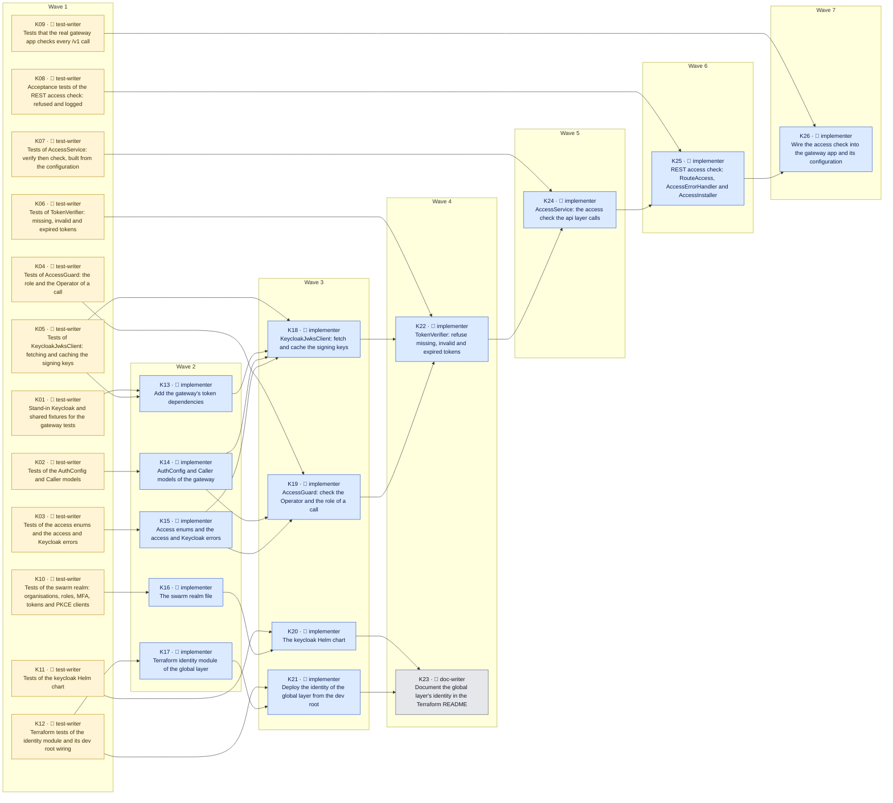

# T0.11: Plan

**Plan:** 🟢 Approved

**Push:** 🟢 Approved

<!-- ticket:specs -->
## 📚 Specifications

The technical pages, features, use cases and business rules of [TICKET.md](TICKET.md), copied by `python3 .claude/scripts/tickets/ticket_refs.py sync`.

- [🔑 Security: identity](../../specs/technical/06-security.md#identity)
- [👥 Security: roles and Operator isolation](../../specs/technical/06-security.md#authorisation)
- [📏 BR-008: Operator isolation](../../specs/functional/business-rules/BR-008-operator-isolation.md)
<!-- /ticket:specs -->

## Summary

T0.11 is planned as 26 tasks in 7 waves. Wave 1 has 12 test-writer tasks, wave 2 has 5 tasks, and the critical path follows the gateway's layers: models, clients, service, api, then wiring into the T0.12 gateway app.

**Keycloak (the global layer)**
- **Realm file:** one realm named `swarm` with organisations turned on and the seven roles of `RoleName`. Pilots, Mission planners, Fleet maintainers, Instructors and Swarm administrators must use a one-time code (OTP), through one conditional step per role in a custom browser sign-in flow.
- **Tokens and clients:** access tokens last 300 seconds and refresh tokens are rotated. There are five public clients using PKCE S256: `ground-control`, `mission-studio`, `back-office`, `client-portal` and `desktop`. A `swarm` client scope puts the `operator_id` claim and the `swarm-gateway` audience in every token.
- **Chart:** the realm ships as `deploy/charts/keycloak/files/swarm-realm.json` in a new Helm chart, `deploy/charts/keycloak`. It runs Keycloak with `start --import-realm` and gives Keycloak its own CloudNativePG database. All credentials are Secret references.
- **Terraform:** a new `identity` module creates the `global` namespace and the admin Secret. The dev root deploys the chart through the existing `cell-application` module, behind a new `identity_enabled` flag.

**Gateway (`services/gateway`)**
- **models:** `AuthConfig` and `Caller`, the `AccessRefusal` and `TokenClaim` enums, and the access and Keycloak errors.
- **clients:** `KeycloakJwksClient` fetches and caches Keycloak's signing keys.
- **service:** `TokenVerifier` refuses a missing, invalid or expired token. `AccessGuard` refuses another Operator's identifier first, then a missing role. `AccessService` combines the two.
- **api:**
  - `RouteAccess` is the per-route check.
  - `AccessErrorHandler` returns 401 for a missing, invalid or expired token, 403 for a missing role, 404 for another Operator's identifier (as in BR-008's "Not found") and 503 when Keycloak cannot be reached. Every refusal is logged at WARNING with the method, path and reason, and never with the token.
  - `AccessInstaller` sets all of this up on an app.
- **Acceptance tests:** the three acceptance criteria (no token, expired token, another Operator's identifier: each refused and logged) are tested end to end. They run on a test app, against a local stand-in Keycloak that signs real RS256 tokens, with no mocks.
- **Dependencies:** one task adds `pyjwt[crypto]`, `httpx` and `swarm-models` to the gateway.
- **Wiring:** the last task (K26) puts the access check into T0.12's gateway app and makes every `/v1` route declare its roles.

**Documentation:** the doc task adds the identity section to `deploy/terraform/README.md`.

There is no screen-capture task, because the ticket touches no front end.

**Before you approve:** T0.12 has no plan yet, so K09 and K26 rely on guessed file names: `services/gateway/conf/app.yaml`, `gateway/models/config/gateway_config.py` and `gateway/api/rest/gateway_rest_app.py`. Once T0.12 is merged, check these names against its real layout. Also add any T0.12 route modules and tests that call `/v1` without a token; they will start getting 401. K26 is told to stop and report `blocked` with the exact files if they differ.

## Assumptions

- The roadmap row names no feature or use case. BR-008 is linked because the epic row names it for the Operator isolation this ticket's checks serve, and the criteria cite it as the most conservative link.
- The row names no row of the budgets table, so the ticket touches no budget.
- The row names no screen, and its delivery is Keycloak and the gateway, so the ticket touches no screen.
- The row says "refused and logged" and gives no status code or log format, so none is asserted.
- T0.11 depends on T0.12 (`docs/specs/roadmap/gantt/ticket-graph.json`) and runs only once T0.12 is merged. T0.12 has no plan yet, so K09 and K26 guess its layout: `services/gateway/conf/app.yaml`, `services/gateway/src/gateway/models/config/gateway_config.py` (the config model) and `services/gateway/src/gateway/api/rest/gateway_rest_app.py` (the app). The person should check these files against T0.12's merged code before approving. They should also add to K26 any T0.12 `/v1` route modules and the tests that call `/v1` without a token, because those will start getting 401.
- The realm name is `swarm`. The specification says only "one realm per deployment".
- The access token carries the Operator in a claim named `operator_id`, set from a user attribute of the same name, and the roles in Keycloak's standard `realm_access.roles`. Each Operator is still a Keycloak organisation. The specification says the token carries the Operator and the roles but does not name the claims. T0.16 sets the attribute when it invites a person.
- The gateway only accepts tokens issued for the audience `swarm-gateway`, which a mapper adds to the access tokens of the five clients. The specification does not name an audience.
- The client IDs are `ground-control`, `mission-studio`, `back-office`, `client-portal` and `desktop`, after the folders of `frontends/`. Their redirect URIs and web origins stay empty: no specification gives the apps' addresses yet, and the environment sets them later.
- MFA means a one-time code (TOTP), required through one conditional step per role, for the five roles the security page lists. Clients and Site agents can turn it on themselves.
- The Sites of Clients and Site agents are not put in the token yet. No Site exists in this phase; T2.15 brings the Site and Client roles.
- How a call names an Operator: by its `operator_id` path parameter. A call that names another Operator, or a malformed id, gets 404, following BR-008's example "Not found; the attempt is logged". A missing, invalid or expired token gets 401 with `WWW-Authenticate: Bearer`, a missing role 403, and a Keycloak that cannot be reached 503. The ticket asserts no status code; these are the most conservative choices that fit BR-008 and RFC 6750.
- The Operator is checked before the role, so another Operator's data stays "not found" whatever the caller's role. A Swarm administrator who names an Operator is refused, because that role has no access to Operators' data.
- Each `/v1` route declares its roles with `RouteAccess`. A K09 test checks that every `/v1` route does, so that "every call" is enforced by a test. Skeleton routes the rights table does not cover are open to the six Operator roles (all but Swarm administrator).
- Default settings, written in `conf/app.yaml`: `jwks_cache_ttl_s` 300, `leeway_s` 0, `request_timeout_s` 5. No clock leeway is the most conservative choice for "an expired token is refused".
- The dev issuer URL is `http://keycloak.global.svc.cluster.local:8080/realms/swarm`. Keycloak's hostname must make tokens carry that issuer, or a later gateway chart overrides it.
- Libraries: PyJWT with the crypto extra (RS256) in the service layer, and httpx in the clients layer for the JWKS. Neither is in `uv.lock` yet. Fetching the JWKS is a short request, so it is not an AsyncRunnable.
- In dev, the global layer's Keycloak runs in the dev cluster, in a `global` namespace. A new Terraform `identity` module creates the namespace and the admin Secret (random password, never in a file). The dev root deploys `deploy/charts/keycloak` through the existing `cell-application` module, behind `identity_enabled`, which needs `platform_enabled`. Running in two EU regions (active and standby) is left to production work.
- Keycloak gets its own CloudNativePG database, `keycloak-database`, with the credentials Secret CloudNativePG generates. It does not use the cell's database or the vault, because it belongs to the global layer and not to a cell.
- The chart pins a Keycloak 26 or later image (`quay.io/keycloak/keycloak`), the first releases where organisations are generally available. The exact tag is chosen and reported by the worker.
- The ticket graph gives T0.11 the area "Keycloak, services/gateway". The new files under `deploy/charts/keycloak`, `deploy/terraform/modules/self-hosted/identity` and `deploy/terraform/cells/dev` are counted as the Keycloak area. No other open ticket owns them.
- The access tests run against a local stand-in Keycloak that serves a real JWKS and signs real RS256 tokens (AGENT.md: real things, no mocks). No test needs a running Keycloak. The realm and the chart are checked statically and with `helm template`.
- The shared test support lives in `services/gateway/tests/support/keycloak/` and is imported by its full path from the repository root (`services.gateway.tests.support...`). Shared fixtures go in `services/gateway/tests/conftest.py`, which K01 extends if T0.12 created it.

<!-- plan:graph -->

> [!NOTE]
> Generated from the json block at the end of this page by `python3 .claude/scripts/tickets/plan.py render`.
> To change a task, edit the json block, then render again: never edit this view by hand.

## Waves

| Wave | Tasks | Agents running at once |
| --- | --- | --- |
| 1 | [K01](#k01), [K02](#k02), [K03](#k03), [K04](#k04), [K05](#k05), [K06](#k06), [K07](#k07), [K08](#k08), [K09](#k09), [K10](#k10), [K11](#k11), [K12](#k12) | 8 of 12 |
| 2 | [K13](#k13), [K14](#k14), [K15](#k15), [K16](#k16), [K17](#k17) | 5 of 5 |
| 3 | [K18](#k18), [K19](#k19), [K20](#k20), [K21](#k21) | 4 of 4 |
| 4 | [K22](#k22), [K23](#k23) | 2 of 2 |
| 5 | [K24](#k24) | 1 of 1 |
| 6 | [K25](#k25) | 1 of 1 |
| 7 | [K26](#k26) | 1 of 1 |

| Wave | Task | Agent | Depends on | Unblocks |
| --- | --- | --- | --- | --- |
| 1 | [K01](#k01) Stand-in Keycloak and shared fixtures for the gateway tests | 🧪 test-writer | none | [K13](#k13) |
| 1 | [K02](#k02) Tests of the AuthConfig and Caller models | 🧪 test-writer | none | [K14](#k14) |
| 1 | [K03](#k03) Tests of the access enums and the access and Keycloak errors | 🧪 test-writer | none | [K15](#k15) |
| 1 | [K04](#k04) Tests of AccessGuard: the role and the Operator of a call | 🧪 test-writer | none | [K19](#k19) |
| 1 | [K05](#k05) Tests of KeycloakJwksClient: fetching and caching the signing keys | 🧪 test-writer | none | [K13](#k13), [K18](#k18) |
| 1 | [K06](#k06) Tests of TokenVerifier: missing, invalid and expired tokens | 🧪 test-writer | none | [K22](#k22) |
| 1 | [K07](#k07) Tests of AccessService: verify then check, built from the configuration | 🧪 test-writer | none | [K24](#k24) |
| 1 | [K08](#k08) Acceptance tests of the REST access check: refused and logged | 🧪 test-writer | none | [K25](#k25) |
| 1 | [K09](#k09) Tests that the real gateway app checks every /v1 call | 🧪 test-writer | none | [K26](#k26) |
| 1 | [K10](#k10) Tests of the swarm realm: organisations, roles, MFA, tokens and PKCE clients | 🧪 test-writer | none | [K16](#k16) |
| 1 | [K11](#k11) Tests of the keycloak Helm chart | 🧪 test-writer | none | [K20](#k20) |
| 1 | [K12](#k12) Terraform tests of the identity module and its dev root wiring | 🧪 test-writer | none | [K17](#k17), [K21](#k21) |
| 2 | [K13](#k13) Add the gateway's token dependencies | 🐍 implementer | [K01](#k01), [K05](#k05) | [K18](#k18) |
| 2 | [K14](#k14) AuthConfig and Caller models of the gateway | 🐍 implementer | [K02](#k02) | [K18](#k18), [K19](#k19) |
| 2 | [K15](#k15) Access enums and the access and Keycloak errors | 🐍 implementer | [K03](#k03) | [K18](#k18), [K19](#k19) |
| 2 | [K16](#k16) The swarm realm file | 🐍 implementer | [K10](#k10) | [K20](#k20) |
| 2 | [K17](#k17) Terraform identity module of the global layer | 🐍 implementer | [K12](#k12) | [K21](#k21) |
| 3 | [K18](#k18) KeycloakJwksClient: fetch and cache the signing keys | 🐍 implementer | [K05](#k05), [K13](#k13), [K14](#k14), [K15](#k15) | [K22](#k22) |
| 3 | [K19](#k19) AccessGuard: check the Operator and the role of a call | 🐍 implementer | [K04](#k04), [K14](#k14), [K15](#k15) | [K22](#k22) |
| 3 | [K20](#k20) The keycloak Helm chart | 🐍 implementer | [K11](#k11), [K16](#k16) | [K23](#k23) |
| 3 | [K21](#k21) Deploy the identity of the global layer from the dev root | 🐍 implementer | [K12](#k12), [K17](#k17) | [K23](#k23) |
| 4 | [K22](#k22) TokenVerifier: refuse missing, invalid and expired tokens | 🐍 implementer | [K06](#k06), [K18](#k18), [K19](#k19) | [K24](#k24) |
| 4 | [K23](#k23) Document the global layer's identity in the Terraform README | 📝 doc-writer | [K20](#k20), [K21](#k21) | none |
| 5 | [K24](#k24) AccessService: the access check the api layer calls | 🐍 implementer | [K07](#k07), [K22](#k22) | [K25](#k25) |
| 6 | [K25](#k25) REST access check: RouteAccess, AccessErrorHandler and AccessInstaller | 🐍 implementer | [K08](#k08), [K24](#k24) | [K26](#k26) |
| 7 | [K26](#k26) Wire the access check into the gateway app and its configuration | 🐍 implementer | [K09](#k09), [K25](#k25) | none |

## Dependency graph



## Tasks

### <a id="k01"></a>K01: Stand-in Keycloak and shared fixtures for the gateway tests

| Agent | Wave | Depends on | Unblocks |
| --- | --- | --- | --- |
| 🧪 test-writer | 1 | none | [K13](#k13) |

**Files** (only this task may change them in its wave):

- `services/gateway/tests/conftest.py`
- `services/gateway/tests/support/keycloak/keycloak_stand_in.py`
- `services/gateway/tests/support/keycloak/certs_request_handler.py`
- `services/gateway/tests/support/keycloak/helpers.py`

**Done when:** `uv run ruff check services/gateway/tests/conftest.py services/gateway/tests/support` prints no error, and `uv run ruff format --check` passes on these four files. Each file holds at most one class, and the interface matches the brief name for name.

**Brief:**

Write the shared test support that every gateway access test of T0.11 uses: a real local stand-in for Keycloak that serves its signing keys and signs real tokens, with no unittest.mock (AGENT.md, Tests: 'Prefer real things to mocks ... a local test server'). Other wave-1 test-writers code against EXACTLY this interface, so do not rename anything.

Specification: [🔑 Security: identity](docs/specs/technical/06-security.md#identity) (Keycloak OpenID Connect, access tokens of 5 minutes carrying the person, the Operator and the roles), [👥 Security: roles and Operator isolation](docs/specs/technical/06-security.md#authorisation), [📏 BR-008: Operator isolation](docs/specs/functional/business-rules/BR-008-operator-isolation.md).

Files and interface:
- `services/gateway/tests/support/keycloak/keycloak_stand_in.py`: class `KeycloakStandIn`, a context manager (`__enter__` returns itself after starting a `ThreadingHTTPServer` on 127.0.0.1, port 0, in a daemon thread; `__exit__` shuts it down). Do NOT name methods `start`, `stop` or `run` (the lifecycle convention test applies to tests too). It generates an RSA 2048 key with `cryptography` and a key id. Members: property `issuer_url` -> `str` = `http://127.0.0.1:<port>/realms/swarm`; property `certs_requests` -> `int` (GET requests served on the certs path); `mint(claims: Dict[str, JsonValue], expires_in_s: int = 300) -> str` (PyJWT, RS256, header `kid` = the served key id, adds `iat` = now and `exp` = now + expires_in_s; a negative value gives an expired token); `forge(claims: Dict[str, JsonValue], expires_in_s: int = 300) -> str` (same, signed by another key that is never served, with a `kid` that is never served); `rotate() -> None` (serves a new key with a new `kid` from then on, and drops the old one). The certs path is `/realms/swarm/protocol/openid-connect/certs` and returns `{"keys": [<JWK with kid, kty, alg RS256, use sig, n, e>]}` (use `jwt.algorithms.RSAAlgorithm.to_jwk`). Any other path returns 404.
- `services/gateway/tests/support/keycloak/certs_request_handler.py`: class `CertsRequestHandler(BaseHTTPRequestHandler)`, the only class of its file. It answers the certs path from the stand-in it reaches through its server, and stays silent (overrides `log_message`).
- `services/gateway/tests/support/keycloak/helpers.py`: module-level constants allowed in a test helpers file. `AUDIENCE = "swarm-gateway"`, `REALM_PATH = "/realms/swarm"`, `CERTS_PATH = REALM_PATH + "/protocol/openid-connect/certs"`, and `claims_for(issuer_url: str, person_id: UUID, operator_id: Optional[UUID], roles: List[RoleName], audience: str = AUDIENCE) -> Dict[str, JsonValue]`. It returns `sub` = str(person_id), `iss` = issuer_url, `aud` = audience, `realm_access` = {`roles`: [role.value ...]}, and `operator_id` = str(operator_id) only when it is not None. `RoleName` is `swarm_models.models.people.enums.RoleName`.
- `services/gateway/tests/conftest.py`: fixtures `keycloak_stand_in` (function scope, yields a started `KeycloakStandIn`) and `auth_config` (returns `gateway.models.auth.auth_config.AuthConfig(issuer_url=keycloak_stand_in.issuer_url, audience=AUDIENCE)`, every other field left at its default). Write this file even though `AuthConfig` does not exist yet (K14 writes it).

Import the support modules by their full path from the repository root: `from services.gateway.tests.support.keycloak.keycloak_stand_in import KeycloakStandIn`. Tests have no `__init__.py`. Keep one class per file, no nested function, no `Any` and no `object`. `pyjwt[crypto]` and `httpx` are added to the gateway by K13. Record any assumption in your result.

### <a id="k02"></a>K02: Tests of the AuthConfig and Caller models

| Agent | Wave | Depends on | Unblocks |
| --- | --- | --- | --- |
| 🧪 test-writer | 1 | none | [K14](#k14) |

**Files** (only this task may change them in its wave):

- `services/gateway/tests/models/auth/test_auth_config.py`
- `services/gateway/tests/models/auth/test_caller.py`

**Done when:** `uv run ruff check services/gateway/tests/models/auth` prints no error, and `uv run pytest services/gateway/tests/models/auth` fails only because the `gateway.models.auth` modules do not exist yet.

**Brief:**

Write the AGENT.md model tests (test_defaults, test_full_valid_construction, test_none_becomes_the_default, test_rejects_bad_values, test_rejects_unknown_keys, test_round_trip, parametrised) for two new gateway models that K14 implements.

Specification: [🔑 Security: identity](docs/specs/technical/06-security.md#identity) (tokens carry the person, the Operator and the roles), [👥 Security: roles and Operator isolation](docs/specs/technical/06-security.md#authorisation) (seven roles, the Swarm administrator has no access to Operators' data), [📏 BR-008: Operator isolation](docs/specs/functional/business-rules/BR-008-operator-isolation.md).

Interface (exact):
- `gateway.models.auth.auth_config.AuthConfig`: a Pydantic model, `extra="forbid"`, `frozen=True`, `validate_default=True`. Fields:
  - `issuer_url: str`, required with no default. It is stripped, must start with `http://` or `https://`, and loses any trailing `/`.
  - `audience: str = "swarm-gateway"`, stripped and non-empty.
  - `jwks_cache_ttl_s: float = 300.0`, > 0.
  - `leeway_s: float = 0.0`, >= 0.
  - `request_timeout_s: float = 5.0`, > 0.
  - Numbers reject `bool`, and None becomes the default.
  - Exceptions come from `gateway.models.auth.exceptions`: `SEInvalidAuthConfigException` (base), `SEAuthConfigInvalidIssuerUrl`, `SEAuthConfigInvalidAudience`, `SEAuthConfigInvalidJwksCacheTtlS`, `SEAuthConfigInvalidLeewayS`, `SEAuthConfigInvalidRequestTimeoutS`.
- `gateway.models.auth.caller.Caller`: the verified identity behind a call, `extra="forbid"`, `frozen=True`. Fields:
  - `person_id: UUID` (any version: Keycloak assigns it).
  - `operator_id: Optional[UUID] = None`.
  - `roles: List[RoleName] = []`, using `swarm_models.models.people.enums.RoleName`; it accepts the string values and refuses unknown ones and duplicates.
  - Cross-field rule: any role other than `SWARM_ADMINISTRATOR` requires an `operator_id`, `SWARM_ADMINISTRATOR` requires `operator_id` None, and both kinds together are refused. An empty `roles` accepts any `operator_id`.
  - Exceptions come from `gateway.models.auth.exceptions`: `SEInvalidCallerException` (base), `SECallerInvalidPersonId`, `SECallerInvalidOperatorId`, `SECallerInvalidRoles`, `SECallerOperatorMismatch`.

Every field exception subclasses its model's base exception. Assert the specific exception with `pytest.raises`. Compare with the enums and ClassVar constants, never their raw values, where they exist. One `Test<Subject>` class per file, test names as sentences, no unittest.mock. Record any assumption in your result.

### <a id="k03"></a>K03: Tests of the access enums and the access and Keycloak errors

| Agent | Wave | Depends on | Unblocks |
| --- | --- | --- | --- |
| 🧪 test-writer | 1 | none | [K15](#k15) |

**Files** (only this task may change them in its wave):

- `services/gateway/tests/models/test_gateway_enums.py`
- `services/gateway/tests/models/access/test_access_errors.py`
- `services/gateway/tests/models/keycloak/test_keycloak_errors.py`

**Done when:** `uv run ruff check services/gateway/tests/models` prints no error, and `uv run pytest services/gateway/tests/models/test_gateway_enums.py services/gateway/tests/models/access services/gateway/tests/models/keycloak` fails only because the modules do not exist yet.

**Brief:**

Write the tests that fix the enums and the error hierarchy of the gateway's access check, implemented by K15.

Specification: [👥 Security: roles and Operator isolation](docs/specs/technical/06-security.md#authorisation) ('the gateway checks the role and the Operator of every call'), [🔑 Security: identity](docs/specs/technical/06-security.md#identity), [📏 BR-008: Operator isolation](docs/specs/functional/business-rules/BR-008-operator-isolation.md).

Interface (exact):
- `gateway.models.enums` (the one `enums.py` of the gateway models; it may already hold T0.12 enums) has:
  - `AccessRefusal(StrEnum)`, `@unique`, with members `MISSING_TOKEN="missing_token"`, `INVALID_TOKEN="invalid_token"`, `EXPIRED_TOKEN="expired_token"`, `WRONG_OPERATOR="wrong_operator"`, `MISSING_ROLE="missing_role"`, `IDENTITY_UNAVAILABLE="identity_unavailable"`.
  - `TokenClaim(StrEnum)`, `@unique`, with members `SUBJECT="sub"`, `ISSUER="iss"`, `AUDIENCE="aud"`, `EXPIRES_AT="exp"`, `ISSUED_AT="iat"`, `OPERATOR_ID="operator_id"`, `REALM_ACCESS="realm_access"`, `ROLES="roles"`.
  - Test that the values are lower snake case with no hyphen, except the standard JWT claim names, which are short lower-case words.
- `gateway.models.access.exceptions` exports:
  - `SEAccessError` (base), whose class attribute `REFUSAL: ClassVar[AccessRefusal]` is set on each subclass.
  - `SEAccessMissingTokenError` (MISSING_TOKEN), `SEAccessInvalidTokenError` (INVALID_TOKEN), `SEAccessExpiredTokenError` (EXPIRED_TOKEN), `SEAccessWrongOperatorError` (WRONG_OPERATOR) and `SEAccessMissingRoleError` (MISSING_ROLE), all subclasses of `SEAccessError`.
- `gateway.models.keycloak.exceptions` exports:
  - `SEKeycloakError` (base, `REFUSAL = AccessRefusal.IDENTITY_UNAVAILABLE`).
  - `SEKeycloakUnreachableError` and `SEKeycloakUnknownKeyError`, both subclasses of it.
  - `SEKeycloakError` is NOT a subclass of `SEAccessError`.

Test that each error is importable from its package, keeps its message, chains a cause with `raise ... from`, and carries its REFUSAL. Parametrise over the subclasses. Use unique file basenames, because pytest runs in prepend import mode. Record any assumption in your result.

### <a id="k04"></a>K04: Tests of AccessGuard: the role and the Operator of a call

| Agent | Wave | Depends on | Unblocks |
| --- | --- | --- | --- |
| 🧪 test-writer | 1 | none | [K19](#k19) |

**Files** (only this task may change them in its wave):

- `services/gateway/tests/service/auth/test_access_guard.py`

**Done when:** `uv run ruff check services/gateway/tests/service/auth/test_access_guard.py` prints no error, and the test file fails only because `gateway.service.auth.access_guard` or the models do not exist yet.

**Brief:**

Write the tests of the business rule 'the gateway checks the role and the Operator of every call', implemented by K19 in the service layer.

Specification: [👥 Security: roles and Operator isolation](docs/specs/technical/06-security.md#authorisation), [📏 BR-008: Operator isolation](docs/specs/functional/business-rules/BR-008-operator-isolation.md) (example 2: another Operator's link is 'Not found; the attempt is logged'), [🧅 Layers](docs/specs/technical/01-architecture.md#layers).

Interface (exact):
- `gateway.service.auth.access_guard.AccessGuard(logger: Optional[Logger] = None)` with `check(caller: Caller, roles: List[RoleName], operator_id: Optional[UUID]) -> None`.
- The Operator is checked FIRST. When `operator_id` is not None and differs from `caller.operator_id`, including a caller with no Operator such as a Swarm administrator, it raises `SEAccessWrongOperatorError`.
- Then, when the caller holds none of `roles`, it raises `SEAccessMissingRoleError`. An empty `roles` list refuses everyone.
- Otherwise it returns None.
- It logs at ERROR before each raise.
- Types: `Caller` is `gateway.models.auth.caller.Caller` (fields `person_id`, `operator_id`, `roles`). `RoleName` comes from `swarm_models.models.people.enums`. The errors come from `gateway.models.access.exceptions`.

Cases:
- The right Operator and role pass.
- Another Operator's id is refused with WRONG_OPERATOR, even when the role is wrong too.
- A Swarm administrator naming an Operator is refused.
- No common role is refused.
- `operator_id` None checks the role only.
- Use `caplog` to assert an ERROR record per refusal.

Build `Caller` objects directly (uuid4 ids). Parametrise. No mocks. Record any assumption in your result.

### <a id="k05"></a>K05: Tests of KeycloakJwksClient: fetching and caching the signing keys

| Agent | Wave | Depends on | Unblocks |
| --- | --- | --- | --- |
| 🧪 test-writer | 1 | none | [K13](#k13), [K18](#k18) |

**Files** (only this task may change them in its wave):

- `services/gateway/tests/clients/keycloak/test_keycloak_jwks_client.py`

**Done when:** `uv run ruff check services/gateway/tests/clients/keycloak` prints no error, and the file fails only because the client module or its models do not exist yet.

**Brief:**

Write the tests of the clients-layer class that fetches Keycloak's signing keys (JWKS), implemented by K18.

Specification: [🔑 Security: identity](docs/specs/technical/06-security.md#identity) (Keycloak, OpenID Connect), [🧅 Layers](docs/specs/technical/01-architecture.md#layers) (`clients/`: one class per external system, Keycloak named there).

Interface (exact):
- `gateway.clients.keycloak.keycloak_jwks_client.KeycloakJwksClient(config: AuthConfig, logger: Optional[Logger] = None)`, with `async signing_key(key_id: str) -> Dict[str, JsonValue]` returning the JWK whose `kid` is `key_id`.
- The URL is `config.issuer_url + CERTS_PATH`, where `CERTS_PATH: ClassVar[str] = "/protocol/openid-connect/certs"`.
- The first call fetches. Later calls within `config.jwks_cache_ttl_s` use the cache.
- An unknown `kid` triggers exactly one refetch within the call. If it is still unknown, the call raises `SEKeycloakUnknownKeyError`.
- A connection failure, a timeout (`config.request_timeout_s`), a non-200 answer or a body that is not a JWKS raises `SEKeycloakUnreachableError`.
- The errors come from `gateway.models.keycloak.exceptions`.

Use the shared fixtures of K01 (same wave; code against this interface): `keycloak_stand_in` (`KeycloakStandIn` with `issuer_url`, `certs_requests`, `rotate()`, `mint`, `forge`) and `auth_config`, from `services/gateway/tests/conftest.py`. Build other configs with `AuthConfig(issuer_url=..., jwks_cache_ttl_s=...)`.

Cases:
- The served key is returned and fetched once for two calls.
- After `rotate()`, the new kid is found with one refetch.
- A kid never served raises unknown-key after one refetch.
- After the TTL (e.g. 0.05 s and a short sleep), the keys are fetched again.
- An unreachable issuer (`http://127.0.0.1:1/realms/swarm`) raises unreachable.

Async tests need no marker. Record any assumption in your result.

### <a id="k06"></a>K06: Tests of TokenVerifier: missing, invalid and expired tokens

| Agent | Wave | Depends on | Unblocks |
| --- | --- | --- | --- |
| 🧪 test-writer | 1 | none | [K22](#k22) |

**Files** (only this task may change them in its wave):

- `services/gateway/tests/service/auth/test_token_verifier.py`

**Done when:** `uv run ruff check services/gateway/tests/service/auth/test_token_verifier.py` prints no error, and the file fails only because the modules it imports do not exist yet.

**Brief:**

Write the tests of the token check of the gateway, implemented by K22 in the service layer. These tests carry acceptance criteria 1 and 2 of TICKET.md at the service level: a call without a token, or with an expired token, is refused and logged.

Specification: [🔑 Security: identity](docs/specs/technical/06-security.md#identity) ('short-lived access tokens (5 minutes) carrying the person, the Operator, the roles'), [👥 Security: roles and Operator isolation](docs/specs/technical/06-security.md#authorisation), [📏 BR-008: Operator isolation](docs/specs/functional/business-rules/BR-008-operator-isolation.md).

Interface (exact):
- `gateway.service.auth.token_verifier.TokenVerifier(config: AuthConfig, keys: KeycloakJwksClient, logger: Optional[Logger] = None)` with `async verify(token: Optional[str]) -> Caller`.
- A None or blank token raises `SEAccessMissingTokenError`.
- `exp` in the past beyond `config.leeway_s` raises `SEAccessExpiredTokenError`.
- These raise `SEAccessInvalidTokenError`: a malformed token, no `kid`, a `kid` the keys do not hold (`SEKeycloakUnknownKeyError` is turned into it), a bad signature, an algorithm other than RS256, a wrong `iss` or `aud`, a missing `sub`, a `sub` or `operator_id` that is not a UUID, or claims that `Caller` refuses.
- `SEKeycloakUnreachableError` propagates unchanged.
- It returns `Caller(person_id=sub, operator_id=operator_id claim or None, roles=the RoleName values found in realm_access.roles)`. Other Keycloak roles, such as `offline_access`, are ignored.
- It logs at ERROR before each raise, and the token text never appears in any log record.
- Errors come from `gateway.models.access.exceptions` and `gateway.models.keycloak.exceptions`. Claim names come from `gateway.models.enums.TokenClaim`.

Use K01's fixtures `keycloak_stand_in` and `auth_config`, `KeycloakStandIn.mint/forge`, and `services.gateway.tests.support.keycloak.helpers.claims_for(issuer_url, person_id, operator_id, roles, audience=AUDIENCE)`. Build the real `KeycloakJwksClient(auth_config)` (`gateway.clients.keycloak.keycloak_jwks_client`). For tokens built by hand, use PyJWT. Assert the token is absent from `caplog.text`. Parametrise the invalid cases. Record any assumption in your result.

### <a id="k07"></a>K07: Tests of AccessService: verify then check, built from the configuration

| Agent | Wave | Depends on | Unblocks |
| --- | --- | --- | --- |
| 🧪 test-writer | 1 | none | [K24](#k24) |

**Files** (only this task may change them in its wave):

- `services/gateway/tests/service/auth/test_access_service.py`

**Done when:** `uv run ruff check services/gateway/tests/service/auth/test_access_service.py` prints no error, and the file fails only because the modules it imports do not exist yet.

**Brief:**

Write the tests of the service facade that the api layer calls, implemented by K24.

Specification: [👥 Security: roles and Operator isolation](docs/specs/technical/06-security.md#authorisation) ('the gateway checks the role and the Operator of every call'), [🔑 Security: identity](docs/specs/technical/06-security.md#identity), [📏 BR-008: Operator isolation](docs/specs/functional/business-rules/BR-008-operator-isolation.md), [🧅 Layers](docs/specs/technical/01-architecture.md#layers) (api never imports clients, so the service builds its client).

Interface (exact):
- `gateway.service.auth.access_service.AccessService(verifier: TokenVerifier, guard: AccessGuard, logger: Optional[Logger] = None)`.
- `@classmethod from_config(cls, config: AuthConfig, logger: Optional[Logger] = None) -> AccessService`, which builds a `KeycloakJwksClient`, a `TokenVerifier` and an `AccessGuard`.
- `async authorise(token: Optional[str], roles: List[RoleName], operator_id: Optional[UUID]) -> Caller`. It verifies the token first (TokenVerifier, K06's rules), then checks the Operator, then the role (AccessGuard, K04's rules), and returns the `Caller`.

Use K01's fixtures `keycloak_stand_in`, `auth_config` and the helper `claims_for`.

Cases, through `AccessService.from_config(auth_config)`:
- A valid token with the right role and Operator returns the Caller.
- No token raises `SEAccessMissingTokenError`.
- An expired token raises `SEAccessExpiredTokenError`.
- Another Operator's id raises `SEAccessWrongOperatorError`.
- A missing role raises `SEAccessMissingRoleError`.
- An invalid token raises `SEAccessInvalidTokenError` before any role check.
- An unreachable Keycloak raises `SEKeycloakUnreachableError`.
- The token never appears in `caplog.text`.

No mocks. Record any assumption in your result.

### <a id="k08"></a>K08: Acceptance tests of the REST access check: refused and logged

| Agent | Wave | Depends on | Unblocks |
| --- | --- | --- | --- |
| 🧪 test-writer | 1 | none | [K25](#k25) |

**Files** (only this task may change them in its wave):

- `services/gateway/tests/api/rest/auth/conftest.py`
- `services/gateway/tests/api/rest/auth/test_route_access.py`
- `services/gateway/tests/api/rest/auth/test_access_installer.py`

**Done when:** `uv run ruff check services/gateway/tests/api/rest/auth` prints no error, and `uv run pytest services/gateway/tests/api/rest/auth` fails only because the `gateway.api.rest.auth` modules or what they import do not exist yet.

**Brief:**

Write the end-to-end tests of the three acceptance criteria of TICKET.md through HTTP. Each must be refused and logged: (1) a call without a token, (2) a call with an expired token, (3) a call with another Operator's identifier. K25 implements the api layer.

Specification: [👥 Security: roles and Operator isolation](docs/specs/technical/06-security.md#authorisation) ('the gateway checks the role and the Operator of every call'), [🔑 Security: identity](docs/specs/technical/06-security.md#identity), [📏 BR-008: Operator isolation](docs/specs/functional/business-rules/BR-008-operator-isolation.md) (another Operator's resource: 'Not found; the attempt is logged'), [🔌 REST](docs/specs/technical/05-api.md#rest) (errors as `application/problem+json`).

Interface (exact):
- `gateway.api.rest.auth.access_installer.AccessInstaller(logger=None)`:
  - `ACCESS_SERVICE_STATE: ClassVar[str] = "access_service"`.
  - `install(app: FastAPI, config: AuthConfig) -> None` sets `app.state.<ACCESS_SERVICE_STATE>` to `AccessService.from_config(config)` and registers `AccessErrorHandler` for `SEAccessError` and `SEKeycloakError`.
- `gateway.api.rest.auth.route_access.RouteAccess(roles: List[RoleName], logger=None)` is a FastAPI dependency, `async __call__(request: Request) -> Caller`.
  - It reads `Authorization: Bearer <token>`; the scheme is case-insensitive, and anything else counts as no token.
  - It reads the path parameter `operator_id` when the route has one. A value that is not a UUID is refused as WRONG_OPERATOR.
  - It calls the service's `authorise`.
- `gateway.api.rest.auth.access_error_handler.AccessErrorHandler(logger=None)`, `async __call__(request, error) -> Response`.
  - Content type `application/problem+json`, with body keys `type`, `title`, `status`, `detail`; the token is never echoed.
  - Status 401 with `WWW-Authenticate: Bearer` for MISSING_TOKEN, INVALID_TOKEN and EXPIRED_TOKEN; 403 for MISSING_ROLE; 404 for WRONG_OPERATOR; 503 for IDENTITY_UNAVAILABLE (the `REFUSAL` of the error, `gateway.models.enums.AccessRefusal`).
  - It logs at WARNING the method, the path and the refusal value.

In `conftest.py`, add these fixtures:
- a test app: `FastAPI()`, then `AccessInstaller().install(app, auth_config)`, with `GET /v1/operators/{operator_id}/probe` guarded by `Depends(RouteAccess([RoleName.MISSION_PLANNER]))` and `GET /v1/probe` guarded the same way. Route handlers are module-level async functions added with `add_api_route`, not nested functions.
- an `httpx.AsyncClient` on `ASGITransport(app=...)`.

Use K01's fixtures `keycloak_stand_in` and `auth_config`, and the helper `claims_for`.

Cases:
- AC-1: no header gives 401, `WWW-Authenticate` and problem+json, plus a WARNING record holding the path and `AccessRefusal.MISSING_TOKEN.value`.
- AC-2: an expired token gives 401 and EXPIRED_TOKEN logged.
- AC-3: a token of Operator A on Operator B's path gives 404 and WRONG_OPERATOR logged.
- A malformed operator id gives 404.
- The right Operator and role give 200.
- The wrong role gives 403.
- A forged token or a wrong audience gives 401 INVALID_TOKEN.
- A non-Bearer scheme gives 401.
- An unreachable issuer gives 503.
- The token never appears in `caplog.text`.

Compare with the enum values. No unittest.mock. Record any assumption in your result.

### <a id="k09"></a>K09: Tests that the real gateway app checks every /v1 call

| Agent | Wave | Depends on | Unblocks |
| --- | --- | --- | --- |
| 🧪 test-writer | 1 | none | [K26](#k26) |

**Files** (only this task may change them in its wave):

- `services/gateway/tests/api/rest/test_gateway_access_wiring.py`

**Done when:** `uv run ruff check services/gateway/tests/api/rest/test_gateway_access_wiring.py` prints no error. The file fails only because the T0.11 modules or the wiring do not exist yet, never because of a wrong T0.12 import.

**Brief:**

Write the tests that prove the access check is wired into the gateway's real FastAPI application. T0.12 delivered that app, and it is a prerequisite of T0.11, merged before this ticket runs. K26 does the wiring.

Specification: [👥 Security: roles and Operator isolation](docs/specs/technical/06-security.md#authorisation) ('the gateway checks the role and the Operator of every call'), [🔑 Security: identity](docs/specs/technical/06-security.md#identity), [📏 BR-008: Operator isolation](docs/specs/functional/business-rules/BR-008-operator-isolation.md), [🔌 REST](docs/specs/technical/05-api.md#rest).

First read how T0.12 builds the gateway app and loads `services/gateway/conf/app.yaml`, under `services/gateway/src/gateway/api/rest/` and `services/gateway/src/gateway/models/`. Use T0.12's real factory or function in your tests, and name it in your result.

Tests:
1. Every `APIRoute` whose path starts with `/v1` has, among its dependencies (walk `route.dependant.dependencies` recursively), a `gateway.api.rest.auth.route_access.RouteAccess` instance with at least one role.
2. After the app is built, `getattr(app.state, AccessInstaller.ACCESS_SERVICE_STATE)` is a `gateway.service.auth.access_service.AccessService`.
3. A request without a token on every `/v1` route with no path parameter gets 401 with `application/problem+json`. Requests go through `httpx.AsyncClient(transport=ASGITransport(app=app))`.
4. `services/gateway/conf/app.yaml` has an `auth` section whose keys are exactly the fields of `gateway.models.auth.auth_config.AuthConfig` (`issuer_url`, `audience`, `jwks_cache_ttl_s`, `leeway_s`, `request_timeout_s`), each written out, and that loads into `AuthConfig`.

K01's fixtures (`keycloak_stand_in`, `auth_config`) are available if you need a signed token. Use unique file basenames. No mocks. Record any assumption in your result, in particular the T0.12 names you relied on.

### <a id="k10"></a>K10: Tests of the swarm realm: organisations, roles, MFA, tokens and PKCE clients

| Agent | Wave | Depends on | Unblocks |
| --- | --- | --- | --- |
| 🧪 test-writer | 1 | none | [K16](#k16) |

**Files** (only this task may change them in its wave):

- `tests/deploy/charts/keycloak/test_swarm_realm.py`

**Done when:** `uv run ruff check tests/deploy/charts/keycloak/test_swarm_realm.py` prints no error, and `uv run pytest tests/deploy/charts/keycloak/test_swarm_realm.py` fails only because the realm file does not exist yet.

**Brief:**

Write the tests of the Keycloak realm file `deploy/charts/keycloak/files/swarm-realm.json` (a realm representation imported with `--import-realm`), written by K16.

Specification: [🔑 Security: identity](docs/specs/technical/06-security.md#identity) (one realm per deployment, each Operator an organisation; multi-factor authentication required for Pilots, Mission planners, Fleet maintainers, Instructors and Swarm administrators, optional for Clients and Site agents; access tokens of 5 minutes carrying the person, the Operator and the roles; refresh tokens rotated; authorisation code flow with PKCE), [👥 Security: roles and Operator isolation](docs/specs/technical/06-security.md#authorisation) (the seven roles), [📏 BR-008: Operator isolation](docs/specs/functional/business-rules/BR-008-operator-isolation.md), [🔲 Cells and the global layer](docs/specs/technical/01-architecture.md#cells).

The file must satisfy (assert each):
1. `realm == "swarm"`, `enabled` true, `organizationsEnabled` true.
2. The realm role names under `roles.realm`, minus Keycloak's own `offline_access`, `uma_authorization` and `default-roles-swarm`, equal exactly the values of `swarm_models.models.people.enums.RoleName`. Import the enum so the realm stays in step with the shared model.
3. `accessTokenLifespan == 300`, `revokeRefreshToken` true, `refreshTokenMaxReuse == 0`.
4. Clients. The Swarm clients are exactly `ground-control`, `mission-studio`, `back-office`, `client-portal` and `desktop` (Keycloak's built-in clients may be absent from the file). Each one has:
   - `publicClient` true, `standardFlowEnabled` true, `implicitFlowEnabled` false, `directAccessGrantsEnabled` false, `serviceAccountsEnabled` false;
   - `attributes["pkce.code.challenge.method"] == "S256"`;
   - no `secret` key;
   - no redirect URI and no web origin equal to `*`;
   - `defaultClientScopes` containing `swarm`, `roles` and `basic`.
5. `clientScopes` defines `basic` (it puts `sub` in the token), `roles` (it puts `realm_access.roles` in the access token) and `swarm` (protocol `openid-connect`). `swarm` holds:
   - one `oidc-usermodel-attribute-mapper` with config `user.attribute` = `operator_id`, `claim.name` = `operator_id`, `jsonType.label` = `String`, `access.token.claim` = `true`;
   - one `oidc-audience-mapper` with `included.custom.audience` = `swarm-gateway` and `access.token.claim` = `true`.
6. Sign-in flow:
   - `browserFlow == "swarm browser"`, a top-level flow of `authenticationFlows`.
   - Walk it through executions with `authenticatorFlow: true` (`flowAlias`).
   - Collect each CONDITIONAL sub-flow that holds an execution `conditional-user-role` (REQUIRED) and an execution `auth-otp-form` (REQUIRED). The role of each comes from the `authenticatorConfig` entry named by the execution's `authenticatorConfig` alias (`config.condUserRole`).
   - The set of roles found equals {pilot, mission_planner, fleet_maintainer, instructor, swarm_administrator}, so `client` and `site_agent` are not in it.
   - The flow also holds `auth-username-password-form`.
7. `requiredActions` holds `CONFIGURE_TOTP` enabled, and `otpPolicyType == "totp"`.
8. There is no `users` entry (or it is empty), and no key anywhere in the document is named `password` or `secret`.

Follow the style of `tests/deploy/charts/test_valkey_chart.py`: one `TestSwarmRealm` class, ClassVar constants, `JsonValue` types, no `Any`. The folder `tests/deploy/charts/` already holds five Python files, so this one sits in `tests/deploy/charts/keycloak/`. Record any assumption in your result.

### <a id="k11"></a>K11: Tests of the keycloak Helm chart

| Agent | Wave | Depends on | Unblocks |
| --- | --- | --- | --- |
| 🧪 test-writer | 1 | none | [K20](#k20) |

**Files** (only this task may change them in its wave):

- `tests/deploy/charts/keycloak/test_keycloak_chart.py`

**Done when:** `uv run ruff check tests/deploy/charts/keycloak/test_keycloak_chart.py` prints no error, and `uv run pytest tests/deploy/charts/keycloak/test_keycloak_chart.py` fails only because the chart does not exist yet.

**Brief:**

Write the tests of the new chart `deploy/charts/keycloak`, which runs the global layer's Keycloak with the swarm realm. K20 writes the chart.

Specification: [🔑 Security: identity](docs/specs/technical/06-security.md#identity) (Keycloak, the same product in the cloud and on premises), [🔲 Cells and the global layer](docs/specs/technical/01-architecture.md#cells) (Keycloak identity in the global layer), [🚢 Deployment: delivery](docs/specs/technical/09-deployment.md#delivery) (Helm charts in `deploy/charts`), [🔑 Secrets and keys](docs/specs/technical/06-security.md#secrets) (configuration holds names, never secrets).

Follow `tests/deploy/charts/test_valkey_chart.py`. Rendering tests run `helm template keycloak deploy/charts/keycloak --namespace global` and are `skipif` helm is missing.

Assert:
1. `Chart.yaml`: `apiVersion: v2`, `name: keycloak`.
2. `values.yaml`:
   - `image.repository == "quay.io/keycloak/keycloak"`, with a tag that is non-empty and not `latest`;
   - `admin.credentialsSecret == "keycloak-admin"`;
   - `database.instances` and `database.storage.size` are set;
   - `ingress.enabled` is false.
3. A `Deployment` named `keycloak`:
   - its container image is `<repository>:<tag>`;
   - its args contain `start` and `--import-realm` and never `start-dev`;
   - env `KC_DB` is `postgres`;
   - `KC_BOOTSTRAP_ADMIN_USERNAME` and `KC_BOOTSTRAP_ADMIN_PASSWORD` come from `secretKeyRef` on `keycloak-admin` (keys `username` and `password`);
   - `KC_DB_USERNAME` and `KC_DB_PASSWORD` come from `secretKeyRef` on `keycloak-database-app` (the Secret CloudNativePG generates);
   - no env entry has a literal `value` for a name containing PASSWORD;
   - a volume from ConfigMap `keycloak-realm` is mounted at `/opt/keycloak/data/import`.
4. ConfigMap `keycloak-realm`: key `swarm-realm.json` parses to the same JSON as `deploy/charts/keycloak/files/swarm-realm.json`.
5. Service `keycloak` exposes port 8080.
6. A CloudNativePG `Cluster` (`postgresql.cnpg.io/v1`) named `keycloak-database`, with `bootstrap.initdb.database == "keycloak"` and `owner == "keycloak"`.
7. No `Ingress` by default. With `--set ingress.enabled=true --set ingress.host=id.example.org`, an `Ingress` routes that host to Service `keycloak` port 8080.
8. `values.yaml` holds no key named password, token, secretkey or the like (the rule of `tests/deploy/environments/test_dev_environment.py::test_no_values_file_holds_a_secret`, which also scans this file).

One `TestKeycloakChart` class, ClassVar constants, `JsonValue`, no `Any`. Record any assumption in your result.

### <a id="k12"></a>K12: Terraform tests of the identity module and its dev root wiring

| Agent | Wave | Depends on | Unblocks |
| --- | --- | --- | --- |
| 🧪 test-writer | 1 | none | [K17](#k17), [K21](#k21) |

**Files** (only this task may change them in its wave):

- `deploy/terraform/modules/self-hosted/identity/tests/identity.tftest.hcl`
- `deploy/terraform/cells/dev/tests/dev.tftest.hcl`

**Done when:** `terraform fmt -check` passes on both files. `terraform -chdir=deploy/terraform/cells/dev init -backend=false && terraform -chdir=deploy/terraform/cells/dev test` still passes the existing runs, and fails only on the new runs because the identity variable and modules do not exist yet.

**Brief:**

Write `terraform test` files (plan only, mock providers, as in `deploy/terraform/modules/self-hosted/cell-application/tests/cell_application.tftest.hcl` and `deploy/terraform/cells/dev/tests/dev.tftest.hcl`) for the global layer's identity. K17 writes the module and K21 the dev root wiring.

Specification: [🔑 Security: identity](docs/specs/technical/06-security.md#identity), [🔲 Cells and the global layer](docs/specs/technical/01-architecture.md#cells), [🧰 Infrastructure as code](docs/specs/technical/09-deployment.md#iac) (Terraform provisions every cell and the global layer; one module per building block in `deploy/terraform/modules/`), [🚢 Delivery](docs/specs/technical/09-deployment.md#delivery) (Helm and Argo CD deploy), [🔑 Secrets and keys](docs/specs/technical/06-security.md#secrets).

1. New file `deploy/terraform/modules/self-hosted/identity/tests/identity.tftest.hcl`, with `mock_provider "kubernetes" {}` and `mock_provider "random" {}`. The module's interface:
   - variables `namespace` (default `global`, a DNS-1123 label, validated) and `admin_secret_name` (default `keycloak-admin`);
   - resources `kubernetes_namespace_v1.identity` (labels `app.kubernetes.io/part-of = swarm` and `swarm-layer = global`), `random_password.admin` (length 32, no special characters) and `kubernetes_secret_v1.admin` (in that namespace, named `admin_secret_name`, data keys `username` and `password`);
   - outputs `namespace` and `admin_secret_name`.

   Runs:
   - the defaults plan the namespace `global` and the secret `keycloak-admin` with those keys and labels;
   - a custom namespace is used;
   - an invalid namespace (`Bad_Name`) is refused (`expect_failures = [var.namespace]`).
2. Add runs to the existing `deploy/terraform/cells/dev/tests/dev.tftest.hcl`, changing none of the existing runs. The dev root gains variable `identity_enabled` (bool, default false, validated: it requires `platform_enabled`), `module "identity"` (count 0 or 1) and `module "identity_application"` (count 0 or 1, source `../../modules/self-hosted/cell-application`, name `identity`, `chart_path = "deploy/charts/keycloak"`, `values_files = []`, namespace from `module.identity[0].namespace`, target revision `var.platform_revision`).

   Runs:
   - by default `length(module.identity) == 0` and `length(module.identity_application) == 0`;
   - with `platform_enabled`, `identity_enabled`, `repository_url` and pinned chart versions, both have length 1 and `strcontains(module.identity_application[0]...` (or the helm_release values it exposes) holds `deploy/charts/keycloak`. Check what `cell-application` outputs and assert on what is reachable;
   - `identity_enabled = true` without the platform is refused (`expect_failures = [var.identity_enabled]`).

Record any assumption in your result.

### <a id="k13"></a>K13: Add the gateway's token dependencies

| Agent | Wave | Depends on | Unblocks |
| --- | --- | --- | --- |
| 🐍 implementer | 2 | [K01](#k01), [K05](#k05) | [K18](#k18) |

**Files** (only this task may change them in its wave):

- `services/gateway/pyproject.toml`
- `uv.lock`

**Done when:** `uv lock --check` passes, `uv sync` succeeds, and `uv run python -c "import jwt, httpx, cryptography, swarm_models"` exits 0.

**Brief:**

Add to the `swarm-gateway` service the libraries its token check and its tests need, and lock them.

Specification: [🔑 Security: identity](docs/specs/technical/06-security.md#identity) (Keycloak OpenID Connect tokens), [🧅 Layers](docs/specs/technical/01-architecture.md#layers) (`clients/` calls Keycloak), [🗂️ Mono-repo](docs/specs/technical/01-architecture.md#mono-repo) (one uv workspace, one `uv.lock`).

Add to `services/gateway/pyproject.toml` `[project].dependencies`:
- `pyjwt[crypto]`, which verifies RS256 tokens and pulls in `cryptography`, used by the stand-in Keycloak of the tests (K01);
- `httpx`, for the JWKS client (K05/K18) and FastAPI's ASGI test transport;
- `swarm-models` (for `RoleName`), with `swarm-models = { workspace = true }` under `[tool.uv.sources]`, unless T0.12 already added it.

Use `uv add --package swarm-gateway ...` so that the floors are current releases and `uv.lock` is regenerated. Do not touch other packages. Keep the existing entries and their order. Report in your result the versions locked and why each library was chosen over its alternatives (for example PyJWT against joserfc or authlib).

### <a id="k14"></a>K14: AuthConfig and Caller models of the gateway

| Agent | Wave | Depends on | Unblocks |
| --- | --- | --- | --- |
| 🐍 implementer | 2 | [K02](#k02) | [K18](#k18), [K19](#k19) |

**Files** (only this task may change them in its wave):

- `services/gateway/src/gateway/models/auth/__init__.py`
- `services/gateway/src/gateway/models/auth/auth_config.py`
- `services/gateway/src/gateway/models/auth/caller.py`
- `services/gateway/src/gateway/models/auth/exceptions/__init__.py`
- `services/gateway/src/gateway/models/auth/exceptions/config/__init__.py`
- `services/gateway/src/gateway/models/auth/exceptions/config/se_invalid_auth_config_exception.py`
- `services/gateway/src/gateway/models/auth/exceptions/config/se_auth_config_invalid_issuer_url.py`
- `services/gateway/src/gateway/models/auth/exceptions/config/se_auth_config_invalid_audience.py`
- `services/gateway/src/gateway/models/auth/exceptions/config/durations/__init__.py`
- `services/gateway/src/gateway/models/auth/exceptions/config/durations/se_auth_config_invalid_jwks_cache_ttl_s.py`
- `services/gateway/src/gateway/models/auth/exceptions/config/durations/se_auth_config_invalid_leeway_s.py`
- `services/gateway/src/gateway/models/auth/exceptions/config/durations/se_auth_config_invalid_request_timeout_s.py`
- `services/gateway/src/gateway/models/auth/exceptions/caller/__init__.py`
- `services/gateway/src/gateway/models/auth/exceptions/caller/se_invalid_caller_exception.py`
- `services/gateway/src/gateway/models/auth/exceptions/caller/se_caller_invalid_person_id.py`
- `services/gateway/src/gateway/models/auth/exceptions/caller/se_caller_invalid_operator_id.py`
- `services/gateway/src/gateway/models/auth/exceptions/caller/se_caller_invalid_roles.py`
- `services/gateway/src/gateway/models/auth/exceptions/caller/se_caller_operator_mismatch.py`

**Done when:** `uv run pytest services/gateway/tests/models/auth -n 2` passes, `uv run mypy services/gateway/src` passes, `uv run ruff check services/gateway` prints no error, and `uv run pytest tests/conventions -n 2` passes.

**Brief:**

Implement the two gateway models fixed by K02's tests (`services/gateway/tests/models/auth/`): `AuthConfig`, the configuration of the token check, and `Caller`, the verified person, Operator and roles behind a call.

Specification: [🔑 Security: identity](docs/specs/technical/06-security.md#identity) (tokens carry the person, the Operator and the roles), [👥 Security: roles and Operator isolation](docs/specs/technical/06-security.md#authorisation) (a Swarm administrator has no access to Operators' data), [📏 BR-008: Operator isolation](docs/specs/functional/business-rules/BR-008-operator-isolation.md), [🧅 Layers](docs/specs/technical/01-architecture.md#layers) (models load and validate, never log).

Read the tests and match them exactly.
- `AuthConfig`: fields `issuer_url` (required), `audience="swarm-gateway"`, `jwks_cache_ttl_s=300.0`, `leeway_s=0.0` and `request_timeout_s=5.0`. Its config is `extra="forbid"`, `frozen=True`, `validate_default=True`.
- `Caller`: fields `person_id: UUID`, `operator_id: Optional[UUID]` and `roles: List[RoleName]` (from `swarm_models.models.people.enums`). It is frozen, and its `@model_validator(mode="after")` holds the Operator and role rule.

AGENT.md, Pydantic models:
- Every field has `Field(description=...)` and a `validate_<field>` validator in `mode="before"` (constant `BEFORE: ClassVar[Literal["before"]]`, field-name ClassVars) that raises its own exception.
- Bounds are `<FIELD>_MIN` and `<FIELD>_MAX` ClassVars.
- Reject `bool` for numbers, strip strings, and None becomes the default.
- Message format: `Invalid <field>: {value!r}.` then `Must be ...`, with one sentence per line and `# noqa: E501` on the first.

Exceptions: one per file. `__init__.py` files re-export through a sorted `__all__`, and `gateway.models.auth.exceptions` re-exports everything under it. No more than five Python files per folder (hence `config/durations/`). Google docstrings, import groups, no `Any` and no `object`, no raw strings outside constants and messages. Models never log.

### <a id="k15"></a>K15: Access enums and the access and Keycloak errors

| Agent | Wave | Depends on | Unblocks |
| --- | --- | --- | --- |
| 🐍 implementer | 2 | [K03](#k03) | [K18](#k18), [K19](#k19) |

**Files** (only this task may change them in its wave):

- `services/gateway/src/gateway/models/enums.py`
- `services/gateway/src/gateway/models/access/__init__.py`
- `services/gateway/src/gateway/models/access/exceptions/__init__.py`
- `services/gateway/src/gateway/models/access/exceptions/se_access_error.py`
- `services/gateway/src/gateway/models/access/exceptions/token/__init__.py`
- `services/gateway/src/gateway/models/access/exceptions/token/se_access_missing_token_error.py`
- `services/gateway/src/gateway/models/access/exceptions/token/se_access_invalid_token_error.py`
- `services/gateway/src/gateway/models/access/exceptions/token/se_access_expired_token_error.py`
- `services/gateway/src/gateway/models/access/exceptions/scope/__init__.py`
- `services/gateway/src/gateway/models/access/exceptions/scope/se_access_missing_role_error.py`
- `services/gateway/src/gateway/models/access/exceptions/scope/se_access_wrong_operator_error.py`
- `services/gateway/src/gateway/models/keycloak/__init__.py`
- `services/gateway/src/gateway/models/keycloak/exceptions/__init__.py`
- `services/gateway/src/gateway/models/keycloak/exceptions/se_keycloak_error.py`
- `services/gateway/src/gateway/models/keycloak/exceptions/se_keycloak_unreachable_error.py`
- `services/gateway/src/gateway/models/keycloak/exceptions/se_keycloak_unknown_key_error.py`

**Done when:** `uv run pytest services/gateway/tests/models/test_gateway_enums.py services/gateway/tests/models/access services/gateway/tests/models/keycloak -n 2` passes, `uv run mypy services/gateway/src` passes, `uv run ruff check services/gateway` prints no error, and `uv run pytest tests/conventions -n 2` passes.

**Brief:**

Implement the enums and the error hierarchy that K03's tests fix (`services/gateway/tests/models/test_gateway_enums.py`, `services/gateway/tests/models/access/`, `services/gateway/tests/models/keycloak/`).

Specification: [👥 Security: roles and Operator isolation](docs/specs/technical/06-security.md#authorisation) ('the gateway checks the role and the Operator of every call'), [🔑 Security: identity](docs/specs/technical/06-security.md#identity), [📏 BR-008: Operator isolation](docs/specs/functional/business-rules/BR-008-operator-isolation.md).

- `services/gateway/src/gateway/models/enums.py`:
  - add `AccessRefusal` and `TokenClaim` (`StrEnum`, `@unique`, members listed under `Attributes:`) with the exact members of K03's brief.
  - If T0.12 already created this file, add the two enums and keep its enums. It is the ONE enums file of the gateway models and holds only enums.
- `gateway.models.access.exceptions`:
  - `SEAccessError` (layer base, docstring `Base class for every refusal of a call by the gateway's access check.`) with `REFUSAL: ClassVar[AccessRefusal]`.
  - Under `token/`: `SEAccessMissingTokenError`, `SEAccessInvalidTokenError`, `SEAccessExpiredTokenError`.
  - Under `scope/`: `SEAccessMissingRoleError`, `SEAccessWrongOperatorError`.
  - Each sets its REFUSAL.
- `gateway.models.keycloak.exceptions`:
  - `SEKeycloakError` (base, `REFUSAL = AccessRefusal.IDENTITY_UNAVAILABLE`), `SEKeycloakUnreachableError` and `SEKeycloakUnknownKeyError`.

One class per file, named after it. Each `exceptions/__init__.py` re-exports everything under it through a sorted `__all__`. No more than five Python files per folder. AGENT.md naming (Exceptions table), Google docstrings, no `Any`, no `object`. Models never log.

### <a id="k16"></a>K16: The swarm realm file

| Agent | Wave | Depends on | Unblocks |
| --- | --- | --- | --- |
| 🐍 implementer | 2 | [K10](#k10) | [K20](#k20) |

**Files** (only this task may change them in its wave):

- `deploy/charts/keycloak/files/swarm-realm.json`

**Done when:** `uv run pytest tests/deploy/charts/keycloak/test_swarm_realm.py -n 2` passes, and `python3 -m json.tool deploy/charts/keycloak/files/swarm-realm.json` exits 0.

**Brief:**

Write `deploy/charts/keycloak/files/swarm-realm.json`, the Keycloak realm representation imported at start (`--import-realm`), so that every assertion of K10's `tests/deploy/charts/keycloak/test_swarm_realm.py` passes. Read the test first; the list below repeats its contract.

Specification: [🔑 Security: identity](docs/specs/technical/06-security.md#identity), [👥 Security: roles and Operator isolation](docs/specs/technical/06-security.md#authorisation), [📏 BR-008: Operator isolation](docs/specs/functional/business-rules/BR-008-operator-isolation.md), [🔲 Cells and the global layer](docs/specs/technical/01-architecture.md#cells).

Contract:
- Realm and tokens:
  - realm `swarm`, enabled, `organizationsEnabled: true`, `sslRequired: external`;
  - realm roles: the seven `RoleName` values `pilot`, `mission_planner`, `fleet_maintainer`, `instructor`, `client`, `site_agent`, `swarm_administrator`;
  - `accessTokenLifespan: 300`, `revokeRefreshToken: true`, `refreshTokenMaxReuse: 0`.
- Clients:
  - five public clients, `ground-control`, `mission-studio`, `back-office`, `client-portal` and `desktop`, with standard flow only (no implicit flow, no direct access grants, no service account) and `pkce.code.challenge.method: S256`;
  - no secret;
  - `defaultClientScopes` include `basic`, `roles` and `swarm`;
  - redirect URIs and web origins left empty: no specification gives them yet, and the environment sets them.
- Client scopes: `basic` (puts `sub`), `roles` (puts `realm_access.roles` in the access token) and `swarm`, which holds an `oidc-usermodel-attribute-mapper` from user attribute `operator_id` to claim `operator_id` (String, access token) and an `oidc-audience-mapper` adding `swarm-gateway` to the access token. Because the file lists `clientScopes`, define every scope the clients use, with the mappers Keycloak needs.
- Sign-in flow:
  - `browserFlow: "swarm browser"`, built like Keycloak's browser flow: cookie ALTERNATIVE, then a forms sub-flow ALTERNATIVE with `auth-username-password-form` REQUIRED;
  - inside the forms sub-flow, one CONDITIONAL sub-flow per MFA role (pilot, mission_planner, fleet_maintainer, instructor, swarm_administrator), each with `conditional-user-role` REQUIRED (an `authenticatorConfig` with `condUserRole` = the role) and `auth-otp-form` REQUIRED;
  - none for `client` and `site_agent`, for whom MFA stays optional.
- `requiredActions` holds `CONFIGURE_TOTP`, enabled. `otpPolicyType: totp`.
- No users, no password and no secret anywhere.

Use the realm-representation keys of the Keycloak release that K20 pins (26 or later, the first with organisations generally available). Report which release you targeted.

### <a id="k17"></a>K17: Terraform identity module of the global layer

| Agent | Wave | Depends on | Unblocks |
| --- | --- | --- | --- |
| 🐍 implementer | 2 | [K12](#k12) | [K21](#k21) |

**Files** (only this task may change them in its wave):

- `deploy/terraform/modules/self-hosted/identity/main.tf`
- `deploy/terraform/modules/self-hosted/identity/variables.tf`
- `deploy/terraform/modules/self-hosted/identity/outputs.tf`
- `deploy/terraform/modules/self-hosted/identity/versions.tf`
- `deploy/terraform/modules/self-hosted/identity/.terraform.lock.hcl`

**Done when:** `terraform -chdir=deploy/terraform/modules/self-hosted/identity init -backend=false && terraform -chdir=deploy/terraform/modules/self-hosted/identity test` passes, and `terraform fmt -check -recursive deploy/terraform/modules/self-hosted/identity` passes.

**Brief:**

Write the Terraform module that prepares the global layer's identity on a self-hosted cluster: its namespace and Keycloak's bootstrap admin Secret, generated so that no secret sits in a file. Make K12's `deploy/terraform/modules/self-hosted/identity/tests/identity.tftest.hcl` pass.

Specification: [🔑 Security: identity](docs/specs/technical/06-security.md#identity), [🔲 Cells and the global layer](docs/specs/technical/01-architecture.md#cells), [🧰 Infrastructure as code](docs/specs/technical/09-deployment.md#iac) (one module per building block in `deploy/terraform/modules/`), [🔑 Secrets and keys](docs/specs/technical/06-security.md#secrets) (configuration holds names, never secrets).

Interface:
- Variables:
  - `namespace`: default `global`, validated as a DNS-1123 label of at most 63 characters, as in `deploy/terraform/modules/self-hosted/cell-application/variables.tf`;
  - `admin_secret_name`: default `keycloak-admin`, validated the same way.
- Resources:
  - `kubernetes_namespace_v1.identity`, labelled `app.kubernetes.io/part-of = swarm` and `swarm-layer = global`;
  - `random_password.admin`: length 32, no special characters;
  - `kubernetes_secret_v1.admin`: in the namespace, named `admin_secret_name`, data `username = "swarm-admin"` and `password` from the random password.
- Outputs: `namespace` and `admin_secret_name`. Never output the password.

Follow `deploy/terraform/modules/self-hosted/cell/` for style and provider versions (`versions.tf`), and generate `.terraform.lock.hcl` with `terraform init -backend=false`, as the other modules do.

### <a id="k18"></a>K18: KeycloakJwksClient: fetch and cache the signing keys

| Agent | Wave | Depends on | Unblocks |
| --- | --- | --- | --- |
| 🐍 implementer | 3 | [K05](#k05), [K13](#k13), [K14](#k14), [K15](#k15) | [K22](#k22) |

**Files** (only this task may change them in its wave):

- `services/gateway/src/gateway/clients/keycloak/__init__.py`
- `services/gateway/src/gateway/clients/keycloak/keycloak_jwks_client.py`

**Done when:** `uv run pytest services/gateway/tests/clients/keycloak -n 2` passes, `uv run mypy services/gateway/src` passes, `uv run ruff check services/gateway` prints no error, and `uv run pytest tests/conventions -n 2` passes.

**Brief:**

Implement `gateway.clients.keycloak.keycloak_jwks_client.KeycloakJwksClient` so that K05's `services/gateway/tests/clients/keycloak/test_keycloak_jwks_client.py` passes, using the stand-in Keycloak of K01 (`services/gateway/tests/conftest.py`, `services/gateway/tests/support/keycloak/`).

Specification: [🔑 Security: identity](docs/specs/technical/06-security.md#identity) (Keycloak OpenID Connect), [🧅 Layers](docs/specs/technical/01-architecture.md#layers) (`clients/`: one class per external system; `clients` never imports `storage`).

Behaviour, as in K05's brief:
- Constructor `(config: AuthConfig, logger: Optional[Logger] = None)`.
- `CERTS_PATH: ClassVar[str] = "/protocol/openid-connect/certs"`, plus ClassVars for the JWKS keys `keys` and `kid`.
- `async signing_key(key_id: str) -> Dict[str, JsonValue]`:
  - it fetches with `httpx.AsyncClient(timeout=config.request_timeout_s)` (a short-lived client per fetch, so nothing stays open);
  - it caches the key set for `config.jwks_cache_ttl_s` (use `time.monotonic`);
  - an unknown `kid` refetches once, then raises `SEKeycloakUnknownKeyError`;
  - a transport error, a timeout, a non-200 answer or a malformed JWKS raises `SEKeycloakUnreachableError` from the cause.

AGENT.md:
- every branch logs (cache hit and refetch at DEBUG, fetched at INFO, ERROR before each raise with `type(error).__name__`);
- every `try` has an `except`;
- lazy log arguments; no raw strings outside constants and messages;
- Google docstrings with banners; no `Any`, no `object`.

This is a short request, not a long-running task, so it is not an AsyncRunnable. Report that choice in your result.

### <a id="k19"></a>K19: AccessGuard: check the Operator and the role of a call

| Agent | Wave | Depends on | Unblocks |
| --- | --- | --- | --- |
| 🐍 implementer | 3 | [K04](#k04), [K14](#k14), [K15](#k15) | [K22](#k22) |

**Files** (only this task may change them in its wave):

- `services/gateway/src/gateway/service/auth/__init__.py`
- `services/gateway/src/gateway/service/auth/access_guard.py`

**Done when:** `uv run pytest services/gateway/tests/service/auth/test_access_guard.py -n 2` passes, `uv run mypy services/gateway/src` passes, `uv run ruff check services/gateway` prints no error, and `uv run pytest tests/conventions -n 2` passes.

**Brief:**

Implement `gateway.service.auth.access_guard.AccessGuard` so that K04's `services/gateway/tests/service/auth/test_access_guard.py` passes.

Specification: [👥 Security: roles and Operator isolation](docs/specs/technical/06-security.md#authorisation) ('the gateway checks the role and the Operator of every call'), [📏 BR-008: Operator isolation](docs/specs/functional/business-rules/BR-008-operator-isolation.md) (a person sees and changes only their own Operator's data; another Operator's link is 'Not found; the attempt is logged'), [🧅 Layers](docs/specs/technical/01-architecture.md#layers) (business rules live in `service/`).

Behaviour:
- `AccessGuard(logger: Optional[Logger] = None)` with `check(caller: Caller, roles: List[RoleName], operator_id: Optional[UUID]) -> None`.
- The Operator comes first: a named `operator_id` that differs from `caller.operator_id` (including None for a Swarm administrator) raises `SEAccessWrongOperatorError`.
- Then no role in common with `roles` (an empty list refuses everyone) raises `SEAccessMissingRoleError`.
- Log at ERROR before each raise, without the person's or the Operator's identifiers. Log the passing check at DEBUG, and every branch.

The Notes of the docstring explain in bold why the Operator is checked before the role: a call to another Operator's data is answered as not found, whatever the role. Follow AGENT.md: one class per file, banners, no `Any`, no `object`, no raw strings.

### <a id="k20"></a>K20: The keycloak Helm chart

| Agent | Wave | Depends on | Unblocks |
| --- | --- | --- | --- |
| 🐍 implementer | 3 | [K11](#k11), [K16](#k16) | [K23](#k23) |

**Files** (only this task may change them in its wave):

- `deploy/charts/keycloak/Chart.yaml`
- `deploy/charts/keycloak/values.yaml`
- `deploy/charts/keycloak/templates/_helpers.tpl`
- `deploy/charts/keycloak/templates/deployment.yaml`
- `deploy/charts/keycloak/templates/service.yaml`
- `deploy/charts/keycloak/templates/realm-configmap.yaml`
- `deploy/charts/keycloak/templates/database.yaml`
- `deploy/charts/keycloak/templates/ingress.yaml`

**Done when:** `uv run pytest tests/deploy/charts/keycloak -n 2` passes (with helm installed), `uv run pytest tests/deploy/environments -n 2` passes, and `helm lint deploy/charts/keycloak` reports no error.

**Brief:**

Write the chart `deploy/charts/keycloak` that runs the global layer's Keycloak with the swarm realm, so that K11's `tests/deploy/charts/keycloak/test_keycloak_chart.py` passes. `tests/deploy/environments/test_dev_environment.py` must also keep passing, because it scans every chart's `values.yaml` for secrets.

Specification: [🔑 Security: identity](docs/specs/technical/06-security.md#identity) (Keycloak, the same product in the cloud and on premises; one realm per deployment), [🔲 Cells and the global layer](docs/specs/technical/01-architecture.md#cells), [🚢 Deployment: delivery](docs/specs/technical/09-deployment.md#delivery) (Helm charts in `deploy/charts`, Argo CD), [🌐 Where it runs](docs/specs/technical/09-deployment.md#providers) (same software everywhere, PostgreSQL through CloudNativePG), [🔑 Secrets and keys](docs/specs/technical/06-security.md#secrets).

Contract (read the test):
- `Chart.yaml`: `apiVersion: v2`, `name: keycloak`.
- `values.yaml`:
  - `image.repository: quay.io/keycloak/keycloak`, with a pinned tag of a Keycloak 26 or later release (organisations), never latest;
  - `admin.credentialsSecret: keycloak-admin` (created by the Terraform identity module, K17);
  - `database.instances`, `database.storage.size`;
  - `ingress.enabled: false`, `ingress.host: ""`.
- `templates/deployment.yaml`: Deployment `keycloak`.
  - args `start` and `--import-realm` (never `start-dev`);
  - env `KC_DB=postgres` and the database host, the `-rw` service of the cluster;
  - DB user and password from `secretKeyRef` on `keycloak-database-app` (`username`/`password`, generated by CloudNativePG);
  - `KC_BOOTSTRAP_ADMIN_USERNAME` and `KC_BOOTSTRAP_ADMIN_PASSWORD` from `secretKeyRef` on `admin.credentialsSecret`;
  - HTTP on 8080 and health enabled, with readiness and liveness probes on the management port;
  - hostname from `ingress.host` when the ingress is enabled;
  - the realm ConfigMap mounted at `/opt/keycloak/data/import`.
- `templates/realm-configmap.yaml`: ConfigMap `keycloak-realm`, key `swarm-realm.json` from `.Files.Get "files/swarm-realm.json"` (the file of K16; do not change it).
- `templates/service.yaml`: Service `keycloak`, port 8080.
- `templates/database.yaml`: CloudNativePG `Cluster` `keycloak-database` with `bootstrap.initdb` database `keycloak`, owner `keycloak`, instances and storage from values.
- `templates/ingress.yaml`: only when `ingress.enabled`, routing `ingress.host` to `keycloak:8080`.

Follow the style of `deploy/charts/valkey` and `deploy/charts/database` (labels in `_helpers.tpl`). No literal secret anywhere.

### <a id="k21"></a>K21: Deploy the identity of the global layer from the dev root

| Agent | Wave | Depends on | Unblocks |
| --- | --- | --- | --- |
| 🐍 implementer | 3 | [K12](#k12), [K17](#k17) | [K23](#k23) |

**Files** (only this task may change them in its wave):

- `deploy/terraform/cells/dev/main.tf`
- `deploy/terraform/cells/dev/variables.tf`
- `deploy/terraform/cells/dev/terraform.tfvars.example`

**Done when:** `terraform -chdir=deploy/terraform/cells/dev init -backend=false && terraform -chdir=deploy/terraform/cells/dev test` passes, and `terraform fmt -check -recursive deploy/terraform/cells/dev` passes.

**Brief:**

Wire the global layer's Keycloak into the dev root so that the new runs of K12's `deploy/terraform/cells/dev/tests/dev.tftest.hcl` pass and the existing ones still pass.

Specification: [🧰 Infrastructure as code](docs/specs/technical/09-deployment.md#iac) (Terraform provisions every cell and the global layer; Helm and Argo CD then deploy), [🚢 Delivery](docs/specs/technical/09-deployment.md#delivery), [🔲 Cells and the global layer](docs/specs/technical/01-architecture.md#cells), [🔑 Security: identity](docs/specs/technical/06-security.md#identity).

- `variables.tf`: add `identity_enabled`.
  - bool, default false;
  - its description says it needs the platform and a second apply, like `platform_enabled`;
  - its validation `!var.identity_enabled || var.platform_enabled` has a clear error message.
- `main.tf`: add two modules.
  - `module "identity"`: source `../../modules/self-hosted/identity`, `count = var.identity_enabled ? 1 : 0`, `depends_on = [module.k3s]`.
  - `module "identity_application"`: source `../../modules/self-hosted/cell-application`, same count, with:
    - `name = "identity"`, `namespace = module.identity[0].namespace`;
    - `repository_url = var.repository_url`, `target_revision = var.platform_revision`;
    - `chart_path = "deploy/charts/keycloak"`, `values_files = []`;
    - `apps_chart_version = var.argocd_apps_chart_version`;
    - `depends_on = [module.argocd, module.identity]`.
- `terraform.tfvars.example`: add `identity_enabled = false` with a one-line comment.

Do not change `deploy/terraform/cells/dev/tests/dev.tftest.hcl` (K12 owns it) or the modules. If a test of K12 is wrong, report `blocked` with the exact change (TKT-19).

### <a id="k22"></a>K22: TokenVerifier: refuse missing, invalid and expired tokens

| Agent | Wave | Depends on | Unblocks |
| --- | --- | --- | --- |
| 🐍 implementer | 4 | [K06](#k06), [K18](#k18), [K19](#k19) | [K24](#k24) |

**Files** (only this task may change them in its wave):

- `services/gateway/src/gateway/service/auth/token_verifier.py`

**Done when:** `uv run pytest services/gateway/tests/service/auth/test_token_verifier.py -n 2` passes, `uv run mypy services/gateway/src` passes, `uv run ruff check services/gateway` prints no error, and `uv run pytest tests/conventions -n 2` passes.

**Brief:**

Implement `gateway.service.auth.token_verifier.TokenVerifier` so that K06's `services/gateway/tests/service/auth/test_token_verifier.py` passes against the stand-in Keycloak of K01. It covers acceptance criteria 1 and 2 of TICKET.md (no token, expired token: refused and logged).

Specification: [🔑 Security: identity](docs/specs/technical/06-security.md#identity) (5-minute access tokens carrying the person, the Operator and the roles), [👥 Security: roles and Operator isolation](docs/specs/technical/06-security.md#authorisation), [📏 BR-008: Operator isolation](docs/specs/functional/business-rules/BR-008-operator-isolation.md), [🧅 Layers](docs/specs/technical/01-architecture.md#layers) (the service receives its client through its constructor).

Behaviour (K06's brief):
- Constructor `(config: AuthConfig, keys: KeycloakJwksClient, logger=None)`. `async verify(token: Optional[str]) -> Caller`.
- Steps:
  - a None or blank token raises missing;
  - read the unverified header's `kid`;
  - `await keys.signing_key(kid)`, where unknown-key becomes invalid;
  - `jwt.decode` with `jwt.PyJWK`, algorithms `[ALGORITHM]` (`ALGORITHM: ClassVar[str] = "RS256"`), `issuer=config.issuer_url`, `audience=config.audience`, `leeway=config.leeway_s`, and `exp`, `iat` and `sub` required;
  - `ExpiredSignatureError` becomes `SEAccessExpiredTokenError`, and every other `jwt.InvalidTokenError` becomes `SEAccessInvalidTokenError`;
  - build `Caller` from `TokenClaim` keys, keeping only the `RoleName` values of `realm_access.roles`. A `Caller` validation error becomes invalid.
- `SEKeycloakUnreachableError` propagates.
- Raise with `from error`. Log at ERROR before each raise with `type(error).__name__` and the refusal, NEVER the token or a claim value. Log every branch.

AGENT.md: every `try` has an `except`, no raw strings (claim names from `gateway.models.enums.TokenClaim`), no `Any`, no `object`, banners and Google docstrings. Do not change `access_guard.py` or `__init__.py` (K19).

### <a id="k23"></a>K23: Document the global layer's identity in the Terraform README

| Agent | Wave | Depends on | Unblocks |
| --- | --- | --- | --- |
| 📝 doc-writer | 4 | [K20](#k20), [K21](#k21) | none |

**Files** (only this task may change them in its wave):

- `deploy/terraform/README.md`

**Done when:** The section exists and every path it names exists in the repository. `python3 .claude/skills/write-specs/scripts/specs.py check` prints nothing.

**Brief:**

Add to `deploy/terraform/README.md` a section `## Global layer: identity`, after `### Second apply: the platform`, saying how the dev deployment gets its Keycloak.

Specification: [🔑 Security: identity](docs/specs/technical/06-security.md#identity), [👥 Security: roles and Operator isolation](docs/specs/technical/06-security.md#authorisation), [🔲 Cells and the global layer](docs/specs/technical/01-architecture.md#cells), [🧰 Infrastructure as code](docs/specs/technical/09-deployment.md#iac).

The section says:
- set `identity_enabled = true` (it needs `platform_enabled`) and apply. The `identity` module creates the `global` namespace and the `keycloak-admin` Secret with a generated password, read back with `kubectl -n global get secret keycloak-admin` and never written to a file;
- Argo CD deploys `deploy/charts/keycloak`: Keycloak with its own CloudNativePG database and the `swarm` realm, imported from `deploy/charts/keycloak/files/swarm-realm.json`;
- what the realm holds:
  - each Operator an organisation;
  - the seven roles;
  - a one-time code required for Pilots, Mission planners, Fleet maintainers, Instructors and Swarm administrators;
  - 5-minute access tokens with rotated refresh tokens;
  - the five PKCE clients;
  - the `operator_id` claim and the `swarm-gateway` audience;
- the clients' redirect URIs are empty until the apps have their addresses;
- the gateway reads the issuer from the `auth` section of `services/gateway/conf/app.yaml`.

Read the delivered files (`deploy/terraform/modules/self-hosted/identity/`, `deploy/terraform/cells/dev/variables.tf`, `deploy/charts/keycloak/`) and state only what they do. Plain British English, no em dash, short sentences, every file path a relative link. Update `## What comes next` if it names identity as future work.

### <a id="k24"></a>K24: AccessService: the access check the api layer calls

| Agent | Wave | Depends on | Unblocks |
| --- | --- | --- | --- |
| 🐍 implementer | 5 | [K07](#k07), [K22](#k22) | [K25](#k25) |

**Files** (only this task may change them in its wave):

- `services/gateway/src/gateway/service/auth/access_service.py`

**Done when:** `uv run pytest services/gateway/tests/service/auth -n 2` passes, `uv run mypy services/gateway/src` passes, `uv run ruff check services/gateway` prints no error, and `uv run pytest tests/conventions -n 2` passes.

**Brief:**

Implement `gateway.service.auth.access_service.AccessService` so that K07's `services/gateway/tests/service/auth/test_access_service.py` passes.

Specification: [👥 Security: roles and Operator isolation](docs/specs/technical/06-security.md#authorisation) ('the gateway checks the role and the Operator of every call'), [🔑 Security: identity](docs/specs/technical/06-security.md#identity), [📏 BR-008: Operator isolation](docs/specs/functional/business-rules/BR-008-operator-isolation.md), [🧅 Layers](docs/specs/technical/01-architecture.md#layers) (api imports service only, so the service builds its Keycloak client; a service receives its clients through its constructor).

Interface:
- Constructor `(verifier: TokenVerifier, guard: AccessGuard, logger=None)`.
- `@classmethod from_config(cls, config: AuthConfig, logger=None) -> AccessService` builds `KeycloakJwksClient(config, logger)`, `TokenVerifier(config, client, logger)` and `AccessGuard(logger)`.
- `async authorise(token: Optional[str], roles: List[RoleName], operator_id: Optional[UUID]) -> Caller` calls `verifier.verify(token)`, then `guard.check(caller, roles, operator_id)`, and returns the caller.

It logs at DEBUG, never the token. Errors propagate unchanged: they were logged where they were raised. An `except` that only re-raises logs at ERROR and uses a bare `raise`. AGENT.md: banners, Google docstrings, no `Any`, no `object`. Do not change the other files of `service/auth/`.

### <a id="k25"></a>K25: REST access check: RouteAccess, AccessErrorHandler and AccessInstaller

| Agent | Wave | Depends on | Unblocks |
| --- | --- | --- | --- |
| 🐍 implementer | 6 | [K08](#k08), [K24](#k24) | [K26](#k26) |

**Files** (only this task may change them in its wave):

- `services/gateway/src/gateway/api/rest/auth/__init__.py`
- `services/gateway/src/gateway/api/rest/auth/route_access.py`
- `services/gateway/src/gateway/api/rest/auth/access_error_handler.py`
- `services/gateway/src/gateway/api/rest/auth/access_installer.py`

**Done when:** `uv run pytest services/gateway/tests/api/rest/auth -n 2` passes, `uv run mypy services/gateway/src` passes, `uv run ruff check services/gateway` prints no error, and `uv run pytest tests/conventions -n 2` passes.

**Brief:**

Implement the api layer of the access check so that K08's tests in `services/gateway/tests/api/rest/auth/` pass. These are the three acceptance criteria of TICKET.md over HTTP: a call without a token, with an expired token, or with another Operator's identifier is refused and logged.

Specification: [👥 Security: roles and Operator isolation](docs/specs/technical/06-security.md#authorisation), [🔑 Security: identity](docs/specs/technical/06-security.md#identity), [📏 BR-008: Operator isolation](docs/specs/functional/business-rules/BR-008-operator-isolation.md) (another Operator's resource: 'Not found; the attempt is logged'), [🔌 REST](docs/specs/technical/05-api.md#rest) (errors as `application/problem+json`), [🧅 Layers](docs/specs/technical/01-architecture.md#layers) (api validates input, calls one service, shapes the answer, never imports `clients` or `storage`).

Interface (K08's brief):
- `RouteAccess(roles: List[RoleName], logger=None)`, `async __call__(request: Request) -> Caller`.
  - Bearer parsing: the scheme is case-insensitive, and anything else counts as no token.
  - The `operator_id` path parameter is parsed to a UUID. A malformed one logs at ERROR and raises `SEAccessWrongOperatorError`.
  - It gets the `AccessService` from `request.app.state` under `AccessInstaller.ACCESS_SERVICE_STATE` and awaits `authorise`.
- `AccessErrorHandler(logger=None)`, `async __call__(request: Request, error: Exception) -> Response`.
  - Status by refusal from an `UPPER_CASE` ClassVar dict: 401 + `WWW-Authenticate: Bearer` for missing, invalid and expired tokens; 403 for a missing role; 404 for a wrong Operator; 503 for an unavailable identity.
  - The problem+json body has keys from ClassVar constants. If T0.12 delivered a problem+json helper in the api layer, use it.
  - It logs at WARNING the method, the path and `error.REFUSAL.value`, never the token or the header.
- `AccessInstaller(logger=None)`: `ACCESS_SERVICE_STATE: ClassVar[str] = "access_service"`; `install(app: FastAPI, config: AuthConfig) -> None` sets the state to `AccessService.from_config(config)` and registers the handler for `SEAccessError` and `SEKeycloakError`.

AGENT.md: every branch logs, no raw strings, no nested function, no `Any`, no `object` (use a `Union` of the two error bases where you can, and say in your result what Starlette's handler signature forced), banners, Google docstrings. If `services/gateway/src/gateway/api/rest/__init__.py` does not exist (T0.12 should have created it), report `blocked`.

### <a id="k26"></a>K26: Wire the access check into the gateway app and its configuration

| Agent | Wave | Depends on | Unblocks |
| --- | --- | --- | --- |
| 🐍 implementer | 7 | [K09](#k09), [K25](#k25) | none |

**Files** (only this task may change them in its wave):

- `services/gateway/conf/app.yaml`
- `services/gateway/src/gateway/models/config/gateway_config.py`
- `services/gateway/src/gateway/api/rest/gateway_rest_app.py`

**Done when:** `uv run pytest services/gateway/tests -n 2` passes, `uv run mypy services/gateway/src` passes, `uv run ruff check services/gateway` prints no error, and `uv run pytest tests/conventions -n 2` passes.

**Brief:**

Make the real gateway check the role and the Operator of every `/v1` call, so that K09's `services/gateway/tests/api/rest/test_gateway_access_wiring.py` passes and every gateway test still passes.

Specification: [👥 Security: roles and Operator isolation](docs/specs/technical/06-security.md#authorisation) ('the gateway checks the role and the Operator of every call'; the rights of each role), [🔑 Security: identity](docs/specs/technical/06-security.md#identity), [📏 BR-008: Operator isolation](docs/specs/functional/business-rules/BR-008-operator-isolation.md), [🔌 REST](docs/specs/technical/05-api.md#rest).

The three files of this task are the planner's assumption of T0.12's layout: the configuration, the service's configuration model and the FastAPI app module. Before changing anything, compare them with what T0.12 actually delivered. If T0.12 named them differently, or if its `/v1` routes or the tests that call them without a token live in other files, stop and report `blocked`, listing the exact files, so that the person amends this task's files (TKT-11).

Changes:
1. In `services/gateway/conf/app.yaml`, add an `auth` section with every field written out:
   - `issuer_url: http://keycloak.global.svc.cluster.local:8080/realms/swarm` (the Service of `deploy/charts/keycloak` in the `global` namespace of the Terraform identity module);
   - `audience: swarm-gateway`, `jwks_cache_ttl_s: 300.0`, `leeway_s: 0.0`, `request_timeout_s: 5.0`.
2. Add `auth: AuthConfig` to the gateway's configuration model, with its `Field(description=...)` and validator, following that model's own pattern.
3. In the app factory, call `AccessInstaller().install(app, config.auth)`, and add `Depends(RouteAccess([...]))` to every `/v1` route.
   - Take the roles from the rights table of the security page.
   - For a skeleton route whose resource that table does not cover, allow the six Operator roles (everything but `swarm_administrator`, who has no access to Operators' data).
   - Record each such choice as an assumption.

AGENT.md rules apply: every branch logs, no raw strings.

<!-- /plan:graph -->

## Task graph

<details>
<summary>🤖 Task graph as read by <code>/ticket-run</code> (json)</summary>

```json
[
  {
    "id": "K01",
    "title": "Stand-in Keycloak and shared fixtures for the gateway tests",
    "agent": "test-writer",
    "depends_on": [],
    "files": [
      "services/gateway/tests/conftest.py",
      "services/gateway/tests/support/keycloak/keycloak_stand_in.py",
      "services/gateway/tests/support/keycloak/certs_request_handler.py",
      "services/gateway/tests/support/keycloak/helpers.py"
    ],
    "brief": "Write the shared test support that every gateway access test of T0.11 uses: a real local stand-in for Keycloak that serves its signing keys and signs real tokens, with no unittest.mock (AGENT.md, Tests: 'Prefer real things to mocks ... a local test server'). Other wave-1 test-writers code against EXACTLY this interface, so do not rename anything.\n\nSpecification: [🔑 Security: identity](docs/specs/technical/06-security.md#identity) (Keycloak OpenID Connect, access tokens of 5 minutes carrying the person, the Operator and the roles), [👥 Security: roles and Operator isolation](docs/specs/technical/06-security.md#authorisation), [📏 BR-008: Operator isolation](docs/specs/functional/business-rules/BR-008-operator-isolation.md).\n\nFiles and interface:\n- `services/gateway/tests/support/keycloak/keycloak_stand_in.py`: class `KeycloakStandIn`, a context manager (`__enter__` returns itself after starting a `ThreadingHTTPServer` on 127.0.0.1, port 0, in a daemon thread; `__exit__` shuts it down). Do NOT name methods `start`, `stop` or `run` (the lifecycle convention test applies to tests too). It generates an RSA 2048 key with `cryptography` and a key id. Members: property `issuer_url` -> `str` = `http://127.0.0.1:<port>/realms/swarm`; property `certs_requests` -> `int` (GET requests served on the certs path); `mint(claims: Dict[str, JsonValue], expires_in_s: int = 300) -> str` (PyJWT, RS256, header `kid` = the served key id, adds `iat` = now and `exp` = now + expires_in_s; a negative value gives an expired token); `forge(claims: Dict[str, JsonValue], expires_in_s: int = 300) -> str` (same, signed by another key that is never served, with a `kid` that is never served); `rotate() -> None` (serves a new key with a new `kid` from then on, and drops the old one). The certs path is `/realms/swarm/protocol/openid-connect/certs` and returns `{\"keys\": [<JWK with kid, kty, alg RS256, use sig, n, e>]}` (use `jwt.algorithms.RSAAlgorithm.to_jwk`). Any other path returns 404.\n- `services/gateway/tests/support/keycloak/certs_request_handler.py`: class `CertsRequestHandler(BaseHTTPRequestHandler)`, the only class of its file. It answers the certs path from the stand-in it reaches through its server, and stays silent (overrides `log_message`).\n- `services/gateway/tests/support/keycloak/helpers.py`: module-level constants allowed in a test helpers file. `AUDIENCE = \"swarm-gateway\"`, `REALM_PATH = \"/realms/swarm\"`, `CERTS_PATH = REALM_PATH + \"/protocol/openid-connect/certs\"`, and `claims_for(issuer_url: str, person_id: UUID, operator_id: Optional[UUID], roles: List[RoleName], audience: str = AUDIENCE) -> Dict[str, JsonValue]`. It returns `sub` = str(person_id), `iss` = issuer_url, `aud` = audience, `realm_access` = {`roles`: [role.value ...]}, and `operator_id` = str(operator_id) only when it is not None. `RoleName` is `swarm_models.models.people.enums.RoleName`.\n- `services/gateway/tests/conftest.py`: fixtures `keycloak_stand_in` (function scope, yields a started `KeycloakStandIn`) and `auth_config` (returns `gateway.models.auth.auth_config.AuthConfig(issuer_url=keycloak_stand_in.issuer_url, audience=AUDIENCE)`, every other field left at its default). Write this file even though `AuthConfig` does not exist yet (K14 writes it).\n\nImport the support modules by their full path from the repository root: `from services.gateway.tests.support.keycloak.keycloak_stand_in import KeycloakStandIn`. Tests have no `__init__.py`. Keep one class per file, no nested function, no `Any` and no `object`. `pyjwt[crypto]` and `httpx` are added to the gateway by K13. Record any assumption in your result.",
    "done_when": "`uv run ruff check services/gateway/tests/conftest.py services/gateway/tests/support` prints no error, and `uv run ruff format --check` passes on these four files. Each file holds at most one class, and the interface matches the brief name for name.",
    "wave": 1
  },
  {
    "id": "K02",
    "title": "Tests of the AuthConfig and Caller models",
    "agent": "test-writer",
    "depends_on": [],
    "files": [
      "services/gateway/tests/models/auth/test_auth_config.py",
      "services/gateway/tests/models/auth/test_caller.py"
    ],
    "brief": "Write the AGENT.md model tests (test_defaults, test_full_valid_construction, test_none_becomes_the_default, test_rejects_bad_values, test_rejects_unknown_keys, test_round_trip, parametrised) for two new gateway models that K14 implements.\n\nSpecification: [🔑 Security: identity](docs/specs/technical/06-security.md#identity) (tokens carry the person, the Operator and the roles), [👥 Security: roles and Operator isolation](docs/specs/technical/06-security.md#authorisation) (seven roles, the Swarm administrator has no access to Operators' data), [📏 BR-008: Operator isolation](docs/specs/functional/business-rules/BR-008-operator-isolation.md).\n\nInterface (exact):\n- `gateway.models.auth.auth_config.AuthConfig`: a Pydantic model, `extra=\"forbid\"`, `frozen=True`, `validate_default=True`. Fields:\n  - `issuer_url: str`, required with no default. It is stripped, must start with `http://` or `https://`, and loses any trailing `/`.\n  - `audience: str = \"swarm-gateway\"`, stripped and non-empty.\n  - `jwks_cache_ttl_s: float = 300.0`, > 0.\n  - `leeway_s: float = 0.0`, >= 0.\n  - `request_timeout_s: float = 5.0`, > 0.\n  - Numbers reject `bool`, and None becomes the default.\n  - Exceptions come from `gateway.models.auth.exceptions`: `SEInvalidAuthConfigException` (base), `SEAuthConfigInvalidIssuerUrl`, `SEAuthConfigInvalidAudience`, `SEAuthConfigInvalidJwksCacheTtlS`, `SEAuthConfigInvalidLeewayS`, `SEAuthConfigInvalidRequestTimeoutS`.\n- `gateway.models.auth.caller.Caller`: the verified identity behind a call, `extra=\"forbid\"`, `frozen=True`. Fields:\n  - `person_id: UUID` (any version: Keycloak assigns it).\n  - `operator_id: Optional[UUID] = None`.\n  - `roles: List[RoleName] = []`, using `swarm_models.models.people.enums.RoleName`; it accepts the string values and refuses unknown ones and duplicates.\n  - Cross-field rule: any role other than `SWARM_ADMINISTRATOR` requires an `operator_id`, `SWARM_ADMINISTRATOR` requires `operator_id` None, and both kinds together are refused. An empty `roles` accepts any `operator_id`.\n  - Exceptions come from `gateway.models.auth.exceptions`: `SEInvalidCallerException` (base), `SECallerInvalidPersonId`, `SECallerInvalidOperatorId`, `SECallerInvalidRoles`, `SECallerOperatorMismatch`.\n\nEvery field exception subclasses its model's base exception. Assert the specific exception with `pytest.raises`. Compare with the enums and ClassVar constants, never their raw values, where they exist. One `Test<Subject>` class per file, test names as sentences, no unittest.mock. Record any assumption in your result.",
    "done_when": "`uv run ruff check services/gateway/tests/models/auth` prints no error, and `uv run pytest services/gateway/tests/models/auth` fails only because the `gateway.models.auth` modules do not exist yet.",
    "wave": 1
  },
  {
    "id": "K03",
    "title": "Tests of the access enums and the access and Keycloak errors",
    "agent": "test-writer",
    "depends_on": [],
    "files": [
      "services/gateway/tests/models/test_gateway_enums.py",
      "services/gateway/tests/models/access/test_access_errors.py",
      "services/gateway/tests/models/keycloak/test_keycloak_errors.py"
    ],
    "brief": "Write the tests that fix the enums and the error hierarchy of the gateway's access check, implemented by K15.\n\nSpecification: [👥 Security: roles and Operator isolation](docs/specs/technical/06-security.md#authorisation) ('the gateway checks the role and the Operator of every call'), [🔑 Security: identity](docs/specs/technical/06-security.md#identity), [📏 BR-008: Operator isolation](docs/specs/functional/business-rules/BR-008-operator-isolation.md).\n\nInterface (exact):\n- `gateway.models.enums` (the one `enums.py` of the gateway models; it may already hold T0.12 enums) has:\n  - `AccessRefusal(StrEnum)`, `@unique`, with members `MISSING_TOKEN=\"missing_token\"`, `INVALID_TOKEN=\"invalid_token\"`, `EXPIRED_TOKEN=\"expired_token\"`, `WRONG_OPERATOR=\"wrong_operator\"`, `MISSING_ROLE=\"missing_role\"`, `IDENTITY_UNAVAILABLE=\"identity_unavailable\"`.\n  - `TokenClaim(StrEnum)`, `@unique`, with members `SUBJECT=\"sub\"`, `ISSUER=\"iss\"`, `AUDIENCE=\"aud\"`, `EXPIRES_AT=\"exp\"`, `ISSUED_AT=\"iat\"`, `OPERATOR_ID=\"operator_id\"`, `REALM_ACCESS=\"realm_access\"`, `ROLES=\"roles\"`.\n  - Test that the values are lower snake case with no hyphen, except the standard JWT claim names, which are short lower-case words.\n- `gateway.models.access.exceptions` exports:\n  - `SEAccessError` (base), whose class attribute `REFUSAL: ClassVar[AccessRefusal]` is set on each subclass.\n  - `SEAccessMissingTokenError` (MISSING_TOKEN), `SEAccessInvalidTokenError` (INVALID_TOKEN), `SEAccessExpiredTokenError` (EXPIRED_TOKEN), `SEAccessWrongOperatorError` (WRONG_OPERATOR) and `SEAccessMissingRoleError` (MISSING_ROLE), all subclasses of `SEAccessError`.\n- `gateway.models.keycloak.exceptions` exports:\n  - `SEKeycloakError` (base, `REFUSAL = AccessRefusal.IDENTITY_UNAVAILABLE`).\n  - `SEKeycloakUnreachableError` and `SEKeycloakUnknownKeyError`, both subclasses of it.\n  - `SEKeycloakError` is NOT a subclass of `SEAccessError`.\n\nTest that each error is importable from its package, keeps its message, chains a cause with `raise ... from`, and carries its REFUSAL. Parametrise over the subclasses. Use unique file basenames, because pytest runs in prepend import mode. Record any assumption in your result.",
    "done_when": "`uv run ruff check services/gateway/tests/models` prints no error, and `uv run pytest services/gateway/tests/models/test_gateway_enums.py services/gateway/tests/models/access services/gateway/tests/models/keycloak` fails only because the modules do not exist yet.",
    "wave": 1
  },
  {
    "id": "K04",
    "title": "Tests of AccessGuard: the role and the Operator of a call",
    "agent": "test-writer",
    "depends_on": [],
    "files": [
      "services/gateway/tests/service/auth/test_access_guard.py"
    ],
    "brief": "Write the tests of the business rule 'the gateway checks the role and the Operator of every call', implemented by K19 in the service layer.\n\nSpecification: [👥 Security: roles and Operator isolation](docs/specs/technical/06-security.md#authorisation), [📏 BR-008: Operator isolation](docs/specs/functional/business-rules/BR-008-operator-isolation.md) (example 2: another Operator's link is 'Not found; the attempt is logged'), [🧅 Layers](docs/specs/technical/01-architecture.md#layers).\n\nInterface (exact):\n- `gateway.service.auth.access_guard.AccessGuard(logger: Optional[Logger] = None)` with `check(caller: Caller, roles: List[RoleName], operator_id: Optional[UUID]) -> None`.\n- The Operator is checked FIRST. When `operator_id` is not None and differs from `caller.operator_id`, including a caller with no Operator such as a Swarm administrator, it raises `SEAccessWrongOperatorError`.\n- Then, when the caller holds none of `roles`, it raises `SEAccessMissingRoleError`. An empty `roles` list refuses everyone.\n- Otherwise it returns None.\n- It logs at ERROR before each raise.\n- Types: `Caller` is `gateway.models.auth.caller.Caller` (fields `person_id`, `operator_id`, `roles`). `RoleName` comes from `swarm_models.models.people.enums`. The errors come from `gateway.models.access.exceptions`.\n\nCases:\n- The right Operator and role pass.\n- Another Operator's id is refused with WRONG_OPERATOR, even when the role is wrong too.\n- A Swarm administrator naming an Operator is refused.\n- No common role is refused.\n- `operator_id` None checks the role only.\n- Use `caplog` to assert an ERROR record per refusal.\n\nBuild `Caller` objects directly (uuid4 ids). Parametrise. No mocks. Record any assumption in your result.",
    "done_when": "`uv run ruff check services/gateway/tests/service/auth/test_access_guard.py` prints no error, and the test file fails only because `gateway.service.auth.access_guard` or the models do not exist yet.",
    "wave": 1
  },
  {
    "id": "K05",
    "title": "Tests of KeycloakJwksClient: fetching and caching the signing keys",
    "agent": "test-writer",
    "depends_on": [],
    "files": [
      "services/gateway/tests/clients/keycloak/test_keycloak_jwks_client.py"
    ],
    "brief": "Write the tests of the clients-layer class that fetches Keycloak's signing keys (JWKS), implemented by K18.\n\nSpecification: [🔑 Security: identity](docs/specs/technical/06-security.md#identity) (Keycloak, OpenID Connect), [🧅 Layers](docs/specs/technical/01-architecture.md#layers) (`clients/`: one class per external system, Keycloak named there).\n\nInterface (exact):\n- `gateway.clients.keycloak.keycloak_jwks_client.KeycloakJwksClient(config: AuthConfig, logger: Optional[Logger] = None)`, with `async signing_key(key_id: str) -> Dict[str, JsonValue]` returning the JWK whose `kid` is `key_id`.\n- The URL is `config.issuer_url + CERTS_PATH`, where `CERTS_PATH: ClassVar[str] = \"/protocol/openid-connect/certs\"`.\n- The first call fetches. Later calls within `config.jwks_cache_ttl_s` use the cache.\n- An unknown `kid` triggers exactly one refetch within the call. If it is still unknown, the call raises `SEKeycloakUnknownKeyError`.\n- A connection failure, a timeout (`config.request_timeout_s`), a non-200 answer or a body that is not a JWKS raises `SEKeycloakUnreachableError`.\n- The errors come from `gateway.models.keycloak.exceptions`.\n\nUse the shared fixtures of K01 (same wave; code against this interface): `keycloak_stand_in` (`KeycloakStandIn` with `issuer_url`, `certs_requests`, `rotate()`, `mint`, `forge`) and `auth_config`, from `services/gateway/tests/conftest.py`. Build other configs with `AuthConfig(issuer_url=..., jwks_cache_ttl_s=...)`.\n\nCases:\n- The served key is returned and fetched once for two calls.\n- After `rotate()`, the new kid is found with one refetch.\n- A kid never served raises unknown-key after one refetch.\n- After the TTL (e.g. 0.05 s and a short sleep), the keys are fetched again.\n- An unreachable issuer (`http://127.0.0.1:1/realms/swarm`) raises unreachable.\n\nAsync tests need no marker. Record any assumption in your result.",
    "done_when": "`uv run ruff check services/gateway/tests/clients/keycloak` prints no error, and the file fails only because the client module or its models do not exist yet.",
    "wave": 1
  },
  {
    "id": "K06",
    "title": "Tests of TokenVerifier: missing, invalid and expired tokens",
    "agent": "test-writer",
    "depends_on": [],
    "files": [
      "services/gateway/tests/service/auth/test_token_verifier.py"
    ],
    "brief": "Write the tests of the token check of the gateway, implemented by K22 in the service layer. These tests carry acceptance criteria 1 and 2 of TICKET.md at the service level: a call without a token, or with an expired token, is refused and logged.\n\nSpecification: [🔑 Security: identity](docs/specs/technical/06-security.md#identity) ('short-lived access tokens (5 minutes) carrying the person, the Operator, the roles'), [👥 Security: roles and Operator isolation](docs/specs/technical/06-security.md#authorisation), [📏 BR-008: Operator isolation](docs/specs/functional/business-rules/BR-008-operator-isolation.md).\n\nInterface (exact):\n- `gateway.service.auth.token_verifier.TokenVerifier(config: AuthConfig, keys: KeycloakJwksClient, logger: Optional[Logger] = None)` with `async verify(token: Optional[str]) -> Caller`.\n- A None or blank token raises `SEAccessMissingTokenError`.\n- `exp` in the past beyond `config.leeway_s` raises `SEAccessExpiredTokenError`.\n- These raise `SEAccessInvalidTokenError`: a malformed token, no `kid`, a `kid` the keys do not hold (`SEKeycloakUnknownKeyError` is turned into it), a bad signature, an algorithm other than RS256, a wrong `iss` or `aud`, a missing `sub`, a `sub` or `operator_id` that is not a UUID, or claims that `Caller` refuses.\n- `SEKeycloakUnreachableError` propagates unchanged.\n- It returns `Caller(person_id=sub, operator_id=operator_id claim or None, roles=the RoleName values found in realm_access.roles)`. Other Keycloak roles, such as `offline_access`, are ignored.\n- It logs at ERROR before each raise, and the token text never appears in any log record.\n- Errors come from `gateway.models.access.exceptions` and `gateway.models.keycloak.exceptions`. Claim names come from `gateway.models.enums.TokenClaim`.\n\nUse K01's fixtures `keycloak_stand_in` and `auth_config`, `KeycloakStandIn.mint/forge`, and `services.gateway.tests.support.keycloak.helpers.claims_for(issuer_url, person_id, operator_id, roles, audience=AUDIENCE)`. Build the real `KeycloakJwksClient(auth_config)` (`gateway.clients.keycloak.keycloak_jwks_client`). For tokens built by hand, use PyJWT. Assert the token is absent from `caplog.text`. Parametrise the invalid cases. Record any assumption in your result.",
    "done_when": "`uv run ruff check services/gateway/tests/service/auth/test_token_verifier.py` prints no error, and the file fails only because the modules it imports do not exist yet.",
    "wave": 1
  },
  {
    "id": "K07",
    "title": "Tests of AccessService: verify then check, built from the configuration",
    "agent": "test-writer",
    "depends_on": [],
    "files": [
      "services/gateway/tests/service/auth/test_access_service.py"
    ],
    "brief": "Write the tests of the service facade that the api layer calls, implemented by K24.\n\nSpecification: [👥 Security: roles and Operator isolation](docs/specs/technical/06-security.md#authorisation) ('the gateway checks the role and the Operator of every call'), [🔑 Security: identity](docs/specs/technical/06-security.md#identity), [📏 BR-008: Operator isolation](docs/specs/functional/business-rules/BR-008-operator-isolation.md), [🧅 Layers](docs/specs/technical/01-architecture.md#layers) (api never imports clients, so the service builds its client).\n\nInterface (exact):\n- `gateway.service.auth.access_service.AccessService(verifier: TokenVerifier, guard: AccessGuard, logger: Optional[Logger] = None)`.\n- `@classmethod from_config(cls, config: AuthConfig, logger: Optional[Logger] = None) -> AccessService`, which builds a `KeycloakJwksClient`, a `TokenVerifier` and an `AccessGuard`.\n- `async authorise(token: Optional[str], roles: List[RoleName], operator_id: Optional[UUID]) -> Caller`. It verifies the token first (TokenVerifier, K06's rules), then checks the Operator, then the role (AccessGuard, K04's rules), and returns the `Caller`.\n\nUse K01's fixtures `keycloak_stand_in`, `auth_config` and the helper `claims_for`.\n\nCases, through `AccessService.from_config(auth_config)`:\n- A valid token with the right role and Operator returns the Caller.\n- No token raises `SEAccessMissingTokenError`.\n- An expired token raises `SEAccessExpiredTokenError`.\n- Another Operator's id raises `SEAccessWrongOperatorError`.\n- A missing role raises `SEAccessMissingRoleError`.\n- An invalid token raises `SEAccessInvalidTokenError` before any role check.\n- An unreachable Keycloak raises `SEKeycloakUnreachableError`.\n- The token never appears in `caplog.text`.\n\nNo mocks. Record any assumption in your result.",
    "done_when": "`uv run ruff check services/gateway/tests/service/auth/test_access_service.py` prints no error, and the file fails only because the modules it imports do not exist yet.",
    "wave": 1
  },
  {
    "id": "K08",
    "title": "Acceptance tests of the REST access check: refused and logged",
    "agent": "test-writer",
    "depends_on": [],
    "files": [
      "services/gateway/tests/api/rest/auth/conftest.py",
      "services/gateway/tests/api/rest/auth/test_route_access.py",
      "services/gateway/tests/api/rest/auth/test_access_installer.py"
    ],
    "brief": "Write the end-to-end tests of the three acceptance criteria of TICKET.md through HTTP. Each must be refused and logged: (1) a call without a token, (2) a call with an expired token, (3) a call with another Operator's identifier. K25 implements the api layer.\n\nSpecification: [👥 Security: roles and Operator isolation](docs/specs/technical/06-security.md#authorisation) ('the gateway checks the role and the Operator of every call'), [🔑 Security: identity](docs/specs/technical/06-security.md#identity), [📏 BR-008: Operator isolation](docs/specs/functional/business-rules/BR-008-operator-isolation.md) (another Operator's resource: 'Not found; the attempt is logged'), [🔌 REST](docs/specs/technical/05-api.md#rest) (errors as `application/problem+json`).\n\nInterface (exact):\n- `gateway.api.rest.auth.access_installer.AccessInstaller(logger=None)`:\n  - `ACCESS_SERVICE_STATE: ClassVar[str] = \"access_service\"`.\n  - `install(app: FastAPI, config: AuthConfig) -> None` sets `app.state.<ACCESS_SERVICE_STATE>` to `AccessService.from_config(config)` and registers `AccessErrorHandler` for `SEAccessError` and `SEKeycloakError`.\n- `gateway.api.rest.auth.route_access.RouteAccess(roles: List[RoleName], logger=None)` is a FastAPI dependency, `async __call__(request: Request) -> Caller`.\n  - It reads `Authorization: Bearer <token>`; the scheme is case-insensitive, and anything else counts as no token.\n  - It reads the path parameter `operator_id` when the route has one. A value that is not a UUID is refused as WRONG_OPERATOR.\n  - It calls the service's `authorise`.\n- `gateway.api.rest.auth.access_error_handler.AccessErrorHandler(logger=None)`, `async __call__(request, error) -> Response`.\n  - Content type `application/problem+json`, with body keys `type`, `title`, `status`, `detail`; the token is never echoed.\n  - Status 401 with `WWW-Authenticate: Bearer` for MISSING_TOKEN, INVALID_TOKEN and EXPIRED_TOKEN; 403 for MISSING_ROLE; 404 for WRONG_OPERATOR; 503 for IDENTITY_UNAVAILABLE (the `REFUSAL` of the error, `gateway.models.enums.AccessRefusal`).\n  - It logs at WARNING the method, the path and the refusal value.\n\nIn `conftest.py`, add these fixtures:\n- a test app: `FastAPI()`, then `AccessInstaller().install(app, auth_config)`, with `GET /v1/operators/{operator_id}/probe` guarded by `Depends(RouteAccess([RoleName.MISSION_PLANNER]))` and `GET /v1/probe` guarded the same way. Route handlers are module-level async functions added with `add_api_route`, not nested functions.\n- an `httpx.AsyncClient` on `ASGITransport(app=...)`.\n\nUse K01's fixtures `keycloak_stand_in` and `auth_config`, and the helper `claims_for`.\n\nCases:\n- AC-1: no header gives 401, `WWW-Authenticate` and problem+json, plus a WARNING record holding the path and `AccessRefusal.MISSING_TOKEN.value`.\n- AC-2: an expired token gives 401 and EXPIRED_TOKEN logged.\n- AC-3: a token of Operator A on Operator B's path gives 404 and WRONG_OPERATOR logged.\n- A malformed operator id gives 404.\n- The right Operator and role give 200.\n- The wrong role gives 403.\n- A forged token or a wrong audience gives 401 INVALID_TOKEN.\n- A non-Bearer scheme gives 401.\n- An unreachable issuer gives 503.\n- The token never appears in `caplog.text`.\n\nCompare with the enum values. No unittest.mock. Record any assumption in your result.",
    "done_when": "`uv run ruff check services/gateway/tests/api/rest/auth` prints no error, and `uv run pytest services/gateway/tests/api/rest/auth` fails only because the `gateway.api.rest.auth` modules or what they import do not exist yet.",
    "wave": 1
  },
  {
    "id": "K09",
    "title": "Tests that the real gateway app checks every /v1 call",
    "agent": "test-writer",
    "depends_on": [],
    "files": [
      "services/gateway/tests/api/rest/test_gateway_access_wiring.py"
    ],
    "brief": "Write the tests that prove the access check is wired into the gateway's real FastAPI application. T0.12 delivered that app, and it is a prerequisite of T0.11, merged before this ticket runs. K26 does the wiring.\n\nSpecification: [👥 Security: roles and Operator isolation](docs/specs/technical/06-security.md#authorisation) ('the gateway checks the role and the Operator of every call'), [🔑 Security: identity](docs/specs/technical/06-security.md#identity), [📏 BR-008: Operator isolation](docs/specs/functional/business-rules/BR-008-operator-isolation.md), [🔌 REST](docs/specs/technical/05-api.md#rest).\n\nFirst read how T0.12 builds the gateway app and loads `services/gateway/conf/app.yaml`, under `services/gateway/src/gateway/api/rest/` and `services/gateway/src/gateway/models/`. Use T0.12's real factory or function in your tests, and name it in your result.\n\nTests:\n1. Every `APIRoute` whose path starts with `/v1` has, among its dependencies (walk `route.dependant.dependencies` recursively), a `gateway.api.rest.auth.route_access.RouteAccess` instance with at least one role.\n2. After the app is built, `getattr(app.state, AccessInstaller.ACCESS_SERVICE_STATE)` is a `gateway.service.auth.access_service.AccessService`.\n3. A request without a token on every `/v1` route with no path parameter gets 401 with `application/problem+json`. Requests go through `httpx.AsyncClient(transport=ASGITransport(app=app))`.\n4. `services/gateway/conf/app.yaml` has an `auth` section whose keys are exactly the fields of `gateway.models.auth.auth_config.AuthConfig` (`issuer_url`, `audience`, `jwks_cache_ttl_s`, `leeway_s`, `request_timeout_s`), each written out, and that loads into `AuthConfig`.\n\nK01's fixtures (`keycloak_stand_in`, `auth_config`) are available if you need a signed token. Use unique file basenames. No mocks. Record any assumption in your result, in particular the T0.12 names you relied on.",
    "done_when": "`uv run ruff check services/gateway/tests/api/rest/test_gateway_access_wiring.py` prints no error. The file fails only because the T0.11 modules or the wiring do not exist yet, never because of a wrong T0.12 import.",
    "wave": 1
  },
  {
    "id": "K10",
    "title": "Tests of the swarm realm: organisations, roles, MFA, tokens and PKCE clients",
    "agent": "test-writer",
    "depends_on": [],
    "files": [
      "tests/deploy/charts/keycloak/test_swarm_realm.py"
    ],
    "brief": "Write the tests of the Keycloak realm file `deploy/charts/keycloak/files/swarm-realm.json` (a realm representation imported with `--import-realm`), written by K16.\n\nSpecification: [🔑 Security: identity](docs/specs/technical/06-security.md#identity) (one realm per deployment, each Operator an organisation; multi-factor authentication required for Pilots, Mission planners, Fleet maintainers, Instructors and Swarm administrators, optional for Clients and Site agents; access tokens of 5 minutes carrying the person, the Operator and the roles; refresh tokens rotated; authorisation code flow with PKCE), [👥 Security: roles and Operator isolation](docs/specs/technical/06-security.md#authorisation) (the seven roles), [📏 BR-008: Operator isolation](docs/specs/functional/business-rules/BR-008-operator-isolation.md), [🔲 Cells and the global layer](docs/specs/technical/01-architecture.md#cells).\n\nThe file must satisfy (assert each):\n1. `realm == \"swarm\"`, `enabled` true, `organizationsEnabled` true.\n2. The realm role names under `roles.realm`, minus Keycloak's own `offline_access`, `uma_authorization` and `default-roles-swarm`, equal exactly the values of `swarm_models.models.people.enums.RoleName`. Import the enum so the realm stays in step with the shared model.\n3. `accessTokenLifespan == 300`, `revokeRefreshToken` true, `refreshTokenMaxReuse == 0`.\n4. Clients. The Swarm clients are exactly `ground-control`, `mission-studio`, `back-office`, `client-portal` and `desktop` (Keycloak's built-in clients may be absent from the file). Each one has:\n   - `publicClient` true, `standardFlowEnabled` true, `implicitFlowEnabled` false, `directAccessGrantsEnabled` false, `serviceAccountsEnabled` false;\n   - `attributes[\"pkce.code.challenge.method\"] == \"S256\"`;\n   - no `secret` key;\n   - no redirect URI and no web origin equal to `*`;\n   - `defaultClientScopes` containing `swarm`, `roles` and `basic`.\n5. `clientScopes` defines `basic` (it puts `sub` in the token), `roles` (it puts `realm_access.roles` in the access token) and `swarm` (protocol `openid-connect`). `swarm` holds:\n   - one `oidc-usermodel-attribute-mapper` with config `user.attribute` = `operator_id`, `claim.name` = `operator_id`, `jsonType.label` = `String`, `access.token.claim` = `true`;\n   - one `oidc-audience-mapper` with `included.custom.audience` = `swarm-gateway` and `access.token.claim` = `true`.\n6. Sign-in flow:\n   - `browserFlow == \"swarm browser\"`, a top-level flow of `authenticationFlows`.\n   - Walk it through executions with `authenticatorFlow: true` (`flowAlias`).\n   - Collect each CONDITIONAL sub-flow that holds an execution `conditional-user-role` (REQUIRED) and an execution `auth-otp-form` (REQUIRED). The role of each comes from the `authenticatorConfig` entry named by the execution's `authenticatorConfig` alias (`config.condUserRole`).\n   - The set of roles found equals {pilot, mission_planner, fleet_maintainer, instructor, swarm_administrator}, so `client` and `site_agent` are not in it.\n   - The flow also holds `auth-username-password-form`.\n7. `requiredActions` holds `CONFIGURE_TOTP` enabled, and `otpPolicyType == \"totp\"`.\n8. There is no `users` entry (or it is empty), and no key anywhere in the document is named `password` or `secret`.\n\nFollow the style of `tests/deploy/charts/test_valkey_chart.py`: one `TestSwarmRealm` class, ClassVar constants, `JsonValue` types, no `Any`. The folder `tests/deploy/charts/` already holds five Python files, so this one sits in `tests/deploy/charts/keycloak/`. Record any assumption in your result.",
    "done_when": "`uv run ruff check tests/deploy/charts/keycloak/test_swarm_realm.py` prints no error, and `uv run pytest tests/deploy/charts/keycloak/test_swarm_realm.py` fails only because the realm file does not exist yet.",
    "wave": 1
  },
  {
    "id": "K11",
    "title": "Tests of the keycloak Helm chart",
    "agent": "test-writer",
    "depends_on": [],
    "files": [
      "tests/deploy/charts/keycloak/test_keycloak_chart.py"
    ],
    "brief": "Write the tests of the new chart `deploy/charts/keycloak`, which runs the global layer's Keycloak with the swarm realm. K20 writes the chart.\n\nSpecification: [🔑 Security: identity](docs/specs/technical/06-security.md#identity) (Keycloak, the same product in the cloud and on premises), [🔲 Cells and the global layer](docs/specs/technical/01-architecture.md#cells) (Keycloak identity in the global layer), [🚢 Deployment: delivery](docs/specs/technical/09-deployment.md#delivery) (Helm charts in `deploy/charts`), [🔑 Secrets and keys](docs/specs/technical/06-security.md#secrets) (configuration holds names, never secrets).\n\nFollow `tests/deploy/charts/test_valkey_chart.py`. Rendering tests run `helm template keycloak deploy/charts/keycloak --namespace global` and are `skipif` helm is missing.\n\nAssert:\n1. `Chart.yaml`: `apiVersion: v2`, `name: keycloak`.\n2. `values.yaml`:\n   - `image.repository == \"quay.io/keycloak/keycloak\"`, with a tag that is non-empty and not `latest`;\n   - `admin.credentialsSecret == \"keycloak-admin\"`;\n   - `database.instances` and `database.storage.size` are set;\n   - `ingress.enabled` is false.\n3. A `Deployment` named `keycloak`:\n   - its container image is `<repository>:<tag>`;\n   - its args contain `start` and `--import-realm` and never `start-dev`;\n   - env `KC_DB` is `postgres`;\n   - `KC_BOOTSTRAP_ADMIN_USERNAME` and `KC_BOOTSTRAP_ADMIN_PASSWORD` come from `secretKeyRef` on `keycloak-admin` (keys `username` and `password`);\n   - `KC_DB_USERNAME` and `KC_DB_PASSWORD` come from `secretKeyRef` on `keycloak-database-app` (the Secret CloudNativePG generates);\n   - no env entry has a literal `value` for a name containing PASSWORD;\n   - a volume from ConfigMap `keycloak-realm` is mounted at `/opt/keycloak/data/import`.\n4. ConfigMap `keycloak-realm`: key `swarm-realm.json` parses to the same JSON as `deploy/charts/keycloak/files/swarm-realm.json`.\n5. Service `keycloak` exposes port 8080.\n6. A CloudNativePG `Cluster` (`postgresql.cnpg.io/v1`) named `keycloak-database`, with `bootstrap.initdb.database == \"keycloak\"` and `owner == \"keycloak\"`.\n7. No `Ingress` by default. With `--set ingress.enabled=true --set ingress.host=id.example.org`, an `Ingress` routes that host to Service `keycloak` port 8080.\n8. `values.yaml` holds no key named password, token, secretkey or the like (the rule of `tests/deploy/environments/test_dev_environment.py::test_no_values_file_holds_a_secret`, which also scans this file).\n\nOne `TestKeycloakChart` class, ClassVar constants, `JsonValue`, no `Any`. Record any assumption in your result.",
    "done_when": "`uv run ruff check tests/deploy/charts/keycloak/test_keycloak_chart.py` prints no error, and `uv run pytest tests/deploy/charts/keycloak/test_keycloak_chart.py` fails only because the chart does not exist yet.",
    "wave": 1
  },
  {
    "id": "K12",
    "title": "Terraform tests of the identity module and its dev root wiring",
    "agent": "test-writer",
    "depends_on": [],
    "files": [
      "deploy/terraform/modules/self-hosted/identity/tests/identity.tftest.hcl",
      "deploy/terraform/cells/dev/tests/dev.tftest.hcl"
    ],
    "brief": "Write `terraform test` files (plan only, mock providers, as in `deploy/terraform/modules/self-hosted/cell-application/tests/cell_application.tftest.hcl` and `deploy/terraform/cells/dev/tests/dev.tftest.hcl`) for the global layer's identity. K17 writes the module and K21 the dev root wiring.\n\nSpecification: [🔑 Security: identity](docs/specs/technical/06-security.md#identity), [🔲 Cells and the global layer](docs/specs/technical/01-architecture.md#cells), [🧰 Infrastructure as code](docs/specs/technical/09-deployment.md#iac) (Terraform provisions every cell and the global layer; one module per building block in `deploy/terraform/modules/`), [🚢 Delivery](docs/specs/technical/09-deployment.md#delivery) (Helm and Argo CD deploy), [🔑 Secrets and keys](docs/specs/technical/06-security.md#secrets).\n\n1. New file `deploy/terraform/modules/self-hosted/identity/tests/identity.tftest.hcl`, with `mock_provider \"kubernetes\" {}` and `mock_provider \"random\" {}`. The module's interface:\n   - variables `namespace` (default `global`, a DNS-1123 label, validated) and `admin_secret_name` (default `keycloak-admin`);\n   - resources `kubernetes_namespace_v1.identity` (labels `app.kubernetes.io/part-of = swarm` and `swarm-layer = global`), `random_password.admin` (length 32, no special characters) and `kubernetes_secret_v1.admin` (in that namespace, named `admin_secret_name`, data keys `username` and `password`);\n   - outputs `namespace` and `admin_secret_name`.\n\n   Runs:\n   - the defaults plan the namespace `global` and the secret `keycloak-admin` with those keys and labels;\n   - a custom namespace is used;\n   - an invalid namespace (`Bad_Name`) is refused (`expect_failures = [var.namespace]`).\n2. Add runs to the existing `deploy/terraform/cells/dev/tests/dev.tftest.hcl`, changing none of the existing runs. The dev root gains variable `identity_enabled` (bool, default false, validated: it requires `platform_enabled`), `module \"identity\"` (count 0 or 1) and `module \"identity_application\"` (count 0 or 1, source `../../modules/self-hosted/cell-application`, name `identity`, `chart_path = \"deploy/charts/keycloak\"`, `values_files = []`, namespace from `module.identity[0].namespace`, target revision `var.platform_revision`).\n\n   Runs:\n   - by default `length(module.identity) == 0` and `length(module.identity_application) == 0`;\n   - with `platform_enabled`, `identity_enabled`, `repository_url` and pinned chart versions, both have length 1 and `strcontains(module.identity_application[0]...` (or the helm_release values it exposes) holds `deploy/charts/keycloak`. Check what `cell-application` outputs and assert on what is reachable;\n   - `identity_enabled = true` without the platform is refused (`expect_failures = [var.identity_enabled]`).\n\nRecord any assumption in your result.",
    "done_when": "`terraform fmt -check` passes on both files. `terraform -chdir=deploy/terraform/cells/dev init -backend=false && terraform -chdir=deploy/terraform/cells/dev test` still passes the existing runs, and fails only on the new runs because the identity variable and modules do not exist yet.",
    "wave": 1
  },
  {
    "id": "K13",
    "title": "Add the gateway's token dependencies",
    "agent": "implementer",
    "depends_on": [
      "K01",
      "K05"
    ],
    "files": [
      "services/gateway/pyproject.toml",
      "uv.lock"
    ],
    "brief": "Add to the `swarm-gateway` service the libraries its token check and its tests need, and lock them.\n\nSpecification: [🔑 Security: identity](docs/specs/technical/06-security.md#identity) (Keycloak OpenID Connect tokens), [🧅 Layers](docs/specs/technical/01-architecture.md#layers) (`clients/` calls Keycloak), [🗂️ Mono-repo](docs/specs/technical/01-architecture.md#mono-repo) (one uv workspace, one `uv.lock`).\n\nAdd to `services/gateway/pyproject.toml` `[project].dependencies`:\n- `pyjwt[crypto]`, which verifies RS256 tokens and pulls in `cryptography`, used by the stand-in Keycloak of the tests (K01);\n- `httpx`, for the JWKS client (K05/K18) and FastAPI's ASGI test transport;\n- `swarm-models` (for `RoleName`), with `swarm-models = { workspace = true }` under `[tool.uv.sources]`, unless T0.12 already added it.\n\nUse `uv add --package swarm-gateway ...` so that the floors are current releases and `uv.lock` is regenerated. Do not touch other packages. Keep the existing entries and their order. Report in your result the versions locked and why each library was chosen over its alternatives (for example PyJWT against joserfc or authlib).",
    "done_when": "`uv lock --check` passes, `uv sync` succeeds, and `uv run python -c \"import jwt, httpx, cryptography, swarm_models\"` exits 0.",
    "wave": 2
  },
  {
    "id": "K14",
    "title": "AuthConfig and Caller models of the gateway",
    "agent": "implementer",
    "depends_on": [
      "K02"
    ],
    "files": [
      "services/gateway/src/gateway/models/auth/__init__.py",
      "services/gateway/src/gateway/models/auth/auth_config.py",
      "services/gateway/src/gateway/models/auth/caller.py",
      "services/gateway/src/gateway/models/auth/exceptions/__init__.py",
      "services/gateway/src/gateway/models/auth/exceptions/config/__init__.py",
      "services/gateway/src/gateway/models/auth/exceptions/config/se_invalid_auth_config_exception.py",
      "services/gateway/src/gateway/models/auth/exceptions/config/se_auth_config_invalid_issuer_url.py",
      "services/gateway/src/gateway/models/auth/exceptions/config/se_auth_config_invalid_audience.py",
      "services/gateway/src/gateway/models/auth/exceptions/config/durations/__init__.py",
      "services/gateway/src/gateway/models/auth/exceptions/config/durations/se_auth_config_invalid_jwks_cache_ttl_s.py",
      "services/gateway/src/gateway/models/auth/exceptions/config/durations/se_auth_config_invalid_leeway_s.py",
      "services/gateway/src/gateway/models/auth/exceptions/config/durations/se_auth_config_invalid_request_timeout_s.py",
      "services/gateway/src/gateway/models/auth/exceptions/caller/__init__.py",
      "services/gateway/src/gateway/models/auth/exceptions/caller/se_invalid_caller_exception.py",
      "services/gateway/src/gateway/models/auth/exceptions/caller/se_caller_invalid_person_id.py",
      "services/gateway/src/gateway/models/auth/exceptions/caller/se_caller_invalid_operator_id.py",
      "services/gateway/src/gateway/models/auth/exceptions/caller/se_caller_invalid_roles.py",
      "services/gateway/src/gateway/models/auth/exceptions/caller/se_caller_operator_mismatch.py"
    ],
    "brief": "Implement the two gateway models fixed by K02's tests (`services/gateway/tests/models/auth/`): `AuthConfig`, the configuration of the token check, and `Caller`, the verified person, Operator and roles behind a call.\n\nSpecification: [🔑 Security: identity](docs/specs/technical/06-security.md#identity) (tokens carry the person, the Operator and the roles), [👥 Security: roles and Operator isolation](docs/specs/technical/06-security.md#authorisation) (a Swarm administrator has no access to Operators' data), [📏 BR-008: Operator isolation](docs/specs/functional/business-rules/BR-008-operator-isolation.md), [🧅 Layers](docs/specs/technical/01-architecture.md#layers) (models load and validate, never log).\n\nRead the tests and match them exactly.\n- `AuthConfig`: fields `issuer_url` (required), `audience=\"swarm-gateway\"`, `jwks_cache_ttl_s=300.0`, `leeway_s=0.0` and `request_timeout_s=5.0`. Its config is `extra=\"forbid\"`, `frozen=True`, `validate_default=True`.\n- `Caller`: fields `person_id: UUID`, `operator_id: Optional[UUID]` and `roles: List[RoleName]` (from `swarm_models.models.people.enums`). It is frozen, and its `@model_validator(mode=\"after\")` holds the Operator and role rule.\n\nAGENT.md, Pydantic models:\n- Every field has `Field(description=...)` and a `validate_<field>` validator in `mode=\"before\"` (constant `BEFORE: ClassVar[Literal[\"before\"]]`, field-name ClassVars) that raises its own exception.\n- Bounds are `<FIELD>_MIN` and `<FIELD>_MAX` ClassVars.\n- Reject `bool` for numbers, strip strings, and None becomes the default.\n- Message format: `Invalid <field>: {value!r}.` then `Must be ...`, with one sentence per line and `# noqa: E501` on the first.\n\nExceptions: one per file. `__init__.py` files re-export through a sorted `__all__`, and `gateway.models.auth.exceptions` re-exports everything under it. No more than five Python files per folder (hence `config/durations/`). Google docstrings, import groups, no `Any` and no `object`, no raw strings outside constants and messages. Models never log.",
    "done_when": "`uv run pytest services/gateway/tests/models/auth -n 2` passes, `uv run mypy services/gateway/src` passes, `uv run ruff check services/gateway` prints no error, and `uv run pytest tests/conventions -n 2` passes.",
    "wave": 2
  },
  {
    "id": "K15",
    "title": "Access enums and the access and Keycloak errors",
    "agent": "implementer",
    "depends_on": [
      "K03"
    ],
    "files": [
      "services/gateway/src/gateway/models/enums.py",
      "services/gateway/src/gateway/models/access/__init__.py",
      "services/gateway/src/gateway/models/access/exceptions/__init__.py",
      "services/gateway/src/gateway/models/access/exceptions/se_access_error.py",
      "services/gateway/src/gateway/models/access/exceptions/token/__init__.py",
      "services/gateway/src/gateway/models/access/exceptions/token/se_access_missing_token_error.py",
      "services/gateway/src/gateway/models/access/exceptions/token/se_access_invalid_token_error.py",
      "services/gateway/src/gateway/models/access/exceptions/token/se_access_expired_token_error.py",
      "services/gateway/src/gateway/models/access/exceptions/scope/__init__.py",
      "services/gateway/src/gateway/models/access/exceptions/scope/se_access_missing_role_error.py",
      "services/gateway/src/gateway/models/access/exceptions/scope/se_access_wrong_operator_error.py",
      "services/gateway/src/gateway/models/keycloak/__init__.py",
      "services/gateway/src/gateway/models/keycloak/exceptions/__init__.py",
      "services/gateway/src/gateway/models/keycloak/exceptions/se_keycloak_error.py",
      "services/gateway/src/gateway/models/keycloak/exceptions/se_keycloak_unreachable_error.py",
      "services/gateway/src/gateway/models/keycloak/exceptions/se_keycloak_unknown_key_error.py"
    ],
    "brief": "Implement the enums and the error hierarchy that K03's tests fix (`services/gateway/tests/models/test_gateway_enums.py`, `services/gateway/tests/models/access/`, `services/gateway/tests/models/keycloak/`).\n\nSpecification: [👥 Security: roles and Operator isolation](docs/specs/technical/06-security.md#authorisation) ('the gateway checks the role and the Operator of every call'), [🔑 Security: identity](docs/specs/technical/06-security.md#identity), [📏 BR-008: Operator isolation](docs/specs/functional/business-rules/BR-008-operator-isolation.md).\n\n- `services/gateway/src/gateway/models/enums.py`:\n  - add `AccessRefusal` and `TokenClaim` (`StrEnum`, `@unique`, members listed under `Attributes:`) with the exact members of K03's brief.\n  - If T0.12 already created this file, add the two enums and keep its enums. It is the ONE enums file of the gateway models and holds only enums.\n- `gateway.models.access.exceptions`:\n  - `SEAccessError` (layer base, docstring `Base class for every refusal of a call by the gateway's access check.`) with `REFUSAL: ClassVar[AccessRefusal]`.\n  - Under `token/`: `SEAccessMissingTokenError`, `SEAccessInvalidTokenError`, `SEAccessExpiredTokenError`.\n  - Under `scope/`: `SEAccessMissingRoleError`, `SEAccessWrongOperatorError`.\n  - Each sets its REFUSAL.\n- `gateway.models.keycloak.exceptions`:\n  - `SEKeycloakError` (base, `REFUSAL = AccessRefusal.IDENTITY_UNAVAILABLE`), `SEKeycloakUnreachableError` and `SEKeycloakUnknownKeyError`.\n\nOne class per file, named after it. Each `exceptions/__init__.py` re-exports everything under it through a sorted `__all__`. No more than five Python files per folder. AGENT.md naming (Exceptions table), Google docstrings, no `Any`, no `object`. Models never log.",
    "done_when": "`uv run pytest services/gateway/tests/models/test_gateway_enums.py services/gateway/tests/models/access services/gateway/tests/models/keycloak -n 2` passes, `uv run mypy services/gateway/src` passes, `uv run ruff check services/gateway` prints no error, and `uv run pytest tests/conventions -n 2` passes.",
    "wave": 2
  },
  {
    "id": "K16",
    "title": "The swarm realm file",
    "agent": "implementer",
    "depends_on": [
      "K10"
    ],
    "files": [
      "deploy/charts/keycloak/files/swarm-realm.json"
    ],
    "brief": "Write `deploy/charts/keycloak/files/swarm-realm.json`, the Keycloak realm representation imported at start (`--import-realm`), so that every assertion of K10's `tests/deploy/charts/keycloak/test_swarm_realm.py` passes. Read the test first; the list below repeats its contract.\n\nSpecification: [🔑 Security: identity](docs/specs/technical/06-security.md#identity), [👥 Security: roles and Operator isolation](docs/specs/technical/06-security.md#authorisation), [📏 BR-008: Operator isolation](docs/specs/functional/business-rules/BR-008-operator-isolation.md), [🔲 Cells and the global layer](docs/specs/technical/01-architecture.md#cells).\n\nContract:\n- Realm and tokens:\n  - realm `swarm`, enabled, `organizationsEnabled: true`, `sslRequired: external`;\n  - realm roles: the seven `RoleName` values `pilot`, `mission_planner`, `fleet_maintainer`, `instructor`, `client`, `site_agent`, `swarm_administrator`;\n  - `accessTokenLifespan: 300`, `revokeRefreshToken: true`, `refreshTokenMaxReuse: 0`.\n- Clients:\n  - five public clients, `ground-control`, `mission-studio`, `back-office`, `client-portal` and `desktop`, with standard flow only (no implicit flow, no direct access grants, no service account) and `pkce.code.challenge.method: S256`;\n  - no secret;\n  - `defaultClientScopes` include `basic`, `roles` and `swarm`;\n  - redirect URIs and web origins left empty: no specification gives them yet, and the environment sets them.\n- Client scopes: `basic` (puts `sub`), `roles` (puts `realm_access.roles` in the access token) and `swarm`, which holds an `oidc-usermodel-attribute-mapper` from user attribute `operator_id` to claim `operator_id` (String, access token) and an `oidc-audience-mapper` adding `swarm-gateway` to the access token. Because the file lists `clientScopes`, define every scope the clients use, with the mappers Keycloak needs.\n- Sign-in flow:\n  - `browserFlow: \"swarm browser\"`, built like Keycloak's browser flow: cookie ALTERNATIVE, then a forms sub-flow ALTERNATIVE with `auth-username-password-form` REQUIRED;\n  - inside the forms sub-flow, one CONDITIONAL sub-flow per MFA role (pilot, mission_planner, fleet_maintainer, instructor, swarm_administrator), each with `conditional-user-role` REQUIRED (an `authenticatorConfig` with `condUserRole` = the role) and `auth-otp-form` REQUIRED;\n  - none for `client` and `site_agent`, for whom MFA stays optional.\n- `requiredActions` holds `CONFIGURE_TOTP`, enabled. `otpPolicyType: totp`.\n- No users, no password and no secret anywhere.\n\nUse the realm-representation keys of the Keycloak release that K20 pins (26 or later, the first with organisations generally available). Report which release you targeted.",
    "done_when": "`uv run pytest tests/deploy/charts/keycloak/test_swarm_realm.py -n 2` passes, and `python3 -m json.tool deploy/charts/keycloak/files/swarm-realm.json` exits 0.",
    "wave": 2
  },
  {
    "id": "K17",
    "title": "Terraform identity module of the global layer",
    "agent": "implementer",
    "depends_on": [
      "K12"
    ],
    "files": [
      "deploy/terraform/modules/self-hosted/identity/main.tf",
      "deploy/terraform/modules/self-hosted/identity/variables.tf",
      "deploy/terraform/modules/self-hosted/identity/outputs.tf",
      "deploy/terraform/modules/self-hosted/identity/versions.tf",
      "deploy/terraform/modules/self-hosted/identity/.terraform.lock.hcl"
    ],
    "brief": "Write the Terraform module that prepares the global layer's identity on a self-hosted cluster: its namespace and Keycloak's bootstrap admin Secret, generated so that no secret sits in a file. Make K12's `deploy/terraform/modules/self-hosted/identity/tests/identity.tftest.hcl` pass.\n\nSpecification: [🔑 Security: identity](docs/specs/technical/06-security.md#identity), [🔲 Cells and the global layer](docs/specs/technical/01-architecture.md#cells), [🧰 Infrastructure as code](docs/specs/technical/09-deployment.md#iac) (one module per building block in `deploy/terraform/modules/`), [🔑 Secrets and keys](docs/specs/technical/06-security.md#secrets) (configuration holds names, never secrets).\n\nInterface:\n- Variables:\n  - `namespace`: default `global`, validated as a DNS-1123 label of at most 63 characters, as in `deploy/terraform/modules/self-hosted/cell-application/variables.tf`;\n  - `admin_secret_name`: default `keycloak-admin`, validated the same way.\n- Resources:\n  - `kubernetes_namespace_v1.identity`, labelled `app.kubernetes.io/part-of = swarm` and `swarm-layer = global`;\n  - `random_password.admin`: length 32, no special characters;\n  - `kubernetes_secret_v1.admin`: in the namespace, named `admin_secret_name`, data `username = \"swarm-admin\"` and `password` from the random password.\n- Outputs: `namespace` and `admin_secret_name`. Never output the password.\n\nFollow `deploy/terraform/modules/self-hosted/cell/` for style and provider versions (`versions.tf`), and generate `.terraform.lock.hcl` with `terraform init -backend=false`, as the other modules do.",
    "done_when": "`terraform -chdir=deploy/terraform/modules/self-hosted/identity init -backend=false && terraform -chdir=deploy/terraform/modules/self-hosted/identity test` passes, and `terraform fmt -check -recursive deploy/terraform/modules/self-hosted/identity` passes.",
    "wave": 2
  },
  {
    "id": "K18",
    "title": "KeycloakJwksClient: fetch and cache the signing keys",
    "agent": "implementer",
    "depends_on": [
      "K05",
      "K13",
      "K14",
      "K15"
    ],
    "files": [
      "services/gateway/src/gateway/clients/keycloak/__init__.py",
      "services/gateway/src/gateway/clients/keycloak/keycloak_jwks_client.py"
    ],
    "brief": "Implement `gateway.clients.keycloak.keycloak_jwks_client.KeycloakJwksClient` so that K05's `services/gateway/tests/clients/keycloak/test_keycloak_jwks_client.py` passes, using the stand-in Keycloak of K01 (`services/gateway/tests/conftest.py`, `services/gateway/tests/support/keycloak/`).\n\nSpecification: [🔑 Security: identity](docs/specs/technical/06-security.md#identity) (Keycloak OpenID Connect), [🧅 Layers](docs/specs/technical/01-architecture.md#layers) (`clients/`: one class per external system; `clients` never imports `storage`).\n\nBehaviour, as in K05's brief:\n- Constructor `(config: AuthConfig, logger: Optional[Logger] = None)`.\n- `CERTS_PATH: ClassVar[str] = \"/protocol/openid-connect/certs\"`, plus ClassVars for the JWKS keys `keys` and `kid`.\n- `async signing_key(key_id: str) -> Dict[str, JsonValue]`:\n  - it fetches with `httpx.AsyncClient(timeout=config.request_timeout_s)` (a short-lived client per fetch, so nothing stays open);\n  - it caches the key set for `config.jwks_cache_ttl_s` (use `time.monotonic`);\n  - an unknown `kid` refetches once, then raises `SEKeycloakUnknownKeyError`;\n  - a transport error, a timeout, a non-200 answer or a malformed JWKS raises `SEKeycloakUnreachableError` from the cause.\n\nAGENT.md:\n- every branch logs (cache hit and refetch at DEBUG, fetched at INFO, ERROR before each raise with `type(error).__name__`);\n- every `try` has an `except`;\n- lazy log arguments; no raw strings outside constants and messages;\n- Google docstrings with banners; no `Any`, no `object`.\n\nThis is a short request, not a long-running task, so it is not an AsyncRunnable. Report that choice in your result.",
    "done_when": "`uv run pytest services/gateway/tests/clients/keycloak -n 2` passes, `uv run mypy services/gateway/src` passes, `uv run ruff check services/gateway` prints no error, and `uv run pytest tests/conventions -n 2` passes.",
    "wave": 3
  },
  {
    "id": "K19",
    "title": "AccessGuard: check the Operator and the role of a call",
    "agent": "implementer",
    "depends_on": [
      "K04",
      "K14",
      "K15"
    ],
    "files": [
      "services/gateway/src/gateway/service/auth/__init__.py",
      "services/gateway/src/gateway/service/auth/access_guard.py"
    ],
    "brief": "Implement `gateway.service.auth.access_guard.AccessGuard` so that K04's `services/gateway/tests/service/auth/test_access_guard.py` passes.\n\nSpecification: [👥 Security: roles and Operator isolation](docs/specs/technical/06-security.md#authorisation) ('the gateway checks the role and the Operator of every call'), [📏 BR-008: Operator isolation](docs/specs/functional/business-rules/BR-008-operator-isolation.md) (a person sees and changes only their own Operator's data; another Operator's link is 'Not found; the attempt is logged'), [🧅 Layers](docs/specs/technical/01-architecture.md#layers) (business rules live in `service/`).\n\nBehaviour:\n- `AccessGuard(logger: Optional[Logger] = None)` with `check(caller: Caller, roles: List[RoleName], operator_id: Optional[UUID]) -> None`.\n- The Operator comes first: a named `operator_id` that differs from `caller.operator_id` (including None for a Swarm administrator) raises `SEAccessWrongOperatorError`.\n- Then no role in common with `roles` (an empty list refuses everyone) raises `SEAccessMissingRoleError`.\n- Log at ERROR before each raise, without the person's or the Operator's identifiers. Log the passing check at DEBUG, and every branch.\n\nThe Notes of the docstring explain in bold why the Operator is checked before the role: a call to another Operator's data is answered as not found, whatever the role. Follow AGENT.md: one class per file, banners, no `Any`, no `object`, no raw strings.",
    "done_when": "`uv run pytest services/gateway/tests/service/auth/test_access_guard.py -n 2` passes, `uv run mypy services/gateway/src` passes, `uv run ruff check services/gateway` prints no error, and `uv run pytest tests/conventions -n 2` passes.",
    "wave": 3
  },
  {
    "id": "K20",
    "title": "The keycloak Helm chart",
    "agent": "implementer",
    "depends_on": [
      "K11",
      "K16"
    ],
    "files": [
      "deploy/charts/keycloak/Chart.yaml",
      "deploy/charts/keycloak/values.yaml",
      "deploy/charts/keycloak/templates/_helpers.tpl",
      "deploy/charts/keycloak/templates/deployment.yaml",
      "deploy/charts/keycloak/templates/service.yaml",
      "deploy/charts/keycloak/templates/realm-configmap.yaml",
      "deploy/charts/keycloak/templates/database.yaml",
      "deploy/charts/keycloak/templates/ingress.yaml"
    ],
    "brief": "Write the chart `deploy/charts/keycloak` that runs the global layer's Keycloak with the swarm realm, so that K11's `tests/deploy/charts/keycloak/test_keycloak_chart.py` passes. `tests/deploy/environments/test_dev_environment.py` must also keep passing, because it scans every chart's `values.yaml` for secrets.\n\nSpecification: [🔑 Security: identity](docs/specs/technical/06-security.md#identity) (Keycloak, the same product in the cloud and on premises; one realm per deployment), [🔲 Cells and the global layer](docs/specs/technical/01-architecture.md#cells), [🚢 Deployment: delivery](docs/specs/technical/09-deployment.md#delivery) (Helm charts in `deploy/charts`, Argo CD), [🌐 Where it runs](docs/specs/technical/09-deployment.md#providers) (same software everywhere, PostgreSQL through CloudNativePG), [🔑 Secrets and keys](docs/specs/technical/06-security.md#secrets).\n\nContract (read the test):\n- `Chart.yaml`: `apiVersion: v2`, `name: keycloak`.\n- `values.yaml`:\n  - `image.repository: quay.io/keycloak/keycloak`, with a pinned tag of a Keycloak 26 or later release (organisations), never latest;\n  - `admin.credentialsSecret: keycloak-admin` (created by the Terraform identity module, K17);\n  - `database.instances`, `database.storage.size`;\n  - `ingress.enabled: false`, `ingress.host: \"\"`.\n- `templates/deployment.yaml`: Deployment `keycloak`.\n  - args `start` and `--import-realm` (never `start-dev`);\n  - env `KC_DB=postgres` and the database host, the `-rw` service of the cluster;\n  - DB user and password from `secretKeyRef` on `keycloak-database-app` (`username`/`password`, generated by CloudNativePG);\n  - `KC_BOOTSTRAP_ADMIN_USERNAME` and `KC_BOOTSTRAP_ADMIN_PASSWORD` from `secretKeyRef` on `admin.credentialsSecret`;\n  - HTTP on 8080 and health enabled, with readiness and liveness probes on the management port;\n  - hostname from `ingress.host` when the ingress is enabled;\n  - the realm ConfigMap mounted at `/opt/keycloak/data/import`.\n- `templates/realm-configmap.yaml`: ConfigMap `keycloak-realm`, key `swarm-realm.json` from `.Files.Get \"files/swarm-realm.json\"` (the file of K16; do not change it).\n- `templates/service.yaml`: Service `keycloak`, port 8080.\n- `templates/database.yaml`: CloudNativePG `Cluster` `keycloak-database` with `bootstrap.initdb` database `keycloak`, owner `keycloak`, instances and storage from values.\n- `templates/ingress.yaml`: only when `ingress.enabled`, routing `ingress.host` to `keycloak:8080`.\n\nFollow the style of `deploy/charts/valkey` and `deploy/charts/database` (labels in `_helpers.tpl`). No literal secret anywhere.",
    "done_when": "`uv run pytest tests/deploy/charts/keycloak -n 2` passes (with helm installed), `uv run pytest tests/deploy/environments -n 2` passes, and `helm lint deploy/charts/keycloak` reports no error.",
    "wave": 3
  },
  {
    "id": "K21",
    "title": "Deploy the identity of the global layer from the dev root",
    "agent": "implementer",
    "depends_on": [
      "K12",
      "K17"
    ],
    "files": [
      "deploy/terraform/cells/dev/main.tf",
      "deploy/terraform/cells/dev/variables.tf",
      "deploy/terraform/cells/dev/terraform.tfvars.example"
    ],
    "brief": "Wire the global layer's Keycloak into the dev root so that the new runs of K12's `deploy/terraform/cells/dev/tests/dev.tftest.hcl` pass and the existing ones still pass.\n\nSpecification: [🧰 Infrastructure as code](docs/specs/technical/09-deployment.md#iac) (Terraform provisions every cell and the global layer; Helm and Argo CD then deploy), [🚢 Delivery](docs/specs/technical/09-deployment.md#delivery), [🔲 Cells and the global layer](docs/specs/technical/01-architecture.md#cells), [🔑 Security: identity](docs/specs/technical/06-security.md#identity).\n\n- `variables.tf`: add `identity_enabled`.\n  - bool, default false;\n  - its description says it needs the platform and a second apply, like `platform_enabled`;\n  - its validation `!var.identity_enabled || var.platform_enabled` has a clear error message.\n- `main.tf`: add two modules.\n  - `module \"identity\"`: source `../../modules/self-hosted/identity`, `count = var.identity_enabled ? 1 : 0`, `depends_on = [module.k3s]`.\n  - `module \"identity_application\"`: source `../../modules/self-hosted/cell-application`, same count, with:\n    - `name = \"identity\"`, `namespace = module.identity[0].namespace`;\n    - `repository_url = var.repository_url`, `target_revision = var.platform_revision`;\n    - `chart_path = \"deploy/charts/keycloak\"`, `values_files = []`;\n    - `apps_chart_version = var.argocd_apps_chart_version`;\n    - `depends_on = [module.argocd, module.identity]`.\n- `terraform.tfvars.example`: add `identity_enabled = false` with a one-line comment.\n\nDo not change `deploy/terraform/cells/dev/tests/dev.tftest.hcl` (K12 owns it) or the modules. If a test of K12 is wrong, report `blocked` with the exact change (TKT-19).",
    "done_when": "`terraform -chdir=deploy/terraform/cells/dev init -backend=false && terraform -chdir=deploy/terraform/cells/dev test` passes, and `terraform fmt -check -recursive deploy/terraform/cells/dev` passes.",
    "wave": 3
  },
  {
    "id": "K22",
    "title": "TokenVerifier: refuse missing, invalid and expired tokens",
    "agent": "implementer",
    "depends_on": [
      "K06",
      "K18",
      "K19"
    ],
    "files": [
      "services/gateway/src/gateway/service/auth/token_verifier.py"
    ],
    "brief": "Implement `gateway.service.auth.token_verifier.TokenVerifier` so that K06's `services/gateway/tests/service/auth/test_token_verifier.py` passes against the stand-in Keycloak of K01. It covers acceptance criteria 1 and 2 of TICKET.md (no token, expired token: refused and logged).\n\nSpecification: [🔑 Security: identity](docs/specs/technical/06-security.md#identity) (5-minute access tokens carrying the person, the Operator and the roles), [👥 Security: roles and Operator isolation](docs/specs/technical/06-security.md#authorisation), [📏 BR-008: Operator isolation](docs/specs/functional/business-rules/BR-008-operator-isolation.md), [🧅 Layers](docs/specs/technical/01-architecture.md#layers) (the service receives its client through its constructor).\n\nBehaviour (K06's brief):\n- Constructor `(config: AuthConfig, keys: KeycloakJwksClient, logger=None)`. `async verify(token: Optional[str]) -> Caller`.\n- Steps:\n  - a None or blank token raises missing;\n  - read the unverified header's `kid`;\n  - `await keys.signing_key(kid)`, where unknown-key becomes invalid;\n  - `jwt.decode` with `jwt.PyJWK`, algorithms `[ALGORITHM]` (`ALGORITHM: ClassVar[str] = \"RS256\"`), `issuer=config.issuer_url`, `audience=config.audience`, `leeway=config.leeway_s`, and `exp`, `iat` and `sub` required;\n  - `ExpiredSignatureError` becomes `SEAccessExpiredTokenError`, and every other `jwt.InvalidTokenError` becomes `SEAccessInvalidTokenError`;\n  - build `Caller` from `TokenClaim` keys, keeping only the `RoleName` values of `realm_access.roles`. A `Caller` validation error becomes invalid.\n- `SEKeycloakUnreachableError` propagates.\n- Raise with `from error`. Log at ERROR before each raise with `type(error).__name__` and the refusal, NEVER the token or a claim value. Log every branch.\n\nAGENT.md: every `try` has an `except`, no raw strings (claim names from `gateway.models.enums.TokenClaim`), no `Any`, no `object`, banners and Google docstrings. Do not change `access_guard.py` or `__init__.py` (K19).",
    "done_when": "`uv run pytest services/gateway/tests/service/auth/test_token_verifier.py -n 2` passes, `uv run mypy services/gateway/src` passes, `uv run ruff check services/gateway` prints no error, and `uv run pytest tests/conventions -n 2` passes.",
    "wave": 4
  },
  {
    "id": "K23",
    "title": "Document the global layer's identity in the Terraform README",
    "agent": "doc-writer",
    "depends_on": [
      "K20",
      "K21"
    ],
    "files": [
      "deploy/terraform/README.md"
    ],
    "brief": "Add to `deploy/terraform/README.md` a section `## Global layer: identity`, after `### Second apply: the platform`, saying how the dev deployment gets its Keycloak.\n\nSpecification: [🔑 Security: identity](docs/specs/technical/06-security.md#identity), [👥 Security: roles and Operator isolation](docs/specs/technical/06-security.md#authorisation), [🔲 Cells and the global layer](docs/specs/technical/01-architecture.md#cells), [🧰 Infrastructure as code](docs/specs/technical/09-deployment.md#iac).\n\nThe section says:\n- set `identity_enabled = true` (it needs `platform_enabled`) and apply. The `identity` module creates the `global` namespace and the `keycloak-admin` Secret with a generated password, read back with `kubectl -n global get secret keycloak-admin` and never written to a file;\n- Argo CD deploys `deploy/charts/keycloak`: Keycloak with its own CloudNativePG database and the `swarm` realm, imported from `deploy/charts/keycloak/files/swarm-realm.json`;\n- what the realm holds:\n  - each Operator an organisation;\n  - the seven roles;\n  - a one-time code required for Pilots, Mission planners, Fleet maintainers, Instructors and Swarm administrators;\n  - 5-minute access tokens with rotated refresh tokens;\n  - the five PKCE clients;\n  - the `operator_id` claim and the `swarm-gateway` audience;\n- the clients' redirect URIs are empty until the apps have their addresses;\n- the gateway reads the issuer from the `auth` section of `services/gateway/conf/app.yaml`.\n\nRead the delivered files (`deploy/terraform/modules/self-hosted/identity/`, `deploy/terraform/cells/dev/variables.tf`, `deploy/charts/keycloak/`) and state only what they do. Plain British English, no em dash, short sentences, every file path a relative link. Update `## What comes next` if it names identity as future work.",
    "done_when": "The section exists and every path it names exists in the repository. `python3 .claude/skills/write-specs/scripts/specs.py check` prints nothing.",
    "wave": 4
  },
  {
    "id": "K24",
    "title": "AccessService: the access check the api layer calls",
    "agent": "implementer",
    "depends_on": [
      "K07",
      "K22"
    ],
    "files": [
      "services/gateway/src/gateway/service/auth/access_service.py"
    ],
    "brief": "Implement `gateway.service.auth.access_service.AccessService` so that K07's `services/gateway/tests/service/auth/test_access_service.py` passes.\n\nSpecification: [👥 Security: roles and Operator isolation](docs/specs/technical/06-security.md#authorisation) ('the gateway checks the role and the Operator of every call'), [🔑 Security: identity](docs/specs/technical/06-security.md#identity), [📏 BR-008: Operator isolation](docs/specs/functional/business-rules/BR-008-operator-isolation.md), [🧅 Layers](docs/specs/technical/01-architecture.md#layers) (api imports service only, so the service builds its Keycloak client; a service receives its clients through its constructor).\n\nInterface:\n- Constructor `(verifier: TokenVerifier, guard: AccessGuard, logger=None)`.\n- `@classmethod from_config(cls, config: AuthConfig, logger=None) -> AccessService` builds `KeycloakJwksClient(config, logger)`, `TokenVerifier(config, client, logger)` and `AccessGuard(logger)`.\n- `async authorise(token: Optional[str], roles: List[RoleName], operator_id: Optional[UUID]) -> Caller` calls `verifier.verify(token)`, then `guard.check(caller, roles, operator_id)`, and returns the caller.\n\nIt logs at DEBUG, never the token. Errors propagate unchanged: they were logged where they were raised. An `except` that only re-raises logs at ERROR and uses a bare `raise`. AGENT.md: banners, Google docstrings, no `Any`, no `object`. Do not change the other files of `service/auth/`.",
    "done_when": "`uv run pytest services/gateway/tests/service/auth -n 2` passes, `uv run mypy services/gateway/src` passes, `uv run ruff check services/gateway` prints no error, and `uv run pytest tests/conventions -n 2` passes.",
    "wave": 5
  },
  {
    "id": "K25",
    "title": "REST access check: RouteAccess, AccessErrorHandler and AccessInstaller",
    "agent": "implementer",
    "depends_on": [
      "K08",
      "K24"
    ],
    "files": [
      "services/gateway/src/gateway/api/rest/auth/__init__.py",
      "services/gateway/src/gateway/api/rest/auth/route_access.py",
      "services/gateway/src/gateway/api/rest/auth/access_error_handler.py",
      "services/gateway/src/gateway/api/rest/auth/access_installer.py"
    ],
    "brief": "Implement the api layer of the access check so that K08's tests in `services/gateway/tests/api/rest/auth/` pass. These are the three acceptance criteria of TICKET.md over HTTP: a call without a token, with an expired token, or with another Operator's identifier is refused and logged.\n\nSpecification: [👥 Security: roles and Operator isolation](docs/specs/technical/06-security.md#authorisation), [🔑 Security: identity](docs/specs/technical/06-security.md#identity), [📏 BR-008: Operator isolation](docs/specs/functional/business-rules/BR-008-operator-isolation.md) (another Operator's resource: 'Not found; the attempt is logged'), [🔌 REST](docs/specs/technical/05-api.md#rest) (errors as `application/problem+json`), [🧅 Layers](docs/specs/technical/01-architecture.md#layers) (api validates input, calls one service, shapes the answer, never imports `clients` or `storage`).\n\nInterface (K08's brief):\n- `RouteAccess(roles: List[RoleName], logger=None)`, `async __call__(request: Request) -> Caller`.\n  - Bearer parsing: the scheme is case-insensitive, and anything else counts as no token.\n  - The `operator_id` path parameter is parsed to a UUID. A malformed one logs at ERROR and raises `SEAccessWrongOperatorError`.\n  - It gets the `AccessService` from `request.app.state` under `AccessInstaller.ACCESS_SERVICE_STATE` and awaits `authorise`.\n- `AccessErrorHandler(logger=None)`, `async __call__(request: Request, error: Exception) -> Response`.\n  - Status by refusal from an `UPPER_CASE` ClassVar dict: 401 + `WWW-Authenticate: Bearer` for missing, invalid and expired tokens; 403 for a missing role; 404 for a wrong Operator; 503 for an unavailable identity.\n  - The problem+json body has keys from ClassVar constants. If T0.12 delivered a problem+json helper in the api layer, use it.\n  - It logs at WARNING the method, the path and `error.REFUSAL.value`, never the token or the header.\n- `AccessInstaller(logger=None)`: `ACCESS_SERVICE_STATE: ClassVar[str] = \"access_service\"`; `install(app: FastAPI, config: AuthConfig) -> None` sets the state to `AccessService.from_config(config)` and registers the handler for `SEAccessError` and `SEKeycloakError`.\n\nAGENT.md: every branch logs, no raw strings, no nested function, no `Any`, no `object` (use a `Union` of the two error bases where you can, and say in your result what Starlette's handler signature forced), banners, Google docstrings. If `services/gateway/src/gateway/api/rest/__init__.py` does not exist (T0.12 should have created it), report `blocked`.",
    "done_when": "`uv run pytest services/gateway/tests/api/rest/auth -n 2` passes, `uv run mypy services/gateway/src` passes, `uv run ruff check services/gateway` prints no error, and `uv run pytest tests/conventions -n 2` passes.",
    "wave": 6
  },
  {
    "id": "K26",
    "title": "Wire the access check into the gateway app and its configuration",
    "agent": "implementer",
    "depends_on": [
      "K09",
      "K25"
    ],
    "files": [
      "services/gateway/conf/app.yaml",
      "services/gateway/src/gateway/models/config/gateway_config.py",
      "services/gateway/src/gateway/api/rest/gateway_rest_app.py"
    ],
    "brief": "Make the real gateway check the role and the Operator of every `/v1` call, so that K09's `services/gateway/tests/api/rest/test_gateway_access_wiring.py` passes and every gateway test still passes.\n\nSpecification: [👥 Security: roles and Operator isolation](docs/specs/technical/06-security.md#authorisation) ('the gateway checks the role and the Operator of every call'; the rights of each role), [🔑 Security: identity](docs/specs/technical/06-security.md#identity), [📏 BR-008: Operator isolation](docs/specs/functional/business-rules/BR-008-operator-isolation.md), [🔌 REST](docs/specs/technical/05-api.md#rest).\n\nThe three files of this task are the planner's assumption of T0.12's layout: the configuration, the service's configuration model and the FastAPI app module. Before changing anything, compare them with what T0.12 actually delivered. If T0.12 named them differently, or if its `/v1` routes or the tests that call them without a token live in other files, stop and report `blocked`, listing the exact files, so that the person amends this task's files (TKT-11).\n\nChanges:\n1. In `services/gateway/conf/app.yaml`, add an `auth` section with every field written out:\n   - `issuer_url: http://keycloak.global.svc.cluster.local:8080/realms/swarm` (the Service of `deploy/charts/keycloak` in the `global` namespace of the Terraform identity module);\n   - `audience: swarm-gateway`, `jwks_cache_ttl_s: 300.0`, `leeway_s: 0.0`, `request_timeout_s: 5.0`.\n2. Add `auth: AuthConfig` to the gateway's configuration model, with its `Field(description=...)` and validator, following that model's own pattern.\n3. In the app factory, call `AccessInstaller().install(app, config.auth)`, and add `Depends(RouteAccess([...]))` to every `/v1` route.\n   - Take the roles from the rights table of the security page.\n   - For a skeleton route whose resource that table does not cover, allow the six Operator roles (everything but `swarm_administrator`, who has no access to Operators' data).\n   - Record each such choice as an assumption.\n\nAGENT.md rules apply: every branch logs, no raw strings.",
    "done_when": "`uv run pytest services/gateway/tests -n 2` passes, `uv run mypy services/gateway/src` passes, `uv run ruff check services/gateway` prints no error, and `uv run pytest tests/conventions -n 2` passes.",
    "wave": 7
  }
]
```

</details>
