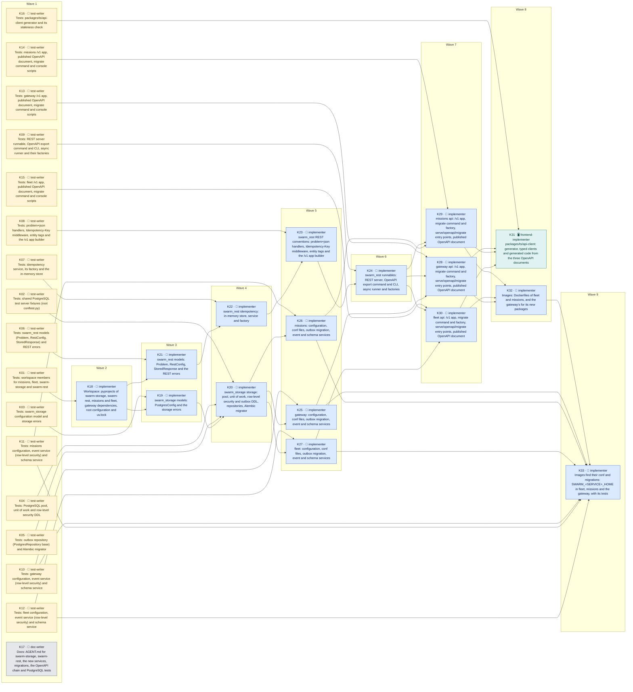

# T0.12: Plan

**Plan:** 🟢 Approved

**Push:** 🟢 Approved

<!-- ticket:specs -->
## 📚 Specifications

The technical pages, features, use cases and business rules of [TICKET.md](TICKET.md), copied by `python3 .claude/scripts/tickets/ticket_refs.py sync`.

- [🗂️ Mono-repo](../../specs/technical/01-architecture.md#mono-repo)
- [🔌 REST](../../specs/technical/05-api.md#rest)
- [🗄️ PostgreSQL and PostGIS](../../specs/technical/03-storage.md#postgresql)
- [📏 BR-008: Operator isolation](../../specs/functional/business-rules/BR-008-operator-isolation.md)
- [📘 FS-012: Operators, deployment and languages](../../specs/functional/features/FS-012-operators-deployment-and-languages.md)
- [🎬 UC-029: Create an Operator](../../specs/functional/use-cases/UC-029-create-an-operator.md)
- [🔐 Security](../../specs/technical/06-security.md#identity)
<!-- /ticket:specs -->

## Summary

T0.12 is split into 31 tasks across 8 waves. Wave 1 has 16 test-writer tasks and the AGENT.md doc task. Wave 2 sets up the uv workspace. Waves 3 to 6 build two shared packages. packages/python/swarm-storage is named in docs/specs/technical/03-storage.md#repositories. It holds the PostgreSQL pool, the unit of work that sets swarm.operator_id on each transaction, the row-level security DDL, PostgresRepository and the outbox repository, and the Alembic migrator. packages/python/swarm-rest is a new package for the REST conventions: problem+json, the Idempotency-Key middleware, ETag/If-Match, the /v1 app builder, the uvicorn server runnable and the OpenAPI export. Waves 5 and 7 turn gateway, missions and fleet into AGENT.md services, each with its config, an event outbox with forced row-level security as its first Operator-owned table (AC-1), migrations, a /v1 app, console scripts and a published OpenAPI document. Wave 8 generates packages/ts/api-client from those documents, and its test script fails CI when the client is stale (AC-2). The ticket shows no screen, so there is no capture task.

## Assumptions

- The roadmap row names only BR-008; FS-012 and UC-029 are taken from epic E0.5, and UC-029 serves as the use case in each criterion because the template requires one.
- The roadmap row names no budget, so none is listed, although the REST page states a p95 budget.
- The roadmap has no per-ticket anchor, so the ticket links to its sprint anchor s03.
- Criterion 2 restates the roadmap's 'generated client is up to date in CI'.
- No screen is touched, since the roadmap row names no use case screen.
- check_ticket.py was not run by me; the workflow runs it.
- Each service's first Operator-owned table is its event outbox (<schema>.outbox). The outbox is named in docs/specs/technical/03-storage.md#repositories and stores the shared Event envelope, which already carries operator_id. No use-case entity is in scope, so no entity columns are invented, and entity tables (Mission, Drone, ApiToken) come with their own tickets.
- The REST conventions shared by the three services go in a new package, packages/python/swarm-rest (swarm_rest). AGENT.md says shared code lives in packages/, but the specification names only swarm-storage (03-storage.md#repositories), not this package. Both packages sit outside the ticket's declared area. They are new folders, so they cannot conflict with another open ticket.
- T0.12 exposes no resource endpoint. Each service's /v1 holds the conventions (problem+json, Idempotency-Key, ETag/If-Match) and its OpenAPI document. Operator-owned resources need the verified token of T0.11, so the generated client holds the Problem type and typed clients with no operations yet. The conventions are proved by swarm-rest tests on a sample router.
- Until T0.11, the Operator is passed by the caller of a service method (EventService.pending(operator_id)). No HTTP header carries it, so nothing in this ticket can choose an Operator from the outside.
- There is one OpenAPI document per service, published (committed) at packages/ts/api-client/openapi/<service>.json. Two checks keep it current. Each service's pytest compares the file with its app. The api-client test script runs generate.ts --check, the same chain as swarm-models to packages/ts/live. A changed document touches packages/, so detect_changes.py runs every check, and no workflow file changes. This keeps the ticket out of T0.10's .github/workflows area.
- The gateway gets its own schema, gateway. The storage page lists the schemas of missions, fleet, processing, evidence and notifier, and gives the gateway repositories (ApiTokenRepository, WebhookSubscriptionRepository).
- The row-level security policy is ENABLE plus FORCE ROW LEVEL SECURITY, policy operator_isolation, with USING and WITH CHECK operator_id = NULLIF(current_setting('swarm.operator_id', true), '')::uuid. An unset setting therefore matches no row. The setting is transaction-local (set_config(..., true)), which is safe with PgBouncer in transaction mode. Services connect as a role that is neither superuser nor BYPASSRLS. The future outbox relay that reads every Operator's rows needs its own role, decided later.
- The database DSN comes from an environment entry named by PostgresConfig.dsn_key, SWARM_<SERVICE>_POSTGRES_DSN, as injected from the vault. Pools default to 1 to 5 connections ('small pools'), with a 5 s command timeout and a 5 s status interval. These defaults are not in the specification.
- Idempotency-Key is required on every POST. A missing key, or one that is not 1 to 255 visible ASCII characters, gives 400. Keys are kept in process memory for 24 hours (the precedent of the NATS responder's idempotency_ttl_s) and capped at 10,000 entries. The same request is replayed, another request with the same key gives 422, a key still in flight gives 409, and 5xx responses are not stored. A store shared across pods (Valkey) and scoping by Operator come later.
- ETag is the row version as a strong tag. A missing If-Match gives 428 and a mismatch gives 412. The REST default port is 8000 on host 0.0.0.0.
- Alembic migrations live in services/<service>/migrations/, outside src/, because Alembic needs module-level upgrade and downgrade functions, which AGENT.md forbids in src/. The version table sits in the service's own schema, the migrator creates the schema, and migrations run through swarm-<service>-migrate.
- PostgreSQL tests use a throwaway server started from local binaries (initdb, pg_ctl, psql), found on PATH, in SWARM_POSTGRES_BIN_DIR or in /usr/lib/postgresql/*/bin. They skip without them, as the NATS tests skip without nats-server. The fixtures sit in a repository-root conftest.py so that every test tree shares them. GitHub's ubuntu runners are assumed to ship the PostgreSQL binaries. If they do not, the tests skip in CI, and a follow-up adds an install step to python.yml (T0.10's area).
- The console scripts are swarm-<service>-serve, swarm-<service>-openapi and swarm-<service>-migrate. The gateway's existing swarm-gateway greeting script and its tests stay unchanged.
- The runner that drives an AsyncRunnable from a console script (AsyncRunnableRunner) goes in swarm-rest rather than swarm-lifecycle, to stay out of another package.
- Test file names carry the service name (test_<service>_event_service.py and so on), because pytest imports test modules by basename across the uv workspace.
- The TypeScript client is generated with openapi-typescript and wrapped with openapi-fetch. The specification names no generator.
- The Dockerfiles of missions and fleet are left to T0.10, which owns one image per service and each Dockerfile. T0.12 does not change .github/workflows.
- The ticket shows no screen ('No screen' in TICKET.md, and its area holds no frontends/), so the plan has no mockup-writer capture task.

<!-- plan:graph -->

> [!NOTE]
> Generated from the json block at the end of this page by `python3 .claude/scripts/tickets/plan.py render`.
> To change a task, edit the json block, then render again: never edit this view by hand.

## Waves

| Wave | Tasks | Agents running at once |
| --- | --- | --- |
| 1 | [K01](#k01), [K02](#k02), [K03](#k03), [K04](#k04), [K05](#k05), [K06](#k06), [K07](#k07), [K08](#k08), [K09](#k09), [K10](#k10), [K11](#k11), [K12](#k12), [K13](#k13), [K14](#k14), [K15](#k15), [K16](#k16), [K17](#k17) | 8 of 17 |
| 2 | [K18](#k18) | 1 of 1 |
| 3 | [K19](#k19), [K21](#k21) | 2 of 2 |
| 4 | [K20](#k20), [K22](#k22) | 2 of 2 |
| 5 | [K23](#k23), [K25](#k25), [K26](#k26), [K27](#k27) | 4 of 4 |
| 6 | [K24](#k24) | 1 of 1 |
| 7 | [K28](#k28), [K29](#k29), [K30](#k30) | 3 of 3 |
| 8 | [K31](#k31), [K32](#k32) | 2 of 2 |
| 9 | [K33](#k33) | 1 of 1 |

| Wave | Task | Agent | Depends on | Unblocks |
| --- | --- | --- | --- | --- |
| 1 | [K01](#k01) Tests: workspace members for missions, fleet, swarm-storage and swarm-rest | 🧪 test-writer | none | [K18](#k18) |
| 1 | [K02](#k02) Tests: shared PostgreSQL test server fixtures (root conftest.py) | 🧪 test-writer | none | [K20](#k20) |
| 1 | [K03](#k03) Tests: swarm_storage configuration model and storage errors | 🧪 test-writer | none | [K19](#k19) |
| 1 | [K04](#k04) Tests: PostgreSQL pool, unit of work and row-level security DDL | 🧪 test-writer | none | [K20](#k20) |
| 1 | [K05](#k05) Tests: outbox repository (PostgresRepository base) and Alembic migrator | 🧪 test-writer | none | [K20](#k20) |
| 1 | [K06](#k06) Tests: swarm_rest models (Problem, RestConfig, StoredResponse) and REST errors | 🧪 test-writer | none | [K21](#k21) |
| 1 | [K07](#k07) Tests: idempotency service, its factory and the in-memory store | 🧪 test-writer | none | [K22](#k22) |
| 1 | [K08](#k08) Tests: problem+json handlers, Idempotency-Key middleware, entity tags and the /v1 app builder | 🧪 test-writer | none | [K23](#k23) |
| 1 | [K09](#k09) Tests: REST server runnable, OpenAPI export command and CLI, async runner and their factories | 🧪 test-writer | none | [K24](#k24) |
| 1 | [K10](#k10) Tests: gateway configuration, event service (row-level security) and schema service | 🧪 test-writer | none | [K25](#k25), [K33](#k33) |
| 1 | [K11](#k11) Tests: missions configuration, event service (row-level security) and schema service | 🧪 test-writer | none | [K26](#k26), [K33](#k33) |
| 1 | [K12](#k12) Tests: fleet configuration, event service (row-level security) and schema service | 🧪 test-writer | none | [K27](#k27), [K33](#k33) |
| 1 | [K13](#k13) Tests: gateway /v1 app, published OpenAPI document, migrate command and console scripts | 🧪 test-writer | none | [K28](#k28) |
| 1 | [K14](#k14) Tests: missions /v1 app, published OpenAPI document, migrate command and console scripts | 🧪 test-writer | none | [K29](#k29) |
| 1 | [K15](#k15) Tests: fleet /v1 app, published OpenAPI document, migrate command and console scripts | 🧪 test-writer | none | [K30](#k30) |
| 1 | [K16](#k16) Tests: packages/ts/api-client generator and its staleness check | 🧪 test-writer | none | [K31](#k31) |
| 1 | [K17](#k17) Docs: AGENT.md for swarm-storage, swarm-rest, the new services, migrations, the OpenAPI chain and PostgreSQL tests | 📝 doc-writer | none | none |
| 2 | [K18](#k18) Workspace: pyprojects of swarm-storage, swarm-rest, missions and fleet, gateway dependencies, root configuration and uv.lock | 🐍 implementer | [K01](#k01) | [K19](#k19), [K21](#k21) |
| 3 | [K19](#k19) swarm_storage models: PostgresConfig and the storage errors | 🐍 implementer | [K03](#k03), [K18](#k18) | [K20](#k20) |
| 3 | [K21](#k21) swarm_rest models: Problem, RestConfig, StoredResponse and the REST errors | 🐍 implementer | [K06](#k06), [K18](#k18) | [K22](#k22) |
| 4 | [K20](#k20) swarm_storage storage: pool, unit of work, row-level security and outbox DDL, repositories, Alembic migrator | 🐍 implementer | [K02](#k02), [K04](#k04), [K05](#k05), [K19](#k19) | [K25](#k25), [K26](#k26), [K27](#k27) |
| 4 | [K22](#k22) swarm_rest idempotency: in-memory store, service and factory | 🐍 implementer | [K07](#k07), [K21](#k21) | [K23](#k23) |
| 5 | [K23](#k23) swarm_rest REST conventions: problem+json handlers, Idempotency-Key middleware, entity tags and the /v1 app builder | 🐍 implementer | [K08](#k08), [K22](#k22) | [K24](#k24) |
| 5 | [K25](#k25) gateway: configuration, conf files, outbox migration, event and schema services | 🐍 implementer | [K10](#k10), [K20](#k20) | [K28](#k28), [K33](#k33) |
| 5 | [K26](#k26) missions: configuration, conf files, outbox migration, event and schema services | 🐍 implementer | [K11](#k11), [K20](#k20) | [K29](#k29), [K33](#k33) |
| 5 | [K27](#k27) fleet: configuration, conf files, outbox migration, event and schema services | 🐍 implementer | [K12](#k12), [K20](#k20) | [K30](#k30), [K33](#k33) |
| 6 | [K24](#k24) swarm_rest runnables: REST server, OpenAPI export command and CLI, async runner and factories | 🐍 implementer | [K09](#k09), [K23](#k23) | [K28](#k28), [K29](#k29), [K30](#k30) |
| 7 | [K28](#k28) gateway api: /v1 app, migrate command and factory, serve/openapi/migrate entry points, published OpenAPI document | 🐍 implementer | [K13](#k13), [K24](#k24), [K25](#k25) | [K31](#k31), [K32](#k32) |
| 7 | [K29](#k29) missions api: /v1 app, migrate command and factory, serve/openapi/migrate entry points, published OpenAPI document | 🐍 implementer | [K14](#k14), [K24](#k24), [K26](#k26) | [K31](#k31), [K32](#k32) |
| 7 | [K30](#k30) fleet api: /v1 app, migrate command and factory, serve/openapi/migrate entry points, published OpenAPI document | 🐍 implementer | [K15](#k15), [K24](#k24), [K27](#k27) | [K31](#k31), [K32](#k32) |
| 8 | [K31](#k31) packages/ts/api-client: generator, typed clients and generated code from the three OpenAPI documents | 🖥️ frontend-implementer | [K16](#k16), [K28](#k28), [K29](#k29), [K30](#k30) | none |
| 8 | [K32](#k32) Images: Dockerfiles of fleet and missions, and the gateway's for its new packages | 🐍 implementer | [K29](#k29), [K30](#k30), [K28](#k28) | [K33](#k33) |
| 9 | [K33](#k33) Images find their conf and migrations: SWARM_<SERVICE>_HOME in fleet, missions and the gateway, with its tests | 🐍 implementer | [K32](#k32), [K25](#k25), [K26](#k26), [K27](#k27), [K10](#k10), [K11](#k11), [K12](#k12) | none |

## Dependency graph



## Tasks

### <a id="k01"></a>K01: Tests: workspace members for missions, fleet, swarm-storage and swarm-rest

| Agent | Wave | Depends on | Unblocks |
| --- | --- | --- | --- |
| 🧪 test-writer | 1 | none | [K18](#k18) |

**Files** (only this task may change them in its wave):

- `tests/conventions/mono_repo/test_python_workspace.py`

**Done when:** `uv run ruff format --check tests/conventions/mono_repo/test_python_workspace.py` and `uv run ruff check tests/conventions/mono_repo/test_python_workspace.py` pass. `uv run pytest tests/conventions/mono_repo/test_python_workspace.py` passes every test that existed before. The new tests fail only because the services, packages and entries do not exist yet.

**Brief:**

Extend the workspace convention tests for ticket T0.12 (docs/tickets/T0.12/TICKET.md). The ticket adds the services missions and fleet and the shared packages swarm-storage and swarm-rest.
Specs applied:
- docs/specs/technical/01-architecture.md#mono-repo: one uv workspace with services/&lt;service>/ and packages/python/.
- docs/specs/technical/01-architecture.md#layers: the five modules api, service, storage, clients and models sit under services/&lt;service>/src/&lt;service>/.
- docs/specs/technical/03-storage.md#repositories: the shared base PostgresRepository lives in packages/python/swarm-storage.

File: tests/conventions/mono_repo/test_python_workspace.py, class TestPythonWorkspace. Keep every existing test unchanged. Add the tests below, with pytest.mark.parametrize and the expected values held in UPPER_CASE constants:
- services/missions/pyproject.toml and services/fleet/pyproject.toml exist. Their project names are swarm-missions and swarm-fleet, and their [tool.uv.build-backend] module-name is missions and fleet.
- For each of gateway, missions and fleet, project.scripts maps:
  - swarm-&lt;s>-serve to '&lt;s>.api.cli.serve_main:main';
  - swarm-&lt;s>-openapi to '&lt;s>.api.cli.openapi_main:main';
  - swarm-&lt;s>-migrate to '&lt;s>.api.cli.migrate_main:main'.
  The gateway keeps swarm-gateway = 'gateway.api.cli.main:main'.
- missions and fleet each have the five layer packages, each with an __init__.py, under src/&lt;s>/.
- packages/python/swarm-storage/pyproject.toml and packages/python/swarm-rest/pyproject.toml exist. Their names are swarm-storage and swarm-rest, and their module-name is swarm_storage and swarm_rest.
- Dependencies:
  - swarm-storage depends on asyncpg, alembic, sqlalchemy and swarm-models;
  - swarm-rest depends on fastapi and uvicorn;
  - each of the three services depends on swarm-storage and swarm-rest.
  Compare distribution names stripped of extras and version specifiers, as test_the_dev_group_lists_the_tool does.
- The root pyproject.toml:
  - tool.ruff.lint.isort.known-first-party contains missions, fleet, swarm_storage and swarm_rest;
  - tool.pytest.ini_options.testpaths contains services/missions/tests, services/fleet/tests, packages/python/swarm-storage/tests and packages/python/swarm-rest/tests;
  - tool.mypy.files contains services/missions/src, services/fleet/src, packages/python/swarm-storage/src and packages/python/swarm-rest/src.

Test rules (AGENT.md Tests and the CLAUDE.md code rules, which hold in tests/ too):
- one Test&lt;Subject> class per file, test names as sentences, parametrize for the cases of one behaviour;
- no mocks, no __init__.py, no Pydantic model defined in a test;
- no Any or object as a type (JsonValue for parsed TOML);
- no dict with hard-coded keys inside a method;
- no nested function, and every try has an except.

### <a id="k02"></a>K02: Tests: shared PostgreSQL test server fixtures (root conftest.py)

| Agent | Wave | Depends on | Unblocks |
| --- | --- | --- | --- |
| 🧪 test-writer | 1 | none | [K20](#k20) |

**Files** (only this task may change them in its wave):

- `conftest.py`
- `tests/postgres/test_postgres_fixture.py`

**Done when:** `uv run ruff format --check conftest.py tests/postgres/test_postgres_fixture.py` and `uv run ruff check conftest.py tests/postgres/test_postgres_fixture.py` pass. `uv run pytest tests/postgres/test_postgres_fixture.py -n 2` passes where PostgreSQL binaries are installed, and skips otherwise.

**Brief:**

Write the fixtures that start a throwaway PostgreSQL server for every test tree of ticket T0.12 (docs/tickets/T0.12/TICKET.md). Tests must run against a real PostgreSQL, including a test that another Operator's rows are never returned.
Specs applied:
- docs/specs/technical/03-storage.md#repositories: no mocks.
- docs/specs/technical/03-storage.md#postgresql: row-level security on operator_id against swarm.operator_id.
- docs/specs/functional/business-rules/BR-008-operator-isolation.md.
Follow the model of packages/python/swarm-nats/tests/conftest.py, which uses a local nats-server binary and skips without it.

(1) conftest.py at the repository root. pytest loads it for services/*/tests, packages/python/*/tests and tests/, because the rootdir is the repository root. Module-level fixture functions and constants are allowed here, as in the swarm-nats conftest. Constants:
- POSTGRES_APP_ROLE = 'swarm_app';
- LOCALHOST = '127.0.0.1';
- the start and stop timeouts.
How to find the binaries:
- the folder of shutil.which('pg_ctl');
- else the folder in the environment variable SWARM_POSTGRES_BIN_DIR;
- else the newest /usr/lib/postgresql/*/bin that holds pg_ctl;
- else pytest.skip('PostgreSQL binaries are not installed').
Fixtures:
- postgres_server (scope='session'). It runs initdb into tmp_path_factory with -U postgres, --auth=trust, --encoding=UTF8 and --no-sync. It runs pg_ctl -w start on a free port, with listen_addresses=127.0.0.1, a socket folder in the temp dir and fsync=off, and calls pytest.fail with the end of the server log when the server does not start. Then psql as postgres runs CREATE ROLE swarm_app LOGIN NOSUPERUSER NOBYPASSRLS NOCREATEROLE. It yields the admin DSN 'postgresql://postgres@127.0.0.1:&lt;port>/postgres' and stops the server with pg_ctl -m fast. Under pytest-xdist each worker gets its own server.
- postgres_dsn (function scope). It creates a fresh database 'swarm_test_&lt;uuid4 hex>' OWNER swarm_app through psql (-X -q -At -v ON_ERROR_STOP=1) and yields 'postgresql://swarm_app@127.0.0.1:&lt;port>/&lt;database>'. Afterwards it runs DROP DATABASE ... WITH (FORCE).
Other tests depend on exactly these names and this contract.

(2) tests/postgres/test_postgres_fixture.py, class TestPostgresFixture. Query through psql on postgres_dsn, so that it runs before any Python driver is installed:
- the current user is swarm_app, and rolsuper and rolbypassrls are both false;
- the database name starts with swarm_test_;
- the database has no table outside pg_catalog and information_schema;
- the owner can CREATE SCHEMA in it.

Test rules (AGENT.md Tests and CLAUDE.md):
- no mocks, no __init__.py, no Any or object as a type;
- no dict with hard-coded keys inside a function, no nested function, and every try has an except;
- test names as sentences.

### <a id="k03"></a>K03: Tests: swarm_storage configuration model and storage errors

| Agent | Wave | Depends on | Unblocks |
| --- | --- | --- | --- |
| 🧪 test-writer | 1 | none | [K19](#k19) |

**Files** (only this task may change them in its wave):

- `packages/python/swarm-storage/tests/models/config/test_postgres_config.py`
- `packages/python/swarm-storage/tests/models/postgres/test_swarm_storage_errors.py`

**Done when:** `uv run ruff format --check` passes on both files. `uv run ruff check --config "lint.isort.known-first-party = ['tests', 'gateway', 'missions', 'fleet', 'swarm_catalog', 'swarm_lifecycle', 'swarm_logging', 'swarm_models', 'swarm_nats', 'swarm_storage', 'swarm_rest']"` passes on them. `uv run pytest` on them fails only because swarm_storage does not exist yet.

**Brief:**

Write the model tests of the new package packages/python/swarm-storage (module swarm_storage) for ticket T0.12 (docs/tickets/T0.12/TICKET.md).
Specs applied:
- docs/specs/technical/03-storage.md#postgresql: asyncpg with small pools, behind PgBouncer.
- docs/specs/technical/03-storage.md#repositories: one base PostgresRepository in swarm-storage.
- docs/specs/technical/06-security.md#identity: secrets never appear in configuration.
- docs/specs/technical/01-architecture.md#layers: models only load and validate.

(1) tests/models/config/test_postgres_config.py, class TestPostgresConfig, for swarm_storage.models.config.postgres_config.PostgresConfig. It uses extra='forbid' and validate_default=True. Fields:
- dsn_key: str, default 'SWARM_POSTGRES_DSN'. It names the environment entry, injected from the vault, that holds the DSN, and never holds a secret. Stripped, non-empty, and must match ^[A-Z][A-Z0-9_]*$.
- pool_min_size: int, default 1, within [POOL_MIN_SIZE_MIN 0, POOL_MIN_SIZE_MAX 100].
- pool_max_size: int, default 5, within [POOL_MAX_SIZE_MIN 1, POOL_MAX_SIZE_MAX 100].
- command_timeout_s: float, default 5.0, > 0.
- status_interval_s: float, default 5.0, > 0. It is the interval between two statuses of a long database job such as a migration.
Model rule: pool_min_size > pool_max_size raises SEPostgresConfigPoolSizesInverted.
Write the AGENT.md model set: test_defaults, test_full_valid_construction, test_none_becomes_the_default, test_rejects_bad_values (bool refused where a number is expected), test_rejects_unknown_keys and test_round_trip. Read the bounds from the ClassVars and never repeat them.
Exceptions come from swarm_storage.models.config.exceptions. The base is SEInvalidPostgresConfigException, and these subclass it: SEPostgresConfigInvalidDsnKey, SEPostgresConfigInvalidPoolMinSize, SEPostgresConfigInvalidPoolMaxSize, SEPostgresConfigInvalidCommandTimeout, SEPostgresConfigInvalidStatusInterval and SEPostgresConfigPoolSizesInverted. Assert the hierarchy with issubclass.

(2) tests/models/postgres/test_swarm_storage_errors.py, class TestSwarmStorageErrors. The errors come from swarm_storage.models.postgres.exceptions. SEStorageError is the base, and these subclass it: SEStorageDsnMissingError, SEStorageConnectionError, SEStorageNotOpenError, SEStorageInvalidIdentifierError, SEStorageInvalidPageError, SEStorageVersionConflictError, SEStorageOperatorRefusedError and SEStorageMigrationError. Assert, parametrized:
- the hierarchy;
- that each is listed in the package's __all__, which is sorted.

Test rules (AGENT.md Tests and the CLAUDE.md code rules, which hold in tests/ too):
- one Test&lt;Subject> class per file, test names as sentences, parametrize, pytest.raises with the specific exception;
- no mocks, no __init__.py, no Pydantic model defined in a test;
- no Any or object as a type (JsonValue for raw values);
- no dict with hard-coded keys inside a method (UPPER_CASE ClassVars);
- no nested function, and every try has an except;
- compare with ClassVar constants;
- test file basenames stay unique across the uv workspace, because pytest imports test modules by basename.

### <a id="k04"></a>K04: Tests: PostgreSQL pool, unit of work and row-level security DDL

| Agent | Wave | Depends on | Unblocks |
| --- | --- | --- | --- |
| 🧪 test-writer | 1 | none | [K20](#k20) |

**Files** (only this task may change them in its wave):

- `packages/python/swarm-storage/tests/storage/postgres/test_postgres_pool.py`
- `packages/python/swarm-storage/tests/storage/postgres/test_unit_of_work.py`
- `packages/python/swarm-storage/tests/storage/postgres/ddl/test_row_level_security.py`
- `packages/python/swarm-storage/tests/storage/postgres/ddl/test_outbox_table.py`

**Done when:** `uv run ruff format --check` passes on the four files. `uv run ruff check --config "lint.isort.known-first-party = ['tests', 'gateway', 'missions', 'fleet', 'swarm_catalog', 'swarm_lifecycle', 'swarm_logging', 'swarm_models', 'swarm_nats', 'swarm_storage', 'swarm_rest']"` passes on them. `uv run pytest` on them fails only because swarm_storage (or asyncpg) does not exist yet.

**Brief:**

Write the storage tests that prove Operator isolation at the database level for ticket T0.12 (docs/tickets/T0.12/TICKET.md). Acceptance criterion 1: a query that forgets the Operator filter returns nothing.
Specs applied:
- docs/specs/technical/03-storage.md#postgresql: every Operator-owned table has operator_id, and row-level security policies compare it with the session setting swarm.operator_id, set by the service on each transaction. PgBouncer runs in transaction mode, with asyncpg.
- docs/specs/technical/03-storage.md#repositories: a unit of work per business operation, the outbox table, and real PostgreSQL in tests.
- docs/specs/technical/06-security.md#authorisation: row-level security enforces the Operator on every row.
- docs/specs/functional/business-rules/BR-008-operator-isolation.md.

Use the root conftest.py fixture postgres_dsn (task K02): a fresh database owned by the role swarm_app, which is neither superuser nor BYPASSRLS. It skips without PostgreSQL. Put the DSN in the environment with monkeypatch.setenv(config.dsn_key, postgres_dsn). Use fixed version 7 UUID constants for the Operators A and B. Raw checks may use asyncpg directly.

(1) test_postgres_pool.py, class TestPostgresPool, for swarm_storage.storage.postgres.postgres_pool.PostgresPool(config: PostgresConfig, logger=None). It has async open(), async close(), is_open (property) and unit_of_work(operator_id: Optional[UUID]) -> UnitOfWork. Tests:
- open with the environment entry unset raises SEStorageDsnMissingError, and the message does not contain the DSN;
- a DSN to a closed port raises SEStorageConnectionError;
- is_open is True after open and False after close;
- close before open and close twice are safe;
- unit_of_work before open raises SEStorageNotOpenError.

(2) test_unit_of_work.py, class TestUnitOfWork, for swarm_storage.storage.postgres.unit_of_work.UnitOfWork. It is an async context manager with ClassVar OPERATOR_SETTING = 'swarm.operator_id', a connection property and an operator_id attribute. Tests:
- inside 'async with pool.unit_of_work(A) as uow', current_setting(OPERATOR_SETTING, true) equals str(A). Pass the setting name as a query parameter, never a literal.
- with None, the setting is NULL or empty;
- with pool_max_size 1, the setting never leaks into the next unit of work, because it is transaction-local;
- the work commits on a normal exit;
- an exception rolls back and propagates;
- uow.connection outside the block raises SEStorageNotOpenError.

(3) ddl/test_row_level_security.py, class TestRowLevelSecurity, for swarm_storage.storage.postgres.ddl.row_level_security.RowLevelSecurity(logger=None):
- enable(schema, table) -> List[str] returns, in order, ENABLE ROW LEVEL SECURITY, FORCE ROW LEVEL SECURITY and CREATE POLICY &lt;POLICY_NAME>, where the ClassVar POLICY_NAME = 'operator_isolation'. USING and WITH CHECK compare operator_id with NULLIF(current_setting(UnitOfWork.OPERATOR_SETTING, true), '')::uuid.
- disable(schema, table) -> List[str] undoes it.
- Identifiers that do not match ^[a-z_][a-z0-9_]*$ raise SEStorageInvalidIdentifierError. Parametrize over '', 'Demo', '1a' and 'x;drop'.
Database test, as swarm_app: create schema demo and table demo.items (id uuid primary key, operator_id uuid not null), then run the enable statements. Insert one row for A and one for B, each in its own Operator's unit of work. Then:
- SELECT * FROM demo.items with no WHERE returns only A's row in A's unit of work, and nothing in a unit of work without an Operator. This holds although swarm_app owns the table, because of FORCE.
- Inserting B's row in A's unit of work raises asyncpg.exceptions.InsufficientPrivilegeError.
- After the disable statements, both rows are visible.

(4) ddl/test_outbox_table.py, class TestOutboxTable, for swarm_storage.storage.postgres.ddl.outbox_table.OutboxTable(logger=None), with ClassVar TABLE = 'outbox':
- create(schema) -> List[str] creates &lt;schema>.outbox with id uuid primary key, operator_id uuid not null, version integer not null default 1, event jsonb not null, recorded_at timestamptz not null default now() and published_at timestamptz null. It adds a B-tree index on (operator_id, id) and the RowLevelSecurity.enable statements.
- drop(schema) -> List[str] removes the table.
- An invalid schema raises SEStorageInvalidIdentifierError.
On the database, check that after create:
- pg_class.relrowsecurity and relforcerowsecurity are true;
- pg_policies holds POLICY_NAME;
- the columns have the types above.
After drop, the table is gone.
Exceptions come from swarm_storage.models.postgres.exceptions.

Test rules (AGENT.md Tests and CLAUDE.md):
- one Test class per file, sentence names, parametrize, specific exceptions;
- no unittest.mock (monkeypatch.setenv is fine), no __init__.py, no model defined in a test;
- no Any or object as a type;
- no dict with hard-coded keys inside a method, no nested function, and every try has an except;
- compare with ClassVar constants;
- async tests need no marker;
- test basenames stay unique across the workspace.

### <a id="k05"></a>K05: Tests: outbox repository (PostgresRepository base) and Alembic migrator

| Agent | Wave | Depends on | Unblocks |
| --- | --- | --- | --- |
| 🧪 test-writer | 1 | none | [K20](#k20) |

**Files** (only this task may change them in its wave):

- `packages/python/swarm-storage/tests/storage/postgres/repositories/test_outbox_repository.py`
- `packages/python/swarm-storage/tests/storage/postgres/migrations/test_alembic_migrator.py`
- `packages/python/swarm-storage/tests/storage/postgres/migrations/sample/env.py`
- `packages/python/swarm-storage/tests/storage/postgres/migrations/sample/script.py.mako`
- `packages/python/swarm-storage/tests/storage/postgres/migrations/sample/versions/0001_sample_outbox.py`

**Done when:** `uv run ruff format --check` passes on the four Python files. `uv run ruff check --config "lint.isort.known-first-party = ['tests', 'gateway', 'missions', 'fleet', 'swarm_catalog', 'swarm_lifecycle', 'swarm_logging', 'swarm_models', 'swarm_nats', 'swarm_storage', 'swarm_rest']"` passes on them. `uv run pytest` on the two test files fails only because swarm_storage does not exist yet.

**Brief:**

Write the tests of the repository base and of the Alembic migrator of swarm_storage for ticket T0.12 (docs/tickets/T0.12/TICKET.md). Acceptance criterion 1: a query that forgets the Operator filter returns nothing.
Specs applied:
- docs/specs/technical/03-storage.md#repositories: PostgresRepository[Model] maps rows to the Pydantic model and back, sets swarm.operator_id on the transaction, pages with cursors and checks a version column on update (the REST ETag). It also covers the outbox in the unit of work, and tests that another Operator's rows are never returned.
- docs/specs/technical/03-storage.md#postgresql: one schema per service, and Alembic per service.
- docs/specs/technical/02-data-models.md#conventions: UUIDv7 identifiers, and operator_id on every Operator-owned model.
- docs/specs/functional/business-rules/BR-008-operator-isolation.md.
Use the postgres_dsn fixture of the root conftest.py (task K02) and monkeypatch.setenv(PostgresConfig().dsn_key, postgres_dsn). Build events with swarm_models.models.events.event.Event and its Actor; read packages/python/swarm-models/tests/models/events for valid values. Use fixed version 7 UUID constants.

(1) repositories/test_outbox_repository.py, class TestOutboxRepository, for swarm_storage.storage.postgres.repositories.outbox_repository.OutboxRepository(unit_of_work: UnitOfWork, schema: str, logger=None). It subclasses swarm_storage.storage.postgres.repositories.postgres_repository.PostgresRepository[Event]. Set up schema demo and run OutboxTable().create('demo') on it (see task K04), then open a PostgresPool. Tests:
- add(event) in the unit of work of event.operator_id returns the event;
- get(id) returns an equal event for its own Operator and None for another;
- list(after: Optional[UUID] = None, limit: int = 100) is ordered by id, and after=&lt;id> returns the rest;
- a limit &lt; 1 or > PostgresRepository.PAGE_SIZE_MAX (a ClassVar, 500) raises SEStorageInvalidPageError;
- pending(limit=100) returns the unpublished events of the unit of work's Operator in recording order;
- mark_published(id) returns True and removes the event from pending, and returns False for another Operator's id;
- version_of(id) is 1 after add, and update(event, expected_version=1) returns 2;
- update with a stale version raises SEStorageVersionConflictError, and so does an update of another Operator's row;
- delete(id) returns True and get is then None, and delete of a missing id returns False;
- AC-1: pending() and list() in a unit of work without an Operator return []. In A's unit of work they never return B's events, although their SQL has no Operator filter.
- add of B's event in A's unit of work raises SEStorageOperatorRefusedError.

(2) migrations/test_alembic_migrator.py, class TestAlembicMigrator, for swarm_storage.storage.postgres.migrations.alembic_migrator.AlembicMigrator(config: PostgresConfig, schema: str, script_location: Path, logger=None). Methods: async upgrade(revision: str = 'head'), async downgrade(revision: str) and async current() -> Optional[str]. ClassVar SCHEMA_ATTRIBUTE is the key of alembic Config.attributes that carries the schema to migrations. Tests, with the sample folder below:
- upgrade creates the schema when missing and &lt;schema>.outbox;
- current() returns '0001';
- a second upgrade changes nothing;
- the alembic_version table lives in the given schema (pg_tables.schemaname);
- downgrade('base') drops the outbox, and current() is then None;
- a missing script folder raises SEStorageMigrationError;
- an unset DSN entry raises SEStorageDsnMissingError.

(3) The sample migration folder migrations/sample/. It is the template the services copy.
- env.py imports swarm_storage.storage.postgres.migrations.alembic_environment.AlembicEnvironment and calls AlembicEnvironment().run().
- script.py.mako is the standard Alembic template.
- versions/0001_sample_outbox.py has revision '0001' and down_revision None. upgrade() reads the schema from alembic.context.config.attributes[AlembicMigrator.SCHEMA_ATTRIBUTE] and calls op.execute for each statement of OutboxTable().create(schema). downgrade() does the same with drop.

Test rules (AGENT.md Tests and CLAUDE.md):
- one Test class per file, sentence names, parametrize, specific exceptions;
- no unittest.mock, no __init__.py, no model defined in a test;
- no Any or object as a type;
- no dict with hard-coded keys inside a method, no nested function, and every try has an except;
- compare with ClassVar constants;
- test basenames stay unique across the workspace.

### <a id="k06"></a>K06: Tests: swarm_rest models (Problem, RestConfig, StoredResponse) and REST errors

| Agent | Wave | Depends on | Unblocks |
| --- | --- | --- | --- |
| 🧪 test-writer | 1 | none | [K21](#k21) |

**Files** (only this task may change them in its wave):

- `packages/python/swarm-rest/tests/models/problems/test_problem.py`
- `packages/python/swarm-rest/tests/models/config/test_rest_config.py`
- `packages/python/swarm-rest/tests/models/idempotency/test_stored_response.py`
- `packages/python/swarm-rest/tests/models/rest/test_swarm_rest_errors.py`

**Done when:** `uv run ruff format --check` passes on the four files. `uv run ruff check --config "lint.isort.known-first-party = ['tests', 'gateway', 'missions', 'fleet', 'swarm_catalog', 'swarm_lifecycle', 'swarm_logging', 'swarm_models', 'swarm_nats', 'swarm_storage', 'swarm_rest']"` passes on them. `uv run pytest` on them fails only because swarm_rest does not exist yet.

**Brief:**

Write the model tests of the new package packages/python/swarm-rest (module swarm_rest), which holds the REST conventions shared by gateway, missions and fleet, for ticket T0.12 (docs/tickets/T0.12/TICKET.md).
Specs applied:
- docs/specs/technical/05-api.md#rest: ETag and If-Match on updates, Idempotency-Key on every POST, and errors as application/problem+json following the message rules of AGENT.md.
- docs/specs/technical/01-architecture.md#layers: models only load and validate.

(1) problems/test_problem.py, class TestProblem, for swarm_rest.models.problems.problem.Problem (RFC 9457). The model is frozen with extra forbid. ClassVar MEDIA_TYPE = 'application/problem+json'. Fields:
- type: str, default 'about:blank', stripped, non-empty, no whitespace;
- title: str, required, stripped and non-empty;
- status: int within [STATUS_MIN 400, STATUS_MAX 599], bool refused;
- detail: Optional[str], default None; stripped, and an empty string is refused;
- instance: Optional[str], default None; stripped, no whitespace, and an empty string is refused.
Round trip through model_dump(exclude_none=True). Exceptions come from swarm_rest.models.problems.exceptions: the base SEInvalidProblemException, with SEProblemInvalidType, SEProblemInvalidTitle, SEProblemInvalidStatus, SEProblemInvalidDetail and SEProblemInvalidInstance.

(2) config/test_rest_config.py, class TestRestConfig, for swarm_rest.models.config.rest_config.RestConfig, with extra forbid and validate_default. Fields:
- host: str, default '0.0.0.0', stripped, non-empty, no whitespace;
- port: int, default 8000, within [PORT_MIN 1, PORT_MAX 65535];
- status_interval_s: float, default 5.0, > 0;
- idempotency_ttl_s: float, default 86400.0, > 0;
- idempotency_max_entries: int, default 10000, >= IDEMPOTENCY_MAX_ENTRIES_MIN 1.
Exceptions come from swarm_rest.models.config.exceptions: the base SEInvalidRestConfigException, with SERestConfigInvalidHost, SERestConfigInvalidPort, SERestConfigInvalidStatusInterval, SERestConfigInvalidIdempotencyTtl and SERestConfigInvalidIdempotencyMaxEntries.

(3) idempotency/test_stored_response.py, class TestStoredResponse, for swarm_rest.models.idempotency.stored_response.StoredResponse. The model is frozen with extra forbid. Fields:
- fingerprint: str matching ^[0-9a-f]{64}$;
- status: int within [STATUS_MIN 100, STATUS_MAX 599];
- headers: List[Tuple[str, str]], default [], each name non-empty;
- body: bytes, default b''.
Exceptions come from swarm_rest.models.idempotency.exceptions: the base SEInvalidStoredResponseException, with SEStoredResponseInvalidFingerprint, SEStoredResponseInvalidStatus, SEStoredResponseInvalidHeaders and SEStoredResponseInvalidBody.

(4) rest/test_swarm_rest_errors.py, class TestSwarmRestErrors. The errors come from swarm_rest.models.rest.exceptions. SERestError is the base, with ClassVars STATUS = 500 and TITLE = HTTPStatus(500).phrase. The subclasses and their STATUS:
- SEIdempotencyKeyMissingError 400;
- SEIdempotencyKeyInvalidError 400;
- SEIdempotencyKeyReusedError 422;
- SEIdempotencyKeyInFlightError 409;
- SEPreconditionRequiredError 428;
- SEPreconditionFailedError 412;
- SERestServerStartError 500.
Assert, parametrized:
- the hierarchy;
- STATUS;
- that TITLE equals HTTPStatus(STATUS).phrase;
- that __all__ is sorted and complete.

Every model gets the AGENT.md model set: test_defaults, test_full_valid_construction, test_none_becomes_the_default, test_rejects_bad_values (bool refused where a number is expected), test_rejects_unknown_keys and test_round_trip. Read the bounds from the ClassVars.

Test rules (AGENT.md Tests and CLAUDE.md, which hold in tests/ too):
- one Test class per file, sentence names, parametrize, specific exceptions;
- no mocks, no __init__.py, no Pydantic model defined in a test;
- no Any or object as a type (JsonValue);
- no dict with hard-coded keys inside a method, no nested function;
- compare with ClassVar constants;
- test basenames stay unique across the workspace.

### <a id="k07"></a>K07: Tests: idempotency service, its factory and the in-memory store

| Agent | Wave | Depends on | Unblocks |
| --- | --- | --- | --- |
| 🧪 test-writer | 1 | none | [K22](#k22) |

**Files** (only this task may change them in its wave):

- `packages/python/swarm-rest/tests/service/idempotency/test_idempotency_service.py`
- `packages/python/swarm-rest/tests/service/factories/test_idempotency_service_factory.py`
- `packages/python/swarm-rest/tests/storage/idempotency/test_memory_idempotency_store.py`
- `packages/python/swarm-rest/tests/storage/idempotency/manual_clock.py`

**Done when:** `uv run ruff format --check` passes on the four files. `uv run ruff check --config "lint.isort.known-first-party = ['tests', 'gateway', 'missions', 'fleet', 'swarm_catalog', 'swarm_lifecycle', 'swarm_logging', 'swarm_models', 'swarm_nats', 'swarm_storage', 'swarm_rest']"` passes on them. `uv run pytest` on the three test files fails only because swarm_rest does not exist yet.

**Brief:**

Write the tests of the Idempotency-Key logic of swarm_rest for ticket T0.12 (docs/tickets/T0.12/TICKET.md).
Specs applied:
- docs/specs/technical/05-api.md#rest: Idempotency-Key on every POST.
- docs/specs/technical/05-api.md#internal: the precedent of idempotency keys on internal calls.
- docs/specs/technical/01-architecture.md#layers: service calls storage.

(1) storage/idempotency/manual_clock.py: a helper class ManualClock, alone in its file. It has now_s (float), advance(seconds: float) -> None and __call__() -> float, so that a store can take it as its clock without a mock.

(2) storage/idempotency/test_memory_idempotency_store.py, class TestMemoryIdempotencyStore, for swarm_rest.storage.idempotency.memory_idempotency_store.MemoryIdempotencyStore(ttl_s: float, max_entries: int, clock: Callable[[], float] = time.monotonic, logger=None). Methods:
- reserve(key) -> bool: True and marks the key in flight when it is free, False when it is in flight or stored;
- is_in_flight(key) -> bool;
- save(key, response: StoredResponse) -> None: stores the response and ends the in-flight state;
- get(key) -> Optional[StoredResponse];
- release(key) -> None: ends the in-flight state without storing;
- size (property): the number of stored responses.
Tests:
- a stored response is returned until ttl_s has passed, then get returns None and the entry is gone;
- saving beyond max_entries drops the oldest entry;
- release frees the key for a new reserve;
- reserve of a stored key returns False.

(3) service/idempotency/test_idempotency_service.py, class TestIdempotencyService, for swarm_rest.service.idempotency.idempotency_service.IdempotencyService(store: MemoryIdempotencyStore, logger=None). ClassVar KEY_LENGTH_MAX = 255. Methods:
- fingerprint(method: str, path: str, body: bytes) -> str: the SHA-256 hex of the request. Equal requests give equal fingerprints; another body or path gives another.
- async begin(key: Optional[str], fingerprint: str) -> Optional[StoredResponse]:
  - None raises SEIdempotencyKeyMissingError;
  - a key that is empty, longer than KEY_LENGTH_MAX or not made of visible ASCII characters 0x21 to 0x7E raises SEIdempotencyKeyInvalidError (parametrize);
  - a stored response with the same fingerprint is returned (replay);
  - a stored response with another fingerprint raises SEIdempotencyKeyReusedError;
  - a key in flight raises SEIdempotencyKeyInFlightError;
  - otherwise the key is reserved and None returned.
- async complete(key, response): a status &lt; 500 is stored, and a status >= 500 is released and not stored, so that a retry runs again.
- async abandon(key): releases the key.

(4) service/factories/test_idempotency_service_factory.py, class TestIdempotencyServiceFactory, for swarm_rest.service.factories.idempotency_service_factory.IdempotencyServiceFactory(config: RestConfig, logger=None). It is a swarm_lifecycle.factories.factory.Factory[IdempotencyService]. Tests:
- create() returns an IdempotencyService whose store uses config.idempotency_ttl_s and config.idempotency_max_entries;
- two create() calls return services with distinct stores.
Exceptions come from swarm_rest.models.rest.exceptions. StoredResponse comes from swarm_rest.models.idempotency.stored_response (task K06).

Test rules (AGENT.md Tests and CLAUDE.md):
- one Test class per file, sentence names, parametrize, specific exceptions;
- no unittest.mock, no __init__.py, no model defined in a test;
- no Any or object as a type;
- no dict with hard-coded keys inside a method, no nested function;
- compare with ClassVar constants;
- test basenames stay unique across the workspace.

### <a id="k08"></a>K08: Tests: problem+json handlers, Idempotency-Key middleware, entity tags and the /v1 app builder

| Agent | Wave | Depends on | Unblocks |
| --- | --- | --- | --- |
| 🧪 test-writer | 1 | none | [K23](#k23) |

**Files** (only this task may change them in its wave):

- `packages/python/swarm-rest/tests/api/rest/test_problem_handlers.py`
- `packages/python/swarm-rest/tests/api/rest/test_idempotency_middleware.py`
- `packages/python/swarm-rest/tests/api/rest/test_entity_tag.py`
- `packages/python/swarm-rest/tests/api/rest/test_rest_app_builder.py`
- `packages/python/swarm-rest/tests/api/rest/samples/sample_resource.py`

**Done when:** `uv run ruff format --check` passes on the five files. `uv run ruff check --config "lint.isort.known-first-party = ['tests', 'gateway', 'missions', 'fleet', 'swarm_catalog', 'swarm_lifecycle', 'swarm_logging', 'swarm_models', 'swarm_nats', 'swarm_storage', 'swarm_rest']"` passes on them. `uv run pytest` on the four test files fails only because swarm_rest does not exist yet.

**Brief:**

Write the HTTP tests of the REST conventions of swarm_rest for ticket T0.12 (docs/tickets/T0.12/TICKET.md). Use fastapi.testclient.TestClient, with raise_server_exceptions=False where a 500 is expected.
Specs applied:
- docs/specs/technical/05-api.md#rest: REST /v1 with FastAPI and OpenAPI 3.1; ETag and If-Match on updates; Idempotency-Key on every POST; errors as application/problem+json following the AGENT.md message rules.
- docs/specs/technical/03-storage.md#repositories: the row version is what the REST layer exposes as ETag.
- docs/specs/technical/01-architecture.md#layers: endpoints live in api.

(1) samples/sample_resource.py: a helper class SampleResource, alone in its file. Its attribute router is an APIRouter whose routes are bound methods added with add_api_route; no nested function. Body and response keys are UPPER_CASE ClassVars. Routes:
- POST /samples takes a Dict[str, JsonValue] body and answers 201 with the number of times it ran, so a test can see a replay.
- GET /samples/{sample_id} answers 200 with the header EntityTag.ETAG_HEADER set to EntityTag().format(VERSION), where VERSION = 3.
- PUT /samples/{sample_id} calls EntityTag().check_if_match(&lt;If-Match header>, VERSION) and answers 200.
- POST /failures answers 503 and counts its runs.
- GET /crash raises RuntimeError('secret detail').
- GET /absent raises HTTPException(404, 'No sample has this identifier.').

(2) test_problem_handlers.py, class TestProblemHandlers, for swarm_rest.api.rest.problem_handlers.ProblemHandlers(logger=None).install(app: FastAPI) -> None, on a bare FastAPI app that includes the sample router. Each case answers with content-type exactly Problem.MEDIA_TYPE and a body that validates as Problem, whose instance is the request path:
- an unknown path gives 404;
- the HTTPException gives 404 with its detail;
- the RuntimeError gives 500 with the title of 500 and no detail, and the body never contains 'secret detail';
- a bad request body gives 422;
- an SERestError subclass raised in a route gives its STATUS and TITLE.

(3) test_idempotency_middleware.py, class TestIdempotencyMiddleware, for swarm_rest.api.rest.idempotency_middleware.IdempotencyMiddleware(app: ASGIApp, service: IdempotencyService, logger=None). It is pure ASGI and added with app.add_middleware(IdempotencyMiddleware, service=IdempotencyServiceFactory(RestConfig()).create()). It holds the ClassVar IDEMPOTENCY_KEY_HEADER = 'Idempotency-Key'. Tests:
- a POST without the header gives 400 problem+json;
- an invalid key gives 400 (parametrize over 256 characters and a key with a space);
- the same key and body twice give the same status and body, and the route ran once;
- the same key with another body gives 422;
- a 503 is not stored, so a retry runs the route again;
- a GET needs no key;
- two different keys run the route twice.

(4) test_entity_tag.py, class TestEntityTag, for swarm_rest.api.rest.entity_tag.EntityTag(logger=None), with ClassVars ETAG_HEADER = 'ETag' and IF_MATCH_HEADER = 'If-Match':
- format(7) == '"7"';
- check_if_match passes for '"7"', '"6", "7"' and '*';
- None or '' raises SEPreconditionRequiredError;
- '"6"' and the weak 'W/"7"' raise SEPreconditionFailedError.
Through SampleResource:
- GET carries the ETag;
- PUT without If-Match gives 428 problem+json;
- PUT with a wrong tag gives 412;
- PUT with the right tag gives 200.

(5) test_rest_app_builder.py, class TestRestAppBuilder, for swarm_rest.api.rest.rest_app_builder.RestAppBuilder(config: RestConfig, logger=None).build(title: str, version: str, routers: List[APIRouter]) -> FastAPI. Tests:
- the routes are served under /v1 (POST /v1/samples with a key gives 201);
- the document is at /v1/openapi.json and /v1/docs answers 200, while /openapi.json gives 404;
- the document's openapi starts with '3.1', and info.title and info.version are the arguments;
- components.schemas.Problem exists with the properties type, title, status, detail and instance;
- every operation has a 'default' response whose application/problem+json content references #/components/schemas/Problem;
- with routers=[], Problem is still in components;
- the problem handlers and the middleware are installed (POST /v1/anything without a key gives 400 problem+json).
Exceptions come from swarm_rest.models.rest.exceptions, and Problem from swarm_rest.models.problems.problem (task K06).

Test rules (AGENT.md Tests and CLAUDE.md):
- one Test class per file, sentence names, parametrize, specific exceptions;
- no unittest.mock, no __init__.py, no Pydantic model defined in a test;
- no Any or object as a type (JsonValue);
- no dict with hard-coded keys inside a method, no nested function;
- compare with ClassVar constants;
- test basenames stay unique across the workspace.

### <a id="k09"></a>K09: Tests: REST server runnable, OpenAPI export command and CLI, async runner and their factories

| Agent | Wave | Depends on | Unblocks |
| --- | --- | --- | --- |
| 🧪 test-writer | 1 | none | [K24](#k24) |

**Files** (only this task may change them in its wave):

- `packages/python/swarm-rest/tests/api/rest/test_rest_server.py`
- `packages/python/swarm-rest/tests/api/cli/test_openapi_export_command.py`
- `packages/python/swarm-rest/tests/api/cli/test_openapi_cli.py`
- `packages/python/swarm-rest/tests/api/cli/test_async_runnable_runner.py`
- `packages/python/swarm-rest/tests/api/cli/samples/sample_job.py`
- `packages/python/swarm-rest/tests/api/factories/test_rest_server_factory.py`
- `packages/python/swarm-rest/tests/api/factories/test_openapi_export_command_factory.py`
- `packages/python/swarm-rest/tests/api/factories/test_async_runnable_runner_factory.py`

**Done when:** `uv run ruff format --check` passes on the eight files. `uv run ruff check --config "lint.isort.known-first-party = ['tests', 'gateway', 'missions', 'fleet', 'swarm_catalog', 'swarm_lifecycle', 'swarm_logging', 'swarm_models', 'swarm_nats', 'swarm_storage', 'swarm_rest']"` passes on them. `uv run pytest` on the test files fails only because swarm_rest does not exist yet.

**Brief:**

Write the tests of the runnables of swarm_rest for ticket T0.12 (docs/tickets/T0.12/TICKET.md):
- the server that serves a /v1 app;
- the command that publishes or checks the OpenAPI document;
- the runner that drives an AsyncRunnable from a console script.
Specs applied:
- docs/specs/technical/05-api.md#rest: the OpenAPI document is generated and published, and the TypeScript client in packages/ts/api-client is generated from it in CI.
- docs/specs/technical/01-architecture.md#layers.
- AGENT.md, Lifecycle and factories: a long-running async task always yields its status, every status_interval_s, then EXECUTED; close always runs; runnables are created by factories.

(1) api/rest/test_rest_server.py, class TestRestServer, for swarm_rest.api.rest.rest_server.RestServer(app: FastAPI, config: RestConfig, logger=None), an AsyncRunnable that serves the app with uvicorn. Tests, with RestConfig(host='127.0.0.1', port=&lt;a free port>, status_interval_s=0.05) and an app from RestAppBuilder:
- status_interval_s equals config.status_interval_s;
- while 'async for status in server.execute()' reports RUNNING, an httpx.AsyncClient GET of /v1/openapi.json answers 200;
- after a break and aclose() of the generator, the port refuses connections, so close ran;
- close() before initialize() is safe.

(2) api/cli/samples/sample_job.py: a helper class SampleJob(AsyncRunnable), alone in its file, with __init__(fail: bool, status_interval_s: float). initialize and close record calls in public boolean attributes. run sleeps briefly, and raises RuntimeError when fail is set.

(3) api/cli/test_async_runnable_runner.py, class TestAsyncRunnableRunner, for swarm_rest.api.cli.async_runnable_runner.AsyncRunnableRunner(runnable: AsyncRunnable, logger=None). It is a swarm_lifecycle Runnable whose run() drives runnable.execute() with asyncio.run and keeps last_status. Tests:
- execute() ends with last_status == RunnableStatus.EXECUTED, and the job was closed;
- a failing job's RuntimeError propagates from execute(), and the job was closed.

(4) api/cli/test_openapi_export_command.py, class TestOpenApiExportCommand, for swarm_rest.api.cli.openapi_export_command.OpenApiExportCommand(app: FastAPI, path: Path, check: bool, logger=None). It is a swarm_lifecycle Runnable with exit_code and render() -> str, where render() returns json.dumps(app.openapi(), indent=2, sort_keys=True, ensure_ascii=False) + '\n'. Tests:
- with check=False it writes render() in UTF-8, creating the parent folders, and exit_code is 0;
- with check=True and an identical file, exit_code is 0 and the file is unchanged;
- with check=True and a different or missing file, exit_code is 1 and nothing is written.

(5) api/cli/test_openapi_cli.py, class TestOpenApiCli, for swarm_rest.api.cli.openapi_cli.OpenApiCli(build_app: Callable[[], FastAPI], default_output: Path, logger=None), with main(argv: List[str]) -> int and the arguments --check and --output PATH:
- main([]) writes default_output and returns 0;
- ['--output', tmp] writes tmp;
- ['--check', '--output', missing] returns 1;
- an unknown argument returns 2.

(6) The factories in swarm_rest.api.factories:
- RestServerFactory(app, config, logger=None), an AsyncRunnableFactory[RestServer];
- OpenApiExportCommandFactory(app, path, check, logger=None), a RunnableFactory[OpenApiExportCommand];
- AsyncRunnableRunnerFactory(runnable, logger=None), a RunnableFactory[AsyncRunnableRunner].
For each, create() returns a new instance of the right class built from the arguments.

Test rules (AGENT.md Tests and CLAUDE.md):
- one Test class per file, sentence names, parametrize, specific exceptions;
- no unittest.mock, no __init__.py, no Pydantic model defined in a test;
- no Any or object as a type;
- no dict with hard-coded keys inside a method, no nested function, and every try has an except;
- compare with enum members (RunnableStatus) and ClassVar constants;
- test basenames stay unique across the workspace.

### <a id="k10"></a>K10: Tests: gateway configuration, event service (row-level security) and schema service

| Agent | Wave | Depends on | Unblocks |
| --- | --- | --- | --- |
| 🧪 test-writer | 1 | none | [K25](#k25), [K33](#k33) |

**Files** (only this task may change them in its wave):

- `services/gateway/tests/models/config/test_gateway_config.py`
- `services/gateway/tests/service/events/test_gateway_event_service.py`
- `services/gateway/tests/service/schema/test_gateway_schema_service.py`

**Done when:** `uv run ruff format --check` passes on the three files. `uv run ruff check --config "lint.isort.known-first-party = ['tests', 'gateway', 'missions', 'fleet', 'swarm_catalog', 'swarm_lifecycle', 'swarm_logging', 'swarm_models', 'swarm_nats', 'swarm_storage', 'swarm_rest']"` passes on them. `uv run pytest` on them fails only because the gateway modules, swarm_storage or swarm_rest do not exist yet.

**Brief:**

Write the tests of the models and service layers of services/gateway for ticket T0.12 (docs/tickets/T0.12/TICKET.md). Acceptance criterion 1: a query that forgets the Operator filter, run through a service of the gateway, returns nothing instead of another Operator's rows.
Specs applied:
- docs/specs/technical/03-storage.md#postgresql: one schema per service, Alembic per service, and row-level security on operator_id against swarm.operator_id.
- docs/specs/technical/03-storage.md#repositories: unit of work, outbox, and tests against a real PostgreSQL.
- docs/specs/technical/06-security.md#authorisation.
- docs/specs/technical/01-architecture.md#layers.
- docs/specs/functional/business-rules/BR-008-operator-isolation.md.
- docs/specs/functional/features/FS-012-operators-deployment-and-languages.md (AC-3) and docs/specs/functional/use-cases/UC-029-create-an-operator.md, named by epic E0.5.
The gateway's first Operator-owned table is its event outbox, gateway.outbox, built with swarm_storage (tasks K04 and K05).

(1) models/config/test_gateway_config.py, class TestGatewayConfig, for gateway.models.config.gateway_config.GatewayConfig. It subclasses swarm_catalog YamlCatalog, with extra forbid and validate_default. Fields:
- schema_name: str, default 'gateway', matching ^[a-z_][a-z0-9_]*$;
- postgres: swarm_storage PostgresConfig, default PostgresConfig(dsn_key='SWARM_GATEWAY_POSTGRES_DSN');
- rest: swarm_rest RestConfig, default RestConfig().
A mapping becomes the nested model, and its errors are raised unchanged. Another type raises SEGatewayConfigInvalidPostgres or SEGatewayConfigInvalidRest.
ClassVars:
- UNREADABLE = SEGatewayConfigUnreadable, which does not subclass ValueError;
- APP_FILE = 'app.yaml';
- LOGGER_FILE = 'logger.yaml';
- DSN_KEY = 'SWARM_GATEWAY_POSTGRES_DSN'.
The classmethod conf_folder() returns services/gateway/conf.
Write the AGENT.md model set. Also test that GatewayConfig.load(GatewayConfig.conf_folder() / GatewayConfig.APP_FILE) equals GatewayConfig(), because conf/app.yaml writes every default out. Exceptions come from gateway.models.config.exceptions: the base SEInvalidGatewayConfigException, with SEGatewayConfigInvalidSchemaName, SEGatewayConfigInvalidPostgres, SEGatewayConfigInvalidRest and SEGatewayConfigUnreadable.

(2) service/schema/test_gateway_schema_service.py, class TestGatewaySchemaService, for gateway.service.schema.schema_service.SchemaService, built by gateway.service.factories.schema_service_factory.SchemaServiceFactory(config: GatewayConfig, logger=None).create(). The factory points AlembicMigrator at services/gateway/migrations. Methods: async upgrade(), async downgrade_to_base() and async current() -> Optional[str]. Use the postgres_dsn fixture of the root conftest.py (task K02) and monkeypatch.setenv(GatewayConfig.DSN_KEY, postgres_dsn). Tests:
- upgrade creates gateway.outbox with pg_class.relrowsecurity and relforcerowsecurity true and the policy RowLevelSecurity.POLICY_NAME;
- current() returns '0001';
- a second upgrade changes nothing;
- downgrade_to_base drops the table.

(3) service/events/test_gateway_event_service.py, class TestGatewayEventService, for gateway.service.events.event_service.EventService, built by gateway.service.factories.event_service_factory.EventServiceFactory(config, logger=None).create(). Methods: async open(), async close(), async record(event: Event) -> Event and async pending(operator_id: Optional[UUID], limit: int = 100) -> List[Event]. Run the schema upgrade first. Record two events of Operator A and one of Operator B, built with swarm_models Event and Actor and fixed version 7 UUIDs. Then:
- pending(A) returns exactly A's two events, and pending(B) exactly B's;
- pending(None) returns [], the forgotten-filter case of AC-1;
- close() is safe twice.

Test rules (AGENT.md Tests and CLAUDE.md):
- one Test class per file, sentence names, parametrize, specific exceptions;
- no unittest.mock (monkeypatch.setenv is fine), no __init__.py, no Pydantic model defined in a test;
- no Any or object as a type;
- no dict with hard-coded keys inside a method, no nested function, and every try has an except;
- compare with ClassVar constants;
- test basenames carry the service name so they stay unique across the workspace.

### <a id="k11"></a>K11: Tests: missions configuration, event service (row-level security) and schema service

| Agent | Wave | Depends on | Unblocks |
| --- | --- | --- | --- |
| 🧪 test-writer | 1 | none | [K26](#k26), [K33](#k33) |

**Files** (only this task may change them in its wave):

- `services/missions/tests/models/config/test_missions_config.py`
- `services/missions/tests/service/events/test_missions_event_service.py`
- `services/missions/tests/service/schema/test_missions_schema_service.py`

**Done when:** `uv run ruff format --check` passes on the three files. `uv run ruff check --config "lint.isort.known-first-party = ['tests', 'gateway', 'missions', 'fleet', 'swarm_catalog', 'swarm_lifecycle', 'swarm_logging', 'swarm_models', 'swarm_nats', 'swarm_storage', 'swarm_rest']"` passes on them. `uv run pytest` on them fails only because missions, swarm_storage or swarm_rest do not exist yet.

**Brief:**

Write the tests of the models and service layers of the new service services/missions for ticket T0.12 (docs/tickets/T0.12/TICKET.md). Acceptance criterion 1: a query that forgets the Operator filter, run through a service of missions, returns nothing instead of another Operator's rows.
Specs applied:
- docs/specs/technical/03-storage.md#postgresql: the schema missions, Alembic per service, and row-level security on operator_id against swarm.operator_id.
- docs/specs/technical/03-storage.md#repositories: unit of work, outbox, and a real PostgreSQL.
- docs/specs/technical/06-security.md#authorisation.
- docs/specs/technical/01-architecture.md#mono-repo and #layers.
- docs/specs/functional/business-rules/BR-008-operator-isolation.md.
- docs/specs/functional/features/FS-012-operators-deployment-and-languages.md and docs/specs/functional/use-cases/UC-029-create-an-operator.md, named by epic E0.5.
The first Operator-owned table of missions is its event outbox, missions.outbox, built with swarm_storage (tasks K04 and K05).

Write exactly the same three test classes as the gateway task K10, with gateway replaced by missions and Gateway by Missions:
- (1) models/config/test_missions_config.py, class TestMissionsConfig, for missions.models.config.missions_config.MissionsConfig(YamlCatalog):
  - schema_name defaults to 'missions';
  - postgres defaults to PostgresConfig(dsn_key='SWARM_MISSIONS_POSTGRES_DSN');
  - rest defaults to RestConfig();
  - the ClassVars are UNREADABLE = SEMissionsConfigUnreadable, APP_FILE, LOGGER_FILE and DSN_KEY = 'SWARM_MISSIONS_POSTGRES_DSN';
  - conf_folder() returns services/missions/conf;
  - the exceptions come from missions.models.config.exceptions: SEInvalidMissionsConfigException, SEMissionsConfigInvalidSchemaName, SEMissionsConfigInvalidPostgres, SEMissionsConfigInvalidRest and SEMissionsConfigUnreadable;
  - the AGENT.md model set, plus loading conf/app.yaml equals the defaults.
- (2) service/schema/test_missions_schema_service.py, class TestMissionsSchemaService, for missions.service.schema.schema_service.SchemaService, built by missions.service.factories.schema_service_factory.SchemaServiceFactory:
  - upgrade creates missions.outbox with row-level security enabled and forced and the operator_isolation policy;
  - current() is '0001';
  - a second upgrade changes nothing;
  - downgrade_to_base drops the table.
- (3) service/events/test_missions_event_service.py, class TestMissionsEventService, for missions.service.events.event_service.EventService, built by missions.service.factories.event_service_factory.EventServiceFactory. The methods are open, close, record and pending(operator_id, limit). After recording events of Operators A and B:
  - pending(A) returns only A's events, and pending(B) only B's;
  - pending(None) returns [].
Use the postgres_dsn fixture of the root conftest.py (task K02) and monkeypatch.setenv(MissionsConfig.DSN_KEY, postgres_dsn). Build events with swarm_models Event and Actor and fixed version 7 UUIDs.

Test rules (AGENT.md Tests and CLAUDE.md):
- one Test class per file, sentence names, parametrize, specific exceptions;
- no unittest.mock, no __init__.py, no Pydantic model defined in a test;
- no Any or object as a type;
- no dict with hard-coded keys inside a method, no nested function, and every try has an except;
- compare with ClassVar constants;
- the basenames carry the service name so they stay unique across the workspace.

### <a id="k12"></a>K12: Tests: fleet configuration, event service (row-level security) and schema service

| Agent | Wave | Depends on | Unblocks |
| --- | --- | --- | --- |
| 🧪 test-writer | 1 | none | [K27](#k27), [K33](#k33) |

**Files** (only this task may change them in its wave):

- `services/fleet/tests/models/config/test_fleet_config.py`
- `services/fleet/tests/service/events/test_fleet_event_service.py`
- `services/fleet/tests/service/schema/test_fleet_schema_service.py`

**Done when:** `uv run ruff format --check` passes on the three files. `uv run ruff check --config "lint.isort.known-first-party = ['tests', 'gateway', 'missions', 'fleet', 'swarm_catalog', 'swarm_lifecycle', 'swarm_logging', 'swarm_models', 'swarm_nats', 'swarm_storage', 'swarm_rest']"` passes on them. `uv run pytest` on them fails only because fleet, swarm_storage or swarm_rest do not exist yet.

**Brief:**

Write the tests of the models and service layers of the new service services/fleet for ticket T0.12 (docs/tickets/T0.12/TICKET.md). Acceptance criterion 1: a query that forgets the Operator filter, run through a service of fleet, returns nothing instead of another Operator's rows.
Specs applied:
- docs/specs/technical/03-storage.md#postgresql: the schema fleet, Alembic per service, and row-level security on operator_id against swarm.operator_id.
- docs/specs/technical/03-storage.md#repositories.
- docs/specs/technical/06-security.md#authorisation.
- docs/specs/technical/01-architecture.md#mono-repo and #layers.
- docs/specs/functional/business-rules/BR-008-operator-isolation.md.
- docs/specs/functional/features/FS-012-operators-deployment-and-languages.md and docs/specs/functional/use-cases/UC-029-create-an-operator.md, named by epic E0.5.
The first Operator-owned table of fleet is its event outbox, fleet.outbox, built with swarm_storage (tasks K04 and K05).

Write exactly the same three test classes as the gateway task K10, with gateway replaced by fleet and Gateway by Fleet:
- (1) models/config/test_fleet_config.py, class TestFleetConfig, for fleet.models.config.fleet_config.FleetConfig(YamlCatalog):
  - schema_name defaults to 'fleet';
  - postgres defaults to PostgresConfig(dsn_key='SWARM_FLEET_POSTGRES_DSN');
  - rest defaults to RestConfig();
  - the ClassVars are UNREADABLE = SEFleetConfigUnreadable, APP_FILE, LOGGER_FILE and DSN_KEY = 'SWARM_FLEET_POSTGRES_DSN';
  - conf_folder() returns services/fleet/conf;
  - the exceptions come from fleet.models.config.exceptions: SEInvalidFleetConfigException, SEFleetConfigInvalidSchemaName, SEFleetConfigInvalidPostgres, SEFleetConfigInvalidRest and SEFleetConfigUnreadable;
  - the AGENT.md model set, plus loading conf/app.yaml equals the defaults.
- (2) service/schema/test_fleet_schema_service.py, class TestFleetSchemaService, for fleet.service.schema.schema_service.SchemaService, built by fleet.service.factories.schema_service_factory.SchemaServiceFactory:
  - upgrade creates fleet.outbox with row-level security enabled and forced and the operator_isolation policy;
  - current() is '0001';
  - a second upgrade changes nothing;
  - downgrade_to_base drops the table.
- (3) service/events/test_fleet_event_service.py, class TestFleetEventService, for fleet.service.events.event_service.EventService, built by fleet.service.factories.event_service_factory.EventServiceFactory. After recording events of Operators A and B:
  - pending(A) returns only A's events, and pending(B) only B's;
  - pending(None) returns [].
Use the postgres_dsn fixture of the root conftest.py (task K02) and monkeypatch.setenv(FleetConfig.DSN_KEY, postgres_dsn). Build events with swarm_models Event and Actor and fixed version 7 UUIDs. A fleet event has no mission_id.

Test rules (AGENT.md Tests and CLAUDE.md):
- one Test class per file, sentence names, parametrize, specific exceptions;
- no unittest.mock, no __init__.py, no Pydantic model defined in a test;
- no Any or object as a type;
- no dict with hard-coded keys inside a method, no nested function, and every try has an except;
- compare with ClassVar constants;
- the basenames carry the service name so they stay unique across the workspace.

### <a id="k13"></a>K13: Tests: gateway /v1 app, published OpenAPI document, migrate command and console scripts

| Agent | Wave | Depends on | Unblocks |
| --- | --- | --- | --- |
| 🧪 test-writer | 1 | none | [K28](#k28) |

**Files** (only this task may change them in its wave):

- `services/gateway/tests/api/rest/test_gateway_rest_app.py`
- `services/gateway/tests/api/cli/commands/test_gateway_migrate_command.py`
- `services/gateway/tests/api/factories/migrate/test_gateway_migrate_command_factory.py`
- `services/gateway/tests/api/cli/test_gateway_console_scripts.py`

**Done when:** `uv run ruff format --check` passes on the four files. `uv run ruff check --config "lint.isort.known-first-party = ['tests', 'gateway', 'missions', 'fleet', 'swarm_catalog', 'swarm_lifecycle', 'swarm_logging', 'swarm_models', 'swarm_nats', 'swarm_storage', 'swarm_rest']"` passes on them. `uv run pytest` on them fails only because the gateway modules, scripts or swarm_rest do not exist yet.

**Brief:**

Write the tests of the api layer of services/gateway for ticket T0.12 (docs/tickets/T0.12/TICKET.md). Acceptance criterion 2, Python half: the published OpenAPI document is up to date.
Specs applied:
- docs/specs/technical/05-api.md#rest: FastAPI /v1 with problem+json, Idempotency-Key and ETag. The OpenAPI document is generated and published, and packages/ts/api-client is generated from it in CI.
- docs/specs/technical/01-architecture.md#layers: api calls service only.
- docs/specs/technical/03-storage.md#postgresql: Alembic per service, run by a pre-deploy step.
- docs/specs/functional/business-rules/BR-008-operator-isolation.md.
- docs/specs/functional/use-cases/UC-029-create-an-operator.md, named by epic E0.5.
The gateway exposes no resource yet: its /v1 holds the conventions and the OpenAPI document. Keep the existing tests of the greeting command unchanged.

(1) api/rest/test_gateway_rest_app.py, class TestGatewayRestApp, for gateway.api.rest.gateway_rest_app.GatewayRestApp(config: GatewayConfig, logger=None).build() -> FastAPI. It uses swarm_rest RestAppBuilder, and has the ClassVars TITLE and OPENAPI_OUTPUT = 'packages/ts/api-client/openapi/gateway.json'. Through TestClient:
- GET /v1/openapi.json gives 200, openapi starts with '3.1', info.title == TITLE, and components.schemas has Problem;
- GET /v1/nothing gives 404 with content-type Problem.MEDIA_TYPE and status 404 in the body;
- POST /v1/nothing without an Idempotency-Key gives 400 problem+json.
The published document test: the file &lt;repository root>/OPENAPI_OUTPUT exists and equals json.dumps(app.openapi(), indent=2, sort_keys=True, ensure_ascii=False) + '\n'. Find the repository root from the test file's path. The assertion message tells the reader to run `uv run swarm-gateway-openapi`.

(2) api/cli/commands/test_gateway_migrate_command.py, class TestGatewayMigrateCommand, for gateway.api.cli.commands.migrate_command.MigrateCommand. It is an AsyncRunnable with exit_code, built by the factory below. Use the postgres_dsn fixture of the root conftest.py (task K02) and monkeypatch.setenv(GatewayConfig.DSN_KEY, postgres_dsn). Tests:
- 'async for status in command.execute()' ends with RunnableStatus.EXECUTED, exit_code is 0, and gateway.outbox exists;
- with the DSN entry unset, exit_code is 1 and nothing is raised.

(3) api/factories/migrate/test_gateway_migrate_command_factory.py, class TestGatewayMigrateCommandFactory, for gateway.api.factories.migrate.migrate_command_factory.MigrateCommandFactory(config: GatewayConfig, logger=None), an AsyncRunnableFactory[MigrateCommand]. create() returns a MigrateCommand whose status_interval_s equals config.postgres.status_interval_s.

(4) api/cli/test_gateway_console_scripts.py, class TestGatewayConsoleScripts. Run the console scripts of the virtual environment (Path(sys.executable).parent / &lt;name>) with subprocess, from the repository root:
- swarm-gateway-openapi --check returns 0;
- swarm-gateway-openapi --output &lt;tmp>/gateway.json writes a file equal to the published one;
- swarm-gateway-migrate with SWARM_GATEWAY_POSTGRES_DSN=postgres_dsn in its environment returns 0.

Test rules (AGENT.md Tests and CLAUDE.md):
- one Test class per file, sentence names, parametrize, specific exceptions;
- no unittest.mock, no __init__.py, no Pydantic model defined in a test;
- no Any or object as a type (JsonValue);
- no dict with hard-coded keys inside a method, no nested function, and every try has an except;
- compare with enum members and ClassVar constants;
- the basenames carry the service name so they stay unique across the workspace.

### <a id="k14"></a>K14: Tests: missions /v1 app, published OpenAPI document, migrate command and console scripts

| Agent | Wave | Depends on | Unblocks |
| --- | --- | --- | --- |
| 🧪 test-writer | 1 | none | [K29](#k29) |

**Files** (only this task may change them in its wave):

- `services/missions/tests/api/rest/test_missions_rest_app.py`
- `services/missions/tests/api/cli/commands/test_missions_migrate_command.py`
- `services/missions/tests/api/factories/migrate/test_missions_migrate_command_factory.py`
- `services/missions/tests/api/cli/test_missions_console_scripts.py`

**Done when:** `uv run ruff format --check` passes on the four files. `uv run ruff check --config "lint.isort.known-first-party = ['tests', 'gateway', 'missions', 'fleet', 'swarm_catalog', 'swarm_lifecycle', 'swarm_logging', 'swarm_models', 'swarm_nats', 'swarm_storage', 'swarm_rest']"` passes on them. `uv run pytest` on them fails only because missions, its scripts or swarm_rest do not exist yet.

**Brief:**

Write the tests of the api layer of services/missions for ticket T0.12 (docs/tickets/T0.12/TICKET.md). Acceptance criterion 2, Python half: the published OpenAPI document is up to date.
Specs applied:
- docs/specs/technical/05-api.md#rest: FastAPI /v1 with problem+json, Idempotency-Key and ETag; the OpenAPI document is published, and packages/ts/api-client is generated from it.
- docs/specs/technical/01-architecture.md#mono-repo and #layers.
- docs/specs/technical/03-storage.md#postgresql: Alembic per service.
- docs/specs/functional/business-rules/BR-008-operator-isolation.md.
- docs/specs/functional/use-cases/UC-029-create-an-operator.md, named by epic E0.5.

Write exactly the same four test classes as the gateway task K13, with gateway replaced by missions and Gateway by Missions:
- (1) api/rest/test_missions_rest_app.py, class TestMissionsRestApp, for missions.api.rest.missions_rest_app.MissionsRestApp(config: MissionsConfig, logger=None).build():
  - the ClassVars are TITLE and OPENAPI_OUTPUT = 'packages/ts/api-client/openapi/missions.json';
  - /v1/openapi.json gives 200, with OpenAPI 3.1 and a Problem schema;
  - unknown paths give 404 problem+json;
  - a POST without an Idempotency-Key gives 400 problem+json;
  - the published file equals json.dumps(app.openapi(), indent=2, sort_keys=True, ensure_ascii=False) + '\n', with a message telling to run `uv run swarm-missions-openapi`.
- (2) api/cli/commands/test_missions_migrate_command.py, class TestMissionsMigrateCommand, for missions.api.cli.commands.migrate_command.MigrateCommand (AsyncRunnable with exit_code):
  - a run ends with EXECUTED, exit_code 0 and missions.outbox created;
  - with the DSN entry unset, exit_code is 1 and nothing is raised.
- (3) api/factories/migrate/test_missions_migrate_command_factory.py, class TestMissionsMigrateCommandFactory, for missions.api.factories.migrate.migrate_command_factory.MigrateCommandFactory(config): status_interval_s equals config.postgres.status_interval_s.
- (4) api/cli/test_missions_console_scripts.py, class TestMissionsConsoleScripts:
  - swarm-missions-openapi --check returns 0;
  - --output &lt;tmp> writes the same text as the published file;
  - swarm-missions-migrate with SWARM_MISSIONS_POSTGRES_DSN set returns 0.
Use the postgres_dsn fixture of the root conftest.py (task K02) and monkeypatch.setenv(MissionsConfig.DSN_KEY, postgres_dsn).

Test rules (AGENT.md Tests and CLAUDE.md):
- one Test class per file, sentence names, parametrize, specific exceptions;
- no unittest.mock, no __init__.py, no Pydantic model defined in a test;
- no Any or object as a type;
- no dict with hard-coded keys inside a method, no nested function, and every try has an except;
- compare with enum members and ClassVar constants;
- the basenames carry the service name.

### <a id="k15"></a>K15: Tests: fleet /v1 app, published OpenAPI document, migrate command and console scripts

| Agent | Wave | Depends on | Unblocks |
| --- | --- | --- | --- |
| 🧪 test-writer | 1 | none | [K30](#k30) |

**Files** (only this task may change them in its wave):

- `services/fleet/tests/api/rest/test_fleet_rest_app.py`
- `services/fleet/tests/api/cli/commands/test_fleet_migrate_command.py`
- `services/fleet/tests/api/factories/migrate/test_fleet_migrate_command_factory.py`
- `services/fleet/tests/api/cli/test_fleet_console_scripts.py`

**Done when:** `uv run ruff format --check` passes on the four files. `uv run ruff check --config "lint.isort.known-first-party = ['tests', 'gateway', 'missions', 'fleet', 'swarm_catalog', 'swarm_lifecycle', 'swarm_logging', 'swarm_models', 'swarm_nats', 'swarm_storage', 'swarm_rest']"` passes on them. `uv run pytest` on them fails only because fleet, its scripts or swarm_rest do not exist yet.

**Brief:**

Write the tests of the api layer of services/fleet for ticket T0.12 (docs/tickets/T0.12/TICKET.md). Acceptance criterion 2, Python half: the published OpenAPI document is up to date.
Specs applied:
- docs/specs/technical/05-api.md#rest: FastAPI /v1 with problem+json, Idempotency-Key and ETag; the OpenAPI document is published, and packages/ts/api-client is generated from it.
- docs/specs/technical/01-architecture.md#mono-repo and #layers.
- docs/specs/technical/03-storage.md#postgresql: Alembic per service.
- docs/specs/functional/business-rules/BR-008-operator-isolation.md.
- docs/specs/functional/use-cases/UC-029-create-an-operator.md, named by epic E0.5.

Write exactly the same four test classes as the gateway task K13, with gateway replaced by fleet and Gateway by Fleet:
- (1) api/rest/test_fleet_rest_app.py, class TestFleetRestApp, for fleet.api.rest.fleet_rest_app.FleetRestApp(config: FleetConfig, logger=None).build():
  - the ClassVars are TITLE and OPENAPI_OUTPUT = 'packages/ts/api-client/openapi/fleet.json';
  - /v1/openapi.json gives 200, with OpenAPI 3.1 and a Problem schema;
  - unknown paths give 404 problem+json;
  - a POST without an Idempotency-Key gives 400 problem+json;
  - the published file equals json.dumps(app.openapi(), indent=2, sort_keys=True, ensure_ascii=False) + '\n', with a message telling to run `uv run swarm-fleet-openapi`.
- (2) api/cli/commands/test_fleet_migrate_command.py, class TestFleetMigrateCommand, for fleet.api.cli.commands.migrate_command.MigrateCommand:
  - a run ends with EXECUTED, exit_code 0 and fleet.outbox created;
  - with the DSN entry unset, exit_code is 1 and nothing is raised.
- (3) api/factories/migrate/test_fleet_migrate_command_factory.py, class TestFleetMigrateCommandFactory, for fleet.api.factories.migrate.migrate_command_factory.MigrateCommandFactory(config): status_interval_s equals config.postgres.status_interval_s.
- (4) api/cli/test_fleet_console_scripts.py, class TestFleetConsoleScripts:
  - swarm-fleet-openapi --check returns 0;
  - --output &lt;tmp> writes the same text as the published file;
  - swarm-fleet-migrate with SWARM_FLEET_POSTGRES_DSN set returns 0.
Use the postgres_dsn fixture of the root conftest.py (task K02) and monkeypatch.setenv(FleetConfig.DSN_KEY, postgres_dsn).

Test rules (AGENT.md Tests and CLAUDE.md):
- one Test class per file, sentence names, parametrize, specific exceptions;
- no unittest.mock, no __init__.py, no Pydantic model defined in a test;
- no Any or object as a type;
- no dict with hard-coded keys inside a method, no nested function, and every try has an except;
- compare with enum members and ClassVar constants;
- the basenames carry the service name.

### <a id="k16"></a>K16: Tests: packages/ts/api-client generator and its staleness check

| Agent | Wave | Depends on | Unblocks |
| --- | --- | --- | --- |
| 🧪 test-writer | 1 | none | [K31](#k31) |

**Files** (only this task may change them in its wave):

- `packages/ts/api-client/test/render.test.ts`
- `packages/ts/api-client/test/generate.test.ts`
- `packages/ts/api-client/test/fixtures/sample.openapi.json`

**Done when:** The three files exist. `node --experimental-strip-types --test packages/ts/api-client/test/render.test.ts packages/ts/api-client/test/generate.test.ts` fails only because scripts/render.ts and scripts/generate.ts do not exist yet. `python3 -m json.tool packages/ts/api-client/test/fixtures/sample.openapi.json` succeeds.

**Brief:**

Write the tests of the TypeScript client generator of the new package packages/ts/api-client (@swarm/api-client) for ticket T0.12 (docs/tickets/T0.12/TICKET.md). Acceptance criterion 2: given the generated OpenAPI documents, CI keeps packages/ts/api-client up to date.
Specs applied:
- docs/specs/technical/05-api.md#rest: the OpenAPI document is generated and published, and the TypeScript client in packages/ts/api-client is generated from it in CI.
- docs/specs/technical/01-architecture.md#mono-repo: packages/ts is a pnpm workspace.
Follow packages/ts/live (test/render.test.ts and scripts/generate.ts --check). The tests run with `node --experimental-strip-types --test test/*.test.ts` and node:test with node:assert/strict, with no other test framework.
The published documents are packages/ts/api-client/openapi/&lt;service>.json, one per service (gateway, missions, fleet). They are written by the services' `swarm-<service>-openapi` commands.

(1) test/fixtures/sample.openapi.json: a small OpenAPI 3.1.0 document with:
- info;
- one path /v1/samples with a POST whose default response is application/problem+json referencing #/components/schemas/Problem;
- components.schemas.Problem with type, title, status, detail and instance.

(2) test/render.test.ts. It imports { renderClient } from '../scripts/render.ts', where renderClient(document: object, name: string): Promise&lt;string>. Tests:
- the output starts with the line '// Generated by scripts/generate.ts from openapi/&lt;name>.json. Do not edit.';
- it contains 'export interface paths', 'export interface components' and 'Problem';
- rendering the same document twice gives identical text.

(3) test/generate.test.ts. It runs `node --experimental-strip-types scripts/generate.ts` through node:child_process, with the options --openapi &lt;dir> (default openapi/) and --out &lt;dir> (default src/generated/), on a temporary folder holding a copy of the fixture as openapi/sample.json. Tests:
- generation writes &lt;out>/sample.ts;
- --check right after exits 0;
- after a generated file is edited, --check exits 1 and names the file on stderr;
- a stale &lt;out>/old.ts with no document makes --check exit 1;
- --check with the default folders, run in the package folder, exits 0. This is the CI check of AC-2.
Keep the tests typed for the strict tsconfig of @swarm/config: no any.

### <a id="k17"></a>K17: Docs: AGENT.md for swarm-storage, swarm-rest, the new services, migrations, the OpenAPI chain and PostgreSQL tests

| Agent | Wave | Depends on | Unblocks |
| --- | --- | --- | --- |
| 📝 doc-writer | 1 | none | none |

**Files** (only this task may change them in its wave):

- `AGENT.md`

**Done when:** `grep -n 'swarm-storage' AGENT.md`, `grep -n 'swarm-rest' AGENT.md`, `grep -n 'packages/ts/api-client' AGENT.md` and `grep -n 'postgres_dsn' AGENT.md` each find the new lines. `grep -n '—' AGENT.md` finds no em dash.

**Brief:**

Update AGENT.md for ticket T0.12 (docs/tickets/T0.12/TICKET.md). Change only the parts named here, in plain British English, with no em dash and the existing style of the file.
Specs applied:
- docs/specs/technical/01-architecture.md#mono-repo and docs/specs/technical/01-architecture.md#layers.
- docs/specs/technical/03-storage.md#postgresql and docs/specs/technical/03-storage.md#repositories.
- docs/specs/technical/05-api.md#rest.
- docs/specs/functional/business-rules/BR-008-operator-isolation.md.

1. Section Mono-repo, the paragraph listing the packages of packages/python/. Add two packages:
   - swarm-storage (swarm_storage): the PostgreSQL pool, the unit of work that sets swarm.operator_id on each transaction for row-level security, the PostgresRepository base and the outbox repository, the row-level security and outbox DDL, and the Alembic migrator;
   - swarm-rest (swarm_rest): the REST conventions of every /v1 app, which are problem+json errors, the Idempotency-Key middleware, ETag and If-Match, the app builder, the uvicorn server runnable, the OpenAPI export command and the runner that drives an AsyncRunnable from a console script.
   Say that the services gateway, missions and fleet each have their own PostgreSQL schema and Alembic migrations in services/&lt;service>/migrations/, outside src/ because Alembic needs module-level functions.
2. Section Commands. After the block that regenerates the shared model types, add a block for the REST contract, run from the repository root:
   - `uv run swarm-<service>-openapi` for each service whose routes changed, which writes packages/ts/api-client/openapi/&lt;service>.json;
   - then `pnpm --filter ./packages/ts/api-client run generate`.
   State the CI checks:
   - each service's pytest compares its published document with its app;
   - the test script of packages/ts/api-client runs generate.ts --check.
   Add `uv run swarm-<service>-migrate` to apply a service's migrations, with its DSN in the environment entry SWARM_&lt;SERVICE>_POSTGRES_DSN.
3. Section Tests. Add a bullet on PostgreSQL tests:
   - the fixtures postgres_server and postgres_dsn of the root conftest.py start a throwaway server from the local PostgreSQL binaries (pg_ctl, initdb and psql), found on PATH, in SWARM_POSTGRES_BIN_DIR or in /usr/lib/postgresql/*/bin;
   - the tests connect as the role swarm_app, which is neither superuser nor BYPASSRLS, so that row-level security applies;
   - they skip when the binaries are missing, as the NATS tests do.
   Add that test file names are unique across the whole uv workspace, because pytest imports test modules by their base name, so a service's tests carry its name.
4. In the console-script text of the Mono-repo section, give the scripts swarm-&lt;service>-serve, swarm-&lt;service>-openapi and swarm-&lt;service>-migrate, and say that swarm-gateway still runs the greeting command.
Do not change anything else.

### <a id="k18"></a>K18: Workspace: pyprojects of swarm-storage, swarm-rest, missions and fleet, gateway dependencies, root configuration and uv.lock

| Agent | Wave | Depends on | Unblocks |
| --- | --- | --- | --- |
| 🐍 implementer | 2 | [K01](#k01) | [K19](#k19), [K21](#k21) |

**Files** (only this task may change them in its wave):

- `pyproject.toml`
- `uv.lock`
- `services/gateway/pyproject.toml`
- `services/missions/pyproject.toml`
- `services/fleet/pyproject.toml`
- `packages/python/swarm-storage/pyproject.toml`
- `packages/python/swarm-rest/pyproject.toml`
- `packages/python/swarm-storage/src/swarm_storage/__init__.py`
- `packages/python/swarm-storage/src/swarm_storage/py.typed`
- `packages/python/swarm-storage/src/swarm_storage/models/__init__.py`
- `packages/python/swarm-storage/src/swarm_storage/storage/__init__.py`
- `packages/python/swarm-rest/src/swarm_rest/__init__.py`
- `packages/python/swarm-rest/src/swarm_rest/py.typed`
- `packages/python/swarm-rest/src/swarm_rest/models/__init__.py`
- `packages/python/swarm-rest/src/swarm_rest/service/__init__.py`
- `packages/python/swarm-rest/src/swarm_rest/storage/__init__.py`
- `packages/python/swarm-rest/src/swarm_rest/api/__init__.py`
- `services/missions/src/missions/__init__.py`
- `services/missions/src/missions/api/__init__.py`
- `services/missions/src/missions/service/__init__.py`
- `services/missions/src/missions/storage/__init__.py`
- `services/missions/src/missions/clients/__init__.py`
- `services/missions/src/missions/models/__init__.py`
- `services/fleet/src/fleet/__init__.py`
- `services/fleet/src/fleet/api/__init__.py`
- `services/fleet/src/fleet/service/__init__.py`
- `services/fleet/src/fleet/storage/__init__.py`
- `services/fleet/src/fleet/clients/__init__.py`
- `services/fleet/src/fleet/models/__init__.py`

**Done when:** `uv sync` succeeds. `uv run python -c "import missions, fleet, swarm_storage, swarm_rest, asyncpg, alembic, sqlalchemy, fastapi, uvicorn, httpx"` succeeds. `uv run pytest tests/conventions -q` passes, including the tests of K01. `uv run mypy services/missions/src services/fleet/src` passes.

**Brief:**

Lay out the uv workspace for ticket T0.12 (docs/tickets/T0.12/TICKET.md) so that the later tasks only write code. This task alone changes the lock file and the pyproject files.
Specs applied:
- docs/specs/technical/01-architecture.md#mono-repo: one uv workspace and one uv.lock.
- docs/specs/technical/01-architecture.md#layers: five modules per service.
- docs/specs/technical/03-storage.md#postgresql: asyncpg, and Alembic per service.
- docs/specs/technical/03-storage.md#repositories: swarm-storage, with SQLAlchemy Core or plain SQL.
- docs/specs/technical/05-api.md#rest: FastAPI.
The tests to pass are tests/conventions/mono_repo/test_python_workspace.py (task K01).

1. packages/python/swarm-storage/pyproject.toml. Copy the shape of packages/python/swarm-nats/pyproject.toml. Name swarm-storage, module-name swarm_storage. Dependencies: asyncpg, sqlalchemy[asyncio], alembic, pydantic, swarm-lifecycle and swarm-models, with the last two as workspace sources.
2. packages/python/swarm-rest/pyproject.toml. Name swarm-rest, module-name swarm_rest. Dependencies: fastapi, uvicorn, pydantic and swarm-lifecycle.
3. services/missions/pyproject.toml and services/fleet/pyproject.toml. Copy the shape of services/gateway/pyproject.toml. Names swarm-missions and swarm-fleet. Dependencies: fastapi, pydantic, pyyaml, swarm-lifecycle, swarm-logging, swarm-catalog, swarm-models, swarm-storage and swarm-rest, all as workspace sources. Scripts:
   - swarm-&lt;s>-serve = '&lt;s>.api.cli.serve_main:main';
   - swarm-&lt;s>-openapi = '&lt;s>.api.cli.openapi_main:main';
   - swarm-&lt;s>-migrate = '&lt;s>.api.cli.migrate_main:main'.
4. services/gateway/pyproject.toml. Add the same dependencies and the three gateway scripts, and keep swarm-gateway = 'gateway.api.cli.main:main'.
5. Root pyproject.toml:
   - add missions, fleet, swarm_storage and swarm_rest to known-first-party;
   - add services/missions/tests, services/fleet/tests, packages/python/swarm-storage/tests and packages/python/swarm-rest/tests to testpaths;
   - add the four src folders to tool.mypy files and mypy_path;
   - add httpx (FastAPI's TestClient) and asyncpg-stubs to the dev group.
6. Create the listed empty __init__.py and py.typed files: the five layer packages of missions and fleet, and the top packages of swarm_storage and swarm_rest. A package __init__.py holds at most a module docstring.
7. Run `uv lock` and `uv sync`.
Use current releases and pin lower bounds as the other pyprojects do. Report the versions chosen.
Rules: AGENT.md Mono-repo (a service never imports another service, no top-level api, service, storage or models package) and Commands.

### <a id="k19"></a>K19: swarm_storage models: PostgresConfig and the storage errors

| Agent | Wave | Depends on | Unblocks |
| --- | --- | --- | --- |
| 🐍 implementer | 3 | [K03](#k03), [K18](#k18) | [K20](#k20) |

**Files** (only this task may change them in its wave):

- `packages/python/swarm-storage/src/swarm_storage/models/config/__init__.py`
- `packages/python/swarm-storage/src/swarm_storage/models/config/postgres_config.py`
- `packages/python/swarm-storage/src/swarm_storage/models/config/exceptions/`
- `packages/python/swarm-storage/src/swarm_storage/models/postgres/__init__.py`
- `packages/python/swarm-storage/src/swarm_storage/models/postgres/exceptions/`

**Done when:** `uv run pytest packages/python/swarm-storage/tests/models -n 2` passes. `uv run mypy packages/python/swarm-storage/src` passes. `uv run ruff check packages/python/swarm-storage` passes. `uv run pytest tests/conventions/packages -q` passes.

**Brief:**

Implement the models of swarm_storage so that the tests of task K03 pass, for ticket T0.12 (docs/tickets/T0.12/TICKET.md). The tests are packages/python/swarm-storage/tests/models/config/test_postgres_config.py and tests/models/postgres/test_swarm_storage_errors.py. They are the contract: read them first and do not change them. If a test is wrong, report it as blocked_by (TKT-19).
Specs applied:
- docs/specs/technical/03-storage.md#postgresql: asyncpg with small pools, behind PgBouncer.
- docs/specs/technical/03-storage.md#repositories.
- docs/specs/technical/06-security.md#identity: secrets never appear in configuration. dsn_key names an environment entry and never holds the DSN.
- docs/specs/technical/01-architecture.md#layers: models only load and validate, and never log.
What to build:
- PostgresConfig in models/config/postgres_config.py, with its field exceptions under models/config/exceptions/ and SEPostgresConfigPoolSizesInverted from a model_validator(mode='after').
- The storage errors under models/postgres/exceptions/, with SEStorageError as the base. Each exceptions package re-exports everything through a sorted __all__.
At most five Python files per folder: split the exceptions into sub-folders by kind, as packages/python/swarm-nats/src/swarm_nats/models/config/exceptions does.
Code rules (AGENT.md and CLAUDE.md):
- one class per file, named after it;
- from __future__ import annotations and the import groups;
- Google docstrings, with every attribute and constant;
- no Any or object;
- no raw strings (UPPER_CASE ClassVars such as DSN_KEY_FIELD and BEFORE: ClassVar[Literal['before']]);
- every field has Field(description=...) and a validate_&lt;field> before-validator raising its own exception, with the message 'Invalid &lt;field>: {value!r}.' then 'Must be ...';
- bool refused where a number is expected, strings stripped and empty ones refused;
- None becomes the default;
- extra='forbid' and validate_default=True.
Report each choice where a reasonable alternative existed: choice, alternatives, trade-off, file and line (TKT-14).

### <a id="k21"></a>K21: swarm_rest models: Problem, RestConfig, StoredResponse and the REST errors

| Agent | Wave | Depends on | Unblocks |
| --- | --- | --- | --- |
| 🐍 implementer | 3 | [K06](#k06), [K18](#k18) | [K22](#k22) |

**Files** (only this task may change them in its wave):

- `packages/python/swarm-rest/src/swarm_rest/models/enums.py`
- `packages/python/swarm-rest/src/swarm_rest/models/problems/__init__.py`
- `packages/python/swarm-rest/src/swarm_rest/models/problems/problem.py`
- `packages/python/swarm-rest/src/swarm_rest/models/problems/exceptions/`
- `packages/python/swarm-rest/src/swarm_rest/models/config/__init__.py`
- `packages/python/swarm-rest/src/swarm_rest/models/config/rest_config.py`
- `packages/python/swarm-rest/src/swarm_rest/models/config/exceptions/`
- `packages/python/swarm-rest/src/swarm_rest/models/idempotency/__init__.py`
- `packages/python/swarm-rest/src/swarm_rest/models/idempotency/stored_response.py`
- `packages/python/swarm-rest/src/swarm_rest/models/idempotency/exceptions/`
- `packages/python/swarm-rest/src/swarm_rest/models/rest/__init__.py`
- `packages/python/swarm-rest/src/swarm_rest/models/rest/exceptions/`

**Done when:** `uv run pytest packages/python/swarm-rest/tests/models -n 2` passes. `uv run mypy packages/python/swarm-rest/src` passes. `uv run ruff check packages/python/swarm-rest` passes. `uv run pytest tests/conventions/packages -q` passes.

**Brief:**

Implement the models of swarm_rest so that the tests of task K06 (packages/python/swarm-rest/tests/models/) pass, for ticket T0.12 (docs/tickets/T0.12/TICKET.md). Read the tests first and do not change them. If one is wrong, report it as blocked_by (TKT-19).
Specs applied:
- docs/specs/technical/05-api.md#rest: errors as application/problem+json following the message rules of AGENT.md; ETag and If-Match; Idempotency-Key on every POST.
- docs/specs/technical/01-architecture.md#layers: models only load and validate, and never log.
What to build:
- Problem (RFC 9457), frozen, with MEDIA_TYPE.
- RestConfig.
- StoredResponse, frozen.
- The layer errors under models/rest/exceptions/: SERestError with the ClassVars STATUS and TITLE (TITLE = HTTPStatus(STATUS).phrase), and its subclasses for the missing, invalid, reused and in-flight Idempotency-Key, for precondition required and failed, and SERestServerStartError.
- Every field exception, with a base per model.
- Each exceptions package re-exports through a sorted __all__, with sub-folders when a folder would pass five Python files.
- models/enums.py holds any StrEnum the package needs, and only enums. Enum values are lower snake case with no hyphen. HTTP header names contain hyphens, so they are ClassVar constants, never enum values.
Code rules (AGENT.md and CLAUDE.md):
- one class per file;
- Field(description=...) and validate_&lt;field> before-validators raising their own exception, with 'Invalid &lt;field>: {value!r}.' then 'Must be ...';
- bool refused where a number is expected, strings stripped and empty ones refused, None becomes the default;
- extra='forbid', and validate_default=True for RestConfig;
- no Any or object, no raw strings (ClassVars);
- Google docstrings, no em dash.
Report each choice where a reasonable alternative existed (TKT-14).

### <a id="k20"></a>K20: swarm_storage storage: pool, unit of work, row-level security and outbox DDL, repositories, Alembic migrator

| Agent | Wave | Depends on | Unblocks |
| --- | --- | --- | --- |
| 🐍 implementer | 4 | [K02](#k02), [K04](#k04), [K05](#k05), [K19](#k19) | [K25](#k25), [K26](#k26), [K27](#k27) |

**Files** (only this task may change them in its wave):

- `packages/python/swarm-storage/src/swarm_storage/storage/postgres/__init__.py`
- `packages/python/swarm-storage/src/swarm_storage/storage/postgres/postgres_pool.py`
- `packages/python/swarm-storage/src/swarm_storage/storage/postgres/unit_of_work.py`
- `packages/python/swarm-storage/src/swarm_storage/storage/postgres/ddl/__init__.py`
- `packages/python/swarm-storage/src/swarm_storage/storage/postgres/ddl/row_level_security.py`
- `packages/python/swarm-storage/src/swarm_storage/storage/postgres/ddl/outbox_table.py`
- `packages/python/swarm-storage/src/swarm_storage/storage/postgres/repositories/__init__.py`
- `packages/python/swarm-storage/src/swarm_storage/storage/postgres/repositories/postgres_repository.py`
- `packages/python/swarm-storage/src/swarm_storage/storage/postgres/repositories/outbox_repository.py`
- `packages/python/swarm-storage/src/swarm_storage/storage/postgres/migrations/__init__.py`
- `packages/python/swarm-storage/src/swarm_storage/storage/postgres/migrations/alembic_migrator.py`
- `packages/python/swarm-storage/src/swarm_storage/storage/postgres/migrations/alembic_environment.py`

**Done when:** `uv run pytest packages/python/swarm-storage/tests -n 2` passes. The PostgreSQL tests run where the binaries are installed. `uv run mypy packages/python/swarm-storage/src` passes. `uv run ruff check packages/python/swarm-storage` passes. `uv run pytest tests/conventions/packages -q` passes.

**Brief:**

Implement the storage layer of swarm_storage so that the tests of tasks K04 and K05 pass, for ticket T0.12 (docs/tickets/T0.12/TICKET.md). This is acceptance criterion 1 at the database level: a query that forgets the Operator filter returns nothing.
The tests are under packages/python/swarm-storage/tests/storage/postgres/, with the sample migrations in tests/storage/postgres/migrations/sample/, and they use the root conftest.py fixtures of K02. Read them first and do not change them. If one is wrong, report it as blocked_by (TKT-19).
Specs applied:
- docs/specs/technical/03-storage.md#postgresql:
  - every Operator-owned table has operator_id;
  - row-level security policies compare it with the session setting swarm.operator_id, set on each transaction;
  - PgBouncer runs in transaction mode, so the setting is set with set_config(name, value, true) and is transaction-local;
  - asyncpg with small pools;
  - Alembic per service, expand then contract.
- docs/specs/technical/03-storage.md#repositories:
  - one base PostgresRepository[Model] that maps rows to the model and back, sets swarm.operator_id, pages with cursors and checks version on update;
  - a unit of work per business operation sharing one transaction;
  - an outbox table in that transaction;
  - no SQL outside repositories (and this DDL module);
  - SQLAlchemy Core or plain SQL.
- docs/specs/technical/06-security.md#authorisation.
- docs/specs/functional/business-rules/BR-008-operator-isolation.md.
Design fixed by the tests:
- PostgresPool reads the DSN from os.environ[config.dsn_key] and never logs or quotes it.
- UnitOfWork.OPERATOR_SETTING = 'swarm.operator_id'. A unit of work without an Operator sets nothing.
- RowLevelSecurity.enable runs ENABLE and FORCE ROW LEVEL SECURITY and creates the policy 'operator_isolation' with USING and WITH CHECK on operator_id = NULLIF(current_setting('swarm.operator_id', true), '')::uuid, so that an unset setting matches no row.
- Identifiers are checked against ^[a-z_][a-z0-9_]*$ and quoted.
- The outbox table holds id, operator_id, version, event jsonb, recorded_at and published_at, with RLS.
- PostgresRepository queries never filter by Operator: row-level security does. asyncpg's InsufficientPrivilegeError on a write becomes SEStorageOperatorRefusedError.
- AlembicMigrator:
  - uses a SQLAlchemy async engine (postgresql+asyncpg) built from the DSN;
  - creates the schema if missing;
  - passes the schema in Config.attributes[SCHEMA_ATTRIBUTE];
  - keeps alembic_version in that schema (version_table_schema);
  - wraps failures in SEStorageMigrationError.
- AlembicEnvironment.run() is what each env.py calls. It works in online mode only, and offline mode raises SEStorageMigrationError.
Code rules (AGENT.md and CLAUDE.md):
- one class per file, at most five Python files per folder;
- Google docstrings;
- no Any or object: type rows and values with real Unions;
- no raw strings: SQL fragments and keys are UPPER_CASE ClassVars;
- every try has an except that logs at ERROR and re-raises or wraps with 'from error';
- every branch logs (DEBUG for skips and defaults, ERROR before a raise);
- lazy log arguments, the logger as the last constructor argument;
- the Internal Helpers and Publicly Exposed banners;
- never log a secret.
Report each choice where a reasonable alternative existed (TKT-14), for example plain SQL against SQLAlchemy Core, and how the version check works.

### <a id="k22"></a>K22: swarm_rest idempotency: in-memory store, service and factory

| Agent | Wave | Depends on | Unblocks |
| --- | --- | --- | --- |
| 🐍 implementer | 4 | [K07](#k07), [K21](#k21) | [K23](#k23) |

**Files** (only this task may change them in its wave):

- `packages/python/swarm-rest/src/swarm_rest/storage/idempotency/__init__.py`
- `packages/python/swarm-rest/src/swarm_rest/storage/idempotency/memory_idempotency_store.py`
- `packages/python/swarm-rest/src/swarm_rest/service/idempotency/__init__.py`
- `packages/python/swarm-rest/src/swarm_rest/service/idempotency/idempotency_service.py`
- `packages/python/swarm-rest/src/swarm_rest/service/factories/__init__.py`
- `packages/python/swarm-rest/src/swarm_rest/service/factories/idempotency_service_factory.py`

**Done when:** `uv run pytest packages/python/swarm-rest/tests/service packages/python/swarm-rest/tests/storage -n 2` passes. `uv run mypy packages/python/swarm-rest/src` passes. `uv run ruff check packages/python/swarm-rest` passes. `uv run pytest tests/conventions/packages -q` passes.

**Brief:**

Implement the Idempotency-Key logic of swarm_rest so that the tests of task K07 pass, for ticket T0.12 (docs/tickets/T0.12/TICKET.md). The tests are:
- packages/python/swarm-rest/tests/service/idempotency/test_idempotency_service.py;
- tests/service/factories/test_idempotency_service_factory.py;
- tests/storage/idempotency/test_memory_idempotency_store.py, with its ManualClock helper.
Read them first and do not change them. If one is wrong, report it as blocked_by (TKT-19).
Specs applied:
- docs/specs/technical/05-api.md#rest: Idempotency-Key on every POST.
- docs/specs/technical/01-architecture.md#layers: service calls storage, and a service receives its store through its constructor, built by the layer's factory.
What to build:
- MemoryIdempotencyStore (storage): in-process, with a TTL and a maximum number of entries (the oldest goes first), an injectable clock, and in-flight reservations.
- IdempotencyService (service), whose methods are coroutines so that a shared store can replace the in-memory one later:
  - fingerprint: SHA-256 hex of the method, path and body;
  - begin: missing, invalid, reused and in-flight keys raise the swarm_rest.models.rest.exceptions errors;
  - complete: stores a response below 500 and releases one of 500 or more;
  - abandon.
- IdempotencyServiceFactory, a swarm_lifecycle.factories.factory.Factory[IdempotencyService], which builds a new store from RestConfig.idempotency_ttl_s and idempotency_max_entries.
Code rules (AGENT.md and CLAUDE.md):
- one class per file;
- Google docstrings;
- no Any or object, no raw strings (ClassVars such as KEY_LENGTH_MAX = 255);
- every branch logs (DEBUG for replays, skips and defaults, ERROR before each raise);
- lazy log arguments, the logger as the last constructor argument, never log a key's value at INFO;
- every try has an except.
Report each choice where a reasonable alternative existed (TKT-14), for example the eviction policy.

### <a id="k23"></a>K23: swarm_rest REST conventions: problem+json handlers, Idempotency-Key middleware, entity tags and the /v1 app builder

| Agent | Wave | Depends on | Unblocks |
| --- | --- | --- | --- |
| 🐍 implementer | 5 | [K08](#k08), [K22](#k22) | [K24](#k24) |

**Files** (only this task may change them in its wave):

- `packages/python/swarm-rest/src/swarm_rest/api/rest/__init__.py`
- `packages/python/swarm-rest/src/swarm_rest/api/rest/problem_handlers.py`
- `packages/python/swarm-rest/src/swarm_rest/api/rest/idempotency_middleware.py`
- `packages/python/swarm-rest/src/swarm_rest/api/rest/entity_tag.py`
- `packages/python/swarm-rest/src/swarm_rest/api/rest/rest_app_builder.py`

**Done when:** `uv run pytest packages/python/swarm-rest/tests/api/rest/test_problem_handlers.py packages/python/swarm-rest/tests/api/rest/test_idempotency_middleware.py packages/python/swarm-rest/tests/api/rest/test_entity_tag.py packages/python/swarm-rest/tests/api/rest/test_rest_app_builder.py -n 2` passes. `uv run mypy packages/python/swarm-rest/src` passes. `uv run ruff check packages/python/swarm-rest` passes. `uv run pytest tests/conventions/packages -q` passes.

**Brief:**

Implement the HTTP conventions of swarm_rest so that the tests of task K08 (packages/python/swarm-rest/tests/api/rest/, except test_rest_server.py) pass, for ticket T0.12 (docs/tickets/T0.12/TICKET.md). Read the tests and samples/sample_resource.py first and do not change them. If one is wrong, report it as blocked_by (TKT-19).
Specs applied:
- docs/specs/technical/05-api.md#rest: REST /v1, FastAPI, OpenAPI 3.1; ETag and If-Match on updates; Idempotency-Key on every POST; errors as application/problem+json following the AGENT.md message rules.
- docs/specs/technical/03-storage.md#repositories: the row version is exposed as ETag.
- docs/specs/technical/01-architecture.md#layers: api calls service only, so the middleware gets an IdempotencyService and never builds a store.
What to build:
- ProblemHandlers.install(app). It answers every error as Problem.MEDIA_TYPE with a Problem body whose instance is the path:
  - starlette HTTPException (unknown routes included) with its status and the HTTPStatus phrase as title, and its detail when it is a string;
  - RequestValidationError as 422 with a one-sentence detail;
  - SERestError subclasses with STATUS and TITLE;
  - any other exception as 500 with no detail. It is logged at ERROR with type(error).__name__ and never echoed.
- IdempotencyMiddleware, pure ASGI. For every POST it:
  - reads Idempotency-Key and fingerprints method, path and buffered body;
  - replays a stored response;
  - renders the 400, 422 or 409 problems itself;
  - otherwise passes the buffered body downstream, captures the response, and calls complete, or abandon on an exception.
  Other methods pass through.
- EntityTag: format, and check_if_match with strong comparison, '*' and lists.
- RestAppBuilder.build(title, version, routers):
  - FastAPI with openapi_url='/v1/openapi.json', docs_url='/v1/docs' and redoc_url=None;
  - every router under the prefix '/v1';
  - ProblemHandlers installed;
  - IdempotencyMiddleware with IdempotencyServiceFactory(config).create();
  - an openapi() override that adds the Problem JSON schema to components.schemas and a 'default' application/problem+json response referencing it to every operation, deterministic so that the published documents are stable.
Code rules (AGENT.md and CLAUDE.md):
- one class per file;
- Google docstrings;
- no Any or object (ASGI types from starlette.types);
- no raw strings (header names, media types and keys as UPPER_CASE ClassVars);
- no dict with hard-coded keys inside a method;
- every branch logs (DEBUG on per-request branches);
- every try has an except;
- no nested function (route handlers and hooks are bound methods).
Report each choice where a reasonable alternative existed (TKT-14), for example pure ASGI against BaseHTTPMiddleware.

### <a id="k25"></a>K25: gateway: configuration, conf files, outbox migration, event and schema services

| Agent | Wave | Depends on | Unblocks |
| --- | --- | --- | --- |
| 🐍 implementer | 5 | [K10](#k10), [K20](#k20) | [K28](#k28), [K33](#k33) |

**Files** (only this task may change them in its wave):

- `services/gateway/conf/app.yaml`
- `services/gateway/conf/logger.yaml`
- `services/gateway/src/gateway/models/config/__init__.py`
- `services/gateway/src/gateway/models/config/gateway_config.py`
- `services/gateway/src/gateway/models/config/exceptions/`
- `services/gateway/src/gateway/service/events/__init__.py`
- `services/gateway/src/gateway/service/events/event_service.py`
- `services/gateway/src/gateway/service/schema/__init__.py`
- `services/gateway/src/gateway/service/schema/schema_service.py`
- `services/gateway/src/gateway/service/factories/__init__.py`
- `services/gateway/src/gateway/service/factories/event_service_factory.py`
- `services/gateway/src/gateway/service/factories/schema_service_factory.py`
- `services/gateway/migrations/env.py`
- `services/gateway/migrations/script.py.mako`
- `services/gateway/migrations/versions/0001_create_outbox.py`

**Done when:** `uv run pytest services/gateway/tests -n 2` passes for every test except those of task K13 (services/gateway/tests/api/rest, tests/api/cli/commands/test_gateway_migrate_command.py, tests/api/factories/migrate and tests/api/cli/test_gateway_console_scripts.py). The PostgreSQL tests run where the binaries are installed. `uv run mypy services/gateway/src` passes. `uv run ruff check services/gateway` passes. `uv run pytest tests/conventions/services/test_service_conventions.py -k gateway- -q` passes.

**Brief:**

Give services/gateway its configuration, its PostgreSQL schema and its first Operator-owned table, so that the tests of task K10 pass, for ticket T0.12 (docs/tickets/T0.12/TICKET.md). Acceptance criterion 1: a query that forgets the Operator filter, run through a service of the gateway, returns nothing.
The tests are services/gateway/tests/models/config/test_gateway_config.py, tests/service/events/test_gateway_event_service.py and tests/service/schema/test_gateway_schema_service.py. Read them first and do not change them. If one is wrong, report it as blocked_by (TKT-19).
Specs applied:
- docs/specs/technical/03-storage.md#postgresql: one schema per service, which reads and writes only its own; row-level security on operator_id against swarm.operator_id; Alembic per service, expand then contract.
- docs/specs/technical/03-storage.md#repositories: a service opens a unit of work per business operation, with the outbox in that transaction.
- docs/specs/technical/01-architecture.md#layers: a service receives repositories through its constructor, built by the layer's factory, and never returns a storage object to api.
- docs/specs/technical/06-security.md#authorisation.
- docs/specs/functional/business-rules/BR-008-operator-isolation.md.
- docs/specs/functional/features/FS-012-operators-deployment-and-languages.md and docs/specs/functional/use-cases/UC-029-create-an-operator.md, named by epic E0.5.
What to build:
- conf/app.yaml, writing every default out:
  - schema_name: gateway;
  - postgres: dsn_key SWARM_GATEWAY_POSTGRES_DSN, pool_min_size 1, pool_max_size 5, command_timeout_s 5.0, status_interval_s 5.0;
  - rest: host 0.0.0.0, port 8000, status_interval_s 5.0, idempotency_ttl_s 86400.0, idempotency_max_entries 10000.
- conf/logger.yaml: a copy of the reference logger.yaml shipped in swarm_logging, with the log file named after the gateway.
- GatewayConfig(YamlCatalog), with model_config extra='forbid', frozen and validate_default, its exceptions, and the ClassVars and conf_folder() the tests name.
- EventService: open and close delegate to a PostgresPool, record(event) and pending(operator_id, limit). Each method uses one unit of work for the Operator it is given and swarm_storage's OutboxRepository on schema_name. pending never adds an Operator filter: row-level security does.
- SchemaService: upgrade, downgrade_to_base and current, through swarm_storage's AlembicMigrator.
- EventServiceFactory and SchemaServiceFactory, swarm_lifecycle Factory subclasses that build the pool and the migrator from GatewayConfig. The migrations folder is found from the module path: services/gateway/migrations.
- migrations/: copy env.py, script.py.mako and versions/0001_create_outbox.py from packages/python/swarm-storage/tests/storage/postgres/migrations/sample/, with revision '0001'. They run OutboxTable().create(schema), with the schema read from the Alembic attributes.
Keep the existing greeting command and its tests unchanged.
Code rules (AGENT.md and CLAUDE.md):
- one class per file, at most five Python files per folder;
- Google docstrings;
- no Any or object;
- no raw strings;
- every branch logs;
- every try has an except;
- models never log;
- a service never imports another service.
Report each choice where a reasonable alternative existed (TKT-14).

### <a id="k26"></a>K26: missions: configuration, conf files, outbox migration, event and schema services

| Agent | Wave | Depends on | Unblocks |
| --- | --- | --- | --- |
| 🐍 implementer | 5 | [K11](#k11), [K20](#k20) | [K29](#k29), [K33](#k33) |

**Files** (only this task may change them in its wave):

- `services/missions/conf/app.yaml`
- `services/missions/conf/logger.yaml`
- `services/missions/src/missions/models/config/__init__.py`
- `services/missions/src/missions/models/config/missions_config.py`
- `services/missions/src/missions/models/config/exceptions/`
- `services/missions/src/missions/service/events/__init__.py`
- `services/missions/src/missions/service/events/event_service.py`
- `services/missions/src/missions/service/schema/__init__.py`
- `services/missions/src/missions/service/schema/schema_service.py`
- `services/missions/src/missions/service/factories/__init__.py`
- `services/missions/src/missions/service/factories/event_service_factory.py`
- `services/missions/src/missions/service/factories/schema_service_factory.py`
- `services/missions/migrations/env.py`
- `services/missions/migrations/script.py.mako`
- `services/missions/migrations/versions/0001_create_outbox.py`

**Done when:** `uv run pytest services/missions/tests/models services/missions/tests/service -n 2` passes. The PostgreSQL tests run where the binaries are installed. `uv run mypy services/missions/src` passes. `uv run ruff check services/missions` passes. `uv run pytest tests/conventions/services/test_service_conventions.py -k missions- -q` passes.

**Brief:**

Give the new service services/missions its configuration, its PostgreSQL schema missions and its first Operator-owned table, so that the tests of task K11 pass, for ticket T0.12 (docs/tickets/T0.12/TICKET.md). Acceptance criterion 1: a query that forgets the Operator filter, run through a service of missions, returns nothing.
The tests are services/missions/tests/models/config/test_missions_config.py, tests/service/events/test_missions_event_service.py and tests/service/schema/test_missions_schema_service.py. Read them first and do not change them. If one is wrong, report it as blocked_by (TKT-19).
Specs applied:
- docs/specs/technical/01-architecture.md#mono-repo: missions holds Missions, Squads, Authorisations, Pre-flight rules and Scorecards. Only the skeleton comes now.
- docs/specs/technical/01-architecture.md#layers.
- docs/specs/technical/03-storage.md#postgresql and #repositories.
- docs/specs/technical/06-security.md#authorisation.
- docs/specs/functional/business-rules/BR-008-operator-isolation.md.
- docs/specs/functional/features/FS-012-operators-deployment-and-languages.md and docs/specs/functional/use-cases/UC-029-create-an-operator.md, named by epic E0.5.
Build exactly what task K25 builds for the gateway, with gateway replaced by missions and Gateway by Missions:
- conf/app.yaml, writing every default out, with schema_name missions and dsn_key SWARM_MISSIONS_POSTGRES_DSN;
- conf/logger.yaml from the swarm_logging reference, with the log file named after missions;
- MissionsConfig(YamlCatalog), with its exceptions, ClassVars and conf_folder();
- EventService, whose pending never filters by Operator because row-level security does;
- SchemaService;
- EventServiceFactory and SchemaServiceFactory, with the migrations folder services/missions/migrations;
- migrations/env.py, script.py.mako and versions/0001_create_outbox.py, copied from packages/python/swarm-storage/tests/storage/postgres/migrations/sample/.
If K25 has been integrated, mirror its structure so that the three services read alike. Otherwise follow the tests.
Code rules (AGENT.md and CLAUDE.md):
- one class per file, at most five Python files per folder;
- Google docstrings;
- no Any or object;
- no raw strings;
- every branch logs;
- every try has an except;
- models never log;
- a service never imports another service, gateway included.
Report each choice where a reasonable alternative existed (TKT-14).

### <a id="k27"></a>K27: fleet: configuration, conf files, outbox migration, event and schema services

| Agent | Wave | Depends on | Unblocks |
| --- | --- | --- | --- |
| 🐍 implementer | 5 | [K12](#k12), [K20](#k20) | [K30](#k30), [K33](#k33) |

**Files** (only this task may change them in its wave):

- `services/fleet/conf/app.yaml`
- `services/fleet/conf/logger.yaml`
- `services/fleet/src/fleet/models/config/__init__.py`
- `services/fleet/src/fleet/models/config/fleet_config.py`
- `services/fleet/src/fleet/models/config/exceptions/`
- `services/fleet/src/fleet/service/events/__init__.py`
- `services/fleet/src/fleet/service/events/event_service.py`
- `services/fleet/src/fleet/service/schema/__init__.py`
- `services/fleet/src/fleet/service/schema/schema_service.py`
- `services/fleet/src/fleet/service/factories/__init__.py`
- `services/fleet/src/fleet/service/factories/event_service_factory.py`
- `services/fleet/src/fleet/service/factories/schema_service_factory.py`
- `services/fleet/migrations/env.py`
- `services/fleet/migrations/script.py.mako`
- `services/fleet/migrations/versions/0001_create_outbox.py`

**Done when:** `uv run pytest services/fleet/tests/models services/fleet/tests/service -n 2` passes. The PostgreSQL tests run where the binaries are installed. `uv run mypy services/fleet/src` passes. `uv run ruff check services/fleet` passes. `uv run pytest tests/conventions/services/test_service_conventions.py -k fleet- -q` passes.

**Brief:**

Give the new service services/fleet its configuration, its PostgreSQL schema fleet and its first Operator-owned table, so that the tests of task K12 pass, for ticket T0.12 (docs/tickets/T0.12/TICKET.md). Acceptance criterion 1: a query that forgets the Operator filter, run through a service of fleet, returns nothing.
The tests are services/fleet/tests/models/config/test_fleet_config.py, tests/service/events/test_fleet_event_service.py and tests/service/schema/test_fleet_schema_service.py. Read them first and do not change them. If one is wrong, report it as blocked_by (TKT-19).
Specs applied:
- docs/specs/technical/01-architecture.md#mono-repo: fleet holds Drones, Drone models, Payloads, Batteries and Docks. Only the skeleton comes now.
- docs/specs/technical/01-architecture.md#layers.
- docs/specs/technical/03-storage.md#postgresql and #repositories.
- docs/specs/technical/06-security.md#authorisation.
- docs/specs/functional/business-rules/BR-008-operator-isolation.md.
- docs/specs/functional/features/FS-012-operators-deployment-and-languages.md and docs/specs/functional/use-cases/UC-029-create-an-operator.md, named by epic E0.5.
Build exactly what task K25 builds for the gateway, with gateway replaced by fleet and Gateway by Fleet:
- conf/app.yaml, writing every default out, with schema_name fleet and dsn_key SWARM_FLEET_POSTGRES_DSN;
- conf/logger.yaml from the swarm_logging reference, with the log file named after fleet;
- FleetConfig(YamlCatalog), with its exceptions, ClassVars and conf_folder();
- EventService, whose pending never filters by Operator because row-level security does;
- SchemaService;
- EventServiceFactory and SchemaServiceFactory, with the migrations folder services/fleet/migrations;
- migrations/env.py, script.py.mako and versions/0001_create_outbox.py, copied from packages/python/swarm-storage/tests/storage/postgres/migrations/sample/.
If K25 has been integrated, mirror its structure so that the three services read alike. Otherwise follow the tests.
Code rules (AGENT.md and CLAUDE.md):
- one class per file, at most five Python files per folder;
- Google docstrings;
- no Any or object;
- no raw strings;
- every branch logs;
- every try has an except;
- models never log;
- a service never imports another service.
Report each choice where a reasonable alternative existed (TKT-14).

### <a id="k24"></a>K24: swarm_rest runnables: REST server, OpenAPI export command and CLI, async runner and factories

| Agent | Wave | Depends on | Unblocks |
| --- | --- | --- | --- |
| 🐍 implementer | 6 | [K09](#k09), [K23](#k23) | [K28](#k28), [K29](#k29), [K30](#k30) |

**Files** (only this task may change them in its wave):

- `packages/python/swarm-rest/src/swarm_rest/api/rest/rest_server.py`
- `packages/python/swarm-rest/src/swarm_rest/api/cli/__init__.py`
- `packages/python/swarm-rest/src/swarm_rest/api/cli/openapi_export_command.py`
- `packages/python/swarm-rest/src/swarm_rest/api/cli/openapi_cli.py`
- `packages/python/swarm-rest/src/swarm_rest/api/cli/async_runnable_runner.py`
- `packages/python/swarm-rest/src/swarm_rest/api/factories/__init__.py`
- `packages/python/swarm-rest/src/swarm_rest/api/factories/rest_server_factory.py`
- `packages/python/swarm-rest/src/swarm_rest/api/factories/openapi_export_command_factory.py`
- `packages/python/swarm-rest/src/swarm_rest/api/factories/async_runnable_runner_factory.py`

**Done when:** `uv run pytest packages/python/swarm-rest/tests -n 2` passes. `uv run mypy packages/python/swarm-rest/src` passes. `uv run ruff check packages/python/swarm-rest` passes. `uv run pytest tests/conventions/packages -q` passes.

**Brief:**

Implement the runnables of swarm_rest so that the tests of task K09 pass, for ticket T0.12 (docs/tickets/T0.12/TICKET.md). The tests are packages/python/swarm-rest/tests/api/rest/test_rest_server.py, tests/api/cli/ (with samples/sample_job.py) and tests/api/factories/. Read them first and do not change them. If one is wrong, report it as blocked_by (TKT-19).
Specs applied:
- docs/specs/technical/05-api.md#rest: the OpenAPI document is generated and published, and the TypeScript client is generated from it in CI.
- docs/specs/technical/01-architecture.md#layers.
- AGENT.md, Lifecycle and factories, and the CLAUDE.md rule that a long-running async task always yields its status.
What to build:
- RestServer(AsyncRunnable), with super().__init__(config.status_interval_s, logger):
  - initialize starts uvicorn.Server (host and port from RestConfig, log_config=None so that swarm_logging stays in charge) in a task and waits until it has started. Past START_TIMEOUT_S it raises SERestServerStartError, logged at ERROR first.
  - run awaits the serving task.
  - close asks the server to exit and awaits it, and is safe after a failed or partial initialize.
- OpenApiExportCommand(Runnable) with exit_code and render(). render() is json.dumps(app.openapi(), indent=2, sort_keys=True, ensure_ascii=False) + '\n'. The command writes in UTF-8 with the class ENCODING, or checks without writing.
- OpenApiCli.main(argv) -> int. It parses --check and --output with argparse, the option names being ClassVars, turns an argparse error into 2, and runs the command through OpenApiExportCommandFactory.
- AsyncRunnableRunner(Runnable). Its run() calls asyncio.run on a method that reads 'async for status in self.runnable.execute()' and keeps last_status. There is no nested function.
- The three factories: AsyncRunnableFactory for RestServer, and RunnableFactory for the other two, from swarm_lifecycle.factories. Each implements _build().
Code rules (AGENT.md and CLAUDE.md):
- one class per file;
- Google docstrings;
- no Any or object;
- no raw strings;
- every branch logs;
- every try has an except that logs at ERROR and re-raises when it cannot handle the error;
- only api/cli prints, and only for the person at the terminal.
Report each choice where a reasonable alternative existed (TKT-14), for example how the start is detected.

### <a id="k28"></a>K28: gateway api: /v1 app, migrate command and factory, serve/openapi/migrate entry points, published OpenAPI document

| Agent | Wave | Depends on | Unblocks |
| --- | --- | --- | --- |
| 🐍 implementer | 7 | [K13](#k13), [K24](#k24), [K25](#k25) | [K31](#k31), [K32](#k32) |

**Files** (only this task may change them in its wave):

- `services/gateway/src/gateway/api/rest/__init__.py`
- `services/gateway/src/gateway/api/rest/gateway_rest_app.py`
- `services/gateway/src/gateway/api/cli/serve_main.py`
- `services/gateway/src/gateway/api/cli/openapi_main.py`
- `services/gateway/src/gateway/api/cli/migrate_main.py`
- `services/gateway/src/gateway/api/cli/commands/migrate_command.py`
- `services/gateway/src/gateway/api/factories/migrate/__init__.py`
- `services/gateway/src/gateway/api/factories/migrate/migrate_command_factory.py`
- `packages/ts/api-client/openapi/gateway.json`

**Done when:** `uv run pytest services/gateway/tests -n 2` passes. The PostgreSQL tests run where the binaries are installed. `uv run swarm-gateway-openapi --check` exits 0. `uv run mypy services/gateway/src` passes. `uv run ruff check services/gateway` passes. `uv run pytest tests/conventions -q` passes.

**Brief:**

Build the api layer of services/gateway so that the tests of task K13 pass, and publish its OpenAPI document, for ticket T0.12 (docs/tickets/T0.12/TICKET.md). This is acceptance criterion 2, Python half.
The tests are:
- services/gateway/tests/api/rest/test_gateway_rest_app.py;
- tests/api/cli/commands/test_gateway_migrate_command.py;
- tests/api/factories/migrate/test_gateway_migrate_command_factory.py;
- tests/api/cli/test_gateway_console_scripts.py.
Read them first and do not change them. If one is wrong, report it as blocked_by (TKT-19).
Specs applied:
- docs/specs/technical/05-api.md#rest: FastAPI /v1 with problem+json, Idempotency-Key and ETag. The OpenAPI document is generated and published, and the TypeScript client in packages/ts/api-client is generated from it in CI.
- docs/specs/technical/01-architecture.md#layers: api calls service only, never storage or clients.
- docs/specs/technical/03-storage.md#postgresql: Alembic run by a pre-deploy step.
- docs/specs/functional/business-rules/BR-008-operator-isolation.md.
- docs/specs/functional/use-cases/UC-029-create-an-operator.md, named by epic E0.5.
What to build:
- GatewayRestApp.build(). It calls swarm_rest's RestAppBuilder(config.rest).build(TITLE, &lt;the swarm-gateway distribution version>, routers=[]). There is no resource yet: Operator-owned resources come with the verified token of T0.11 and later tickets.
- MigrateCommand(AsyncRunnable), with status_interval_s from config.postgres.status_interval_s and exit_code. Its run awaits SchemaService.upgrade(), and an SEStorageError is logged at ERROR and gives exit_code 1.
- MigrateCommandFactory(AsyncRunnableFactory[MigrateCommand]). It builds the command with SchemaServiceFactory.
- The console-script modules, each holding only main(). Each loads GatewayConfig from conf_folder() / APP_FILE and configures logging once with LoggingConfigurator(LoggingConfig(path=conf_folder() / LOGGER_FILE)).
  - serve_main runs RestServerFactory(app, config.rest).create() through AsyncRunnableRunnerFactory;
  - openapi_main runs OpenApiCli(GatewayRestApp(config).build, Path(OPENAPI_OUTPUT)).main(sys.argv[1:]) and exits with its code;
  - migrate_main runs MigrateCommandFactory(config).create() through AsyncRunnableRunnerFactory and raises SystemExit(1), logged at ERROR, when exit_code is not 0.
- Finally, run `uv run swarm-gateway-openapi` from the repository root to write packages/ts/api-client/openapi/gateway.json.
Keep the greeting command, its factory, gateway.api.cli.main and their tests unchanged.
Code rules (AGENT.md and CLAUDE.md):
- one class per file;
- Google docstrings;
- no Any or object;
- no raw strings: paths and names are ClassVars of GatewayConfig and GatewayRestApp;
- every branch logs;
- every try has an except;
- runnables only through factories;
- only api/cli prints.
Report each choice where a reasonable alternative existed (TKT-14).

### <a id="k29"></a>K29: missions api: /v1 app, migrate command and factory, serve/openapi/migrate entry points, published OpenAPI document

| Agent | Wave | Depends on | Unblocks |
| --- | --- | --- | --- |
| 🐍 implementer | 7 | [K14](#k14), [K24](#k24), [K26](#k26) | [K31](#k31), [K32](#k32) |

**Files** (only this task may change them in its wave):

- `services/missions/src/missions/api/rest/__init__.py`
- `services/missions/src/missions/api/rest/missions_rest_app.py`
- `services/missions/src/missions/api/cli/__init__.py`
- `services/missions/src/missions/api/cli/serve_main.py`
- `services/missions/src/missions/api/cli/openapi_main.py`
- `services/missions/src/missions/api/cli/migrate_main.py`
- `services/missions/src/missions/api/cli/commands/__init__.py`
- `services/missions/src/missions/api/cli/commands/migrate_command.py`
- `services/missions/src/missions/api/factories/__init__.py`
- `services/missions/src/missions/api/factories/migrate/__init__.py`
- `services/missions/src/missions/api/factories/migrate/migrate_command_factory.py`
- `packages/ts/api-client/openapi/missions.json`

**Done when:** `uv run pytest services/missions/tests -n 2` passes. The PostgreSQL tests run where the binaries are installed. `uv run swarm-missions-openapi --check` exits 0. `uv run mypy services/missions/src` passes. `uv run ruff check services/missions` passes. `uv run pytest tests/conventions -q` passes.

**Brief:**

Build the api layer of services/missions so that the tests of task K14 pass, and publish its OpenAPI document, for ticket T0.12 (docs/tickets/T0.12/TICKET.md). This is acceptance criterion 2, Python half.
The tests are:
- services/missions/tests/api/rest/test_missions_rest_app.py;
- tests/api/cli/commands/test_missions_migrate_command.py;
- tests/api/factories/migrate/test_missions_migrate_command_factory.py;
- tests/api/cli/test_missions_console_scripts.py.
Read them first and do not change them. If one is wrong, report it as blocked_by (TKT-19).
Specs applied:
- docs/specs/technical/05-api.md#rest: FastAPI /v1 with problem+json, Idempotency-Key and ETag; the OpenAPI document is published, and packages/ts/api-client is generated from it.
- docs/specs/technical/01-architecture.md#mono-repo and #layers.
- docs/specs/technical/03-storage.md#postgresql: Alembic run by a pre-deploy step.
- docs/specs/functional/business-rules/BR-008-operator-isolation.md.
- docs/specs/functional/use-cases/UC-029-create-an-operator.md, named by epic E0.5.
Build exactly what task K28 builds for the gateway, with gateway replaced by missions and Gateway by Missions:
- MissionsRestApp.build(), using RestAppBuilder with no router yet;
- MigrateCommand(AsyncRunnable) and MigrateCommandFactory. There is no gateway Command base here: subclass swarm_lifecycle directly;
- serve_main, openapi_main and migrate_main, each with only main(), loading MissionsConfig and configuring logging once;
- finally run `uv run swarm-missions-openapi` from the repository root to write packages/ts/api-client/openapi/missions.json.
If K28 has been integrated, mirror its structure. Otherwise follow the tests.
Code rules (AGENT.md and CLAUDE.md):
- one class per file;
- Google docstrings;
- no Any or object;
- no raw strings (ClassVars of MissionsConfig and MissionsRestApp);
- every branch logs;
- every try has an except;
- runnables only through factories;
- only api/cli prints;
- a service never imports another service.
Report each choice where a reasonable alternative existed (TKT-14).

### <a id="k30"></a>K30: fleet api: /v1 app, migrate command and factory, serve/openapi/migrate entry points, published OpenAPI document

| Agent | Wave | Depends on | Unblocks |
| --- | --- | --- | --- |
| 🐍 implementer | 7 | [K15](#k15), [K24](#k24), [K27](#k27) | [K31](#k31), [K32](#k32) |

**Files** (only this task may change them in its wave):

- `services/fleet/src/fleet/api/rest/__init__.py`
- `services/fleet/src/fleet/api/rest/fleet_rest_app.py`
- `services/fleet/src/fleet/api/cli/__init__.py`
- `services/fleet/src/fleet/api/cli/serve_main.py`
- `services/fleet/src/fleet/api/cli/openapi_main.py`
- `services/fleet/src/fleet/api/cli/migrate_main.py`
- `services/fleet/src/fleet/api/cli/commands/__init__.py`
- `services/fleet/src/fleet/api/cli/commands/migrate_command.py`
- `services/fleet/src/fleet/api/factories/__init__.py`
- `services/fleet/src/fleet/api/factories/migrate/__init__.py`
- `services/fleet/src/fleet/api/factories/migrate/migrate_command_factory.py`
- `packages/ts/api-client/openapi/fleet.json`

**Done when:** `uv run pytest services/fleet/tests -n 2` passes. The PostgreSQL tests run where the binaries are installed. `uv run swarm-fleet-openapi --check` exits 0. `uv run mypy services/fleet/src` passes. `uv run ruff check services/fleet` passes. `uv run pytest tests/conventions -q` passes.

**Brief:**

Build the api layer of services/fleet so that the tests of task K15 pass, and publish its OpenAPI document, for ticket T0.12 (docs/tickets/T0.12/TICKET.md). This is acceptance criterion 2, Python half.
The tests are:
- services/fleet/tests/api/rest/test_fleet_rest_app.py;
- tests/api/cli/commands/test_fleet_migrate_command.py;
- tests/api/factories/migrate/test_fleet_migrate_command_factory.py;
- tests/api/cli/test_fleet_console_scripts.py.
Read them first and do not change them. If one is wrong, report it as blocked_by (TKT-19).
Specs applied:
- docs/specs/technical/05-api.md#rest: FastAPI /v1 with problem+json, Idempotency-Key and ETag; the OpenAPI document is published, and packages/ts/api-client is generated from it.
- docs/specs/technical/01-architecture.md#mono-repo and #layers.
- docs/specs/technical/03-storage.md#postgresql: Alembic run by a pre-deploy step.
- docs/specs/functional/business-rules/BR-008-operator-isolation.md.
- docs/specs/functional/use-cases/UC-029-create-an-operator.md, named by epic E0.5.
Build exactly what task K28 builds for the gateway, with gateway replaced by fleet and Gateway by Fleet:
- FleetRestApp.build(), using RestAppBuilder with no router yet;
- MigrateCommand(AsyncRunnable) and MigrateCommandFactory, subclassing swarm_lifecycle directly;
- serve_main, openapi_main and migrate_main, each with only main(), loading FleetConfig and configuring logging once;
- finally run `uv run swarm-fleet-openapi` from the repository root to write packages/ts/api-client/openapi/fleet.json.
If K28 has been integrated, mirror its structure. Otherwise follow the tests.
Code rules (AGENT.md and CLAUDE.md):
- one class per file;
- Google docstrings;
- no Any or object;
- no raw strings (ClassVars of FleetConfig and FleetRestApp);
- every branch logs;
- every try has an except;
- runnables only through factories;
- only api/cli prints;
- a service never imports another service.
Report each choice where a reasonable alternative existed (TKT-14).

### <a id="k31"></a>K31: packages/ts/api-client: generator, typed clients and generated code from the three OpenAPI documents

| Agent | Wave | Depends on | Unblocks |
| --- | --- | --- | --- |
| 🖥️ frontend-implementer | 8 | [K16](#k16), [K28](#k28), [K29](#k29), [K30](#k30) | none |

**Files** (only this task may change them in its wave):

- `packages/ts/api-client/package.json`
- `packages/ts/api-client/tsconfig.json`
- `packages/ts/api-client/eslint.config.js`
- `packages/ts/api-client/scripts/render.ts`
- `packages/ts/api-client/scripts/generate.ts`
- `packages/ts/api-client/src/index.ts`
- `packages/ts/api-client/src/generated/gateway.ts`
- `packages/ts/api-client/src/generated/missions.ts`
- `packages/ts/api-client/src/generated/fleet.ts`
- `pnpm-lock.yaml`

**Done when:** From packages/ts: `pnpm --filter ./api-client run lint`, `pnpm --filter ./api-client run typecheck` and `pnpm --filter ./api-client run test` pass, the last including generate.ts --check. `pnpm install --frozen-lockfile` succeeds at the repository root. `uv run pytest tests/conventions/mono_repo/test_pnpm_workspace.py tests/conventions/linters/test_typescript_settings.py -q` passes.

**Brief:**

Create the package packages/ts/api-client (@swarm/api-client), generated from the published OpenAPI documents, so that the tests of task K16 pass, for ticket T0.12 (docs/tickets/T0.12/TICKET.md). Acceptance criterion 2: given the generated OpenAPI documents, when CI runs, packages/ts/api-client is up to date.
The documents are packages/ts/api-client/openapi/gateway.json, missions.json and fleet.json, written by tasks K28 to K30. The tests are packages/ts/api-client/test/render.test.ts and generate.test.ts, with test/fixtures/sample.openapi.json. Read them first and do not change them. If one is wrong, report it as blocked_by (TKT-19).
Specs applied:
- docs/specs/technical/05-api.md#rest: the OpenAPI document is generated and published, and the TypeScript client in packages/ts/api-client is generated from it in CI.
- docs/specs/technical/01-architecture.md#mono-repo: shared TypeScript in packages/ts (ui, live, tokens, i18n, api-client), a pnpm workspace.
Follow packages/ts/live exactly for the shape: package.json scripts, tsconfig.json and eslint.config.js extending @swarm/config, node --experimental-strip-types, and pinned devDependency versions.
What to build:
- package.json: private, type module, exports '.' -> './src/index.ts'. Scripts:
  - lint: 'eslint .';
  - typecheck: 'tsc --noEmit -p tsconfig.json';
  - test: 'node --experimental-strip-types --test test/*.test.ts && node --experimental-strip-types scripts/generate.ts --check';
  - generate: 'node --experimental-strip-types scripts/generate.ts'.
  The dependency is openapi-fetch. The devDependencies are openapi-typescript, @swarm/config (workspace:*), typescript, eslint, typescript-eslint, @eslint/js and @types/node, with the versions live uses where shared.
- scripts/render.ts: renderClient(document, name). It returns the header line '// Generated by scripts/generate.ts from openapi/&lt;name>.json. Do not edit.', then openapi-typescript's output (astToString), deterministic.
- scripts/generate.ts. Options --openapi &lt;dir> (default openapi/), --out &lt;dir> (default src/generated/) and --check. It renders every &lt;dir>/*.json, sorted, to &lt;out>/&lt;name>.ts. --check writes nothing, exits 1 and names on stderr every stale, missing or orphan generated file, and exits 0 otherwise.
- src/index.ts. It exports, per service, the generated paths and components types under the names GatewayPaths, MissionsPaths and FleetPaths, the Problem type from the gateway components, and createGatewayClient, createMissionsClient and createFleetClient(options) built on openapi-fetch's createClient.
- Run `pnpm install` from the repository root to update pnpm-lock.yaml, then `pnpm --filter ./packages/ts/api-client run generate` to write src/generated/*.ts. Never edit the generated files by hand.
The TypeScript is strict: no any.
Report each choice where a reasonable alternative existed (TKT-14), for example openapi-typescript with openapi-fetch against a hand-written generator like that of live.

### <a id="k32"></a>K32: Images: Dockerfiles of fleet and missions, and the gateway's for its new packages

| Agent | Wave | Depends on | Unblocks |
| --- | --- | --- | --- |
| 🐍 implementer | 8 | [K29](#k29), [K30](#k30), [K28](#k28) | [K33](#k33) |

**Files** (only this task may change them in its wave):

- `services/fleet/Dockerfile`
- `services/missions/Dockerfile`
- `services/gateway/Dockerfile`

**Done when:** `uv run pytest tests/deploy/images -n 2` passes. Where Docker is available, `docker build -f services/<service>/Dockerfile .` succeeds for gateway, fleet and missions; where it is not, say so in the result rather than skip silently.

**Brief:**

Give the two new services their image, and keep the gateway's image building, for ticket T0.12 (docs/tickets/T0.12/TICKET.md). Added to the approved plan by the person on 2026-11-20: T0.10, merged after this plan was written, requires one Dockerfile per folder of services/ (AGENT.md, Mono-repo, Docker images), checked by tests/deploy/images/test_service_images.py, which you read first and do not change (TKT-19).
Specs applied: docs/specs/technical/09-deployment.md and 01-architecture.md#mono-repo: one multi-stage image per service, built from the repository root because the shared uv.lock is there.
Model: services/gateway/Dockerfile (T0.10): a build stage with uv and a runtime stage with a non-root user 10001, the entry point the service's console script.
- services/fleet/Dockerfile and services/missions/Dockerfile: the same shape, for swarm-fleet and swarm-missions, copying the pyproject.toml of every workspace package they depend on (swarm-catalog, swarm-lifecycle, swarm-logging, swarm-models, swarm-storage, swarm-rest) before the first uv sync, then their conf/ and migrations/ into the image; the entry point is swarm-fleet-serve and swarm-missions-serve.
- services/gateway/Dockerfile: add the pyproject.toml of swarm-storage and swarm-rest, which this ticket made gateway dependencies, and its conf/ and migrations/; the entry point becomes swarm-gateway-serve.
Report each choice where a reasonable alternative existed (TKT-14).

### <a id="k33"></a>K33: Images find their conf and migrations: SWARM_<SERVICE>_HOME in fleet, missions and the gateway, with its tests

| Agent | Wave | Depends on | Unblocks |
| --- | --- | --- | --- |
| 🐍 implementer | 9 | [K32](#k32), [K25](#k25), [K26](#k26), [K27](#k27), [K10](#k10), [K11](#k11), [K12](#k12) | none |

**Files** (only this task may change them in its wave):

- `services/gateway/Dockerfile`
- `services/missions/Dockerfile`
- `services/fleet/Dockerfile`
- `services/missions/src/missions/models/config/missions_config.py`
- `services/missions/src/missions/service/factories/schema_service_factory.py`
- `services/fleet/src/fleet/models/config/fleet_config.py`
- `services/fleet/src/fleet/service/factories/schema_service_factory.py`
- `services/gateway/tests/models/config/test_gateway_config.py`
- `services/missions/tests/models/config/test_missions_config.py`
- `services/fleet/tests/models/config/test_fleet_config.py`
- `tests/deploy/images/test_service_images.py`

**Done when:** `uv run pytest services/gateway/tests/models services/missions/tests/models services/fleet/tests/models tests/deploy/images -n 2` passes, and the new tests fail when the fix is reverted. `uv run mypy services/gateway/src`, `services/missions/src` and `services/fleet/src` pass, and `uv run pytest tests/conventions/services -n 2` passes. Where Docker is available, `docker build -f services/<service>/Dockerfile .` succeeds for the three services and the image's `python -c` of `<Service>Config.conf_folder()` prints /app/conf; where it is not, say so in the result.

**Brief:**

Close the blocking review finding of ticket T0.12 (docs/tickets/T0.12/TICKET.md, docs/tickets/T0.12/REVIEW.md): the images of gateway, missions and fleet cannot start. Added to the approved plan by the person on 2026-11-23, after review round 3, because each fix task was blocked by tests outside its files.
The problem: each Dockerfile runs `uv sync --no-editable`, so the service package is installed under /opt/venv/lib/python3.12/site-packages, while its conf/ and migrations/ are copied to /app (services/gateway/Dockerfile lines 46-47). A folder found from `Path(__file__).resolve().parents[...]` then points inside /opt/venv, and swarm-&lt;service>-serve and swarm-&lt;service>-migrate fail at start.
Model: GatewayConfig (services/gateway/src/gateway/models/config/gateway_config.py, K25) already reads HOME_KEY = "SWARM_GATEWAY_HOME" in service_folder(), treats a blank value as unset, falls back to parents[SERVICE_FOLDER_DEPTH], and builds conf_folder() and migrations_folder() from it.
Tests first (TKT-4), each failing before the fix:
- services/gateway/tests/models/config/test_gateway_config.py, services/missions/tests/models/config/test_missions_config.py and services/fleet/tests/models/config/test_fleet_config.py: with monkeypatch.setenv(SWARM_&lt;SERVICE>_HOME, tmp_path), conf_folder() and migrations_folder() resolve under tmp_path; unset or blank, they resolve to services/&lt;service>/conf and services/&lt;service>/migrations of the repository. Compare with the config's constants, never raw strings.
- tests/deploy/images/test_service_images.py: for every service Dockerfile, the runtime stage sets ENV SWARM_&lt;SERVICE>_HOME to the folder that its `COPY --from=build .../conf` line fills (/app). It covers every folder of services/ found at run time, so a new service is covered without a change.
Then the fix:
- MissionsConfig and FleetConfig get the gateway's HOME_KEY (SWARM_MISSIONS_HOME, SWARM_FLEET_HOME), service_folder(), conf_folder() and migrations_folder(), with the same blank-means-unset rule and Google docstrings; keep the existing constants the current tests use.
- The missions and fleet schema service factories take their migrations folder from migrations_folder(), not from their own parents[...] or conf_folder().parent.
- The runtime ENV of each of the three Dockerfiles adds SWARM_&lt;SERVICE>_HOME=/app.
Follow AGENT.md: every branch logs outside models/, no raw string outside constants, the three import groups. Report each choice where a reasonable alternative existed (TKT-14).

<!-- /plan:graph -->

## Task graph

<details>
<summary>🤖 Task graph as read by <code>/ticket-run</code> (json)</summary>

```json
[
  {
    "id": "K01",
    "title": "Tests: workspace members for missions, fleet, swarm-storage and swarm-rest",
    "agent": "test-writer",
    "depends_on": [],
    "files": [
      "tests/conventions/mono_repo/test_python_workspace.py"
    ],
    "brief": "Extend the workspace convention tests for ticket T0.12 (docs/tickets/T0.12/TICKET.md). The ticket adds the services missions and fleet and the shared packages swarm-storage and swarm-rest.\nSpecs applied:\n- docs/specs/technical/01-architecture.md#mono-repo: one uv workspace with services/<service>/ and packages/python/.\n- docs/specs/technical/01-architecture.md#layers: the five modules api, service, storage, clients and models sit under services/<service>/src/<service>/.\n- docs/specs/technical/03-storage.md#repositories: the shared base PostgresRepository lives in packages/python/swarm-storage.\n\nFile: tests/conventions/mono_repo/test_python_workspace.py, class TestPythonWorkspace. Keep every existing test unchanged. Add the tests below, with pytest.mark.parametrize and the expected values held in UPPER_CASE constants:\n- services/missions/pyproject.toml and services/fleet/pyproject.toml exist. Their project names are swarm-missions and swarm-fleet, and their [tool.uv.build-backend] module-name is missions and fleet.\n- For each of gateway, missions and fleet, project.scripts maps:\n  - swarm-<s>-serve to '<s>.api.cli.serve_main:main';\n  - swarm-<s>-openapi to '<s>.api.cli.openapi_main:main';\n  - swarm-<s>-migrate to '<s>.api.cli.migrate_main:main'.\n  The gateway keeps swarm-gateway = 'gateway.api.cli.main:main'.\n- missions and fleet each have the five layer packages, each with an __init__.py, under src/<s>/.\n- packages/python/swarm-storage/pyproject.toml and packages/python/swarm-rest/pyproject.toml exist. Their names are swarm-storage and swarm-rest, and their module-name is swarm_storage and swarm_rest.\n- Dependencies:\n  - swarm-storage depends on asyncpg, alembic, sqlalchemy and swarm-models;\n  - swarm-rest depends on fastapi and uvicorn;\n  - each of the three services depends on swarm-storage and swarm-rest.\n  Compare distribution names stripped of extras and version specifiers, as test_the_dev_group_lists_the_tool does.\n- The root pyproject.toml:\n  - tool.ruff.lint.isort.known-first-party contains missions, fleet, swarm_storage and swarm_rest;\n  - tool.pytest.ini_options.testpaths contains services/missions/tests, services/fleet/tests, packages/python/swarm-storage/tests and packages/python/swarm-rest/tests;\n  - tool.mypy.files contains services/missions/src, services/fleet/src, packages/python/swarm-storage/src and packages/python/swarm-rest/src.\n\nTest rules (AGENT.md Tests and the CLAUDE.md code rules, which hold in tests/ too):\n- one Test<Subject> class per file, test names as sentences, parametrize for the cases of one behaviour;\n- no mocks, no __init__.py, no Pydantic model defined in a test;\n- no Any or object as a type (JsonValue for parsed TOML);\n- no dict with hard-coded keys inside a method;\n- no nested function, and every try has an except.",
    "done_when": "`uv run ruff format --check tests/conventions/mono_repo/test_python_workspace.py` and `uv run ruff check tests/conventions/mono_repo/test_python_workspace.py` pass. `uv run pytest tests/conventions/mono_repo/test_python_workspace.py` passes every test that existed before. The new tests fail only because the services, packages and entries do not exist yet.",
    "wave": 1
  },
  {
    "id": "K02",
    "title": "Tests: shared PostgreSQL test server fixtures (root conftest.py)",
    "agent": "test-writer",
    "depends_on": [],
    "files": [
      "conftest.py",
      "tests/postgres/test_postgres_fixture.py"
    ],
    "brief": "Write the fixtures that start a throwaway PostgreSQL server for every test tree of ticket T0.12 (docs/tickets/T0.12/TICKET.md). Tests must run against a real PostgreSQL, including a test that another Operator's rows are never returned.\nSpecs applied:\n- docs/specs/technical/03-storage.md#repositories: no mocks.\n- docs/specs/technical/03-storage.md#postgresql: row-level security on operator_id against swarm.operator_id.\n- docs/specs/functional/business-rules/BR-008-operator-isolation.md.\nFollow the model of packages/python/swarm-nats/tests/conftest.py, which uses a local nats-server binary and skips without it.\n\n(1) conftest.py at the repository root. pytest loads it for services/*/tests, packages/python/*/tests and tests/, because the rootdir is the repository root. Module-level fixture functions and constants are allowed here, as in the swarm-nats conftest. Constants:\n- POSTGRES_APP_ROLE = 'swarm_app';\n- LOCALHOST = '127.0.0.1';\n- the start and stop timeouts.\nHow to find the binaries:\n- the folder of shutil.which('pg_ctl');\n- else the folder in the environment variable SWARM_POSTGRES_BIN_DIR;\n- else the newest /usr/lib/postgresql/*/bin that holds pg_ctl;\n- else pytest.skip('PostgreSQL binaries are not installed').\nFixtures:\n- postgres_server (scope='session'). It runs initdb into tmp_path_factory with -U postgres, --auth=trust, --encoding=UTF8 and --no-sync. It runs pg_ctl -w start on a free port, with listen_addresses=127.0.0.1, a socket folder in the temp dir and fsync=off, and calls pytest.fail with the end of the server log when the server does not start. Then psql as postgres runs CREATE ROLE swarm_app LOGIN NOSUPERUSER NOBYPASSRLS NOCREATEROLE. It yields the admin DSN 'postgresql://postgres@127.0.0.1:<port>/postgres' and stops the server with pg_ctl -m fast. Under pytest-xdist each worker gets its own server.\n- postgres_dsn (function scope). It creates a fresh database 'swarm_test_<uuid4 hex>' OWNER swarm_app through psql (-X -q -At -v ON_ERROR_STOP=1) and yields 'postgresql://swarm_app@127.0.0.1:<port>/<database>'. Afterwards it runs DROP DATABASE ... WITH (FORCE).\nOther tests depend on exactly these names and this contract.\n\n(2) tests/postgres/test_postgres_fixture.py, class TestPostgresFixture. Query through psql on postgres_dsn, so that it runs before any Python driver is installed:\n- the current user is swarm_app, and rolsuper and rolbypassrls are both false;\n- the database name starts with swarm_test_;\n- the database has no table outside pg_catalog and information_schema;\n- the owner can CREATE SCHEMA in it.\n\nTest rules (AGENT.md Tests and CLAUDE.md):\n- no mocks, no __init__.py, no Any or object as a type;\n- no dict with hard-coded keys inside a function, no nested function, and every try has an except;\n- test names as sentences.",
    "done_when": "`uv run ruff format --check conftest.py tests/postgres/test_postgres_fixture.py` and `uv run ruff check conftest.py tests/postgres/test_postgres_fixture.py` pass. `uv run pytest tests/postgres/test_postgres_fixture.py -n 2` passes where PostgreSQL binaries are installed, and skips otherwise.",
    "wave": 1
  },
  {
    "id": "K03",
    "title": "Tests: swarm_storage configuration model and storage errors",
    "agent": "test-writer",
    "depends_on": [],
    "files": [
      "packages/python/swarm-storage/tests/models/config/test_postgres_config.py",
      "packages/python/swarm-storage/tests/models/postgres/test_swarm_storage_errors.py"
    ],
    "brief": "Write the model tests of the new package packages/python/swarm-storage (module swarm_storage) for ticket T0.12 (docs/tickets/T0.12/TICKET.md).\nSpecs applied:\n- docs/specs/technical/03-storage.md#postgresql: asyncpg with small pools, behind PgBouncer.\n- docs/specs/technical/03-storage.md#repositories: one base PostgresRepository in swarm-storage.\n- docs/specs/technical/06-security.md#identity: secrets never appear in configuration.\n- docs/specs/technical/01-architecture.md#layers: models only load and validate.\n\n(1) tests/models/config/test_postgres_config.py, class TestPostgresConfig, for swarm_storage.models.config.postgres_config.PostgresConfig. It uses extra='forbid' and validate_default=True. Fields:\n- dsn_key: str, default 'SWARM_POSTGRES_DSN'. It names the environment entry, injected from the vault, that holds the DSN, and never holds a secret. Stripped, non-empty, and must match ^[A-Z][A-Z0-9_]*$.\n- pool_min_size: int, default 1, within [POOL_MIN_SIZE_MIN 0, POOL_MIN_SIZE_MAX 100].\n- pool_max_size: int, default 5, within [POOL_MAX_SIZE_MIN 1, POOL_MAX_SIZE_MAX 100].\n- command_timeout_s: float, default 5.0, > 0.\n- status_interval_s: float, default 5.0, > 0. It is the interval between two statuses of a long database job such as a migration.\nModel rule: pool_min_size > pool_max_size raises SEPostgresConfigPoolSizesInverted.\nWrite the AGENT.md model set: test_defaults, test_full_valid_construction, test_none_becomes_the_default, test_rejects_bad_values (bool refused where a number is expected), test_rejects_unknown_keys and test_round_trip. Read the bounds from the ClassVars and never repeat them.\nExceptions come from swarm_storage.models.config.exceptions. The base is SEInvalidPostgresConfigException, and these subclass it: SEPostgresConfigInvalidDsnKey, SEPostgresConfigInvalidPoolMinSize, SEPostgresConfigInvalidPoolMaxSize, SEPostgresConfigInvalidCommandTimeout, SEPostgresConfigInvalidStatusInterval and SEPostgresConfigPoolSizesInverted. Assert the hierarchy with issubclass.\n\n(2) tests/models/postgres/test_swarm_storage_errors.py, class TestSwarmStorageErrors. The errors come from swarm_storage.models.postgres.exceptions. SEStorageError is the base, and these subclass it: SEStorageDsnMissingError, SEStorageConnectionError, SEStorageNotOpenError, SEStorageInvalidIdentifierError, SEStorageInvalidPageError, SEStorageVersionConflictError, SEStorageOperatorRefusedError and SEStorageMigrationError. Assert, parametrized:\n- the hierarchy;\n- that each is listed in the package's __all__, which is sorted.\n\nTest rules (AGENT.md Tests and the CLAUDE.md code rules, which hold in tests/ too):\n- one Test<Subject> class per file, test names as sentences, parametrize, pytest.raises with the specific exception;\n- no mocks, no __init__.py, no Pydantic model defined in a test;\n- no Any or object as a type (JsonValue for raw values);\n- no dict with hard-coded keys inside a method (UPPER_CASE ClassVars);\n- no nested function, and every try has an except;\n- compare with ClassVar constants;\n- test file basenames stay unique across the uv workspace, because pytest imports test modules by basename.",
    "done_when": "`uv run ruff format --check` passes on both files. `uv run ruff check --config \"lint.isort.known-first-party = ['tests', 'gateway', 'missions', 'fleet', 'swarm_catalog', 'swarm_lifecycle', 'swarm_logging', 'swarm_models', 'swarm_nats', 'swarm_storage', 'swarm_rest']\"` passes on them. `uv run pytest` on them fails only because swarm_storage does not exist yet.",
    "wave": 1
  },
  {
    "id": "K04",
    "title": "Tests: PostgreSQL pool, unit of work and row-level security DDL",
    "agent": "test-writer",
    "depends_on": [],
    "files": [
      "packages/python/swarm-storage/tests/storage/postgres/test_postgres_pool.py",
      "packages/python/swarm-storage/tests/storage/postgres/test_unit_of_work.py",
      "packages/python/swarm-storage/tests/storage/postgres/ddl/test_row_level_security.py",
      "packages/python/swarm-storage/tests/storage/postgres/ddl/test_outbox_table.py"
    ],
    "brief": "Write the storage tests that prove Operator isolation at the database level for ticket T0.12 (docs/tickets/T0.12/TICKET.md). Acceptance criterion 1: a query that forgets the Operator filter returns nothing.\nSpecs applied:\n- docs/specs/technical/03-storage.md#postgresql: every Operator-owned table has operator_id, and row-level security policies compare it with the session setting swarm.operator_id, set by the service on each transaction. PgBouncer runs in transaction mode, with asyncpg.\n- docs/specs/technical/03-storage.md#repositories: a unit of work per business operation, the outbox table, and real PostgreSQL in tests.\n- docs/specs/technical/06-security.md#authorisation: row-level security enforces the Operator on every row.\n- docs/specs/functional/business-rules/BR-008-operator-isolation.md.\n\nUse the root conftest.py fixture postgres_dsn (task K02): a fresh database owned by the role swarm_app, which is neither superuser nor BYPASSRLS. It skips without PostgreSQL. Put the DSN in the environment with monkeypatch.setenv(config.dsn_key, postgres_dsn). Use fixed version 7 UUID constants for the Operators A and B. Raw checks may use asyncpg directly.\n\n(1) test_postgres_pool.py, class TestPostgresPool, for swarm_storage.storage.postgres.postgres_pool.PostgresPool(config: PostgresConfig, logger=None). It has async open(), async close(), is_open (property) and unit_of_work(operator_id: Optional[UUID]) -> UnitOfWork. Tests:\n- open with the environment entry unset raises SEStorageDsnMissingError, and the message does not contain the DSN;\n- a DSN to a closed port raises SEStorageConnectionError;\n- is_open is True after open and False after close;\n- close before open and close twice are safe;\n- unit_of_work before open raises SEStorageNotOpenError.\n\n(2) test_unit_of_work.py, class TestUnitOfWork, for swarm_storage.storage.postgres.unit_of_work.UnitOfWork. It is an async context manager with ClassVar OPERATOR_SETTING = 'swarm.operator_id', a connection property and an operator_id attribute. Tests:\n- inside 'async with pool.unit_of_work(A) as uow', current_setting(OPERATOR_SETTING, true) equals str(A). Pass the setting name as a query parameter, never a literal.\n- with None, the setting is NULL or empty;\n- with pool_max_size 1, the setting never leaks into the next unit of work, because it is transaction-local;\n- the work commits on a normal exit;\n- an exception rolls back and propagates;\n- uow.connection outside the block raises SEStorageNotOpenError.\n\n(3) ddl/test_row_level_security.py, class TestRowLevelSecurity, for swarm_storage.storage.postgres.ddl.row_level_security.RowLevelSecurity(logger=None):\n- enable(schema, table) -> List[str] returns, in order, ENABLE ROW LEVEL SECURITY, FORCE ROW LEVEL SECURITY and CREATE POLICY <POLICY_NAME>, where the ClassVar POLICY_NAME = 'operator_isolation'. USING and WITH CHECK compare operator_id with NULLIF(current_setting(UnitOfWork.OPERATOR_SETTING, true), '')::uuid.\n- disable(schema, table) -> List[str] undoes it.\n- Identifiers that do not match ^[a-z_][a-z0-9_]*$ raise SEStorageInvalidIdentifierError. Parametrize over '', 'Demo', '1a' and 'x;drop'.\nDatabase test, as swarm_app: create schema demo and table demo.items (id uuid primary key, operator_id uuid not null), then run the enable statements. Insert one row for A and one for B, each in its own Operator's unit of work. Then:\n- SELECT * FROM demo.items with no WHERE returns only A's row in A's unit of work, and nothing in a unit of work without an Operator. This holds although swarm_app owns the table, because of FORCE.\n- Inserting B's row in A's unit of work raises asyncpg.exceptions.InsufficientPrivilegeError.\n- After the disable statements, both rows are visible.\n\n(4) ddl/test_outbox_table.py, class TestOutboxTable, for swarm_storage.storage.postgres.ddl.outbox_table.OutboxTable(logger=None), with ClassVar TABLE = 'outbox':\n- create(schema) -> List[str] creates <schema>.outbox with id uuid primary key, operator_id uuid not null, version integer not null default 1, event jsonb not null, recorded_at timestamptz not null default now() and published_at timestamptz null. It adds a B-tree index on (operator_id, id) and the RowLevelSecurity.enable statements.\n- drop(schema) -> List[str] removes the table.\n- An invalid schema raises SEStorageInvalidIdentifierError.\nOn the database, check that after create:\n- pg_class.relrowsecurity and relforcerowsecurity are true;\n- pg_policies holds POLICY_NAME;\n- the columns have the types above.\nAfter drop, the table is gone.\nExceptions come from swarm_storage.models.postgres.exceptions.\n\nTest rules (AGENT.md Tests and CLAUDE.md):\n- one Test class per file, sentence names, parametrize, specific exceptions;\n- no unittest.mock (monkeypatch.setenv is fine), no __init__.py, no model defined in a test;\n- no Any or object as a type;\n- no dict with hard-coded keys inside a method, no nested function, and every try has an except;\n- compare with ClassVar constants;\n- async tests need no marker;\n- test basenames stay unique across the workspace.",
    "done_when": "`uv run ruff format --check` passes on the four files. `uv run ruff check --config \"lint.isort.known-first-party = ['tests', 'gateway', 'missions', 'fleet', 'swarm_catalog', 'swarm_lifecycle', 'swarm_logging', 'swarm_models', 'swarm_nats', 'swarm_storage', 'swarm_rest']\"` passes on them. `uv run pytest` on them fails only because swarm_storage (or asyncpg) does not exist yet.",
    "wave": 1
  },
  {
    "id": "K05",
    "title": "Tests: outbox repository (PostgresRepository base) and Alembic migrator",
    "agent": "test-writer",
    "depends_on": [],
    "files": [
      "packages/python/swarm-storage/tests/storage/postgres/repositories/test_outbox_repository.py",
      "packages/python/swarm-storage/tests/storage/postgres/migrations/test_alembic_migrator.py",
      "packages/python/swarm-storage/tests/storage/postgres/migrations/sample/env.py",
      "packages/python/swarm-storage/tests/storage/postgres/migrations/sample/script.py.mako",
      "packages/python/swarm-storage/tests/storage/postgres/migrations/sample/versions/0001_sample_outbox.py"
    ],
    "brief": "Write the tests of the repository base and of the Alembic migrator of swarm_storage for ticket T0.12 (docs/tickets/T0.12/TICKET.md). Acceptance criterion 1: a query that forgets the Operator filter returns nothing.\nSpecs applied:\n- docs/specs/technical/03-storage.md#repositories: PostgresRepository[Model] maps rows to the Pydantic model and back, sets swarm.operator_id on the transaction, pages with cursors and checks a version column on update (the REST ETag). It also covers the outbox in the unit of work, and tests that another Operator's rows are never returned.\n- docs/specs/technical/03-storage.md#postgresql: one schema per service, and Alembic per service.\n- docs/specs/technical/02-data-models.md#conventions: UUIDv7 identifiers, and operator_id on every Operator-owned model.\n- docs/specs/functional/business-rules/BR-008-operator-isolation.md.\nUse the postgres_dsn fixture of the root conftest.py (task K02) and monkeypatch.setenv(PostgresConfig().dsn_key, postgres_dsn). Build events with swarm_models.models.events.event.Event and its Actor; read packages/python/swarm-models/tests/models/events for valid values. Use fixed version 7 UUID constants.\n\n(1) repositories/test_outbox_repository.py, class TestOutboxRepository, for swarm_storage.storage.postgres.repositories.outbox_repository.OutboxRepository(unit_of_work: UnitOfWork, schema: str, logger=None). It subclasses swarm_storage.storage.postgres.repositories.postgres_repository.PostgresRepository[Event]. Set up schema demo and run OutboxTable().create('demo') on it (see task K04), then open a PostgresPool. Tests:\n- add(event) in the unit of work of event.operator_id returns the event;\n- get(id) returns an equal event for its own Operator and None for another;\n- list(after: Optional[UUID] = None, limit: int = 100) is ordered by id, and after=<id> returns the rest;\n- a limit < 1 or > PostgresRepository.PAGE_SIZE_MAX (a ClassVar, 500) raises SEStorageInvalidPageError;\n- pending(limit=100) returns the unpublished events of the unit of work's Operator in recording order;\n- mark_published(id) returns True and removes the event from pending, and returns False for another Operator's id;\n- version_of(id) is 1 after add, and update(event, expected_version=1) returns 2;\n- update with a stale version raises SEStorageVersionConflictError, and so does an update of another Operator's row;\n- delete(id) returns True and get is then None, and delete of a missing id returns False;\n- AC-1: pending() and list() in a unit of work without an Operator return []. In A's unit of work they never return B's events, although their SQL has no Operator filter.\n- add of B's event in A's unit of work raises SEStorageOperatorRefusedError.\n\n(2) migrations/test_alembic_migrator.py, class TestAlembicMigrator, for swarm_storage.storage.postgres.migrations.alembic_migrator.AlembicMigrator(config: PostgresConfig, schema: str, script_location: Path, logger=None). Methods: async upgrade(revision: str = 'head'), async downgrade(revision: str) and async current() -> Optional[str]. ClassVar SCHEMA_ATTRIBUTE is the key of alembic Config.attributes that carries the schema to migrations. Tests, with the sample folder below:\n- upgrade creates the schema when missing and <schema>.outbox;\n- current() returns '0001';\n- a second upgrade changes nothing;\n- the alembic_version table lives in the given schema (pg_tables.schemaname);\n- downgrade('base') drops the outbox, and current() is then None;\n- a missing script folder raises SEStorageMigrationError;\n- an unset DSN entry raises SEStorageDsnMissingError.\n\n(3) The sample migration folder migrations/sample/. It is the template the services copy.\n- env.py imports swarm_storage.storage.postgres.migrations.alembic_environment.AlembicEnvironment and calls AlembicEnvironment().run().\n- script.py.mako is the standard Alembic template.\n- versions/0001_sample_outbox.py has revision '0001' and down_revision None. upgrade() reads the schema from alembic.context.config.attributes[AlembicMigrator.SCHEMA_ATTRIBUTE] and calls op.execute for each statement of OutboxTable().create(schema). downgrade() does the same with drop.\n\nTest rules (AGENT.md Tests and CLAUDE.md):\n- one Test class per file, sentence names, parametrize, specific exceptions;\n- no unittest.mock, no __init__.py, no model defined in a test;\n- no Any or object as a type;\n- no dict with hard-coded keys inside a method, no nested function, and every try has an except;\n- compare with ClassVar constants;\n- test basenames stay unique across the workspace.",
    "done_when": "`uv run ruff format --check` passes on the four Python files. `uv run ruff check --config \"lint.isort.known-first-party = ['tests', 'gateway', 'missions', 'fleet', 'swarm_catalog', 'swarm_lifecycle', 'swarm_logging', 'swarm_models', 'swarm_nats', 'swarm_storage', 'swarm_rest']\"` passes on them. `uv run pytest` on the two test files fails only because swarm_storage does not exist yet.",
    "wave": 1
  },
  {
    "id": "K06",
    "title": "Tests: swarm_rest models (Problem, RestConfig, StoredResponse) and REST errors",
    "agent": "test-writer",
    "depends_on": [],
    "files": [
      "packages/python/swarm-rest/tests/models/problems/test_problem.py",
      "packages/python/swarm-rest/tests/models/config/test_rest_config.py",
      "packages/python/swarm-rest/tests/models/idempotency/test_stored_response.py",
      "packages/python/swarm-rest/tests/models/rest/test_swarm_rest_errors.py"
    ],
    "brief": "Write the model tests of the new package packages/python/swarm-rest (module swarm_rest), which holds the REST conventions shared by gateway, missions and fleet, for ticket T0.12 (docs/tickets/T0.12/TICKET.md).\nSpecs applied:\n- docs/specs/technical/05-api.md#rest: ETag and If-Match on updates, Idempotency-Key on every POST, and errors as application/problem+json following the message rules of AGENT.md.\n- docs/specs/technical/01-architecture.md#layers: models only load and validate.\n\n(1) problems/test_problem.py, class TestProblem, for swarm_rest.models.problems.problem.Problem (RFC 9457). The model is frozen with extra forbid. ClassVar MEDIA_TYPE = 'application/problem+json'. Fields:\n- type: str, default 'about:blank', stripped, non-empty, no whitespace;\n- title: str, required, stripped and non-empty;\n- status: int within [STATUS_MIN 400, STATUS_MAX 599], bool refused;\n- detail: Optional[str], default None; stripped, and an empty string is refused;\n- instance: Optional[str], default None; stripped, no whitespace, and an empty string is refused.\nRound trip through model_dump(exclude_none=True). Exceptions come from swarm_rest.models.problems.exceptions: the base SEInvalidProblemException, with SEProblemInvalidType, SEProblemInvalidTitle, SEProblemInvalidStatus, SEProblemInvalidDetail and SEProblemInvalidInstance.\n\n(2) config/test_rest_config.py, class TestRestConfig, for swarm_rest.models.config.rest_config.RestConfig, with extra forbid and validate_default. Fields:\n- host: str, default '0.0.0.0', stripped, non-empty, no whitespace;\n- port: int, default 8000, within [PORT_MIN 1, PORT_MAX 65535];\n- status_interval_s: float, default 5.0, > 0;\n- idempotency_ttl_s: float, default 86400.0, > 0;\n- idempotency_max_entries: int, default 10000, >= IDEMPOTENCY_MAX_ENTRIES_MIN 1.\nExceptions come from swarm_rest.models.config.exceptions: the base SEInvalidRestConfigException, with SERestConfigInvalidHost, SERestConfigInvalidPort, SERestConfigInvalidStatusInterval, SERestConfigInvalidIdempotencyTtl and SERestConfigInvalidIdempotencyMaxEntries.\n\n(3) idempotency/test_stored_response.py, class TestStoredResponse, for swarm_rest.models.idempotency.stored_response.StoredResponse. The model is frozen with extra forbid. Fields:\n- fingerprint: str matching ^[0-9a-f]{64}$;\n- status: int within [STATUS_MIN 100, STATUS_MAX 599];\n- headers: List[Tuple[str, str]], default [], each name non-empty;\n- body: bytes, default b''.\nExceptions come from swarm_rest.models.idempotency.exceptions: the base SEInvalidStoredResponseException, with SEStoredResponseInvalidFingerprint, SEStoredResponseInvalidStatus, SEStoredResponseInvalidHeaders and SEStoredResponseInvalidBody.\n\n(4) rest/test_swarm_rest_errors.py, class TestSwarmRestErrors. The errors come from swarm_rest.models.rest.exceptions. SERestError is the base, with ClassVars STATUS = 500 and TITLE = HTTPStatus(500).phrase. The subclasses and their STATUS:\n- SEIdempotencyKeyMissingError 400;\n- SEIdempotencyKeyInvalidError 400;\n- SEIdempotencyKeyReusedError 422;\n- SEIdempotencyKeyInFlightError 409;\n- SEPreconditionRequiredError 428;\n- SEPreconditionFailedError 412;\n- SERestServerStartError 500.\nAssert, parametrized:\n- the hierarchy;\n- STATUS;\n- that TITLE equals HTTPStatus(STATUS).phrase;\n- that __all__ is sorted and complete.\n\nEvery model gets the AGENT.md model set: test_defaults, test_full_valid_construction, test_none_becomes_the_default, test_rejects_bad_values (bool refused where a number is expected), test_rejects_unknown_keys and test_round_trip. Read the bounds from the ClassVars.\n\nTest rules (AGENT.md Tests and CLAUDE.md, which hold in tests/ too):\n- one Test class per file, sentence names, parametrize, specific exceptions;\n- no mocks, no __init__.py, no Pydantic model defined in a test;\n- no Any or object as a type (JsonValue);\n- no dict with hard-coded keys inside a method, no nested function;\n- compare with ClassVar constants;\n- test basenames stay unique across the workspace.",
    "done_when": "`uv run ruff format --check` passes on the four files. `uv run ruff check --config \"lint.isort.known-first-party = ['tests', 'gateway', 'missions', 'fleet', 'swarm_catalog', 'swarm_lifecycle', 'swarm_logging', 'swarm_models', 'swarm_nats', 'swarm_storage', 'swarm_rest']\"` passes on them. `uv run pytest` on them fails only because swarm_rest does not exist yet.",
    "wave": 1
  },
  {
    "id": "K07",
    "title": "Tests: idempotency service, its factory and the in-memory store",
    "agent": "test-writer",
    "depends_on": [],
    "files": [
      "packages/python/swarm-rest/tests/service/idempotency/test_idempotency_service.py",
      "packages/python/swarm-rest/tests/service/factories/test_idempotency_service_factory.py",
      "packages/python/swarm-rest/tests/storage/idempotency/test_memory_idempotency_store.py",
      "packages/python/swarm-rest/tests/storage/idempotency/manual_clock.py"
    ],
    "brief": "Write the tests of the Idempotency-Key logic of swarm_rest for ticket T0.12 (docs/tickets/T0.12/TICKET.md).\nSpecs applied:\n- docs/specs/technical/05-api.md#rest: Idempotency-Key on every POST.\n- docs/specs/technical/05-api.md#internal: the precedent of idempotency keys on internal calls.\n- docs/specs/technical/01-architecture.md#layers: service calls storage.\n\n(1) storage/idempotency/manual_clock.py: a helper class ManualClock, alone in its file. It has now_s (float), advance(seconds: float) -> None and __call__() -> float, so that a store can take it as its clock without a mock.\n\n(2) storage/idempotency/test_memory_idempotency_store.py, class TestMemoryIdempotencyStore, for swarm_rest.storage.idempotency.memory_idempotency_store.MemoryIdempotencyStore(ttl_s: float, max_entries: int, clock: Callable[[], float] = time.monotonic, logger=None). Methods:\n- reserve(key) -> bool: True and marks the key in flight when it is free, False when it is in flight or stored;\n- is_in_flight(key) -> bool;\n- save(key, response: StoredResponse) -> None: stores the response and ends the in-flight state;\n- get(key) -> Optional[StoredResponse];\n- release(key) -> None: ends the in-flight state without storing;\n- size (property): the number of stored responses.\nTests:\n- a stored response is returned until ttl_s has passed, then get returns None and the entry is gone;\n- saving beyond max_entries drops the oldest entry;\n- release frees the key for a new reserve;\n- reserve of a stored key returns False.\n\n(3) service/idempotency/test_idempotency_service.py, class TestIdempotencyService, for swarm_rest.service.idempotency.idempotency_service.IdempotencyService(store: MemoryIdempotencyStore, logger=None). ClassVar KEY_LENGTH_MAX = 255. Methods:\n- fingerprint(method: str, path: str, body: bytes) -> str: the SHA-256 hex of the request. Equal requests give equal fingerprints; another body or path gives another.\n- async begin(key: Optional[str], fingerprint: str) -> Optional[StoredResponse]:\n  - None raises SEIdempotencyKeyMissingError;\n  - a key that is empty, longer than KEY_LENGTH_MAX or not made of visible ASCII characters 0x21 to 0x7E raises SEIdempotencyKeyInvalidError (parametrize);\n  - a stored response with the same fingerprint is returned (replay);\n  - a stored response with another fingerprint raises SEIdempotencyKeyReusedError;\n  - a key in flight raises SEIdempotencyKeyInFlightError;\n  - otherwise the key is reserved and None returned.\n- async complete(key, response): a status < 500 is stored, and a status >= 500 is released and not stored, so that a retry runs again.\n- async abandon(key): releases the key.\n\n(4) service/factories/test_idempotency_service_factory.py, class TestIdempotencyServiceFactory, for swarm_rest.service.factories.idempotency_service_factory.IdempotencyServiceFactory(config: RestConfig, logger=None). It is a swarm_lifecycle.factories.factory.Factory[IdempotencyService]. Tests:\n- create() returns an IdempotencyService whose store uses config.idempotency_ttl_s and config.idempotency_max_entries;\n- two create() calls return services with distinct stores.\nExceptions come from swarm_rest.models.rest.exceptions. StoredResponse comes from swarm_rest.models.idempotency.stored_response (task K06).\n\nTest rules (AGENT.md Tests and CLAUDE.md):\n- one Test class per file, sentence names, parametrize, specific exceptions;\n- no unittest.mock, no __init__.py, no model defined in a test;\n- no Any or object as a type;\n- no dict with hard-coded keys inside a method, no nested function;\n- compare with ClassVar constants;\n- test basenames stay unique across the workspace.",
    "done_when": "`uv run ruff format --check` passes on the four files. `uv run ruff check --config \"lint.isort.known-first-party = ['tests', 'gateway', 'missions', 'fleet', 'swarm_catalog', 'swarm_lifecycle', 'swarm_logging', 'swarm_models', 'swarm_nats', 'swarm_storage', 'swarm_rest']\"` passes on them. `uv run pytest` on the three test files fails only because swarm_rest does not exist yet.",
    "wave": 1
  },
  {
    "id": "K08",
    "title": "Tests: problem+json handlers, Idempotency-Key middleware, entity tags and the /v1 app builder",
    "agent": "test-writer",
    "depends_on": [],
    "files": [
      "packages/python/swarm-rest/tests/api/rest/test_problem_handlers.py",
      "packages/python/swarm-rest/tests/api/rest/test_idempotency_middleware.py",
      "packages/python/swarm-rest/tests/api/rest/test_entity_tag.py",
      "packages/python/swarm-rest/tests/api/rest/test_rest_app_builder.py",
      "packages/python/swarm-rest/tests/api/rest/samples/sample_resource.py"
    ],
    "brief": "Write the HTTP tests of the REST conventions of swarm_rest for ticket T0.12 (docs/tickets/T0.12/TICKET.md). Use fastapi.testclient.TestClient, with raise_server_exceptions=False where a 500 is expected.\nSpecs applied:\n- docs/specs/technical/05-api.md#rest: REST /v1 with FastAPI and OpenAPI 3.1; ETag and If-Match on updates; Idempotency-Key on every POST; errors as application/problem+json following the AGENT.md message rules.\n- docs/specs/technical/03-storage.md#repositories: the row version is what the REST layer exposes as ETag.\n- docs/specs/technical/01-architecture.md#layers: endpoints live in api.\n\n(1) samples/sample_resource.py: a helper class SampleResource, alone in its file. Its attribute router is an APIRouter whose routes are bound methods added with add_api_route; no nested function. Body and response keys are UPPER_CASE ClassVars. Routes:\n- POST /samples takes a Dict[str, JsonValue] body and answers 201 with the number of times it ran, so a test can see a replay.\n- GET /samples/{sample_id} answers 200 with the header EntityTag.ETAG_HEADER set to EntityTag().format(VERSION), where VERSION = 3.\n- PUT /samples/{sample_id} calls EntityTag().check_if_match(<If-Match header>, VERSION) and answers 200.\n- POST /failures answers 503 and counts its runs.\n- GET /crash raises RuntimeError('secret detail').\n- GET /absent raises HTTPException(404, 'No sample has this identifier.').\n\n(2) test_problem_handlers.py, class TestProblemHandlers, for swarm_rest.api.rest.problem_handlers.ProblemHandlers(logger=None).install(app: FastAPI) -> None, on a bare FastAPI app that includes the sample router. Each case answers with content-type exactly Problem.MEDIA_TYPE and a body that validates as Problem, whose instance is the request path:\n- an unknown path gives 404;\n- the HTTPException gives 404 with its detail;\n- the RuntimeError gives 500 with the title of 500 and no detail, and the body never contains 'secret detail';\n- a bad request body gives 422;\n- an SERestError subclass raised in a route gives its STATUS and TITLE.\n\n(3) test_idempotency_middleware.py, class TestIdempotencyMiddleware, for swarm_rest.api.rest.idempotency_middleware.IdempotencyMiddleware(app: ASGIApp, service: IdempotencyService, logger=None). It is pure ASGI and added with app.add_middleware(IdempotencyMiddleware, service=IdempotencyServiceFactory(RestConfig()).create()). It holds the ClassVar IDEMPOTENCY_KEY_HEADER = 'Idempotency-Key'. Tests:\n- a POST without the header gives 400 problem+json;\n- an invalid key gives 400 (parametrize over 256 characters and a key with a space);\n- the same key and body twice give the same status and body, and the route ran once;\n- the same key with another body gives 422;\n- a 503 is not stored, so a retry runs the route again;\n- a GET needs no key;\n- two different keys run the route twice.\n\n(4) test_entity_tag.py, class TestEntityTag, for swarm_rest.api.rest.entity_tag.EntityTag(logger=None), with ClassVars ETAG_HEADER = 'ETag' and IF_MATCH_HEADER = 'If-Match':\n- format(7) == '\"7\"';\n- check_if_match passes for '\"7\"', '\"6\", \"7\"' and '*';\n- None or '' raises SEPreconditionRequiredError;\n- '\"6\"' and the weak 'W/\"7\"' raise SEPreconditionFailedError.\nThrough SampleResource:\n- GET carries the ETag;\n- PUT without If-Match gives 428 problem+json;\n- PUT with a wrong tag gives 412;\n- PUT with the right tag gives 200.\n\n(5) test_rest_app_builder.py, class TestRestAppBuilder, for swarm_rest.api.rest.rest_app_builder.RestAppBuilder(config: RestConfig, logger=None).build(title: str, version: str, routers: List[APIRouter]) -> FastAPI. Tests:\n- the routes are served under /v1 (POST /v1/samples with a key gives 201);\n- the document is at /v1/openapi.json and /v1/docs answers 200, while /openapi.json gives 404;\n- the document's openapi starts with '3.1', and info.title and info.version are the arguments;\n- components.schemas.Problem exists with the properties type, title, status, detail and instance;\n- every operation has a 'default' response whose application/problem+json content references #/components/schemas/Problem;\n- with routers=[], Problem is still in components;\n- the problem handlers and the middleware are installed (POST /v1/anything without a key gives 400 problem+json).\nExceptions come from swarm_rest.models.rest.exceptions, and Problem from swarm_rest.models.problems.problem (task K06).\n\nTest rules (AGENT.md Tests and CLAUDE.md):\n- one Test class per file, sentence names, parametrize, specific exceptions;\n- no unittest.mock, no __init__.py, no Pydantic model defined in a test;\n- no Any or object as a type (JsonValue);\n- no dict with hard-coded keys inside a method, no nested function;\n- compare with ClassVar constants;\n- test basenames stay unique across the workspace.",
    "done_when": "`uv run ruff format --check` passes on the five files. `uv run ruff check --config \"lint.isort.known-first-party = ['tests', 'gateway', 'missions', 'fleet', 'swarm_catalog', 'swarm_lifecycle', 'swarm_logging', 'swarm_models', 'swarm_nats', 'swarm_storage', 'swarm_rest']\"` passes on them. `uv run pytest` on the four test files fails only because swarm_rest does not exist yet.",
    "wave": 1
  },
  {
    "id": "K09",
    "title": "Tests: REST server runnable, OpenAPI export command and CLI, async runner and their factories",
    "agent": "test-writer",
    "depends_on": [],
    "files": [
      "packages/python/swarm-rest/tests/api/rest/test_rest_server.py",
      "packages/python/swarm-rest/tests/api/cli/test_openapi_export_command.py",
      "packages/python/swarm-rest/tests/api/cli/test_openapi_cli.py",
      "packages/python/swarm-rest/tests/api/cli/test_async_runnable_runner.py",
      "packages/python/swarm-rest/tests/api/cli/samples/sample_job.py",
      "packages/python/swarm-rest/tests/api/factories/test_rest_server_factory.py",
      "packages/python/swarm-rest/tests/api/factories/test_openapi_export_command_factory.py",
      "packages/python/swarm-rest/tests/api/factories/test_async_runnable_runner_factory.py"
    ],
    "brief": "Write the tests of the runnables of swarm_rest for ticket T0.12 (docs/tickets/T0.12/TICKET.md):\n- the server that serves a /v1 app;\n- the command that publishes or checks the OpenAPI document;\n- the runner that drives an AsyncRunnable from a console script.\nSpecs applied:\n- docs/specs/technical/05-api.md#rest: the OpenAPI document is generated and published, and the TypeScript client in packages/ts/api-client is generated from it in CI.\n- docs/specs/technical/01-architecture.md#layers.\n- AGENT.md, Lifecycle and factories: a long-running async task always yields its status, every status_interval_s, then EXECUTED; close always runs; runnables are created by factories.\n\n(1) api/rest/test_rest_server.py, class TestRestServer, for swarm_rest.api.rest.rest_server.RestServer(app: FastAPI, config: RestConfig, logger=None), an AsyncRunnable that serves the app with uvicorn. Tests, with RestConfig(host='127.0.0.1', port=<a free port>, status_interval_s=0.05) and an app from RestAppBuilder:\n- status_interval_s equals config.status_interval_s;\n- while 'async for status in server.execute()' reports RUNNING, an httpx.AsyncClient GET of /v1/openapi.json answers 200;\n- after a break and aclose() of the generator, the port refuses connections, so close ran;\n- close() before initialize() is safe.\n\n(2) api/cli/samples/sample_job.py: a helper class SampleJob(AsyncRunnable), alone in its file, with __init__(fail: bool, status_interval_s: float). initialize and close record calls in public boolean attributes. run sleeps briefly, and raises RuntimeError when fail is set.\n\n(3) api/cli/test_async_runnable_runner.py, class TestAsyncRunnableRunner, for swarm_rest.api.cli.async_runnable_runner.AsyncRunnableRunner(runnable: AsyncRunnable, logger=None). It is a swarm_lifecycle Runnable whose run() drives runnable.execute() with asyncio.run and keeps last_status. Tests:\n- execute() ends with last_status == RunnableStatus.EXECUTED, and the job was closed;\n- a failing job's RuntimeError propagates from execute(), and the job was closed.\n\n(4) api/cli/test_openapi_export_command.py, class TestOpenApiExportCommand, for swarm_rest.api.cli.openapi_export_command.OpenApiExportCommand(app: FastAPI, path: Path, check: bool, logger=None). It is a swarm_lifecycle Runnable with exit_code and render() -> str, where render() returns json.dumps(app.openapi(), indent=2, sort_keys=True, ensure_ascii=False) + '\\n'. Tests:\n- with check=False it writes render() in UTF-8, creating the parent folders, and exit_code is 0;\n- with check=True and an identical file, exit_code is 0 and the file is unchanged;\n- with check=True and a different or missing file, exit_code is 1 and nothing is written.\n\n(5) api/cli/test_openapi_cli.py, class TestOpenApiCli, for swarm_rest.api.cli.openapi_cli.OpenApiCli(build_app: Callable[[], FastAPI], default_output: Path, logger=None), with main(argv: List[str]) -> int and the arguments --check and --output PATH:\n- main([]) writes default_output and returns 0;\n- ['--output', tmp] writes tmp;\n- ['--check', '--output', missing] returns 1;\n- an unknown argument returns 2.\n\n(6) The factories in swarm_rest.api.factories:\n- RestServerFactory(app, config, logger=None), an AsyncRunnableFactory[RestServer];\n- OpenApiExportCommandFactory(app, path, check, logger=None), a RunnableFactory[OpenApiExportCommand];\n- AsyncRunnableRunnerFactory(runnable, logger=None), a RunnableFactory[AsyncRunnableRunner].\nFor each, create() returns a new instance of the right class built from the arguments.\n\nTest rules (AGENT.md Tests and CLAUDE.md):\n- one Test class per file, sentence names, parametrize, specific exceptions;\n- no unittest.mock, no __init__.py, no Pydantic model defined in a test;\n- no Any or object as a type;\n- no dict with hard-coded keys inside a method, no nested function, and every try has an except;\n- compare with enum members (RunnableStatus) and ClassVar constants;\n- test basenames stay unique across the workspace.",
    "done_when": "`uv run ruff format --check` passes on the eight files. `uv run ruff check --config \"lint.isort.known-first-party = ['tests', 'gateway', 'missions', 'fleet', 'swarm_catalog', 'swarm_lifecycle', 'swarm_logging', 'swarm_models', 'swarm_nats', 'swarm_storage', 'swarm_rest']\"` passes on them. `uv run pytest` on the test files fails only because swarm_rest does not exist yet.",
    "wave": 1
  },
  {
    "id": "K10",
    "title": "Tests: gateway configuration, event service (row-level security) and schema service",
    "agent": "test-writer",
    "depends_on": [],
    "files": [
      "services/gateway/tests/models/config/test_gateway_config.py",
      "services/gateway/tests/service/events/test_gateway_event_service.py",
      "services/gateway/tests/service/schema/test_gateway_schema_service.py"
    ],
    "brief": "Write the tests of the models and service layers of services/gateway for ticket T0.12 (docs/tickets/T0.12/TICKET.md). Acceptance criterion 1: a query that forgets the Operator filter, run through a service of the gateway, returns nothing instead of another Operator's rows.\nSpecs applied:\n- docs/specs/technical/03-storage.md#postgresql: one schema per service, Alembic per service, and row-level security on operator_id against swarm.operator_id.\n- docs/specs/technical/03-storage.md#repositories: unit of work, outbox, and tests against a real PostgreSQL.\n- docs/specs/technical/06-security.md#authorisation.\n- docs/specs/technical/01-architecture.md#layers.\n- docs/specs/functional/business-rules/BR-008-operator-isolation.md.\n- docs/specs/functional/features/FS-012-operators-deployment-and-languages.md (AC-3) and docs/specs/functional/use-cases/UC-029-create-an-operator.md, named by epic E0.5.\nThe gateway's first Operator-owned table is its event outbox, gateway.outbox, built with swarm_storage (tasks K04 and K05).\n\n(1) models/config/test_gateway_config.py, class TestGatewayConfig, for gateway.models.config.gateway_config.GatewayConfig. It subclasses swarm_catalog YamlCatalog, with extra forbid and validate_default. Fields:\n- schema_name: str, default 'gateway', matching ^[a-z_][a-z0-9_]*$;\n- postgres: swarm_storage PostgresConfig, default PostgresConfig(dsn_key='SWARM_GATEWAY_POSTGRES_DSN');\n- rest: swarm_rest RestConfig, default RestConfig().\nA mapping becomes the nested model, and its errors are raised unchanged. Another type raises SEGatewayConfigInvalidPostgres or SEGatewayConfigInvalidRest.\nClassVars:\n- UNREADABLE = SEGatewayConfigUnreadable, which does not subclass ValueError;\n- APP_FILE = 'app.yaml';\n- LOGGER_FILE = 'logger.yaml';\n- DSN_KEY = 'SWARM_GATEWAY_POSTGRES_DSN'.\nThe classmethod conf_folder() returns services/gateway/conf.\nWrite the AGENT.md model set. Also test that GatewayConfig.load(GatewayConfig.conf_folder() / GatewayConfig.APP_FILE) equals GatewayConfig(), because conf/app.yaml writes every default out. Exceptions come from gateway.models.config.exceptions: the base SEInvalidGatewayConfigException, with SEGatewayConfigInvalidSchemaName, SEGatewayConfigInvalidPostgres, SEGatewayConfigInvalidRest and SEGatewayConfigUnreadable.\n\n(2) service/schema/test_gateway_schema_service.py, class TestGatewaySchemaService, for gateway.service.schema.schema_service.SchemaService, built by gateway.service.factories.schema_service_factory.SchemaServiceFactory(config: GatewayConfig, logger=None).create(). The factory points AlembicMigrator at services/gateway/migrations. Methods: async upgrade(), async downgrade_to_base() and async current() -> Optional[str]. Use the postgres_dsn fixture of the root conftest.py (task K02) and monkeypatch.setenv(GatewayConfig.DSN_KEY, postgres_dsn). Tests:\n- upgrade creates gateway.outbox with pg_class.relrowsecurity and relforcerowsecurity true and the policy RowLevelSecurity.POLICY_NAME;\n- current() returns '0001';\n- a second upgrade changes nothing;\n- downgrade_to_base drops the table.\n\n(3) service/events/test_gateway_event_service.py, class TestGatewayEventService, for gateway.service.events.event_service.EventService, built by gateway.service.factories.event_service_factory.EventServiceFactory(config, logger=None).create(). Methods: async open(), async close(), async record(event: Event) -> Event and async pending(operator_id: Optional[UUID], limit: int = 100) -> List[Event]. Run the schema upgrade first. Record two events of Operator A and one of Operator B, built with swarm_models Event and Actor and fixed version 7 UUIDs. Then:\n- pending(A) returns exactly A's two events, and pending(B) exactly B's;\n- pending(None) returns [], the forgotten-filter case of AC-1;\n- close() is safe twice.\n\nTest rules (AGENT.md Tests and CLAUDE.md):\n- one Test class per file, sentence names, parametrize, specific exceptions;\n- no unittest.mock (monkeypatch.setenv is fine), no __init__.py, no Pydantic model defined in a test;\n- no Any or object as a type;\n- no dict with hard-coded keys inside a method, no nested function, and every try has an except;\n- compare with ClassVar constants;\n- test basenames carry the service name so they stay unique across the workspace.",
    "done_when": "`uv run ruff format --check` passes on the three files. `uv run ruff check --config \"lint.isort.known-first-party = ['tests', 'gateway', 'missions', 'fleet', 'swarm_catalog', 'swarm_lifecycle', 'swarm_logging', 'swarm_models', 'swarm_nats', 'swarm_storage', 'swarm_rest']\"` passes on them. `uv run pytest` on them fails only because the gateway modules, swarm_storage or swarm_rest do not exist yet.",
    "wave": 1
  },
  {
    "id": "K11",
    "title": "Tests: missions configuration, event service (row-level security) and schema service",
    "agent": "test-writer",
    "depends_on": [],
    "files": [
      "services/missions/tests/models/config/test_missions_config.py",
      "services/missions/tests/service/events/test_missions_event_service.py",
      "services/missions/tests/service/schema/test_missions_schema_service.py"
    ],
    "brief": "Write the tests of the models and service layers of the new service services/missions for ticket T0.12 (docs/tickets/T0.12/TICKET.md). Acceptance criterion 1: a query that forgets the Operator filter, run through a service of missions, returns nothing instead of another Operator's rows.\nSpecs applied:\n- docs/specs/technical/03-storage.md#postgresql: the schema missions, Alembic per service, and row-level security on operator_id against swarm.operator_id.\n- docs/specs/technical/03-storage.md#repositories: unit of work, outbox, and a real PostgreSQL.\n- docs/specs/technical/06-security.md#authorisation.\n- docs/specs/technical/01-architecture.md#mono-repo and #layers.\n- docs/specs/functional/business-rules/BR-008-operator-isolation.md.\n- docs/specs/functional/features/FS-012-operators-deployment-and-languages.md and docs/specs/functional/use-cases/UC-029-create-an-operator.md, named by epic E0.5.\nThe first Operator-owned table of missions is its event outbox, missions.outbox, built with swarm_storage (tasks K04 and K05).\n\nWrite exactly the same three test classes as the gateway task K10, with gateway replaced by missions and Gateway by Missions:\n- (1) models/config/test_missions_config.py, class TestMissionsConfig, for missions.models.config.missions_config.MissionsConfig(YamlCatalog):\n  - schema_name defaults to 'missions';\n  - postgres defaults to PostgresConfig(dsn_key='SWARM_MISSIONS_POSTGRES_DSN');\n  - rest defaults to RestConfig();\n  - the ClassVars are UNREADABLE = SEMissionsConfigUnreadable, APP_FILE, LOGGER_FILE and DSN_KEY = 'SWARM_MISSIONS_POSTGRES_DSN';\n  - conf_folder() returns services/missions/conf;\n  - the exceptions come from missions.models.config.exceptions: SEInvalidMissionsConfigException, SEMissionsConfigInvalidSchemaName, SEMissionsConfigInvalidPostgres, SEMissionsConfigInvalidRest and SEMissionsConfigUnreadable;\n  - the AGENT.md model set, plus loading conf/app.yaml equals the defaults.\n- (2) service/schema/test_missions_schema_service.py, class TestMissionsSchemaService, for missions.service.schema.schema_service.SchemaService, built by missions.service.factories.schema_service_factory.SchemaServiceFactory:\n  - upgrade creates missions.outbox with row-level security enabled and forced and the operator_isolation policy;\n  - current() is '0001';\n  - a second upgrade changes nothing;\n  - downgrade_to_base drops the table.\n- (3) service/events/test_missions_event_service.py, class TestMissionsEventService, for missions.service.events.event_service.EventService, built by missions.service.factories.event_service_factory.EventServiceFactory. The methods are open, close, record and pending(operator_id, limit). After recording events of Operators A and B:\n  - pending(A) returns only A's events, and pending(B) only B's;\n  - pending(None) returns [].\nUse the postgres_dsn fixture of the root conftest.py (task K02) and monkeypatch.setenv(MissionsConfig.DSN_KEY, postgres_dsn). Build events with swarm_models Event and Actor and fixed version 7 UUIDs.\n\nTest rules (AGENT.md Tests and CLAUDE.md):\n- one Test class per file, sentence names, parametrize, specific exceptions;\n- no unittest.mock, no __init__.py, no Pydantic model defined in a test;\n- no Any or object as a type;\n- no dict with hard-coded keys inside a method, no nested function, and every try has an except;\n- compare with ClassVar constants;\n- the basenames carry the service name so they stay unique across the workspace.",
    "done_when": "`uv run ruff format --check` passes on the three files. `uv run ruff check --config \"lint.isort.known-first-party = ['tests', 'gateway', 'missions', 'fleet', 'swarm_catalog', 'swarm_lifecycle', 'swarm_logging', 'swarm_models', 'swarm_nats', 'swarm_storage', 'swarm_rest']\"` passes on them. `uv run pytest` on them fails only because missions, swarm_storage or swarm_rest do not exist yet.",
    "wave": 1
  },
  {
    "id": "K12",
    "title": "Tests: fleet configuration, event service (row-level security) and schema service",
    "agent": "test-writer",
    "depends_on": [],
    "files": [
      "services/fleet/tests/models/config/test_fleet_config.py",
      "services/fleet/tests/service/events/test_fleet_event_service.py",
      "services/fleet/tests/service/schema/test_fleet_schema_service.py"
    ],
    "brief": "Write the tests of the models and service layers of the new service services/fleet for ticket T0.12 (docs/tickets/T0.12/TICKET.md). Acceptance criterion 1: a query that forgets the Operator filter, run through a service of fleet, returns nothing instead of another Operator's rows.\nSpecs applied:\n- docs/specs/technical/03-storage.md#postgresql: the schema fleet, Alembic per service, and row-level security on operator_id against swarm.operator_id.\n- docs/specs/technical/03-storage.md#repositories.\n- docs/specs/technical/06-security.md#authorisation.\n- docs/specs/technical/01-architecture.md#mono-repo and #layers.\n- docs/specs/functional/business-rules/BR-008-operator-isolation.md.\n- docs/specs/functional/features/FS-012-operators-deployment-and-languages.md and docs/specs/functional/use-cases/UC-029-create-an-operator.md, named by epic E0.5.\nThe first Operator-owned table of fleet is its event outbox, fleet.outbox, built with swarm_storage (tasks K04 and K05).\n\nWrite exactly the same three test classes as the gateway task K10, with gateway replaced by fleet and Gateway by Fleet:\n- (1) models/config/test_fleet_config.py, class TestFleetConfig, for fleet.models.config.fleet_config.FleetConfig(YamlCatalog):\n  - schema_name defaults to 'fleet';\n  - postgres defaults to PostgresConfig(dsn_key='SWARM_FLEET_POSTGRES_DSN');\n  - rest defaults to RestConfig();\n  - the ClassVars are UNREADABLE = SEFleetConfigUnreadable, APP_FILE, LOGGER_FILE and DSN_KEY = 'SWARM_FLEET_POSTGRES_DSN';\n  - conf_folder() returns services/fleet/conf;\n  - the exceptions come from fleet.models.config.exceptions: SEInvalidFleetConfigException, SEFleetConfigInvalidSchemaName, SEFleetConfigInvalidPostgres, SEFleetConfigInvalidRest and SEFleetConfigUnreadable;\n  - the AGENT.md model set, plus loading conf/app.yaml equals the defaults.\n- (2) service/schema/test_fleet_schema_service.py, class TestFleetSchemaService, for fleet.service.schema.schema_service.SchemaService, built by fleet.service.factories.schema_service_factory.SchemaServiceFactory:\n  - upgrade creates fleet.outbox with row-level security enabled and forced and the operator_isolation policy;\n  - current() is '0001';\n  - a second upgrade changes nothing;\n  - downgrade_to_base drops the table.\n- (3) service/events/test_fleet_event_service.py, class TestFleetEventService, for fleet.service.events.event_service.EventService, built by fleet.service.factories.event_service_factory.EventServiceFactory. After recording events of Operators A and B:\n  - pending(A) returns only A's events, and pending(B) only B's;\n  - pending(None) returns [].\nUse the postgres_dsn fixture of the root conftest.py (task K02) and monkeypatch.setenv(FleetConfig.DSN_KEY, postgres_dsn). Build events with swarm_models Event and Actor and fixed version 7 UUIDs. A fleet event has no mission_id.\n\nTest rules (AGENT.md Tests and CLAUDE.md):\n- one Test class per file, sentence names, parametrize, specific exceptions;\n- no unittest.mock, no __init__.py, no Pydantic model defined in a test;\n- no Any or object as a type;\n- no dict with hard-coded keys inside a method, no nested function, and every try has an except;\n- compare with ClassVar constants;\n- the basenames carry the service name so they stay unique across the workspace.",
    "done_when": "`uv run ruff format --check` passes on the three files. `uv run ruff check --config \"lint.isort.known-first-party = ['tests', 'gateway', 'missions', 'fleet', 'swarm_catalog', 'swarm_lifecycle', 'swarm_logging', 'swarm_models', 'swarm_nats', 'swarm_storage', 'swarm_rest']\"` passes on them. `uv run pytest` on them fails only because fleet, swarm_storage or swarm_rest do not exist yet.",
    "wave": 1
  },
  {
    "id": "K13",
    "title": "Tests: gateway /v1 app, published OpenAPI document, migrate command and console scripts",
    "agent": "test-writer",
    "depends_on": [],
    "files": [
      "services/gateway/tests/api/rest/test_gateway_rest_app.py",
      "services/gateway/tests/api/cli/commands/test_gateway_migrate_command.py",
      "services/gateway/tests/api/factories/migrate/test_gateway_migrate_command_factory.py",
      "services/gateway/tests/api/cli/test_gateway_console_scripts.py"
    ],
    "brief": "Write the tests of the api layer of services/gateway for ticket T0.12 (docs/tickets/T0.12/TICKET.md). Acceptance criterion 2, Python half: the published OpenAPI document is up to date.\nSpecs applied:\n- docs/specs/technical/05-api.md#rest: FastAPI /v1 with problem+json, Idempotency-Key and ETag. The OpenAPI document is generated and published, and packages/ts/api-client is generated from it in CI.\n- docs/specs/technical/01-architecture.md#layers: api calls service only.\n- docs/specs/technical/03-storage.md#postgresql: Alembic per service, run by a pre-deploy step.\n- docs/specs/functional/business-rules/BR-008-operator-isolation.md.\n- docs/specs/functional/use-cases/UC-029-create-an-operator.md, named by epic E0.5.\nThe gateway exposes no resource yet: its /v1 holds the conventions and the OpenAPI document. Keep the existing tests of the greeting command unchanged.\n\n(1) api/rest/test_gateway_rest_app.py, class TestGatewayRestApp, for gateway.api.rest.gateway_rest_app.GatewayRestApp(config: GatewayConfig, logger=None).build() -> FastAPI. It uses swarm_rest RestAppBuilder, and has the ClassVars TITLE and OPENAPI_OUTPUT = 'packages/ts/api-client/openapi/gateway.json'. Through TestClient:\n- GET /v1/openapi.json gives 200, openapi starts with '3.1', info.title == TITLE, and components.schemas has Problem;\n- GET /v1/nothing gives 404 with content-type Problem.MEDIA_TYPE and status 404 in the body;\n- POST /v1/nothing without an Idempotency-Key gives 400 problem+json.\nThe published document test: the file <repository root>/OPENAPI_OUTPUT exists and equals json.dumps(app.openapi(), indent=2, sort_keys=True, ensure_ascii=False) + '\\n'. Find the repository root from the test file's path. The assertion message tells the reader to run `uv run swarm-gateway-openapi`.\n\n(2) api/cli/commands/test_gateway_migrate_command.py, class TestGatewayMigrateCommand, for gateway.api.cli.commands.migrate_command.MigrateCommand. It is an AsyncRunnable with exit_code, built by the factory below. Use the postgres_dsn fixture of the root conftest.py (task K02) and monkeypatch.setenv(GatewayConfig.DSN_KEY, postgres_dsn). Tests:\n- 'async for status in command.execute()' ends with RunnableStatus.EXECUTED, exit_code is 0, and gateway.outbox exists;\n- with the DSN entry unset, exit_code is 1 and nothing is raised.\n\n(3) api/factories/migrate/test_gateway_migrate_command_factory.py, class TestGatewayMigrateCommandFactory, for gateway.api.factories.migrate.migrate_command_factory.MigrateCommandFactory(config: GatewayConfig, logger=None), an AsyncRunnableFactory[MigrateCommand]. create() returns a MigrateCommand whose status_interval_s equals config.postgres.status_interval_s.\n\n(4) api/cli/test_gateway_console_scripts.py, class TestGatewayConsoleScripts. Run the console scripts of the virtual environment (Path(sys.executable).parent / <name>) with subprocess, from the repository root:\n- swarm-gateway-openapi --check returns 0;\n- swarm-gateway-openapi --output <tmp>/gateway.json writes a file equal to the published one;\n- swarm-gateway-migrate with SWARM_GATEWAY_POSTGRES_DSN=postgres_dsn in its environment returns 0.\n\nTest rules (AGENT.md Tests and CLAUDE.md):\n- one Test class per file, sentence names, parametrize, specific exceptions;\n- no unittest.mock, no __init__.py, no Pydantic model defined in a test;\n- no Any or object as a type (JsonValue);\n- no dict with hard-coded keys inside a method, no nested function, and every try has an except;\n- compare with enum members and ClassVar constants;\n- the basenames carry the service name so they stay unique across the workspace.",
    "done_when": "`uv run ruff format --check` passes on the four files. `uv run ruff check --config \"lint.isort.known-first-party = ['tests', 'gateway', 'missions', 'fleet', 'swarm_catalog', 'swarm_lifecycle', 'swarm_logging', 'swarm_models', 'swarm_nats', 'swarm_storage', 'swarm_rest']\"` passes on them. `uv run pytest` on them fails only because the gateway modules, scripts or swarm_rest do not exist yet.",
    "wave": 1
  },
  {
    "id": "K14",
    "title": "Tests: missions /v1 app, published OpenAPI document, migrate command and console scripts",
    "agent": "test-writer",
    "depends_on": [],
    "files": [
      "services/missions/tests/api/rest/test_missions_rest_app.py",
      "services/missions/tests/api/cli/commands/test_missions_migrate_command.py",
      "services/missions/tests/api/factories/migrate/test_missions_migrate_command_factory.py",
      "services/missions/tests/api/cli/test_missions_console_scripts.py"
    ],
    "brief": "Write the tests of the api layer of services/missions for ticket T0.12 (docs/tickets/T0.12/TICKET.md). Acceptance criterion 2, Python half: the published OpenAPI document is up to date.\nSpecs applied:\n- docs/specs/technical/05-api.md#rest: FastAPI /v1 with problem+json, Idempotency-Key and ETag; the OpenAPI document is published, and packages/ts/api-client is generated from it.\n- docs/specs/technical/01-architecture.md#mono-repo and #layers.\n- docs/specs/technical/03-storage.md#postgresql: Alembic per service.\n- docs/specs/functional/business-rules/BR-008-operator-isolation.md.\n- docs/specs/functional/use-cases/UC-029-create-an-operator.md, named by epic E0.5.\n\nWrite exactly the same four test classes as the gateway task K13, with gateway replaced by missions and Gateway by Missions:\n- (1) api/rest/test_missions_rest_app.py, class TestMissionsRestApp, for missions.api.rest.missions_rest_app.MissionsRestApp(config: MissionsConfig, logger=None).build():\n  - the ClassVars are TITLE and OPENAPI_OUTPUT = 'packages/ts/api-client/openapi/missions.json';\n  - /v1/openapi.json gives 200, with OpenAPI 3.1 and a Problem schema;\n  - unknown paths give 404 problem+json;\n  - a POST without an Idempotency-Key gives 400 problem+json;\n  - the published file equals json.dumps(app.openapi(), indent=2, sort_keys=True, ensure_ascii=False) + '\\n', with a message telling to run `uv run swarm-missions-openapi`.\n- (2) api/cli/commands/test_missions_migrate_command.py, class TestMissionsMigrateCommand, for missions.api.cli.commands.migrate_command.MigrateCommand (AsyncRunnable with exit_code):\n  - a run ends with EXECUTED, exit_code 0 and missions.outbox created;\n  - with the DSN entry unset, exit_code is 1 and nothing is raised.\n- (3) api/factories/migrate/test_missions_migrate_command_factory.py, class TestMissionsMigrateCommandFactory, for missions.api.factories.migrate.migrate_command_factory.MigrateCommandFactory(config): status_interval_s equals config.postgres.status_interval_s.\n- (4) api/cli/test_missions_console_scripts.py, class TestMissionsConsoleScripts:\n  - swarm-missions-openapi --check returns 0;\n  - --output <tmp> writes the same text as the published file;\n  - swarm-missions-migrate with SWARM_MISSIONS_POSTGRES_DSN set returns 0.\nUse the postgres_dsn fixture of the root conftest.py (task K02) and monkeypatch.setenv(MissionsConfig.DSN_KEY, postgres_dsn).\n\nTest rules (AGENT.md Tests and CLAUDE.md):\n- one Test class per file, sentence names, parametrize, specific exceptions;\n- no unittest.mock, no __init__.py, no Pydantic model defined in a test;\n- no Any or object as a type;\n- no dict with hard-coded keys inside a method, no nested function, and every try has an except;\n- compare with enum members and ClassVar constants;\n- the basenames carry the service name.",
    "done_when": "`uv run ruff format --check` passes on the four files. `uv run ruff check --config \"lint.isort.known-first-party = ['tests', 'gateway', 'missions', 'fleet', 'swarm_catalog', 'swarm_lifecycle', 'swarm_logging', 'swarm_models', 'swarm_nats', 'swarm_storage', 'swarm_rest']\"` passes on them. `uv run pytest` on them fails only because missions, its scripts or swarm_rest do not exist yet.",
    "wave": 1
  },
  {
    "id": "K15",
    "title": "Tests: fleet /v1 app, published OpenAPI document, migrate command and console scripts",
    "agent": "test-writer",
    "depends_on": [],
    "files": [
      "services/fleet/tests/api/rest/test_fleet_rest_app.py",
      "services/fleet/tests/api/cli/commands/test_fleet_migrate_command.py",
      "services/fleet/tests/api/factories/migrate/test_fleet_migrate_command_factory.py",
      "services/fleet/tests/api/cli/test_fleet_console_scripts.py"
    ],
    "brief": "Write the tests of the api layer of services/fleet for ticket T0.12 (docs/tickets/T0.12/TICKET.md). Acceptance criterion 2, Python half: the published OpenAPI document is up to date.\nSpecs applied:\n- docs/specs/technical/05-api.md#rest: FastAPI /v1 with problem+json, Idempotency-Key and ETag; the OpenAPI document is published, and packages/ts/api-client is generated from it.\n- docs/specs/technical/01-architecture.md#mono-repo and #layers.\n- docs/specs/technical/03-storage.md#postgresql: Alembic per service.\n- docs/specs/functional/business-rules/BR-008-operator-isolation.md.\n- docs/specs/functional/use-cases/UC-029-create-an-operator.md, named by epic E0.5.\n\nWrite exactly the same four test classes as the gateway task K13, with gateway replaced by fleet and Gateway by Fleet:\n- (1) api/rest/test_fleet_rest_app.py, class TestFleetRestApp, for fleet.api.rest.fleet_rest_app.FleetRestApp(config: FleetConfig, logger=None).build():\n  - the ClassVars are TITLE and OPENAPI_OUTPUT = 'packages/ts/api-client/openapi/fleet.json';\n  - /v1/openapi.json gives 200, with OpenAPI 3.1 and a Problem schema;\n  - unknown paths give 404 problem+json;\n  - a POST without an Idempotency-Key gives 400 problem+json;\n  - the published file equals json.dumps(app.openapi(), indent=2, sort_keys=True, ensure_ascii=False) + '\\n', with a message telling to run `uv run swarm-fleet-openapi`.\n- (2) api/cli/commands/test_fleet_migrate_command.py, class TestFleetMigrateCommand, for fleet.api.cli.commands.migrate_command.MigrateCommand:\n  - a run ends with EXECUTED, exit_code 0 and fleet.outbox created;\n  - with the DSN entry unset, exit_code is 1 and nothing is raised.\n- (3) api/factories/migrate/test_fleet_migrate_command_factory.py, class TestFleetMigrateCommandFactory, for fleet.api.factories.migrate.migrate_command_factory.MigrateCommandFactory(config): status_interval_s equals config.postgres.status_interval_s.\n- (4) api/cli/test_fleet_console_scripts.py, class TestFleetConsoleScripts:\n  - swarm-fleet-openapi --check returns 0;\n  - --output <tmp> writes the same text as the published file;\n  - swarm-fleet-migrate with SWARM_FLEET_POSTGRES_DSN set returns 0.\nUse the postgres_dsn fixture of the root conftest.py (task K02) and monkeypatch.setenv(FleetConfig.DSN_KEY, postgres_dsn).\n\nTest rules (AGENT.md Tests and CLAUDE.md):\n- one Test class per file, sentence names, parametrize, specific exceptions;\n- no unittest.mock, no __init__.py, no Pydantic model defined in a test;\n- no Any or object as a type;\n- no dict with hard-coded keys inside a method, no nested function, and every try has an except;\n- compare with enum members and ClassVar constants;\n- the basenames carry the service name.",
    "done_when": "`uv run ruff format --check` passes on the four files. `uv run ruff check --config \"lint.isort.known-first-party = ['tests', 'gateway', 'missions', 'fleet', 'swarm_catalog', 'swarm_lifecycle', 'swarm_logging', 'swarm_models', 'swarm_nats', 'swarm_storage', 'swarm_rest']\"` passes on them. `uv run pytest` on them fails only because fleet, its scripts or swarm_rest do not exist yet.",
    "wave": 1
  },
  {
    "id": "K16",
    "title": "Tests: packages/ts/api-client generator and its staleness check",
    "agent": "test-writer",
    "depends_on": [],
    "files": [
      "packages/ts/api-client/test/render.test.ts",
      "packages/ts/api-client/test/generate.test.ts",
      "packages/ts/api-client/test/fixtures/sample.openapi.json"
    ],
    "brief": "Write the tests of the TypeScript client generator of the new package packages/ts/api-client (@swarm/api-client) for ticket T0.12 (docs/tickets/T0.12/TICKET.md). Acceptance criterion 2: given the generated OpenAPI documents, CI keeps packages/ts/api-client up to date.\nSpecs applied:\n- docs/specs/technical/05-api.md#rest: the OpenAPI document is generated and published, and the TypeScript client in packages/ts/api-client is generated from it in CI.\n- docs/specs/technical/01-architecture.md#mono-repo: packages/ts is a pnpm workspace.\nFollow packages/ts/live (test/render.test.ts and scripts/generate.ts --check). The tests run with `node --experimental-strip-types --test test/*.test.ts` and node:test with node:assert/strict, with no other test framework.\nThe published documents are packages/ts/api-client/openapi/<service>.json, one per service (gateway, missions, fleet). They are written by the services' `swarm-<service>-openapi` commands.\n\n(1) test/fixtures/sample.openapi.json: a small OpenAPI 3.1.0 document with:\n- info;\n- one path /v1/samples with a POST whose default response is application/problem+json referencing #/components/schemas/Problem;\n- components.schemas.Problem with type, title, status, detail and instance.\n\n(2) test/render.test.ts. It imports { renderClient } from '../scripts/render.ts', where renderClient(document: object, name: string): Promise<string>. Tests:\n- the output starts with the line '// Generated by scripts/generate.ts from openapi/<name>.json. Do not edit.';\n- it contains 'export interface paths', 'export interface components' and 'Problem';\n- rendering the same document twice gives identical text.\n\n(3) test/generate.test.ts. It runs `node --experimental-strip-types scripts/generate.ts` through node:child_process, with the options --openapi <dir> (default openapi/) and --out <dir> (default src/generated/), on a temporary folder holding a copy of the fixture as openapi/sample.json. Tests:\n- generation writes <out>/sample.ts;\n- --check right after exits 0;\n- after a generated file is edited, --check exits 1 and names the file on stderr;\n- a stale <out>/old.ts with no document makes --check exit 1;\n- --check with the default folders, run in the package folder, exits 0. This is the CI check of AC-2.\nKeep the tests typed for the strict tsconfig of @swarm/config: no any.",
    "done_when": "The three files exist. `node --experimental-strip-types --test packages/ts/api-client/test/render.test.ts packages/ts/api-client/test/generate.test.ts` fails only because scripts/render.ts and scripts/generate.ts do not exist yet. `python3 -m json.tool packages/ts/api-client/test/fixtures/sample.openapi.json` succeeds.",
    "wave": 1
  },
  {
    "id": "K17",
    "title": "Docs: AGENT.md for swarm-storage, swarm-rest, the new services, migrations, the OpenAPI chain and PostgreSQL tests",
    "agent": "doc-writer",
    "depends_on": [],
    "files": [
      "AGENT.md"
    ],
    "brief": "Update AGENT.md for ticket T0.12 (docs/tickets/T0.12/TICKET.md). Change only the parts named here, in plain British English, with no em dash and the existing style of the file.\nSpecs applied:\n- docs/specs/technical/01-architecture.md#mono-repo and docs/specs/technical/01-architecture.md#layers.\n- docs/specs/technical/03-storage.md#postgresql and docs/specs/technical/03-storage.md#repositories.\n- docs/specs/technical/05-api.md#rest.\n- docs/specs/functional/business-rules/BR-008-operator-isolation.md.\n\n1. Section Mono-repo, the paragraph listing the packages of packages/python/. Add two packages:\n   - swarm-storage (swarm_storage): the PostgreSQL pool, the unit of work that sets swarm.operator_id on each transaction for row-level security, the PostgresRepository base and the outbox repository, the row-level security and outbox DDL, and the Alembic migrator;\n   - swarm-rest (swarm_rest): the REST conventions of every /v1 app, which are problem+json errors, the Idempotency-Key middleware, ETag and If-Match, the app builder, the uvicorn server runnable, the OpenAPI export command and the runner that drives an AsyncRunnable from a console script.\n   Say that the services gateway, missions and fleet each have their own PostgreSQL schema and Alembic migrations in services/<service>/migrations/, outside src/ because Alembic needs module-level functions.\n2. Section Commands. After the block that regenerates the shared model types, add a block for the REST contract, run from the repository root:\n   - `uv run swarm-<service>-openapi` for each service whose routes changed, which writes packages/ts/api-client/openapi/<service>.json;\n   - then `pnpm --filter ./packages/ts/api-client run generate`.\n   State the CI checks:\n   - each service's pytest compares its published document with its app;\n   - the test script of packages/ts/api-client runs generate.ts --check.\n   Add `uv run swarm-<service>-migrate` to apply a service's migrations, with its DSN in the environment entry SWARM_<SERVICE>_POSTGRES_DSN.\n3. Section Tests. Add a bullet on PostgreSQL tests:\n   - the fixtures postgres_server and postgres_dsn of the root conftest.py start a throwaway server from the local PostgreSQL binaries (pg_ctl, initdb and psql), found on PATH, in SWARM_POSTGRES_BIN_DIR or in /usr/lib/postgresql/*/bin;\n   - the tests connect as the role swarm_app, which is neither superuser nor BYPASSRLS, so that row-level security applies;\n   - they skip when the binaries are missing, as the NATS tests do.\n   Add that test file names are unique across the whole uv workspace, because pytest imports test modules by their base name, so a service's tests carry its name.\n4. In the console-script text of the Mono-repo section, give the scripts swarm-<service>-serve, swarm-<service>-openapi and swarm-<service>-migrate, and say that swarm-gateway still runs the greeting command.\nDo not change anything else.",
    "done_when": "`grep -n 'swarm-storage' AGENT.md`, `grep -n 'swarm-rest' AGENT.md`, `grep -n 'packages/ts/api-client' AGENT.md` and `grep -n 'postgres_dsn' AGENT.md` each find the new lines. `grep -n '—' AGENT.md` finds no em dash.",
    "wave": 1
  },
  {
    "id": "K18",
    "title": "Workspace: pyprojects of swarm-storage, swarm-rest, missions and fleet, gateway dependencies, root configuration and uv.lock",
    "agent": "implementer",
    "depends_on": [
      "K01"
    ],
    "files": [
      "pyproject.toml",
      "uv.lock",
      "services/gateway/pyproject.toml",
      "services/missions/pyproject.toml",
      "services/fleet/pyproject.toml",
      "packages/python/swarm-storage/pyproject.toml",
      "packages/python/swarm-rest/pyproject.toml",
      "packages/python/swarm-storage/src/swarm_storage/__init__.py",
      "packages/python/swarm-storage/src/swarm_storage/py.typed",
      "packages/python/swarm-storage/src/swarm_storage/models/__init__.py",
      "packages/python/swarm-storage/src/swarm_storage/storage/__init__.py",
      "packages/python/swarm-rest/src/swarm_rest/__init__.py",
      "packages/python/swarm-rest/src/swarm_rest/py.typed",
      "packages/python/swarm-rest/src/swarm_rest/models/__init__.py",
      "packages/python/swarm-rest/src/swarm_rest/service/__init__.py",
      "packages/python/swarm-rest/src/swarm_rest/storage/__init__.py",
      "packages/python/swarm-rest/src/swarm_rest/api/__init__.py",
      "services/missions/src/missions/__init__.py",
      "services/missions/src/missions/api/__init__.py",
      "services/missions/src/missions/service/__init__.py",
      "services/missions/src/missions/storage/__init__.py",
      "services/missions/src/missions/clients/__init__.py",
      "services/missions/src/missions/models/__init__.py",
      "services/fleet/src/fleet/__init__.py",
      "services/fleet/src/fleet/api/__init__.py",
      "services/fleet/src/fleet/service/__init__.py",
      "services/fleet/src/fleet/storage/__init__.py",
      "services/fleet/src/fleet/clients/__init__.py",
      "services/fleet/src/fleet/models/__init__.py"
    ],
    "brief": "Lay out the uv workspace for ticket T0.12 (docs/tickets/T0.12/TICKET.md) so that the later tasks only write code. This task alone changes the lock file and the pyproject files.\nSpecs applied:\n- docs/specs/technical/01-architecture.md#mono-repo: one uv workspace and one uv.lock.\n- docs/specs/technical/01-architecture.md#layers: five modules per service.\n- docs/specs/technical/03-storage.md#postgresql: asyncpg, and Alembic per service.\n- docs/specs/technical/03-storage.md#repositories: swarm-storage, with SQLAlchemy Core or plain SQL.\n- docs/specs/technical/05-api.md#rest: FastAPI.\nThe tests to pass are tests/conventions/mono_repo/test_python_workspace.py (task K01).\n\n1. packages/python/swarm-storage/pyproject.toml. Copy the shape of packages/python/swarm-nats/pyproject.toml. Name swarm-storage, module-name swarm_storage. Dependencies: asyncpg, sqlalchemy[asyncio], alembic, pydantic, swarm-lifecycle and swarm-models, with the last two as workspace sources.\n2. packages/python/swarm-rest/pyproject.toml. Name swarm-rest, module-name swarm_rest. Dependencies: fastapi, uvicorn, pydantic and swarm-lifecycle.\n3. services/missions/pyproject.toml and services/fleet/pyproject.toml. Copy the shape of services/gateway/pyproject.toml. Names swarm-missions and swarm-fleet. Dependencies: fastapi, pydantic, pyyaml, swarm-lifecycle, swarm-logging, swarm-catalog, swarm-models, swarm-storage and swarm-rest, all as workspace sources. Scripts:\n   - swarm-<s>-serve = '<s>.api.cli.serve_main:main';\n   - swarm-<s>-openapi = '<s>.api.cli.openapi_main:main';\n   - swarm-<s>-migrate = '<s>.api.cli.migrate_main:main'.\n4. services/gateway/pyproject.toml. Add the same dependencies and the three gateway scripts, and keep swarm-gateway = 'gateway.api.cli.main:main'.\n5. Root pyproject.toml:\n   - add missions, fleet, swarm_storage and swarm_rest to known-first-party;\n   - add services/missions/tests, services/fleet/tests, packages/python/swarm-storage/tests and packages/python/swarm-rest/tests to testpaths;\n   - add the four src folders to tool.mypy files and mypy_path;\n   - add httpx (FastAPI's TestClient) and asyncpg-stubs to the dev group.\n6. Create the listed empty __init__.py and py.typed files: the five layer packages of missions and fleet, and the top packages of swarm_storage and swarm_rest. A package __init__.py holds at most a module docstring.\n7. Run `uv lock` and `uv sync`.\nUse current releases and pin lower bounds as the other pyprojects do. Report the versions chosen.\nRules: AGENT.md Mono-repo (a service never imports another service, no top-level api, service, storage or models package) and Commands.",
    "done_when": "`uv sync` succeeds. `uv run python -c \"import missions, fleet, swarm_storage, swarm_rest, asyncpg, alembic, sqlalchemy, fastapi, uvicorn, httpx\"` succeeds. `uv run pytest tests/conventions -q` passes, including the tests of K01. `uv run mypy services/missions/src services/fleet/src` passes.",
    "wave": 2
  },
  {
    "id": "K19",
    "title": "swarm_storage models: PostgresConfig and the storage errors",
    "agent": "implementer",
    "depends_on": [
      "K03",
      "K18"
    ],
    "files": [
      "packages/python/swarm-storage/src/swarm_storage/models/config/__init__.py",
      "packages/python/swarm-storage/src/swarm_storage/models/config/postgres_config.py",
      "packages/python/swarm-storage/src/swarm_storage/models/config/exceptions/",
      "packages/python/swarm-storage/src/swarm_storage/models/postgres/__init__.py",
      "packages/python/swarm-storage/src/swarm_storage/models/postgres/exceptions/"
    ],
    "brief": "Implement the models of swarm_storage so that the tests of task K03 pass, for ticket T0.12 (docs/tickets/T0.12/TICKET.md). The tests are packages/python/swarm-storage/tests/models/config/test_postgres_config.py and tests/models/postgres/test_swarm_storage_errors.py. They are the contract: read them first and do not change them. If a test is wrong, report it as blocked_by (TKT-19).\nSpecs applied:\n- docs/specs/technical/03-storage.md#postgresql: asyncpg with small pools, behind PgBouncer.\n- docs/specs/technical/03-storage.md#repositories.\n- docs/specs/technical/06-security.md#identity: secrets never appear in configuration. dsn_key names an environment entry and never holds the DSN.\n- docs/specs/technical/01-architecture.md#layers: models only load and validate, and never log.\nWhat to build:\n- PostgresConfig in models/config/postgres_config.py, with its field exceptions under models/config/exceptions/ and SEPostgresConfigPoolSizesInverted from a model_validator(mode='after').\n- The storage errors under models/postgres/exceptions/, with SEStorageError as the base. Each exceptions package re-exports everything through a sorted __all__.\nAt most five Python files per folder: split the exceptions into sub-folders by kind, as packages/python/swarm-nats/src/swarm_nats/models/config/exceptions does.\nCode rules (AGENT.md and CLAUDE.md):\n- one class per file, named after it;\n- from __future__ import annotations and the import groups;\n- Google docstrings, with every attribute and constant;\n- no Any or object;\n- no raw strings (UPPER_CASE ClassVars such as DSN_KEY_FIELD and BEFORE: ClassVar[Literal['before']]);\n- every field has Field(description=...) and a validate_<field> before-validator raising its own exception, with the message 'Invalid <field>: {value!r}.' then 'Must be ...';\n- bool refused where a number is expected, strings stripped and empty ones refused;\n- None becomes the default;\n- extra='forbid' and validate_default=True.\nReport each choice where a reasonable alternative existed: choice, alternatives, trade-off, file and line (TKT-14).",
    "done_when": "`uv run pytest packages/python/swarm-storage/tests/models -n 2` passes. `uv run mypy packages/python/swarm-storage/src` passes. `uv run ruff check packages/python/swarm-storage` passes. `uv run pytest tests/conventions/packages -q` passes.",
    "wave": 3
  },
  {
    "id": "K21",
    "title": "swarm_rest models: Problem, RestConfig, StoredResponse and the REST errors",
    "agent": "implementer",
    "depends_on": [
      "K06",
      "K18"
    ],
    "files": [
      "packages/python/swarm-rest/src/swarm_rest/models/enums.py",
      "packages/python/swarm-rest/src/swarm_rest/models/problems/__init__.py",
      "packages/python/swarm-rest/src/swarm_rest/models/problems/problem.py",
      "packages/python/swarm-rest/src/swarm_rest/models/problems/exceptions/",
      "packages/python/swarm-rest/src/swarm_rest/models/config/__init__.py",
      "packages/python/swarm-rest/src/swarm_rest/models/config/rest_config.py",
      "packages/python/swarm-rest/src/swarm_rest/models/config/exceptions/",
      "packages/python/swarm-rest/src/swarm_rest/models/idempotency/__init__.py",
      "packages/python/swarm-rest/src/swarm_rest/models/idempotency/stored_response.py",
      "packages/python/swarm-rest/src/swarm_rest/models/idempotency/exceptions/",
      "packages/python/swarm-rest/src/swarm_rest/models/rest/__init__.py",
      "packages/python/swarm-rest/src/swarm_rest/models/rest/exceptions/"
    ],
    "brief": "Implement the models of swarm_rest so that the tests of task K06 (packages/python/swarm-rest/tests/models/) pass, for ticket T0.12 (docs/tickets/T0.12/TICKET.md). Read the tests first and do not change them. If one is wrong, report it as blocked_by (TKT-19).\nSpecs applied:\n- docs/specs/technical/05-api.md#rest: errors as application/problem+json following the message rules of AGENT.md; ETag and If-Match; Idempotency-Key on every POST.\n- docs/specs/technical/01-architecture.md#layers: models only load and validate, and never log.\nWhat to build:\n- Problem (RFC 9457), frozen, with MEDIA_TYPE.\n- RestConfig.\n- StoredResponse, frozen.\n- The layer errors under models/rest/exceptions/: SERestError with the ClassVars STATUS and TITLE (TITLE = HTTPStatus(STATUS).phrase), and its subclasses for the missing, invalid, reused and in-flight Idempotency-Key, for precondition required and failed, and SERestServerStartError.\n- Every field exception, with a base per model.\n- Each exceptions package re-exports through a sorted __all__, with sub-folders when a folder would pass five Python files.\n- models/enums.py holds any StrEnum the package needs, and only enums. Enum values are lower snake case with no hyphen. HTTP header names contain hyphens, so they are ClassVar constants, never enum values.\nCode rules (AGENT.md and CLAUDE.md):\n- one class per file;\n- Field(description=...) and validate_<field> before-validators raising their own exception, with 'Invalid <field>: {value!r}.' then 'Must be ...';\n- bool refused where a number is expected, strings stripped and empty ones refused, None becomes the default;\n- extra='forbid', and validate_default=True for RestConfig;\n- no Any or object, no raw strings (ClassVars);\n- Google docstrings, no em dash.\nReport each choice where a reasonable alternative existed (TKT-14).",
    "done_when": "`uv run pytest packages/python/swarm-rest/tests/models -n 2` passes. `uv run mypy packages/python/swarm-rest/src` passes. `uv run ruff check packages/python/swarm-rest` passes. `uv run pytest tests/conventions/packages -q` passes.",
    "wave": 3
  },
  {
    "id": "K20",
    "title": "swarm_storage storage: pool, unit of work, row-level security and outbox DDL, repositories, Alembic migrator",
    "agent": "implementer",
    "depends_on": [
      "K02",
      "K04",
      "K05",
      "K19"
    ],
    "files": [
      "packages/python/swarm-storage/src/swarm_storage/storage/postgres/__init__.py",
      "packages/python/swarm-storage/src/swarm_storage/storage/postgres/postgres_pool.py",
      "packages/python/swarm-storage/src/swarm_storage/storage/postgres/unit_of_work.py",
      "packages/python/swarm-storage/src/swarm_storage/storage/postgres/ddl/__init__.py",
      "packages/python/swarm-storage/src/swarm_storage/storage/postgres/ddl/row_level_security.py",
      "packages/python/swarm-storage/src/swarm_storage/storage/postgres/ddl/outbox_table.py",
      "packages/python/swarm-storage/src/swarm_storage/storage/postgres/repositories/__init__.py",
      "packages/python/swarm-storage/src/swarm_storage/storage/postgres/repositories/postgres_repository.py",
      "packages/python/swarm-storage/src/swarm_storage/storage/postgres/repositories/outbox_repository.py",
      "packages/python/swarm-storage/src/swarm_storage/storage/postgres/migrations/__init__.py",
      "packages/python/swarm-storage/src/swarm_storage/storage/postgres/migrations/alembic_migrator.py",
      "packages/python/swarm-storage/src/swarm_storage/storage/postgres/migrations/alembic_environment.py"
    ],
    "brief": "Implement the storage layer of swarm_storage so that the tests of tasks K04 and K05 pass, for ticket T0.12 (docs/tickets/T0.12/TICKET.md). This is acceptance criterion 1 at the database level: a query that forgets the Operator filter returns nothing.\nThe tests are under packages/python/swarm-storage/tests/storage/postgres/, with the sample migrations in tests/storage/postgres/migrations/sample/, and they use the root conftest.py fixtures of K02. Read them first and do not change them. If one is wrong, report it as blocked_by (TKT-19).\nSpecs applied:\n- docs/specs/technical/03-storage.md#postgresql:\n  - every Operator-owned table has operator_id;\n  - row-level security policies compare it with the session setting swarm.operator_id, set on each transaction;\n  - PgBouncer runs in transaction mode, so the setting is set with set_config(name, value, true) and is transaction-local;\n  - asyncpg with small pools;\n  - Alembic per service, expand then contract.\n- docs/specs/technical/03-storage.md#repositories:\n  - one base PostgresRepository[Model] that maps rows to the model and back, sets swarm.operator_id, pages with cursors and checks version on update;\n  - a unit of work per business operation sharing one transaction;\n  - an outbox table in that transaction;\n  - no SQL outside repositories (and this DDL module);\n  - SQLAlchemy Core or plain SQL.\n- docs/specs/technical/06-security.md#authorisation.\n- docs/specs/functional/business-rules/BR-008-operator-isolation.md.\nDesign fixed by the tests:\n- PostgresPool reads the DSN from os.environ[config.dsn_key] and never logs or quotes it.\n- UnitOfWork.OPERATOR_SETTING = 'swarm.operator_id'. A unit of work without an Operator sets nothing.\n- RowLevelSecurity.enable runs ENABLE and FORCE ROW LEVEL SECURITY and creates the policy 'operator_isolation' with USING and WITH CHECK on operator_id = NULLIF(current_setting('swarm.operator_id', true), '')::uuid, so that an unset setting matches no row.\n- Identifiers are checked against ^[a-z_][a-z0-9_]*$ and quoted.\n- The outbox table holds id, operator_id, version, event jsonb, recorded_at and published_at, with RLS.\n- PostgresRepository queries never filter by Operator: row-level security does. asyncpg's InsufficientPrivilegeError on a write becomes SEStorageOperatorRefusedError.\n- AlembicMigrator:\n  - uses a SQLAlchemy async engine (postgresql+asyncpg) built from the DSN;\n  - creates the schema if missing;\n  - passes the schema in Config.attributes[SCHEMA_ATTRIBUTE];\n  - keeps alembic_version in that schema (version_table_schema);\n  - wraps failures in SEStorageMigrationError.\n- AlembicEnvironment.run() is what each env.py calls. It works in online mode only, and offline mode raises SEStorageMigrationError.\nCode rules (AGENT.md and CLAUDE.md):\n- one class per file, at most five Python files per folder;\n- Google docstrings;\n- no Any or object: type rows and values with real Unions;\n- no raw strings: SQL fragments and keys are UPPER_CASE ClassVars;\n- every try has an except that logs at ERROR and re-raises or wraps with 'from error';\n- every branch logs (DEBUG for skips and defaults, ERROR before a raise);\n- lazy log arguments, the logger as the last constructor argument;\n- the Internal Helpers and Publicly Exposed banners;\n- never log a secret.\nReport each choice where a reasonable alternative existed (TKT-14), for example plain SQL against SQLAlchemy Core, and how the version check works.",
    "done_when": "`uv run pytest packages/python/swarm-storage/tests -n 2` passes. The PostgreSQL tests run where the binaries are installed. `uv run mypy packages/python/swarm-storage/src` passes. `uv run ruff check packages/python/swarm-storage` passes. `uv run pytest tests/conventions/packages -q` passes.",
    "wave": 4
  },
  {
    "id": "K22",
    "title": "swarm_rest idempotency: in-memory store, service and factory",
    "agent": "implementer",
    "depends_on": [
      "K07",
      "K21"
    ],
    "files": [
      "packages/python/swarm-rest/src/swarm_rest/storage/idempotency/__init__.py",
      "packages/python/swarm-rest/src/swarm_rest/storage/idempotency/memory_idempotency_store.py",
      "packages/python/swarm-rest/src/swarm_rest/service/idempotency/__init__.py",
      "packages/python/swarm-rest/src/swarm_rest/service/idempotency/idempotency_service.py",
      "packages/python/swarm-rest/src/swarm_rest/service/factories/__init__.py",
      "packages/python/swarm-rest/src/swarm_rest/service/factories/idempotency_service_factory.py"
    ],
    "brief": "Implement the Idempotency-Key logic of swarm_rest so that the tests of task K07 pass, for ticket T0.12 (docs/tickets/T0.12/TICKET.md). The tests are:\n- packages/python/swarm-rest/tests/service/idempotency/test_idempotency_service.py;\n- tests/service/factories/test_idempotency_service_factory.py;\n- tests/storage/idempotency/test_memory_idempotency_store.py, with its ManualClock helper.\nRead them first and do not change them. If one is wrong, report it as blocked_by (TKT-19).\nSpecs applied:\n- docs/specs/technical/05-api.md#rest: Idempotency-Key on every POST.\n- docs/specs/technical/01-architecture.md#layers: service calls storage, and a service receives its store through its constructor, built by the layer's factory.\nWhat to build:\n- MemoryIdempotencyStore (storage): in-process, with a TTL and a maximum number of entries (the oldest goes first), an injectable clock, and in-flight reservations.\n- IdempotencyService (service), whose methods are coroutines so that a shared store can replace the in-memory one later:\n  - fingerprint: SHA-256 hex of the method, path and body;\n  - begin: missing, invalid, reused and in-flight keys raise the swarm_rest.models.rest.exceptions errors;\n  - complete: stores a response below 500 and releases one of 500 or more;\n  - abandon.\n- IdempotencyServiceFactory, a swarm_lifecycle.factories.factory.Factory[IdempotencyService], which builds a new store from RestConfig.idempotency_ttl_s and idempotency_max_entries.\nCode rules (AGENT.md and CLAUDE.md):\n- one class per file;\n- Google docstrings;\n- no Any or object, no raw strings (ClassVars such as KEY_LENGTH_MAX = 255);\n- every branch logs (DEBUG for replays, skips and defaults, ERROR before each raise);\n- lazy log arguments, the logger as the last constructor argument, never log a key's value at INFO;\n- every try has an except.\nReport each choice where a reasonable alternative existed (TKT-14), for example the eviction policy.",
    "done_when": "`uv run pytest packages/python/swarm-rest/tests/service packages/python/swarm-rest/tests/storage -n 2` passes. `uv run mypy packages/python/swarm-rest/src` passes. `uv run ruff check packages/python/swarm-rest` passes. `uv run pytest tests/conventions/packages -q` passes.",
    "wave": 4
  },
  {
    "id": "K23",
    "title": "swarm_rest REST conventions: problem+json handlers, Idempotency-Key middleware, entity tags and the /v1 app builder",
    "agent": "implementer",
    "depends_on": [
      "K08",
      "K22"
    ],
    "files": [
      "packages/python/swarm-rest/src/swarm_rest/api/rest/__init__.py",
      "packages/python/swarm-rest/src/swarm_rest/api/rest/problem_handlers.py",
      "packages/python/swarm-rest/src/swarm_rest/api/rest/idempotency_middleware.py",
      "packages/python/swarm-rest/src/swarm_rest/api/rest/entity_tag.py",
      "packages/python/swarm-rest/src/swarm_rest/api/rest/rest_app_builder.py"
    ],
    "brief": "Implement the HTTP conventions of swarm_rest so that the tests of task K08 (packages/python/swarm-rest/tests/api/rest/, except test_rest_server.py) pass, for ticket T0.12 (docs/tickets/T0.12/TICKET.md). Read the tests and samples/sample_resource.py first and do not change them. If one is wrong, report it as blocked_by (TKT-19).\nSpecs applied:\n- docs/specs/technical/05-api.md#rest: REST /v1, FastAPI, OpenAPI 3.1; ETag and If-Match on updates; Idempotency-Key on every POST; errors as application/problem+json following the AGENT.md message rules.\n- docs/specs/technical/03-storage.md#repositories: the row version is exposed as ETag.\n- docs/specs/technical/01-architecture.md#layers: api calls service only, so the middleware gets an IdempotencyService and never builds a store.\nWhat to build:\n- ProblemHandlers.install(app). It answers every error as Problem.MEDIA_TYPE with a Problem body whose instance is the path:\n  - starlette HTTPException (unknown routes included) with its status and the HTTPStatus phrase as title, and its detail when it is a string;\n  - RequestValidationError as 422 with a one-sentence detail;\n  - SERestError subclasses with STATUS and TITLE;\n  - any other exception as 500 with no detail. It is logged at ERROR with type(error).__name__ and never echoed.\n- IdempotencyMiddleware, pure ASGI. For every POST it:\n  - reads Idempotency-Key and fingerprints method, path and buffered body;\n  - replays a stored response;\n  - renders the 400, 422 or 409 problems itself;\n  - otherwise passes the buffered body downstream, captures the response, and calls complete, or abandon on an exception.\n  Other methods pass through.\n- EntityTag: format, and check_if_match with strong comparison, '*' and lists.\n- RestAppBuilder.build(title, version, routers):\n  - FastAPI with openapi_url='/v1/openapi.json', docs_url='/v1/docs' and redoc_url=None;\n  - every router under the prefix '/v1';\n  - ProblemHandlers installed;\n  - IdempotencyMiddleware with IdempotencyServiceFactory(config).create();\n  - an openapi() override that adds the Problem JSON schema to components.schemas and a 'default' application/problem+json response referencing it to every operation, deterministic so that the published documents are stable.\nCode rules (AGENT.md and CLAUDE.md):\n- one class per file;\n- Google docstrings;\n- no Any or object (ASGI types from starlette.types);\n- no raw strings (header names, media types and keys as UPPER_CASE ClassVars);\n- no dict with hard-coded keys inside a method;\n- every branch logs (DEBUG on per-request branches);\n- every try has an except;\n- no nested function (route handlers and hooks are bound methods).\nReport each choice where a reasonable alternative existed (TKT-14), for example pure ASGI against BaseHTTPMiddleware.",
    "done_when": "`uv run pytest packages/python/swarm-rest/tests/api/rest/test_problem_handlers.py packages/python/swarm-rest/tests/api/rest/test_idempotency_middleware.py packages/python/swarm-rest/tests/api/rest/test_entity_tag.py packages/python/swarm-rest/tests/api/rest/test_rest_app_builder.py -n 2` passes. `uv run mypy packages/python/swarm-rest/src` passes. `uv run ruff check packages/python/swarm-rest` passes. `uv run pytest tests/conventions/packages -q` passes.",
    "wave": 5
  },
  {
    "id": "K25",
    "title": "gateway: configuration, conf files, outbox migration, event and schema services",
    "agent": "implementer",
    "depends_on": [
      "K10",
      "K20"
    ],
    "files": [
      "services/gateway/conf/app.yaml",
      "services/gateway/conf/logger.yaml",
      "services/gateway/src/gateway/models/config/__init__.py",
      "services/gateway/src/gateway/models/config/gateway_config.py",
      "services/gateway/src/gateway/models/config/exceptions/",
      "services/gateway/src/gateway/service/events/__init__.py",
      "services/gateway/src/gateway/service/events/event_service.py",
      "services/gateway/src/gateway/service/schema/__init__.py",
      "services/gateway/src/gateway/service/schema/schema_service.py",
      "services/gateway/src/gateway/service/factories/__init__.py",
      "services/gateway/src/gateway/service/factories/event_service_factory.py",
      "services/gateway/src/gateway/service/factories/schema_service_factory.py",
      "services/gateway/migrations/env.py",
      "services/gateway/migrations/script.py.mako",
      "services/gateway/migrations/versions/0001_create_outbox.py"
    ],
    "brief": "Give services/gateway its configuration, its PostgreSQL schema and its first Operator-owned table, so that the tests of task K10 pass, for ticket T0.12 (docs/tickets/T0.12/TICKET.md). Acceptance criterion 1: a query that forgets the Operator filter, run through a service of the gateway, returns nothing.\nThe tests are services/gateway/tests/models/config/test_gateway_config.py, tests/service/events/test_gateway_event_service.py and tests/service/schema/test_gateway_schema_service.py. Read them first and do not change them. If one is wrong, report it as blocked_by (TKT-19).\nSpecs applied:\n- docs/specs/technical/03-storage.md#postgresql: one schema per service, which reads and writes only its own; row-level security on operator_id against swarm.operator_id; Alembic per service, expand then contract.\n- docs/specs/technical/03-storage.md#repositories: a service opens a unit of work per business operation, with the outbox in that transaction.\n- docs/specs/technical/01-architecture.md#layers: a service receives repositories through its constructor, built by the layer's factory, and never returns a storage object to api.\n- docs/specs/technical/06-security.md#authorisation.\n- docs/specs/functional/business-rules/BR-008-operator-isolation.md.\n- docs/specs/functional/features/FS-012-operators-deployment-and-languages.md and docs/specs/functional/use-cases/UC-029-create-an-operator.md, named by epic E0.5.\nWhat to build:\n- conf/app.yaml, writing every default out:\n  - schema_name: gateway;\n  - postgres: dsn_key SWARM_GATEWAY_POSTGRES_DSN, pool_min_size 1, pool_max_size 5, command_timeout_s 5.0, status_interval_s 5.0;\n  - rest: host 0.0.0.0, port 8000, status_interval_s 5.0, idempotency_ttl_s 86400.0, idempotency_max_entries 10000.\n- conf/logger.yaml: a copy of the reference logger.yaml shipped in swarm_logging, with the log file named after the gateway.\n- GatewayConfig(YamlCatalog), with model_config extra='forbid', frozen and validate_default, its exceptions, and the ClassVars and conf_folder() the tests name.\n- EventService: open and close delegate to a PostgresPool, record(event) and pending(operator_id, limit). Each method uses one unit of work for the Operator it is given and swarm_storage's OutboxRepository on schema_name. pending never adds an Operator filter: row-level security does.\n- SchemaService: upgrade, downgrade_to_base and current, through swarm_storage's AlembicMigrator.\n- EventServiceFactory and SchemaServiceFactory, swarm_lifecycle Factory subclasses that build the pool and the migrator from GatewayConfig. The migrations folder is found from the module path: services/gateway/migrations.\n- migrations/: copy env.py, script.py.mako and versions/0001_create_outbox.py from packages/python/swarm-storage/tests/storage/postgres/migrations/sample/, with revision '0001'. They run OutboxTable().create(schema), with the schema read from the Alembic attributes.\nKeep the existing greeting command and its tests unchanged.\nCode rules (AGENT.md and CLAUDE.md):\n- one class per file, at most five Python files per folder;\n- Google docstrings;\n- no Any or object;\n- no raw strings;\n- every branch logs;\n- every try has an except;\n- models never log;\n- a service never imports another service.\nReport each choice where a reasonable alternative existed (TKT-14).",
    "done_when": "`uv run pytest services/gateway/tests -n 2` passes for every test except those of task K13 (services/gateway/tests/api/rest, tests/api/cli/commands/test_gateway_migrate_command.py, tests/api/factories/migrate and tests/api/cli/test_gateway_console_scripts.py). The PostgreSQL tests run where the binaries are installed. `uv run mypy services/gateway/src` passes. `uv run ruff check services/gateway` passes. `uv run pytest tests/conventions/services/test_service_conventions.py -k gateway- -q` passes.",
    "wave": 5
  },
  {
    "id": "K26",
    "title": "missions: configuration, conf files, outbox migration, event and schema services",
    "agent": "implementer",
    "depends_on": [
      "K11",
      "K20"
    ],
    "files": [
      "services/missions/conf/app.yaml",
      "services/missions/conf/logger.yaml",
      "services/missions/src/missions/models/config/__init__.py",
      "services/missions/src/missions/models/config/missions_config.py",
      "services/missions/src/missions/models/config/exceptions/",
      "services/missions/src/missions/service/events/__init__.py",
      "services/missions/src/missions/service/events/event_service.py",
      "services/missions/src/missions/service/schema/__init__.py",
      "services/missions/src/missions/service/schema/schema_service.py",
      "services/missions/src/missions/service/factories/__init__.py",
      "services/missions/src/missions/service/factories/event_service_factory.py",
      "services/missions/src/missions/service/factories/schema_service_factory.py",
      "services/missions/migrations/env.py",
      "services/missions/migrations/script.py.mako",
      "services/missions/migrations/versions/0001_create_outbox.py"
    ],
    "brief": "Give the new service services/missions its configuration, its PostgreSQL schema missions and its first Operator-owned table, so that the tests of task K11 pass, for ticket T0.12 (docs/tickets/T0.12/TICKET.md). Acceptance criterion 1: a query that forgets the Operator filter, run through a service of missions, returns nothing.\nThe tests are services/missions/tests/models/config/test_missions_config.py, tests/service/events/test_missions_event_service.py and tests/service/schema/test_missions_schema_service.py. Read them first and do not change them. If one is wrong, report it as blocked_by (TKT-19).\nSpecs applied:\n- docs/specs/technical/01-architecture.md#mono-repo: missions holds Missions, Squads, Authorisations, Pre-flight rules and Scorecards. Only the skeleton comes now.\n- docs/specs/technical/01-architecture.md#layers.\n- docs/specs/technical/03-storage.md#postgresql and #repositories.\n- docs/specs/technical/06-security.md#authorisation.\n- docs/specs/functional/business-rules/BR-008-operator-isolation.md.\n- docs/specs/functional/features/FS-012-operators-deployment-and-languages.md and docs/specs/functional/use-cases/UC-029-create-an-operator.md, named by epic E0.5.\nBuild exactly what task K25 builds for the gateway, with gateway replaced by missions and Gateway by Missions:\n- conf/app.yaml, writing every default out, with schema_name missions and dsn_key SWARM_MISSIONS_POSTGRES_DSN;\n- conf/logger.yaml from the swarm_logging reference, with the log file named after missions;\n- MissionsConfig(YamlCatalog), with its exceptions, ClassVars and conf_folder();\n- EventService, whose pending never filters by Operator because row-level security does;\n- SchemaService;\n- EventServiceFactory and SchemaServiceFactory, with the migrations folder services/missions/migrations;\n- migrations/env.py, script.py.mako and versions/0001_create_outbox.py, copied from packages/python/swarm-storage/tests/storage/postgres/migrations/sample/.\nIf K25 has been integrated, mirror its structure so that the three services read alike. Otherwise follow the tests.\nCode rules (AGENT.md and CLAUDE.md):\n- one class per file, at most five Python files per folder;\n- Google docstrings;\n- no Any or object;\n- no raw strings;\n- every branch logs;\n- every try has an except;\n- models never log;\n- a service never imports another service, gateway included.\nReport each choice where a reasonable alternative existed (TKT-14).",
    "done_when": "`uv run pytest services/missions/tests/models services/missions/tests/service -n 2` passes. The PostgreSQL tests run where the binaries are installed. `uv run mypy services/missions/src` passes. `uv run ruff check services/missions` passes. `uv run pytest tests/conventions/services/test_service_conventions.py -k missions- -q` passes.",
    "wave": 5
  },
  {
    "id": "K27",
    "title": "fleet: configuration, conf files, outbox migration, event and schema services",
    "agent": "implementer",
    "depends_on": [
      "K12",
      "K20"
    ],
    "files": [
      "services/fleet/conf/app.yaml",
      "services/fleet/conf/logger.yaml",
      "services/fleet/src/fleet/models/config/__init__.py",
      "services/fleet/src/fleet/models/config/fleet_config.py",
      "services/fleet/src/fleet/models/config/exceptions/",
      "services/fleet/src/fleet/service/events/__init__.py",
      "services/fleet/src/fleet/service/events/event_service.py",
      "services/fleet/src/fleet/service/schema/__init__.py",
      "services/fleet/src/fleet/service/schema/schema_service.py",
      "services/fleet/src/fleet/service/factories/__init__.py",
      "services/fleet/src/fleet/service/factories/event_service_factory.py",
      "services/fleet/src/fleet/service/factories/schema_service_factory.py",
      "services/fleet/migrations/env.py",
      "services/fleet/migrations/script.py.mako",
      "services/fleet/migrations/versions/0001_create_outbox.py"
    ],
    "brief": "Give the new service services/fleet its configuration, its PostgreSQL schema fleet and its first Operator-owned table, so that the tests of task K12 pass, for ticket T0.12 (docs/tickets/T0.12/TICKET.md). Acceptance criterion 1: a query that forgets the Operator filter, run through a service of fleet, returns nothing.\nThe tests are services/fleet/tests/models/config/test_fleet_config.py, tests/service/events/test_fleet_event_service.py and tests/service/schema/test_fleet_schema_service.py. Read them first and do not change them. If one is wrong, report it as blocked_by (TKT-19).\nSpecs applied:\n- docs/specs/technical/01-architecture.md#mono-repo: fleet holds Drones, Drone models, Payloads, Batteries and Docks. Only the skeleton comes now.\n- docs/specs/technical/01-architecture.md#layers.\n- docs/specs/technical/03-storage.md#postgresql and #repositories.\n- docs/specs/technical/06-security.md#authorisation.\n- docs/specs/functional/business-rules/BR-008-operator-isolation.md.\n- docs/specs/functional/features/FS-012-operators-deployment-and-languages.md and docs/specs/functional/use-cases/UC-029-create-an-operator.md, named by epic E0.5.\nBuild exactly what task K25 builds for the gateway, with gateway replaced by fleet and Gateway by Fleet:\n- conf/app.yaml, writing every default out, with schema_name fleet and dsn_key SWARM_FLEET_POSTGRES_DSN;\n- conf/logger.yaml from the swarm_logging reference, with the log file named after fleet;\n- FleetConfig(YamlCatalog), with its exceptions, ClassVars and conf_folder();\n- EventService, whose pending never filters by Operator because row-level security does;\n- SchemaService;\n- EventServiceFactory and SchemaServiceFactory, with the migrations folder services/fleet/migrations;\n- migrations/env.py, script.py.mako and versions/0001_create_outbox.py, copied from packages/python/swarm-storage/tests/storage/postgres/migrations/sample/.\nIf K25 has been integrated, mirror its structure so that the three services read alike. Otherwise follow the tests.\nCode rules (AGENT.md and CLAUDE.md):\n- one class per file, at most five Python files per folder;\n- Google docstrings;\n- no Any or object;\n- no raw strings;\n- every branch logs;\n- every try has an except;\n- models never log;\n- a service never imports another service.\nReport each choice where a reasonable alternative existed (TKT-14).",
    "done_when": "`uv run pytest services/fleet/tests/models services/fleet/tests/service -n 2` passes. The PostgreSQL tests run where the binaries are installed. `uv run mypy services/fleet/src` passes. `uv run ruff check services/fleet` passes. `uv run pytest tests/conventions/services/test_service_conventions.py -k fleet- -q` passes.",
    "wave": 5
  },
  {
    "id": "K24",
    "title": "swarm_rest runnables: REST server, OpenAPI export command and CLI, async runner and factories",
    "agent": "implementer",
    "depends_on": [
      "K09",
      "K23"
    ],
    "files": [
      "packages/python/swarm-rest/src/swarm_rest/api/rest/rest_server.py",
      "packages/python/swarm-rest/src/swarm_rest/api/cli/__init__.py",
      "packages/python/swarm-rest/src/swarm_rest/api/cli/openapi_export_command.py",
      "packages/python/swarm-rest/src/swarm_rest/api/cli/openapi_cli.py",
      "packages/python/swarm-rest/src/swarm_rest/api/cli/async_runnable_runner.py",
      "packages/python/swarm-rest/src/swarm_rest/api/factories/__init__.py",
      "packages/python/swarm-rest/src/swarm_rest/api/factories/rest_server_factory.py",
      "packages/python/swarm-rest/src/swarm_rest/api/factories/openapi_export_command_factory.py",
      "packages/python/swarm-rest/src/swarm_rest/api/factories/async_runnable_runner_factory.py"
    ],
    "brief": "Implement the runnables of swarm_rest so that the tests of task K09 pass, for ticket T0.12 (docs/tickets/T0.12/TICKET.md). The tests are packages/python/swarm-rest/tests/api/rest/test_rest_server.py, tests/api/cli/ (with samples/sample_job.py) and tests/api/factories/. Read them first and do not change them. If one is wrong, report it as blocked_by (TKT-19).\nSpecs applied:\n- docs/specs/technical/05-api.md#rest: the OpenAPI document is generated and published, and the TypeScript client is generated from it in CI.\n- docs/specs/technical/01-architecture.md#layers.\n- AGENT.md, Lifecycle and factories, and the CLAUDE.md rule that a long-running async task always yields its status.\nWhat to build:\n- RestServer(AsyncRunnable), with super().__init__(config.status_interval_s, logger):\n  - initialize starts uvicorn.Server (host and port from RestConfig, log_config=None so that swarm_logging stays in charge) in a task and waits until it has started. Past START_TIMEOUT_S it raises SERestServerStartError, logged at ERROR first.\n  - run awaits the serving task.\n  - close asks the server to exit and awaits it, and is safe after a failed or partial initialize.\n- OpenApiExportCommand(Runnable) with exit_code and render(). render() is json.dumps(app.openapi(), indent=2, sort_keys=True, ensure_ascii=False) + '\\n'. The command writes in UTF-8 with the class ENCODING, or checks without writing.\n- OpenApiCli.main(argv) -> int. It parses --check and --output with argparse, the option names being ClassVars, turns an argparse error into 2, and runs the command through OpenApiExportCommandFactory.\n- AsyncRunnableRunner(Runnable). Its run() calls asyncio.run on a method that reads 'async for status in self.runnable.execute()' and keeps last_status. There is no nested function.\n- The three factories: AsyncRunnableFactory for RestServer, and RunnableFactory for the other two, from swarm_lifecycle.factories. Each implements _build().\nCode rules (AGENT.md and CLAUDE.md):\n- one class per file;\n- Google docstrings;\n- no Any or object;\n- no raw strings;\n- every branch logs;\n- every try has an except that logs at ERROR and re-raises when it cannot handle the error;\n- only api/cli prints, and only for the person at the terminal.\nReport each choice where a reasonable alternative existed (TKT-14), for example how the start is detected.",
    "done_when": "`uv run pytest packages/python/swarm-rest/tests -n 2` passes. `uv run mypy packages/python/swarm-rest/src` passes. `uv run ruff check packages/python/swarm-rest` passes. `uv run pytest tests/conventions/packages -q` passes.",
    "wave": 6
  },
  {
    "id": "K28",
    "title": "gateway api: /v1 app, migrate command and factory, serve/openapi/migrate entry points, published OpenAPI document",
    "agent": "implementer",
    "depends_on": [
      "K13",
      "K24",
      "K25"
    ],
    "files": [
      "services/gateway/src/gateway/api/rest/__init__.py",
      "services/gateway/src/gateway/api/rest/gateway_rest_app.py",
      "services/gateway/src/gateway/api/cli/serve_main.py",
      "services/gateway/src/gateway/api/cli/openapi_main.py",
      "services/gateway/src/gateway/api/cli/migrate_main.py",
      "services/gateway/src/gateway/api/cli/commands/migrate_command.py",
      "services/gateway/src/gateway/api/factories/migrate/__init__.py",
      "services/gateway/src/gateway/api/factories/migrate/migrate_command_factory.py",
      "packages/ts/api-client/openapi/gateway.json"
    ],
    "brief": "Build the api layer of services/gateway so that the tests of task K13 pass, and publish its OpenAPI document, for ticket T0.12 (docs/tickets/T0.12/TICKET.md). This is acceptance criterion 2, Python half.\nThe tests are:\n- services/gateway/tests/api/rest/test_gateway_rest_app.py;\n- tests/api/cli/commands/test_gateway_migrate_command.py;\n- tests/api/factories/migrate/test_gateway_migrate_command_factory.py;\n- tests/api/cli/test_gateway_console_scripts.py.\nRead them first and do not change them. If one is wrong, report it as blocked_by (TKT-19).\nSpecs applied:\n- docs/specs/technical/05-api.md#rest: FastAPI /v1 with problem+json, Idempotency-Key and ETag. The OpenAPI document is generated and published, and the TypeScript client in packages/ts/api-client is generated from it in CI.\n- docs/specs/technical/01-architecture.md#layers: api calls service only, never storage or clients.\n- docs/specs/technical/03-storage.md#postgresql: Alembic run by a pre-deploy step.\n- docs/specs/functional/business-rules/BR-008-operator-isolation.md.\n- docs/specs/functional/use-cases/UC-029-create-an-operator.md, named by epic E0.5.\nWhat to build:\n- GatewayRestApp.build(). It calls swarm_rest's RestAppBuilder(config.rest).build(TITLE, <the swarm-gateway distribution version>, routers=[]). There is no resource yet: Operator-owned resources come with the verified token of T0.11 and later tickets.\n- MigrateCommand(AsyncRunnable), with status_interval_s from config.postgres.status_interval_s and exit_code. Its run awaits SchemaService.upgrade(), and an SEStorageError is logged at ERROR and gives exit_code 1.\n- MigrateCommandFactory(AsyncRunnableFactory[MigrateCommand]). It builds the command with SchemaServiceFactory.\n- The console-script modules, each holding only main(). Each loads GatewayConfig from conf_folder() / APP_FILE and configures logging once with LoggingConfigurator(LoggingConfig(path=conf_folder() / LOGGER_FILE)).\n  - serve_main runs RestServerFactory(app, config.rest).create() through AsyncRunnableRunnerFactory;\n  - openapi_main runs OpenApiCli(GatewayRestApp(config).build, Path(OPENAPI_OUTPUT)).main(sys.argv[1:]) and exits with its code;\n  - migrate_main runs MigrateCommandFactory(config).create() through AsyncRunnableRunnerFactory and raises SystemExit(1), logged at ERROR, when exit_code is not 0.\n- Finally, run `uv run swarm-gateway-openapi` from the repository root to write packages/ts/api-client/openapi/gateway.json.\nKeep the greeting command, its factory, gateway.api.cli.main and their tests unchanged.\nCode rules (AGENT.md and CLAUDE.md):\n- one class per file;\n- Google docstrings;\n- no Any or object;\n- no raw strings: paths and names are ClassVars of GatewayConfig and GatewayRestApp;\n- every branch logs;\n- every try has an except;\n- runnables only through factories;\n- only api/cli prints.\nReport each choice where a reasonable alternative existed (TKT-14).",
    "done_when": "`uv run pytest services/gateway/tests -n 2` passes. The PostgreSQL tests run where the binaries are installed. `uv run swarm-gateway-openapi --check` exits 0. `uv run mypy services/gateway/src` passes. `uv run ruff check services/gateway` passes. `uv run pytest tests/conventions -q` passes.",
    "wave": 7
  },
  {
    "id": "K29",
    "title": "missions api: /v1 app, migrate command and factory, serve/openapi/migrate entry points, published OpenAPI document",
    "agent": "implementer",
    "depends_on": [
      "K14",
      "K24",
      "K26"
    ],
    "files": [
      "services/missions/src/missions/api/rest/__init__.py",
      "services/missions/src/missions/api/rest/missions_rest_app.py",
      "services/missions/src/missions/api/cli/__init__.py",
      "services/missions/src/missions/api/cli/serve_main.py",
      "services/missions/src/missions/api/cli/openapi_main.py",
      "services/missions/src/missions/api/cli/migrate_main.py",
      "services/missions/src/missions/api/cli/commands/__init__.py",
      "services/missions/src/missions/api/cli/commands/migrate_command.py",
      "services/missions/src/missions/api/factories/__init__.py",
      "services/missions/src/missions/api/factories/migrate/__init__.py",
      "services/missions/src/missions/api/factories/migrate/migrate_command_factory.py",
      "packages/ts/api-client/openapi/missions.json"
    ],
    "brief": "Build the api layer of services/missions so that the tests of task K14 pass, and publish its OpenAPI document, for ticket T0.12 (docs/tickets/T0.12/TICKET.md). This is acceptance criterion 2, Python half.\nThe tests are:\n- services/missions/tests/api/rest/test_missions_rest_app.py;\n- tests/api/cli/commands/test_missions_migrate_command.py;\n- tests/api/factories/migrate/test_missions_migrate_command_factory.py;\n- tests/api/cli/test_missions_console_scripts.py.\nRead them first and do not change them. If one is wrong, report it as blocked_by (TKT-19).\nSpecs applied:\n- docs/specs/technical/05-api.md#rest: FastAPI /v1 with problem+json, Idempotency-Key and ETag; the OpenAPI document is published, and packages/ts/api-client is generated from it.\n- docs/specs/technical/01-architecture.md#mono-repo and #layers.\n- docs/specs/technical/03-storage.md#postgresql: Alembic run by a pre-deploy step.\n- docs/specs/functional/business-rules/BR-008-operator-isolation.md.\n- docs/specs/functional/use-cases/UC-029-create-an-operator.md, named by epic E0.5.\nBuild exactly what task K28 builds for the gateway, with gateway replaced by missions and Gateway by Missions:\n- MissionsRestApp.build(), using RestAppBuilder with no router yet;\n- MigrateCommand(AsyncRunnable) and MigrateCommandFactory. There is no gateway Command base here: subclass swarm_lifecycle directly;\n- serve_main, openapi_main and migrate_main, each with only main(), loading MissionsConfig and configuring logging once;\n- finally run `uv run swarm-missions-openapi` from the repository root to write packages/ts/api-client/openapi/missions.json.\nIf K28 has been integrated, mirror its structure. Otherwise follow the tests.\nCode rules (AGENT.md and CLAUDE.md):\n- one class per file;\n- Google docstrings;\n- no Any or object;\n- no raw strings (ClassVars of MissionsConfig and MissionsRestApp);\n- every branch logs;\n- every try has an except;\n- runnables only through factories;\n- only api/cli prints;\n- a service never imports another service.\nReport each choice where a reasonable alternative existed (TKT-14).",
    "done_when": "`uv run pytest services/missions/tests -n 2` passes. The PostgreSQL tests run where the binaries are installed. `uv run swarm-missions-openapi --check` exits 0. `uv run mypy services/missions/src` passes. `uv run ruff check services/missions` passes. `uv run pytest tests/conventions -q` passes.",
    "wave": 7
  },
  {
    "id": "K30",
    "title": "fleet api: /v1 app, migrate command and factory, serve/openapi/migrate entry points, published OpenAPI document",
    "agent": "implementer",
    "depends_on": [
      "K15",
      "K24",
      "K27"
    ],
    "files": [
      "services/fleet/src/fleet/api/rest/__init__.py",
      "services/fleet/src/fleet/api/rest/fleet_rest_app.py",
      "services/fleet/src/fleet/api/cli/__init__.py",
      "services/fleet/src/fleet/api/cli/serve_main.py",
      "services/fleet/src/fleet/api/cli/openapi_main.py",
      "services/fleet/src/fleet/api/cli/migrate_main.py",
      "services/fleet/src/fleet/api/cli/commands/__init__.py",
      "services/fleet/src/fleet/api/cli/commands/migrate_command.py",
      "services/fleet/src/fleet/api/factories/__init__.py",
      "services/fleet/src/fleet/api/factories/migrate/__init__.py",
      "services/fleet/src/fleet/api/factories/migrate/migrate_command_factory.py",
      "packages/ts/api-client/openapi/fleet.json"
    ],
    "brief": "Build the api layer of services/fleet so that the tests of task K15 pass, and publish its OpenAPI document, for ticket T0.12 (docs/tickets/T0.12/TICKET.md). This is acceptance criterion 2, Python half.\nThe tests are:\n- services/fleet/tests/api/rest/test_fleet_rest_app.py;\n- tests/api/cli/commands/test_fleet_migrate_command.py;\n- tests/api/factories/migrate/test_fleet_migrate_command_factory.py;\n- tests/api/cli/test_fleet_console_scripts.py.\nRead them first and do not change them. If one is wrong, report it as blocked_by (TKT-19).\nSpecs applied:\n- docs/specs/technical/05-api.md#rest: FastAPI /v1 with problem+json, Idempotency-Key and ETag; the OpenAPI document is published, and packages/ts/api-client is generated from it.\n- docs/specs/technical/01-architecture.md#mono-repo and #layers.\n- docs/specs/technical/03-storage.md#postgresql: Alembic run by a pre-deploy step.\n- docs/specs/functional/business-rules/BR-008-operator-isolation.md.\n- docs/specs/functional/use-cases/UC-029-create-an-operator.md, named by epic E0.5.\nBuild exactly what task K28 builds for the gateway, with gateway replaced by fleet and Gateway by Fleet:\n- FleetRestApp.build(), using RestAppBuilder with no router yet;\n- MigrateCommand(AsyncRunnable) and MigrateCommandFactory, subclassing swarm_lifecycle directly;\n- serve_main, openapi_main and migrate_main, each with only main(), loading FleetConfig and configuring logging once;\n- finally run `uv run swarm-fleet-openapi` from the repository root to write packages/ts/api-client/openapi/fleet.json.\nIf K28 has been integrated, mirror its structure. Otherwise follow the tests.\nCode rules (AGENT.md and CLAUDE.md):\n- one class per file;\n- Google docstrings;\n- no Any or object;\n- no raw strings (ClassVars of FleetConfig and FleetRestApp);\n- every branch logs;\n- every try has an except;\n- runnables only through factories;\n- only api/cli prints;\n- a service never imports another service.\nReport each choice where a reasonable alternative existed (TKT-14).",
    "done_when": "`uv run pytest services/fleet/tests -n 2` passes. The PostgreSQL tests run where the binaries are installed. `uv run swarm-fleet-openapi --check` exits 0. `uv run mypy services/fleet/src` passes. `uv run ruff check services/fleet` passes. `uv run pytest tests/conventions -q` passes.",
    "wave": 7
  },
  {
    "id": "K31",
    "title": "packages/ts/api-client: generator, typed clients and generated code from the three OpenAPI documents",
    "agent": "frontend-implementer",
    "depends_on": [
      "K16",
      "K28",
      "K29",
      "K30"
    ],
    "files": [
      "packages/ts/api-client/package.json",
      "packages/ts/api-client/tsconfig.json",
      "packages/ts/api-client/eslint.config.js",
      "packages/ts/api-client/scripts/render.ts",
      "packages/ts/api-client/scripts/generate.ts",
      "packages/ts/api-client/src/index.ts",
      "packages/ts/api-client/src/generated/gateway.ts",
      "packages/ts/api-client/src/generated/missions.ts",
      "packages/ts/api-client/src/generated/fleet.ts",
      "pnpm-lock.yaml"
    ],
    "brief": "Create the package packages/ts/api-client (@swarm/api-client), generated from the published OpenAPI documents, so that the tests of task K16 pass, for ticket T0.12 (docs/tickets/T0.12/TICKET.md). Acceptance criterion 2: given the generated OpenAPI documents, when CI runs, packages/ts/api-client is up to date.\nThe documents are packages/ts/api-client/openapi/gateway.json, missions.json and fleet.json, written by tasks K28 to K30. The tests are packages/ts/api-client/test/render.test.ts and generate.test.ts, with test/fixtures/sample.openapi.json. Read them first and do not change them. If one is wrong, report it as blocked_by (TKT-19).\nSpecs applied:\n- docs/specs/technical/05-api.md#rest: the OpenAPI document is generated and published, and the TypeScript client in packages/ts/api-client is generated from it in CI.\n- docs/specs/technical/01-architecture.md#mono-repo: shared TypeScript in packages/ts (ui, live, tokens, i18n, api-client), a pnpm workspace.\nFollow packages/ts/live exactly for the shape: package.json scripts, tsconfig.json and eslint.config.js extending @swarm/config, node --experimental-strip-types, and pinned devDependency versions.\nWhat to build:\n- package.json: private, type module, exports '.' -> './src/index.ts'. Scripts:\n  - lint: 'eslint .';\n  - typecheck: 'tsc --noEmit -p tsconfig.json';\n  - test: 'node --experimental-strip-types --test test/*.test.ts && node --experimental-strip-types scripts/generate.ts --check';\n  - generate: 'node --experimental-strip-types scripts/generate.ts'.\n  The dependency is openapi-fetch. The devDependencies are openapi-typescript, @swarm/config (workspace:*), typescript, eslint, typescript-eslint, @eslint/js and @types/node, with the versions live uses where shared.\n- scripts/render.ts: renderClient(document, name). It returns the header line '// Generated by scripts/generate.ts from openapi/<name>.json. Do not edit.', then openapi-typescript's output (astToString), deterministic.\n- scripts/generate.ts. Options --openapi <dir> (default openapi/), --out <dir> (default src/generated/) and --check. It renders every <dir>/*.json, sorted, to <out>/<name>.ts. --check writes nothing, exits 1 and names on stderr every stale, missing or orphan generated file, and exits 0 otherwise.\n- src/index.ts. It exports, per service, the generated paths and components types under the names GatewayPaths, MissionsPaths and FleetPaths, the Problem type from the gateway components, and createGatewayClient, createMissionsClient and createFleetClient(options) built on openapi-fetch's createClient.\n- Run `pnpm install` from the repository root to update pnpm-lock.yaml, then `pnpm --filter ./packages/ts/api-client run generate` to write src/generated/*.ts. Never edit the generated files by hand.\nThe TypeScript is strict: no any.\nReport each choice where a reasonable alternative existed (TKT-14), for example openapi-typescript with openapi-fetch against a hand-written generator like that of live.",
    "done_when": "From packages/ts: `pnpm --filter ./api-client run lint`, `pnpm --filter ./api-client run typecheck` and `pnpm --filter ./api-client run test` pass, the last including generate.ts --check. `pnpm install --frozen-lockfile` succeeds at the repository root. `uv run pytest tests/conventions/mono_repo/test_pnpm_workspace.py tests/conventions/linters/test_typescript_settings.py -q` passes.",
    "wave": 8
  },
  {
    "wave": 8,
    "id": "K32",
    "title": "Images: Dockerfiles of fleet and missions, and the gateway's for its new packages",
    "agent": "implementer",
    "depends_on": [
      "K29",
      "K30",
      "K28"
    ],
    "files": [
      "services/fleet/Dockerfile",
      "services/missions/Dockerfile",
      "services/gateway/Dockerfile"
    ],
    "brief": "Give the two new services their image, and keep the gateway's image building, for ticket T0.12 (docs/tickets/T0.12/TICKET.md). Added to the approved plan by the person on 2026-11-20: T0.10, merged after this plan was written, requires one Dockerfile per folder of services/ (AGENT.md, Mono-repo, Docker images), checked by tests/deploy/images/test_service_images.py, which you read first and do not change (TKT-19).\nSpecs applied: docs/specs/technical/09-deployment.md and 01-architecture.md#mono-repo: one multi-stage image per service, built from the repository root because the shared uv.lock is there.\nModel: services/gateway/Dockerfile (T0.10): a build stage with uv and a runtime stage with a non-root user 10001, the entry point the service's console script.\n- services/fleet/Dockerfile and services/missions/Dockerfile: the same shape, for swarm-fleet and swarm-missions, copying the pyproject.toml of every workspace package they depend on (swarm-catalog, swarm-lifecycle, swarm-logging, swarm-models, swarm-storage, swarm-rest) before the first uv sync, then their conf/ and migrations/ into the image; the entry point is swarm-fleet-serve and swarm-missions-serve.\n- services/gateway/Dockerfile: add the pyproject.toml of swarm-storage and swarm-rest, which this ticket made gateway dependencies, and its conf/ and migrations/; the entry point becomes swarm-gateway-serve.\nReport each choice where a reasonable alternative existed (TKT-14).",
    "done_when": "`uv run pytest tests/deploy/images -n 2` passes. Where Docker is available, `docker build -f services/<service>/Dockerfile .` succeeds for gateway, fleet and missions; where it is not, say so in the result rather than skip silently."
  },
  {
    "wave": 9,
    "id": "K33",
    "title": "Images find their conf and migrations: SWARM_<SERVICE>_HOME in fleet, missions and the gateway, with its tests",
    "agent": "implementer",
    "depends_on": [
      "K32",
      "K25",
      "K26",
      "K27",
      "K10",
      "K11",
      "K12"
    ],
    "files": [
      "services/gateway/Dockerfile",
      "services/missions/Dockerfile",
      "services/fleet/Dockerfile",
      "services/missions/src/missions/models/config/missions_config.py",
      "services/missions/src/missions/service/factories/schema_service_factory.py",
      "services/fleet/src/fleet/models/config/fleet_config.py",
      "services/fleet/src/fleet/service/factories/schema_service_factory.py",
      "services/gateway/tests/models/config/test_gateway_config.py",
      "services/missions/tests/models/config/test_missions_config.py",
      "services/fleet/tests/models/config/test_fleet_config.py",
      "tests/deploy/images/test_service_images.py"
    ],
    "brief": "Close the blocking review finding of ticket T0.12 (docs/tickets/T0.12/TICKET.md, docs/tickets/T0.12/REVIEW.md): the images of gateway, missions and fleet cannot start. Added to the approved plan by the person on 2026-11-23, after review round 3, because each fix task was blocked by tests outside its files.\nThe problem: each Dockerfile runs `uv sync --no-editable`, so the service package is installed under /opt/venv/lib/python3.12/site-packages, while its conf/ and migrations/ are copied to /app (services/gateway/Dockerfile lines 46-47). A folder found from `Path(__file__).resolve().parents[...]` then points inside /opt/venv, and swarm-<service>-serve and swarm-<service>-migrate fail at start.\nModel: GatewayConfig (services/gateway/src/gateway/models/config/gateway_config.py, K25) already reads HOME_KEY = \"SWARM_GATEWAY_HOME\" in service_folder(), treats a blank value as unset, falls back to parents[SERVICE_FOLDER_DEPTH], and builds conf_folder() and migrations_folder() from it.\nTests first (TKT-4), each failing before the fix:\n- services/gateway/tests/models/config/test_gateway_config.py, services/missions/tests/models/config/test_missions_config.py and services/fleet/tests/models/config/test_fleet_config.py: with monkeypatch.setenv(SWARM_<SERVICE>_HOME, tmp_path), conf_folder() and migrations_folder() resolve under tmp_path; unset or blank, they resolve to services/<service>/conf and services/<service>/migrations of the repository. Compare with the config's constants, never raw strings.\n- tests/deploy/images/test_service_images.py: for every service Dockerfile, the runtime stage sets ENV SWARM_<SERVICE>_HOME to the folder that its `COPY --from=build .../conf` line fills (/app). It covers every folder of services/ found at run time, so a new service is covered without a change.\nThen the fix:\n- MissionsConfig and FleetConfig get the gateway's HOME_KEY (SWARM_MISSIONS_HOME, SWARM_FLEET_HOME), service_folder(), conf_folder() and migrations_folder(), with the same blank-means-unset rule and Google docstrings; keep the existing constants the current tests use.\n- The missions and fleet schema service factories take their migrations folder from migrations_folder(), not from their own parents[...] or conf_folder().parent.\n- The runtime ENV of each of the three Dockerfiles adds SWARM_<SERVICE>_HOME=/app.\nFollow AGENT.md: every branch logs outside models/, no raw string outside constants, the three import groups. Report each choice where a reasonable alternative existed (TKT-14).",
    "done_when": "`uv run pytest services/gateway/tests/models services/missions/tests/models services/fleet/tests/models tests/deploy/images -n 2` passes, and the new tests fail when the fix is reverted. `uv run mypy services/gateway/src`, `services/missions/src` and `services/fleet/src` pass, and `uv run pytest tests/conventions/services -n 2` passes. Where Docker is available, `docker build -f services/<service>/Dockerfile .` succeeds for the three services and the image's `python -c` of `<Service>Config.conf_folder()` prints /app/conf; where it is not, say so in the result."
  }
]
```

</details>
