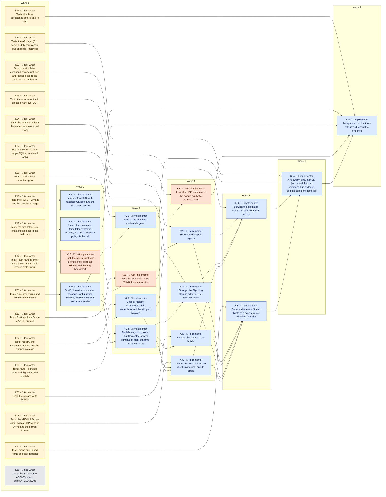

# T0.13: Plan

**Plan:** 🟢 Approved

**Push:** 🟢 Approved

<!-- ticket:specs -->
## 📚 Specifications

The technical pages, features, use cases and business rules of [TICKET.md](TICKET.md), copied by `python3 .claude/scripts/tickets/ticket_refs.py sync`.

- [📏 BR-014](../../specs/functional/business-rules/BR-014-simulation-isolation.md)
- [🗂️ Architecture: mono-repo](../../specs/technical/01-architecture.md#mono-repo)
- [🕹️ Engine and services: simulator](../../specs/technical/04-engine.md#simulator)
- [📘 FS-010: Simulator and training](../../specs/functional/features/FS-010-simulator-and-training.md)
- [🎬 UC-002](../../specs/functional/use-cases/UC-002-simulate-a-mission.md)
- [🎬 UC-013](../../specs/functional/use-cases/UC-013-train-on-the-simulator.md)
<!-- /ticket:specs -->

## 📑 Summary

T0.13 delivers the Simulator base. It has five parts:

1. **The service.** `services/simulator` is a new AGENT.md service with the layers api, service, storage, clients and models.
2. **Synthetic Drones.** A new Rust crate, `packages/rust/swarm-synthetic-drones`, holds a library (route follower, MAVLink state machine) and a binary that flies up to 255 synthetic Drones over UDP MAVLink 2.
3. **Isolation (BR-014), three ways:**
   - An adapter registry holds only simulated Drones (simulated kinds, allowed hosts). A Command for any other Drone is refused, logged at WARNING and written to the Flight log.
   - `swarm-simulator serve` refuses to start unless its NATS credentials carry the `simulated` tag issued by T0.09.
   - Every Flight log entry is marked simulated, in the model and by a SQLite CHECK constraint in the edge store.
4. **Fidelity.** A PX4 SITL image with headless Gazebo in `deploy/images/px4-sitl`. Beside it, the simulator's own multi-stage image, and a `deploy/charts/simulator` sub-chart of the cell, disabled by default, so the dev cell can run 10 synthetic Drones and one PX4 SITL Drone.
5. **Acceptance.** Tests in `tests/simulator` cover the three criteria through the real CLI, the real Rust binary, a real nats-server in operator mode and, when Docker and the image are present, the PX4 container. A last task records the evidence.

**Tasks:** 35 tasks in 7 waves.

| Wave | Tasks |
| --- | --- |
| 1 | 17 test-writers and 1 doc-writer |
| 2 | Service skeleton and configuration, Rust crate and route follower, images, chart |
| 3 | Registry and command models, route and Flight log models, credentials guard, Rust protocol |
| 4 | Adapter registry, square route builder, Flight log store, MAVLink client, Rust UDP binary |
| 5 | Command service, drone and Squad flights |
| 6 | API layer |
| 7 | Acceptance evidence |

No two tasks of a wave share a file.

## ⚠️ Assumptions

1. The roadmap row names only BR-014; FS-010 is linked as the feature BR-014 serves and the phase page scopes to the Simulator base.
2. UC-002 is cited in the criteria because it applies BR-014; the ticket builds no screen of it. I did not open UC-002 or check_ticket.py output, so the link is unverified.
3. The row names no budget row, so the ticket touches no budget; no screen is touched.
4. 'A square route' and 'refused and logged' are taken as written; no size or timing is asserted.
5. Simulated NATS credentials are issued by T0.09; this ticket uses them.
6. The architecture mono-repo anchor was taken from the phase page and not opened; check_ticket.py was not run by me.
7. Synthetic Drones are a new Cargo workspace crate, packages/rust/swarm-synthetic-drones, outside swarm-core: a library plus a binary. They are a simulator tool, not part of the flight hot path. They use the crates.io mavlink crate (common dialect). The swarm-core-mavlink placeholder of T0.07 stays untouched for the flight engine of T0.18.
8. The Python side of the Simulator speaks MAVLink through pymavlink, in its clients layer. pymavlink ships no types, so mypy ignores its missing imports for pymavlink.* only.
9. The specifications do not settle the MAVLink subset shared by the client, the synthetic Drones and PX4 SITL. The plan takes the standard one:
   - the mission upload protocol;
   - the items NAV_TAKEOFF, NAV_WAYPOINT and NAV_LAND;
   - COMMAND_LONG arm, MISSION_START, DO_PAUSE_CONTINUE, NAV_RETURN_TO_LAUNCH and NAV_LAND;
   - MISSION_ITEM_REACHED.

   A route is complete when the item of its last waypoint is reached.
10. A 'square route' is four corners and back to the start, at side_m 50 m and altitude_m 20 m by default. The other defaults are configurable and not in the specifications:
    - timeouts: heartbeat 30 s, arm 120 s, route 600 s;
    - synthetic Drones: ports from 14600, 10 m/s, 50 ms tick;
    - the PX4 MAVLink port 18570.
11. The adapter registry is the catalog conf/catalogs/simulated_squad.yaml: only simulated kinds (synthetic, px4_sitl), on hosts from an allow-list (synthetic-drones, px4-sitl, 127.0.0.1, localhost). Every MAVLink client is built from a registered entry only. A Command to any other Drone has three effects: a REFUSED reply, a WARNING log naming the Drone, and a simulated COMMAND_REFUSED Flight log entry. Together they meet 'refused and logged'.
12. The command mapping maps Hold to MAV_CMD_DO_PAUSE_CONTINUE and Return home to MAV_CMD_NAV_RETURN_TO_LAUNCH. The glossary does not define Abort and Manual control, so the Simulator base refuses them as unsupported until the flight engine defines them.
13. Commands reach the Simulator on op.<operator_id>.mission.<mission_id>.command, the Mission subject pattern of 02-data-models.md#events, through the T0.09 NatsResponder. The responder subject must stay inside op.<operator_id>.
14. 'Separate NATS credentials' are enforced at start-up: swarm-simulator serve refuses to start (exit 3) unless its creds file carries the 'simulated' tag that the T0.09 CredentialIssuer writes. Issuing the credentials stays in T0.09, and the chart only mounts a Secret created outside the repository.
15. The Flight log of the Simulator is stored in SQLite, as the edge store of 03-storage.md#edge-store. A CHECK (simulated = 1) constraint backs the model's refusal of simulated False. The FlightLogEntry model stays local to services/simulator until the flight engine owns the shared FlightLogEntry of 02-data-models.md#models. Changing packages/python/swarm-models, which has uncommitted changes and lies outside the ticket's area, is avoided.
16. Python 3.12 has no UUIDv7 generator and none is in the repository. The fly command therefore takes --mission-id, and the catalog holds fixed UUIDv7 ids for the simulated Drones.
17. One swarm-synthetic-drones process flies at most 255 Drones, because a MAVLink system id is one byte. 'Thousands per node' means several processes per node.
18. Criterion 1 'in the dev cell' needs a deployment. The plan adds deploy/charts/simulator as a sub-chart of the cell, disabled by default, because it needs an Operator id and a credentials Secret that the repository does not hold. deploy/environments/dev/values.yaml is not changed. The roadmap area of T0.13 is 'services/simulator, packages/rust', so deploy/charts, deploy/images and the root pyproject.toml are touched outside it: other open tickets (T0.10, T0.12, T0.17, T0.18) may touch the same files.
19. Criterion 1 is proven by tests/simulator and the evidence task. The synthetic Drones always run. The PX4 SITL Drone runs only when docker and the locally built image swarm-px4-sitl:local are present, and it is skipped with its reason otherwise. The run inside the dev cell is left to the person after the merge.
20. The PX4 release tag, the PX4 development base image and the exact start command of headless Gazebo are pinned by the implementer of K21 and recorded as decisions. The specification names only 'PX4 SITL in containers (headless Gazebo)'.
21. The naming and registry of service images belong to T0.10. The chart therefore requires the image tags and sets no default registry path beyond a repository value.
22. conf/app.yaml writes every default. operator_id, nats.credentials_path and responder.subject have no default, so the deployment gives them (the chart's ConfigMap).
23. Test files of services/simulator get basenames unique in the repository, and the shared test helpers are imported as services.simulator.tests.* namespace packages. The pytest configuration imports test files by basename, and services/gateway already has test_main.py.
24. The api layer of the simulator uses the swarm_nats package connector and responder as its NATS entry point. They are a shared package, not the service's own clients layer, so the rule that api never imports clients still holds.

<!-- plan:graph -->

> [!NOTE]
> Generated from the json block at the end of this page by `python3 .claude/scripts/tickets/plan.py render`.
> To change a task, edit the json block, then render again: never edit this view by hand.

## Waves

| Wave | Tasks | Agents running at once |
| --- | --- | --- |
| 1 | [K01](#k01), [K02](#k02), [K03](#k03), [K04](#k04), [K05](#k05), [K06](#k06), [K07](#k07), [K08](#k08), [K09](#k09), [K10](#k10), [K11](#k11), [K12](#k12), [K13](#k13), [K14](#k14), [K15](#k15), [K16](#k16), [K17](#k17), [K18](#k18) | 8 of 18 |
| 2 | [K19](#k19), [K20](#k20), [K21](#k21), [K22](#k22) | 4 of 4 |
| 3 | [K23](#k23), [K24](#k24), [K25](#k25), [K26](#k26) | 4 of 4 |
| 4 | [K27](#k27), [K28](#k28), [K29](#k29), [K30](#k30), [K31](#k31) | 5 of 5 |
| 5 | [K32](#k32), [K33](#k33) | 2 of 2 |
| 6 | [K34](#k34) | 1 of 1 |
| 7 | [K35](#k35) | 1 of 1 |

| Wave | Task | Agent | Depends on | Unblocks |
| --- | --- | --- | --- | --- |
| 1 | [K01](#k01) Tests: simulator enums and configuration models | 🧪 test-writer | none | [K19](#k19) |
| 1 | [K02](#k02) Tests: registry and command models, and the shipped catalogs | 🧪 test-writer | none | [K23](#k23) |
| 1 | [K03](#k03) Tests: route, Flight log entry and flight outcome models | 🧪 test-writer | none | [K24](#k24) |
| 1 | [K04](#k04) Tests: the adapter registry that cannot address a real Drone | 🧪 test-writer | none | [K27](#k27) |
| 1 | [K05](#k05) Tests: the simulated credentials guard | 🧪 test-writer | none | [K25](#k25) |
| 1 | [K06](#k06) Tests: the square route builder | 🧪 test-writer | none | [K28](#k28) |
| 1 | [K07](#k07) Tests: the Flight log store (edge SQLite, simulated only) | 🧪 test-writer | none | [K29](#k29) |
| 1 | [K08](#k08) Tests: the MAVLink Drone client, with a UDP stand-in Drone and the shared fixtures | 🧪 test-writer | none | [K30](#k30) |
| 1 | [K09](#k09) Tests: the simulated command service (refused and logged outside the registry) and its factory | 🧪 test-writer | none | [K32](#k32) |
| 1 | [K10](#k10) Tests: drone and Squad flights and their factories | 🧪 test-writer | none | [K33](#k33) |
| 1 | [K11](#k11) Tests: the API layer (CLI, serve and fly commands, bus endpoint, factories) | 🧪 test-writer | none | [K34](#k34) |
| 1 | [K12](#k12) Tests: Rust route follower and the swarm-synthetic-drones crate layout | 🧪 test-writer | none | [K20](#k20) |
| 1 | [K13](#k13) Tests: Rust synthetic Drone MAVLink protocol | 🧪 test-writer | none | [K26](#k26) |
| 1 | [K14](#k14) Tests: the swarm-synthetic-drones binary over UDP | 🧪 test-writer | none | [K31](#k31) |
| 1 | [K15](#k15) Tests: the three acceptance criteria end to end | 🧪 test-writer | none | [K35](#k35) |
| 1 | [K16](#k16) Tests: the PX4 SITL image and the simulator image | 🧪 test-writer | none | [K21](#k21) |
| 1 | [K17](#k17) Tests: the simulator Helm chart and its place in the cell chart | 🧪 test-writer | none | [K22](#k22) |
| 1 | [K18](#k18) Docs: the Simulator in AGENT.md and deploy/README.md | 📝 doc-writer | none | none |
| 2 | [K19](#k19) Scaffold services/simulator: package, configuration models, enums, conf and workspace entries | 🐍 implementer | [K01](#k01) | [K23](#k23), [K24](#k24), [K25](#k25) |
| 2 | [K20](#k20) Rust: the swarm-synthetic-drones crate, its route follower and the step benchmark | 🦀 rust-implementer | [K12](#k12) | [K26](#k26) |
| 2 | [K21](#k21) Images: PX4 SITL with headless Gazebo, and the simulator service | 🐍 implementer | [K16](#k16) | [K35](#k35) |
| 2 | [K22](#k22) Helm chart: simulator (simulator, synthetic Drones, PX4 SITL, network policy) in the cell | 🐍 implementer | [K17](#k17) | [K35](#k35) |
| 3 | [K23](#k23) Models: registry, commands, their exceptions and the shipped catalogs | 🐍 implementer | [K02](#k02), [K19](#k19) | [K27](#k27), [K30](#k30) |
| 3 | [K24](#k24) Models: waypoint, route, Flight log entry (always simulated), flight outcome and their errors | 🐍 implementer | [K03](#k03), [K19](#k19) | [K28](#k28), [K29](#k29), [K30](#k30) |
| 3 | [K25](#k25) Service: the simulated credentials guard | 🐍 implementer | [K05](#k05), [K19](#k19) | [K34](#k34) |
| 3 | [K26](#k26) Rust: the synthetic Drone MAVLink state machine | 🦀 rust-implementer | [K13](#k13), [K20](#k20) | [K31](#k31) |
| 4 | [K27](#k27) Service: the adapter registry | 🐍 implementer | [K04](#k04), [K23](#k23) | [K32](#k32), [K33](#k33) |
| 4 | [K28](#k28) Service: the square route builder | 🐍 implementer | [K06](#k06), [K24](#k24) | [K33](#k33) |
| 4 | [K29](#k29) Storage: the Flight log store in edge SQLite, simulated only | 🐍 implementer | [K07](#k07), [K24](#k24) | [K32](#k32), [K33](#k33) |
| 4 | [K30](#k30) Clients: the MAVLink Drone client (pymavlink) and its errors | 🐍 implementer | [K08](#k08), [K23](#k23), [K24](#k24) | [K32](#k32), [K33](#k33) |
| 4 | [K31](#k31) Rust: the UDP runtime and the swarm-synthetic-drones binary | 🦀 rust-implementer | [K14](#k14), [K26](#k26) | [K35](#k35) |
| 5 | [K32](#k32) Service: the simulated command service and its factory | 🐍 implementer | [K09](#k09), [K27](#k27), [K29](#k29), [K30](#k30) | [K34](#k34) |
| 5 | [K33](#k33) Service: drone and Squad flights on a square route, with their factories | 🐍 implementer | [K10](#k10), [K27](#k27), [K28](#k28), [K29](#k29), [K30](#k30) | [K34](#k34) |
| 6 | [K34](#k34) API: swarm-simulator CLI (serve and fly), the command bus endpoint and the command factories | 🐍 implementer | [K11](#k11), [K25](#k25), [K32](#k32), [K33](#k33) | [K35](#k35) |
| 7 | [K35](#k35) Acceptance: run the three criteria and record the evidence | 🐍 implementer | [K15](#k15), [K21](#k21), [K22](#k22), [K31](#k31), [K34](#k34) | none |

## Dependency graph



## Tasks

### <a id="k01"></a>K01: Tests: simulator enums and configuration models

| Agent | Wave | Depends on | Unblocks |
| --- | --- | --- | --- |
| 🧪 test-writer | 1 | none | [K19](#k19) |

**Files** (only this task may change them in its wave):

- `services/simulator/tests/models/test_simulator_enums.py`
- `services/simulator/tests/models/config/test_simulator_config.py`
- `services/simulator/tests/models/config/test_registry_config.py`
- `services/simulator/tests/models/config/test_route_config.py`
- `services/simulator/tests/models/config/test_flight_config.py`

**Done when:** `uv run ruff format --check` passes on the five files. `uv run ruff check --config "lint.isort.known-first-party = ['tests', 'gateway', 'simulator', 'swarm_catalog', 'swarm_lifecycle', 'swarm_logging', 'swarm_models', 'swarm_nats']"` also passes on them. `uv run pytest` on them fails only because the module `simulator` does not exist yet.

**Brief:**

Write the tests, first, for the enums and configuration models of the new service services/simulator (module `simulator`, source in services/simulator/src/simulator/). Ticket: docs/tickets/T0.13/TICKET.md.
Specs applied:
- docs/specs/technical/04-engine.md#simulator: the Simulator flies PX4 SITL and synthetic Drones, with separate NATS credentials.
- docs/specs/technical/01-architecture.md#layers: models/ holds Pydantic models, enums and exceptions.
- docs/specs/functional/business-rules/BR-014-simulation-isolation.md: simulated credentials are required.

Contract the implementer will follow, exactly:
1) simulator.models.enums holds @unique StrEnums with lower snake case values:
- SimulatedDroneKind: SYNTHETIC='synthetic', PX4_SITL='px4_sitl';
- FlightLogEntryKind: ROUTE_UPLOADED, ARMED, ROUTE_STARTED, WAYPOINT_REACHED, ROUTE_COMPLETED, ROUTE_FAILED, COMMAND_ACCEPTED, COMMAND_REFUSED;
- CommandVerdict: ACCEPTED, REFUSED;
- SimulatorCommandName: SERVE='serve', FLY='fly'.
Test the members and that no value holds a hyphen.
2) simulator.models.config.route_config.RouteConfig:
- side_m float > 0, default 50.0;
- altitude_m float > 0, default 20.0.
Exceptions SERouteConfigInvalidSide and SERouteConfigInvalidAltitude.
3) simulator.models.config.flight_config.FlightConfig, every field a number > 0 with bool refused:
- heartbeat_timeout_s, default 30.0;
- arm_timeout_s, default 120.0;
- route_timeout_s, default 600.0;
- status_interval_s, default 5.0.
Exceptions SEFlightConfigInvalidHeartbeatTimeout, SEFlightConfigInvalidArmTimeout, SEFlightConfigInvalidRouteTimeout and SEFlightConfigInvalidStatusInterval.
4) simulator.models.config.registry_config.RegistryConfig:
- squad_catalog_path str, default 'conf/catalogs/simulated_squad.yaml';
- command_mapping_path str, default 'conf/catalogs/command_mapping.yaml';
- simulated_hosts List[str], default ['synthetic-drones', 'px4-sitl', '127.0.0.1', 'localhost'].
Strings are stripped and an empty one is refused. The host list must not be empty and must not hold a duplicate.
Exceptions SERegistryConfigInvalidSquadCatalogPath, SERegistryConfigInvalidCommandMappingPath and SERegistryConfigInvalidSimulatedHosts.
5) simulator.models.config.simulator_config.SimulatorConfig, a subclass of swarm_catalog.models.yaml_catalog.YamlCatalog (load(path); UNREADABLE = SESimulatorConfigUnreadable):
- operator_id: a version 7 UUID, required (SESimulatorConfigInvalidOperatorId);
- nats: swarm_nats.models.config.nats_client_config.NatsClientConfig, required;
- responder: swarm_nats.models.config.nats_responder_config.NatsResponderConfig, required;
- registry: RegistryConfig, defaulted;
- route: RouteConfig, defaulted;
- flight: FlightConfig, defaulted;
- flight_log_path: str, default 'data/flight_log.sqlite3' (SESimulatorConfigInvalidFlightLogPath).
Model rules:
- responder.subject must start with 'op.&lt;operator_id>.', or SESimulatorConfigSubjectOutsideOperator is raised;
- nats.credentials_path None raises SESimulatorConfigNoCredentials, because a simulated Squad always uses its own credentials.
All exceptions are imported from simulator.models.config.exceptions.
6) services/simulator/conf/app.yaml writes every default. The deployment gives operator_id, nats.credentials_path and responder.subject (the subject reads op.&lt;operator_id>.mission.*.command). Test that the file, with those three values added in a tmp copy, loads, and that every other field equals its model default.
Read NatsClientConfig and NatsResponderConfig in packages/python/swarm-nats to build valid nested values.

Test rules: AGENT.md Tests:
- one Test&lt;Subject> class per file, test names written as sentences;
- no __init__.py, and no unittest.mock;
- pytest.raises with the specific exception, and comparisons with enums and constants;
- the six model tests for every model.
Give each test file a basename unique in the whole repository (search first), because pytest imports test files by basename.

### <a id="k02"></a>K02: Tests: registry and command models, and the shipped catalogs

| Agent | Wave | Depends on | Unblocks |
| --- | --- | --- | --- |
| 🧪 test-writer | 1 | none | [K23](#k23) |

**Files** (only this task may change them in its wave):

- `services/simulator/tests/models/registry/test_registered_drone.py`
- `services/simulator/tests/models/registry/test_simulated_squad_catalog.py`
- `services/simulator/tests/models/commands/test_mavlink_command_spec.py`
- `services/simulator/tests/models/commands/test_command_mapping_catalog.py`
- `services/simulator/tests/models/commands/test_command_reply.py`

**Done when:** `uv run ruff format --check` passes on the five files. `uv run ruff check --config "lint.isort.known-first-party = ['tests', 'gateway', 'simulator', 'swarm_catalog', 'swarm_lifecycle', 'swarm_logging', 'swarm_models', 'swarm_nats']"` also passes on them. `uv run pytest` on them fails only because the module `simulator` does not exist yet.

**Brief:**

Write the tests, first, for the models of the adapter registry and of the simulated commands of services/simulator (module `simulator`). Ticket: docs/tickets/T0.13/TICKET.md.
Specs applied:
- docs/specs/technical/04-engine.md#simulator: an adapter registry that cannot address a real Drone.
- docs/specs/functional/business-rules/BR-014-simulation-isolation.md: a simulated Squad MUST NOT send any command to a real Drone.
- docs/specs/technical/02-data-models.md#conventions: UUIDv7 identifiers, units in names, frozen models.

Contract the implementer will follow, exactly:
1) simulator.models.registry.registered_drone.RegisteredDrone, frozen, extra forbidden:
- drone_id: version 7 UUID;
- kind: simulator.models.enums.SimulatedDroneKind, which has only simulated kinds;
- host: str, stripped, not empty;
- port: int in [1, 65535];
- system_id: int in [1, 255].
bool is refused where an int is expected. Exceptions SERegisteredDroneInvalidDroneId, SERegisteredDroneInvalidKind, SERegisteredDroneInvalidHost, SERegisteredDroneInvalidPort and SERegisteredDroneInvalidSystemId, from simulator.models.registry.exceptions.
2) simulator.models.registry.simulated_squad_catalog.SimulatedSquadCatalog, a YamlCatalog (UNREADABLE = SESimulatedSquadCatalogUnreadable):
- drones: List[RegisteredDrone], not empty (SESimulatedSquadCatalogInvalidDrones);
- a duplicate drone_id raises SESimulatedSquadCatalogDuplicateDrone;
- a duplicate (host, port) raises SESimulatedSquadCatalogDuplicateEndpoint.
3) simulator.models.commands.mavlink_command_spec.MavlinkCommandSpec, frozen:
- command_id: int in [0, 65535];
- param1: float, default 0.0, finite.
Exceptions SEMavlinkCommandSpecInvalidCommandId and SEMavlinkCommandSpecInvalidParam1.
4) simulator.models.commands.command_mapping_catalog.CommandMappingCatalog, a YamlCatalog (UNREADABLE = SECommandMappingCatalogUnreadable):
- commands: Dict[CommandKind, MavlinkCommandSpec], where CommandKind is swarm_models.models.commands.enums.CommandKind;
- an unknown key raises SECommandMappingCatalogInvalidCommands.
5) simulator.models.commands.command_reply.CommandReply, frozen:
- command_id: version 7 UUID;
- verdict: CommandVerdict;
- reason: Optional[str], stripped, not empty when given.
A REFUSED verdict without a reason raises SECommandReplyRefusedWithoutReason. Exceptions come from simulator.models.commands.exceptions.
6) The shipped catalogs, read from services/simulator/conf/catalogs/:
- simulated_squad.yaml loads with 11 Drones. Ten are synthetic, on host 'synthetic-drones', ports 14600 to 14609 and system ids 1 to 10. One is px4_sitl, on host 'px4-sitl', port 18570, system id 1.
- command_mapping.yaml maps hold to command_id 193 (MAV_CMD_DO_PAUSE_CONTINUE) with param1 0.0, and return_home to 20 (MAV_CMD_NAV_RETURN_TO_LAUNCH). It has no abort and no manual_control.

Test rules: AGENT.md Tests:
- one Test&lt;Subject> class per file, test names written as sentences;
- no __init__.py, and no unittest.mock;
- the specific exception, and the six model tests per model;
- YAML written to tmp_path for the catalog tests.
Give each test file a basename unique in the whole repository (search first).

### <a id="k03"></a>K03: Tests: route, Flight log entry and flight outcome models

| Agent | Wave | Depends on | Unblocks |
| --- | --- | --- | --- |
| 🧪 test-writer | 1 | none | [K24](#k24) |

**Files** (only this task may change them in its wave):

- `services/simulator/tests/models/routes/test_waypoint.py`
- `services/simulator/tests/models/routes/test_route.py`
- `services/simulator/tests/models/flight_logs/test_flight_log_entry.py`
- `services/simulator/tests/models/flights/test_flight_outcome.py`

**Done when:** `uv run ruff format --check` passes on the four files. `uv run ruff check --config "lint.isort.known-first-party = ['tests', 'gateway', 'simulator', 'swarm_catalog', 'swarm_lifecycle', 'swarm_logging', 'swarm_models', 'swarm_nats']"` also passes on them. `uv run pytest` on them fails only because the module `simulator` does not exist yet.

**Brief:**

Write the tests, first, for the route, Flight log and flight outcome models of services/simulator (module `simulator`). Ticket: docs/tickets/T0.13/TICKET.md.
Specs applied:
- docs/specs/functional/business-rules/BR-014-simulation-isolation.md: the Flight log of a simulated Squad MUST be marked as simulated.
- docs/specs/functional/use-cases/UC-002-simulate-a-mission.md: the Flight log records the simulated flight, marked Simulated.
- docs/specs/technical/04-engine.md#simulator: synthetic Drones follow routes, and every Flight log is marked simulated.
- docs/specs/technical/02-data-models.md#conventions: UUIDv7, t_us in integer microseconds, units in names, frozen.

Contract the implementer will follow, exactly:
1) simulator.models.routes.waypoint.Waypoint, frozen:
- lat_e7: int in [-900000000, 900000000];
- lon_e7: int in [-1800000000, 1800000000];
- altitude_m: finite float > 0.
bool is refused. Exceptions SEWaypointInvalidLat, SEWaypointInvalidLon and SEWaypointInvalidAltitude.
2) simulator.models.routes.route.Route, frozen: waypoints: List[Waypoint], with at least WAYPOINTS_MIN = 2 (SERouteInvalidWaypoints). Exceptions come from simulator.models.routes.exceptions.
3) simulator.models.flight_logs.flight_log_entry.FlightLogEntry, frozen:
- mission_id: version 7 UUID;
- drone_id: Optional version 7 UUID, None for the whole Squad;
- t_us: int >= 0;
- kind: FlightLogEntryKind;
- seq: Optional int >= 0;
- detail: Optional str, stripped, not empty;
- simulated: bool, default True.
**simulated False raises SEFlightLogEntryNotSimulated (BR-014).** Test the default, the refusal, and that a round trip keeps simulated True. Other exceptions: SEFlightLogEntryInvalidMissionId, SEFlightLogEntryInvalidDroneId, SEFlightLogEntryInvalidTUs, SEFlightLogEntryInvalidKind, SEFlightLogEntryInvalidSeq and SEFlightLogEntryInvalidDetail, from simulator.models.flight_logs.exceptions.
4) simulator.models.flights.flight_outcome.FlightOutcome, frozen:
- drone_id: version 7 UUID;
- kind: SimulatedDroneKind;
- completed: bool, strict, so 1 and 'yes' are refused;
- waypoints_reached: int >= 0;
- elapsed_s: float >= 0.
Exceptions SEFlightOutcomeInvalidDroneId, SEFlightOutcomeInvalidKind, SEFlightOutcomeInvalidCompleted, SEFlightOutcomeInvalidWaypointsReached and SEFlightOutcomeInvalidElapsed, from simulator.models.flights.exceptions.
Enums come from simulator.models.enums: SimulatedDroneKind (SYNTHETIC, PX4_SITL) and FlightLogEntryKind (ROUTE_UPLOADED, ARMED, ROUTE_STARTED, WAYPOINT_REACHED, ROUTE_COMPLETED, ROUTE_FAILED, COMMAND_ACCEPTED, COMMAND_REFUSED).

Test rules: AGENT.md Tests:
- one Test&lt;Subject> class per file, test names written as sentences;
- no __init__.py, and no unittest.mock;
- the specific exception, and the six model tests per model.
Give each test file a basename unique in the whole repository (search first).

### <a id="k04"></a>K04: Tests: the adapter registry that cannot address a real Drone

| Agent | Wave | Depends on | Unblocks |
| --- | --- | --- | --- |
| 🧪 test-writer | 1 | none | [K27](#k27) |

**Files** (only this task may change them in its wave):

- `services/simulator/tests/service/registry/test_adapter_registry.py`

**Done when:** `uv run ruff format --check` passes on the file. `uv run ruff check --config "lint.isort.known-first-party = ['tests', 'gateway', 'simulator', 'swarm_catalog', 'swarm_lifecycle', 'swarm_logging', 'swarm_models', 'swarm_nats']"` also passes on it. `uv run pytest` on it fails only because the module `simulator` does not exist yet.

**Brief:**

Write the tests, first, for simulator.service.registry.adapter_registry.AdapterRegistry. Ticket: docs/tickets/T0.13/TICKET.md.
Specs applied:
- docs/specs/technical/04-engine.md#simulator: an adapter registry that cannot address a real Drone.
- docs/specs/functional/business-rules/BR-014-simulation-isolation.md: Example 2, a simulated Mission that addresses a real Drone, is refused and logged.
- docs/specs/technical/01-architecture.md#layers: business rules live in service/.

Contract the implementer will follow:
- AdapterRegistry(simulated_hosts: List[str], logger: Optional[Logger] = None).
- register(drone: RegisteredDrone) -> None:
  - a host outside simulated_hosts logs at ERROR and raises SEAdapterRegistryHostRefusedError;
  - a drone_id already registered logs at ERROR and raises SEAdapterRegistryDuplicateDroneError.
- load(catalog: SimulatedSquadCatalog) -> None registers every Drone of the catalog.
- resolve(drone_id: UUID) -> RegisteredDrone. An unknown id logs at ERROR, with the Drone id in the message, and raises SEAdapterRegistryUnknownDroneError.
- contains(drone_id: UUID) -> bool.
- drones() -> List[RegisteredDrone], in registration order.
The exceptions come from simulator.models.registry.exceptions. RegisteredDrone (drone_id UUIDv7, kind SimulatedDroneKind, host, port, system_id) and SimulatedSquadCatalog are in simulator.models.registry.

Tests:
- registering and resolving works;
- a host not in the list is refused and nothing is registered;
- a duplicate is refused;
- an unknown Drone id is refused, and caplog holds an ERROR record that names it;
- load registers a whole catalog;
- drones() keeps the order.
Use real models, with UUIDv7 literals. Test rules: AGENT.md Tests (one TestAdapterRegistry class, test names written as sentences, no mocks). The basename must be unique in the repository.

### <a id="k05"></a>K05: Tests: the simulated credentials guard

| Agent | Wave | Depends on | Unblocks |
| --- | --- | --- | --- |
| 🧪 test-writer | 1 | none | [K25](#k25) |

**Files** (only this task may change them in its wave):

- `services/simulator/tests/service/credentials/test_simulated_credentials_guard.py`

**Done when:** `uv run ruff format --check` passes on the file. `uv run ruff check --config "lint.isort.known-first-party = ['tests', 'gateway', 'simulator', 'swarm_catalog', 'swarm_lifecycle', 'swarm_logging', 'swarm_models', 'swarm_nats']"` also passes on it. `uv run pytest` on it fails only because the module `simulator` does not exist yet.

**Brief:**

Write the tests, first, for simulator.service.credentials.simulated_credentials_guard.SimulatedCredentialsGuard. Ticket: docs/tickets/T0.13/TICKET.md.
Specs applied:
- docs/specs/technical/04-engine.md#simulator: simulated Squads use separate NATS credentials.
- docs/specs/functional/business-rules/BR-014-simulation-isolation.md: a simulated Squad never acts as a real one.
The simulated credentials are issued by the T0.09 package swarm_nats: CredentialIssuer tags a user JWT with its kind in nats.tags.

Contract the implementer will follow:
- SimulatedCredentialsGuard(logger: Optional[Logger] = None).
- check(path: str) -> None reads the NATS creds file in UTF-8 and takes the JWT between the '-----BEGIN NATS USER JWT-----' and '------END NATS USER JWT------' lines. It decodes the JWT payload (base64url, padding added) and requires nats.tags to hold CredentialKind.SIMULATED.value.
- A credential of another kind raises SESimulatedCredentialsNotSimulatedError.
- A missing file, a file without a JWT block or an undecodable payload raises SESimulatedCredentialsUnreadableError.
- Each failure logs at ERROR first. The JWT and the seed are never logged.
The exceptions come from simulator.models.credentials.exceptions.

Tests:
- Issue real credentials with the swarm_nats issuers (NkeyFactory, NatsJwtSigner, OperatorIssuer, AccountIssuer, CredentialIssuer), as tests/deploy/nats/helpers.py does. Read that file, and do not change it.
- Write each creds file with CredentialIssuer.creds_file to tmp_path.
- A simulated credential passes. A service credential and an edge credential are refused.
- A missing file and a garbage file are unreadable.
- caplog never holds the seed or the JWT text.

Test rules: AGENT.md Tests (one class, test names written as sentences, no mocks, real issuers). The basename must be unique in the repository.

### <a id="k06"></a>K06: Tests: the square route builder

| Agent | Wave | Depends on | Unblocks |
| --- | --- | --- | --- |
| 🧪 test-writer | 1 | none | [K28](#k28) |

**Files** (only this task may change them in its wave):

- `services/simulator/tests/service/routes/test_square_route_builder.py`

**Done when:** `uv run ruff format --check` passes on the file. `uv run ruff check --config "lint.isort.known-first-party = ['tests', 'gateway', 'simulator', 'swarm_catalog', 'swarm_lifecycle', 'swarm_logging', 'swarm_models', 'swarm_nats']"` also passes on it. `uv run pytest` on it fails only because the module `simulator` does not exist yet.

**Brief:**

Write the tests, first, for simulator.service.routes.square_route_builder.SquareRouteBuilder. Ticket: docs/tickets/T0.13/TICKET.md.
Specs applied:
- docs/specs/technical/04-engine.md#simulator: Drones follow routes.
- TICKET.md criterion 1: the Drones fly a square route.
- docs/specs/technical/02-data-models.md#conventions: lat_e7 and lon_e7 integers, altitude_m.

Contract the implementer will follow:
- SquareRouteBuilder(config: RouteConfig, logger: Optional[Logger] = None), where RouteConfig has side_m and altitude_m and lives in simulator.models.config.route_config.
- build(lat_e7: int, lon_e7: int) -> Route returns five Waypoints, all at config.altitude_m:
  - corner A at the start;
  - B, side_m north of A;
  - C, side_m north and side_m east of A;
  - D, side_m east of A;
  - A again.
- It uses a local flat-earth offset with EARTH_RADIUS_M = 6371000.0.
Route and Waypoint live in simulator.models.routes.

Tests:
- five waypoints, and the last equals the first;
- B has a greater latitude and the same longitude as A, and D has the same latitude and a greater longitude;
- each side, measured with a haversine formula in the test, is side_m within 0.5 %, and the diagonal is side_m * sqrt(2) within 0.5 %;
- every altitude is altitude_m;
- a custom side and altitude are used;
- it works near the date line and in the southern hemisphere.
Test rules: AGENT.md Tests (one class, test names written as sentences, parametrize). The basename must be unique in the repository.

### <a id="k07"></a>K07: Tests: the Flight log store (edge SQLite, simulated only)

| Agent | Wave | Depends on | Unblocks |
| --- | --- | --- | --- |
| 🧪 test-writer | 1 | none | [K29](#k29) |

**Files** (only this task may change them in its wave):

- `services/simulator/tests/storage/edge/test_flight_log_store.py`

**Done when:** `uv run ruff format --check` passes on the file. `uv run ruff check --config "lint.isort.known-first-party = ['tests', 'gateway', 'simulator', 'swarm_catalog', 'swarm_lifecycle', 'swarm_logging', 'swarm_models', 'swarm_nats']"` also passes on it. `uv run pytest` on it fails only because the module `simulator` does not exist yet.

**Brief:**

Write the tests, first, for simulator.storage.edge.flight_log_store.FlightLogStore. Ticket: docs/tickets/T0.13/TICKET.md.
Specs applied:
- docs/specs/functional/business-rules/BR-014-simulation-isolation.md: the Flight log MUST be marked as simulated.
- docs/specs/technical/03-storage.md#edge-store: the Flight log is written to SQLite at the edge.
- docs/specs/technical/01-architecture.md#layers: storage/edge/ holds the edge SQLite.

Contract the implementer will follow:
- FlightLogStore(path: str, logger: Optional[Logger] = None).
- open() -> None creates the parent folder, the SQLite file and the table flight_log_entries. Its columns are mission_id TEXT, drone_id TEXT NULL, t_us INTEGER, kind TEXT, seq INTEGER NULL, detail TEXT NULL, and simulated INTEGER NOT NULL CHECK (simulated = 1).
- append(entry: FlightLogEntry) -> None:
  - an entry whose simulated is not True logs at ERROR and raises SEFlightLogStoreNotSimulatedError, storing nothing;
  - a sqlite3 error raises SEFlightLogStoreUnwritableError.
- entries(mission_id: UUID) -> List[FlightLogEntry], ordered by t_us, then insertion.
- close() -> None is safe twice and before open.
The exceptions come from simulator.models.flight_logs.exceptions. FlightLogEntry is in simulator.models.flight_logs.flight_log_entry: mission_id, drone_id, t_us, kind, seq, detail, simulated default True.

Tests:
- open creates a missing folder;
- append then entries gives the same entries back;
- a sqlite3 query shows simulated = 1 on every row;
- **inserting a row with simulated 0 straight through sqlite3 raises sqlite3.IntegrityError (BR-014 enforced by the store itself)**;
- an entry built with FlightLogEntry.model_construct(simulated=False) is refused and not stored;
- another Mission's entries are not returned;
- a path that is a folder is unwritable;
- close is safe twice.
Test rules: AGENT.md Tests (one class, test names written as sentences, real SQLite in tmp_path). The basename must be unique in the repository.

### <a id="k08"></a>K08: Tests: the MAVLink Drone client, with a UDP stand-in Drone and the shared fixtures

| Agent | Wave | Depends on | Unblocks |
| --- | --- | --- | --- |
| 🧪 test-writer | 1 | none | [K30](#k30) |

**Files** (only this task may change them in its wave):

- `services/simulator/tests/conftest.py`
- `services/simulator/tests/helpers.py`
- `services/simulator/tests/stand_in_drone.py`
- `services/simulator/tests/stand_in_drones.py`
- `services/simulator/tests/clients/mavlink/test_mavlink_drone_client.py`

**Done when:** `uv run ruff format --check` passes on the five files. `uv run ruff check --config "lint.isort.known-first-party = ['tests', 'gateway', 'simulator', 'swarm_catalog', 'swarm_lifecycle', 'swarm_logging', 'swarm_models', 'swarm_nats']"` also passes on them. `uv run pytest services/simulator/tests/clients` fails only because the module `simulator` or `pymavlink` is not installed yet.

**Brief:**

Write the tests, first, for simulator.clients.mavlink.mavlink_drone_client.MavlinkDroneClient. Also write the stand-in Drone and the fixtures that the service tests share (K09, K10, K11). Ticket: docs/tickets/T0.13/TICKET.md.
Specs applied:
- docs/specs/technical/04-engine.md#simulator: PX4 SITL and synthetic Drones that speak MAVLink and follow routes.
- docs/specs/technical/01-architecture.md#layers: clients/ holds one class per remote system.
The client uses pymavlink, and K19 adds it to the service.

Client contract (async methods; blocking pymavlink calls run in asyncio.to_thread):
- MavlinkDroneClient(drone: RegisteredDrone, config: FlightConfig, logger: Optional[Logger] = None).
- connect():
  - opens 'udpout:&lt;host>:&lt;port>' as GCS system 255;
  - sends a HEARTBEAT of type GCS;
  - waits for a HEARTBEAT from drone.system_id within heartbeat_timeout_s, or raises SEMavlinkClientTimeoutError.
- position() -> Tuple[int, int] gives (lat_e7, lon_e7) from GLOBAL_POSITION_INT.
- upload_route(route) runs the mission protocol:
  - MISSION_COUNT, then it answers each MISSION_REQUEST_INT or MISSION_REQUEST with a MISSION_ITEM_INT in frame GLOBAL_RELATIVE_ALT_INT;
  - the items are seq 0 NAV_TAKEOFF (22) at the first waypoint, seq 1..n NAV_WAYPOINT (16) for each waypoint, and seq n+1 NAV_LAND (21) at the last waypoint;
  - a MISSION_ACK that is not ACCEPTED raises SEMavlinkClientRefusedError;
  - silence raises SEMavlinkClientTimeoutError.
- arm() sends COMMAND_LONG 400 with param1 1 every second until a COMMAND_ACK ACCEPTED, or raises SEMavlinkClientTimeoutError after arm_timeout_s.
- start_route() sends COMMAND_LONG 300. A result other than ACCEPTED raises SEMavlinkClientRefusedError.
- next_reached() -> int returns the seq of the next MISSION_ITEM_REACHED, within route_timeout_s.
- send_command(spec: MavlinkCommandSpec) -> bool sends COMMAND_LONG spec.command_id with param1. It returns True on ACCEPTED and False on any other result, and silence raises SEMavlinkClientTimeoutError.
- close() is safe twice.
The exceptions come from simulator.models.mavlink.exceptions.

Shared test files. Do not write a start or stop method anywhere: the convention tests forbid them outside lifecycle classes.
- stand_in_drone.py: class StandInDrone, a context manager (__enter__ and __exit__). It binds pymavlink 'udpin:127.0.0.1:&lt;free port>' with source_system system_id. A background thread, run by a method, answers like a Drone:
  - HEARTBEAT every 0.2 s and GLOBAL_POSITION_INT at its start, once a packet has arrived;
  - the mission protocol, recording uploaded_items as (seq, command, x, y, z);
  - an ACCEPTED COMMAND_ACK for an arm;
  - for MISSION_START, ACCEPTED when armed and a mission is uploaded, then MISSION_ITEM_REACHED for each seq every step_s (default 0.05);
  - for any other COMMAND_LONG, ACCEPTED when its id is in accepted_commands (default {20, 21, 193}), otherwise UNSUPPORTED, and the id is appended to received_commands.
  Options: system_id=1, lat_e7=473977420, lon_e7=85455940, refuse_arm=False, refuse_mission=False, stall_after_seq=None, silent=False, step_s=0.05. Attributes: host, port, received_commands, uploaded_items.
- stand_in_drones.py: class StandInDrones with make(**options) -> StandInDrone (entered) and close_all().
- conftest.py: the fixtures stand_in_drones (closes all at teardown) and stand_in_drone (one default stand-in).
- helpers.py: module constants OPERATOR_ID, MISSION_ID and DRONE_IDS (11 UUIDv7 strings), START_LAT_E7 and START_LON_E7. Functions:
  - a_registered_drone(stand_in, index=0, kind=SimulatedDroneKind.SYNTHETIC) -> RegisteredDrone;
  - a_flight_config() -> FlightConfig with short timeouts (heartbeat 2, arm 2, route 5, status 0.1 seconds);
  - a_square_route() -> Route.
Import them by full path, `services.simulator.tests.helpers`, as namespace packages under the root pythonpath.

Client tests:
- connect gets the heartbeat, and a silent stand-in times out;
- position is the stand-in's start;
- the upload sends 7 items with the right commands and coordinates;
- a refused mission raises the refused error, and refuse_arm times out;
- start, then next_reached, gives 0..6 in order, and a stall times out;
- send_command(20) is True and recorded, and an unsupported id is False;
- close is safe twice.
Test rules: AGENT.md Tests (one class per file, test names written as sentences, no unittest.mock: the stand-in is a real UDP peer). The basenames must be unique in the repository.

### <a id="k09"></a>K09: Tests: the simulated command service (refused and logged outside the registry) and its factory

| Agent | Wave | Depends on | Unblocks |
| --- | --- | --- | --- |
| 🧪 test-writer | 1 | none | [K32](#k32) |

**Files** (only this task may change them in its wave):

- `services/simulator/tests/service/commands/test_simulated_command_service.py`
- `services/simulator/tests/service/factories/commands/test_simulated_command_service_factory.py`

**Done when:** `uv run ruff format --check` passes on both files. `uv run ruff check --config "lint.isort.known-first-party = ['tests', 'gateway', 'simulator', 'swarm_catalog', 'swarm_lifecycle', 'swarm_logging', 'swarm_models', 'swarm_nats']"` also passes on them. `uv run pytest` on them fails only because the module `simulator`, `pymavlink` or the shared fixtures of K08 do not exist yet.

**Brief:**

Write the tests, first, for simulator.service.commands.simulated_command_service.SimulatedCommandService and for simulator.service.factories.commands.simulated_command_service_factory.SimulatedCommandServiceFactory. Ticket: docs/tickets/T0.13/TICKET.md, criterion 2.
Specs applied:
- docs/specs/functional/business-rules/BR-014-simulation-isolation.md: a simulated Squad MUST NOT send any command to a real Drone, and Example 2 is refused and logged.
- docs/specs/technical/04-engine.md#simulator: an adapter registry that cannot address a real Drone.
- docs/specs/functional/use-cases/UC-002-simulate-a-mission.md: no command reaches a real Drone.

Service contract:
- SimulatedCommandService(registry: AdapterRegistry, store: FlightLogStore, mapping: CommandMappingCatalog, config: FlightConfig, logger: Optional[Logger] = None).
- async open() opens the store. async close() closes the cached MavlinkDroneClients and the store.
- async handle(command) -> CommandReply, where command is swarm_models.models.commands.command.Command. HOLD, ABORT, RETURN_HOME and MANUAL_CONTROL all travel in CommandLane.SAFETY.
  - The targets are registry.resolve(command.drone_id), or every registered Drone when drone_id is None.
  - **An unknown Drone gives a REFUSED reply with a reason.** It is logged at WARNING with the Drone id and written to the Flight log as COMMAND_REFUSED (mission_id and drone_id of the command, simulated). Nothing is sent to any Drone.
  - A kind missing from the mapping (ABORT, MANUAL_CONTROL) is REFUSED as not supported by the Simulator base, logged at WARNING, written as COMMAND_REFUSED and not sent.
  - Otherwise it sends the MavlinkCommandSpec to each target through its client, created per Drone and cached. It is ACCEPTED, with one COMMAND_ACCEPTED entry per Drone, when every target accepts, and REFUSED otherwise.
Factory contract: SimulatedCommandServiceFactory(config: SimulatorConfig, logger), a swarm_lifecycle.factories.factory.Factory[SimulatedCommandService]. It loads both catalogs from config.registry, registers the Squad in an AdapterRegistry(config.registry.simulated_hosts) and builds a FlightLogStore(config.flight_log_path). A catalog host outside the list raises SEAdapterRegistryHostRefusedError.

Use the fixtures and helpers of services/simulator/tests/conftest.py and helpers.py, which K08 writes in this wave:
- stand_in_drones and stand_in_drone;
- a_registered_drone and a_flight_config;
- OPERATOR_ID, MISSION_ID and DRONE_IDS;
- a StandInDrone has received_commands.
Write the catalogs and the SimulatorConfig YAML to tmp_path.

Tests:
- **an unknown Drone is refused, caplog holds a WARNING naming it, the Flight log holds a simulated COMMAND_REFUSED, and no stand-in received anything**;
- MANUAL_CONTROL is refused and not sent;
- RETURN_HOME to a registered stand-in is accepted, 20 is received, and COMMAND_ACCEPTED is logged;
- drone_id None reaches every registered stand-in;
- a Drone that refuses gives REFUSED;
- the factory builds a service from tmp catalogs, and a refused host is refused.
Test rules: AGENT.md Tests (one class per file, test names written as sentences, no mocks, async tests without a marker). The basenames must be unique in the repository.

### <a id="k10"></a>K10: Tests: drone and Squad flights and their factories

| Agent | Wave | Depends on | Unblocks |
| --- | --- | --- | --- |
| 🧪 test-writer | 1 | none | [K33](#k33) |

**Files** (only this task may change them in its wave):

- `services/simulator/tests/service/flights/test_drone_flight.py`
- `services/simulator/tests/service/flights/test_squad_flight.py`
- `services/simulator/tests/service/factories/flights/test_drone_flight_factory.py`
- `services/simulator/tests/service/factories/flights/test_squad_flight_factory.py`

**Done when:** `uv run ruff format --check` passes on the four files. `uv run ruff check --config "lint.isort.known-first-party = ['tests', 'gateway', 'simulator', 'swarm_catalog', 'swarm_lifecycle', 'swarm_logging', 'swarm_models', 'swarm_nats']"` also passes on them. `uv run pytest` on them fails only because the module `simulator`, `pymavlink` or K08's fixtures do not exist yet.

**Brief:**

Write the tests, first, for the flights of the Simulator. Ticket: docs/tickets/T0.13/TICKET.md, criteria 1 and 3.
Specs applied:
- docs/specs/technical/04-engine.md#simulator: Drones that follow routes, and every Flight log marked simulated.
- docs/specs/functional/business-rules/BR-014-simulation-isolation.md: the Flight log is marked simulated.
- AGENT.md Lifecycle and factories: a long-running async task yields RunnableStatus.

Contract:
1) simulator.service.flights.drone_flight.DroneFlight(AsyncRunnable).
- Constructor: (drone: RegisteredDrone, mission_id: UUID, client: MavlinkDroneClient, builder: SquareRouteBuilder, store: FlightLogStore, config: FlightConfig, logger). It calls super().__init__(config.status_interval_s, logger).
- initialize: client.connect().
- run:
  - position(), then builder.build(), then upload_route, which writes the entry ROUTE_UPLOADED;
  - arm writes ARMED, and start_route writes ROUTE_STARTED;
  - each next_reached seq from 1 to n writes WAYPOINT_REACHED with that seq, where n is the number of waypoints, and seq 0 (takeoff) is skipped;
  - seq n writes ROUTE_COMPLETED and sets outcome to a FlightOutcome with completed True and waypoints_reached n.
- Any SEMavlinkClient error, in initialize or run, does three things before raising: it writes ROUTE_FAILED (detail: the error class name), sets an outcome with completed False, and logs at ERROR. It then raises SEDroneFlightTimeoutError or SEDroneFlightRefusedError (from simulator.models.flights.exceptions).
- close: client.close().
- Every entry has simulated True.
2) simulator.service.flights.squad_flight.SquadFlight(AsyncRunnable).
- Constructor: (flights: List[DroneFlight], store: FlightLogStore, status_interval_s: float, logger).
- initialize opens the store, and close closes it.
- run flies every DroneFlight concurrently, reading each execute(). It catches SEDroneFlightError per Drone and logs it at WARNING, and never raises because of one Drone.
- outcomes: List[FlightOutcome], one per flight. The property all_completed is True only when there is at least one outcome and all are completed.
3) simulator.service.factories.flights:
- DroneFlightFactory(drone, mission_id, builder, store, config: FlightConfig, logger) creates a DroneFlight with its own MavlinkDroneClient;
- SquadFlightFactory(config: SimulatorConfig, mission_id: UUID, logger) loads the Squad catalog, registers it in an AdapterRegistry and creates a SquadFlight with one DroneFlight per registered Drone, sharing one FlightLogStore(config.flight_log_path) and a SquareRouteBuilder(config.route).
Both subclass the abstract simulator.service.factories.flight_factory.FlightFactory (an AsyncRunnableFactory). Callers use create().

Use K08's fixtures and helpers (stand_in_drones, stand_in_drone, a_registered_drone, a_flight_config, MISSION_ID, DRONE_IDS; StandInDrone options stall_after_seq and silent). Use RunnableStatus from swarm_lifecycle.models.enums. Open the FlightLogStore in tmp_path for the DroneFlight tests.

Tests:
- execute yields INITIALISING or RUNNING, then EXECUTED;
- the outcome is completed with 5 waypoints;
- the Flight log entries come in the order ROUTE_UPLOADED, ARMED, ROUTE_STARTED, WAYPOINT_REACHED x5 (seq 1..5), ROUTE_COMPLETED, all simulated;
- a stall gives the timeout error, ROUTE_FAILED and an incomplete outcome;
- a silent stand-in fails in initialize the same way;
- a Squad of 3 has all_completed True, with one stalled it is False and the others are complete, and it does not raise;
- each factory builds the right products from a tmp config and a tmp catalog of stand-ins.
Test rules: AGENT.md Tests (one class per file, test names written as sentences, no mocks). The basenames must be unique in the repository.

### <a id="k11"></a>K11: Tests: the API layer (CLI, serve and fly commands, bus endpoint, factories)

| Agent | Wave | Depends on | Unblocks |
| --- | --- | --- | --- |
| 🧪 test-writer | 1 | none | [K34](#k34) |

**Files** (only this task may change them in its wave):

- `services/simulator/tests/api/conftest.py`
- `services/simulator/tests/api/cli/test_simulator_main.py`
- `services/simulator/tests/api/cli/commands/test_fly_command.py`
- `services/simulator/tests/api/cli/commands/test_serve_command.py`
- `services/simulator/tests/api/bus/test_command_endpoint.py`
- `services/simulator/tests/api/factories/serve/test_serve_command_factory.py`
- `services/simulator/tests/api/factories/fly/test_fly_command_factory.py`

**Done when:** `uv run ruff format --check` passes on the seven files. `uv run ruff check --config "lint.isort.known-first-party = ['tests', 'gateway', 'simulator', 'swarm_catalog', 'swarm_lifecycle', 'swarm_logging', 'swarm_models', 'swarm_nats']"` also passes on them. `uv run pytest services/simulator/tests/api` fails only because the module `simulator`, `pymavlink` or K08's fixtures do not exist yet.

**Brief:**

Write the tests, first, for the api layer of services/simulator. Ticket: docs/tickets/T0.13/TICKET.md, criteria 1 to 3.
Specs applied:
- docs/specs/technical/01-architecture.md#layers: api/ holds the command line and the NATS request-reply handlers, and calls one service.
- docs/specs/technical/04-engine.md#simulator: separate NATS credentials.
- docs/specs/functional/business-rules/BR-014-simulation-isolation.md.

Contract:
- The console script swarm-simulator runs simulator.api.cli.main:main. Its forms are 'swarm-simulator serve --config PATH' and 'swarm-simulator fly --config PATH --mission-id UUID'. --config defaults to conf/app.yaml.
- main configures logging, loads SimulatorConfig and dispatches on SimulatorCommandName. An unreadable or invalid config exits 2 with a message. A bad command or a missing --mission-id exits 2.
- simulator.api.cli.commands.fly_command.FlyCommand is a Runnable command with exit_code:
  - it runs SquadFlightFactory(config, mission_id).create() to the end;
  - it prints one line per Drone outcome;
  - exit_code is 0 when all_completed, and 1 otherwise.
- simulator.api.cli.commands.serve_command.ServeCommand:
  - first, SimulatedCredentialsGuard.check(config.nats.credentials_path). A refusal or an unreadable file sets exit_code 3, with an ERROR log and a printed message, and nothing connects;
  - then it connects to NATS with the swarm_nats connector;
  - it builds the service with SimulatedCommandServiceFactory and serves Command requests on config.responder.subject, through a swarm_nats NatsResponder whose handler is CommandEndpoint.handle;
  - it runs until SIGTERM or SIGINT, then exits 0.
- simulator.api.bus.command_endpoint.CommandEndpoint(service, logger): async handle(command) -> CommandReply delegates to service.handle.
- simulator.api.factories: serve.serve_command_factory.ServeCommandFactory(config) and fly.fly_command_factory.FlyCommandFactory(config, mission_id), both concrete CommandFactory classes with create().

Fixtures in services/simulator/tests/api/conftest.py:
- a NATS server in operator mode, with JetStream and one account for OPERATOR_ID, started with tests/deploy/nats/helpers.py and nats_server_process.py (read them, and do not change them);
- simulated and service creds files issued with the swarm_nats issuers;
- it skips when nats-server is not on PATH.
The responder uses idempotency replicas 1 and the subject op.&lt;OPERATOR_ID>.mission.*.command. The requests go through swarm_nats.clients.nats_requester.NatsRequester (read it for its headers and deadline).
Use K08's stand-ins and helpers (services/simulator/tests/conftest.py and helpers.py). Run the console script as a subprocess from Path(sys.executable).parent / 'swarm-simulator', with a tmp app.yaml and a tmp catalog of stand-ins.

Tests:
- fly with 2 stand-ins exits 0 and prints 2 lines, and with one stalled stand-in exits 1;
- a missing config exits 2, and a missing mission id exits 2;
- serve with service credentials gives exit_code 3 without connecting;
- serve with simulated credentials answers a Command for an unknown Drone with REFUSED;
- the endpoint delegates;
- each factory creates its command.
Test rules: AGENT.md Tests (one class per file, test names written as sentences, no mocks, a subprocess is allowed). The basenames must be unique in the repository: services/gateway/tests already has test_main.py.

### <a id="k12"></a>K12: Tests: Rust route follower and the swarm-synthetic-drones crate layout

| Agent | Wave | Depends on | Unblocks |
| --- | --- | --- | --- |
| 🧪 test-writer | 1 | none | [K20](#k20) |

**Files** (only this task may change them in its wave):

- `packages/rust/swarm-synthetic-drones/tests/route.rs`
- `tests/rust/swarm_synthetic_drones/test_synthetic_drones_layout.py`

**Done when:** `rustfmt --edition 2021 --check packages/rust/swarm-synthetic-drones/tests/route.rs` passes. `uv run ruff check tests/rust/swarm_synthetic_drones` and `uv run ruff format --check tests/rust/swarm_synthetic_drones` pass. `uv run pytest tests/rust/swarm_synthetic_drones -q` collects, and fails only because the crate does not exist yet.

**Brief:**

Write the tests, first, for the new crate packages/rust/swarm-synthetic-drones: package swarm-synthetic-drones, library swarm_synthetic_drones and a binary of the same name. Ticket: docs/tickets/T0.13/TICKET.md.
Specs applied:
- docs/specs/technical/04-engine.md#simulator: synthetic Drones written in Rust that speak MAVLink and follow routes, thousands per node.
- docs/specs/technical/01-architecture.md#mono-repo: the Cargo workspace in packages/rust.

1) tests/route.rs, against this API of the module swarm_synthetic_drones::route:
- `#[derive(Clone, Copy, Debug, PartialEq)] pub struct Position { pub lat_e7: i32, pub lon_e7: i32, pub altitude_m: f32 }`;
- `pub const ARRIVAL_TOLERANCE_M: f32 = 1.0`;
- `pub fn offset(origin: Position, north_m: f32, east_m: f32) -> Position`;
- `pub fn distance_m(a: Position, b: Position) -> f32`, the 3D local flat-earth distance;
- `pub struct RouteFollower` with:
  - `new(start: Position, speed_m_s: f32) -> Self`;
  - `set_route(&mut self, waypoints: &[Position])`;
  - `step(&mut self, dt_s: f32) -> Option<usize>`: the index of a waypoint reached in this step, and it never allocates;
  - `position(&self) -> Position`;
  - `current_index(&self) -> Option<usize>`;
  - `is_complete(&self) -> bool`.
Tests:
- a 50 m square (5 waypoints, made with offset) at 10 m/s with dt 0.05 reaches indexes 0..4 in order, then is complete;
- the elapsed time is the path length divided by the speed, within 10 %;
- step returns None between waypoints;
- the final position is within ARRIVAL_TOLERANCE_M of the last waypoint;
- an empty route is complete at once;
- offset and distance_m agree within 0.5 %.
2) tests/rust/swarm_synthetic_drones/test_synthetic_drones_layout.py (pytest), in the style of tests/rust/swarm_core/test_swarm_core_layout.py, reading the TOML with tomllib:
- 'swarm-synthetic-drones' is in the members of packages/rust/Cargo.toml;
- the crate has `[lints] workspace = true`, package name swarm-synthetic-drones and edition.workspace;
- it depends on the crate mavlink;
- it has a [[bench]] named step with harness false, and the file benches/step.rs;
- it has src/main.rs, so the binary is built;
- the folder is not matched by the uv workspace members.
Rust rules: rustfmt, clippy pedantic, and doc comments where needed. AGENT.md Tests for the pytest file.

### <a id="k13"></a>K13: Tests: Rust synthetic Drone MAVLink protocol

| Agent | Wave | Depends on | Unblocks |
| --- | --- | --- | --- |
| 🧪 test-writer | 1 | none | [K26](#k26) |

**Files** (only this task may change them in its wave):

- `packages/rust/swarm-synthetic-drones/tests/drone.rs`

**Done when:** `rustfmt --edition 2021 --check packages/rust/swarm-synthetic-drones/tests/drone.rs` passes.

**Brief:**

Write the tests, first, for the MAVLink state machine of a synthetic Drone, the module swarm_synthetic_drones::drone of packages/rust/swarm-synthetic-drones. Ticket: docs/tickets/T0.13/TICKET.md.
Specs applied: docs/specs/technical/04-engine.md#simulator, synthetic Drones that speak MAVLink and follow routes.
The messages are those of the crates.io crate mavlink, dialect common: `mavlink::common::MavMessage` and its *_DATA structs.

API:
- `pub struct DroneConfig { pub system_id: u8, pub home: Position, pub speed_m_s: f32 }`.
- `pub enum DroneState { Landed, Armed, Flying, Holding, Returning, Landing }`, deriving Debug, PartialEq, Clone and Copy.
- `pub struct SyntheticDrone` with:
  - `new(config: DroneConfig) -> Self`;
  - `handle(&mut self, message: &MavMessage, out: &mut Vec<MavMessage>)`;
  - `tick(&mut self, dt_s: f32, out: &mut Vec<MavMessage>)`;
  - `heartbeat(&self) -> MavMessage`;
  - `position(&self) -> Position`;
  - `state(&self) -> DroneState`;
  - `system_id(&self) -> u8`.
Position comes from swarm_synthetic_drones::route.

Behaviour to test:
- MISSION_COUNT 7 for its system gives MISSION_REQUEST_INT seq 0. Each MISSION_ITEM_INT gives the next request, and the last gives MISSION_ACK MAV_MISSION_ACCEPTED.
- The accepted item commands are NAV_TAKEOFF, NAV_WAYPOINT and NAV_LAND. Any other gives MISSION_ACK MAV_MISSION_UNSUPPORTED.
- A message whose target_system is another system gives no output.
- COMMAND_LONG:
  - COMPONENT_ARM_DISARM with param1 1 is ACCEPTED, and the state becomes Armed;
  - MISSION_START is DENIED when not armed or without a mission, and ACCEPTED otherwise, with the state Flying;
  - DO_PAUSE_CONTINUE with param1 0 gives Holding, and the position does not move over ticks; param1 1 resumes;
  - NAV_RETURN_TO_LAUNCH gives Returning, then Landed at home within ARRIVAL_TOLERANCE_M;
  - NAV_LAND gives Landing, then Landed;
  - an unknown command gives COMMAND_ACK MAV_RESULT_UNSUPPORTED.
- Ticking a flying Drone emits GLOBAL_POSITION_INT each tick and MISSION_ITEM_REACHED for seq 0..6 in order. The takeoff is reached when the altitude is within tolerance. After the LAND item, the state is Landed and the Drone is disarmed.
- The heartbeat has MAV_TYPE_QUADROTOR and the armed flag of base_mode when armed.
Use a 20 m square built with route::offset, at 20 m/s.

### <a id="k14"></a>K14: Tests: the swarm-synthetic-drones binary over UDP

| Agent | Wave | Depends on | Unblocks |
| --- | --- | --- | --- |
| 🧪 test-writer | 1 | none | [K31](#k31) |

**Files** (only this task may change them in its wave):

- `packages/rust/swarm-synthetic-drones/tests/udp.rs`

**Done when:** `rustfmt --edition 2021 --check packages/rust/swarm-synthetic-drones/tests/udp.rs` passes.

**Brief:**

Write the tests, first, for the binary swarm-synthetic-drones of packages/rust/swarm-synthetic-drones. Ticket: docs/tickets/T0.13/TICKET.md, criterion 1.
Specs applied: docs/specs/technical/04-engine.md#simulator, synthetic Drones that speak MAVLink and follow routes, thousands per node.

Binary contract:
- Arguments:
  - `--count N`, 1 to 255, default 10;
  - `--bind ADDR`, default 127.0.0.1;
  - `--base-port P`, default 14600;
  - `--system-id-base S`, default 1;
  - `--home-lat-e7` and `--home-lon-e7`, default 473977420 and 85455940;
  - `--spacing-m`, default 5;
  - `--speed-m-s`, default 10;
  - `--tick-ms`, default 50.
- Drone i listens on UDP bind:base_port+i, as system system_id_base+i, starting at its home offset east by i*spacing_m.
- When every socket is bound, the binary prints the line 'ready' on stdout.
- Each Drone answers the last peer address it received from, sends HEARTBEAT every second and GLOBAL_POSITION_INT every tick, and runs the protocol of the drone module.
- An invalid argument, such as --count 0, exits non-zero with a message on stderr.

Tests, with env!("CARGO_BIN_EXE_swarm-synthetic-drones") and std::process::Command:
- Start 3 Drones on a free high base port (retry another base if a bind fails), with --speed-m-s 50 and --tick-ms 20, and wait for 'ready'.
- For each Drone, open `mavlink::connect("udpout:127.0.0.1:<port>")` and send a GCS heartbeat. Expect the heartbeat of system base+i.
- Upload a 20 m square: NAV_TAKEOFF, 5 NAV_WAYPOINT, NAV_LAND. Arm, send MISSION_START, and receive MISSION_ITEM_REACHED for every seq within 30 s.
- --count 0 fails.
- Kill the child process at the end of every test.
The mavlink crate is used with its common dialect and UDP support.

### <a id="k15"></a>K15: Tests: the three acceptance criteria end to end

| Agent | Wave | Depends on | Unblocks |
| --- | --- | --- | --- |
| 🧪 test-writer | 1 | none | [K35](#k35) |

**Files** (only this task may change them in its wave):

- `tests/simulator/conftest.py`
- `tests/simulator/helpers.py`
- `tests/simulator/test_square_route_flight.py`
- `tests/simulator/test_simulated_flight_log.py`
- `tests/simulator/test_command_isolation.py`

**Done when:** `uv run ruff format --check tests/simulator` passes. `uv run ruff check --config "lint.isort.known-first-party = ['tests', 'gateway', 'simulator', 'swarm_catalog', 'swarm_lifecycle', 'swarm_logging', 'swarm_models', 'swarm_nats']" tests/simulator` passes. `uv run pytest tests/simulator` collects, and fails or skips only because the service, the binary or the tools are not there yet.

**Brief:**

Write the acceptance tests of T0.13 under tests/simulator, against the real console script swarm-simulator, the real Rust binary swarm-synthetic-drones and, when available, a real PX4 SITL container. Ticket: docs/tickets/T0.13/TICKET.md, acceptance criteria 1, 2 and 3.
Specs applied:
- docs/specs/functional/business-rules/BR-014-simulation-isolation.md: no command to a real Drone, and the Flight log marked simulated.
- docs/specs/functional/use-cases/UC-002-simulate-a-mission.md: main flow step 2.
- docs/specs/technical/04-engine.md#simulator: fidelity (PX4 SITL), volume (synthetic Rust Drones) and isolation.

Fixtures (conftest.py) and functions (helpers.py, constants at module level):
- a session fixture that builds the binary with `cargo build -p swarm-synthetic-drones --locked` in packages/rust and returns packages/rust/target/debug/swarm-synthetic-drones. It skips when cargo is missing.
- a fixture that starts the binary with --count 10, --bind 127.0.0.1, a free base port, --speed-m-s 50 and --tick-ms 20, waits for 'ready' and kills it at teardown.
- a fixture px4_sitl that skips unless docker is on PATH and the image named by SWARM_PX4_SITL_IMAGE (default 'swarm-px4-sitl:local') exists locally. It runs `docker run --rm -d -p <free>:18570/udp <image>` and removes the container at teardown.
- write_squad_catalog(tmp_path, endpoints) and write_app_config(tmp_path, ...). The app config holds operator_id, the nats section (credentials_path, servers), responder.subject 'op.&lt;operator>.mission.*.command' with replicas 1, registry.simulated_hosts ['127.0.0.1'], route side_m 20 and altitude_m 10, short flight timeouts and flight_log_path in tmp_path.
- the swarm-simulator script at Path(sys.executable).parent / 'swarm-simulator'.

Tests:
1) test_square_route_flight.py:
- `swarm-simulator fly --config <tmp> --mission-id <uuid7>` with the 10 synthetic Drones exits 0, and the Flight log (SQLite at flight_log_path, read through sqlite3) holds one ROUTE_COMPLETED per Drone;
- the same with the 10 synthetic Drones and one PX4 SITL Drone (kind px4_sitl) gives 11 ROUTE_COMPLETED. It skips without PX4, with a route_timeout_s long enough for PX4, such as 600.
2) test_simulated_flight_log.py:
- after a fly run, every row of flight_log_entries has simulated = 1;
- inserting a row with simulated = 0 raises sqlite3.IntegrityError;
- the kinds of each Drone follow ROUTE_UPLOADED, ARMED, ROUTE_STARTED, WAYPOINT_REACHED..., ROUTE_COMPLETED.
3) test_command_isolation.py:
- start a nats-server in operator mode with JetStream and an account for one Operator, with tests/deploy/nats/helpers.py and nats_server_process.py (read them, and do not change them); it skips without nats-server;
- issue a simulated credential for the simulator and a service credential for the caller;
- start `swarm-simulator serve` as a subprocess, with stderr captured;
- send a swarm_models Command (lane safety, kind return_home) for a Drone id outside the registry, with swarm_nats.clients.nats_requester.NatsRequester, on op.&lt;operator>.mission.&lt;mission>.command;
- **the reply verdict is refused, the serve stderr holds a WARNING line with that Drone id, and the Flight log holds a simulated COMMAND_REFUSED**;
- a serve started with the service credential exits non-zero and never connects.
Test rules: AGENT.md Tests (one class per test file, test names written as sentences, no mocks, the constants of helpers.py at module level). The basenames must be unique in the repository.

### <a id="k16"></a>K16: Tests: the PX4 SITL image and the simulator image

| Agent | Wave | Depends on | Unblocks |
| --- | --- | --- | --- |
| 🧪 test-writer | 1 | none | [K21](#k21) |

**Files** (only this task may change them in its wave):

- `tests/deploy/images/test_px4_sitl_image.py`
- `tests/deploy/images/test_simulator_image.py`

**Done when:** `uv run ruff check` and `uv run ruff format --check` pass on both files. `uv run pytest tests/deploy/images/test_px4_sitl_image.py tests/deploy/images/test_simulator_image.py` collects, and fails only because the Dockerfiles do not exist yet. `uv run pytest tests/deploy/images/test_postgres_image.py` still passes.

**Brief:**

Write the static tests, first, for two Dockerfiles, in the style of tests/deploy/images/test_postgres_image.py. Ticket: docs/tickets/T0.13/TICKET.md.
Specs applied:
- docs/specs/technical/04-engine.md#simulator: PX4 SITL in containers (headless Gazebo).
- docs/specs/technical/01-architecture.md#mono-repo: each service builds exactly one image, with a multi-stage Dockerfile in its own folder and the repository root as context. deploy/images/ holds the images that are not a service.
- AGENT.md Docker images.

1) deploy/images/px4-sitl/Dockerfile (test_px4_sitl_image.py):
- at least two FROM stages, and every FROM image has an explicit tag that is not latest;
- an ARG PX4_VERSION pinned to a release tag (vX.Y.Z), used to check out PX4-Autopilot;
- a build of px4_sitl;
- ENV HEADLESS=1 and the Gazebo model gz_x500 (PX4_SIM_MODEL);
- EXPOSE 18570/udp;
- a last USER that is not root or 0.
2) services/simulator/Dockerfile (test_simulator_image.py):
- at least three FROM stages with pinned tags;
- a Rust stage that runs `cargo build --release` with `-p swarm-synthetic-drones` and --locked from packages/rust;
- a stage that runs `uv sync` with --frozen, --no-dev and `--package swarm-simulator`, after copying uv.lock and pyproject.toml;
- the runtime stage copies the binary swarm-synthetic-drones and the service conf/;
- a last USER that is not root;
- the ENTRYPOINT runs swarm-simulator.
Test rules: AGENT.md Tests (one class per file, test names written as sentences, ClassVar constants).

### <a id="k17"></a>K17: Tests: the simulator Helm chart and its place in the cell chart

| Agent | Wave | Depends on | Unblocks |
| --- | --- | --- | --- |
| 🧪 test-writer | 1 | none | [K22](#k22) |

**Files** (only this task may change them in its wave):

- `tests/deploy/charts/simulator/test_simulator_chart.py`
- `tests/deploy/charts/test_cell_chart.py`

**Done when:** `uv run ruff check` and `uv run ruff format --check` pass on both files. `uv run pytest tests/deploy/charts/simulator tests/deploy/charts/test_cell_chart.py` collects. The only failures are the new expectations, because the chart and the cell dependency do not exist yet.

**Brief:**

Write the tests, first, for the new Helm chart deploy/charts/simulator, and extend the cell chart test. Ticket: docs/tickets/T0.13/TICKET.md, criterion 1 ('Given the dev cell').
Specs applied:
- docs/specs/technical/04-engine.md#simulator: PX4 SITL, synthetic Drones, separate NATS credentials.
- docs/specs/technical/09-deployment.md#environments: the dev cell runs simulated Drones only.
- docs/specs/technical/09-deployment.md#delivery: charts in deploy/charts.
- docs/specs/functional/business-rules/BR-014-simulation-isolation.md.
Follow the style of tests/deploy/charts/nats/test_nats_chart.py: static checks always, and rendering checks with `helm template` only when helm is installed.

1) tests/deploy/charts/simulator/test_simulator_chart.py:
- Chart.yaml: apiVersion v2, name simulator, version 0.1.0.
- values.yaml:
  - image.repository, and image.tag empty;
  - px4Sitl.image.repository, px4Sitl.image.tag empty, px4Sitl.port 18570;
  - syntheticDrones: count 10, basePort 14600, speedMS 10, tickMs 50;
  - operatorId empty;
  - nats.servers, and nats.credentialsSecretName 'simulator-nats-credentials';
  - no seed, JWT or password value.
- Rendering with operatorId=&lt;uuid7> and both image tags set gives:
  - a ConfigMap simulator-config whose app.yaml has that operator_id, a responder.subject starting with 'op.&lt;operatorId>.mission.' and a nats.credentials_path under the mounted Secret;
  - a Deployment simulator that runs 'serve' and mounts the Secret named by credentialsSecretName;
  - a Deployment synthetic-drones that runs swarm-synthetic-drones with --count 10 and --bind 0.0.0.0;
  - a Service synthetic-drones with UDP ports 14600 to 14609;
  - a Deployment px4-sitl and a Service px4-sitl with UDP 18570;
  - a NetworkPolicy that lets only the simulator pods reach the synthetic-drones and px4-sitl pods.
- Rendering without operatorId, or without an image tag, fails with a message naming the value.
2) tests/deploy/charts/test_cell_chart.py, an existing file:
- keep its tests;
- add a dependency {name: simulator, repository: file://../simulator, condition: simulator.enabled} to EXPECTED_DEPENDENCIES;
- check that deploy/charts/cell/values.yaml sets simulator.enabled false by default, so the expected default resources are unchanged.
Test rules: AGENT.md Tests.

### <a id="k18"></a>K18: Docs: the Simulator in AGENT.md and deploy/README.md

| Agent | Wave | Depends on | Unblocks |
| --- | --- | --- | --- |
| 📝 doc-writer | 1 | none | none |

**Files** (only this task may change them in its wave):

- `AGENT.md`
- `deploy/README.md`

**Done when:** `grep -n 'swarm-synthetic-drones' AGENT.md` and `grep -n 'swarm-simulator' AGENT.md` print at least one line each. `grep -n 'The Simulator of a cell' deploy/README.md` prints a line. `grep -c '—' AGENT.md deploy/README.md` prints 0 for both.

**Brief:**

Document the Simulator base. Ticket: docs/tickets/T0.13/TICKET.md.
Specs applied:
- docs/specs/technical/04-engine.md#simulator;
- docs/specs/technical/01-architecture.md#mono-repo;
- docs/specs/functional/business-rules/BR-014-simulation-isolation.md.
Write only what this plan delivers.

1) AGENT.md, section Mono-repo:
- Add a short paragraph after the Rust core paragraph. It says that `packages/rust/swarm-synthetic-drones/` is a workspace crate outside swarm-core: a library (route follower, MAVLink state machine) and a binary `swarm-synthetic-drones`. The binary flies up to 255 synthetic Drones per process over UDP MAVLink 2 (`cargo run -p swarm-synthetic-drones -- --count 10`). It has a criterion benchmark `step`.
- Add a paragraph on `services/simulator`:
  - `swarm-simulator fly --config conf/app.yaml --mission-id <uuid7>` flies the Squad of conf/catalogs/simulated_squad.yaml on a square route;
  - `swarm-simulator serve` answers Commands on NATS and refuses to start without simulated credentials;
  - its adapter registry holds only simulated Drones;
  - its Flight log, in SQLite, is marked simulated (BR-014);
  - its acceptance tests are in `tests/simulator/`. They need cargo, nats-server and, for PX4, docker with the image built by `docker build -f deploy/images/px4-sitl/Dockerfile -t swarm-px4-sitl:local .`, and they skip without them.
2) deploy/README.md: add a section 'The Simulator of a cell', after 'The NATS of a cell'. It covers:
- the chart charts/simulator, a sub-chart of charts/cell, disabled by default (`simulator.enabled`);
- the values to give when enabling it: simulator.operatorId, the image tags, and the Secret simulator-nats-credentials holding a creds file of kind simulated, issued by CredentialIssuer and never written in the repository;
- the workloads: the simulator, 10 synthetic Drones and one PX4 SITL Drone;
- the NetworkPolicy that lets only the simulator reach them;
- links to the simulator section of the engine page and to BR-014, as relative links like the existing ones.
Rules: plain British English, short sentences, no em dash, and keep the existing structure.

### <a id="k19"></a>K19: Scaffold services/simulator: package, configuration models, enums, conf and workspace entries

| Agent | Wave | Depends on | Unblocks |
| --- | --- | --- | --- |
| 🐍 implementer | 2 | [K01](#k01) | [K23](#k23), [K24](#k24), [K25](#k25) |

**Files** (only this task may change them in its wave):

- `services/simulator/pyproject.toml`
- `services/simulator/conf/app.yaml`
- `services/simulator/conf/logger.yaml`
- `services/simulator/src/simulator/__init__.py`
- `services/simulator/src/simulator/api/__init__.py`
- `services/simulator/src/simulator/service/__init__.py`
- `services/simulator/src/simulator/service/factories/__init__.py`
- `services/simulator/src/simulator/storage/__init__.py`
- `services/simulator/src/simulator/clients/__init__.py`
- `services/simulator/src/simulator/models/__init__.py`
- `services/simulator/src/simulator/models/enums.py`
- `services/simulator/src/simulator/models/config/__init__.py`
- `services/simulator/src/simulator/models/config/simulator_config.py`
- `services/simulator/src/simulator/models/config/registry_config.py`
- `services/simulator/src/simulator/models/config/route_config.py`
- `services/simulator/src/simulator/models/config/flight_config.py`
- `services/simulator/src/simulator/models/config/exceptions/`
- `pyproject.toml`
- `uv.lock`

**Done when:** `uv sync` succeeds, and `uv run python -c "import simulator, pymavlink"` succeeds. `uv run pytest services/simulator/tests/models/test_simulator_enums.py services/simulator/tests/models/config -n 2` passes. `uv run mypy services/simulator/src` passes. `uv run ruff check services/simulator` passes. `uv run pytest tests/conventions -q` passes.

**Brief:**

Create the service services/simulator (module simulator), with its enums and configuration models, as the tests of K01 expect. Ticket: docs/tickets/T0.13/TICKET.md.
Specs applied:
- docs/specs/technical/01-architecture.md#mono-repo: services/simulator, Python 3.12, one uv.lock.
- docs/specs/technical/01-architecture.md#layers: the five layers api, service, storage, clients and models under services/simulator/src/simulator/.
- docs/specs/technical/04-engine.md#simulator.
- docs/specs/functional/business-rules/BR-014-simulation-isolation.md: SimulatorConfig requires the credentials.

1) services/simulator/pyproject.toml, modelled on services/gateway/pyproject.toml:
- name 'swarm-simulator', version 0.1.0, requires-python >=3.12;
- dependencies: pydantic, pymavlink (current stable, pinned with >=), pyyaml, and swarm-catalog, swarm-lifecycle, swarm-logging, swarm-models and swarm-nats as workspace sources;
- [project.scripts] swarm-simulator = 'simulator.api.cli.main:main' (K34 writes that module);
- uv_build with module-name simulator.
2) Root pyproject.toml: keep every entry, and add:
- services/simulator/tests to pytest testpaths;
- services/simulator/src to mypy files and mypy_path;
- 'simulator' to the isort known-first-party list;
- a [[tool.mypy.overrides]] with ignore_missing_imports = true for pymavlink.* only, if pymavlink ships no types.
Then run `uv lock` and `uv sync`.
3) The empty package __init__.py files listed, each with a module docstring: simulator, api, service, service/factories, storage, clients and models. Later tasks add the other sub-packages.
4) models/enums.py, with only these @unique StrEnums and their members under Attributes:
- SimulatedDroneKind (SYNTHETIC='synthetic', PX4_SITL='px4_sitl');
- FlightLogEntryKind (ROUTE_UPLOADED, ARMED, ROUTE_STARTED, WAYPOINT_REACHED, ROUTE_COMPLETED, ROUTE_FAILED, COMMAND_ACCEPTED, COMMAND_REFUSED);
- CommandVerdict (ACCEPTED, REFUSED);
- SimulatorCommandName (SERVE='serve', FLY='fly').
Values are lower snake case.
5) models/config/: RouteConfig, FlightConfig, RegistryConfig and SimulatorConfig, exactly as the K01 tests and their brief say. SimulatorConfig subclasses swarm_catalog.models.yaml_catalog.YamlCatalog. The exceptions go in models/config/exceptions/, with sub-folders per model so no folder holds more than five files, and an __init__.py that re-exports everything with a sorted __all__. Configuration sections use extra='forbid' and validate_default=True. Each field has a Field(description=...) and a validate_&lt;field> before-validator.
6) conf/app.yaml writes every default. A comment block says that the deployment gives operator_id, nats.credentials_path (a creds file of kind simulated) and responder.subject (op.&lt;operator_id>.mission.*.command).
7) conf/logger.yaml is copied from the reference logger.yaml shipped in swarm_logging.
Rules: AGENT.md (Mono-repo, Layout, File shape, Imports, Typing, Naming, Docstrings, Exceptions, Messages, Pydantic models, Data and enums) and the seven CLAUDE.md code rules: one class per file, at most five Python files per folder, no Any or object, no raw strings (ClassVar constants for field names and 'before'), and enums only in enums.py. British English, no em dash. Format only your files.

### <a id="k20"></a>K20: Rust: the swarm-synthetic-drones crate, its route follower and the step benchmark

| Agent | Wave | Depends on | Unblocks |
| --- | --- | --- | --- |
| 🦀 rust-implementer | 2 | [K12](#k12) | [K26](#k26) |

**Files** (only this task may change them in its wave):

- `packages/rust/Cargo.toml`
- `packages/rust/Cargo.lock`
- `packages/rust/swarm-synthetic-drones/Cargo.toml`
- `packages/rust/swarm-synthetic-drones/src/lib.rs`
- `packages/rust/swarm-synthetic-drones/src/route.rs`
- `packages/rust/swarm-synthetic-drones/benches/step.rs`

**Done when:** In packages/rust: `cargo fmt --all --check` passes. `cargo clippy --workspace --all-targets --locked -- -D warnings` passes. `cargo test -p swarm-synthetic-drones --locked --test route` passes. `cargo bench -p swarm-synthetic-drones --locked --bench step --no-run` passes. From the root, `uv run pytest tests/rust/swarm_synthetic_drones -q -k 'not main'` passes, and `uv run pytest tests/rust/swarm_core -q -k 'not wheel'` still passes.

**Brief:**

Create the crate packages/rust/swarm-synthetic-drones and its module route, as tests/route.rs and tests/rust/swarm_synthetic_drones/test_synthetic_drones_layout.py expect. Ticket: docs/tickets/T0.13/TICKET.md.
Specs applied:
- docs/specs/technical/04-engine.md#simulator: synthetic Drones written in Rust that follow routes, thousands per node.
- docs/specs/technical/01-architecture.md#mono-repo: the Cargo workspace packages/rust.

1) Cargo.toml:
- package swarm-synthetic-drones, version 0.1.0, edition.workspace, publish false, and a description;
- `[lints] workspace = true`;
- [dependencies] mavlink: the current crates.io release, pinned, with the common dialect, std and the UDP connection features that tests/udp.rs needs (check the feature names of the version you pin);
- [dev-dependencies] criterion.workspace;
- [[bench]] name 'step', harness false.
No [[bin]] entry: K31 adds src/main.rs, which Cargo finds by itself. Add the member 'swarm-synthetic-drones' to packages/rust/Cargo.toml, and update Cargo.lock.
2) src/lib.rs holds the crate docs and `pub mod route;`. K26 and K31 add `drone` and `link` later.
3) src/route.rs holds Position, ARRIVAL_TOLERANCE_M, offset, distance_m and RouteFollower, with the exact API of the K12 brief:
- a local flat-earth projection with an Earth radius of 6371000 m;
- the follower moves in 3D at speed_m_s;
- **step allocates nothing**, and set_route copies the waypoints once.
4) benches/step.rs: a criterion benchmark that steps 1,000 RouteFollowers on a square, with dt 0.05.
The mavlink dependency is declared now so that later tasks never touch Cargo.toml or Cargo.lock. An unused dependency does not warn.

### <a id="k21"></a>K21: Images: PX4 SITL with headless Gazebo, and the simulator service

| Agent | Wave | Depends on | Unblocks |
| --- | --- | --- | --- |
| 🐍 implementer | 2 | [K16](#k16) | [K35](#k35) |

**Files** (only this task may change them in its wave):

- `deploy/images/px4-sitl/Dockerfile`
- `deploy/images/px4-sitl/entrypoint.sh`
- `services/simulator/Dockerfile`

**Done when:** `uv run pytest tests/deploy/images -n 2` passes. When hadolint is installed, `hadolint deploy/images/px4-sitl/Dockerfile services/simulator/Dockerfile` reports no error. When shellcheck is installed, `shellcheck deploy/images/px4-sitl/entrypoint.sh` passes.

**Brief:**

Write the two Dockerfiles that tests/deploy/images/test_px4_sitl_image.py and test_simulator_image.py check. Ticket: docs/tickets/T0.13/TICKET.md.
Specs applied:
- docs/specs/technical/04-engine.md#simulator: PX4 SITL in containers (headless Gazebo), about 50 Drones per node.
- docs/specs/technical/01-architecture.md#mono-repo: each service has exactly one image, built by a multi-stage Dockerfile, with the repository root as the build context.

1) deploy/images/px4-sitl/Dockerfile:
- a builder stage FROM the PX4 development image for Gazebo Harmonic, pinned by tag (never latest);
- ARG PX4_VERSION set to a current PX4-Autopilot release tag that exists. Record which one;
- it clones PX4-Autopilot at that tag with its submodules and builds px4_sitl;
- the runtime stage keeps only what px4 and gz need to run, with ENV HEADLESS=1 and PX4_SIM_MODEL=gz_x500, EXPOSE 18570/udp and a non-root USER;
- entrypoint.sh starts PX4 SITL instance 0 with headless Gazebo, its MAVLink GCS link on UDP 18570 answering the address it receives from.
Check the port and the start command against the PX4 documentation of that release, and record them as decisions.
2) services/simulator/Dockerfile, with the repository root as context:
- stage rust, FROM a pinned rust image: `cargo build --release -p swarm-synthetic-drones --locked` in packages/rust;
- stage python, FROM a pinned python:3.12-slim with uv copied from a pinned ghcr.io/astral-sh/uv image: copy pyproject.toml, uv.lock, packages/python and services/simulator, then `uv sync --frozen --no-dev --package swarm-simulator`;
- runtime stage, FROM python:3.12-slim pinned: the virtual environment, the binary as /usr/local/bin/swarm-synthetic-drones and services/simulator/conf;
- WORKDIR is the service folder, so conf/app.yaml resolves;
- a non-root USER, ENTRYPOINT ['swarm-simulator'] and CMD ['serve'].
Do not build the PX4 image here: it is long. K35 builds it when docker is present.

### <a id="k22"></a>K22: Helm chart: simulator (simulator, synthetic Drones, PX4 SITL, network policy) in the cell

| Agent | Wave | Depends on | Unblocks |
| --- | --- | --- | --- |
| 🐍 implementer | 2 | [K17](#k17) | [K35](#k35) |

**Files** (only this task may change them in its wave):

- `deploy/charts/simulator/Chart.yaml`
- `deploy/charts/simulator/values.yaml`
- `deploy/charts/simulator/templates/_helpers.tpl`
- `deploy/charts/simulator/templates/configmap.yaml`
- `deploy/charts/simulator/templates/deployment.yaml`
- `deploy/charts/simulator/templates/synthetic-drones.yaml`
- `deploy/charts/simulator/templates/px4-sitl.yaml`
- `deploy/charts/simulator/templates/networkpolicy.yaml`
- `deploy/charts/cell/Chart.yaml`
- `deploy/charts/cell/values.yaml`
- `deploy/charts/cell/Chart.lock`

**Done when:** `uv run pytest tests/deploy/charts -n 2` passes; its rendering tests run when helm is installed. When helm is installed, `helm lint deploy/charts/simulator --set operatorId=0190a5b2-7c3e-7d4f-8a1b-2c3d4e5f6a7b --set image.tag=dev --set px4Sitl.image.tag=dev` passes. `uv run pytest tests/deploy/environments -n 2` still passes.

**Brief:**

Write the chart deploy/charts/simulator and add it to the cell chart, as tests/deploy/charts/simulator/test_simulator_chart.py and tests/deploy/charts/test_cell_chart.py expect. Ticket: docs/tickets/T0.13/TICKET.md, criterion 1.
Specs applied:
- docs/specs/technical/04-engine.md#simulator: PX4 SITL, synthetic Drones, separate NATS credentials.
- docs/specs/technical/09-deployment.md#environments: the dev cell runs simulated Drones only.
- docs/specs/technical/09-deployment.md#delivery.
- docs/specs/functional/business-rules/BR-014-simulation-isolation.md.
Model the style on deploy/charts/nats and deploy/charts/valkey: fixed resource names, and the label app.kubernetes.io/name.

Values (defaults):
- image: repository for the simulator image, tag '' (required), pullPolicy IfNotPresent;
- px4Sitl: image.repository, image.tag '' (required), port 18570;
- syntheticDrones: count 10, basePort 14600, speedMS 10, tickMs 50;
- operatorId '' (required);
- nats: servers ['nats://nats:4222'], credentialsSecretName 'simulator-nats-credentials';
- resources {}.
Templates:
- _helpers.tpl: `required` checks naming operatorId, image.tag and px4Sitl.image.tag.
- configmap.yaml: ConfigMap simulator-config with the app.yaml of the service. It holds:
  - operator_id;
  - nats.servers and nats.credentials_path /etc/simulator/nats/creds;
  - responder.subject op.&lt;operatorId>.mission.*.command, with replicas 3;
  - the default registry, mounted over the image's conf/app.yaml.
- deployment.yaml: Deployment simulator with args ['serve'], the ConfigMap and the Secret mounted read-only.
- synthetic-drones.yaml: a Deployment synthetic-drones, the same image, running swarm-synthetic-drones with --count, --bind 0.0.0.0, --base-port, --speed-m-s and --tick-ms. With it, a Service synthetic-drones with one UDP port per Drone, basePort to basePort+count-1.
- px4-sitl.yaml: a Deployment px4-sitl and a Service px4-sitl, UDP 18570.
- networkpolicy.yaml: the synthetic-drones and px4-sitl pods accept traffic only from the simulator pods.
The chart holds no secret: the creds Secret is created outside the chart, from the issuance of T0.09.
Cell chart:
- add the dependency simulator (repository file://../simulator, condition simulator.enabled) to deploy/charts/cell/Chart.yaml;
- set `simulator: enabled: false` in deploy/charts/cell/values.yaml;
- refresh Chart.lock (with `helm dependency update` when helm is installed, or by hand in the same format, with the digest helm would write).
Do not change deploy/environments/dev/values.yaml.

### <a id="k23"></a>K23: Models: registry, commands, their exceptions and the shipped catalogs

| Agent | Wave | Depends on | Unblocks |
| --- | --- | --- | --- |
| 🐍 implementer | 3 | [K02](#k02), [K19](#k19) | [K27](#k27), [K30](#k30) |

**Files** (only this task may change them in its wave):

- `services/simulator/src/simulator/models/registry/__init__.py`
- `services/simulator/src/simulator/models/registry/registered_drone.py`
- `services/simulator/src/simulator/models/registry/simulated_squad_catalog.py`
- `services/simulator/src/simulator/models/registry/exceptions/`
- `services/simulator/src/simulator/models/commands/__init__.py`
- `services/simulator/src/simulator/models/commands/mavlink_command_spec.py`
- `services/simulator/src/simulator/models/commands/command_mapping_catalog.py`
- `services/simulator/src/simulator/models/commands/command_reply.py`
- `services/simulator/src/simulator/models/commands/exceptions/`
- `services/simulator/conf/catalogs/simulated_squad.yaml`
- `services/simulator/conf/catalogs/command_mapping.yaml`

**Done when:** `uv run pytest services/simulator/tests/models/registry services/simulator/tests/models/commands -n 2` passes. `uv run mypy services/simulator/src` passes. `uv run ruff check services/simulator/src` passes. `uv run pytest tests/conventions -q` passes.

**Brief:**

Implement the registry and command models of services/simulator, as the K02 tests expect. Ticket: docs/tickets/T0.13/TICKET.md.
Specs applied:
- docs/specs/technical/04-engine.md#simulator: an adapter registry that cannot address a real Drone.
- docs/specs/functional/business-rules/BR-014-simulation-isolation.md.
- docs/specs/technical/02-data-models.md#conventions: UUIDv7 and frozen models.

Models, with the fields, bounds and exception names of the K02 brief:
- RegisteredDrone;
- SimulatedSquadCatalog (YamlCatalog);
- MavlinkCommandSpec;
- CommandMappingCatalog (YamlCatalog, keyed by swarm_models CommandKind);
- CommandReply.
Parse UUIDv7 the way swarm_models.models.base.swarm_model.SwarmModel.parse_uuid7 does: subclass SwarmModel where that fits. Rules:
- reject bool where a number is expected;
- strip strings and reject empty ones;
- None becomes the default;
- check cross-field rules in a model_validator(mode='after').
Also define the layer errors of the adapter registry in models/registry/exceptions/errors/:
- SEAdapterRegistryError, the base: 'Base class for every error raised by the adapter registry of the Simulator.';
- SEAdapterRegistryUnknownDroneError, SEAdapterRegistryHostRefusedError and SEAdapterRegistryDuplicateDroneError.
Every exceptions/ package re-exports everything under it with a sorted __all__, and each folder has at most five files: use sub-folders per model and for errors.
Catalogs:
- conf/catalogs/simulated_squad.yaml holds 11 Drones with fixed UUIDv7 ids. Ten are synthetic, on host synthetic-drones, ports 14600 to 14609 and system ids 1 to 10. One is px4_sitl, on host px4-sitl, port 18570, system id 1.
- conf/catalogs/command_mapping.yaml maps hold to 193 with param1 0.0, and return_home to 20. It has no abort and no manual_control, which the Simulator base refuses.
Rules: AGENT.md (File shape, Imports, Typing, Naming, Docstrings, Exceptions, Messages, Pydantic models, Data and enums) and the seven CLAUDE.md code rules: models never log, no raw strings (ClassVar field names), one class per file, and at most five files per folder. British English, no em dash.

### <a id="k24"></a>K24: Models: waypoint, route, Flight log entry (always simulated), flight outcome and their errors

| Agent | Wave | Depends on | Unblocks |
| --- | --- | --- | --- |
| 🐍 implementer | 3 | [K03](#k03), [K19](#k19) | [K28](#k28), [K29](#k29), [K30](#k30) |

**Files** (only this task may change them in its wave):

- `services/simulator/src/simulator/models/routes/__init__.py`
- `services/simulator/src/simulator/models/routes/waypoint.py`
- `services/simulator/src/simulator/models/routes/route.py`
- `services/simulator/src/simulator/models/routes/exceptions/`
- `services/simulator/src/simulator/models/flight_logs/__init__.py`
- `services/simulator/src/simulator/models/flight_logs/flight_log_entry.py`
- `services/simulator/src/simulator/models/flight_logs/exceptions/`
- `services/simulator/src/simulator/models/flights/__init__.py`
- `services/simulator/src/simulator/models/flights/flight_outcome.py`
- `services/simulator/src/simulator/models/flights/exceptions/`

**Done when:** `uv run pytest services/simulator/tests/models/routes services/simulator/tests/models/flight_logs services/simulator/tests/models/flights -n 2` passes. `uv run mypy services/simulator/src` passes. `uv run ruff check services/simulator/src` passes. `uv run pytest tests/conventions -q` passes.

**Brief:**

Implement the route, Flight log and flight models of services/simulator, as the K03 tests expect. Ticket: docs/tickets/T0.13/TICKET.md, criterion 3.
Specs applied:
- docs/specs/functional/business-rules/BR-014-simulation-isolation.md: the Flight log MUST be marked as simulated.
- docs/specs/functional/use-cases/UC-002-simulate-a-mission.md: the Flight log is marked Simulated.
- docs/specs/technical/02-data-models.md#conventions: UUIDv7, t_us, lat_e7 and lon_e7, units in names, frozen.

Models, with the fields, bounds and exception names of the K03 brief:
- Waypoint, Route (WAYPOINTS_MIN = 2);
- FlightLogEntry;
- FlightOutcome.
**FlightLogEntry.simulated defaults to True, and False raises SEFlightLogEntryNotSimulated, whose message cites BR-014.** In the Notes: of FlightLogEntry, say that it stays local to the Simulator until the flight engine owns the shared FlightLogEntry of docs/specs/technical/02-data-models.md#models.
Also define these layer errors, used by later tasks:
- in models/flight_logs/exceptions/store/: SEFlightLogStoreError (base), SEFlightLogStoreNotSimulatedError and SEFlightLogStoreUnwritableError;
- in models/flights/exceptions/errors/: SEDroneFlightError (base), SEDroneFlightTimeoutError and SEDroneFlightRefusedError.
Every exceptions/ package re-exports everything under it with a sorted __all__, with at most five files per folder (use sub-folders). Use SwarmModel.parse_uuid7 for the UUIDs. Reject bool for numbers, and use strict bool for completed and simulated.
Rules: AGENT.md (File shape, Imports, Typing, Naming, Docstrings, Exceptions, Messages, Pydantic models, Data and enums) and the seven CLAUDE.md code rules. British English, no em dash.

### <a id="k25"></a>K25: Service: the simulated credentials guard

| Agent | Wave | Depends on | Unblocks |
| --- | --- | --- | --- |
| 🐍 implementer | 3 | [K05](#k05), [K19](#k19) | [K34](#k34) |

**Files** (only this task may change them in its wave):

- `services/simulator/src/simulator/service/credentials/__init__.py`
- `services/simulator/src/simulator/service/credentials/simulated_credentials_guard.py`
- `services/simulator/src/simulator/models/credentials/__init__.py`
- `services/simulator/src/simulator/models/credentials/exceptions/`

**Done when:** `uv run pytest services/simulator/tests/service/credentials -n 2` passes. `uv run mypy services/simulator/src` passes. `uv run ruff check services/simulator/src` passes. `uv run pytest tests/conventions -q` passes.

**Brief:**

Implement simulator.service.credentials.simulated_credentials_guard.SimulatedCredentialsGuard and its exceptions, as services/simulator/tests/service/credentials/test_simulated_credentials_guard.py expects. Ticket: docs/tickets/T0.13/TICKET.md, criterion 2 ('Given simulated credentials').
Specs applied:
- docs/specs/technical/04-engine.md#simulator: simulated Squads use separate NATS credentials.
- docs/specs/functional/business-rules/BR-014-simulation-isolation.md.

Contract (K05 brief): check(path: str) -> None.
- It reads the creds file with ENCODING 'utf-8' and finds the JWT between the BEGIN and END NATS USER JWT lines, kept as ClassVar constants.
- It base64url-decodes the payload, adding the padding, parses it as JSON (JsonValue) and requires CredentialKind.SIMULATED.value (swarm_nats.models.enums) in nats.tags.
- The errors live in models/credentials/exceptions/:
  - SESimulatedCredentialsError, the base;
  - SESimulatedCredentialsUnreadableError, for a missing file, no JWT block, bad base64 or bad JSON, raised with `from error`;
  - SESimulatedCredentialsNotSimulatedError.
- Log at ERROR before each raise with the path and type(error).__name__ only. **Never log the JWT, the seed or the claims.**
- Log at INFO when the credentials are accepted.
Keys such as 'nats' and 'tags' are ClassVar constants. Every branch logs.
Rules: AGENT.md (Layout, File shape, Logging, Exceptions, Messages, Typing) and the seven CLAUDE.md code rules: every try has an except, there is no Any, and claims are typed with JsonValue. British English.

### <a id="k26"></a>K26: Rust: the synthetic Drone MAVLink state machine

| Agent | Wave | Depends on | Unblocks |
| --- | --- | --- | --- |
| 🦀 rust-implementer | 3 | [K13](#k13), [K20](#k20) | [K31](#k31) |

**Files** (only this task may change them in its wave):

- `packages/rust/swarm-synthetic-drones/src/drone.rs`
- `packages/rust/swarm-synthetic-drones/src/lib.rs`

**Done when:** In packages/rust: `cargo fmt --all --check` passes. `cargo clippy -p swarm-synthetic-drones --locked --lib --test drone --test route --bench step -- -D warnings` passes (the workspace-wide clippy needs K31's binary for tests/udp.rs and is run by the verifier). `cargo test -p swarm-synthetic-drones --locked --test route --test drone` passes.

**Brief:**

Implement the module swarm_synthetic_drones::drone (DroneConfig, DroneState, SyntheticDrone), as packages/rust/swarm-synthetic-drones/tests/drone.rs expects, and add `pub mod drone;` to src/lib.rs. Ticket: docs/tickets/T0.13/TICKET.md.
Specs applied: docs/specs/technical/04-engine.md#simulator, synthetic Drones that speak MAVLink and follow routes, thousands per node.

The behaviour is the one the K13 brief lists:
- the mission protocol with MISSION_COUNT, MISSION_REQUEST_INT, MISSION_ITEM_INT and MISSION_ACK, accepting NAV_TAKEOFF, NAV_WAYPOINT and NAV_LAND;
- COMMAND_LONG for arm and disarm, MISSION_START, DO_PAUSE_CONTINUE, NAV_RETURN_TO_LAUNCH and NAV_LAND, each answered by COMMAND_ACK with ACCEPTED, DENIED or UNSUPPORTED;
- messages for another target system are ignored;
- tick moves the RouteFollower of the route module and emits GLOBAL_POSITION_INT and MISSION_ITEM_REACHED in seq order;
- after the LAND item the Drone is Landed and disarmed;
- the heartbeat is a quadrotor, with the armed flag.
Use the crate mavlink (common dialect) already declared by K20, and do not change Cargo.toml.
**Keep tick free of allocation: write into the caller's out vector, and keep the mission items in a Vec filled once during the upload.** Avoid panics: no unwrap on input data.
Doc comments on every public item (missing_docs is warned, and clippy pedantic runs with -D warnings).

### <a id="k27"></a>K27: Service: the adapter registry

| Agent | Wave | Depends on | Unblocks |
| --- | --- | --- | --- |
| 🐍 implementer | 4 | [K04](#k04), [K23](#k23) | [K32](#k32), [K33](#k33) |

**Files** (only this task may change them in its wave):

- `services/simulator/src/simulator/service/registry/__init__.py`
- `services/simulator/src/simulator/service/registry/adapter_registry.py`

**Done when:** `uv run pytest services/simulator/tests/service/registry -n 2` passes. `uv run mypy services/simulator/src` passes. `uv run ruff check services/simulator/src` passes. `uv run pytest tests/conventions -q` passes.

**Brief:**

Implement simulator.service.registry.adapter_registry.AdapterRegistry, as services/simulator/tests/service/registry/test_adapter_registry.py expects. Ticket: docs/tickets/T0.13/TICKET.md, criterion 2.
Specs applied:
- docs/specs/technical/04-engine.md#simulator: an adapter registry that cannot address a real Drone.
- docs/specs/functional/business-rules/BR-014-simulation-isolation.md: Example 2 is refused and logged.
- docs/specs/technical/01-architecture.md#layers.

Contract (K04 brief):
- the constructor takes simulated_hosts and logger;
- register(drone), load(catalog), resolve(drone_id), contains(drone_id) and drones();
- the errors SEAdapterRegistryHostRefusedError, SEAdapterRegistryDuplicateDroneError and SEAdapterRegistryUnknownDroneError come from simulator.models.registry.exceptions.
The registry keeps the Drones in a dict keyed by drone_id, in insertion order. It holds only RegisteredDrone values, whose kind is always a SimulatedDroneKind, on an allowed host. In the Notes:, say that this is how the Simulator cannot address a real Drone (BR-014): every client the Simulator opens comes from resolve().
Logging:
- ERROR before each raise, with the Drone id or the host;
- DEBUG on each register and on contains;
- INFO when load finishes, with the count.
Rules: AGENT.md (Layout, File shape, Logging, Exceptions, Messages) and the seven CLAUDE.md code rules: every branch logs, and there are no raw strings. British English.

### <a id="k28"></a>K28: Service: the square route builder

| Agent | Wave | Depends on | Unblocks |
| --- | --- | --- | --- |
| 🐍 implementer | 4 | [K06](#k06), [K24](#k24) | [K33](#k33) |

**Files** (only this task may change them in its wave):

- `services/simulator/src/simulator/service/routes/__init__.py`
- `services/simulator/src/simulator/service/routes/square_route_builder.py`

**Done when:** `uv run pytest services/simulator/tests/service/routes -n 2` passes. `uv run mypy services/simulator/src` passes. `uv run ruff check services/simulator/src` passes. `uv run pytest tests/conventions -q` passes.

**Brief:**

Implement simulator.service.routes.square_route_builder.SquareRouteBuilder, as services/simulator/tests/service/routes/test_square_route_builder.py expects. Ticket: docs/tickets/T0.13/TICKET.md, criterion 1 ('a square route').
Specs applied:
- docs/specs/technical/04-engine.md#simulator: Drones follow routes.
- docs/specs/technical/02-data-models.md#conventions: lat_e7 and lon_e7 integers, altitude_m.

Contract (K06 brief):
- SquareRouteBuilder(config: RouteConfig, logger);
- build(lat_e7, lon_e7) -> Route with five Waypoints, A, A+north, A+north+east, A+east and A, at config.altitude_m;
- EARTH_RADIUS_M = 6371000.0 is a ClassVar, and the offsets are rounded to int e7.
It logs the route built at DEBUG.
Rules: AGENT.md (File shape, Logging, Typing, Docstrings) and the seven CLAUDE.md code rules. British English.

### <a id="k29"></a>K29: Storage: the Flight log store in edge SQLite, simulated only

| Agent | Wave | Depends on | Unblocks |
| --- | --- | --- | --- |
| 🐍 implementer | 4 | [K07](#k07), [K24](#k24) | [K32](#k32), [K33](#k33) |

**Files** (only this task may change them in its wave):

- `services/simulator/src/simulator/storage/edge/__init__.py`
- `services/simulator/src/simulator/storage/edge/flight_log_store.py`

**Done when:** `uv run pytest services/simulator/tests/storage -n 2` passes. `uv run mypy services/simulator/src` passes. `uv run ruff check services/simulator/src` passes. `uv run pytest tests/conventions -q` passes.

**Brief:**

Implement simulator.storage.edge.flight_log_store.FlightLogStore, as services/simulator/tests/storage/edge/test_flight_log_store.py expects. Ticket: docs/tickets/T0.13/TICKET.md, criterion 3.
Specs applied:
- docs/specs/functional/business-rules/BR-014-simulation-isolation.md: the Flight log MUST be marked as simulated.
- docs/specs/technical/03-storage.md#edge-store: the Flight log is written to SQLite at the edge.
- docs/specs/technical/01-architecture.md#layers: storage/edge/ for the edge SQLite, and nothing outside storage/ imports sqlite3.

Contract (K07 brief):
- open(), append(entry), entries(mission_id) and close();
- the table flight_log_entries has **simulated INTEGER NOT NULL CHECK (simulated = 1)**;
- append checks entry.simulated is True, or logs at ERROR and raises SEFlightLogStoreNotSimulatedError;
- sqlite3.Error becomes SEFlightLogStoreUnwritableError, raised `from error` after an ERROR log with type(error).__name__;
- entries are rebuilt as FlightLogEntry objects, ordered by t_us, then rowid.
Use the stdlib sqlite3, with SQL texts and column names as ClassVar constants, and the encoding constant. Every try has an except, and every branch logs: INFO on open, DEBUG on each append, DEBUG for a close that has nothing to close. Commit after each append, so that a crash keeps what was written.
Rules: AGENT.md (Layout, File shape, Logging, Exceptions, Messages) and the seven CLAUDE.md code rules. British English.

### <a id="k30"></a>K30: Clients: the MAVLink Drone client (pymavlink) and its errors

| Agent | Wave | Depends on | Unblocks |
| --- | --- | --- | --- |
| 🐍 implementer | 4 | [K08](#k08), [K23](#k23), [K24](#k24) | [K32](#k32), [K33](#k33) |

**Files** (only this task may change them in its wave):

- `services/simulator/src/simulator/clients/mavlink/__init__.py`
- `services/simulator/src/simulator/clients/mavlink/mavlink_drone_client.py`
- `services/simulator/src/simulator/models/mavlink/__init__.py`
- `services/simulator/src/simulator/models/mavlink/exceptions/`

**Done when:** `uv run pytest services/simulator/tests/clients -n 2` passes. `uv run mypy services/simulator/src` passes. `uv run ruff check services/simulator/src` passes. `uv run pytest tests/conventions -q` passes.

**Brief:**

Implement simulator.clients.mavlink.mavlink_drone_client.MavlinkDroneClient, and its errors in simulator.models.mavlink.exceptions, as services/simulator/tests/clients/mavlink/test_mavlink_drone_client.py expects with the stand-in Drone of services/simulator/tests/stand_in_drone.py. Ticket: docs/tickets/T0.13/TICKET.md, criteria 1 and 2.
Specs applied:
- docs/specs/technical/04-engine.md#simulator: PX4 SITL and synthetic Drones speak MAVLink.
- docs/specs/technical/01-architecture.md#layers: clients/ holds one class per remote system, used by the service layer.

Contract (K08 brief): connect, position, upload_route, arm, start_route, next_reached, send_command and close.
- Mission items: seq 0 NAV_TAKEOFF, seq 1..n NAV_WAYPOINT and seq n+1 NAV_LAND, in frame GLOBAL_RELATIVE_ALT_INT.
- The route is complete when seq n is reached.
- Timeouts come from FlightConfig.
- The errors are SEMavlinkClientError (base), SEMavlinkClientTimeoutError and SEMavlinkClientRefusedError.
Implementation:
- pymavlink mavutil with 'udpout:&lt;host>:&lt;port>' and source_system 255;
- each blocking recv_match runs in asyncio.to_thread with a bounded timeout;
- the MAVLink ids and enum values come from pymavlink's mavlink module, never as magic numbers. The arm retry interval is a ClassVar.
**The client only ever connects to the RegisteredDrone it was built with. It takes no host or port from anywhere else.** In the Notes:, say that this is how the adapter registry keeps it away from a real Drone (BR-014).
Logging: INFO on connect and on route upload, DEBUG per message step, WARNING when an arm is retried, ERROR before each raise. Every except logs. pymavlink is untyped, so wrap it with typed signatures, with no Any and no object in the code.
Rules: AGENT.md (Layout, File shape, Logging, Exceptions, Messages, Typing) and the seven CLAUDE.md code rules. British English.

### <a id="k31"></a>K31: Rust: the UDP runtime and the swarm-synthetic-drones binary

| Agent | Wave | Depends on | Unblocks |
| --- | --- | --- | --- |
| 🦀 rust-implementer | 4 | [K14](#k14), [K26](#k26) | [K35](#k35) |

**Files** (only this task may change them in its wave):

- `packages/rust/swarm-synthetic-drones/src/link.rs`
- `packages/rust/swarm-synthetic-drones/src/main.rs`
- `packages/rust/swarm-synthetic-drones/src/lib.rs`

**Done when:** In packages/rust: `cargo fmt --all --check` passes. `cargo clippy --workspace --all-targets --locked -- -D warnings` passes. `cargo test --workspace --locked` passes, including route.rs, drone.rs and udp.rs. `cargo bench --workspace --locked --bench '*' --no-run` passes. From the root, `uv run pytest tests/rust/swarm_synthetic_drones -q` passes.

**Brief:**

Implement the module swarm_synthetic_drones::link and the binary src/main.rs, as packages/rust/swarm-synthetic-drones/tests/udp.rs expects, and add `pub mod link;` to src/lib.rs. Ticket: docs/tickets/T0.13/TICKET.md, criterion 1.
Specs applied: docs/specs/technical/04-engine.md#simulator, synthetic Drones that speak MAVLink, thousands per node.

The binary contract is the one in the K14 brief. Its arguments are --count (1 to 255), --bind, --base-port, --system-id-base, --home-lat-e7, --home-lon-e7, --spacing-m, --speed-m-s and --tick-ms, with the same defaults. It prints 'ready' when every socket is bound. An invalid argument exits non-zero with a message on stderr.
- link: a `FleetConfig` and a `Fleet`.
  - One non-blocking std::net::UdpSocket per Drone, on bind:base_port+i, with one SyntheticDrone per socket, home offset east by i*spacing_m and system id base+i.
  - A single-thread loop at tick_ms: read every pending datagram, parse it as MAVLink 2 with the mavlink crate and hand it to the Drone.
  - Remember the last peer address of each Drone, and answer only to that peer.
  - Tick each Drone, and send its output and, once per second, its heartbeat.
  - Reuse the buffers between ticks.
- main: parse the arguments with the standard library only (no new dependency), build the Fleet, print 'ready', then run until killed.
Do not change Cargo.toml or Cargo.lock. Doc comments on public items. clippy pedantic with -D warnings.

### <a id="k32"></a>K32: Service: the simulated command service and its factory

| Agent | Wave | Depends on | Unblocks |
| --- | --- | --- | --- |
| 🐍 implementer | 5 | [K09](#k09), [K27](#k27), [K29](#k29), [K30](#k30) | [K34](#k34) |

**Files** (only this task may change them in its wave):

- `services/simulator/src/simulator/service/commands/__init__.py`
- `services/simulator/src/simulator/service/commands/simulated_command_service.py`
- `services/simulator/src/simulator/service/factories/commands/__init__.py`
- `services/simulator/src/simulator/service/factories/commands/simulated_command_service_factory.py`

**Done when:** `uv run pytest services/simulator/tests/service/commands services/simulator/tests/service/factories/commands -n 2` passes. `uv run mypy services/simulator/src` passes. `uv run ruff check services/simulator/src` passes. `uv run pytest tests/conventions -q` passes.

**Brief:**

Implement SimulatedCommandService and SimulatedCommandServiceFactory, as services/simulator/tests/service/commands and services/simulator/tests/service/factories/commands expect. Ticket: docs/tickets/T0.13/TICKET.md, criterion 2.
Specs applied:
- docs/specs/functional/business-rules/BR-014-simulation-isolation.md: a simulated Squad MUST NOT send any command to a real Drone, and Example 2 is refused and logged.
- docs/specs/technical/04-engine.md#simulator: the adapter registry.
- docs/specs/functional/use-cases/UC-002-simulate-a-mission.md: no command reaches a real Drone.
- docs/specs/technical/01-architecture.md#layers: the service receives its storage and clients through its constructor, built by the layer's factory.

Contract (K09 brief): open(), close() and handle(command) -> CommandReply.
- Resolve the targets through AdapterRegistry.resolve, or drones() when drone_id is None.
- **On SEAdapterRegistryUnknownDroneError: log at WARNING 'Refused command &lt;id> to Drone &lt;drone_id>: it is not in the adapter registry of the Simulator.', append a simulated COMMAND_REFUSED FlightLogEntry, return REFUSED with that reason, and send nothing.**
- A kind missing from CommandMappingCatalog is refused the same way, as unsupported by the Simulator base.
- Otherwise use one cached MavlinkDroneClient per Drone, connected on first use, and send_command(spec). Write COMMAND_ACCEPTED, or COMMAND_REFUSED, per Drone.
- t_us is time.time_ns() // 1000.
- An SEMavlinkClientError from a Drone is logged at WARNING and makes the reply REFUSED.
The factory subclasses swarm_lifecycle.factories.factory.Factory[SimulatedCommandService], with the constructor (config: SimulatorConfig, logger). It:
- loads SimulatedSquadCatalog and CommandMappingCatalog from config.registry;
- builds AdapterRegistry(config.registry.simulated_hosts) and loads it;
- builds FlightLogStore(config.flight_log_path);
- passes config.flight.
Reason texts and keys are ClassVar constants, and match/case branches on CommandVerdict. Every branch logs.
Rules: AGENT.md (Layout, Lifecycle and factories, File shape, Logging, Exceptions, Messages) and the seven CLAUDE.md code rules. British English.

### <a id="k33"></a>K33: Service: drone and Squad flights on a square route, with their factories

| Agent | Wave | Depends on | Unblocks |
| --- | --- | --- | --- |
| 🐍 implementer | 5 | [K10](#k10), [K27](#k27), [K28](#k28), [K29](#k29), [K30](#k30) | [K34](#k34) |

**Files** (only this task may change them in its wave):

- `services/simulator/src/simulator/service/flights/__init__.py`
- `services/simulator/src/simulator/service/flights/drone_flight.py`
- `services/simulator/src/simulator/service/flights/squad_flight.py`
- `services/simulator/src/simulator/service/factories/flight_factory.py`
- `services/simulator/src/simulator/service/factories/flights/__init__.py`
- `services/simulator/src/simulator/service/factories/flights/drone_flight_factory.py`
- `services/simulator/src/simulator/service/factories/flights/squad_flight_factory.py`

**Done when:** `uv run pytest services/simulator/tests/service/flights services/simulator/tests/service/factories/flights -n 2` passes. `uv run mypy services/simulator/src` passes. `uv run ruff check services/simulator/src` passes. `uv run pytest tests/conventions -q` passes.

**Brief:**

Implement DroneFlight and SquadFlight (both AsyncRunnable), the abstract FlightFactory, DroneFlightFactory and SquadFlightFactory, as services/simulator/tests/service/flights and services/simulator/tests/service/factories/flights expect. Ticket: docs/tickets/T0.13/TICKET.md, criteria 1 and 3.
Specs applied:
- docs/specs/technical/04-engine.md#simulator: Drones follow routes, and every Flight log marked simulated.
- docs/specs/functional/business-rules/BR-014-simulation-isolation.md.
- docs/specs/functional/use-cases/UC-002-simulate-a-mission.md: the Simulator flies a virtual Squad.
- AGENT.md Lifecycle and factories: AsyncRunnable, status_interval_s from the configuration, and runnables built only by factories.

Contract (K10 brief):
- DroneFlight:
  - initialize connects;
  - run does position, build, upload (ROUTE_UPLOADED), arm (ARMED), start (ROUTE_STARTED), then WAYPOINT_REACHED for seq 1..n and ROUTE_COMPLETED at seq n;
  - on an SEMavlinkClient error in initialize or run, it writes ROUTE_FAILED, sets an incomplete FlightOutcome, logs at ERROR and raises SEDroneFlightTimeoutError or SEDroneFlightRefusedError `from error`;
  - close closes the client;
  - its outcome is a FlightOutcome with completed, waypoints_reached and elapsed_s.
- SquadFlight:
  - initialize opens the shared store, and close closes it;
  - run flies every DroneFlight concurrently through its execute(), using a method, not a nested function. It catches SEDroneFlightError per Drone and logs it at WARNING;
  - it exposes outcomes and all_completed.
- service/factories/flight_factory.py: FlightFactory[A: AsyncRunnable](AsyncRunnableFactory[A], ABC), the abstract factory of the service layer.
- service/factories/flights/drone_flight_factory.py and squad_flight_factory.py are concrete FlightFactory classes. SquadFlightFactory loads SimulatedSquadCatalog, registers it in an AdapterRegistry and builds:
  - one SquareRouteBuilder(config.route);
  - one FlightLogStore(config.flight_log_path);
  - one DroneFlight per registered Drone, through DroneFlightFactory;
  - the SquadFlight, with config.flight.status_interval_s.
Do not call a runnable's constructor outside these factories. Every branch logs, with INFO for a Drone that completes and for the Squad result.
Rules: AGENT.md (Layout, Lifecycle and factories, File shape, Logging, Exceptions, Messages, Typing) and the seven CLAUDE.md code rules. British English.

### <a id="k34"></a>K34: API: swarm-simulator CLI (serve and fly), the command bus endpoint and the command factories

| Agent | Wave | Depends on | Unblocks |
| --- | --- | --- | --- |
| 🐍 implementer | 6 | [K11](#k11), [K25](#k25), [K32](#k32), [K33](#k33) | [K35](#k35) |

**Files** (only this task may change them in its wave):

- `services/simulator/src/simulator/api/cli/__init__.py`
- `services/simulator/src/simulator/api/cli/main.py`
- `services/simulator/src/simulator/api/cli/simulator_argument_parser.py`
- `services/simulator/src/simulator/api/cli/commands/__init__.py`
- `services/simulator/src/simulator/api/cli/commands/command.py`
- `services/simulator/src/simulator/api/cli/commands/serve_command.py`
- `services/simulator/src/simulator/api/cli/commands/fly_command.py`
- `services/simulator/src/simulator/api/bus/__init__.py`
- `services/simulator/src/simulator/api/bus/command_endpoint.py`
- `services/simulator/src/simulator/api/factories/__init__.py`
- `services/simulator/src/simulator/api/factories/command_factory.py`
- `services/simulator/src/simulator/api/factories/serve/__init__.py`
- `services/simulator/src/simulator/api/factories/serve/serve_command_factory.py`
- `services/simulator/src/simulator/api/factories/fly/__init__.py`
- `services/simulator/src/simulator/api/factories/fly/fly_command_factory.py`

**Done when:** `uv run pytest services/simulator/tests -n 2` passes; the NATS tests skip without nats-server. `uv run mypy services/simulator/src` passes. `uv run ruff check services/simulator` passes. `uv run pytest tests/conventions -q` passes. `uv run swarm-simulator --help` exits 0.

**Brief:**

Implement the api layer of services/simulator, as services/simulator/tests/api expects. Ticket: docs/tickets/T0.13/TICKET.md, criteria 1 to 3.
Specs applied:
- docs/specs/technical/01-architecture.md#layers: api/cli and api/bus, which validate the input, call one service and shape the answer, with no business rule, storage or client.
- docs/specs/technical/04-engine.md#simulator: separate NATS credentials.
- docs/specs/functional/business-rules/BR-014-simulation-isolation.md.

Contract (K11 brief). Model it on services/gateway/src/gateway/api/cli:
- main():
  - configures logging once with swarm_logging LoggingConfigurator, using the service conf/logger.yaml;
  - parses the arguments with SimulatorArgumentParser, whose option names are ClassVar constants, with the command SimulatorCommandName, --config default conf/app.yaml and --mission-id;
  - loads SimulatorConfig. On failure it logs at ERROR, prints the message and exits 2;
  - dispatches with match/case to ServeCommandFactory or FlyCommandFactory and runs execute(). A non-zero exit_code becomes SystemExit.
- Command is the Runnable base with exit_code, as in the gateway.
- FlyCommand runs SquadFlightFactory(config, mission_id).create() in asyncio.run, reading its statuses. It prints one line per FlightOutcome. exit_code is 0 when all_completed, and 1 otherwise.
- ServeCommand:
  - **first runs SimulatedCredentialsGuard.check(config.nats.credentials_path). A refusal gives exit_code 3 and an ERROR log, and nothing connects (BR-014)**;
  - then connects with the swarm_nats connector (read packages/python/swarm-nats/src/swarm_nats/clients/nats_connector.py), using config.nats;
  - builds the service with SimulatedCommandServiceFactory and opens it;
  - creates a NatsResponder[Command, CommandReply] through the swarm_nats NatsResponderFactory, with config.responder and the handler CommandEndpoint.handle, and reads its execute() until SIGTERM or SIGINT;
  - then closes the responder, the service and the connection.
- CommandEndpoint(service, logger).handle(command) logs and delegates.
- api/factories: the abstract CommandFactory(RunnableFactory[Command], ABC), and the concrete ServeCommandFactory and FlyCommandFactory.
Only api/cli prints. The exit codes are ClassVars. api imports service and models only, never simulator.storage or simulator.clients. The swarm_nats package connector and responder are the bus entry point.
Rules: AGENT.md (Layout, Lifecycle and factories, File shape, Logging, Exceptions, Messages) and the seven CLAUDE.md code rules. British English.

### <a id="k35"></a>K35: Acceptance: run the three criteria and record the evidence

| Agent | Wave | Depends on | Unblocks |
| --- | --- | --- | --- |
| 🐍 implementer | 7 | [K15](#k15), [K21](#k21), [K22](#k22), [K31](#k31), [K34](#k34) | none |

**Files** (only this task may change them in its wave):

- `docs/tickets/T0.13/tests-evidences/acceptance.txt`
- `docs/tickets/T0.13/tests-evidences/rust.txt`
- `docs/tickets/T0.13/tests-evidences/simulator-service.txt`

**Done when:** The three files exist under docs/tickets/T0.13/tests-evidences/. `uv run pytest tests/simulator` passes, and only the PX4 SITL and docker-dependent tests may skip, with their reason recorded in acceptance.txt. `cargo test --workspace --locked` passes in packages/rust.

**Brief:**

Run the acceptance tests of T0.13 and keep their output as evidence. Ticket: docs/tickets/T0.13/TICKET.md, acceptance criteria 1, 2 and 3.
Specs applied:
- docs/specs/functional/business-rules/BR-014-simulation-isolation.md;
- docs/specs/functional/use-cases/UC-002-simulate-a-mission.md;
- docs/specs/technical/04-engine.md#simulator.
Change no code: when a test fails, report the failing test and the owning task as blocked (TKT-19).
Steps:
1) In packages/rust, run `cargo test --workspace --locked`. Write the command, the date and the output to docs/tickets/T0.13/tests-evidences/rust.txt.
2) Run `uv run pytest services/simulator/tests -n 2 -rs` and write the output to simulator-service.txt.
3) When docker is available, build the PX4 image with `docker build -f deploy/images/px4-sitl/Dockerfile -t swarm-px4-sitl:local .` and record the outcome. Without docker, record that the PX4 part could not run here.
4) Run `uv run pytest tests/simulator -rs -v` and write the output to acceptance.txt. Then add a short summary per criterion:
- (1) the square route with 10 synthetic Drones, and with the PX4 SITL Drone when it ran;
- (2) a Command from simulated credentials to a Drone outside the registry is refused and logged;
- (3) the Flight log is marked simulated.
Every skipped test gets its reason. Say plainly that the run in the dev cell itself is left to the person, after the merge, with the chart deploy/charts/simulator.
Write the evidence in British English, with no em dash.

<!-- /plan:graph -->

## Task graph

<details>
<summary>🤖 Task graph as read by <code>/ticket-run</code> (json)</summary>

```json
[
  {
    "id": "K01",
    "title": "Tests: simulator enums and configuration models",
    "agent": "test-writer",
    "depends_on": [],
    "files": [
      "services/simulator/tests/models/test_simulator_enums.py",
      "services/simulator/tests/models/config/test_simulator_config.py",
      "services/simulator/tests/models/config/test_registry_config.py",
      "services/simulator/tests/models/config/test_route_config.py",
      "services/simulator/tests/models/config/test_flight_config.py"
    ],
    "brief": "Write the tests, first, for the enums and configuration models of the new service services/simulator (module `simulator`, source in services/simulator/src/simulator/). Ticket: docs/tickets/T0.13/TICKET.md.\nSpecs applied:\n- docs/specs/technical/04-engine.md#simulator: the Simulator flies PX4 SITL and synthetic Drones, with separate NATS credentials.\n- docs/specs/technical/01-architecture.md#layers: models/ holds Pydantic models, enums and exceptions.\n- docs/specs/functional/business-rules/BR-014-simulation-isolation.md: simulated credentials are required.\n\nContract the implementer will follow, exactly:\n1) simulator.models.enums holds @unique StrEnums with lower snake case values:\n- SimulatedDroneKind: SYNTHETIC='synthetic', PX4_SITL='px4_sitl';\n- FlightLogEntryKind: ROUTE_UPLOADED, ARMED, ROUTE_STARTED, WAYPOINT_REACHED, ROUTE_COMPLETED, ROUTE_FAILED, COMMAND_ACCEPTED, COMMAND_REFUSED;\n- CommandVerdict: ACCEPTED, REFUSED;\n- SimulatorCommandName: SERVE='serve', FLY='fly'.\nTest the members and that no value holds a hyphen.\n2) simulator.models.config.route_config.RouteConfig:\n- side_m float > 0, default 50.0;\n- altitude_m float > 0, default 20.0.\nExceptions SERouteConfigInvalidSide and SERouteConfigInvalidAltitude.\n3) simulator.models.config.flight_config.FlightConfig, every field a number > 0 with bool refused:\n- heartbeat_timeout_s, default 30.0;\n- arm_timeout_s, default 120.0;\n- route_timeout_s, default 600.0;\n- status_interval_s, default 5.0.\nExceptions SEFlightConfigInvalidHeartbeatTimeout, SEFlightConfigInvalidArmTimeout, SEFlightConfigInvalidRouteTimeout and SEFlightConfigInvalidStatusInterval.\n4) simulator.models.config.registry_config.RegistryConfig:\n- squad_catalog_path str, default 'conf/catalogs/simulated_squad.yaml';\n- command_mapping_path str, default 'conf/catalogs/command_mapping.yaml';\n- simulated_hosts List[str], default ['synthetic-drones', 'px4-sitl', '127.0.0.1', 'localhost'].\nStrings are stripped and an empty one is refused. The host list must not be empty and must not hold a duplicate.\nExceptions SERegistryConfigInvalidSquadCatalogPath, SERegistryConfigInvalidCommandMappingPath and SERegistryConfigInvalidSimulatedHosts.\n5) simulator.models.config.simulator_config.SimulatorConfig, a subclass of swarm_catalog.models.yaml_catalog.YamlCatalog (load(path); UNREADABLE = SESimulatorConfigUnreadable):\n- operator_id: a version 7 UUID, required (SESimulatorConfigInvalidOperatorId);\n- nats: swarm_nats.models.config.nats_client_config.NatsClientConfig, required;\n- responder: swarm_nats.models.config.nats_responder_config.NatsResponderConfig, required;\n- registry: RegistryConfig, defaulted;\n- route: RouteConfig, defaulted;\n- flight: FlightConfig, defaulted;\n- flight_log_path: str, default 'data/flight_log.sqlite3' (SESimulatorConfigInvalidFlightLogPath).\nModel rules:\n- responder.subject must start with 'op.<operator_id>.', or SESimulatorConfigSubjectOutsideOperator is raised;\n- nats.credentials_path None raises SESimulatorConfigNoCredentials, because a simulated Squad always uses its own credentials.\nAll exceptions are imported from simulator.models.config.exceptions.\n6) services/simulator/conf/app.yaml writes every default. The deployment gives operator_id, nats.credentials_path and responder.subject (the subject reads op.<operator_id>.mission.*.command). Test that the file, with those three values added in a tmp copy, loads, and that every other field equals its model default.\nRead NatsClientConfig and NatsResponderConfig in packages/python/swarm-nats to build valid nested values.\n\nTest rules: AGENT.md Tests:\n- one Test<Subject> class per file, test names written as sentences;\n- no __init__.py, and no unittest.mock;\n- pytest.raises with the specific exception, and comparisons with enums and constants;\n- the six model tests for every model.\nGive each test file a basename unique in the whole repository (search first), because pytest imports test files by basename.",
    "done_when": "`uv run ruff format --check` passes on the five files. `uv run ruff check --config \"lint.isort.known-first-party = ['tests', 'gateway', 'simulator', 'swarm_catalog', 'swarm_lifecycle', 'swarm_logging', 'swarm_models', 'swarm_nats']\"` also passes on them. `uv run pytest` on them fails only because the module `simulator` does not exist yet.",
    "wave": 1
  },
  {
    "id": "K02",
    "title": "Tests: registry and command models, and the shipped catalogs",
    "agent": "test-writer",
    "depends_on": [],
    "files": [
      "services/simulator/tests/models/registry/test_registered_drone.py",
      "services/simulator/tests/models/registry/test_simulated_squad_catalog.py",
      "services/simulator/tests/models/commands/test_mavlink_command_spec.py",
      "services/simulator/tests/models/commands/test_command_mapping_catalog.py",
      "services/simulator/tests/models/commands/test_command_reply.py"
    ],
    "brief": "Write the tests, first, for the models of the adapter registry and of the simulated commands of services/simulator (module `simulator`). Ticket: docs/tickets/T0.13/TICKET.md.\nSpecs applied:\n- docs/specs/technical/04-engine.md#simulator: an adapter registry that cannot address a real Drone.\n- docs/specs/functional/business-rules/BR-014-simulation-isolation.md: a simulated Squad MUST NOT send any command to a real Drone.\n- docs/specs/technical/02-data-models.md#conventions: UUIDv7 identifiers, units in names, frozen models.\n\nContract the implementer will follow, exactly:\n1) simulator.models.registry.registered_drone.RegisteredDrone, frozen, extra forbidden:\n- drone_id: version 7 UUID;\n- kind: simulator.models.enums.SimulatedDroneKind, which has only simulated kinds;\n- host: str, stripped, not empty;\n- port: int in [1, 65535];\n- system_id: int in [1, 255].\nbool is refused where an int is expected. Exceptions SERegisteredDroneInvalidDroneId, SERegisteredDroneInvalidKind, SERegisteredDroneInvalidHost, SERegisteredDroneInvalidPort and SERegisteredDroneInvalidSystemId, from simulator.models.registry.exceptions.\n2) simulator.models.registry.simulated_squad_catalog.SimulatedSquadCatalog, a YamlCatalog (UNREADABLE = SESimulatedSquadCatalogUnreadable):\n- drones: List[RegisteredDrone], not empty (SESimulatedSquadCatalogInvalidDrones);\n- a duplicate drone_id raises SESimulatedSquadCatalogDuplicateDrone;\n- a duplicate (host, port) raises SESimulatedSquadCatalogDuplicateEndpoint.\n3) simulator.models.commands.mavlink_command_spec.MavlinkCommandSpec, frozen:\n- command_id: int in [0, 65535];\n- param1: float, default 0.0, finite.\nExceptions SEMavlinkCommandSpecInvalidCommandId and SEMavlinkCommandSpecInvalidParam1.\n4) simulator.models.commands.command_mapping_catalog.CommandMappingCatalog, a YamlCatalog (UNREADABLE = SECommandMappingCatalogUnreadable):\n- commands: Dict[CommandKind, MavlinkCommandSpec], where CommandKind is swarm_models.models.commands.enums.CommandKind;\n- an unknown key raises SECommandMappingCatalogInvalidCommands.\n5) simulator.models.commands.command_reply.CommandReply, frozen:\n- command_id: version 7 UUID;\n- verdict: CommandVerdict;\n- reason: Optional[str], stripped, not empty when given.\nA REFUSED verdict without a reason raises SECommandReplyRefusedWithoutReason. Exceptions come from simulator.models.commands.exceptions.\n6) The shipped catalogs, read from services/simulator/conf/catalogs/:\n- simulated_squad.yaml loads with 11 Drones. Ten are synthetic, on host 'synthetic-drones', ports 14600 to 14609 and system ids 1 to 10. One is px4_sitl, on host 'px4-sitl', port 18570, system id 1.\n- command_mapping.yaml maps hold to command_id 193 (MAV_CMD_DO_PAUSE_CONTINUE) with param1 0.0, and return_home to 20 (MAV_CMD_NAV_RETURN_TO_LAUNCH). It has no abort and no manual_control.\n\nTest rules: AGENT.md Tests:\n- one Test<Subject> class per file, test names written as sentences;\n- no __init__.py, and no unittest.mock;\n- the specific exception, and the six model tests per model;\n- YAML written to tmp_path for the catalog tests.\nGive each test file a basename unique in the whole repository (search first).",
    "done_when": "`uv run ruff format --check` passes on the five files. `uv run ruff check --config \"lint.isort.known-first-party = ['tests', 'gateway', 'simulator', 'swarm_catalog', 'swarm_lifecycle', 'swarm_logging', 'swarm_models', 'swarm_nats']\"` also passes on them. `uv run pytest` on them fails only because the module `simulator` does not exist yet.",
    "wave": 1
  },
  {
    "id": "K03",
    "title": "Tests: route, Flight log entry and flight outcome models",
    "agent": "test-writer",
    "depends_on": [],
    "files": [
      "services/simulator/tests/models/routes/test_waypoint.py",
      "services/simulator/tests/models/routes/test_route.py",
      "services/simulator/tests/models/flight_logs/test_flight_log_entry.py",
      "services/simulator/tests/models/flights/test_flight_outcome.py"
    ],
    "brief": "Write the tests, first, for the route, Flight log and flight outcome models of services/simulator (module `simulator`). Ticket: docs/tickets/T0.13/TICKET.md.\nSpecs applied:\n- docs/specs/functional/business-rules/BR-014-simulation-isolation.md: the Flight log of a simulated Squad MUST be marked as simulated.\n- docs/specs/functional/use-cases/UC-002-simulate-a-mission.md: the Flight log records the simulated flight, marked Simulated.\n- docs/specs/technical/04-engine.md#simulator: synthetic Drones follow routes, and every Flight log is marked simulated.\n- docs/specs/technical/02-data-models.md#conventions: UUIDv7, t_us in integer microseconds, units in names, frozen.\n\nContract the implementer will follow, exactly:\n1) simulator.models.routes.waypoint.Waypoint, frozen:\n- lat_e7: int in [-900000000, 900000000];\n- lon_e7: int in [-1800000000, 1800000000];\n- altitude_m: finite float > 0.\nbool is refused. Exceptions SEWaypointInvalidLat, SEWaypointInvalidLon and SEWaypointInvalidAltitude.\n2) simulator.models.routes.route.Route, frozen: waypoints: List[Waypoint], with at least WAYPOINTS_MIN = 2 (SERouteInvalidWaypoints). Exceptions come from simulator.models.routes.exceptions.\n3) simulator.models.flight_logs.flight_log_entry.FlightLogEntry, frozen:\n- mission_id: version 7 UUID;\n- drone_id: Optional version 7 UUID, None for the whole Squad;\n- t_us: int >= 0;\n- kind: FlightLogEntryKind;\n- seq: Optional int >= 0;\n- detail: Optional str, stripped, not empty;\n- simulated: bool, default True.\n**simulated False raises SEFlightLogEntryNotSimulated (BR-014).** Test the default, the refusal, and that a round trip keeps simulated True. Other exceptions: SEFlightLogEntryInvalidMissionId, SEFlightLogEntryInvalidDroneId, SEFlightLogEntryInvalidTUs, SEFlightLogEntryInvalidKind, SEFlightLogEntryInvalidSeq and SEFlightLogEntryInvalidDetail, from simulator.models.flight_logs.exceptions.\n4) simulator.models.flights.flight_outcome.FlightOutcome, frozen:\n- drone_id: version 7 UUID;\n- kind: SimulatedDroneKind;\n- completed: bool, strict, so 1 and 'yes' are refused;\n- waypoints_reached: int >= 0;\n- elapsed_s: float >= 0.\nExceptions SEFlightOutcomeInvalidDroneId, SEFlightOutcomeInvalidKind, SEFlightOutcomeInvalidCompleted, SEFlightOutcomeInvalidWaypointsReached and SEFlightOutcomeInvalidElapsed, from simulator.models.flights.exceptions.\nEnums come from simulator.models.enums: SimulatedDroneKind (SYNTHETIC, PX4_SITL) and FlightLogEntryKind (ROUTE_UPLOADED, ARMED, ROUTE_STARTED, WAYPOINT_REACHED, ROUTE_COMPLETED, ROUTE_FAILED, COMMAND_ACCEPTED, COMMAND_REFUSED).\n\nTest rules: AGENT.md Tests:\n- one Test<Subject> class per file, test names written as sentences;\n- no __init__.py, and no unittest.mock;\n- the specific exception, and the six model tests per model.\nGive each test file a basename unique in the whole repository (search first).",
    "done_when": "`uv run ruff format --check` passes on the four files. `uv run ruff check --config \"lint.isort.known-first-party = ['tests', 'gateway', 'simulator', 'swarm_catalog', 'swarm_lifecycle', 'swarm_logging', 'swarm_models', 'swarm_nats']\"` also passes on them. `uv run pytest` on them fails only because the module `simulator` does not exist yet.",
    "wave": 1
  },
  {
    "id": "K04",
    "title": "Tests: the adapter registry that cannot address a real Drone",
    "agent": "test-writer",
    "depends_on": [],
    "files": [
      "services/simulator/tests/service/registry/test_adapter_registry.py"
    ],
    "brief": "Write the tests, first, for simulator.service.registry.adapter_registry.AdapterRegistry. Ticket: docs/tickets/T0.13/TICKET.md.\nSpecs applied:\n- docs/specs/technical/04-engine.md#simulator: an adapter registry that cannot address a real Drone.\n- docs/specs/functional/business-rules/BR-014-simulation-isolation.md: Example 2, a simulated Mission that addresses a real Drone, is refused and logged.\n- docs/specs/technical/01-architecture.md#layers: business rules live in service/.\n\nContract the implementer will follow:\n- AdapterRegistry(simulated_hosts: List[str], logger: Optional[Logger] = None).\n- register(drone: RegisteredDrone) -> None:\n  - a host outside simulated_hosts logs at ERROR and raises SEAdapterRegistryHostRefusedError;\n  - a drone_id already registered logs at ERROR and raises SEAdapterRegistryDuplicateDroneError.\n- load(catalog: SimulatedSquadCatalog) -> None registers every Drone of the catalog.\n- resolve(drone_id: UUID) -> RegisteredDrone. An unknown id logs at ERROR, with the Drone id in the message, and raises SEAdapterRegistryUnknownDroneError.\n- contains(drone_id: UUID) -> bool.\n- drones() -> List[RegisteredDrone], in registration order.\nThe exceptions come from simulator.models.registry.exceptions. RegisteredDrone (drone_id UUIDv7, kind SimulatedDroneKind, host, port, system_id) and SimulatedSquadCatalog are in simulator.models.registry.\n\nTests:\n- registering and resolving works;\n- a host not in the list is refused and nothing is registered;\n- a duplicate is refused;\n- an unknown Drone id is refused, and caplog holds an ERROR record that names it;\n- load registers a whole catalog;\n- drones() keeps the order.\nUse real models, with UUIDv7 literals. Test rules: AGENT.md Tests (one TestAdapterRegistry class, test names written as sentences, no mocks). The basename must be unique in the repository.",
    "done_when": "`uv run ruff format --check` passes on the file. `uv run ruff check --config \"lint.isort.known-first-party = ['tests', 'gateway', 'simulator', 'swarm_catalog', 'swarm_lifecycle', 'swarm_logging', 'swarm_models', 'swarm_nats']\"` also passes on it. `uv run pytest` on it fails only because the module `simulator` does not exist yet.",
    "wave": 1
  },
  {
    "id": "K05",
    "title": "Tests: the simulated credentials guard",
    "agent": "test-writer",
    "depends_on": [],
    "files": [
      "services/simulator/tests/service/credentials/test_simulated_credentials_guard.py"
    ],
    "brief": "Write the tests, first, for simulator.service.credentials.simulated_credentials_guard.SimulatedCredentialsGuard. Ticket: docs/tickets/T0.13/TICKET.md.\nSpecs applied:\n- docs/specs/technical/04-engine.md#simulator: simulated Squads use separate NATS credentials.\n- docs/specs/functional/business-rules/BR-014-simulation-isolation.md: a simulated Squad never acts as a real one.\nThe simulated credentials are issued by the T0.09 package swarm_nats: CredentialIssuer tags a user JWT with its kind in nats.tags.\n\nContract the implementer will follow:\n- SimulatedCredentialsGuard(logger: Optional[Logger] = None).\n- check(path: str) -> None reads the NATS creds file in UTF-8 and takes the JWT between the '-----BEGIN NATS USER JWT-----' and '------END NATS USER JWT------' lines. It decodes the JWT payload (base64url, padding added) and requires nats.tags to hold CredentialKind.SIMULATED.value.\n- A credential of another kind raises SESimulatedCredentialsNotSimulatedError.\n- A missing file, a file without a JWT block or an undecodable payload raises SESimulatedCredentialsUnreadableError.\n- Each failure logs at ERROR first. The JWT and the seed are never logged.\nThe exceptions come from simulator.models.credentials.exceptions.\n\nTests:\n- Issue real credentials with the swarm_nats issuers (NkeyFactory, NatsJwtSigner, OperatorIssuer, AccountIssuer, CredentialIssuer), as tests/deploy/nats/helpers.py does. Read that file, and do not change it.\n- Write each creds file with CredentialIssuer.creds_file to tmp_path.\n- A simulated credential passes. A service credential and an edge credential are refused.\n- A missing file and a garbage file are unreadable.\n- caplog never holds the seed or the JWT text.\n\nTest rules: AGENT.md Tests (one class, test names written as sentences, no mocks, real issuers). The basename must be unique in the repository.",
    "done_when": "`uv run ruff format --check` passes on the file. `uv run ruff check --config \"lint.isort.known-first-party = ['tests', 'gateway', 'simulator', 'swarm_catalog', 'swarm_lifecycle', 'swarm_logging', 'swarm_models', 'swarm_nats']\"` also passes on it. `uv run pytest` on it fails only because the module `simulator` does not exist yet.",
    "wave": 1
  },
  {
    "id": "K06",
    "title": "Tests: the square route builder",
    "agent": "test-writer",
    "depends_on": [],
    "files": [
      "services/simulator/tests/service/routes/test_square_route_builder.py"
    ],
    "brief": "Write the tests, first, for simulator.service.routes.square_route_builder.SquareRouteBuilder. Ticket: docs/tickets/T0.13/TICKET.md.\nSpecs applied:\n- docs/specs/technical/04-engine.md#simulator: Drones follow routes.\n- TICKET.md criterion 1: the Drones fly a square route.\n- docs/specs/technical/02-data-models.md#conventions: lat_e7 and lon_e7 integers, altitude_m.\n\nContract the implementer will follow:\n- SquareRouteBuilder(config: RouteConfig, logger: Optional[Logger] = None), where RouteConfig has side_m and altitude_m and lives in simulator.models.config.route_config.\n- build(lat_e7: int, lon_e7: int) -> Route returns five Waypoints, all at config.altitude_m:\n  - corner A at the start;\n  - B, side_m north of A;\n  - C, side_m north and side_m east of A;\n  - D, side_m east of A;\n  - A again.\n- It uses a local flat-earth offset with EARTH_RADIUS_M = 6371000.0.\nRoute and Waypoint live in simulator.models.routes.\n\nTests:\n- five waypoints, and the last equals the first;\n- B has a greater latitude and the same longitude as A, and D has the same latitude and a greater longitude;\n- each side, measured with a haversine formula in the test, is side_m within 0.5 %, and the diagonal is side_m * sqrt(2) within 0.5 %;\n- every altitude is altitude_m;\n- a custom side and altitude are used;\n- it works near the date line and in the southern hemisphere.\nTest rules: AGENT.md Tests (one class, test names written as sentences, parametrize). The basename must be unique in the repository.",
    "done_when": "`uv run ruff format --check` passes on the file. `uv run ruff check --config \"lint.isort.known-first-party = ['tests', 'gateway', 'simulator', 'swarm_catalog', 'swarm_lifecycle', 'swarm_logging', 'swarm_models', 'swarm_nats']\"` also passes on it. `uv run pytest` on it fails only because the module `simulator` does not exist yet.",
    "wave": 1
  },
  {
    "id": "K07",
    "title": "Tests: the Flight log store (edge SQLite, simulated only)",
    "agent": "test-writer",
    "depends_on": [],
    "files": [
      "services/simulator/tests/storage/edge/test_flight_log_store.py"
    ],
    "brief": "Write the tests, first, for simulator.storage.edge.flight_log_store.FlightLogStore. Ticket: docs/tickets/T0.13/TICKET.md.\nSpecs applied:\n- docs/specs/functional/business-rules/BR-014-simulation-isolation.md: the Flight log MUST be marked as simulated.\n- docs/specs/technical/03-storage.md#edge-store: the Flight log is written to SQLite at the edge.\n- docs/specs/technical/01-architecture.md#layers: storage/edge/ holds the edge SQLite.\n\nContract the implementer will follow:\n- FlightLogStore(path: str, logger: Optional[Logger] = None).\n- open() -> None creates the parent folder, the SQLite file and the table flight_log_entries. Its columns are mission_id TEXT, drone_id TEXT NULL, t_us INTEGER, kind TEXT, seq INTEGER NULL, detail TEXT NULL, and simulated INTEGER NOT NULL CHECK (simulated = 1).\n- append(entry: FlightLogEntry) -> None:\n  - an entry whose simulated is not True logs at ERROR and raises SEFlightLogStoreNotSimulatedError, storing nothing;\n  - a sqlite3 error raises SEFlightLogStoreUnwritableError.\n- entries(mission_id: UUID) -> List[FlightLogEntry], ordered by t_us, then insertion.\n- close() -> None is safe twice and before open.\nThe exceptions come from simulator.models.flight_logs.exceptions. FlightLogEntry is in simulator.models.flight_logs.flight_log_entry: mission_id, drone_id, t_us, kind, seq, detail, simulated default True.\n\nTests:\n- open creates a missing folder;\n- append then entries gives the same entries back;\n- a sqlite3 query shows simulated = 1 on every row;\n- **inserting a row with simulated 0 straight through sqlite3 raises sqlite3.IntegrityError (BR-014 enforced by the store itself)**;\n- an entry built with FlightLogEntry.model_construct(simulated=False) is refused and not stored;\n- another Mission's entries are not returned;\n- a path that is a folder is unwritable;\n- close is safe twice.\nTest rules: AGENT.md Tests (one class, test names written as sentences, real SQLite in tmp_path). The basename must be unique in the repository.",
    "done_when": "`uv run ruff format --check` passes on the file. `uv run ruff check --config \"lint.isort.known-first-party = ['tests', 'gateway', 'simulator', 'swarm_catalog', 'swarm_lifecycle', 'swarm_logging', 'swarm_models', 'swarm_nats']\"` also passes on it. `uv run pytest` on it fails only because the module `simulator` does not exist yet.",
    "wave": 1
  },
  {
    "id": "K08",
    "title": "Tests: the MAVLink Drone client, with a UDP stand-in Drone and the shared fixtures",
    "agent": "test-writer",
    "depends_on": [],
    "files": [
      "services/simulator/tests/conftest.py",
      "services/simulator/tests/helpers.py",
      "services/simulator/tests/stand_in_drone.py",
      "services/simulator/tests/stand_in_drones.py",
      "services/simulator/tests/clients/mavlink/test_mavlink_drone_client.py"
    ],
    "brief": "Write the tests, first, for simulator.clients.mavlink.mavlink_drone_client.MavlinkDroneClient. Also write the stand-in Drone and the fixtures that the service tests share (K09, K10, K11). Ticket: docs/tickets/T0.13/TICKET.md.\nSpecs applied:\n- docs/specs/technical/04-engine.md#simulator: PX4 SITL and synthetic Drones that speak MAVLink and follow routes.\n- docs/specs/technical/01-architecture.md#layers: clients/ holds one class per remote system.\nThe client uses pymavlink, and K19 adds it to the service.\n\nClient contract (async methods; blocking pymavlink calls run in asyncio.to_thread):\n- MavlinkDroneClient(drone: RegisteredDrone, config: FlightConfig, logger: Optional[Logger] = None).\n- connect():\n  - opens 'udpout:<host>:<port>' as GCS system 255;\n  - sends a HEARTBEAT of type GCS;\n  - waits for a HEARTBEAT from drone.system_id within heartbeat_timeout_s, or raises SEMavlinkClientTimeoutError.\n- position() -> Tuple[int, int] gives (lat_e7, lon_e7) from GLOBAL_POSITION_INT.\n- upload_route(route) runs the mission protocol:\n  - MISSION_COUNT, then it answers each MISSION_REQUEST_INT or MISSION_REQUEST with a MISSION_ITEM_INT in frame GLOBAL_RELATIVE_ALT_INT;\n  - the items are seq 0 NAV_TAKEOFF (22) at the first waypoint, seq 1..n NAV_WAYPOINT (16) for each waypoint, and seq n+1 NAV_LAND (21) at the last waypoint;\n  - a MISSION_ACK that is not ACCEPTED raises SEMavlinkClientRefusedError;\n  - silence raises SEMavlinkClientTimeoutError.\n- arm() sends COMMAND_LONG 400 with param1 1 every second until a COMMAND_ACK ACCEPTED, or raises SEMavlinkClientTimeoutError after arm_timeout_s.\n- start_route() sends COMMAND_LONG 300. A result other than ACCEPTED raises SEMavlinkClientRefusedError.\n- next_reached() -> int returns the seq of the next MISSION_ITEM_REACHED, within route_timeout_s.\n- send_command(spec: MavlinkCommandSpec) -> bool sends COMMAND_LONG spec.command_id with param1. It returns True on ACCEPTED and False on any other result, and silence raises SEMavlinkClientTimeoutError.\n- close() is safe twice.\nThe exceptions come from simulator.models.mavlink.exceptions.\n\nShared test files. Do not write a start or stop method anywhere: the convention tests forbid them outside lifecycle classes.\n- stand_in_drone.py: class StandInDrone, a context manager (__enter__ and __exit__). It binds pymavlink 'udpin:127.0.0.1:<free port>' with source_system system_id. A background thread, run by a method, answers like a Drone:\n  - HEARTBEAT every 0.2 s and GLOBAL_POSITION_INT at its start, once a packet has arrived;\n  - the mission protocol, recording uploaded_items as (seq, command, x, y, z);\n  - an ACCEPTED COMMAND_ACK for an arm;\n  - for MISSION_START, ACCEPTED when armed and a mission is uploaded, then MISSION_ITEM_REACHED for each seq every step_s (default 0.05);\n  - for any other COMMAND_LONG, ACCEPTED when its id is in accepted_commands (default {20, 21, 193}), otherwise UNSUPPORTED, and the id is appended to received_commands.\n  Options: system_id=1, lat_e7=473977420, lon_e7=85455940, refuse_arm=False, refuse_mission=False, stall_after_seq=None, silent=False, step_s=0.05. Attributes: host, port, received_commands, uploaded_items.\n- stand_in_drones.py: class StandInDrones with make(**options) -> StandInDrone (entered) and close_all().\n- conftest.py: the fixtures stand_in_drones (closes all at teardown) and stand_in_drone (one default stand-in).\n- helpers.py: module constants OPERATOR_ID, MISSION_ID and DRONE_IDS (11 UUIDv7 strings), START_LAT_E7 and START_LON_E7. Functions:\n  - a_registered_drone(stand_in, index=0, kind=SimulatedDroneKind.SYNTHETIC) -> RegisteredDrone;\n  - a_flight_config() -> FlightConfig with short timeouts (heartbeat 2, arm 2, route 5, status 0.1 seconds);\n  - a_square_route() -> Route.\nImport them by full path, `services.simulator.tests.helpers`, as namespace packages under the root pythonpath.\n\nClient tests:\n- connect gets the heartbeat, and a silent stand-in times out;\n- position is the stand-in's start;\n- the upload sends 7 items with the right commands and coordinates;\n- a refused mission raises the refused error, and refuse_arm times out;\n- start, then next_reached, gives 0..6 in order, and a stall times out;\n- send_command(20) is True and recorded, and an unsupported id is False;\n- close is safe twice.\nTest rules: AGENT.md Tests (one class per file, test names written as sentences, no unittest.mock: the stand-in is a real UDP peer). The basenames must be unique in the repository.",
    "done_when": "`uv run ruff format --check` passes on the five files. `uv run ruff check --config \"lint.isort.known-first-party = ['tests', 'gateway', 'simulator', 'swarm_catalog', 'swarm_lifecycle', 'swarm_logging', 'swarm_models', 'swarm_nats']\"` also passes on them. `uv run pytest services/simulator/tests/clients` fails only because the module `simulator` or `pymavlink` is not installed yet.",
    "wave": 1
  },
  {
    "id": "K09",
    "title": "Tests: the simulated command service (refused and logged outside the registry) and its factory",
    "agent": "test-writer",
    "depends_on": [],
    "files": [
      "services/simulator/tests/service/commands/test_simulated_command_service.py",
      "services/simulator/tests/service/factories/commands/test_simulated_command_service_factory.py"
    ],
    "brief": "Write the tests, first, for simulator.service.commands.simulated_command_service.SimulatedCommandService and for simulator.service.factories.commands.simulated_command_service_factory.SimulatedCommandServiceFactory. Ticket: docs/tickets/T0.13/TICKET.md, criterion 2.\nSpecs applied:\n- docs/specs/functional/business-rules/BR-014-simulation-isolation.md: a simulated Squad MUST NOT send any command to a real Drone, and Example 2 is refused and logged.\n- docs/specs/technical/04-engine.md#simulator: an adapter registry that cannot address a real Drone.\n- docs/specs/functional/use-cases/UC-002-simulate-a-mission.md: no command reaches a real Drone.\n\nService contract:\n- SimulatedCommandService(registry: AdapterRegistry, store: FlightLogStore, mapping: CommandMappingCatalog, config: FlightConfig, logger: Optional[Logger] = None).\n- async open() opens the store. async close() closes the cached MavlinkDroneClients and the store.\n- async handle(command) -> CommandReply, where command is swarm_models.models.commands.command.Command. HOLD, ABORT, RETURN_HOME and MANUAL_CONTROL all travel in CommandLane.SAFETY.\n  - The targets are registry.resolve(command.drone_id), or every registered Drone when drone_id is None.\n  - **An unknown Drone gives a REFUSED reply with a reason.** It is logged at WARNING with the Drone id and written to the Flight log as COMMAND_REFUSED (mission_id and drone_id of the command, simulated). Nothing is sent to any Drone.\n  - A kind missing from the mapping (ABORT, MANUAL_CONTROL) is REFUSED as not supported by the Simulator base, logged at WARNING, written as COMMAND_REFUSED and not sent.\n  - Otherwise it sends the MavlinkCommandSpec to each target through its client, created per Drone and cached. It is ACCEPTED, with one COMMAND_ACCEPTED entry per Drone, when every target accepts, and REFUSED otherwise.\nFactory contract: SimulatedCommandServiceFactory(config: SimulatorConfig, logger), a swarm_lifecycle.factories.factory.Factory[SimulatedCommandService]. It loads both catalogs from config.registry, registers the Squad in an AdapterRegistry(config.registry.simulated_hosts) and builds a FlightLogStore(config.flight_log_path). A catalog host outside the list raises SEAdapterRegistryHostRefusedError.\n\nUse the fixtures and helpers of services/simulator/tests/conftest.py and helpers.py, which K08 writes in this wave:\n- stand_in_drones and stand_in_drone;\n- a_registered_drone and a_flight_config;\n- OPERATOR_ID, MISSION_ID and DRONE_IDS;\n- a StandInDrone has received_commands.\nWrite the catalogs and the SimulatorConfig YAML to tmp_path.\n\nTests:\n- **an unknown Drone is refused, caplog holds a WARNING naming it, the Flight log holds a simulated COMMAND_REFUSED, and no stand-in received anything**;\n- MANUAL_CONTROL is refused and not sent;\n- RETURN_HOME to a registered stand-in is accepted, 20 is received, and COMMAND_ACCEPTED is logged;\n- drone_id None reaches every registered stand-in;\n- a Drone that refuses gives REFUSED;\n- the factory builds a service from tmp catalogs, and a refused host is refused.\nTest rules: AGENT.md Tests (one class per file, test names written as sentences, no mocks, async tests without a marker). The basenames must be unique in the repository.",
    "done_when": "`uv run ruff format --check` passes on both files. `uv run ruff check --config \"lint.isort.known-first-party = ['tests', 'gateway', 'simulator', 'swarm_catalog', 'swarm_lifecycle', 'swarm_logging', 'swarm_models', 'swarm_nats']\"` also passes on them. `uv run pytest` on them fails only because the module `simulator`, `pymavlink` or the shared fixtures of K08 do not exist yet.",
    "wave": 1
  },
  {
    "id": "K10",
    "title": "Tests: drone and Squad flights and their factories",
    "agent": "test-writer",
    "depends_on": [],
    "files": [
      "services/simulator/tests/service/flights/test_drone_flight.py",
      "services/simulator/tests/service/flights/test_squad_flight.py",
      "services/simulator/tests/service/factories/flights/test_drone_flight_factory.py",
      "services/simulator/tests/service/factories/flights/test_squad_flight_factory.py"
    ],
    "brief": "Write the tests, first, for the flights of the Simulator. Ticket: docs/tickets/T0.13/TICKET.md, criteria 1 and 3.\nSpecs applied:\n- docs/specs/technical/04-engine.md#simulator: Drones that follow routes, and every Flight log marked simulated.\n- docs/specs/functional/business-rules/BR-014-simulation-isolation.md: the Flight log is marked simulated.\n- AGENT.md Lifecycle and factories: a long-running async task yields RunnableStatus.\n\nContract:\n1) simulator.service.flights.drone_flight.DroneFlight(AsyncRunnable).\n- Constructor: (drone: RegisteredDrone, mission_id: UUID, client: MavlinkDroneClient, builder: SquareRouteBuilder, store: FlightLogStore, config: FlightConfig, logger). It calls super().__init__(config.status_interval_s, logger).\n- initialize: client.connect().\n- run:\n  - position(), then builder.build(), then upload_route, which writes the entry ROUTE_UPLOADED;\n  - arm writes ARMED, and start_route writes ROUTE_STARTED;\n  - each next_reached seq from 1 to n writes WAYPOINT_REACHED with that seq, where n is the number of waypoints, and seq 0 (takeoff) is skipped;\n  - seq n writes ROUTE_COMPLETED and sets outcome to a FlightOutcome with completed True and waypoints_reached n.\n- Any SEMavlinkClient error, in initialize or run, does three things before raising: it writes ROUTE_FAILED (detail: the error class name), sets an outcome with completed False, and logs at ERROR. It then raises SEDroneFlightTimeoutError or SEDroneFlightRefusedError (from simulator.models.flights.exceptions).\n- close: client.close().\n- Every entry has simulated True.\n2) simulator.service.flights.squad_flight.SquadFlight(AsyncRunnable).\n- Constructor: (flights: List[DroneFlight], store: FlightLogStore, status_interval_s: float, logger).\n- initialize opens the store, and close closes it.\n- run flies every DroneFlight concurrently, reading each execute(). It catches SEDroneFlightError per Drone and logs it at WARNING, and never raises because of one Drone.\n- outcomes: List[FlightOutcome], one per flight. The property all_completed is True only when there is at least one outcome and all are completed.\n3) simulator.service.factories.flights:\n- DroneFlightFactory(drone, mission_id, builder, store, config: FlightConfig, logger) creates a DroneFlight with its own MavlinkDroneClient;\n- SquadFlightFactory(config: SimulatorConfig, mission_id: UUID, logger) loads the Squad catalog, registers it in an AdapterRegistry and creates a SquadFlight with one DroneFlight per registered Drone, sharing one FlightLogStore(config.flight_log_path) and a SquareRouteBuilder(config.route).\nBoth subclass the abstract simulator.service.factories.flight_factory.FlightFactory (an AsyncRunnableFactory). Callers use create().\n\nUse K08's fixtures and helpers (stand_in_drones, stand_in_drone, a_registered_drone, a_flight_config, MISSION_ID, DRONE_IDS; StandInDrone options stall_after_seq and silent). Use RunnableStatus from swarm_lifecycle.models.enums. Open the FlightLogStore in tmp_path for the DroneFlight tests.\n\nTests:\n- execute yields INITIALISING or RUNNING, then EXECUTED;\n- the outcome is completed with 5 waypoints;\n- the Flight log entries come in the order ROUTE_UPLOADED, ARMED, ROUTE_STARTED, WAYPOINT_REACHED x5 (seq 1..5), ROUTE_COMPLETED, all simulated;\n- a stall gives the timeout error, ROUTE_FAILED and an incomplete outcome;\n- a silent stand-in fails in initialize the same way;\n- a Squad of 3 has all_completed True, with one stalled it is False and the others are complete, and it does not raise;\n- each factory builds the right products from a tmp config and a tmp catalog of stand-ins.\nTest rules: AGENT.md Tests (one class per file, test names written as sentences, no mocks). The basenames must be unique in the repository.",
    "done_when": "`uv run ruff format --check` passes on the four files. `uv run ruff check --config \"lint.isort.known-first-party = ['tests', 'gateway', 'simulator', 'swarm_catalog', 'swarm_lifecycle', 'swarm_logging', 'swarm_models', 'swarm_nats']\"` also passes on them. `uv run pytest` on them fails only because the module `simulator`, `pymavlink` or K08's fixtures do not exist yet.",
    "wave": 1
  },
  {
    "id": "K11",
    "title": "Tests: the API layer (CLI, serve and fly commands, bus endpoint, factories)",
    "agent": "test-writer",
    "depends_on": [],
    "files": [
      "services/simulator/tests/api/conftest.py",
      "services/simulator/tests/api/cli/test_simulator_main.py",
      "services/simulator/tests/api/cli/commands/test_fly_command.py",
      "services/simulator/tests/api/cli/commands/test_serve_command.py",
      "services/simulator/tests/api/bus/test_command_endpoint.py",
      "services/simulator/tests/api/factories/serve/test_serve_command_factory.py",
      "services/simulator/tests/api/factories/fly/test_fly_command_factory.py"
    ],
    "brief": "Write the tests, first, for the api layer of services/simulator. Ticket: docs/tickets/T0.13/TICKET.md, criteria 1 to 3.\nSpecs applied:\n- docs/specs/technical/01-architecture.md#layers: api/ holds the command line and the NATS request-reply handlers, and calls one service.\n- docs/specs/technical/04-engine.md#simulator: separate NATS credentials.\n- docs/specs/functional/business-rules/BR-014-simulation-isolation.md.\n\nContract:\n- The console script swarm-simulator runs simulator.api.cli.main:main. Its forms are 'swarm-simulator serve --config PATH' and 'swarm-simulator fly --config PATH --mission-id UUID'. --config defaults to conf/app.yaml.\n- main configures logging, loads SimulatorConfig and dispatches on SimulatorCommandName. An unreadable or invalid config exits 2 with a message. A bad command or a missing --mission-id exits 2.\n- simulator.api.cli.commands.fly_command.FlyCommand is a Runnable command with exit_code:\n  - it runs SquadFlightFactory(config, mission_id).create() to the end;\n  - it prints one line per Drone outcome;\n  - exit_code is 0 when all_completed, and 1 otherwise.\n- simulator.api.cli.commands.serve_command.ServeCommand:\n  - first, SimulatedCredentialsGuard.check(config.nats.credentials_path). A refusal or an unreadable file sets exit_code 3, with an ERROR log and a printed message, and nothing connects;\n  - then it connects to NATS with the swarm_nats connector;\n  - it builds the service with SimulatedCommandServiceFactory and serves Command requests on config.responder.subject, through a swarm_nats NatsResponder whose handler is CommandEndpoint.handle;\n  - it runs until SIGTERM or SIGINT, then exits 0.\n- simulator.api.bus.command_endpoint.CommandEndpoint(service, logger): async handle(command) -> CommandReply delegates to service.handle.\n- simulator.api.factories: serve.serve_command_factory.ServeCommandFactory(config) and fly.fly_command_factory.FlyCommandFactory(config, mission_id), both concrete CommandFactory classes with create().\n\nFixtures in services/simulator/tests/api/conftest.py:\n- a NATS server in operator mode, with JetStream and one account for OPERATOR_ID, started with tests/deploy/nats/helpers.py and nats_server_process.py (read them, and do not change them);\n- simulated and service creds files issued with the swarm_nats issuers;\n- it skips when nats-server is not on PATH.\nThe responder uses idempotency replicas 1 and the subject op.<OPERATOR_ID>.mission.*.command. The requests go through swarm_nats.clients.nats_requester.NatsRequester (read it for its headers and deadline).\nUse K08's stand-ins and helpers (services/simulator/tests/conftest.py and helpers.py). Run the console script as a subprocess from Path(sys.executable).parent / 'swarm-simulator', with a tmp app.yaml and a tmp catalog of stand-ins.\n\nTests:\n- fly with 2 stand-ins exits 0 and prints 2 lines, and with one stalled stand-in exits 1;\n- a missing config exits 2, and a missing mission id exits 2;\n- serve with service credentials gives exit_code 3 without connecting;\n- serve with simulated credentials answers a Command for an unknown Drone with REFUSED;\n- the endpoint delegates;\n- each factory creates its command.\nTest rules: AGENT.md Tests (one class per file, test names written as sentences, no mocks, a subprocess is allowed). The basenames must be unique in the repository: services/gateway/tests already has test_main.py.",
    "done_when": "`uv run ruff format --check` passes on the seven files. `uv run ruff check --config \"lint.isort.known-first-party = ['tests', 'gateway', 'simulator', 'swarm_catalog', 'swarm_lifecycle', 'swarm_logging', 'swarm_models', 'swarm_nats']\"` also passes on them. `uv run pytest services/simulator/tests/api` fails only because the module `simulator`, `pymavlink` or K08's fixtures do not exist yet.",
    "wave": 1
  },
  {
    "id": "K12",
    "title": "Tests: Rust route follower and the swarm-synthetic-drones crate layout",
    "agent": "test-writer",
    "depends_on": [],
    "files": [
      "packages/rust/swarm-synthetic-drones/tests/route.rs",
      "tests/rust/swarm_synthetic_drones/test_synthetic_drones_layout.py"
    ],
    "brief": "Write the tests, first, for the new crate packages/rust/swarm-synthetic-drones: package swarm-synthetic-drones, library swarm_synthetic_drones and a binary of the same name. Ticket: docs/tickets/T0.13/TICKET.md.\nSpecs applied:\n- docs/specs/technical/04-engine.md#simulator: synthetic Drones written in Rust that speak MAVLink and follow routes, thousands per node.\n- docs/specs/technical/01-architecture.md#mono-repo: the Cargo workspace in packages/rust.\n\n1) tests/route.rs, against this API of the module swarm_synthetic_drones::route:\n- `#[derive(Clone, Copy, Debug, PartialEq)] pub struct Position { pub lat_e7: i32, pub lon_e7: i32, pub altitude_m: f32 }`;\n- `pub const ARRIVAL_TOLERANCE_M: f32 = 1.0`;\n- `pub fn offset(origin: Position, north_m: f32, east_m: f32) -> Position`;\n- `pub fn distance_m(a: Position, b: Position) -> f32`, the 3D local flat-earth distance;\n- `pub struct RouteFollower` with:\n  - `new(start: Position, speed_m_s: f32) -> Self`;\n  - `set_route(&mut self, waypoints: &[Position])`;\n  - `step(&mut self, dt_s: f32) -> Option<usize>`: the index of a waypoint reached in this step, and it never allocates;\n  - `position(&self) -> Position`;\n  - `current_index(&self) -> Option<usize>`;\n  - `is_complete(&self) -> bool`.\nTests:\n- a 50 m square (5 waypoints, made with offset) at 10 m/s with dt 0.05 reaches indexes 0..4 in order, then is complete;\n- the elapsed time is the path length divided by the speed, within 10 %;\n- step returns None between waypoints;\n- the final position is within ARRIVAL_TOLERANCE_M of the last waypoint;\n- an empty route is complete at once;\n- offset and distance_m agree within 0.5 %.\n2) tests/rust/swarm_synthetic_drones/test_synthetic_drones_layout.py (pytest), in the style of tests/rust/swarm_core/test_swarm_core_layout.py, reading the TOML with tomllib:\n- 'swarm-synthetic-drones' is in the members of packages/rust/Cargo.toml;\n- the crate has `[lints] workspace = true`, package name swarm-synthetic-drones and edition.workspace;\n- it depends on the crate mavlink;\n- it has a [[bench]] named step with harness false, and the file benches/step.rs;\n- it has src/main.rs, so the binary is built;\n- the folder is not matched by the uv workspace members.\nRust rules: rustfmt, clippy pedantic, and doc comments where needed. AGENT.md Tests for the pytest file.",
    "done_when": "`rustfmt --edition 2021 --check packages/rust/swarm-synthetic-drones/tests/route.rs` passes. `uv run ruff check tests/rust/swarm_synthetic_drones` and `uv run ruff format --check tests/rust/swarm_synthetic_drones` pass. `uv run pytest tests/rust/swarm_synthetic_drones -q` collects, and fails only because the crate does not exist yet.",
    "wave": 1
  },
  {
    "id": "K13",
    "title": "Tests: Rust synthetic Drone MAVLink protocol",
    "agent": "test-writer",
    "depends_on": [],
    "files": [
      "packages/rust/swarm-synthetic-drones/tests/drone.rs"
    ],
    "brief": "Write the tests, first, for the MAVLink state machine of a synthetic Drone, the module swarm_synthetic_drones::drone of packages/rust/swarm-synthetic-drones. Ticket: docs/tickets/T0.13/TICKET.md.\nSpecs applied: docs/specs/technical/04-engine.md#simulator, synthetic Drones that speak MAVLink and follow routes.\nThe messages are those of the crates.io crate mavlink, dialect common: `mavlink::common::MavMessage` and its *_DATA structs.\n\nAPI:\n- `pub struct DroneConfig { pub system_id: u8, pub home: Position, pub speed_m_s: f32 }`.\n- `pub enum DroneState { Landed, Armed, Flying, Holding, Returning, Landing }`, deriving Debug, PartialEq, Clone and Copy.\n- `pub struct SyntheticDrone` with:\n  - `new(config: DroneConfig) -> Self`;\n  - `handle(&mut self, message: &MavMessage, out: &mut Vec<MavMessage>)`;\n  - `tick(&mut self, dt_s: f32, out: &mut Vec<MavMessage>)`;\n  - `heartbeat(&self) -> MavMessage`;\n  - `position(&self) -> Position`;\n  - `state(&self) -> DroneState`;\n  - `system_id(&self) -> u8`.\nPosition comes from swarm_synthetic_drones::route.\n\nBehaviour to test:\n- MISSION_COUNT 7 for its system gives MISSION_REQUEST_INT seq 0. Each MISSION_ITEM_INT gives the next request, and the last gives MISSION_ACK MAV_MISSION_ACCEPTED.\n- The accepted item commands are NAV_TAKEOFF, NAV_WAYPOINT and NAV_LAND. Any other gives MISSION_ACK MAV_MISSION_UNSUPPORTED.\n- A message whose target_system is another system gives no output.\n- COMMAND_LONG:\n  - COMPONENT_ARM_DISARM with param1 1 is ACCEPTED, and the state becomes Armed;\n  - MISSION_START is DENIED when not armed or without a mission, and ACCEPTED otherwise, with the state Flying;\n  - DO_PAUSE_CONTINUE with param1 0 gives Holding, and the position does not move over ticks; param1 1 resumes;\n  - NAV_RETURN_TO_LAUNCH gives Returning, then Landed at home within ARRIVAL_TOLERANCE_M;\n  - NAV_LAND gives Landing, then Landed;\n  - an unknown command gives COMMAND_ACK MAV_RESULT_UNSUPPORTED.\n- Ticking a flying Drone emits GLOBAL_POSITION_INT each tick and MISSION_ITEM_REACHED for seq 0..6 in order. The takeoff is reached when the altitude is within tolerance. After the LAND item, the state is Landed and the Drone is disarmed.\n- The heartbeat has MAV_TYPE_QUADROTOR and the armed flag of base_mode when armed.\nUse a 20 m square built with route::offset, at 20 m/s.",
    "done_when": "`rustfmt --edition 2021 --check packages/rust/swarm-synthetic-drones/tests/drone.rs` passes.",
    "wave": 1
  },
  {
    "id": "K14",
    "title": "Tests: the swarm-synthetic-drones binary over UDP",
    "agent": "test-writer",
    "depends_on": [],
    "files": [
      "packages/rust/swarm-synthetic-drones/tests/udp.rs"
    ],
    "brief": "Write the tests, first, for the binary swarm-synthetic-drones of packages/rust/swarm-synthetic-drones. Ticket: docs/tickets/T0.13/TICKET.md, criterion 1.\nSpecs applied: docs/specs/technical/04-engine.md#simulator, synthetic Drones that speak MAVLink and follow routes, thousands per node.\n\nBinary contract:\n- Arguments:\n  - `--count N`, 1 to 255, default 10;\n  - `--bind ADDR`, default 127.0.0.1;\n  - `--base-port P`, default 14600;\n  - `--system-id-base S`, default 1;\n  - `--home-lat-e7` and `--home-lon-e7`, default 473977420 and 85455940;\n  - `--spacing-m`, default 5;\n  - `--speed-m-s`, default 10;\n  - `--tick-ms`, default 50.\n- Drone i listens on UDP bind:base_port+i, as system system_id_base+i, starting at its home offset east by i*spacing_m.\n- When every socket is bound, the binary prints the line 'ready' on stdout.\n- Each Drone answers the last peer address it received from, sends HEARTBEAT every second and GLOBAL_POSITION_INT every tick, and runs the protocol of the drone module.\n- An invalid argument, such as --count 0, exits non-zero with a message on stderr.\n\nTests, with env!(\"CARGO_BIN_EXE_swarm-synthetic-drones\") and std::process::Command:\n- Start 3 Drones on a free high base port (retry another base if a bind fails), with --speed-m-s 50 and --tick-ms 20, and wait for 'ready'.\n- For each Drone, open `mavlink::connect(\"udpout:127.0.0.1:<port>\")` and send a GCS heartbeat. Expect the heartbeat of system base+i.\n- Upload a 20 m square: NAV_TAKEOFF, 5 NAV_WAYPOINT, NAV_LAND. Arm, send MISSION_START, and receive MISSION_ITEM_REACHED for every seq within 30 s.\n- --count 0 fails.\n- Kill the child process at the end of every test.\nThe mavlink crate is used with its common dialect and UDP support.",
    "done_when": "`rustfmt --edition 2021 --check packages/rust/swarm-synthetic-drones/tests/udp.rs` passes.",
    "wave": 1
  },
  {
    "id": "K15",
    "title": "Tests: the three acceptance criteria end to end",
    "agent": "test-writer",
    "depends_on": [],
    "files": [
      "tests/simulator/conftest.py",
      "tests/simulator/helpers.py",
      "tests/simulator/test_square_route_flight.py",
      "tests/simulator/test_simulated_flight_log.py",
      "tests/simulator/test_command_isolation.py"
    ],
    "brief": "Write the acceptance tests of T0.13 under tests/simulator, against the real console script swarm-simulator, the real Rust binary swarm-synthetic-drones and, when available, a real PX4 SITL container. Ticket: docs/tickets/T0.13/TICKET.md, acceptance criteria 1, 2 and 3.\nSpecs applied:\n- docs/specs/functional/business-rules/BR-014-simulation-isolation.md: no command to a real Drone, and the Flight log marked simulated.\n- docs/specs/functional/use-cases/UC-002-simulate-a-mission.md: main flow step 2.\n- docs/specs/technical/04-engine.md#simulator: fidelity (PX4 SITL), volume (synthetic Rust Drones) and isolation.\n\nFixtures (conftest.py) and functions (helpers.py, constants at module level):\n- a session fixture that builds the binary with `cargo build -p swarm-synthetic-drones --locked` in packages/rust and returns packages/rust/target/debug/swarm-synthetic-drones. It skips when cargo is missing.\n- a fixture that starts the binary with --count 10, --bind 127.0.0.1, a free base port, --speed-m-s 50 and --tick-ms 20, waits for 'ready' and kills it at teardown.\n- a fixture px4_sitl that skips unless docker is on PATH and the image named by SWARM_PX4_SITL_IMAGE (default 'swarm-px4-sitl:local') exists locally. It runs `docker run --rm -d -p <free>:18570/udp <image>` and removes the container at teardown.\n- write_squad_catalog(tmp_path, endpoints) and write_app_config(tmp_path, ...). The app config holds operator_id, the nats section (credentials_path, servers), responder.subject 'op.<operator>.mission.*.command' with replicas 1, registry.simulated_hosts ['127.0.0.1'], route side_m 20 and altitude_m 10, short flight timeouts and flight_log_path in tmp_path.\n- the swarm-simulator script at Path(sys.executable).parent / 'swarm-simulator'.\n\nTests:\n1) test_square_route_flight.py:\n- `swarm-simulator fly --config <tmp> --mission-id <uuid7>` with the 10 synthetic Drones exits 0, and the Flight log (SQLite at flight_log_path, read through sqlite3) holds one ROUTE_COMPLETED per Drone;\n- the same with the 10 synthetic Drones and one PX4 SITL Drone (kind px4_sitl) gives 11 ROUTE_COMPLETED. It skips without PX4, with a route_timeout_s long enough for PX4, such as 600.\n2) test_simulated_flight_log.py:\n- after a fly run, every row of flight_log_entries has simulated = 1;\n- inserting a row with simulated = 0 raises sqlite3.IntegrityError;\n- the kinds of each Drone follow ROUTE_UPLOADED, ARMED, ROUTE_STARTED, WAYPOINT_REACHED..., ROUTE_COMPLETED.\n3) test_command_isolation.py:\n- start a nats-server in operator mode with JetStream and an account for one Operator, with tests/deploy/nats/helpers.py and nats_server_process.py (read them, and do not change them); it skips without nats-server;\n- issue a simulated credential for the simulator and a service credential for the caller;\n- start `swarm-simulator serve` as a subprocess, with stderr captured;\n- send a swarm_models Command (lane safety, kind return_home) for a Drone id outside the registry, with swarm_nats.clients.nats_requester.NatsRequester, on op.<operator>.mission.<mission>.command;\n- **the reply verdict is refused, the serve stderr holds a WARNING line with that Drone id, and the Flight log holds a simulated COMMAND_REFUSED**;\n- a serve started with the service credential exits non-zero and never connects.\nTest rules: AGENT.md Tests (one class per test file, test names written as sentences, no mocks, the constants of helpers.py at module level). The basenames must be unique in the repository.",
    "done_when": "`uv run ruff format --check tests/simulator` passes. `uv run ruff check --config \"lint.isort.known-first-party = ['tests', 'gateway', 'simulator', 'swarm_catalog', 'swarm_lifecycle', 'swarm_logging', 'swarm_models', 'swarm_nats']\" tests/simulator` passes. `uv run pytest tests/simulator` collects, and fails or skips only because the service, the binary or the tools are not there yet.",
    "wave": 1
  },
  {
    "id": "K16",
    "title": "Tests: the PX4 SITL image and the simulator image",
    "agent": "test-writer",
    "depends_on": [],
    "files": [
      "tests/deploy/images/test_px4_sitl_image.py",
      "tests/deploy/images/test_simulator_image.py"
    ],
    "brief": "Write the static tests, first, for two Dockerfiles, in the style of tests/deploy/images/test_postgres_image.py. Ticket: docs/tickets/T0.13/TICKET.md.\nSpecs applied:\n- docs/specs/technical/04-engine.md#simulator: PX4 SITL in containers (headless Gazebo).\n- docs/specs/technical/01-architecture.md#mono-repo: each service builds exactly one image, with a multi-stage Dockerfile in its own folder and the repository root as context. deploy/images/ holds the images that are not a service.\n- AGENT.md Docker images.\n\n1) deploy/images/px4-sitl/Dockerfile (test_px4_sitl_image.py):\n- at least two FROM stages, and every FROM image has an explicit tag that is not latest;\n- an ARG PX4_VERSION pinned to a release tag (vX.Y.Z), used to check out PX4-Autopilot;\n- a build of px4_sitl;\n- ENV HEADLESS=1 and the Gazebo model gz_x500 (PX4_SIM_MODEL);\n- EXPOSE 18570/udp;\n- a last USER that is not root or 0.\n2) services/simulator/Dockerfile (test_simulator_image.py):\n- at least three FROM stages with pinned tags;\n- a Rust stage that runs `cargo build --release` with `-p swarm-synthetic-drones` and --locked from packages/rust;\n- a stage that runs `uv sync` with --frozen, --no-dev and `--package swarm-simulator`, after copying uv.lock and pyproject.toml;\n- the runtime stage copies the binary swarm-synthetic-drones and the service conf/;\n- a last USER that is not root;\n- the ENTRYPOINT runs swarm-simulator.\nTest rules: AGENT.md Tests (one class per file, test names written as sentences, ClassVar constants).",
    "done_when": "`uv run ruff check` and `uv run ruff format --check` pass on both files. `uv run pytest tests/deploy/images/test_px4_sitl_image.py tests/deploy/images/test_simulator_image.py` collects, and fails only because the Dockerfiles do not exist yet. `uv run pytest tests/deploy/images/test_postgres_image.py` still passes.",
    "wave": 1
  },
  {
    "id": "K17",
    "title": "Tests: the simulator Helm chart and its place in the cell chart",
    "agent": "test-writer",
    "depends_on": [],
    "files": [
      "tests/deploy/charts/simulator/test_simulator_chart.py",
      "tests/deploy/charts/test_cell_chart.py"
    ],
    "brief": "Write the tests, first, for the new Helm chart deploy/charts/simulator, and extend the cell chart test. Ticket: docs/tickets/T0.13/TICKET.md, criterion 1 ('Given the dev cell').\nSpecs applied:\n- docs/specs/technical/04-engine.md#simulator: PX4 SITL, synthetic Drones, separate NATS credentials.\n- docs/specs/technical/09-deployment.md#environments: the dev cell runs simulated Drones only.\n- docs/specs/technical/09-deployment.md#delivery: charts in deploy/charts.\n- docs/specs/functional/business-rules/BR-014-simulation-isolation.md.\nFollow the style of tests/deploy/charts/nats/test_nats_chart.py: static checks always, and rendering checks with `helm template` only when helm is installed.\n\n1) tests/deploy/charts/simulator/test_simulator_chart.py:\n- Chart.yaml: apiVersion v2, name simulator, version 0.1.0.\n- values.yaml:\n  - image.repository, and image.tag empty;\n  - px4Sitl.image.repository, px4Sitl.image.tag empty, px4Sitl.port 18570;\n  - syntheticDrones: count 10, basePort 14600, speedMS 10, tickMs 50;\n  - operatorId empty;\n  - nats.servers, and nats.credentialsSecretName 'simulator-nats-credentials';\n  - no seed, JWT or password value.\n- Rendering with operatorId=<uuid7> and both image tags set gives:\n  - a ConfigMap simulator-config whose app.yaml has that operator_id, a responder.subject starting with 'op.<operatorId>.mission.' and a nats.credentials_path under the mounted Secret;\n  - a Deployment simulator that runs 'serve' and mounts the Secret named by credentialsSecretName;\n  - a Deployment synthetic-drones that runs swarm-synthetic-drones with --count 10 and --bind 0.0.0.0;\n  - a Service synthetic-drones with UDP ports 14600 to 14609;\n  - a Deployment px4-sitl and a Service px4-sitl with UDP 18570;\n  - a NetworkPolicy that lets only the simulator pods reach the synthetic-drones and px4-sitl pods.\n- Rendering without operatorId, or without an image tag, fails with a message naming the value.\n2) tests/deploy/charts/test_cell_chart.py, an existing file:\n- keep its tests;\n- add a dependency {name: simulator, repository: file://../simulator, condition: simulator.enabled} to EXPECTED_DEPENDENCIES;\n- check that deploy/charts/cell/values.yaml sets simulator.enabled false by default, so the expected default resources are unchanged.\nTest rules: AGENT.md Tests.",
    "done_when": "`uv run ruff check` and `uv run ruff format --check` pass on both files. `uv run pytest tests/deploy/charts/simulator tests/deploy/charts/test_cell_chart.py` collects. The only failures are the new expectations, because the chart and the cell dependency do not exist yet.",
    "wave": 1
  },
  {
    "id": "K18",
    "title": "Docs: the Simulator in AGENT.md and deploy/README.md",
    "agent": "doc-writer",
    "depends_on": [],
    "files": [
      "AGENT.md",
      "deploy/README.md"
    ],
    "brief": "Document the Simulator base. Ticket: docs/tickets/T0.13/TICKET.md.\nSpecs applied:\n- docs/specs/technical/04-engine.md#simulator;\n- docs/specs/technical/01-architecture.md#mono-repo;\n- docs/specs/functional/business-rules/BR-014-simulation-isolation.md.\nWrite only what this plan delivers.\n\n1) AGENT.md, section Mono-repo:\n- Add a short paragraph after the Rust core paragraph. It says that `packages/rust/swarm-synthetic-drones/` is a workspace crate outside swarm-core: a library (route follower, MAVLink state machine) and a binary `swarm-synthetic-drones`. The binary flies up to 255 synthetic Drones per process over UDP MAVLink 2 (`cargo run -p swarm-synthetic-drones -- --count 10`). It has a criterion benchmark `step`.\n- Add a paragraph on `services/simulator`:\n  - `swarm-simulator fly --config conf/app.yaml --mission-id <uuid7>` flies the Squad of conf/catalogs/simulated_squad.yaml on a square route;\n  - `swarm-simulator serve` answers Commands on NATS and refuses to start without simulated credentials;\n  - its adapter registry holds only simulated Drones;\n  - its Flight log, in SQLite, is marked simulated (BR-014);\n  - its acceptance tests are in `tests/simulator/`. They need cargo, nats-server and, for PX4, docker with the image built by `docker build -f deploy/images/px4-sitl/Dockerfile -t swarm-px4-sitl:local .`, and they skip without them.\n2) deploy/README.md: add a section 'The Simulator of a cell', after 'The NATS of a cell'. It covers:\n- the chart charts/simulator, a sub-chart of charts/cell, disabled by default (`simulator.enabled`);\n- the values to give when enabling it: simulator.operatorId, the image tags, and the Secret simulator-nats-credentials holding a creds file of kind simulated, issued by CredentialIssuer and never written in the repository;\n- the workloads: the simulator, 10 synthetic Drones and one PX4 SITL Drone;\n- the NetworkPolicy that lets only the simulator reach them;\n- links to the simulator section of the engine page and to BR-014, as relative links like the existing ones.\nRules: plain British English, short sentences, no em dash, and keep the existing structure.",
    "done_when": "`grep -n 'swarm-synthetic-drones' AGENT.md` and `grep -n 'swarm-simulator' AGENT.md` print at least one line each. `grep -n 'The Simulator of a cell' deploy/README.md` prints a line. `grep -c '—' AGENT.md deploy/README.md` prints 0 for both.",
    "wave": 1
  },
  {
    "id": "K19",
    "title": "Scaffold services/simulator: package, configuration models, enums, conf and workspace entries",
    "agent": "implementer",
    "depends_on": [
      "K01"
    ],
    "files": [
      "services/simulator/pyproject.toml",
      "services/simulator/conf/app.yaml",
      "services/simulator/conf/logger.yaml",
      "services/simulator/src/simulator/__init__.py",
      "services/simulator/src/simulator/api/__init__.py",
      "services/simulator/src/simulator/service/__init__.py",
      "services/simulator/src/simulator/service/factories/__init__.py",
      "services/simulator/src/simulator/storage/__init__.py",
      "services/simulator/src/simulator/clients/__init__.py",
      "services/simulator/src/simulator/models/__init__.py",
      "services/simulator/src/simulator/models/enums.py",
      "services/simulator/src/simulator/models/config/__init__.py",
      "services/simulator/src/simulator/models/config/simulator_config.py",
      "services/simulator/src/simulator/models/config/registry_config.py",
      "services/simulator/src/simulator/models/config/route_config.py",
      "services/simulator/src/simulator/models/config/flight_config.py",
      "services/simulator/src/simulator/models/config/exceptions/",
      "pyproject.toml",
      "uv.lock"
    ],
    "brief": "Create the service services/simulator (module simulator), with its enums and configuration models, as the tests of K01 expect. Ticket: docs/tickets/T0.13/TICKET.md.\nSpecs applied:\n- docs/specs/technical/01-architecture.md#mono-repo: services/simulator, Python 3.12, one uv.lock.\n- docs/specs/technical/01-architecture.md#layers: the five layers api, service, storage, clients and models under services/simulator/src/simulator/.\n- docs/specs/technical/04-engine.md#simulator.\n- docs/specs/functional/business-rules/BR-014-simulation-isolation.md: SimulatorConfig requires the credentials.\n\n1) services/simulator/pyproject.toml, modelled on services/gateway/pyproject.toml:\n- name 'swarm-simulator', version 0.1.0, requires-python >=3.12;\n- dependencies: pydantic, pymavlink (current stable, pinned with >=), pyyaml, and swarm-catalog, swarm-lifecycle, swarm-logging, swarm-models and swarm-nats as workspace sources;\n- [project.scripts] swarm-simulator = 'simulator.api.cli.main:main' (K34 writes that module);\n- uv_build with module-name simulator.\n2) Root pyproject.toml: keep every entry, and add:\n- services/simulator/tests to pytest testpaths;\n- services/simulator/src to mypy files and mypy_path;\n- 'simulator' to the isort known-first-party list;\n- a [[tool.mypy.overrides]] with ignore_missing_imports = true for pymavlink.* only, if pymavlink ships no types.\nThen run `uv lock` and `uv sync`.\n3) The empty package __init__.py files listed, each with a module docstring: simulator, api, service, service/factories, storage, clients and models. Later tasks add the other sub-packages.\n4) models/enums.py, with only these @unique StrEnums and their members under Attributes:\n- SimulatedDroneKind (SYNTHETIC='synthetic', PX4_SITL='px4_sitl');\n- FlightLogEntryKind (ROUTE_UPLOADED, ARMED, ROUTE_STARTED, WAYPOINT_REACHED, ROUTE_COMPLETED, ROUTE_FAILED, COMMAND_ACCEPTED, COMMAND_REFUSED);\n- CommandVerdict (ACCEPTED, REFUSED);\n- SimulatorCommandName (SERVE='serve', FLY='fly').\nValues are lower snake case.\n5) models/config/: RouteConfig, FlightConfig, RegistryConfig and SimulatorConfig, exactly as the K01 tests and their brief say. SimulatorConfig subclasses swarm_catalog.models.yaml_catalog.YamlCatalog. The exceptions go in models/config/exceptions/, with sub-folders per model so no folder holds more than five files, and an __init__.py that re-exports everything with a sorted __all__. Configuration sections use extra='forbid' and validate_default=True. Each field has a Field(description=...) and a validate_<field> before-validator.\n6) conf/app.yaml writes every default. A comment block says that the deployment gives operator_id, nats.credentials_path (a creds file of kind simulated) and responder.subject (op.<operator_id>.mission.*.command).\n7) conf/logger.yaml is copied from the reference logger.yaml shipped in swarm_logging.\nRules: AGENT.md (Mono-repo, Layout, File shape, Imports, Typing, Naming, Docstrings, Exceptions, Messages, Pydantic models, Data and enums) and the seven CLAUDE.md code rules: one class per file, at most five Python files per folder, no Any or object, no raw strings (ClassVar constants for field names and 'before'), and enums only in enums.py. British English, no em dash. Format only your files.",
    "done_when": "`uv sync` succeeds, and `uv run python -c \"import simulator, pymavlink\"` succeeds. `uv run pytest services/simulator/tests/models/test_simulator_enums.py services/simulator/tests/models/config -n 2` passes. `uv run mypy services/simulator/src` passes. `uv run ruff check services/simulator` passes. `uv run pytest tests/conventions -q` passes.",
    "wave": 2
  },
  {
    "id": "K20",
    "title": "Rust: the swarm-synthetic-drones crate, its route follower and the step benchmark",
    "agent": "rust-implementer",
    "depends_on": [
      "K12"
    ],
    "files": [
      "packages/rust/Cargo.toml",
      "packages/rust/Cargo.lock",
      "packages/rust/swarm-synthetic-drones/Cargo.toml",
      "packages/rust/swarm-synthetic-drones/src/lib.rs",
      "packages/rust/swarm-synthetic-drones/src/route.rs",
      "packages/rust/swarm-synthetic-drones/benches/step.rs"
    ],
    "brief": "Create the crate packages/rust/swarm-synthetic-drones and its module route, as tests/route.rs and tests/rust/swarm_synthetic_drones/test_synthetic_drones_layout.py expect. Ticket: docs/tickets/T0.13/TICKET.md.\nSpecs applied:\n- docs/specs/technical/04-engine.md#simulator: synthetic Drones written in Rust that follow routes, thousands per node.\n- docs/specs/technical/01-architecture.md#mono-repo: the Cargo workspace packages/rust.\n\n1) Cargo.toml:\n- package swarm-synthetic-drones, version 0.1.0, edition.workspace, publish false, and a description;\n- `[lints] workspace = true`;\n- [dependencies] mavlink: the current crates.io release, pinned, with the common dialect, std and the UDP connection features that tests/udp.rs needs (check the feature names of the version you pin);\n- [dev-dependencies] criterion.workspace;\n- [[bench]] name 'step', harness false.\nNo [[bin]] entry: K31 adds src/main.rs, which Cargo finds by itself. Add the member 'swarm-synthetic-drones' to packages/rust/Cargo.toml, and update Cargo.lock.\n2) src/lib.rs holds the crate docs and `pub mod route;`. K26 and K31 add `drone` and `link` later.\n3) src/route.rs holds Position, ARRIVAL_TOLERANCE_M, offset, distance_m and RouteFollower, with the exact API of the K12 brief:\n- a local flat-earth projection with an Earth radius of 6371000 m;\n- the follower moves in 3D at speed_m_s;\n- **step allocates nothing**, and set_route copies the waypoints once.\n4) benches/step.rs: a criterion benchmark that steps 1,000 RouteFollowers on a square, with dt 0.05.\nThe mavlink dependency is declared now so that later tasks never touch Cargo.toml or Cargo.lock. An unused dependency does not warn.",
    "done_when": "In packages/rust: `cargo fmt --all --check` passes. `cargo clippy --workspace --all-targets --locked -- -D warnings` passes. `cargo test -p swarm-synthetic-drones --locked --test route` passes. `cargo bench -p swarm-synthetic-drones --locked --bench step --no-run` passes. From the root, `uv run pytest tests/rust/swarm_synthetic_drones -q -k 'not main'` passes, and `uv run pytest tests/rust/swarm_core -q -k 'not wheel'` still passes.",
    "wave": 2
  },
  {
    "id": "K21",
    "title": "Images: PX4 SITL with headless Gazebo, and the simulator service",
    "agent": "implementer",
    "depends_on": [
      "K16"
    ],
    "files": [
      "deploy/images/px4-sitl/Dockerfile",
      "deploy/images/px4-sitl/entrypoint.sh",
      "services/simulator/Dockerfile"
    ],
    "brief": "Write the two Dockerfiles that tests/deploy/images/test_px4_sitl_image.py and test_simulator_image.py check. Ticket: docs/tickets/T0.13/TICKET.md.\nSpecs applied:\n- docs/specs/technical/04-engine.md#simulator: PX4 SITL in containers (headless Gazebo), about 50 Drones per node.\n- docs/specs/technical/01-architecture.md#mono-repo: each service has exactly one image, built by a multi-stage Dockerfile, with the repository root as the build context.\n\n1) deploy/images/px4-sitl/Dockerfile:\n- a builder stage FROM the PX4 development image for Gazebo Harmonic, pinned by tag (never latest);\n- ARG PX4_VERSION set to a current PX4-Autopilot release tag that exists. Record which one;\n- it clones PX4-Autopilot at that tag with its submodules and builds px4_sitl;\n- the runtime stage keeps only what px4 and gz need to run, with ENV HEADLESS=1 and PX4_SIM_MODEL=gz_x500, EXPOSE 18570/udp and a non-root USER;\n- entrypoint.sh starts PX4 SITL instance 0 with headless Gazebo, its MAVLink GCS link on UDP 18570 answering the address it receives from.\nCheck the port and the start command against the PX4 documentation of that release, and record them as decisions.\n2) services/simulator/Dockerfile, with the repository root as context:\n- stage rust, FROM a pinned rust image: `cargo build --release -p swarm-synthetic-drones --locked` in packages/rust;\n- stage python, FROM a pinned python:3.12-slim with uv copied from a pinned ghcr.io/astral-sh/uv image: copy pyproject.toml, uv.lock, packages/python and services/simulator, then `uv sync --frozen --no-dev --package swarm-simulator`;\n- runtime stage, FROM python:3.12-slim pinned: the virtual environment, the binary as /usr/local/bin/swarm-synthetic-drones and services/simulator/conf;\n- WORKDIR is the service folder, so conf/app.yaml resolves;\n- a non-root USER, ENTRYPOINT ['swarm-simulator'] and CMD ['serve'].\nDo not build the PX4 image here: it is long. K35 builds it when docker is present.",
    "done_when": "`uv run pytest tests/deploy/images -n 2` passes. When hadolint is installed, `hadolint deploy/images/px4-sitl/Dockerfile services/simulator/Dockerfile` reports no error. When shellcheck is installed, `shellcheck deploy/images/px4-sitl/entrypoint.sh` passes.",
    "wave": 2
  },
  {
    "id": "K22",
    "title": "Helm chart: simulator (simulator, synthetic Drones, PX4 SITL, network policy) in the cell",
    "agent": "implementer",
    "depends_on": [
      "K17"
    ],
    "files": [
      "deploy/charts/simulator/Chart.yaml",
      "deploy/charts/simulator/values.yaml",
      "deploy/charts/simulator/templates/_helpers.tpl",
      "deploy/charts/simulator/templates/configmap.yaml",
      "deploy/charts/simulator/templates/deployment.yaml",
      "deploy/charts/simulator/templates/synthetic-drones.yaml",
      "deploy/charts/simulator/templates/px4-sitl.yaml",
      "deploy/charts/simulator/templates/networkpolicy.yaml",
      "deploy/charts/cell/Chart.yaml",
      "deploy/charts/cell/values.yaml",
      "deploy/charts/cell/Chart.lock"
    ],
    "brief": "Write the chart deploy/charts/simulator and add it to the cell chart, as tests/deploy/charts/simulator/test_simulator_chart.py and tests/deploy/charts/test_cell_chart.py expect. Ticket: docs/tickets/T0.13/TICKET.md, criterion 1.\nSpecs applied:\n- docs/specs/technical/04-engine.md#simulator: PX4 SITL, synthetic Drones, separate NATS credentials.\n- docs/specs/technical/09-deployment.md#environments: the dev cell runs simulated Drones only.\n- docs/specs/technical/09-deployment.md#delivery.\n- docs/specs/functional/business-rules/BR-014-simulation-isolation.md.\nModel the style on deploy/charts/nats and deploy/charts/valkey: fixed resource names, and the label app.kubernetes.io/name.\n\nValues (defaults):\n- image: repository for the simulator image, tag '' (required), pullPolicy IfNotPresent;\n- px4Sitl: image.repository, image.tag '' (required), port 18570;\n- syntheticDrones: count 10, basePort 14600, speedMS 10, tickMs 50;\n- operatorId '' (required);\n- nats: servers ['nats://nats:4222'], credentialsSecretName 'simulator-nats-credentials';\n- resources {}.\nTemplates:\n- _helpers.tpl: `required` checks naming operatorId, image.tag and px4Sitl.image.tag.\n- configmap.yaml: ConfigMap simulator-config with the app.yaml of the service. It holds:\n  - operator_id;\n  - nats.servers and nats.credentials_path /etc/simulator/nats/creds;\n  - responder.subject op.<operatorId>.mission.*.command, with replicas 3;\n  - the default registry, mounted over the image's conf/app.yaml.\n- deployment.yaml: Deployment simulator with args ['serve'], the ConfigMap and the Secret mounted read-only.\n- synthetic-drones.yaml: a Deployment synthetic-drones, the same image, running swarm-synthetic-drones with --count, --bind 0.0.0.0, --base-port, --speed-m-s and --tick-ms. With it, a Service synthetic-drones with one UDP port per Drone, basePort to basePort+count-1.\n- px4-sitl.yaml: a Deployment px4-sitl and a Service px4-sitl, UDP 18570.\n- networkpolicy.yaml: the synthetic-drones and px4-sitl pods accept traffic only from the simulator pods.\nThe chart holds no secret: the creds Secret is created outside the chart, from the issuance of T0.09.\nCell chart:\n- add the dependency simulator (repository file://../simulator, condition simulator.enabled) to deploy/charts/cell/Chart.yaml;\n- set `simulator: enabled: false` in deploy/charts/cell/values.yaml;\n- refresh Chart.lock (with `helm dependency update` when helm is installed, or by hand in the same format, with the digest helm would write).\nDo not change deploy/environments/dev/values.yaml.",
    "done_when": "`uv run pytest tests/deploy/charts -n 2` passes; its rendering tests run when helm is installed. When helm is installed, `helm lint deploy/charts/simulator --set operatorId=0190a5b2-7c3e-7d4f-8a1b-2c3d4e5f6a7b --set image.tag=dev --set px4Sitl.image.tag=dev` passes. `uv run pytest tests/deploy/environments -n 2` still passes.",
    "wave": 2
  },
  {
    "id": "K23",
    "title": "Models: registry, commands, their exceptions and the shipped catalogs",
    "agent": "implementer",
    "depends_on": [
      "K02",
      "K19"
    ],
    "files": [
      "services/simulator/src/simulator/models/registry/__init__.py",
      "services/simulator/src/simulator/models/registry/registered_drone.py",
      "services/simulator/src/simulator/models/registry/simulated_squad_catalog.py",
      "services/simulator/src/simulator/models/registry/exceptions/",
      "services/simulator/src/simulator/models/commands/__init__.py",
      "services/simulator/src/simulator/models/commands/mavlink_command_spec.py",
      "services/simulator/src/simulator/models/commands/command_mapping_catalog.py",
      "services/simulator/src/simulator/models/commands/command_reply.py",
      "services/simulator/src/simulator/models/commands/exceptions/",
      "services/simulator/conf/catalogs/simulated_squad.yaml",
      "services/simulator/conf/catalogs/command_mapping.yaml"
    ],
    "brief": "Implement the registry and command models of services/simulator, as the K02 tests expect. Ticket: docs/tickets/T0.13/TICKET.md.\nSpecs applied:\n- docs/specs/technical/04-engine.md#simulator: an adapter registry that cannot address a real Drone.\n- docs/specs/functional/business-rules/BR-014-simulation-isolation.md.\n- docs/specs/technical/02-data-models.md#conventions: UUIDv7 and frozen models.\n\nModels, with the fields, bounds and exception names of the K02 brief:\n- RegisteredDrone;\n- SimulatedSquadCatalog (YamlCatalog);\n- MavlinkCommandSpec;\n- CommandMappingCatalog (YamlCatalog, keyed by swarm_models CommandKind);\n- CommandReply.\nParse UUIDv7 the way swarm_models.models.base.swarm_model.SwarmModel.parse_uuid7 does: subclass SwarmModel where that fits. Rules:\n- reject bool where a number is expected;\n- strip strings and reject empty ones;\n- None becomes the default;\n- check cross-field rules in a model_validator(mode='after').\nAlso define the layer errors of the adapter registry in models/registry/exceptions/errors/:\n- SEAdapterRegistryError, the base: 'Base class for every error raised by the adapter registry of the Simulator.';\n- SEAdapterRegistryUnknownDroneError, SEAdapterRegistryHostRefusedError and SEAdapterRegistryDuplicateDroneError.\nEvery exceptions/ package re-exports everything under it with a sorted __all__, and each folder has at most five files: use sub-folders per model and for errors.\nCatalogs:\n- conf/catalogs/simulated_squad.yaml holds 11 Drones with fixed UUIDv7 ids. Ten are synthetic, on host synthetic-drones, ports 14600 to 14609 and system ids 1 to 10. One is px4_sitl, on host px4-sitl, port 18570, system id 1.\n- conf/catalogs/command_mapping.yaml maps hold to 193 with param1 0.0, and return_home to 20. It has no abort and no manual_control, which the Simulator base refuses.\nRules: AGENT.md (File shape, Imports, Typing, Naming, Docstrings, Exceptions, Messages, Pydantic models, Data and enums) and the seven CLAUDE.md code rules: models never log, no raw strings (ClassVar field names), one class per file, and at most five files per folder. British English, no em dash.",
    "done_when": "`uv run pytest services/simulator/tests/models/registry services/simulator/tests/models/commands -n 2` passes. `uv run mypy services/simulator/src` passes. `uv run ruff check services/simulator/src` passes. `uv run pytest tests/conventions -q` passes.",
    "wave": 3
  },
  {
    "id": "K24",
    "title": "Models: waypoint, route, Flight log entry (always simulated), flight outcome and their errors",
    "agent": "implementer",
    "depends_on": [
      "K03",
      "K19"
    ],
    "files": [
      "services/simulator/src/simulator/models/routes/__init__.py",
      "services/simulator/src/simulator/models/routes/waypoint.py",
      "services/simulator/src/simulator/models/routes/route.py",
      "services/simulator/src/simulator/models/routes/exceptions/",
      "services/simulator/src/simulator/models/flight_logs/__init__.py",
      "services/simulator/src/simulator/models/flight_logs/flight_log_entry.py",
      "services/simulator/src/simulator/models/flight_logs/exceptions/",
      "services/simulator/src/simulator/models/flights/__init__.py",
      "services/simulator/src/simulator/models/flights/flight_outcome.py",
      "services/simulator/src/simulator/models/flights/exceptions/"
    ],
    "brief": "Implement the route, Flight log and flight models of services/simulator, as the K03 tests expect. Ticket: docs/tickets/T0.13/TICKET.md, criterion 3.\nSpecs applied:\n- docs/specs/functional/business-rules/BR-014-simulation-isolation.md: the Flight log MUST be marked as simulated.\n- docs/specs/functional/use-cases/UC-002-simulate-a-mission.md: the Flight log is marked Simulated.\n- docs/specs/technical/02-data-models.md#conventions: UUIDv7, t_us, lat_e7 and lon_e7, units in names, frozen.\n\nModels, with the fields, bounds and exception names of the K03 brief:\n- Waypoint, Route (WAYPOINTS_MIN = 2);\n- FlightLogEntry;\n- FlightOutcome.\n**FlightLogEntry.simulated defaults to True, and False raises SEFlightLogEntryNotSimulated, whose message cites BR-014.** In the Notes: of FlightLogEntry, say that it stays local to the Simulator until the flight engine owns the shared FlightLogEntry of docs/specs/technical/02-data-models.md#models.\nAlso define these layer errors, used by later tasks:\n- in models/flight_logs/exceptions/store/: SEFlightLogStoreError (base), SEFlightLogStoreNotSimulatedError and SEFlightLogStoreUnwritableError;\n- in models/flights/exceptions/errors/: SEDroneFlightError (base), SEDroneFlightTimeoutError and SEDroneFlightRefusedError.\nEvery exceptions/ package re-exports everything under it with a sorted __all__, with at most five files per folder (use sub-folders). Use SwarmModel.parse_uuid7 for the UUIDs. Reject bool for numbers, and use strict bool for completed and simulated.\nRules: AGENT.md (File shape, Imports, Typing, Naming, Docstrings, Exceptions, Messages, Pydantic models, Data and enums) and the seven CLAUDE.md code rules. British English, no em dash.",
    "done_when": "`uv run pytest services/simulator/tests/models/routes services/simulator/tests/models/flight_logs services/simulator/tests/models/flights -n 2` passes. `uv run mypy services/simulator/src` passes. `uv run ruff check services/simulator/src` passes. `uv run pytest tests/conventions -q` passes.",
    "wave": 3
  },
  {
    "id": "K25",
    "title": "Service: the simulated credentials guard",
    "agent": "implementer",
    "depends_on": [
      "K05",
      "K19"
    ],
    "files": [
      "services/simulator/src/simulator/service/credentials/__init__.py",
      "services/simulator/src/simulator/service/credentials/simulated_credentials_guard.py",
      "services/simulator/src/simulator/models/credentials/__init__.py",
      "services/simulator/src/simulator/models/credentials/exceptions/"
    ],
    "brief": "Implement simulator.service.credentials.simulated_credentials_guard.SimulatedCredentialsGuard and its exceptions, as services/simulator/tests/service/credentials/test_simulated_credentials_guard.py expects. Ticket: docs/tickets/T0.13/TICKET.md, criterion 2 ('Given simulated credentials').\nSpecs applied:\n- docs/specs/technical/04-engine.md#simulator: simulated Squads use separate NATS credentials.\n- docs/specs/functional/business-rules/BR-014-simulation-isolation.md.\n\nContract (K05 brief): check(path: str) -> None.\n- It reads the creds file with ENCODING 'utf-8' and finds the JWT between the BEGIN and END NATS USER JWT lines, kept as ClassVar constants.\n- It base64url-decodes the payload, adding the padding, parses it as JSON (JsonValue) and requires CredentialKind.SIMULATED.value (swarm_nats.models.enums) in nats.tags.\n- The errors live in models/credentials/exceptions/:\n  - SESimulatedCredentialsError, the base;\n  - SESimulatedCredentialsUnreadableError, for a missing file, no JWT block, bad base64 or bad JSON, raised with `from error`;\n  - SESimulatedCredentialsNotSimulatedError.\n- Log at ERROR before each raise with the path and type(error).__name__ only. **Never log the JWT, the seed or the claims.**\n- Log at INFO when the credentials are accepted.\nKeys such as 'nats' and 'tags' are ClassVar constants. Every branch logs.\nRules: AGENT.md (Layout, File shape, Logging, Exceptions, Messages, Typing) and the seven CLAUDE.md code rules: every try has an except, there is no Any, and claims are typed with JsonValue. British English.",
    "done_when": "`uv run pytest services/simulator/tests/service/credentials -n 2` passes. `uv run mypy services/simulator/src` passes. `uv run ruff check services/simulator/src` passes. `uv run pytest tests/conventions -q` passes.",
    "wave": 3
  },
  {
    "id": "K26",
    "title": "Rust: the synthetic Drone MAVLink state machine",
    "agent": "rust-implementer",
    "depends_on": [
      "K13",
      "K20"
    ],
    "files": [
      "packages/rust/swarm-synthetic-drones/src/drone.rs",
      "packages/rust/swarm-synthetic-drones/src/lib.rs"
    ],
    "brief": "Implement the module swarm_synthetic_drones::drone (DroneConfig, DroneState, SyntheticDrone), as packages/rust/swarm-synthetic-drones/tests/drone.rs expects, and add `pub mod drone;` to src/lib.rs. Ticket: docs/tickets/T0.13/TICKET.md.\nSpecs applied: docs/specs/technical/04-engine.md#simulator, synthetic Drones that speak MAVLink and follow routes, thousands per node.\n\nThe behaviour is the one the K13 brief lists:\n- the mission protocol with MISSION_COUNT, MISSION_REQUEST_INT, MISSION_ITEM_INT and MISSION_ACK, accepting NAV_TAKEOFF, NAV_WAYPOINT and NAV_LAND;\n- COMMAND_LONG for arm and disarm, MISSION_START, DO_PAUSE_CONTINUE, NAV_RETURN_TO_LAUNCH and NAV_LAND, each answered by COMMAND_ACK with ACCEPTED, DENIED or UNSUPPORTED;\n- messages for another target system are ignored;\n- tick moves the RouteFollower of the route module and emits GLOBAL_POSITION_INT and MISSION_ITEM_REACHED in seq order;\n- after the LAND item the Drone is Landed and disarmed;\n- the heartbeat is a quadrotor, with the armed flag.\nUse the crate mavlink (common dialect) already declared by K20, and do not change Cargo.toml.\n**Keep tick free of allocation: write into the caller's out vector, and keep the mission items in a Vec filled once during the upload.** Avoid panics: no unwrap on input data.\nDoc comments on every public item (missing_docs is warned, and clippy pedantic runs with -D warnings).",
    "done_when": "In packages/rust: `cargo fmt --all --check` passes. `cargo clippy -p swarm-synthetic-drones --locked --lib --test drone --test route --bench step -- -D warnings` passes (the workspace-wide clippy needs K31's binary for tests/udp.rs and is run by the verifier). `cargo test -p swarm-synthetic-drones --locked --test route --test drone` passes.",
    "wave": 3
  },
  {
    "id": "K27",
    "title": "Service: the adapter registry",
    "agent": "implementer",
    "depends_on": [
      "K04",
      "K23"
    ],
    "files": [
      "services/simulator/src/simulator/service/registry/__init__.py",
      "services/simulator/src/simulator/service/registry/adapter_registry.py"
    ],
    "brief": "Implement simulator.service.registry.adapter_registry.AdapterRegistry, as services/simulator/tests/service/registry/test_adapter_registry.py expects. Ticket: docs/tickets/T0.13/TICKET.md, criterion 2.\nSpecs applied:\n- docs/specs/technical/04-engine.md#simulator: an adapter registry that cannot address a real Drone.\n- docs/specs/functional/business-rules/BR-014-simulation-isolation.md: Example 2 is refused and logged.\n- docs/specs/technical/01-architecture.md#layers.\n\nContract (K04 brief):\n- the constructor takes simulated_hosts and logger;\n- register(drone), load(catalog), resolve(drone_id), contains(drone_id) and drones();\n- the errors SEAdapterRegistryHostRefusedError, SEAdapterRegistryDuplicateDroneError and SEAdapterRegistryUnknownDroneError come from simulator.models.registry.exceptions.\nThe registry keeps the Drones in a dict keyed by drone_id, in insertion order. It holds only RegisteredDrone values, whose kind is always a SimulatedDroneKind, on an allowed host. In the Notes:, say that this is how the Simulator cannot address a real Drone (BR-014): every client the Simulator opens comes from resolve().\nLogging:\n- ERROR before each raise, with the Drone id or the host;\n- DEBUG on each register and on contains;\n- INFO when load finishes, with the count.\nRules: AGENT.md (Layout, File shape, Logging, Exceptions, Messages) and the seven CLAUDE.md code rules: every branch logs, and there are no raw strings. British English.",
    "done_when": "`uv run pytest services/simulator/tests/service/registry -n 2` passes. `uv run mypy services/simulator/src` passes. `uv run ruff check services/simulator/src` passes. `uv run pytest tests/conventions -q` passes.",
    "wave": 4
  },
  {
    "id": "K28",
    "title": "Service: the square route builder",
    "agent": "implementer",
    "depends_on": [
      "K06",
      "K24"
    ],
    "files": [
      "services/simulator/src/simulator/service/routes/__init__.py",
      "services/simulator/src/simulator/service/routes/square_route_builder.py"
    ],
    "brief": "Implement simulator.service.routes.square_route_builder.SquareRouteBuilder, as services/simulator/tests/service/routes/test_square_route_builder.py expects. Ticket: docs/tickets/T0.13/TICKET.md, criterion 1 ('a square route').\nSpecs applied:\n- docs/specs/technical/04-engine.md#simulator: Drones follow routes.\n- docs/specs/technical/02-data-models.md#conventions: lat_e7 and lon_e7 integers, altitude_m.\n\nContract (K06 brief):\n- SquareRouteBuilder(config: RouteConfig, logger);\n- build(lat_e7, lon_e7) -> Route with five Waypoints, A, A+north, A+north+east, A+east and A, at config.altitude_m;\n- EARTH_RADIUS_M = 6371000.0 is a ClassVar, and the offsets are rounded to int e7.\nIt logs the route built at DEBUG.\nRules: AGENT.md (File shape, Logging, Typing, Docstrings) and the seven CLAUDE.md code rules. British English.",
    "done_when": "`uv run pytest services/simulator/tests/service/routes -n 2` passes. `uv run mypy services/simulator/src` passes. `uv run ruff check services/simulator/src` passes. `uv run pytest tests/conventions -q` passes.",
    "wave": 4
  },
  {
    "id": "K29",
    "title": "Storage: the Flight log store in edge SQLite, simulated only",
    "agent": "implementer",
    "depends_on": [
      "K07",
      "K24"
    ],
    "files": [
      "services/simulator/src/simulator/storage/edge/__init__.py",
      "services/simulator/src/simulator/storage/edge/flight_log_store.py"
    ],
    "brief": "Implement simulator.storage.edge.flight_log_store.FlightLogStore, as services/simulator/tests/storage/edge/test_flight_log_store.py expects. Ticket: docs/tickets/T0.13/TICKET.md, criterion 3.\nSpecs applied:\n- docs/specs/functional/business-rules/BR-014-simulation-isolation.md: the Flight log MUST be marked as simulated.\n- docs/specs/technical/03-storage.md#edge-store: the Flight log is written to SQLite at the edge.\n- docs/specs/technical/01-architecture.md#layers: storage/edge/ for the edge SQLite, and nothing outside storage/ imports sqlite3.\n\nContract (K07 brief):\n- open(), append(entry), entries(mission_id) and close();\n- the table flight_log_entries has **simulated INTEGER NOT NULL CHECK (simulated = 1)**;\n- append checks entry.simulated is True, or logs at ERROR and raises SEFlightLogStoreNotSimulatedError;\n- sqlite3.Error becomes SEFlightLogStoreUnwritableError, raised `from error` after an ERROR log with type(error).__name__;\n- entries are rebuilt as FlightLogEntry objects, ordered by t_us, then rowid.\nUse the stdlib sqlite3, with SQL texts and column names as ClassVar constants, and the encoding constant. Every try has an except, and every branch logs: INFO on open, DEBUG on each append, DEBUG for a close that has nothing to close. Commit after each append, so that a crash keeps what was written.\nRules: AGENT.md (Layout, File shape, Logging, Exceptions, Messages) and the seven CLAUDE.md code rules. British English.",
    "done_when": "`uv run pytest services/simulator/tests/storage -n 2` passes. `uv run mypy services/simulator/src` passes. `uv run ruff check services/simulator/src` passes. `uv run pytest tests/conventions -q` passes.",
    "wave": 4
  },
  {
    "id": "K30",
    "title": "Clients: the MAVLink Drone client (pymavlink) and its errors",
    "agent": "implementer",
    "depends_on": [
      "K08",
      "K23",
      "K24"
    ],
    "files": [
      "services/simulator/src/simulator/clients/mavlink/__init__.py",
      "services/simulator/src/simulator/clients/mavlink/mavlink_drone_client.py",
      "services/simulator/src/simulator/models/mavlink/__init__.py",
      "services/simulator/src/simulator/models/mavlink/exceptions/"
    ],
    "brief": "Implement simulator.clients.mavlink.mavlink_drone_client.MavlinkDroneClient, and its errors in simulator.models.mavlink.exceptions, as services/simulator/tests/clients/mavlink/test_mavlink_drone_client.py expects with the stand-in Drone of services/simulator/tests/stand_in_drone.py. Ticket: docs/tickets/T0.13/TICKET.md, criteria 1 and 2.\nSpecs applied:\n- docs/specs/technical/04-engine.md#simulator: PX4 SITL and synthetic Drones speak MAVLink.\n- docs/specs/technical/01-architecture.md#layers: clients/ holds one class per remote system, used by the service layer.\n\nContract (K08 brief): connect, position, upload_route, arm, start_route, next_reached, send_command and close.\n- Mission items: seq 0 NAV_TAKEOFF, seq 1..n NAV_WAYPOINT and seq n+1 NAV_LAND, in frame GLOBAL_RELATIVE_ALT_INT.\n- The route is complete when seq n is reached.\n- Timeouts come from FlightConfig.\n- The errors are SEMavlinkClientError (base), SEMavlinkClientTimeoutError and SEMavlinkClientRefusedError.\nImplementation:\n- pymavlink mavutil with 'udpout:<host>:<port>' and source_system 255;\n- each blocking recv_match runs in asyncio.to_thread with a bounded timeout;\n- the MAVLink ids and enum values come from pymavlink's mavlink module, never as magic numbers. The arm retry interval is a ClassVar.\n**The client only ever connects to the RegisteredDrone it was built with. It takes no host or port from anywhere else.** In the Notes:, say that this is how the adapter registry keeps it away from a real Drone (BR-014).\nLogging: INFO on connect and on route upload, DEBUG per message step, WARNING when an arm is retried, ERROR before each raise. Every except logs. pymavlink is untyped, so wrap it with typed signatures, with no Any and no object in the code.\nRules: AGENT.md (Layout, File shape, Logging, Exceptions, Messages, Typing) and the seven CLAUDE.md code rules. British English.",
    "done_when": "`uv run pytest services/simulator/tests/clients -n 2` passes. `uv run mypy services/simulator/src` passes. `uv run ruff check services/simulator/src` passes. `uv run pytest tests/conventions -q` passes.",
    "wave": 4
  },
  {
    "id": "K31",
    "title": "Rust: the UDP runtime and the swarm-synthetic-drones binary",
    "agent": "rust-implementer",
    "depends_on": [
      "K14",
      "K26"
    ],
    "files": [
      "packages/rust/swarm-synthetic-drones/src/link.rs",
      "packages/rust/swarm-synthetic-drones/src/main.rs",
      "packages/rust/swarm-synthetic-drones/src/lib.rs"
    ],
    "brief": "Implement the module swarm_synthetic_drones::link and the binary src/main.rs, as packages/rust/swarm-synthetic-drones/tests/udp.rs expects, and add `pub mod link;` to src/lib.rs. Ticket: docs/tickets/T0.13/TICKET.md, criterion 1.\nSpecs applied: docs/specs/technical/04-engine.md#simulator, synthetic Drones that speak MAVLink, thousands per node.\n\nThe binary contract is the one in the K14 brief. Its arguments are --count (1 to 255), --bind, --base-port, --system-id-base, --home-lat-e7, --home-lon-e7, --spacing-m, --speed-m-s and --tick-ms, with the same defaults. It prints 'ready' when every socket is bound. An invalid argument exits non-zero with a message on stderr.\n- link: a `FleetConfig` and a `Fleet`.\n  - One non-blocking std::net::UdpSocket per Drone, on bind:base_port+i, with one SyntheticDrone per socket, home offset east by i*spacing_m and system id base+i.\n  - A single-thread loop at tick_ms: read every pending datagram, parse it as MAVLink 2 with the mavlink crate and hand it to the Drone.\n  - Remember the last peer address of each Drone, and answer only to that peer.\n  - Tick each Drone, and send its output and, once per second, its heartbeat.\n  - Reuse the buffers between ticks.\n- main: parse the arguments with the standard library only (no new dependency), build the Fleet, print 'ready', then run until killed.\nDo not change Cargo.toml or Cargo.lock. Doc comments on public items. clippy pedantic with -D warnings.",
    "done_when": "In packages/rust: `cargo fmt --all --check` passes. `cargo clippy --workspace --all-targets --locked -- -D warnings` passes. `cargo test --workspace --locked` passes, including route.rs, drone.rs and udp.rs. `cargo bench --workspace --locked --bench '*' --no-run` passes. From the root, `uv run pytest tests/rust/swarm_synthetic_drones -q` passes.",
    "wave": 4
  },
  {
    "id": "K32",
    "title": "Service: the simulated command service and its factory",
    "agent": "implementer",
    "depends_on": [
      "K09",
      "K27",
      "K29",
      "K30"
    ],
    "files": [
      "services/simulator/src/simulator/service/commands/__init__.py",
      "services/simulator/src/simulator/service/commands/simulated_command_service.py",
      "services/simulator/src/simulator/service/factories/commands/__init__.py",
      "services/simulator/src/simulator/service/factories/commands/simulated_command_service_factory.py"
    ],
    "brief": "Implement SimulatedCommandService and SimulatedCommandServiceFactory, as services/simulator/tests/service/commands and services/simulator/tests/service/factories/commands expect. Ticket: docs/tickets/T0.13/TICKET.md, criterion 2.\nSpecs applied:\n- docs/specs/functional/business-rules/BR-014-simulation-isolation.md: a simulated Squad MUST NOT send any command to a real Drone, and Example 2 is refused and logged.\n- docs/specs/technical/04-engine.md#simulator: the adapter registry.\n- docs/specs/functional/use-cases/UC-002-simulate-a-mission.md: no command reaches a real Drone.\n- docs/specs/technical/01-architecture.md#layers: the service receives its storage and clients through its constructor, built by the layer's factory.\n\nContract (K09 brief): open(), close() and handle(command) -> CommandReply.\n- Resolve the targets through AdapterRegistry.resolve, or drones() when drone_id is None.\n- **On SEAdapterRegistryUnknownDroneError: log at WARNING 'Refused command <id> to Drone <drone_id>: it is not in the adapter registry of the Simulator.', append a simulated COMMAND_REFUSED FlightLogEntry, return REFUSED with that reason, and send nothing.**\n- A kind missing from CommandMappingCatalog is refused the same way, as unsupported by the Simulator base.\n- Otherwise use one cached MavlinkDroneClient per Drone, connected on first use, and send_command(spec). Write COMMAND_ACCEPTED, or COMMAND_REFUSED, per Drone.\n- t_us is time.time_ns() // 1000.\n- An SEMavlinkClientError from a Drone is logged at WARNING and makes the reply REFUSED.\nThe factory subclasses swarm_lifecycle.factories.factory.Factory[SimulatedCommandService], with the constructor (config: SimulatorConfig, logger). It:\n- loads SimulatedSquadCatalog and CommandMappingCatalog from config.registry;\n- builds AdapterRegistry(config.registry.simulated_hosts) and loads it;\n- builds FlightLogStore(config.flight_log_path);\n- passes config.flight.\nReason texts and keys are ClassVar constants, and match/case branches on CommandVerdict. Every branch logs.\nRules: AGENT.md (Layout, Lifecycle and factories, File shape, Logging, Exceptions, Messages) and the seven CLAUDE.md code rules. British English.",
    "done_when": "`uv run pytest services/simulator/tests/service/commands services/simulator/tests/service/factories/commands -n 2` passes. `uv run mypy services/simulator/src` passes. `uv run ruff check services/simulator/src` passes. `uv run pytest tests/conventions -q` passes.",
    "wave": 5
  },
  {
    "id": "K33",
    "title": "Service: drone and Squad flights on a square route, with their factories",
    "agent": "implementer",
    "depends_on": [
      "K10",
      "K27",
      "K28",
      "K29",
      "K30"
    ],
    "files": [
      "services/simulator/src/simulator/service/flights/__init__.py",
      "services/simulator/src/simulator/service/flights/drone_flight.py",
      "services/simulator/src/simulator/service/flights/squad_flight.py",
      "services/simulator/src/simulator/service/factories/flight_factory.py",
      "services/simulator/src/simulator/service/factories/flights/__init__.py",
      "services/simulator/src/simulator/service/factories/flights/drone_flight_factory.py",
      "services/simulator/src/simulator/service/factories/flights/squad_flight_factory.py"
    ],
    "brief": "Implement DroneFlight and SquadFlight (both AsyncRunnable), the abstract FlightFactory, DroneFlightFactory and SquadFlightFactory, as services/simulator/tests/service/flights and services/simulator/tests/service/factories/flights expect. Ticket: docs/tickets/T0.13/TICKET.md, criteria 1 and 3.\nSpecs applied:\n- docs/specs/technical/04-engine.md#simulator: Drones follow routes, and every Flight log marked simulated.\n- docs/specs/functional/business-rules/BR-014-simulation-isolation.md.\n- docs/specs/functional/use-cases/UC-002-simulate-a-mission.md: the Simulator flies a virtual Squad.\n- AGENT.md Lifecycle and factories: AsyncRunnable, status_interval_s from the configuration, and runnables built only by factories.\n\nContract (K10 brief):\n- DroneFlight:\n  - initialize connects;\n  - run does position, build, upload (ROUTE_UPLOADED), arm (ARMED), start (ROUTE_STARTED), then WAYPOINT_REACHED for seq 1..n and ROUTE_COMPLETED at seq n;\n  - on an SEMavlinkClient error in initialize or run, it writes ROUTE_FAILED, sets an incomplete FlightOutcome, logs at ERROR and raises SEDroneFlightTimeoutError or SEDroneFlightRefusedError `from error`;\n  - close closes the client;\n  - its outcome is a FlightOutcome with completed, waypoints_reached and elapsed_s.\n- SquadFlight:\n  - initialize opens the shared store, and close closes it;\n  - run flies every DroneFlight concurrently through its execute(), using a method, not a nested function. It catches SEDroneFlightError per Drone and logs it at WARNING;\n  - it exposes outcomes and all_completed.\n- service/factories/flight_factory.py: FlightFactory[A: AsyncRunnable](AsyncRunnableFactory[A], ABC), the abstract factory of the service layer.\n- service/factories/flights/drone_flight_factory.py and squad_flight_factory.py are concrete FlightFactory classes. SquadFlightFactory loads SimulatedSquadCatalog, registers it in an AdapterRegistry and builds:\n  - one SquareRouteBuilder(config.route);\n  - one FlightLogStore(config.flight_log_path);\n  - one DroneFlight per registered Drone, through DroneFlightFactory;\n  - the SquadFlight, with config.flight.status_interval_s.\nDo not call a runnable's constructor outside these factories. Every branch logs, with INFO for a Drone that completes and for the Squad result.\nRules: AGENT.md (Layout, Lifecycle and factories, File shape, Logging, Exceptions, Messages, Typing) and the seven CLAUDE.md code rules. British English.",
    "done_when": "`uv run pytest services/simulator/tests/service/flights services/simulator/tests/service/factories/flights -n 2` passes. `uv run mypy services/simulator/src` passes. `uv run ruff check services/simulator/src` passes. `uv run pytest tests/conventions -q` passes.",
    "wave": 5
  },
  {
    "id": "K34",
    "title": "API: swarm-simulator CLI (serve and fly), the command bus endpoint and the command factories",
    "agent": "implementer",
    "depends_on": [
      "K11",
      "K25",
      "K32",
      "K33"
    ],
    "files": [
      "services/simulator/src/simulator/api/cli/__init__.py",
      "services/simulator/src/simulator/api/cli/main.py",
      "services/simulator/src/simulator/api/cli/simulator_argument_parser.py",
      "services/simulator/src/simulator/api/cli/commands/__init__.py",
      "services/simulator/src/simulator/api/cli/commands/command.py",
      "services/simulator/src/simulator/api/cli/commands/serve_command.py",
      "services/simulator/src/simulator/api/cli/commands/fly_command.py",
      "services/simulator/src/simulator/api/bus/__init__.py",
      "services/simulator/src/simulator/api/bus/command_endpoint.py",
      "services/simulator/src/simulator/api/factories/__init__.py",
      "services/simulator/src/simulator/api/factories/command_factory.py",
      "services/simulator/src/simulator/api/factories/serve/__init__.py",
      "services/simulator/src/simulator/api/factories/serve/serve_command_factory.py",
      "services/simulator/src/simulator/api/factories/fly/__init__.py",
      "services/simulator/src/simulator/api/factories/fly/fly_command_factory.py"
    ],
    "brief": "Implement the api layer of services/simulator, as services/simulator/tests/api expects. Ticket: docs/tickets/T0.13/TICKET.md, criteria 1 to 3.\nSpecs applied:\n- docs/specs/technical/01-architecture.md#layers: api/cli and api/bus, which validate the input, call one service and shape the answer, with no business rule, storage or client.\n- docs/specs/technical/04-engine.md#simulator: separate NATS credentials.\n- docs/specs/functional/business-rules/BR-014-simulation-isolation.md.\n\nContract (K11 brief). Model it on services/gateway/src/gateway/api/cli:\n- main():\n  - configures logging once with swarm_logging LoggingConfigurator, using the service conf/logger.yaml;\n  - parses the arguments with SimulatorArgumentParser, whose option names are ClassVar constants, with the command SimulatorCommandName, --config default conf/app.yaml and --mission-id;\n  - loads SimulatorConfig. On failure it logs at ERROR, prints the message and exits 2;\n  - dispatches with match/case to ServeCommandFactory or FlyCommandFactory and runs execute(). A non-zero exit_code becomes SystemExit.\n- Command is the Runnable base with exit_code, as in the gateway.\n- FlyCommand runs SquadFlightFactory(config, mission_id).create() in asyncio.run, reading its statuses. It prints one line per FlightOutcome. exit_code is 0 when all_completed, and 1 otherwise.\n- ServeCommand:\n  - **first runs SimulatedCredentialsGuard.check(config.nats.credentials_path). A refusal gives exit_code 3 and an ERROR log, and nothing connects (BR-014)**;\n  - then connects with the swarm_nats connector (read packages/python/swarm-nats/src/swarm_nats/clients/nats_connector.py), using config.nats;\n  - builds the service with SimulatedCommandServiceFactory and opens it;\n  - creates a NatsResponder[Command, CommandReply] through the swarm_nats NatsResponderFactory, with config.responder and the handler CommandEndpoint.handle, and reads its execute() until SIGTERM or SIGINT;\n  - then closes the responder, the service and the connection.\n- CommandEndpoint(service, logger).handle(command) logs and delegates.\n- api/factories: the abstract CommandFactory(RunnableFactory[Command], ABC), and the concrete ServeCommandFactory and FlyCommandFactory.\nOnly api/cli prints. The exit codes are ClassVars. api imports service and models only, never simulator.storage or simulator.clients. The swarm_nats package connector and responder are the bus entry point.\nRules: AGENT.md (Layout, Lifecycle and factories, File shape, Logging, Exceptions, Messages) and the seven CLAUDE.md code rules. British English.",
    "done_when": "`uv run pytest services/simulator/tests -n 2` passes; the NATS tests skip without nats-server. `uv run mypy services/simulator/src` passes. `uv run ruff check services/simulator` passes. `uv run pytest tests/conventions -q` passes. `uv run swarm-simulator --help` exits 0.",
    "wave": 6
  },
  {
    "id": "K35",
    "title": "Acceptance: run the three criteria and record the evidence",
    "agent": "implementer",
    "depends_on": [
      "K15",
      "K21",
      "K22",
      "K31",
      "K34"
    ],
    "files": [
      "docs/tickets/T0.13/tests-evidences/acceptance.txt",
      "docs/tickets/T0.13/tests-evidences/rust.txt",
      "docs/tickets/T0.13/tests-evidences/simulator-service.txt"
    ],
    "brief": "Run the acceptance tests of T0.13 and keep their output as evidence. Ticket: docs/tickets/T0.13/TICKET.md, acceptance criteria 1, 2 and 3.\nSpecs applied:\n- docs/specs/functional/business-rules/BR-014-simulation-isolation.md;\n- docs/specs/functional/use-cases/UC-002-simulate-a-mission.md;\n- docs/specs/technical/04-engine.md#simulator.\nChange no code: when a test fails, report the failing test and the owning task as blocked (TKT-19).\nSteps:\n1) In packages/rust, run `cargo test --workspace --locked`. Write the command, the date and the output to docs/tickets/T0.13/tests-evidences/rust.txt.\n2) Run `uv run pytest services/simulator/tests -n 2 -rs` and write the output to simulator-service.txt.\n3) When docker is available, build the PX4 image with `docker build -f deploy/images/px4-sitl/Dockerfile -t swarm-px4-sitl:local .` and record the outcome. Without docker, record that the PX4 part could not run here.\n4) Run `uv run pytest tests/simulator -rs -v` and write the output to acceptance.txt. Then add a short summary per criterion:\n- (1) the square route with 10 synthetic Drones, and with the PX4 SITL Drone when it ran;\n- (2) a Command from simulated credentials to a Drone outside the registry is refused and logged;\n- (3) the Flight log is marked simulated.\nEvery skipped test gets its reason. Say plainly that the run in the dev cell itself is left to the person, after the merge, with the chart deploy/charts/simulator.\nWrite the evidence in British English, with no em dash.",
    "done_when": "The three files exist under docs/tickets/T0.13/tests-evidences/. `uv run pytest tests/simulator` passes, and only the PX4 SITL and docker-dependent tests may skip, with their reason recorded in acceptance.txt. `cargo test --workspace --locked` passes in packages/rust.",
    "wave": 7
  }
]
```

</details>
