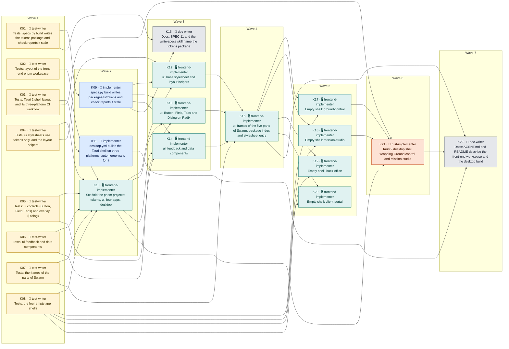

# T0.14: Plan

**Plan:** 🟢 Approved

**Push:** 🟢 Approved

<!-- ticket:specs -->
## 📚 Specifications

The technical pages, features, use cases and business rules of [TICKET.md](TICKET.md), copied by `python3 .claude/scripts/ticket_refs.py sync`.

- [🎨 Design system](../../specs/technical/10-frontends.md#design-system)
- [🗂️ Apps and shared packages](../../specs/technical/10-frontends.md#apps)
- [🖥️ Desktop shell and inputs](../../specs/technical/10-frontends.md#desktop)
- [📏 BR-017: Every screen in four languages](../../specs/functional/business-rules/BR-017-every-screen-in-four-languages.md)
<!-- /ticket:specs -->

## 📑 Summary

T0.14 builds the front-end foundation in 22 tasks over 7 waves.

Wave 1 has 8 test-writer tasks. Three are Python tests: the tokens pipeline, the layout of the front-end workspace, and the Tauri shell with its CI workflow. Five are Vitest suites: the ui stylesheet and layout helpers, the controls and overlays, the feedback and data components, the frames, and the four app shells.

Wave 2 has three tasks:
- `specs.py build` also writes `packages/ts/tokens/src/tokens.css`, and `check` reports it as SPEC-11 when it is stale. This is the "one build" of acceptance criterion 1.
- One scaffold task writes every package.json, tsconfig, eslint and vite config. It is the only task that changes `pnpm-lock.yaml`, `.gitignore` and `turbo.json`.
- A new `desktop.yml` workflow builds Tauri on Windows, macOS and Linux (criterion 3), and `automerge.yml` waits for it.

Waves 3 to 5 build `@swarm/ui` on Radix in three separate component groups. Then come the frames of the five parts of Swarm with the package entry points, then the four empty shells (criterion 2), one task each. Wave 6 builds the Tauri 2 crate (rust-implementer), which bundles Ground control and Mission studio as two windows. Two doc-writer tasks update SPEC-11, the write-specs skill and `enforcement.json` (wave 3), then AGENT.md and the README (wave 7).

There is no capture task: TICKET.md lists "➖ No screen", so TKT-21 asks for none. The plan adds no Dockerfiles or Playwright, which belong to T0.10 and T0.20.

## ⚠️ Assumptions

- The roadmap row names no feature or use case, so none is linked. BR-017 is linked because the epic E0.7 row names it, and no criterion cites it since the languages belong to T0.15.
- The roadmap row has no anchor of its own, so the ticket link points to the sprint anchor #s03.
- The ticket shows no use case screen (the shells are empty), so Screens touched says "➖ No screen" with its reason.
- The ticket touches no budget, because the roadmap row names none.
- Acceptance criteria do not cite a BR or UC, because the roadmap names no use case for this ticket.
- I did not run check_ticket.py myself, the workflow runs it next.
- No capture task is planned. TICKET.md lists "➖ No screen" under Screens touched, so check_plan.py's TKT-21 check asks for none.
- Tokens: `specs.py build` writes `packages/ts/tokens/src/tokens.css` byte-for-byte equal to `docs/specs/screens/mockups/visual-identity.css`, and `check` reports it as SPEC-11 when it is missing or stale. The package ships only that CSS, exported as `@swarm/tokens/tokens.css`. No TypeScript token module is generated, because the specifications ask only for CSS variables.
- The ui components render the class names of `docs/specs/screens/mockups/components.css`, and their stylesheets port its rules with `var(--...)` only, so that the app and the mock-ups match (T0.20 compares them). The map classes are not ported: maps are T0.19.
- Every frame is built, Swarm administration included (it is a row of the Frames table), but only the four shells use them. The frames' English words sit in one file, `packages/ts/ui/src/frames/parts.ts`, until T0.15 delivers the four languages (BR-017).
- Empty shells: no Mission, Operator, Client or status bar values. The first side bar item is active. The Client portal hides 🔔 Alarms because nobody is signed in. There is no routing, and the content area is empty, so no use case screen is shown. Ground control still shows ✋ Hold the Squad and 🛑 Abort as the Frames table requires, with no behaviour yet.
- Light and dark mode follow `prefers-color-scheme` through the tokens CSS, with `color-scheme: light dark` in each `index.html`. Criterion 2 is checked by Vitest and by the generated CSS holding both modes. Browser checks of both modes are left to the Playwright pipeline of T0.10 and T0.20.
- No Dockerfile, compose.e2e.yaml or Playwright setup is added. Images and Playwright are T0.10 (as T0.01 left the gateway's Dockerfile to T0.10), and visual tests are T0.20.
- The Tauri shell has its own Cargo workspace in `frontends/desktop/src-tauri`, not in `packages/rust`. It wraps both apps as two windows opened at start (`ground-control/index.html` and `mission-studio/index.html` in an assembled `dist/`), sized 1280 x 800 from the screen tokens. The window titles are the title-bar texts of the visual identity.
- Criterion 3 is met by `tauri build --no-bundle` on ubuntu, windows and macos runners in a new standalone `desktop.yml` with path filters. Installers, signing and auto-update are later work, such as the Tauri updater of T7.14. `automerge.yml` also waits for the `desktop` workflow, so that a desktop build that finishes last does not leave its pull request unmerged.
- The Tauri identifier `io.github.gpbcom.swarm` and the icons are not in the specifications. The identifier comes from the GitHub repository, and the icons are a plain square in `color.primary`, with no invented logo.
- Library versions (React 19.x, Vite, Vitest, Radix primitives, Tauri 2.x) are chosen by the workers at install time, pinned exactly, and reported as decisions. `pnpm install` and Cargo checking that they resolve is part of each task's done_when.
- SPEC-11 and SPEC-13 are only extended to name the new generated file, and `enforcement.json` gains its test. No rule ID or meaning changes.

<!-- plan:graph -->

> [!NOTE]
> Generated from the json block at the end of this page by `python3 .claude/scripts/plan.py render`.
> To change a task, edit the json block, then render again: never edit this view by hand.

## Waves

| Wave | Tasks | Agents running at once |
| --- | --- | --- |
| 1 | [K01](#k01), [K02](#k02), [K03](#k03), [K04](#k04), [K05](#k05), [K06](#k06), [K07](#k07), [K08](#k08) | 8 of 8 |
| 2 | [K09](#k09), [K10](#k10), [K11](#k11) | 3 of 3 |
| 3 | [K12](#k12), [K13](#k13), [K14](#k14), [K15](#k15) | 4 of 4 |
| 4 | [K16](#k16) | 1 of 1 |
| 5 | [K17](#k17), [K18](#k18), [K19](#k19), [K20](#k20) | 4 of 4 |
| 6 | [K21](#k21) | 1 of 1 |
| 7 | [K22](#k22) | 1 of 1 |

| Wave | Task | Agent | Depends on | Unblocks |
| --- | --- | --- | --- | --- |
| 1 | [K01](#k01) Tests: specs.py build writes the tokens package and check reports it stale | 🧪 test-writer | none | [K09](#k09), [K15](#k15) |
| 1 | [K02](#k02) Tests: layout of the front-end pnpm workspace | 🧪 test-writer | none | [K10](#k10) |
| 1 | [K03](#k03) Tests: Tauri 2 shell layout and its three-platform CI workflow | 🧪 test-writer | none | [K11](#k11), [K21](#k21) |
| 1 | [K04](#k04) Tests: ui stylesheets use tokens only, and the layout helpers | 🧪 test-writer | none | [K10](#k10), [K12](#k12) |
| 1 | [K05](#k05) Tests: ui controls (Button, Field, Tabs) and overlay (Dialog) | 🧪 test-writer | none | [K10](#k10), [K13](#k13) |
| 1 | [K06](#k06) Tests: ui feedback and data components | 🧪 test-writer | none | [K10](#k10), [K14](#k14) |
| 1 | [K07](#k07) Tests: the frames of the parts of Swarm | 🧪 test-writer | none | [K10](#k10), [K16](#k16) |
| 1 | [K08](#k08) Tests: the four empty app shells | 🧪 test-writer | none | [K10](#k10), [K17](#k17), [K18](#k18), [K19](#k19), [K20](#k20) |
| 2 | [K09](#k09) specs.py build writes packages/ts/tokens and check reports it stale | 🐍 implementer | [K01](#k01) | [K12](#k12), [K13](#k13), [K14](#k14), [K15](#k15) |
| 2 | [K10](#k10) Scaffold the pnpm projects: tokens, ui, four apps, desktop | 🖥️ frontend-implementer | [K02](#k02), [K04](#k04), [K05](#k05), [K06](#k06), [K07](#k07), [K08](#k08) | [K12](#k12), [K13](#k13), [K14](#k14), [K21](#k21) |
| 2 | [K11](#k11) desktop.yml builds the Tauri shell on three platforms; automerge waits for it | 🐍 implementer | [K03](#k03) | [K22](#k22) |
| 3 | [K12](#k12) ui: base stylesheet and layout helpers | 🖥️ frontend-implementer | [K04](#k04), [K09](#k09), [K10](#k10) | [K16](#k16) |
| 3 | [K13](#k13) ui: Button, Field, Tabs and Dialog on Radix | 🖥️ frontend-implementer | [K05](#k05), [K09](#k09), [K10](#k10) | [K16](#k16) |
| 3 | [K14](#k14) ui: feedback and data components | 🖥️ frontend-implementer | [K06](#k06), [K09](#k09), [K10](#k10) | [K16](#k16) |
| 3 | [K15](#k15) Docs: SPEC-11 and the write-specs skill name the tokens package | 📝 doc-writer | [K01](#k01), [K09](#k09) | none |
| 4 | [K16](#k16) ui: frames of the five parts of Swarm, package index and stylesheet entry | 🖥️ frontend-implementer | [K07](#k07), [K12](#k12), [K13](#k13), [K14](#k14) | [K17](#k17), [K18](#k18), [K19](#k19), [K20](#k20), [K22](#k22) |
| 5 | [K17](#k17) Empty shell: ground-control | 🖥️ frontend-implementer | [K08](#k08), [K16](#k16) | [K21](#k21) |
| 5 | [K18](#k18) Empty shell: mission-studio | 🖥️ frontend-implementer | [K08](#k08), [K16](#k16) | [K21](#k21) |
| 5 | [K19](#k19) Empty shell: back-office | 🖥️ frontend-implementer | [K08](#k08), [K16](#k16) | none |
| 5 | [K20](#k20) Empty shell: client-portal | 🖥️ frontend-implementer | [K08](#k08), [K16](#k16) | none |
| 6 | [K21](#k21) Tauri 2 desktop shell wrapping Ground control and Mission studio | 🦀 rust-implementer | [K03](#k03), [K10](#k10), [K17](#k17), [K18](#k18) | [K22](#k22) |
| 7 | [K22](#k22) Docs: AGENT.md and README describe the front-end workspace and the desktop build | 📝 doc-writer | [K11](#k11), [K16](#k16), [K21](#k21) | none |

## Dependency graph



## Tasks

### <a id="k01"></a>K01: Tests: specs.py build writes the tokens package and check reports it stale

| Agent | Wave | Depends on | Unblocks |
| --- | --- | --- | --- |
| 🧪 test-writer | 1 | none | [K09](#k09), [K15](#k15) |

**Files** (only this task may change them in its wave):

- `tests/harness/write_specs/test_tokens_package.py`
- `tests/harness/write_specs/helpers.py`

**Done when:** `uv run pytest tests/harness/write_specs/test_tokens_package.py -n 2` collects every test, and tests 1-7 fail only because `packages/ts/tokens/src/tokens.css` is not written or checked yet. `uv run ruff check tests/harness/write_specs` and `uv run ruff format --check tests/harness/write_specs` pass.

**Brief:**

Write Python tests for the tokens pipeline. One build of the specifications must write the design tokens into `packages/ts/tokens/src/tokens.css`, beside the mock-ups' `docs/specs/screens/mockups/visual-identity.css`. This is the pipeline named by docs/specs/technical/10-frontends.md#design-system: "Tokens in the visual identity are generated into `packages/ts/tokens` (CSS variables with light and dark values), by the same pipeline that writes the mock-ups' `visual-identity.css`." The tokens are those of docs/specs/visual-identity.md#colours (each with a light and a dark value). The generated-content rule is .claude/rules/specs.md#spec-11. Ticket: docs/tickets/T0.14/TICKET.md, acceptance criterion 1 ("Given a token changed on the visual identity page, when one build runs, then the apps and the mock-ups show the change").

How the script finds its root: `.claude/skills/write-specs/scripts/spec_model.py` sets `ROOT = Path(__file__).resolve().parents[4]`. So a test copies `.claude/skills/write-specs/` and `docs/specs/` into `tmp_path`, keeping the same relative paths. It then runs `python3 <tmp>/.claude/skills/write-specs/scripts/specs.py build|check` with `subprocess.run` and `cwd=tmp_path`. Put the copying and the running in `helpers.py`, as module-level functions and constants (AGENT.md, Tests). The expected generated file is `<root>/packages/ts/tokens/src/tokens.css`.

One class `TestTokensPackage`, with tests named as sentences:
1. after `build`, `packages/ts/tokens/src/tokens.css` exists and its text equals `docs/specs/screens/mockups/visual-identity.css`;
2. it holds `--color-background: #f8fafc;` under `:root` and `--color-background: #0b1220;` under `@media (prefers-color-scheme: dark)`;
3. changing the light value of `color.primary` in the copied `docs/specs/visual-identity.md` (`#4338ca` to `#3730a3`), then one `build`, changes both CSS files to the new value (criterion 1);
4. after `build`, no line printed by `check` mentions `tokens.css`. Filter the output on that name, because the copied tree may report unrelated problems;
5. a hand-edited `tokens.css` (append a line) makes `check` print a line that names `packages/ts/tokens/src/tokens.css` and `SPEC-11`;
6. a deleted `tokens.css` makes `check` print the same kind of line;
7. `build` creates the missing `packages/ts/tokens/src/` folder.

Follow AGENT.md, Tests: no `unittest.mock`, no `Any`, `from __future__ import annotations`, and `typing` generics. The tests must fail now only because the pipeline does not write the file yet.

### <a id="k02"></a>K02: Tests: layout of the front-end pnpm workspace

| Agent | Wave | Depends on | Unblocks |
| --- | --- | --- | --- |
| 🧪 test-writer | 1 | none | [K10](#k10) |

**Files** (only this task may change them in its wave):

- `tests/conventions/mono_repo/test_frontend_workspace.py`

**Done when:** `uv run pytest tests/conventions/mono_repo/test_frontend_workspace.py -n 2` collects and fails only because the projects do not exist yet. Ruff check and format pass on the file.

**Brief:**

Write a Python convention test for the projects that T0.14 adds to the pnpm workspace. They are listed in docs/specs/technical/10-frontends.md#apps: the apps `ground-control`, `mission-studio`, `back-office` and `client-portal` and the shell `desktop` under `frontends/`, and the packages `ui` ("Components on Radix primitives, styled only with the design tokens") and `tokens` ("CSS variables generated from the visual identity") under `packages/ts/`. The design system is docs/specs/technical/10-frontends.md#design-system, the desktop shell docs/specs/technical/10-frontends.md#desktop, and the ticket docs/tickets/T0.14/TICKET.md. Model the file on `tests/conventions/mono_repo/test_pnpm_workspace.py` and `tests/conventions/linters/test_typescript_settings.py`, and use `repo_root()` from `tests.conventions.mono_repo.helpers`.

One class `TestFrontendWorkspace`. Parametrise over the projects `packages/ts/tokens` (`@swarm/tokens`), `packages/ts/ui` (`@swarm/ui`), `frontends/ground-control` (`@swarm/ground-control`), `frontends/mission-studio` (`@swarm/mission-studio`), `frontends/back-office` (`@swarm/back-office`), `frontends/client-portal` (`@swarm/client-portal`) and `frontends/desktop` (`@swarm/desktop`). Check that:
- each `package.json` exists, with that `name`, `private: true` and `type: module`;
- every version in `dependencies` and `devDependencies` is either `workspace:*` or an exact version (`\d+\.\d+\.\d+(-...)?`);
- `pnpm-lock.yaml` has an importer line `<folder>:` for each project.

For every project except `tokens`, check that:
- `tsconfig.json` extends `@swarm/config/tsconfig.base.json`;
- `eslint.config.js` imports `@swarm/config/eslint`;
- `devDependencies` has `@swarm/config: workspace:*`;
- `scripts` has `lint` (contains `eslint`) and `typecheck` (contains `tsc` and `--noEmit`).

For `tokens`, check that `exports` maps `./tokens.css` to `./src/tokens.css`.

For `ui`, check that:
- `exports` maps `.` to `./src/index.ts` and `./styles.css` to `./src/styles.css`;
- `dependencies` has `@swarm/tokens: workspace:*`, at least one `@radix-ui/react-` package, and `react` and `react-dom` in 19.x (as peer or dev dependencies);
- the `test` script contains `vitest`.

For each of the four apps, check that:
- `dependencies` has `@swarm/ui` and `@swarm/tokens` as `workspace:*`, and `react` and `react-dom` 19.x;
- `scripts.build` contains `vite build`, and `scripts.test` contains `vitest`;
- `vite.config.ts` exists and sets `base: "./"`, so that the desktop shell can serve the build from a sub-folder.

For `desktop`, check that `devDependencies` has `@tauri-apps/cli` in an exact 2.x version, and that `scripts.tauri` is `tauri`.

Follow AGENT.md, Tests (one class, tests named as sentences, `JsonValue`, no `Any`).

### <a id="k03"></a>K03: Tests: Tauri 2 shell layout and its three-platform CI workflow

| Agent | Wave | Depends on | Unblocks |
| --- | --- | --- | --- |
| 🧪 test-writer | 1 | none | [K11](#k11), [K21](#k21) |

**Files** (only this task may change them in its wave):

- `tests/conventions/mono_repo/test_desktop_shell.py`
- `tests/ci/workflows/test_desktop_workflow.py`
- `tests/ci/workflows/test_gitflow_workflows.py`

**Done when:** `uv run pytest tests/conventions/mono_repo/test_desktop_shell.py tests/ci/workflows/test_desktop_workflow.py tests/ci/workflows/test_gitflow_workflows.py -n 2` collects. Its failures come only from the missing shell, the missing `desktop.yml` and the waited-for list of `automerge.yml`. Ruff check and format pass on the three files.

**Brief:**

Write the Python tests for the desktop shell and for its build on three platforms. The rule is docs/specs/technical/10-frontends.md#desktop: "Tauri 2 wraps Ground control and Mission studio: native windows on several screens". The table of docs/specs/technical/10-frontends.md#apps adds `desktop`: "Shell for Ground control and Mission studio", on Windows, macOS and Linux. Ticket docs/tickets/T0.14/TICKET.md, acceptance criterion 3 ("Given the Tauri 2 desktop shell, when it is built on Windows, macOS and Linux, then it builds on each").

(1) `tests/conventions/mono_repo/test_desktop_shell.py`, class `TestDesktopShell`, about `frontends/desktop/src-tauri/`.
- `Cargo.toml` has:
  - a `[package]` named `swarm-desktop`;
  - its own empty `[workspace]` table, so that it stays outside `packages/rust`;
  - `tauri` and, under `[build-dependencies]`, `tauri-build`, both in exact `2.x.y` versions;
  - `[lints.clippy]` with `all` deny and `pedantic` warn, as the workspace lints of `packages/rust/Cargo.toml`.
- `rust-toolchain.toml` exists, and `Cargo.lock` exists.
- `tauri.conf.json` has:
  - `productName` `Swarm`, and a non-empty `identifier`;
  - `build.frontendDist` `../dist`;
  - a `build.beforeBuildCommand` that names `@swarm/ground-control`, `@swarm/mission-studio` and `scripts/assemble.ts`;
  - exactly two `app.windows`. The first has `label` `ground-control`, `url` `ground-control/index.html` and `title` `⚙️ Swarm · Ground control`. The second has `label` `mission-studio`, `url` `mission-studio/index.html` and `title` `⚙️ Swarm · Mission studio`. Each is `width` 1280 and `height` 800, the `screen.width` and `screen.height` of docs/specs/visual-identity.md#screens.
- `capabilities/default.json` lists both window labels.
- The icons `icons/32x32.png`, `icons/128x128.png`, `icons/128x128@2x.png`, `icons/icon.icns` and `icons/icon.ico` exist.
- `src/main.rs` and `src/lib.rs` exist, and `frontends/desktop/scripts/assemble.ts` exists.

(2) `tests/ci/workflows/test_desktop_workflow.py`, class `TestDesktopWorkflow`, modelled on `tests/ci/workflows/test_typescript_workflow.py`. It checks `.github/workflows/desktop.yml`:
- `name: desktop`;
- triggers `pull_request` (branches `develop`, `master`, `release/**`) and `push` (`master`, `develop`, `release/**`, `hotfix/**`), each with `paths` holding `frontends/desktop/**`, `frontends/ground-control/**`, `frontends/mission-studio/**`, `packages/ts/**`, `pnpm-lock.yaml` and `.github/workflows/desktop.yml`;
- permissions `{contents: read}`;
- one job `build` with `strategy.fail-fast` false and `matrix.os` exactly `[ubuntu-latest, windows-latest, macos-latest]`, `runs-on: ${{ matrix.os }}`;
- the first steps use `actions/checkout@`, `pnpm/action-setup@` and `actions/setup-node@` (node 22, cache pnpm);
- one step installs the Rust toolchain with `rustup toolchain install` in `frontends/desktop/src-tauri`;
- one step with `if` naming `ubuntu` installs `libwebkit2gtk-4.1-dev`;
- one run is `pnpm install --frozen-lockfile`;
- one run contains `pnpm --filter @swarm/desktop tauri build --no-bundle`;
- on ubuntu only, runs contain `cargo fmt --check` and `cargo clippy --all-targets --locked -- -D warnings`, with working directory `frontends/desktop/src-tauri`;
- no `run` interpolates `${{`.

(3) In `tests/ci/workflows/test_gitflow_workflows.py`, change `WAITED_FOR` to `["ci", "gitflow", "terraform", "desktop"]` and change nothing else. Without it, a pull request whose desktop build finishes last is never merged.

Follow AGENT.md, Tests (`tomllib` and `json` for parsing, `yaml.safe_load` as in the existing workflow tests, `JsonValue`, no `Any`).

### <a id="k04"></a>K04: Tests: ui stylesheets use tokens only, and the layout helpers

| Agent | Wave | Depends on | Unblocks |
| --- | --- | --- | --- |
| 🧪 test-writer | 1 | none | [K10](#k10), [K12](#k12) |

**Files** (only this task may change them in its wave):

- `packages/ts/ui/test/styles.test.ts`
- `packages/ts/ui/test/layout.test.tsx`

**Done when:** Both files exist, are valid TypeScript (TSX for the component test), and import only the modules named in the brief. Each case listed in the brief has its own `it` or `test`.

**Brief:**

Write Vitest tests (jsdom, `@testing-library/react`) for `@swarm/ui`. The rule is docs/specs/technical/10-frontends.md#design-system: "Components in `packages/ts/ui` use the tokens only, like `components.css` does for the mock-ups". The tokens are those of docs/specs/visual-identity.md#colours, and the components and their class names are the table of docs/specs/visual-identity.md#components. The same rule for the mock-ups is .claude/rules/specs.md#spec-13. Ticket docs/tickets/T0.14/TICKET.md. The ui components render the class names of `docs/specs/screens/mockups/components.css`, so that the app and the mock-ups look the same.

`styles.test.ts`, with `describe('ui stylesheets')`, reads the files with `node:fs` from paths relative to `import.meta.dirname`:
1. every `.css` file under `packages/ts/ui/src/` holds no colour literal (`#rgb`/`#rrggbb`, `rgb(`, `rgba(`, `hsl(`) and no `font-family` whose value is not a `var(--font-...)`;
2. every `var(--name)` they use is defined in `packages/ts/tokens/src/tokens.css`;
3. `src/styles.css` imports `src/base.css` and every group stylesheet: `layout/layout.css`, `controls/controls.css`, `overlays/overlays.css`, `feedback/feedback.css`, `data/data.css` and `frames/frames.css`;
4. `src/base.css` sets the body's `background` to `var(--color-background)`, its `color` to `var(--color-text)` and its `font-family` to `var(--font-ui)`.

`layout.test.tsx` imports from `../src/layout`. It checks that `Row`, `Stack`, `Grid2` and `Spacer` render a `div` with the class `row`, `stack`, `grid-2` and `spacer` and render their children. It also checks that `Muted` and `Mono` render a `span` with the class `muted` or `mono`.

The tests import only `vitest`, `@testing-library/react`, `react` and `node:` modules. Write them so that they fail until K10, K12 and K16 have written the package.

### <a id="k05"></a>K05: Tests: ui controls (Button, Field, Tabs) and overlay (Dialog)

| Agent | Wave | Depends on | Unblocks |
| --- | --- | --- | --- |
| 🧪 test-writer | 1 | none | [K10](#k10), [K13](#k13) |

**Files** (only this task may change them in its wave):

- `packages/ts/ui/test/controls.test.tsx`
- `packages/ts/ui/test/overlays.test.tsx`

**Done when:** Both files exist, are valid TSX, and import only `vitest`, `@testing-library/react`, `@testing-library/user-event`, `react` and the `../src/<group>` barrels. Each case of the brief has its own `it` or `test`.

**Brief:**

Write Vitest tests (jsdom, `@testing-library/react`, `@testing-library/user-event`) for the components of docs/specs/visual-identity.md#components that sit on Radix primitives. The packages are described in docs/specs/technical/10-frontends.md#apps ("`ui`: Components on Radix primitives, styled only with the design tokens") and docs/specs/technical/10-frontends.md#design-system. Ticket docs/tickets/T0.14/TICKET.md. Every visible word is passed in through props: the four languages of docs/specs/functional/business-rules/BR-017-every-screen-in-four-languages.md come with T0.15.

`controls.test.tsx` imports `Button`, `Field` and `Tabs` from `../src/controls`.
- `Button({variant, children, onClick?, type?, disabled?})` renders a `button` with the class `button primary`, `button secondary` or `button danger`. Its `type` defaults to `button`, and a click calls `onClick`.
- `Field({id, label, hint?, error?, value?, onChange?})` renders a `div.field` with a `label` tied to the `input#id` (`getByLabelText` works) and an input with the class `input`.
  - With a `hint`, it shows `p.hint`, and the input's `aria-describedby` points to it.
  - With an `error`, it shows `p.error` with role `alert`, gives the input the class `input invalid` and `aria-invalid=true`, and shows no hint.
- `Tabs({tabs: {value, label, content}[], defaultValue})` renders a list with the class `tabs`, and a trigger with the class `tab` for each tab.
  - The selected trigger has the class `tab active` and `aria-selected=true`, and only its content is shown.
  - Clicking another trigger with `userEvent` moves `active` and the content to it.

`overlays.test.tsx` imports `Dialog` from `../src/overlays`. `Dialog({open, onOpenChange, title, children, actions?})` works as follows:
- when open, it renders an element with the class `overlay` and a sibling element with role `dialog` and the class `dialog`, named by `title`;
- when closed, it renders neither;
- pressing Escape calls `onOpenChange(false)`;
- `actions` are rendered inside the dialog.

### <a id="k06"></a>K06: Tests: ui feedback and data components

| Agent | Wave | Depends on | Unblocks |
| --- | --- | --- | --- |
| 🧪 test-writer | 1 | none | [K10](#k10), [K14](#k14) |

**Files** (only this task may change them in its wave):

- `packages/ts/ui/test/feedback.test.tsx`
- `packages/ts/ui/test/data.test.tsx`

**Done when:** Both files exist, are valid TSX, and import only `vitest`, `@testing-library/react`, `react` and the `../src/<group>` barrels. Each case of the brief has its own `it` or `test`.

**Brief:**

Write Vitest tests (jsdom, `@testing-library/react`) for the feedback and data components of docs/specs/visual-identity.md#components. They are styled with the tokens of docs/specs/visual-identity.md#colours only, as in docs/specs/technical/10-frontends.md#design-system. Ticket docs/tickets/T0.14/TICKET.md. Principle 2 of the visual identity, "never colour alone", means that a state always shows an icon and a word. All words come through props (docs/specs/functional/business-rules/BR-017-every-screen-in-four-languages.md, delivered by T0.15).

`feedback.test.tsx` imports from `../src/feedback`.
- `Badge({kind, icon, label})`, for each kind in persona, entity, system, success, failure, decision and action, renders `span.badge.<kind>` holding the icon (`aria-hidden`) and the label.
- `Banner({kind, icon, children})`, for kinds success, failure, decision and system, renders `div.banner.<kind>`. Its role is `alert` for failure and decision, and `status` otherwise.
- `ToastProvider` wraps `Toast({kind: success|failure, icon, message, open, onOpenChange})`. When open, it renders an element with the class `toast <kind>` holding the icon and the message.
- `Progress({value, label, kind?})` renders role `progressbar` with `aria-valuenow` equal to `value`, the class `progress` (plus the `kind` when one is given), and an indicator `span` with the class `p<n>`. `n` is `value` rounded to the nearest 10 and clamped to 0..100, and there is no `p` class at 0. Test 0, 34 (p30), 35 (p40) and 100.
- `Checklist({items: {label, status: ok|fail|pending}[]})` renders `ul.checklist`, with one `li.check.<status>` per item, prefixed with ✅, ❌ or ⏳.
- `EmptyState({icon, message, action?})` renders `div.empty` with the icon, the message and the action.

`data.test.tsx` imports from `../src/data`.
- `Card({title?, children})` renders `section.card`, with an `h2` when there is a `title`.
- `Table({columns, rows})` renders `table.table`, with one `th` per column and one `tr` per row in `tbody`.
- `List` renders `ul.list`, and `ListItem` renders `li.list-item`.
- `Split` renders `div.split`, and `Panel` renders `div.panel`.
- `Kpis` renders `div.kpis`, and `Kpi({value, label})` renders `div.kpi` with `.value` and `.label`.
- `Conversation` renders `div.conversation`, and `Message({from: person|agent, children})` renders `div.message.<from>`.

### <a id="k07"></a>K07: Tests: the frames of the parts of Swarm

| Agent | Wave | Depends on | Unblocks |
| --- | --- | --- | --- |
| 🧪 test-writer | 1 | none | [K10](#k10), [K16](#k16) |

**Files** (only this task may change them in its wave):

- `packages/ts/ui/test/frames.test.tsx`

**Done when:** The file exists, is valid TSX, and imports only `vitest`, the testing-library packages, `react`, `../src/frames` and `../src/index`. Each case of the brief has its own `it` or `test`.

**Brief:**

Write Vitest tests (jsdom, `@testing-library/react`, `@testing-library/user-event`) for the frames. docs/specs/technical/10-frontends.md#design-system says "the frames of each part of Swarm are layout components", and docs/specs/visual-identity.md#components ("Frames" table) defines each frame's title bar, side bar items in order, and status bar. Ticket docs/tickets/T0.14/TICKET.md. All on-screen words of the frames sit in one module, `src/frames/parts.ts`, so that T0.15 can turn them into messages (docs/specs/functional/business-rules/BR-017-every-screen-in-four-languages.md).

Import from `../src/frames`:
- `Window({titleBar, sideBar, statusBar, children})` renders `div.window`, holding the title bar, then `div.layout` with the side bar and `main.content` holding the children, then the status bar.
- `TitleBar({part, context?, actions?})` renders `header.titlebar`. It starts with `span.app` `⚙️ Swarm`, then the part name, then each context item, separated by ` · `. The actions sit at the right.
- `SideBar({items, active, onSelect?})` renders `nav.sidebar` with one `.nav-item` per item, showing its icon and label. The active item has the class `nav-item active` and `aria-current=page`, and a click calls `onSelect(id)`.
- `StatusBar({items})` renders `footer.statusbar` with the items separated by ` · `.

The part frames each render `Window` with their side bar items in exactly this order:
- `GroundControlFrame`: 🛰️ Flight, 📋 Pre-flight, 🛸 Squad, 🎥 Video, 📼 Debrief, 🔧 Settings.
- `MissionStudioFrame`: 🗺️ Missions, 🖊️ Design, 🕹️ Simulate, 💬 Assistant.
- `BackOfficeFrame`: 🛸 Fleet, 📜 Authorisations, 📦 Deliverables, 🔏 Evidence, 👥 People, 🔧 Settings.
- `ClientPortalFrame`: 🗺️ Missions, ➕ Order, 📦 Deliverables, 🧾 Scorecards, plus 🔔 Alarms only when `isSiteAgent` is true.
- `SwarmAdministrationFrame`: ➕ Operators, 👥 People, 🔧 Settings, with the title bar part `Back office` and the context `Swarm administration`.

Tests (parametrise over the five frames):
- the title bar shows `⚙️ Swarm` and the part name (Ground control, Mission studio, Back office, Client portal);
- the side bar items come in the order above;
- the first item is active by default, and an `active` prop selects another one;
- the children render inside `main.content`;
- `GroundControlFrame` always shows a `button secondary` `✋ Hold the Squad` and a `button danger` `🛑 Abort` in its title bar, which call `onHold` and `onAbort`;
- `GroundControlFrame` and `MissionStudioFrame` show `missionName` and `missionState` in the title bar context when they are given;
- `BackOfficeFrame` shows `operatorName`, and `ClientPortalFrame` shows `clientName`;
- `statusItems` render in the status bar;
- `../src/index` re-exports every frame and every component named in K04-K06 (`Row`, `Stack`, `Grid2`, `Spacer`, `Muted`, `Mono`, `Button`, `Field`, `Tabs`, `Dialog`, `Badge`, `Banner`, `Toast`, `ToastProvider`, `Progress`, `Checklist`, `EmptyState`, `Card`, `Table`, `List`, `ListItem`, `Split`, `Panel`, `Kpis`, `Kpi`, `Conversation`, `Message`).

### <a id="k08"></a>K08: Tests: the four empty app shells

| Agent | Wave | Depends on | Unblocks |
| --- | --- | --- | --- |
| 🧪 test-writer | 1 | none | [K10](#k10), [K17](#k17), [K18](#k18), [K19](#k19), [K20](#k20) |

**Files** (only this task may change them in its wave):

- `frontends/ground-control/test/app.test.tsx`
- `frontends/mission-studio/test/app.test.tsx`
- `frontends/back-office/test/app.test.tsx`
- `frontends/client-portal/test/app.test.tsx`

**Done when:** The four files exist, are valid TSX, and import only `vitest`, `@testing-library/react`, `react`, `node:` modules and `../src/App`. Each case of the brief has its own `it` or `test`.

**Brief:**

Write one Vitest test file (jsdom, `@testing-library/react`) per empty shell. The four apps of docs/specs/technical/10-frontends.md#apps are `ground-control`, `mission-studio`, `back-office` and `client-portal`. Each shows the frame of its part of Swarm (docs/specs/visual-identity.md#components, "Frames"), with the tokens of docs/specs/visual-identity.md#colours in light and dark mode (docs/specs/technical/10-frontends.md#design-system). Ticket docs/tickets/T0.14/TICKET.md, acceptance criterion 2 ("each opens in light mode and in dark mode"). On-screen words are English until T0.15 (docs/specs/functional/business-rules/BR-017-every-screen-in-four-languages.md).

Each file has `describe('<app> shell')` and imports `App` from `../src/App`.
- Rendering `<App />` shows `header.titlebar` with `⚙️ Swarm` and the part name (`Ground control`, `Mission studio`, `Back office`, `Client portal`).
- The side bar shows the part's first item as `nav-item active`: 🛰️ Flight, 🗺️ Missions, 🛸 Fleet and 🗺️ Missions respectively. The Ground control side bar has its six items. The Client portal has no 🔔 Alarms item, because nobody is signed in.
- Ground control shows the `✋ Hold the Squad` and `🛑 Abort` buttons.
- `main.content` is empty: the shell shows no screen.
- Read `../src/main.tsx` as text with `node:fs` and check that it imports `@swarm/tokens/tokens.css` and `@swarm/ui/styles.css` and mounts into `#root`.
- Read `../index.html` and check that it has `<meta name="color-scheme" content="light dark">`, `lang="en"`, a `div#root` and a `<title>` of `⚙️ Swarm · <part name>`.
- Read `../../../packages/ts/tokens/src/tokens.css` and check that it holds a `@media (prefers-color-scheme: dark)` block, so the shell has both modes.

### <a id="k09"></a>K09: specs.py build writes packages/ts/tokens and check reports it stale

| Agent | Wave | Depends on | Unblocks |
| --- | --- | --- | --- |
| 🐍 implementer | 2 | [K01](#k01) | [K12](#k12), [K13](#k13), [K14](#k14), [K15](#k15) |

**Files** (only this task may change them in its wave):

- `.claude/skills/write-specs/scripts/spec_model.py`
- `.claude/skills/write-specs/scripts/specs.py`
- `.claude/skills/write-specs/scripts/spec_check.py`
- `packages/ts/tokens/src/tokens.css`

**Done when:** `uv run pytest tests/harness/write_specs/test_tokens_package.py -n 2` passes. `python3 .claude/skills/write-specs/scripts/specs.py check` prints nothing. `packages/ts/tokens/src/tokens.css` exists and is byte-identical to `docs/specs/screens/mockups/visual-identity.css`.

**Brief:**

Extend the specification pipeline so that one `specs.py build` writes the design tokens into the `tokens` package too. docs/specs/technical/10-frontends.md#design-system: "Tokens in the visual identity are generated into `packages/ts/tokens` (CSS variables with light and dark values), by the same pipeline that writes the mock-ups' `visual-identity.css`." See also docs/specs/technical/10-frontends.md#apps, docs/specs/visual-identity.md#colours and .claude/rules/specs.md#spec-11 (generated content, written by the script only). Ticket docs/tickets/T0.14/TICKET.md, acceptance criterion 1. The tests are `tests/harness/write_specs/test_tokens_package.py` (K01). Read them first.

In `spec_model.py`, add `TOKENS_CSS = ROOT / "packages" / "ts" / "tokens" / "src" / "tokens.css"`, next to `IDENTITY_CSS`.

In `specs.py` `command_build`, write the same `identity_css(tokens, dark)` text to `TOKENS_CSS`. Write it only when it differs, and create the parent folder. Update the module docstring (``build`` writes `visual-identity.css` and `packages/ts/tokens/src/tokens.css`).

In `spec_check.py` `check_identity`, report `TOKENS_CSS` exactly as `IDENTITY_CSS` is reported, missing or different: `self.error(TOKENS_CSS, 11, "out of date: run specs.py build.")`. Check that `error()` prints a path relative to `ROOT` for a file outside `docs/specs`; if it does not, make it.

Keep the style of these scripts, which are harness scripts, not services. Then run `python3 .claude/skills/write-specs/scripts/specs.py build` in the repository to generate `packages/ts/tokens/src/tokens.css`. Change nothing else under `docs/specs`: build must leave the pages as they are.

### <a id="k10"></a>K10: Scaffold the pnpm projects: tokens, ui, four apps, desktop

| Agent | Wave | Depends on | Unblocks |
| --- | --- | --- | --- |
| 🖥️ frontend-implementer | 2 | [K02](#k02), [K04](#k04), [K05](#k05), [K06](#k06), [K07](#k07), [K08](#k08) | [K12](#k12), [K13](#k13), [K14](#k14), [K21](#k21) |

**Files** (only this task may change them in its wave):

- `packages/ts/tokens/package.json`
- `packages/ts/ui/package.json`
- `packages/ts/ui/tsconfig.json`
- `packages/ts/ui/eslint.config.js`
- `packages/ts/ui/vitest.config.ts`
- `frontends/ground-control/package.json`
- `frontends/ground-control/tsconfig.json`
- `frontends/ground-control/eslint.config.js`
- `frontends/ground-control/vite.config.ts`
- `frontends/mission-studio/package.json`
- `frontends/mission-studio/tsconfig.json`
- `frontends/mission-studio/eslint.config.js`
- `frontends/mission-studio/vite.config.ts`
- `frontends/back-office/package.json`
- `frontends/back-office/tsconfig.json`
- `frontends/back-office/eslint.config.js`
- `frontends/back-office/vite.config.ts`
- `frontends/client-portal/package.json`
- `frontends/client-portal/tsconfig.json`
- `frontends/client-portal/eslint.config.js`
- `frontends/client-portal/vite.config.ts`
- `frontends/desktop/package.json`
- `frontends/desktop/tsconfig.json`
- `frontends/desktop/eslint.config.js`
- `frontends/.gitkeep`
- `pnpm-lock.yaml`
- `.gitignore`
- `turbo.json`

**Done when:** `pnpm install --frozen-lockfile` succeeds at the root. `uv run pytest tests/conventions/mono_repo/test_frontend_workspace.py tests/conventions/mono_repo/test_pnpm_workspace.py -n 2` passes. `pnpm --filter @swarm/ui exec vitest --version` prints a version.

**Brief:**

Create the manifests and the tool configuration of the seven pnpm projects of docs/specs/technical/10-frontends.md#apps. That page names the stack: "React 19, Vite, TanStack Query for server data, Zustand for UI state, Vitest and Playwright for tests". Only React, Vite and Vitest are needed now. The other references are docs/specs/technical/10-frontends.md#design-system and docs/specs/technical/10-frontends.md#desktop ("Tauri 2 wraps Ground control and Mission studio"), and the ticket docs/tickets/T0.14/TICKET.md.

This task alone writes `pnpm-lock.yaml`, so every later task finds its dependencies installed. The convention test is `tests/conventions/mono_repo/test_frontend_workspace.py` (K02). Read it and the Vitest files of K04-K08 (`packages/ts/ui/test/*.test.ts*` and `frontends/*/test/app.test.tsx`) to know every package they import. Follow the existing `packages/ts/live` and `packages/ts/config` packages (AGENT.md, Commands): exact versions only, and `@swarm/config` as `workspace:*`.

- `packages/ts/tokens/package.json`: `@swarm/tokens`, private, `type: module`, `exports: {"./tokens.css": "./src/tokens.css"}`, and no scripts. Its CSS is generated by K09.
- `packages/ts/ui`:
  - `package.json` for `@swarm/ui`:
    - `exports`: `.` to `./src/index.ts` and `./styles.css` to `./src/styles.css`;
    - dependencies: `@swarm/tokens` (`workspace:*`), `@radix-ui/react-dialog`, `@radix-ui/react-tabs`, `@radix-ui/react-toast`, `@radix-ui/react-progress` and `@radix-ui/react-label`;
    - `react` and `react-dom` 19.x as peer and dev dependencies;
    - dev dependencies: `vitest`, `jsdom`, `@testing-library/react`, `@testing-library/user-event`, `@vitejs/plugin-react`, `@types/react`, `@types/react-dom`, `@types/node`, eslint, typescript and typescript-eslint (the versions of `packages/ts/live`);
    - scripts `lint: eslint .`, `typecheck: tsc --noEmit -p tsconfig.json` and `test: vitest run`.
  - `tsconfig.json`: extends `@swarm/config/tsconfig.base.json`, with `jsx: react-jsx`, `lib` ES2023 + DOM + DOM.Iterable, `types` [`node`, `vitest/globals` only if used], `noEmit`, and includes `src`, `test` and the config files.
  - `eslint.config.js`: extends `@swarm/config/eslint` as `packages/ts/live/eslint.config.js` does.
  - `vitest.config.ts`: jsdom environment, `test/**/*.test.{ts,tsx}`.
- The four apps `frontends/<app>` (`@swarm/<app>`):
  - `package.json` with dependencies `@swarm/ui` and `@swarm/tokens` (`workspace:*`) and `react` and `react-dom` 19.x;
  - dev dependencies `vite`, `@vitejs/plugin-react`, `vitest`, `jsdom`, `@testing-library/react`, the types and the lint tools;
  - scripts `build: vite build`, `lint`, `typecheck` and `test: vitest run`;
  - `vite.config.ts` with the React plugin, `base: "./"` (the desktop shell serves the build from a sub-folder), `build.outDir: "dist"` and a `test` block (jsdom, `test/**/*.test.tsx`);
  - `tsconfig.json` and `eslint.config.js` as for ui.
- `frontends/desktop`:
  - `package.json`: `@swarm/desktop`, with `@tauri-apps/cli` in an exact 2.x version, lint tools and `@types/node`. Scripts: `tauri: tauri`, `lint` and `typecheck`. It has no `build` or `test` script: turbo and CI do not build Tauri, `desktop.yml` does.
  - `tsconfig.json`: includes `scripts` and allows `.ts` imports, as `packages/ts/live` does.
  - `eslint.config.js`: ignores `src-tauri/` and `dist/`.
- Delete `frontends/.gitkeep`.
- Add `dist/`, `frontends/desktop/dist/` and `frontends/desktop/src-tauri/target/` to `.gitignore` if they are not covered.
- Touch `turbo.json` only if the tests need it.

Run `pnpm install` at the root to update `pnpm-lock.yaml`. Report every version you picked as a decision.

### <a id="k11"></a>K11: desktop.yml builds the Tauri shell on three platforms; automerge waits for it

| Agent | Wave | Depends on | Unblocks |
| --- | --- | --- | --- |
| 🐍 implementer | 2 | [K03](#k03) | [K22](#k22) |

**Files** (only this task may change them in its wave):

- `.github/workflows/desktop.yml`
- `.github/workflows/automerge.yml`

**Done when:** `uv run pytest tests/ci/workflows/test_desktop_workflow.py tests/ci/workflows/test_gitflow_workflows.py -n 2` passes, and `python3 -c "import yaml,sys;yaml.safe_load(open('.github/workflows/desktop.yml'))"` succeeds.

**Brief:**

Write the CI workflow that builds the Tauri 2 desktop shell on Windows, macOS and Linux. References: docs/specs/technical/10-frontends.md#desktop ("Tauri 2 wraps Ground control and Mission studio") and docs/specs/technical/10-frontends.md#apps (`desktop`: Windows, macOS, Linux). Ticket docs/tickets/T0.14/TICKET.md, acceptance criterion 3. The tests are `tests/ci/workflows/test_desktop_workflow.py` and `tests/ci/workflows/test_gitflow_workflows.py` (K03): read them first and follow them exactly.

`.github/workflows/desktop.yml` runs on its own, like `terraform.yml`, with path filters, and is not called from `ci.yml`.
- `name: desktop`, the triggers and `paths` of the test, and `permissions: contents: read`.
- One job `build`, with matrix `os: [ubuntu-latest, windows-latest, macos-latest]`, `fail-fast: false` and `runs-on: ${{ matrix.os }}`. Its steps, in order:
  1. `actions/checkout@v7`;
  2. `pnpm/action-setup@v6`;
  3. `actions/setup-node@v7` (node 22, `cache: pnpm`), the same versions as `typescript.yml`;
  4. `rustup toolchain install` with `working-directory: frontends/desktop/src-tauri`, as `rust.yml` does;
  5. `Swatinem/rust-cache@v2` with `workspaces: frontends/desktop/src-tauri`;
  6. on ubuntu only (`if: matrix.os == 'ubuntu-latest'`), `sudo apt-get update && sudo apt-get install -y libwebkit2gtk-4.1-dev libappindicator3-dev librsvg2-dev patchelf`;
  7. `pnpm install --frozen-lockfile`;
  8. `pnpm --filter @swarm/desktop tauri build --no-bundle`;
  9. on ubuntu only, in `frontends/desktop/src-tauri`, `cargo fmt --check` and `cargo clippy --all-targets --locked -- -D warnings`.
- No `run` interpolates `${{`: pass values through `env`.

In `.github/workflows/automerge.yml`, change `workflows: [ci, gitflow, terraform]` to `[ci, gitflow, terraform, desktop]`, and nothing else.

### <a id="k12"></a>K12: ui: base stylesheet and layout helpers

| Agent | Wave | Depends on | Unblocks |
| --- | --- | --- | --- |
| 🖥️ frontend-implementer | 3 | [K04](#k04), [K09](#k09), [K10](#k10) | [K16](#k16) |

**Files** (only this task may change them in its wave):

- `packages/ts/ui/src/base.css`
- `packages/ts/ui/src/layout/layout.css`
- `packages/ts/ui/src/layout/Row.tsx`
- `packages/ts/ui/src/layout/Stack.tsx`
- `packages/ts/ui/src/layout/Grid2.tsx`
- `packages/ts/ui/src/layout/Spacer.tsx`
- `packages/ts/ui/src/layout/Muted.tsx`
- `packages/ts/ui/src/layout/Mono.tsx`
- `packages/ts/ui/src/layout/index.ts`

**Done when:** `pnpm --filter @swarm/ui exec vitest run test/layout.test.tsx` passes, and the cases of `test/styles.test.ts` about colour literals, font literals and unknown variables pass. The `styles.css` cases wait for K16. `pnpm --filter @swarm/ui lint` reports nothing in `src/layout` or `src/base.css`.

**Brief:**

Write the base stylesheet and the layout helpers of `@swarm/ui`. Components "use the tokens only, like `components.css` does for the mock-ups" (docs/specs/technical/10-frontends.md#design-system). The tokens are docs/specs/visual-identity.md#colours with its typography and spacing tokens, the components docs/specs/visual-identity.md#components ("Layout: `row`, `stack`, `grid-2`, `spacer`, `muted`, `mono`"), and the rule for colours and fonts .claude/rules/specs.md#spec-13. Ticket docs/tickets/T0.14/TICKET.md. The tests are `packages/ts/ui/test/layout.test.tsx` and `packages/ts/ui/test/styles.test.ts` (K04).

- `src/base.css`: the box sizing; `body` with `margin: 0`, `background: var(--color-background)`, `color: var(--color-text)`, `font-family: var(--font-ui)` and `font-size: var(--size-body)`; and `#root` at full height.
- `src/layout/layout.css`: port the `.row`, `.stack`, `.grid-2`, `.spacer`, `.muted` and `.mono` rules of `docs/specs/screens/mockups/components.css`, with `var(--...)` only and no colour or font literal.
- One component per file. `Row`, `Stack`, `Grid2` and `Spacer` render a `div` with their class, and `Muted` and `Mono` a `span`. Props are `{children?: ReactNode}`.
- `index.ts` re-exports them.

Use strict TypeScript (the `@swarm/config` presets), no `any`, and no inline `style`. Do not create `src/styles.css` or `src/index.ts`: K16 owns them.

### <a id="k13"></a>K13: ui: Button, Field, Tabs and Dialog on Radix

| Agent | Wave | Depends on | Unblocks |
| --- | --- | --- | --- |
| 🖥️ frontend-implementer | 3 | [K05](#k05), [K09](#k09), [K10](#k10) | [K16](#k16) |

**Files** (only this task may change them in its wave):

- `packages/ts/ui/src/controls/controls.css`
- `packages/ts/ui/src/controls/Button.tsx`
- `packages/ts/ui/src/controls/Field.tsx`
- `packages/ts/ui/src/controls/Tabs.tsx`
- `packages/ts/ui/src/controls/index.ts`
- `packages/ts/ui/src/overlays/overlays.css`
- `packages/ts/ui/src/overlays/Dialog.tsx`
- `packages/ts/ui/src/overlays/index.ts`

**Done when:** `pnpm --filter @swarm/ui exec vitest run test/controls.test.tsx test/overlays.test.tsx` passes, and the colour, font and variable cases of `test/styles.test.ts` pass for these files. `pnpm --filter @swarm/ui lint` reports nothing in `src/controls` or `src/overlays`.

**Brief:**

Write the controls and the overlay of `@swarm/ui` on Radix primitives. References: docs/specs/technical/10-frontends.md#apps ("Components on Radix primitives, styled only with the design tokens"), docs/specs/technical/10-frontends.md#design-system, and the Buttons, Field, Tabs and Dialog rows of docs/specs/visual-identity.md#components. The tokens are docs/specs/visual-identity.md#colours. Every word comes through props, for the four languages of docs/specs/functional/business-rules/BR-017-every-screen-in-four-languages.md (T0.15). Ticket docs/tickets/T0.14/TICKET.md. The tests are `packages/ts/ui/test/controls.test.tsx` and `packages/ts/ui/test/overlays.test.tsx` (K05): the props and classes they assert are the API.

- `Button`: a native `button` with the class `button <variant>`, and `type` defaulting to `button`.
- `Field`: Radix `@radix-ui/react-label` for the label, `input.input` (`input invalid` with `aria-invalid` when there is an error), `p.hint` or `p.error` (role `alert`), and `aria-describedby`.
- `Tabs`: Radix `@radix-ui/react-tabs`. The `List` has the class `tabs`. Each `Trigger` has the class `tab`, plus `active` for the selected value, which you track in state (controlled `value` and `onValueChange`).
- `Dialog`: Radix `@radix-ui/react-dialog`, with `Portal`, `Overlay` (class `overlay`) and, as its sibling, `Content` (class `dialog`) with a `Title`, the children and the actions.
- `controls.css` and `overlays.css`: port the `.button*`, `.field`, `.input*`, `.hint`, `.error`, `.tabs`/`.tab*`, `.overlay` and `.dialog` rules of `docs/specs/screens/mockups/components.css`, with `var(--...)` only. Keep 1 rule = 1 meaning: one primary per screen, and danger in `color.failure`.

One component per file, an `index.ts` per group, strict TypeScript, no `any` and no inline `style`.

### <a id="k14"></a>K14: ui: feedback and data components

| Agent | Wave | Depends on | Unblocks |
| --- | --- | --- | --- |
| 🖥️ frontend-implementer | 3 | [K06](#k06), [K09](#k09), [K10](#k10) | [K16](#k16) |

**Files** (only this task may change them in its wave):

- `packages/ts/ui/src/feedback/feedback.css`
- `packages/ts/ui/src/feedback/Badge.tsx`
- `packages/ts/ui/src/feedback/Banner.tsx`
- `packages/ts/ui/src/feedback/Toast.tsx`
- `packages/ts/ui/src/feedback/Progress.tsx`
- `packages/ts/ui/src/feedback/Checklist.tsx`
- `packages/ts/ui/src/feedback/EmptyState.tsx`
- `packages/ts/ui/src/feedback/index.ts`
- `packages/ts/ui/src/data/data.css`
- `packages/ts/ui/src/data/Card.tsx`
- `packages/ts/ui/src/data/Table.tsx`
- `packages/ts/ui/src/data/List.tsx`
- `packages/ts/ui/src/data/Panels.tsx`
- `packages/ts/ui/src/data/Kpis.tsx`
- `packages/ts/ui/src/data/Conversation.tsx`
- `packages/ts/ui/src/data/index.ts`

**Done when:** `pnpm --filter @swarm/ui exec vitest run test/feedback.test.tsx test/data.test.tsx` passes, and the colour, font and variable cases of `test/styles.test.ts` pass for these files. `pnpm --filter @swarm/ui lint` reports nothing in `src/feedback` or `src/data`.

**Brief:**

Write the feedback and data components of `@swarm/ui`, the rows Badges, Banner, Toast, Progress, Checklist, Empty state, Card, Table, Tabs and lists, Panels and Conversation of docs/specs/visual-identity.md#components. They use the tokens of docs/specs/visual-identity.md#colours only (docs/specs/technical/10-frontends.md#design-system), on Radix primitives where one exists (docs/specs/technical/10-frontends.md#apps). Principle 2 of the visual identity, never colour alone, means an icon and a word with every state. Words come through props (docs/specs/functional/business-rules/BR-017-every-screen-in-four-languages.md). Ticket docs/tickets/T0.14/TICKET.md. The tests are `packages/ts/ui/test/feedback.test.tsx` and `packages/ts/ui/test/data.test.tsx` (K06): their props and classes are the API.

Feedback:
- `Badge` and `Banner`: plain elements.
- `Toast` and `ToastProvider`: `@radix-ui/react-toast`. The provider holds the Radix `Provider` and a `Viewport`, and `Toast` is a `Root` with the class `toast <kind>`.
- `Progress`: `@radix-ui/react-progress`, with an `Indicator` `asChild` on a `span` with the class `p<n>`, as specified in the test.
- `Checklist` and `EmptyState`: plain elements.

Data:
- `Card`, `Table`, `List`/`ListItem`, `Split`/`Panel` (in `Panels.tsx`), `Kpis`/`Kpi` (in `Kpis.tsx`) and `Conversation`/`Message` (in `Conversation.tsx`).

Port the matching rules of `docs/specs/screens/mockups/components.css` to `feedback.css` and `data.css`, with `var(--...)` only. The map classes (`map`, `zone`, `marker`) are not ported: the maps package is T0.19. Use strict TypeScript, no `any` and no inline `style`.

### <a id="k15"></a>K15: Docs: SPEC-11 and the write-specs skill name the tokens package

| Agent | Wave | Depends on | Unblocks |
| --- | --- | --- | --- |
| 📝 doc-writer | 3 | [K01](#k01), [K09](#k09) | none |

**Files** (only this task may change them in its wave):

- `.claude/rules/specs.md`
- `.claude/skills/write-specs/SKILL.md`
- `.claude/rules/enforcement.json`

**Done when:** `uv run pytest tests/harness/wiring/test_enforcement.py -n 2` passes, and `grep -n 'packages/ts/tokens' .claude/rules/specs.md .claude/skills/write-specs/SKILL.md` finds the new lines.

**Brief:**

Record that `specs.py build` now also writes `packages/ts/tokens/src/tokens.css`. The pipeline comes from docs/specs/technical/10-frontends.md#design-system ("generated into `packages/ts/tokens` ... by the same pipeline that writes the mock-ups' `visual-identity.css`") and docs/specs/visual-identity.md#colours. Ticket docs/tickets/T0.14/TICKET.md.

- `.claude/rules/specs.md`, in SPEC-11 (.claude/rules/specs.md#spec-11), under the list of what `specs.py build` writes: add `packages/ts/tokens/src/tokens.css`, the same tokens for the apps, beside `docs/specs/screens/mockups/visual-identity.css`. Its Check says that `specs.py check` reports it when it differs. In SPEC-13 (.claude/rules/specs.md#spec-13), where `specs.py build` writes the tokens as CSS variables, add that it writes them to the tokens package too. Change no rule ID, no other rule and no date in the summary table.
- `.claude/skills/write-specs/SKILL.md`: where it lists what `build` writes, add the tokens package file.
- `.claude/rules/enforcement.json`: add, under `SPEC-11`, an entry `{"kind": "test", "path": "tests/harness/write_specs/test_tokens_package.py", "what": "build writes the tokens package and check reports it stale"}`, keeping the file's formatting.

Plain British English, short sentences, no em dash.

### <a id="k16"></a>K16: ui: frames of the five parts of Swarm, package index and stylesheet entry

| Agent | Wave | Depends on | Unblocks |
| --- | --- | --- | --- |
| 🖥️ frontend-implementer | 4 | [K07](#k07), [K12](#k12), [K13](#k13), [K14](#k14) | [K17](#k17), [K18](#k18), [K19](#k19), [K20](#k20), [K22](#k22) |

**Files** (only this task may change them in its wave):

- `packages/ts/ui/src/frames/frames.css`
- `packages/ts/ui/src/frames/Window.tsx`
- `packages/ts/ui/src/frames/TitleBar.tsx`
- `packages/ts/ui/src/frames/SideBar.tsx`
- `packages/ts/ui/src/frames/StatusBar.tsx`
- `packages/ts/ui/src/frames/parts.ts`
- `packages/ts/ui/src/frames/GroundControlFrame.tsx`
- `packages/ts/ui/src/frames/MissionStudioFrame.tsx`
- `packages/ts/ui/src/frames/BackOfficeFrame.tsx`
- `packages/ts/ui/src/frames/ClientPortalFrame.tsx`
- `packages/ts/ui/src/frames/SwarmAdministrationFrame.tsx`
- `packages/ts/ui/src/frames/index.ts`
- `packages/ts/ui/src/index.ts`
- `packages/ts/ui/src/styles.css`

**Done when:** `pnpm --filter @swarm/ui test`, `pnpm --filter @swarm/ui lint` and `pnpm --filter @swarm/ui typecheck` all pass.

**Brief:**

Write the frames as layout components. docs/specs/technical/10-frontends.md#design-system says "the frames of each part of Swarm are layout components". The "Frames" table of docs/specs/visual-identity.md#components gives each part's title bar, side bar items in order (the current one is `nav-item active`) and status bar, and the Window, Title bar and Side bar rows give the structure. Ticket docs/tickets/T0.14/TICKET.md. The tests are `packages/ts/ui/test/frames.test.tsx` (K07) and the `styles.css` cases of `packages/ts/ui/test/styles.test.ts` (K04): their props and classes are the API.

- `Window`, `TitleBar`, `SideBar` and `StatusBar` render the `window`, `titlebar` (`.app`, ` · ` separators), `layout`, `sidebar`, `nav-item`/`nav-item active` (`aria-current=page`), `content` and `statusbar` structure of `docs/specs/screens/mockups/components.css`. `SideBar` items are buttons.
- `parts.ts` holds, as typed `as const` data, every on-screen word of the frames: the `⚙️ Swarm` app name, each part's name and context words, its side bar items `{id, icon, label}` in the order of the Frames table, the Client portal's `siteAgentOnly` flag on 🔔 Alarms, and the Ground control labels `✋ Hold the Squad` and `🛑 Abort`. It is the one place T0.15 will turn into messages for docs/specs/functional/business-rules/BR-017-every-screen-in-four-languages.md.
- The five part frames compose `Window`, `TitleBar`, `SideBar` and `StatusBar`. The first item is active unless `active` says otherwise.
  - `GroundControlFrame` always renders `Button` secondary `✋ Hold the Squad` (`onHold`) and `Button` danger `🛑 Abort` (`onAbort`) at the right of its title bar, "on every screen" as the Frames table says. The safety behaviour itself is a later ticket.
  - Mission name and state, Operator name, Client name and the status items are optional props: a shell without them shows none.
- `frames.css` ports the `.window`, `.titlebar`, `.layout`, `.sidebar`, `.nav-item`, `.content` and `.statusbar` rules, with `var(--...)` only.
- `src/index.ts` re-exports every component of `layout`, `controls`, `overlays`, `feedback`, `data` and `frames`.
- `src/styles.css` `@import`s `base.css` then each group stylesheet.

Use strict TypeScript, no `any` and no inline `style`.

### <a id="k17"></a>K17: Empty shell: ground-control

| Agent | Wave | Depends on | Unblocks |
| --- | --- | --- | --- |
| 🖥️ frontend-implementer | 5 | [K08](#k08), [K16](#k16) | [K21](#k21) |

**Files** (only this task may change them in its wave):

- `frontends/ground-control/index.html`
- `frontends/ground-control/src/main.tsx`
- `frontends/ground-control/src/App.tsx`

**Done when:** `pnpm --filter @swarm/ground-control test`, `lint`, `typecheck` and `build` pass, and `frontends/ground-control/dist/index.html` exists.

**Brief:**

Write the empty Ground control shell. `ground-control` is the app of the Pilot and the Instructor (docs/specs/technical/10-frontends.md#apps). It shows the Ground control frame of docs/specs/visual-identity.md#components with the tokens of docs/specs/visual-identity.md#colours, in the light or dark mode of the system (docs/specs/technical/10-frontends.md#design-system). Ticket docs/tickets/T0.14/TICKET.md, acceptance criterion 2. The test is `frontends/ground-control/test/app.test.tsx` (K08). Words are English until T0.15 (docs/specs/functional/business-rules/BR-017-every-screen-in-four-languages.md).

- `index.html`: `<html lang="en">`, `<meta name="color-scheme" content="light dark">`, `<title>⚙️ Swarm · Ground control</title>`, `<div id="root">`, and the module script `/src/main.tsx`.
- `src/main.tsx`: imports `@swarm/tokens/tokens.css` and `@swarm/ui/styles.css`, then `createRoot(document.getElementById('root'))` (with a typed null check) renders `<StrictMode><App /></StrictMode>`.
- `src/App.tsx`: renders `GroundControlFrame` from `@swarm/ui`, with no Mission, no status items and an empty content area. The Hold and Abort handlers do nothing yet.

Invent no text beyond the frame's own words.

### <a id="k18"></a>K18: Empty shell: mission-studio

| Agent | Wave | Depends on | Unblocks |
| --- | --- | --- | --- |
| 🖥️ frontend-implementer | 5 | [K08](#k08), [K16](#k16) | [K21](#k21) |

**Files** (only this task may change them in its wave):

- `frontends/mission-studio/index.html`
- `frontends/mission-studio/src/main.tsx`
- `frontends/mission-studio/src/App.tsx`

**Done when:** `pnpm --filter @swarm/mission-studio test`, `lint`, `typecheck` and `build` pass, and `frontends/mission-studio/dist/index.html` exists.

**Brief:**

Write the empty Mission studio shell. `mission-studio` is the Mission planner's app (docs/specs/technical/10-frontends.md#apps). It shows the Mission studio frame of docs/specs/visual-identity.md#components with the tokens of docs/specs/visual-identity.md#colours, light or dark from the system (docs/specs/technical/10-frontends.md#design-system). Ticket docs/tickets/T0.14/TICKET.md, acceptance criterion 2. The test is `frontends/mission-studio/test/app.test.tsx` (K08). Words are English until T0.15 (docs/specs/functional/business-rules/BR-017-every-screen-in-four-languages.md).

- `index.html`: `lang="en"`, `<meta name="color-scheme" content="light dark">`, `<title>⚙️ Swarm · Mission studio</title>`, `div#root`, and the module script `/src/main.tsx`.
- `src/main.tsx`: imports `@swarm/tokens/tokens.css` and `@swarm/ui/styles.css` and mounts `<StrictMode><App /></StrictMode>` into `#root`, with a typed null check.
- `src/App.tsx`: renders `MissionStudioFrame` with no Mission, no status items and empty content.

### <a id="k19"></a>K19: Empty shell: back-office

| Agent | Wave | Depends on | Unblocks |
| --- | --- | --- | --- |
| 🖥️ frontend-implementer | 5 | [K08](#k08), [K16](#k16) | none |

**Files** (only this task may change them in its wave):

- `frontends/back-office/index.html`
- `frontends/back-office/src/main.tsx`
- `frontends/back-office/src/App.tsx`

**Done when:** `pnpm --filter @swarm/back-office test`, `lint`, `typecheck` and `build` pass, and `frontends/back-office/dist/index.html` exists.

**Brief:**

Write the empty Back office shell. `back-office` is the app of the Fleet maintainer, the Mission planner and the Swarm administrator (docs/specs/technical/10-frontends.md#apps). It shows the Back office frame of docs/specs/visual-identity.md#components with the tokens of docs/specs/visual-identity.md#colours, light or dark from the system (docs/specs/technical/10-frontends.md#design-system). Ticket docs/tickets/T0.14/TICKET.md, acceptance criterion 2. The test is `frontends/back-office/test/app.test.tsx` (K08). Words are English until T0.15 (docs/specs/functional/business-rules/BR-017-every-screen-in-four-languages.md).

- `index.html`: `lang="en"`, `<meta name="color-scheme" content="light dark">`, `<title>⚙️ Swarm · Back office</title>`, `div#root`, and the module script `/src/main.tsx`.
- `src/main.tsx`: imports `@swarm/tokens/tokens.css` and `@swarm/ui/styles.css` and mounts `<StrictMode><App /></StrictMode>`, with a typed null check.
- `src/App.tsx`: renders `BackOfficeFrame` with no Operator, no status items and empty content. The Swarm administration frame is not used yet: no one is signed in.

### <a id="k20"></a>K20: Empty shell: client-portal

| Agent | Wave | Depends on | Unblocks |
| --- | --- | --- | --- |
| 🖥️ frontend-implementer | 5 | [K08](#k08), [K16](#k16) | none |

**Files** (only this task may change them in its wave):

- `frontends/client-portal/index.html`
- `frontends/client-portal/src/main.tsx`
- `frontends/client-portal/src/App.tsx`

**Done when:** `pnpm --filter @swarm/client-portal test`, `lint`, `typecheck` and `build` pass, and `frontends/client-portal/dist/index.html` exists.

**Brief:**

Write the empty Client portal shell. `client-portal` is the app of the Client and the Site agent (docs/specs/technical/10-frontends.md#apps). It shows the Client portal frame of docs/specs/visual-identity.md#components with the tokens of docs/specs/visual-identity.md#colours, light or dark from the system (docs/specs/technical/10-frontends.md#design-system). Ticket docs/tickets/T0.14/TICKET.md, acceptance criterion 2. The test is `frontends/client-portal/test/app.test.tsx` (K08). Words are English until T0.15 (docs/specs/functional/business-rules/BR-017-every-screen-in-four-languages.md).

- `index.html`: `lang="en"`, `<meta name="color-scheme" content="light dark">`, `<title>⚙️ Swarm · Client portal</title>`, `div#root`, and the module script `/src/main.tsx`.
- `src/main.tsx`: imports `@swarm/tokens/tokens.css` and `@swarm/ui/styles.css` and mounts `<StrictMode><App /></StrictMode>`, with a typed null check.
- `src/App.tsx`: renders `ClientPortalFrame` with `isSiteAgent` false (no one is signed in, so there is no 🔔 Alarms item), no Client, no status items and empty content.

### <a id="k21"></a>K21: Tauri 2 desktop shell wrapping Ground control and Mission studio

| Agent | Wave | Depends on | Unblocks |
| --- | --- | --- | --- |
| 🦀 rust-implementer | 6 | [K03](#k03), [K10](#k10), [K17](#k17), [K18](#k18) | [K22](#k22) |

**Files** (only this task may change them in its wave):

- `frontends/desktop/src-tauri/Cargo.toml`
- `frontends/desktop/src-tauri/Cargo.lock`
- `frontends/desktop/src-tauri/rust-toolchain.toml`
- `frontends/desktop/src-tauri/build.rs`
- `frontends/desktop/src-tauri/tauri.conf.json`
- `frontends/desktop/src-tauri/capabilities/default.json`
- `frontends/desktop/src-tauri/src/main.rs`
- `frontends/desktop/src-tauri/src/lib.rs`
- `frontends/desktop/src-tauri/icons/32x32.png`
- `frontends/desktop/src-tauri/icons/128x128.png`
- `frontends/desktop/src-tauri/icons/128x128@2x.png`
- `frontends/desktop/src-tauri/icons/icon.icns`
- `frontends/desktop/src-tauri/icons/icon.ico`
- `frontends/desktop/src-tauri/icons/icon.png`
- `frontends/desktop/scripts/assemble.ts`

**Done when:** From the repository root on Linux, `pnpm --filter @swarm/desktop tauri build --no-bundle` succeeds. In `frontends/desktop/src-tauri`, `cargo fmt --check` and `cargo clippy --all-targets --locked -- -D warnings` pass. `uv run pytest tests/conventions/mono_repo/test_desktop_shell.py -n 2` passes, and `pnpm --filter @swarm/desktop lint` and `typecheck` pass.

**Brief:**

Build the Tauri 2 desktop shell. docs/specs/technical/10-frontends.md#desktop: "Tauri 2 wraps Ground control and Mission studio: native windows on several screens". docs/specs/technical/10-frontends.md#apps: `desktop` is the "Shell for Ground control and Mission studio", on Windows, macOS and Linux. Windows are sized to the `screen.width` and `screen.height` of docs/specs/visual-identity.md#screens. Ticket docs/tickets/T0.14/TICKET.md, acceptance criterion 3. Auto-update, several screens, SDL2 gamepads and the edge connection are later tickets: build only the empty shell. The test is `tests/conventions/mono_repo/test_desktop_shell.py` (K03). Read it first: its expectations are the contract, including the window labels, urls and titles, the `beforeBuildCommand` and `frontendDist`.

- `scripts/assemble.ts` (Node, run with `node --experimental-strip-types`): empties `frontends/desktop/dist/`, then copies `frontends/ground-control/dist` to `dist/ground-control` and `frontends/mission-studio/dist` to `dist/mission-studio`. The apps build with `base: "./"` (K10). It fails with a clear message when a build is missing.
- `tauri.conf.json`:
  - `build.beforeBuildCommand`: `pnpm --filter @swarm/ground-control --filter @swarm/mission-studio build && node --experimental-strip-types scripts/assemble.ts`;
  - `build.frontendDist`: `../dist`;
  - two windows `ground-control` and `mission-studio`, both open at start, 1280 x 800, titled `⚙️ Swarm · Ground control` and `⚙️ Swarm · Mission studio`;
  - `productName` `Swarm`, and identifier `io.github.gpbcom.swarm`;
  - a CSP that allows `'self'` only. Add `'unsafe-inline'` for styles only if Radix needs it, and report the choice;
  - `bundle.icon` listing the icons.
- `capabilities/default.json`: both windows, `core:default` only.
- `Cargo.toml`:
  - package `swarm-desktop`, edition 2021;
  - its own empty `[workspace]`;
  - `[lib]` `swarm_desktop_lib` with crate types staticlib, cdylib and rlib;
  - `tauri` and `tauri-build` pinned to exact 2.x.y;
  - `[lints.clippy] all = { level = "deny", priority = -1 }`, `pedantic = { level = "warn", priority = -1 }`, and `[lints.rust] missing_docs = "warn"`, as `packages/rust/Cargo.toml`.
- `rust-toolchain.toml`: the same channel as `packages/rust/rust-toolchain.toml`.
- `src/lib.rs`: a documented `pub fn run()` that builds and runs the Tauri app. `src/main.rs` sets the Windows subsystem in release builds and calls it.
- Icons: generate them with `pnpm --filter @swarm/desktop tauri icon` from a plain square PNG. Use a token colour of the visual identity, such as `color.primary` `#4338ca`, with no invented logo, and keep the source as `icons/icon.png`.

Run `cargo generate-lockfile` or a build to write `Cargo.lock`. Report every version you picked.

### <a id="k22"></a>K22: Docs: AGENT.md and README describe the front-end workspace and the desktop build

| Agent | Wave | Depends on | Unblocks |
| --- | --- | --- | --- |
| 📝 doc-writer | 7 | [K11](#k11), [K16](#k16), [K21](#k21) | none |

**Files** (only this task may change them in its wave):

- `AGENT.md`
- `README.md`

**Done when:** `grep -n 'packages/ts/tokens' AGENT.md README.md` and `grep -n 'desktop.yml' AGENT.md` find the new lines, and `uv run pytest tests/harness/wiring -n 2` still passes.

**Brief:**

Document what T0.14 adds, for people and agents. The sources are docs/specs/technical/10-frontends.md#apps, docs/specs/technical/10-frontends.md#desktop, docs/specs/technical/10-frontends.md#design-system and docs/specs/visual-identity.md#components. Ticket docs/tickets/T0.14/TICKET.md.

In `AGENT.md`, "Mono-repo" section, add a short paragraph in the style of the `packages/python` paragraph:
- `packages/ts/tokens` (`@swarm/tokens`): its `src/tokens.css` is generated by `specs.py build` from `docs/specs/visual-identity.md`, never edited by hand;
- `packages/ts/ui` (`@swarm/ui`): components on Radix primitives, styled with `var(--...)` tokens only, using the class names of the mock-ups' `components.css`, with the frames of each part of Swarm in `src/frames/` and their words in `src/frames/parts.ts`;
- the four app shells;
- `frontends/desktop`: Tauri 2, with its own Cargo workspace in `src-tauri/`, wrapping Ground control and Mission studio, built on Windows, macOS and Linux by `.github/workflows/desktop.yml`.

In "Commands", add `pnpm --filter @swarm/<project> test|lint|typecheck|build` and, from the root, `pnpm --filter @swarm/desktop tauri build --no-bundle`, with `cargo fmt --check` and `cargo clippy --all-targets --locked -- -D warnings` in `frontends/desktop/src-tauri`. Update the sentence "The Docker and front-end rules are not tested yet": `tests/conventions/mono_repo/test_frontend_workspace.py` and `test_desktop_shell.py` now check the front-end workspace layout, and the Docker rules are still untested.

In `README.md`, where the front ends or the repository layout are described, add the same facts in a line or two each. Plain British English, no em dash, and nothing the sources do not say.

<!-- /plan:graph -->

## Task graph

<details>
<summary>🤖 Task graph as read by <code>/ticket-run</code> (json)</summary>

```json
[
  {
    "id": "K01",
    "title": "Tests: specs.py build writes the tokens package and check reports it stale",
    "agent": "test-writer",
    "depends_on": [],
    "files": [
      "tests/harness/write_specs/test_tokens_package.py",
      "tests/harness/write_specs/helpers.py"
    ],
    "brief": "Write Python tests for the tokens pipeline. One build of the specifications must write the design tokens into `packages/ts/tokens/src/tokens.css`, beside the mock-ups' `docs/specs/screens/mockups/visual-identity.css`. This is the pipeline named by docs/specs/technical/10-frontends.md#design-system: \"Tokens in the visual identity are generated into `packages/ts/tokens` (CSS variables with light and dark values), by the same pipeline that writes the mock-ups' `visual-identity.css`.\" The tokens are those of docs/specs/visual-identity.md#colours (each with a light and a dark value). The generated-content rule is .claude/rules/specs.md#spec-11. Ticket: docs/tickets/T0.14/TICKET.md, acceptance criterion 1 (\"Given a token changed on the visual identity page, when one build runs, then the apps and the mock-ups show the change\").\n\nHow the script finds its root: `.claude/skills/write-specs/scripts/spec_model.py` sets `ROOT = Path(__file__).resolve().parents[4]`. So a test copies `.claude/skills/write-specs/` and `docs/specs/` into `tmp_path`, keeping the same relative paths. It then runs `python3 <tmp>/.claude/skills/write-specs/scripts/specs.py build|check` with `subprocess.run` and `cwd=tmp_path`. Put the copying and the running in `helpers.py`, as module-level functions and constants (AGENT.md, Tests). The expected generated file is `<root>/packages/ts/tokens/src/tokens.css`.\n\nOne class `TestTokensPackage`, with tests named as sentences:\n1. after `build`, `packages/ts/tokens/src/tokens.css` exists and its text equals `docs/specs/screens/mockups/visual-identity.css`;\n2. it holds `--color-background: #f8fafc;` under `:root` and `--color-background: #0b1220;` under `@media (prefers-color-scheme: dark)`;\n3. changing the light value of `color.primary` in the copied `docs/specs/visual-identity.md` (`#4338ca` to `#3730a3`), then one `build`, changes both CSS files to the new value (criterion 1);\n4. after `build`, no line printed by `check` mentions `tokens.css`. Filter the output on that name, because the copied tree may report unrelated problems;\n5. a hand-edited `tokens.css` (append a line) makes `check` print a line that names `packages/ts/tokens/src/tokens.css` and `SPEC-11`;\n6. a deleted `tokens.css` makes `check` print the same kind of line;\n7. `build` creates the missing `packages/ts/tokens/src/` folder.\n\nFollow AGENT.md, Tests: no `unittest.mock`, no `Any`, `from __future__ import annotations`, and `typing` generics. The tests must fail now only because the pipeline does not write the file yet.",
    "done_when": "`uv run pytest tests/harness/write_specs/test_tokens_package.py -n 2` collects every test, and tests 1-7 fail only because `packages/ts/tokens/src/tokens.css` is not written or checked yet. `uv run ruff check tests/harness/write_specs` and `uv run ruff format --check tests/harness/write_specs` pass.",
    "wave": 1
  },
  {
    "id": "K02",
    "title": "Tests: layout of the front-end pnpm workspace",
    "agent": "test-writer",
    "depends_on": [],
    "files": [
      "tests/conventions/mono_repo/test_frontend_workspace.py"
    ],
    "brief": "Write a Python convention test for the projects that T0.14 adds to the pnpm workspace. They are listed in docs/specs/technical/10-frontends.md#apps: the apps `ground-control`, `mission-studio`, `back-office` and `client-portal` and the shell `desktop` under `frontends/`, and the packages `ui` (\"Components on Radix primitives, styled only with the design tokens\") and `tokens` (\"CSS variables generated from the visual identity\") under `packages/ts/`. The design system is docs/specs/technical/10-frontends.md#design-system, the desktop shell docs/specs/technical/10-frontends.md#desktop, and the ticket docs/tickets/T0.14/TICKET.md. Model the file on `tests/conventions/mono_repo/test_pnpm_workspace.py` and `tests/conventions/linters/test_typescript_settings.py`, and use `repo_root()` from `tests.conventions.mono_repo.helpers`.\n\nOne class `TestFrontendWorkspace`. Parametrise over the projects `packages/ts/tokens` (`@swarm/tokens`), `packages/ts/ui` (`@swarm/ui`), `frontends/ground-control` (`@swarm/ground-control`), `frontends/mission-studio` (`@swarm/mission-studio`), `frontends/back-office` (`@swarm/back-office`), `frontends/client-portal` (`@swarm/client-portal`) and `frontends/desktop` (`@swarm/desktop`). Check that:\n- each `package.json` exists, with that `name`, `private: true` and `type: module`;\n- every version in `dependencies` and `devDependencies` is either `workspace:*` or an exact version (`\\d+\\.\\d+\\.\\d+(-...)?`);\n- `pnpm-lock.yaml` has an importer line `<folder>:` for each project.\n\nFor every project except `tokens`, check that:\n- `tsconfig.json` extends `@swarm/config/tsconfig.base.json`;\n- `eslint.config.js` imports `@swarm/config/eslint`;\n- `devDependencies` has `@swarm/config: workspace:*`;\n- `scripts` has `lint` (contains `eslint`) and `typecheck` (contains `tsc` and `--noEmit`).\n\nFor `tokens`, check that `exports` maps `./tokens.css` to `./src/tokens.css`.\n\nFor `ui`, check that:\n- `exports` maps `.` to `./src/index.ts` and `./styles.css` to `./src/styles.css`;\n- `dependencies` has `@swarm/tokens: workspace:*`, at least one `@radix-ui/react-` package, and `react` and `react-dom` in 19.x (as peer or dev dependencies);\n- the `test` script contains `vitest`.\n\nFor each of the four apps, check that:\n- `dependencies` has `@swarm/ui` and `@swarm/tokens` as `workspace:*`, and `react` and `react-dom` 19.x;\n- `scripts.build` contains `vite build`, and `scripts.test` contains `vitest`;\n- `vite.config.ts` exists and sets `base: \"./\"`, so that the desktop shell can serve the build from a sub-folder.\n\nFor `desktop`, check that `devDependencies` has `@tauri-apps/cli` in an exact 2.x version, and that `scripts.tauri` is `tauri`.\n\nFollow AGENT.md, Tests (one class, tests named as sentences, `JsonValue`, no `Any`).",
    "done_when": "`uv run pytest tests/conventions/mono_repo/test_frontend_workspace.py -n 2` collects and fails only because the projects do not exist yet. Ruff check and format pass on the file.",
    "wave": 1
  },
  {
    "id": "K03",
    "title": "Tests: Tauri 2 shell layout and its three-platform CI workflow",
    "agent": "test-writer",
    "depends_on": [],
    "files": [
      "tests/conventions/mono_repo/test_desktop_shell.py",
      "tests/ci/workflows/test_desktop_workflow.py",
      "tests/ci/workflows/test_gitflow_workflows.py"
    ],
    "brief": "Write the Python tests for the desktop shell and for its build on three platforms. The rule is docs/specs/technical/10-frontends.md#desktop: \"Tauri 2 wraps Ground control and Mission studio: native windows on several screens\". The table of docs/specs/technical/10-frontends.md#apps adds `desktop`: \"Shell for Ground control and Mission studio\", on Windows, macOS and Linux. Ticket docs/tickets/T0.14/TICKET.md, acceptance criterion 3 (\"Given the Tauri 2 desktop shell, when it is built on Windows, macOS and Linux, then it builds on each\").\n\n(1) `tests/conventions/mono_repo/test_desktop_shell.py`, class `TestDesktopShell`, about `frontends/desktop/src-tauri/`.\n- `Cargo.toml` has:\n  - a `[package]` named `swarm-desktop`;\n  - its own empty `[workspace]` table, so that it stays outside `packages/rust`;\n  - `tauri` and, under `[build-dependencies]`, `tauri-build`, both in exact `2.x.y` versions;\n  - `[lints.clippy]` with `all` deny and `pedantic` warn, as the workspace lints of `packages/rust/Cargo.toml`.\n- `rust-toolchain.toml` exists, and `Cargo.lock` exists.\n- `tauri.conf.json` has:\n  - `productName` `Swarm`, and a non-empty `identifier`;\n  - `build.frontendDist` `../dist`;\n  - a `build.beforeBuildCommand` that names `@swarm/ground-control`, `@swarm/mission-studio` and `scripts/assemble.ts`;\n  - exactly two `app.windows`. The first has `label` `ground-control`, `url` `ground-control/index.html` and `title` `⚙️ Swarm · Ground control`. The second has `label` `mission-studio`, `url` `mission-studio/index.html` and `title` `⚙️ Swarm · Mission studio`. Each is `width` 1280 and `height` 800, the `screen.width` and `screen.height` of docs/specs/visual-identity.md#screens.\n- `capabilities/default.json` lists both window labels.\n- The icons `icons/32x32.png`, `icons/128x128.png`, `icons/128x128@2x.png`, `icons/icon.icns` and `icons/icon.ico` exist.\n- `src/main.rs` and `src/lib.rs` exist, and `frontends/desktop/scripts/assemble.ts` exists.\n\n(2) `tests/ci/workflows/test_desktop_workflow.py`, class `TestDesktopWorkflow`, modelled on `tests/ci/workflows/test_typescript_workflow.py`. It checks `.github/workflows/desktop.yml`:\n- `name: desktop`;\n- triggers `pull_request` (branches `develop`, `master`, `release/**`) and `push` (`master`, `develop`, `release/**`, `hotfix/**`), each with `paths` holding `frontends/desktop/**`, `frontends/ground-control/**`, `frontends/mission-studio/**`, `packages/ts/**`, `pnpm-lock.yaml` and `.github/workflows/desktop.yml`;\n- permissions `{contents: read}`;\n- one job `build` with `strategy.fail-fast` false and `matrix.os` exactly `[ubuntu-latest, windows-latest, macos-latest]`, `runs-on: ${{ matrix.os }}`;\n- the first steps use `actions/checkout@`, `pnpm/action-setup@` and `actions/setup-node@` (node 22, cache pnpm);\n- one step installs the Rust toolchain with `rustup toolchain install` in `frontends/desktop/src-tauri`;\n- one step with `if` naming `ubuntu` installs `libwebkit2gtk-4.1-dev`;\n- one run is `pnpm install --frozen-lockfile`;\n- one run contains `pnpm --filter @swarm/desktop tauri build --no-bundle`;\n- on ubuntu only, runs contain `cargo fmt --check` and `cargo clippy --all-targets --locked -- -D warnings`, with working directory `frontends/desktop/src-tauri`;\n- no `run` interpolates `${{`.\n\n(3) In `tests/ci/workflows/test_gitflow_workflows.py`, change `WAITED_FOR` to `[\"ci\", \"gitflow\", \"terraform\", \"desktop\"]` and change nothing else. Without it, a pull request whose desktop build finishes last is never merged.\n\nFollow AGENT.md, Tests (`tomllib` and `json` for parsing, `yaml.safe_load` as in the existing workflow tests, `JsonValue`, no `Any`).",
    "done_when": "`uv run pytest tests/conventions/mono_repo/test_desktop_shell.py tests/ci/workflows/test_desktop_workflow.py tests/ci/workflows/test_gitflow_workflows.py -n 2` collects. Its failures come only from the missing shell, the missing `desktop.yml` and the waited-for list of `automerge.yml`. Ruff check and format pass on the three files.",
    "wave": 1
  },
  {
    "id": "K04",
    "title": "Tests: ui stylesheets use tokens only, and the layout helpers",
    "agent": "test-writer",
    "depends_on": [],
    "files": [
      "packages/ts/ui/test/styles.test.ts",
      "packages/ts/ui/test/layout.test.tsx"
    ],
    "brief": "Write Vitest tests (jsdom, `@testing-library/react`) for `@swarm/ui`. The rule is docs/specs/technical/10-frontends.md#design-system: \"Components in `packages/ts/ui` use the tokens only, like `components.css` does for the mock-ups\". The tokens are those of docs/specs/visual-identity.md#colours, and the components and their class names are the table of docs/specs/visual-identity.md#components. The same rule for the mock-ups is .claude/rules/specs.md#spec-13. Ticket docs/tickets/T0.14/TICKET.md. The ui components render the class names of `docs/specs/screens/mockups/components.css`, so that the app and the mock-ups look the same.\n\n`styles.test.ts`, with `describe('ui stylesheets')`, reads the files with `node:fs` from paths relative to `import.meta.dirname`:\n1. every `.css` file under `packages/ts/ui/src/` holds no colour literal (`#rgb`/`#rrggbb`, `rgb(`, `rgba(`, `hsl(`) and no `font-family` whose value is not a `var(--font-...)`;\n2. every `var(--name)` they use is defined in `packages/ts/tokens/src/tokens.css`;\n3. `src/styles.css` imports `src/base.css` and every group stylesheet: `layout/layout.css`, `controls/controls.css`, `overlays/overlays.css`, `feedback/feedback.css`, `data/data.css` and `frames/frames.css`;\n4. `src/base.css` sets the body's `background` to `var(--color-background)`, its `color` to `var(--color-text)` and its `font-family` to `var(--font-ui)`.\n\n`layout.test.tsx` imports from `../src/layout`. It checks that `Row`, `Stack`, `Grid2` and `Spacer` render a `div` with the class `row`, `stack`, `grid-2` and `spacer` and render their children. It also checks that `Muted` and `Mono` render a `span` with the class `muted` or `mono`.\n\nThe tests import only `vitest`, `@testing-library/react`, `react` and `node:` modules. Write them so that they fail until K10, K12 and K16 have written the package.",
    "done_when": "Both files exist, are valid TypeScript (TSX for the component test), and import only the modules named in the brief. Each case listed in the brief has its own `it` or `test`.",
    "wave": 1
  },
  {
    "id": "K05",
    "title": "Tests: ui controls (Button, Field, Tabs) and overlay (Dialog)",
    "agent": "test-writer",
    "depends_on": [],
    "files": [
      "packages/ts/ui/test/controls.test.tsx",
      "packages/ts/ui/test/overlays.test.tsx"
    ],
    "brief": "Write Vitest tests (jsdom, `@testing-library/react`, `@testing-library/user-event`) for the components of docs/specs/visual-identity.md#components that sit on Radix primitives. The packages are described in docs/specs/technical/10-frontends.md#apps (\"`ui`: Components on Radix primitives, styled only with the design tokens\") and docs/specs/technical/10-frontends.md#design-system. Ticket docs/tickets/T0.14/TICKET.md. Every visible word is passed in through props: the four languages of docs/specs/functional/business-rules/BR-017-every-screen-in-four-languages.md come with T0.15.\n\n`controls.test.tsx` imports `Button`, `Field` and `Tabs` from `../src/controls`.\n- `Button({variant, children, onClick?, type?, disabled?})` renders a `button` with the class `button primary`, `button secondary` or `button danger`. Its `type` defaults to `button`, and a click calls `onClick`.\n- `Field({id, label, hint?, error?, value?, onChange?})` renders a `div.field` with a `label` tied to the `input#id` (`getByLabelText` works) and an input with the class `input`.\n  - With a `hint`, it shows `p.hint`, and the input's `aria-describedby` points to it.\n  - With an `error`, it shows `p.error` with role `alert`, gives the input the class `input invalid` and `aria-invalid=true`, and shows no hint.\n- `Tabs({tabs: {value, label, content}[], defaultValue})` renders a list with the class `tabs`, and a trigger with the class `tab` for each tab.\n  - The selected trigger has the class `tab active` and `aria-selected=true`, and only its content is shown.\n  - Clicking another trigger with `userEvent` moves `active` and the content to it.\n\n`overlays.test.tsx` imports `Dialog` from `../src/overlays`. `Dialog({open, onOpenChange, title, children, actions?})` works as follows:\n- when open, it renders an element with the class `overlay` and a sibling element with role `dialog` and the class `dialog`, named by `title`;\n- when closed, it renders neither;\n- pressing Escape calls `onOpenChange(false)`;\n- `actions` are rendered inside the dialog.",
    "done_when": "Both files exist, are valid TSX, and import only `vitest`, `@testing-library/react`, `@testing-library/user-event`, `react` and the `../src/<group>` barrels. Each case of the brief has its own `it` or `test`.",
    "wave": 1
  },
  {
    "id": "K06",
    "title": "Tests: ui feedback and data components",
    "agent": "test-writer",
    "depends_on": [],
    "files": [
      "packages/ts/ui/test/feedback.test.tsx",
      "packages/ts/ui/test/data.test.tsx"
    ],
    "brief": "Write Vitest tests (jsdom, `@testing-library/react`) for the feedback and data components of docs/specs/visual-identity.md#components. They are styled with the tokens of docs/specs/visual-identity.md#colours only, as in docs/specs/technical/10-frontends.md#design-system. Ticket docs/tickets/T0.14/TICKET.md. Principle 2 of the visual identity, \"never colour alone\", means that a state always shows an icon and a word. All words come through props (docs/specs/functional/business-rules/BR-017-every-screen-in-four-languages.md, delivered by T0.15).\n\n`feedback.test.tsx` imports from `../src/feedback`.\n- `Badge({kind, icon, label})`, for each kind in persona, entity, system, success, failure, decision and action, renders `span.badge.<kind>` holding the icon (`aria-hidden`) and the label.\n- `Banner({kind, icon, children})`, for kinds success, failure, decision and system, renders `div.banner.<kind>`. Its role is `alert` for failure and decision, and `status` otherwise.\n- `ToastProvider` wraps `Toast({kind: success|failure, icon, message, open, onOpenChange})`. When open, it renders an element with the class `toast <kind>` holding the icon and the message.\n- `Progress({value, label, kind?})` renders role `progressbar` with `aria-valuenow` equal to `value`, the class `progress` (plus the `kind` when one is given), and an indicator `span` with the class `p<n>`. `n` is `value` rounded to the nearest 10 and clamped to 0..100, and there is no `p` class at 0. Test 0, 34 (p30), 35 (p40) and 100.\n- `Checklist({items: {label, status: ok|fail|pending}[]})` renders `ul.checklist`, with one `li.check.<status>` per item, prefixed with ✅, ❌ or ⏳.\n- `EmptyState({icon, message, action?})` renders `div.empty` with the icon, the message and the action.\n\n`data.test.tsx` imports from `../src/data`.\n- `Card({title?, children})` renders `section.card`, with an `h2` when there is a `title`.\n- `Table({columns, rows})` renders `table.table`, with one `th` per column and one `tr` per row in `tbody`.\n- `List` renders `ul.list`, and `ListItem` renders `li.list-item`.\n- `Split` renders `div.split`, and `Panel` renders `div.panel`.\n- `Kpis` renders `div.kpis`, and `Kpi({value, label})` renders `div.kpi` with `.value` and `.label`.\n- `Conversation` renders `div.conversation`, and `Message({from: person|agent, children})` renders `div.message.<from>`.",
    "done_when": "Both files exist, are valid TSX, and import only `vitest`, `@testing-library/react`, `react` and the `../src/<group>` barrels. Each case of the brief has its own `it` or `test`.",
    "wave": 1
  },
  {
    "id": "K07",
    "title": "Tests: the frames of the parts of Swarm",
    "agent": "test-writer",
    "depends_on": [],
    "files": [
      "packages/ts/ui/test/frames.test.tsx"
    ],
    "brief": "Write Vitest tests (jsdom, `@testing-library/react`, `@testing-library/user-event`) for the frames. docs/specs/technical/10-frontends.md#design-system says \"the frames of each part of Swarm are layout components\", and docs/specs/visual-identity.md#components (\"Frames\" table) defines each frame's title bar, side bar items in order, and status bar. Ticket docs/tickets/T0.14/TICKET.md. All on-screen words of the frames sit in one module, `src/frames/parts.ts`, so that T0.15 can turn them into messages (docs/specs/functional/business-rules/BR-017-every-screen-in-four-languages.md).\n\nImport from `../src/frames`:\n- `Window({titleBar, sideBar, statusBar, children})` renders `div.window`, holding the title bar, then `div.layout` with the side bar and `main.content` holding the children, then the status bar.\n- `TitleBar({part, context?, actions?})` renders `header.titlebar`. It starts with `span.app` `⚙️ Swarm`, then the part name, then each context item, separated by ` · `. The actions sit at the right.\n- `SideBar({items, active, onSelect?})` renders `nav.sidebar` with one `.nav-item` per item, showing its icon and label. The active item has the class `nav-item active` and `aria-current=page`, and a click calls `onSelect(id)`.\n- `StatusBar({items})` renders `footer.statusbar` with the items separated by ` · `.\n\nThe part frames each render `Window` with their side bar items in exactly this order:\n- `GroundControlFrame`: 🛰️ Flight, 📋 Pre-flight, 🛸 Squad, 🎥 Video, 📼 Debrief, 🔧 Settings.\n- `MissionStudioFrame`: 🗺️ Missions, 🖊️ Design, 🕹️ Simulate, 💬 Assistant.\n- `BackOfficeFrame`: 🛸 Fleet, 📜 Authorisations, 📦 Deliverables, 🔏 Evidence, 👥 People, 🔧 Settings.\n- `ClientPortalFrame`: 🗺️ Missions, ➕ Order, 📦 Deliverables, 🧾 Scorecards, plus 🔔 Alarms only when `isSiteAgent` is true.\n- `SwarmAdministrationFrame`: ➕ Operators, 👥 People, 🔧 Settings, with the title bar part `Back office` and the context `Swarm administration`.\n\nTests (parametrise over the five frames):\n- the title bar shows `⚙️ Swarm` and the part name (Ground control, Mission studio, Back office, Client portal);\n- the side bar items come in the order above;\n- the first item is active by default, and an `active` prop selects another one;\n- the children render inside `main.content`;\n- `GroundControlFrame` always shows a `button secondary` `✋ Hold the Squad` and a `button danger` `🛑 Abort` in its title bar, which call `onHold` and `onAbort`;\n- `GroundControlFrame` and `MissionStudioFrame` show `missionName` and `missionState` in the title bar context when they are given;\n- `BackOfficeFrame` shows `operatorName`, and `ClientPortalFrame` shows `clientName`;\n- `statusItems` render in the status bar;\n- `../src/index` re-exports every frame and every component named in K04-K06 (`Row`, `Stack`, `Grid2`, `Spacer`, `Muted`, `Mono`, `Button`, `Field`, `Tabs`, `Dialog`, `Badge`, `Banner`, `Toast`, `ToastProvider`, `Progress`, `Checklist`, `EmptyState`, `Card`, `Table`, `List`, `ListItem`, `Split`, `Panel`, `Kpis`, `Kpi`, `Conversation`, `Message`).",
    "done_when": "The file exists, is valid TSX, and imports only `vitest`, the testing-library packages, `react`, `../src/frames` and `../src/index`. Each case of the brief has its own `it` or `test`.",
    "wave": 1
  },
  {
    "id": "K08",
    "title": "Tests: the four empty app shells",
    "agent": "test-writer",
    "depends_on": [],
    "files": [
      "frontends/ground-control/test/app.test.tsx",
      "frontends/mission-studio/test/app.test.tsx",
      "frontends/back-office/test/app.test.tsx",
      "frontends/client-portal/test/app.test.tsx"
    ],
    "brief": "Write one Vitest test file (jsdom, `@testing-library/react`) per empty shell. The four apps of docs/specs/technical/10-frontends.md#apps are `ground-control`, `mission-studio`, `back-office` and `client-portal`. Each shows the frame of its part of Swarm (docs/specs/visual-identity.md#components, \"Frames\"), with the tokens of docs/specs/visual-identity.md#colours in light and dark mode (docs/specs/technical/10-frontends.md#design-system). Ticket docs/tickets/T0.14/TICKET.md, acceptance criterion 2 (\"each opens in light mode and in dark mode\"). On-screen words are English until T0.15 (docs/specs/functional/business-rules/BR-017-every-screen-in-four-languages.md).\n\nEach file has `describe('<app> shell')` and imports `App` from `../src/App`.\n- Rendering `<App />` shows `header.titlebar` with `⚙️ Swarm` and the part name (`Ground control`, `Mission studio`, `Back office`, `Client portal`).\n- The side bar shows the part's first item as `nav-item active`: 🛰️ Flight, 🗺️ Missions, 🛸 Fleet and 🗺️ Missions respectively. The Ground control side bar has its six items. The Client portal has no 🔔 Alarms item, because nobody is signed in.\n- Ground control shows the `✋ Hold the Squad` and `🛑 Abort` buttons.\n- `main.content` is empty: the shell shows no screen.\n- Read `../src/main.tsx` as text with `node:fs` and check that it imports `@swarm/tokens/tokens.css` and `@swarm/ui/styles.css` and mounts into `#root`.\n- Read `../index.html` and check that it has `<meta name=\"color-scheme\" content=\"light dark\">`, `lang=\"en\"`, a `div#root` and a `<title>` of `⚙️ Swarm · <part name>`.\n- Read `../../../packages/ts/tokens/src/tokens.css` and check that it holds a `@media (prefers-color-scheme: dark)` block, so the shell has both modes.",
    "done_when": "The four files exist, are valid TSX, and import only `vitest`, `@testing-library/react`, `react`, `node:` modules and `../src/App`. Each case of the brief has its own `it` or `test`.",
    "wave": 1
  },
  {
    "id": "K09",
    "title": "specs.py build writes packages/ts/tokens and check reports it stale",
    "agent": "implementer",
    "depends_on": [
      "K01"
    ],
    "files": [
      ".claude/skills/write-specs/scripts/spec_model.py",
      ".claude/skills/write-specs/scripts/specs.py",
      ".claude/skills/write-specs/scripts/spec_check.py",
      "packages/ts/tokens/src/tokens.css"
    ],
    "brief": "Extend the specification pipeline so that one `specs.py build` writes the design tokens into the `tokens` package too. docs/specs/technical/10-frontends.md#design-system: \"Tokens in the visual identity are generated into `packages/ts/tokens` (CSS variables with light and dark values), by the same pipeline that writes the mock-ups' `visual-identity.css`.\" See also docs/specs/technical/10-frontends.md#apps, docs/specs/visual-identity.md#colours and .claude/rules/specs.md#spec-11 (generated content, written by the script only). Ticket docs/tickets/T0.14/TICKET.md, acceptance criterion 1. The tests are `tests/harness/write_specs/test_tokens_package.py` (K01). Read them first.\n\nIn `spec_model.py`, add `TOKENS_CSS = ROOT / \"packages\" / \"ts\" / \"tokens\" / \"src\" / \"tokens.css\"`, next to `IDENTITY_CSS`.\n\nIn `specs.py` `command_build`, write the same `identity_css(tokens, dark)` text to `TOKENS_CSS`. Write it only when it differs, and create the parent folder. Update the module docstring (``build`` writes `visual-identity.css` and `packages/ts/tokens/src/tokens.css`).\n\nIn `spec_check.py` `check_identity`, report `TOKENS_CSS` exactly as `IDENTITY_CSS` is reported, missing or different: `self.error(TOKENS_CSS, 11, \"out of date: run specs.py build.\")`. Check that `error()` prints a path relative to `ROOT` for a file outside `docs/specs`; if it does not, make it.\n\nKeep the style of these scripts, which are harness scripts, not services. Then run `python3 .claude/skills/write-specs/scripts/specs.py build` in the repository to generate `packages/ts/tokens/src/tokens.css`. Change nothing else under `docs/specs`: build must leave the pages as they are.",
    "done_when": "`uv run pytest tests/harness/write_specs/test_tokens_package.py -n 2` passes. `python3 .claude/skills/write-specs/scripts/specs.py check` prints nothing. `packages/ts/tokens/src/tokens.css` exists and is byte-identical to `docs/specs/screens/mockups/visual-identity.css`.",
    "wave": 2
  },
  {
    "id": "K10",
    "title": "Scaffold the pnpm projects: tokens, ui, four apps, desktop",
    "agent": "frontend-implementer",
    "depends_on": [
      "K02",
      "K04",
      "K05",
      "K06",
      "K07",
      "K08"
    ],
    "files": [
      "packages/ts/tokens/package.json",
      "packages/ts/ui/package.json",
      "packages/ts/ui/tsconfig.json",
      "packages/ts/ui/eslint.config.js",
      "packages/ts/ui/vitest.config.ts",
      "frontends/ground-control/package.json",
      "frontends/ground-control/tsconfig.json",
      "frontends/ground-control/eslint.config.js",
      "frontends/ground-control/vite.config.ts",
      "frontends/mission-studio/package.json",
      "frontends/mission-studio/tsconfig.json",
      "frontends/mission-studio/eslint.config.js",
      "frontends/mission-studio/vite.config.ts",
      "frontends/back-office/package.json",
      "frontends/back-office/tsconfig.json",
      "frontends/back-office/eslint.config.js",
      "frontends/back-office/vite.config.ts",
      "frontends/client-portal/package.json",
      "frontends/client-portal/tsconfig.json",
      "frontends/client-portal/eslint.config.js",
      "frontends/client-portal/vite.config.ts",
      "frontends/desktop/package.json",
      "frontends/desktop/tsconfig.json",
      "frontends/desktop/eslint.config.js",
      "frontends/.gitkeep",
      "pnpm-lock.yaml",
      ".gitignore",
      "turbo.json"
    ],
    "brief": "Create the manifests and the tool configuration of the seven pnpm projects of docs/specs/technical/10-frontends.md#apps. That page names the stack: \"React 19, Vite, TanStack Query for server data, Zustand for UI state, Vitest and Playwright for tests\". Only React, Vite and Vitest are needed now. The other references are docs/specs/technical/10-frontends.md#design-system and docs/specs/technical/10-frontends.md#desktop (\"Tauri 2 wraps Ground control and Mission studio\"), and the ticket docs/tickets/T0.14/TICKET.md.\n\nThis task alone writes `pnpm-lock.yaml`, so every later task finds its dependencies installed. The convention test is `tests/conventions/mono_repo/test_frontend_workspace.py` (K02). Read it and the Vitest files of K04-K08 (`packages/ts/ui/test/*.test.ts*` and `frontends/*/test/app.test.tsx`) to know every package they import. Follow the existing `packages/ts/live` and `packages/ts/config` packages (AGENT.md, Commands): exact versions only, and `@swarm/config` as `workspace:*`.\n\n- `packages/ts/tokens/package.json`: `@swarm/tokens`, private, `type: module`, `exports: {\"./tokens.css\": \"./src/tokens.css\"}`, and no scripts. Its CSS is generated by K09.\n- `packages/ts/ui`:\n  - `package.json` for `@swarm/ui`:\n    - `exports`: `.` to `./src/index.ts` and `./styles.css` to `./src/styles.css`;\n    - dependencies: `@swarm/tokens` (`workspace:*`), `@radix-ui/react-dialog`, `@radix-ui/react-tabs`, `@radix-ui/react-toast`, `@radix-ui/react-progress` and `@radix-ui/react-label`;\n    - `react` and `react-dom` 19.x as peer and dev dependencies;\n    - dev dependencies: `vitest`, `jsdom`, `@testing-library/react`, `@testing-library/user-event`, `@vitejs/plugin-react`, `@types/react`, `@types/react-dom`, `@types/node`, eslint, typescript and typescript-eslint (the versions of `packages/ts/live`);\n    - scripts `lint: eslint .`, `typecheck: tsc --noEmit -p tsconfig.json` and `test: vitest run`.\n  - `tsconfig.json`: extends `@swarm/config/tsconfig.base.json`, with `jsx: react-jsx`, `lib` ES2023 + DOM + DOM.Iterable, `types` [`node`, `vitest/globals` only if used], `noEmit`, and includes `src`, `test` and the config files.\n  - `eslint.config.js`: extends `@swarm/config/eslint` as `packages/ts/live/eslint.config.js` does.\n  - `vitest.config.ts`: jsdom environment, `test/**/*.test.{ts,tsx}`.\n- The four apps `frontends/<app>` (`@swarm/<app>`):\n  - `package.json` with dependencies `@swarm/ui` and `@swarm/tokens` (`workspace:*`) and `react` and `react-dom` 19.x;\n  - dev dependencies `vite`, `@vitejs/plugin-react`, `vitest`, `jsdom`, `@testing-library/react`, the types and the lint tools;\n  - scripts `build: vite build`, `lint`, `typecheck` and `test: vitest run`;\n  - `vite.config.ts` with the React plugin, `base: \"./\"` (the desktop shell serves the build from a sub-folder), `build.outDir: \"dist\"` and a `test` block (jsdom, `test/**/*.test.tsx`);\n  - `tsconfig.json` and `eslint.config.js` as for ui.\n- `frontends/desktop`:\n  - `package.json`: `@swarm/desktop`, with `@tauri-apps/cli` in an exact 2.x version, lint tools and `@types/node`. Scripts: `tauri: tauri`, `lint` and `typecheck`. It has no `build` or `test` script: turbo and CI do not build Tauri, `desktop.yml` does.\n  - `tsconfig.json`: includes `scripts` and allows `.ts` imports, as `packages/ts/live` does.\n  - `eslint.config.js`: ignores `src-tauri/` and `dist/`.\n- Delete `frontends/.gitkeep`.\n- Add `dist/`, `frontends/desktop/dist/` and `frontends/desktop/src-tauri/target/` to `.gitignore` if they are not covered.\n- Touch `turbo.json` only if the tests need it.\n\nRun `pnpm install` at the root to update `pnpm-lock.yaml`. Report every version you picked as a decision.",
    "done_when": "`pnpm install --frozen-lockfile` succeeds at the root. `uv run pytest tests/conventions/mono_repo/test_frontend_workspace.py tests/conventions/mono_repo/test_pnpm_workspace.py -n 2` passes. `pnpm --filter @swarm/ui exec vitest --version` prints a version.",
    "wave": 2
  },
  {
    "id": "K11",
    "title": "desktop.yml builds the Tauri shell on three platforms; automerge waits for it",
    "agent": "implementer",
    "depends_on": [
      "K03"
    ],
    "files": [
      ".github/workflows/desktop.yml",
      ".github/workflows/automerge.yml"
    ],
    "brief": "Write the CI workflow that builds the Tauri 2 desktop shell on Windows, macOS and Linux. References: docs/specs/technical/10-frontends.md#desktop (\"Tauri 2 wraps Ground control and Mission studio\") and docs/specs/technical/10-frontends.md#apps (`desktop`: Windows, macOS, Linux). Ticket docs/tickets/T0.14/TICKET.md, acceptance criterion 3. The tests are `tests/ci/workflows/test_desktop_workflow.py` and `tests/ci/workflows/test_gitflow_workflows.py` (K03): read them first and follow them exactly.\n\n`.github/workflows/desktop.yml` runs on its own, like `terraform.yml`, with path filters, and is not called from `ci.yml`.\n- `name: desktop`, the triggers and `paths` of the test, and `permissions: contents: read`.\n- One job `build`, with matrix `os: [ubuntu-latest, windows-latest, macos-latest]`, `fail-fast: false` and `runs-on: ${{ matrix.os }}`. Its steps, in order:\n  1. `actions/checkout@v7`;\n  2. `pnpm/action-setup@v6`;\n  3. `actions/setup-node@v7` (node 22, `cache: pnpm`), the same versions as `typescript.yml`;\n  4. `rustup toolchain install` with `working-directory: frontends/desktop/src-tauri`, as `rust.yml` does;\n  5. `Swatinem/rust-cache@v2` with `workspaces: frontends/desktop/src-tauri`;\n  6. on ubuntu only (`if: matrix.os == 'ubuntu-latest'`), `sudo apt-get update && sudo apt-get install -y libwebkit2gtk-4.1-dev libappindicator3-dev librsvg2-dev patchelf`;\n  7. `pnpm install --frozen-lockfile`;\n  8. `pnpm --filter @swarm/desktop tauri build --no-bundle`;\n  9. on ubuntu only, in `frontends/desktop/src-tauri`, `cargo fmt --check` and `cargo clippy --all-targets --locked -- -D warnings`.\n- No `run` interpolates `${{`: pass values through `env`.\n\nIn `.github/workflows/automerge.yml`, change `workflows: [ci, gitflow, terraform]` to `[ci, gitflow, terraform, desktop]`, and nothing else.",
    "done_when": "`uv run pytest tests/ci/workflows/test_desktop_workflow.py tests/ci/workflows/test_gitflow_workflows.py -n 2` passes, and `python3 -c \"import yaml,sys;yaml.safe_load(open('.github/workflows/desktop.yml'))\"` succeeds.",
    "wave": 2
  },
  {
    "id": "K12",
    "title": "ui: base stylesheet and layout helpers",
    "agent": "frontend-implementer",
    "depends_on": [
      "K04",
      "K09",
      "K10"
    ],
    "files": [
      "packages/ts/ui/src/base.css",
      "packages/ts/ui/src/layout/layout.css",
      "packages/ts/ui/src/layout/Row.tsx",
      "packages/ts/ui/src/layout/Stack.tsx",
      "packages/ts/ui/src/layout/Grid2.tsx",
      "packages/ts/ui/src/layout/Spacer.tsx",
      "packages/ts/ui/src/layout/Muted.tsx",
      "packages/ts/ui/src/layout/Mono.tsx",
      "packages/ts/ui/src/layout/index.ts"
    ],
    "brief": "Write the base stylesheet and the layout helpers of `@swarm/ui`. Components \"use the tokens only, like `components.css` does for the mock-ups\" (docs/specs/technical/10-frontends.md#design-system). The tokens are docs/specs/visual-identity.md#colours with its typography and spacing tokens, the components docs/specs/visual-identity.md#components (\"Layout: `row`, `stack`, `grid-2`, `spacer`, `muted`, `mono`\"), and the rule for colours and fonts .claude/rules/specs.md#spec-13. Ticket docs/tickets/T0.14/TICKET.md. The tests are `packages/ts/ui/test/layout.test.tsx` and `packages/ts/ui/test/styles.test.ts` (K04).\n\n- `src/base.css`: the box sizing; `body` with `margin: 0`, `background: var(--color-background)`, `color: var(--color-text)`, `font-family: var(--font-ui)` and `font-size: var(--size-body)`; and `#root` at full height.\n- `src/layout/layout.css`: port the `.row`, `.stack`, `.grid-2`, `.spacer`, `.muted` and `.mono` rules of `docs/specs/screens/mockups/components.css`, with `var(--...)` only and no colour or font literal.\n- One component per file. `Row`, `Stack`, `Grid2` and `Spacer` render a `div` with their class, and `Muted` and `Mono` a `span`. Props are `{children?: ReactNode}`.\n- `index.ts` re-exports them.\n\nUse strict TypeScript (the `@swarm/config` presets), no `any`, and no inline `style`. Do not create `src/styles.css` or `src/index.ts`: K16 owns them.",
    "done_when": "`pnpm --filter @swarm/ui exec vitest run test/layout.test.tsx` passes, and the cases of `test/styles.test.ts` about colour literals, font literals and unknown variables pass. The `styles.css` cases wait for K16. `pnpm --filter @swarm/ui lint` reports nothing in `src/layout` or `src/base.css`.",
    "wave": 3
  },
  {
    "id": "K13",
    "title": "ui: Button, Field, Tabs and Dialog on Radix",
    "agent": "frontend-implementer",
    "depends_on": [
      "K05",
      "K09",
      "K10"
    ],
    "files": [
      "packages/ts/ui/src/controls/controls.css",
      "packages/ts/ui/src/controls/Button.tsx",
      "packages/ts/ui/src/controls/Field.tsx",
      "packages/ts/ui/src/controls/Tabs.tsx",
      "packages/ts/ui/src/controls/index.ts",
      "packages/ts/ui/src/overlays/overlays.css",
      "packages/ts/ui/src/overlays/Dialog.tsx",
      "packages/ts/ui/src/overlays/index.ts"
    ],
    "brief": "Write the controls and the overlay of `@swarm/ui` on Radix primitives. References: docs/specs/technical/10-frontends.md#apps (\"Components on Radix primitives, styled only with the design tokens\"), docs/specs/technical/10-frontends.md#design-system, and the Buttons, Field, Tabs and Dialog rows of docs/specs/visual-identity.md#components. The tokens are docs/specs/visual-identity.md#colours. Every word comes through props, for the four languages of docs/specs/functional/business-rules/BR-017-every-screen-in-four-languages.md (T0.15). Ticket docs/tickets/T0.14/TICKET.md. The tests are `packages/ts/ui/test/controls.test.tsx` and `packages/ts/ui/test/overlays.test.tsx` (K05): the props and classes they assert are the API.\n\n- `Button`: a native `button` with the class `button <variant>`, and `type` defaulting to `button`.\n- `Field`: Radix `@radix-ui/react-label` for the label, `input.input` (`input invalid` with `aria-invalid` when there is an error), `p.hint` or `p.error` (role `alert`), and `aria-describedby`.\n- `Tabs`: Radix `@radix-ui/react-tabs`. The `List` has the class `tabs`. Each `Trigger` has the class `tab`, plus `active` for the selected value, which you track in state (controlled `value` and `onValueChange`).\n- `Dialog`: Radix `@radix-ui/react-dialog`, with `Portal`, `Overlay` (class `overlay`) and, as its sibling, `Content` (class `dialog`) with a `Title`, the children and the actions.\n- `controls.css` and `overlays.css`: port the `.button*`, `.field`, `.input*`, `.hint`, `.error`, `.tabs`/`.tab*`, `.overlay` and `.dialog` rules of `docs/specs/screens/mockups/components.css`, with `var(--...)` only. Keep 1 rule = 1 meaning: one primary per screen, and danger in `color.failure`.\n\nOne component per file, an `index.ts` per group, strict TypeScript, no `any` and no inline `style`.",
    "done_when": "`pnpm --filter @swarm/ui exec vitest run test/controls.test.tsx test/overlays.test.tsx` passes, and the colour, font and variable cases of `test/styles.test.ts` pass for these files. `pnpm --filter @swarm/ui lint` reports nothing in `src/controls` or `src/overlays`.",
    "wave": 3
  },
  {
    "id": "K14",
    "title": "ui: feedback and data components",
    "agent": "frontend-implementer",
    "depends_on": [
      "K06",
      "K09",
      "K10"
    ],
    "files": [
      "packages/ts/ui/src/feedback/feedback.css",
      "packages/ts/ui/src/feedback/Badge.tsx",
      "packages/ts/ui/src/feedback/Banner.tsx",
      "packages/ts/ui/src/feedback/Toast.tsx",
      "packages/ts/ui/src/feedback/Progress.tsx",
      "packages/ts/ui/src/feedback/Checklist.tsx",
      "packages/ts/ui/src/feedback/EmptyState.tsx",
      "packages/ts/ui/src/feedback/index.ts",
      "packages/ts/ui/src/data/data.css",
      "packages/ts/ui/src/data/Card.tsx",
      "packages/ts/ui/src/data/Table.tsx",
      "packages/ts/ui/src/data/List.tsx",
      "packages/ts/ui/src/data/Panels.tsx",
      "packages/ts/ui/src/data/Kpis.tsx",
      "packages/ts/ui/src/data/Conversation.tsx",
      "packages/ts/ui/src/data/index.ts"
    ],
    "brief": "Write the feedback and data components of `@swarm/ui`, the rows Badges, Banner, Toast, Progress, Checklist, Empty state, Card, Table, Tabs and lists, Panels and Conversation of docs/specs/visual-identity.md#components. They use the tokens of docs/specs/visual-identity.md#colours only (docs/specs/technical/10-frontends.md#design-system), on Radix primitives where one exists (docs/specs/technical/10-frontends.md#apps). Principle 2 of the visual identity, never colour alone, means an icon and a word with every state. Words come through props (docs/specs/functional/business-rules/BR-017-every-screen-in-four-languages.md). Ticket docs/tickets/T0.14/TICKET.md. The tests are `packages/ts/ui/test/feedback.test.tsx` and `packages/ts/ui/test/data.test.tsx` (K06): their props and classes are the API.\n\nFeedback:\n- `Badge` and `Banner`: plain elements.\n- `Toast` and `ToastProvider`: `@radix-ui/react-toast`. The provider holds the Radix `Provider` and a `Viewport`, and `Toast` is a `Root` with the class `toast <kind>`.\n- `Progress`: `@radix-ui/react-progress`, with an `Indicator` `asChild` on a `span` with the class `p<n>`, as specified in the test.\n- `Checklist` and `EmptyState`: plain elements.\n\nData:\n- `Card`, `Table`, `List`/`ListItem`, `Split`/`Panel` (in `Panels.tsx`), `Kpis`/`Kpi` (in `Kpis.tsx`) and `Conversation`/`Message` (in `Conversation.tsx`).\n\nPort the matching rules of `docs/specs/screens/mockups/components.css` to `feedback.css` and `data.css`, with `var(--...)` only. The map classes (`map`, `zone`, `marker`) are not ported: the maps package is T0.19. Use strict TypeScript, no `any` and no inline `style`.",
    "done_when": "`pnpm --filter @swarm/ui exec vitest run test/feedback.test.tsx test/data.test.tsx` passes, and the colour, font and variable cases of `test/styles.test.ts` pass for these files. `pnpm --filter @swarm/ui lint` reports nothing in `src/feedback` or `src/data`.",
    "wave": 3
  },
  {
    "id": "K15",
    "title": "Docs: SPEC-11 and the write-specs skill name the tokens package",
    "agent": "doc-writer",
    "depends_on": [
      "K01",
      "K09"
    ],
    "files": [
      ".claude/rules/specs.md",
      ".claude/skills/write-specs/SKILL.md",
      ".claude/rules/enforcement.json"
    ],
    "brief": "Record that `specs.py build` now also writes `packages/ts/tokens/src/tokens.css`. The pipeline comes from docs/specs/technical/10-frontends.md#design-system (\"generated into `packages/ts/tokens` ... by the same pipeline that writes the mock-ups' `visual-identity.css`\") and docs/specs/visual-identity.md#colours. Ticket docs/tickets/T0.14/TICKET.md.\n\n- `.claude/rules/specs.md`, in SPEC-11 (.claude/rules/specs.md#spec-11), under the list of what `specs.py build` writes: add `packages/ts/tokens/src/tokens.css`, the same tokens for the apps, beside `docs/specs/screens/mockups/visual-identity.css`. Its Check says that `specs.py check` reports it when it differs. In SPEC-13 (.claude/rules/specs.md#spec-13), where `specs.py build` writes the tokens as CSS variables, add that it writes them to the tokens package too. Change no rule ID, no other rule and no date in the summary table.\n- `.claude/skills/write-specs/SKILL.md`: where it lists what `build` writes, add the tokens package file.\n- `.claude/rules/enforcement.json`: add, under `SPEC-11`, an entry `{\"kind\": \"test\", \"path\": \"tests/harness/write_specs/test_tokens_package.py\", \"what\": \"build writes the tokens package and check reports it stale\"}`, keeping the file's formatting.\n\nPlain British English, short sentences, no em dash.",
    "done_when": "`uv run pytest tests/harness/wiring/test_enforcement.py -n 2` passes, and `grep -n 'packages/ts/tokens' .claude/rules/specs.md .claude/skills/write-specs/SKILL.md` finds the new lines.",
    "wave": 3
  },
  {
    "id": "K16",
    "title": "ui: frames of the five parts of Swarm, package index and stylesheet entry",
    "agent": "frontend-implementer",
    "depends_on": [
      "K07",
      "K12",
      "K13",
      "K14"
    ],
    "files": [
      "packages/ts/ui/src/frames/frames.css",
      "packages/ts/ui/src/frames/Window.tsx",
      "packages/ts/ui/src/frames/TitleBar.tsx",
      "packages/ts/ui/src/frames/SideBar.tsx",
      "packages/ts/ui/src/frames/StatusBar.tsx",
      "packages/ts/ui/src/frames/parts.ts",
      "packages/ts/ui/src/frames/GroundControlFrame.tsx",
      "packages/ts/ui/src/frames/MissionStudioFrame.tsx",
      "packages/ts/ui/src/frames/BackOfficeFrame.tsx",
      "packages/ts/ui/src/frames/ClientPortalFrame.tsx",
      "packages/ts/ui/src/frames/SwarmAdministrationFrame.tsx",
      "packages/ts/ui/src/frames/index.ts",
      "packages/ts/ui/src/index.ts",
      "packages/ts/ui/src/styles.css"
    ],
    "brief": "Write the frames as layout components. docs/specs/technical/10-frontends.md#design-system says \"the frames of each part of Swarm are layout components\". The \"Frames\" table of docs/specs/visual-identity.md#components gives each part's title bar, side bar items in order (the current one is `nav-item active`) and status bar, and the Window, Title bar and Side bar rows give the structure. Ticket docs/tickets/T0.14/TICKET.md. The tests are `packages/ts/ui/test/frames.test.tsx` (K07) and the `styles.css` cases of `packages/ts/ui/test/styles.test.ts` (K04): their props and classes are the API.\n\n- `Window`, `TitleBar`, `SideBar` and `StatusBar` render the `window`, `titlebar` (`.app`, ` · ` separators), `layout`, `sidebar`, `nav-item`/`nav-item active` (`aria-current=page`), `content` and `statusbar` structure of `docs/specs/screens/mockups/components.css`. `SideBar` items are buttons.\n- `parts.ts` holds, as typed `as const` data, every on-screen word of the frames: the `⚙️ Swarm` app name, each part's name and context words, its side bar items `{id, icon, label}` in the order of the Frames table, the Client portal's `siteAgentOnly` flag on 🔔 Alarms, and the Ground control labels `✋ Hold the Squad` and `🛑 Abort`. It is the one place T0.15 will turn into messages for docs/specs/functional/business-rules/BR-017-every-screen-in-four-languages.md.\n- The five part frames compose `Window`, `TitleBar`, `SideBar` and `StatusBar`. The first item is active unless `active` says otherwise.\n  - `GroundControlFrame` always renders `Button` secondary `✋ Hold the Squad` (`onHold`) and `Button` danger `🛑 Abort` (`onAbort`) at the right of its title bar, \"on every screen\" as the Frames table says. The safety behaviour itself is a later ticket.\n  - Mission name and state, Operator name, Client name and the status items are optional props: a shell without them shows none.\n- `frames.css` ports the `.window`, `.titlebar`, `.layout`, `.sidebar`, `.nav-item`, `.content` and `.statusbar` rules, with `var(--...)` only.\n- `src/index.ts` re-exports every component of `layout`, `controls`, `overlays`, `feedback`, `data` and `frames`.\n- `src/styles.css` `@import`s `base.css` then each group stylesheet.\n\nUse strict TypeScript, no `any` and no inline `style`.",
    "done_when": "`pnpm --filter @swarm/ui test`, `pnpm --filter @swarm/ui lint` and `pnpm --filter @swarm/ui typecheck` all pass.",
    "wave": 4
  },
  {
    "id": "K17",
    "title": "Empty shell: ground-control",
    "agent": "frontend-implementer",
    "depends_on": [
      "K08",
      "K16"
    ],
    "files": [
      "frontends/ground-control/index.html",
      "frontends/ground-control/src/main.tsx",
      "frontends/ground-control/src/App.tsx"
    ],
    "brief": "Write the empty Ground control shell. `ground-control` is the app of the Pilot and the Instructor (docs/specs/technical/10-frontends.md#apps). It shows the Ground control frame of docs/specs/visual-identity.md#components with the tokens of docs/specs/visual-identity.md#colours, in the light or dark mode of the system (docs/specs/technical/10-frontends.md#design-system). Ticket docs/tickets/T0.14/TICKET.md, acceptance criterion 2. The test is `frontends/ground-control/test/app.test.tsx` (K08). Words are English until T0.15 (docs/specs/functional/business-rules/BR-017-every-screen-in-four-languages.md).\n\n- `index.html`: `<html lang=\"en\">`, `<meta name=\"color-scheme\" content=\"light dark\">`, `<title>⚙️ Swarm · Ground control</title>`, `<div id=\"root\">`, and the module script `/src/main.tsx`.\n- `src/main.tsx`: imports `@swarm/tokens/tokens.css` and `@swarm/ui/styles.css`, then `createRoot(document.getElementById('root'))` (with a typed null check) renders `<StrictMode><App /></StrictMode>`.\n- `src/App.tsx`: renders `GroundControlFrame` from `@swarm/ui`, with no Mission, no status items and an empty content area. The Hold and Abort handlers do nothing yet.\n\nInvent no text beyond the frame's own words.",
    "done_when": "`pnpm --filter @swarm/ground-control test`, `lint`, `typecheck` and `build` pass, and `frontends/ground-control/dist/index.html` exists.",
    "wave": 5
  },
  {
    "id": "K18",
    "title": "Empty shell: mission-studio",
    "agent": "frontend-implementer",
    "depends_on": [
      "K08",
      "K16"
    ],
    "files": [
      "frontends/mission-studio/index.html",
      "frontends/mission-studio/src/main.tsx",
      "frontends/mission-studio/src/App.tsx"
    ],
    "brief": "Write the empty Mission studio shell. `mission-studio` is the Mission planner's app (docs/specs/technical/10-frontends.md#apps). It shows the Mission studio frame of docs/specs/visual-identity.md#components with the tokens of docs/specs/visual-identity.md#colours, light or dark from the system (docs/specs/technical/10-frontends.md#design-system). Ticket docs/tickets/T0.14/TICKET.md, acceptance criterion 2. The test is `frontends/mission-studio/test/app.test.tsx` (K08). Words are English until T0.15 (docs/specs/functional/business-rules/BR-017-every-screen-in-four-languages.md).\n\n- `index.html`: `lang=\"en\"`, `<meta name=\"color-scheme\" content=\"light dark\">`, `<title>⚙️ Swarm · Mission studio</title>`, `div#root`, and the module script `/src/main.tsx`.\n- `src/main.tsx`: imports `@swarm/tokens/tokens.css` and `@swarm/ui/styles.css` and mounts `<StrictMode><App /></StrictMode>` into `#root`, with a typed null check.\n- `src/App.tsx`: renders `MissionStudioFrame` with no Mission, no status items and empty content.",
    "done_when": "`pnpm --filter @swarm/mission-studio test`, `lint`, `typecheck` and `build` pass, and `frontends/mission-studio/dist/index.html` exists.",
    "wave": 5
  },
  {
    "id": "K19",
    "title": "Empty shell: back-office",
    "agent": "frontend-implementer",
    "depends_on": [
      "K08",
      "K16"
    ],
    "files": [
      "frontends/back-office/index.html",
      "frontends/back-office/src/main.tsx",
      "frontends/back-office/src/App.tsx"
    ],
    "brief": "Write the empty Back office shell. `back-office` is the app of the Fleet maintainer, the Mission planner and the Swarm administrator (docs/specs/technical/10-frontends.md#apps). It shows the Back office frame of docs/specs/visual-identity.md#components with the tokens of docs/specs/visual-identity.md#colours, light or dark from the system (docs/specs/technical/10-frontends.md#design-system). Ticket docs/tickets/T0.14/TICKET.md, acceptance criterion 2. The test is `frontends/back-office/test/app.test.tsx` (K08). Words are English until T0.15 (docs/specs/functional/business-rules/BR-017-every-screen-in-four-languages.md).\n\n- `index.html`: `lang=\"en\"`, `<meta name=\"color-scheme\" content=\"light dark\">`, `<title>⚙️ Swarm · Back office</title>`, `div#root`, and the module script `/src/main.tsx`.\n- `src/main.tsx`: imports `@swarm/tokens/tokens.css` and `@swarm/ui/styles.css` and mounts `<StrictMode><App /></StrictMode>`, with a typed null check.\n- `src/App.tsx`: renders `BackOfficeFrame` with no Operator, no status items and empty content. The Swarm administration frame is not used yet: no one is signed in.",
    "done_when": "`pnpm --filter @swarm/back-office test`, `lint`, `typecheck` and `build` pass, and `frontends/back-office/dist/index.html` exists.",
    "wave": 5
  },
  {
    "id": "K20",
    "title": "Empty shell: client-portal",
    "agent": "frontend-implementer",
    "depends_on": [
      "K08",
      "K16"
    ],
    "files": [
      "frontends/client-portal/index.html",
      "frontends/client-portal/src/main.tsx",
      "frontends/client-portal/src/App.tsx"
    ],
    "brief": "Write the empty Client portal shell. `client-portal` is the app of the Client and the Site agent (docs/specs/technical/10-frontends.md#apps). It shows the Client portal frame of docs/specs/visual-identity.md#components with the tokens of docs/specs/visual-identity.md#colours, light or dark from the system (docs/specs/technical/10-frontends.md#design-system). Ticket docs/tickets/T0.14/TICKET.md, acceptance criterion 2. The test is `frontends/client-portal/test/app.test.tsx` (K08). Words are English until T0.15 (docs/specs/functional/business-rules/BR-017-every-screen-in-four-languages.md).\n\n- `index.html`: `lang=\"en\"`, `<meta name=\"color-scheme\" content=\"light dark\">`, `<title>⚙️ Swarm · Client portal</title>`, `div#root`, and the module script `/src/main.tsx`.\n- `src/main.tsx`: imports `@swarm/tokens/tokens.css` and `@swarm/ui/styles.css` and mounts `<StrictMode><App /></StrictMode>`, with a typed null check.\n- `src/App.tsx`: renders `ClientPortalFrame` with `isSiteAgent` false (no one is signed in, so there is no 🔔 Alarms item), no Client, no status items and empty content.",
    "done_when": "`pnpm --filter @swarm/client-portal test`, `lint`, `typecheck` and `build` pass, and `frontends/client-portal/dist/index.html` exists.",
    "wave": 5
  },
  {
    "id": "K21",
    "title": "Tauri 2 desktop shell wrapping Ground control and Mission studio",
    "agent": "rust-implementer",
    "depends_on": [
      "K03",
      "K10",
      "K17",
      "K18"
    ],
    "files": [
      "frontends/desktop/src-tauri/Cargo.toml",
      "frontends/desktop/src-tauri/Cargo.lock",
      "frontends/desktop/src-tauri/rust-toolchain.toml",
      "frontends/desktop/src-tauri/build.rs",
      "frontends/desktop/src-tauri/tauri.conf.json",
      "frontends/desktop/src-tauri/capabilities/default.json",
      "frontends/desktop/src-tauri/src/main.rs",
      "frontends/desktop/src-tauri/src/lib.rs",
      "frontends/desktop/src-tauri/icons/32x32.png",
      "frontends/desktop/src-tauri/icons/128x128.png",
      "frontends/desktop/src-tauri/icons/128x128@2x.png",
      "frontends/desktop/src-tauri/icons/icon.icns",
      "frontends/desktop/src-tauri/icons/icon.ico",
      "frontends/desktop/src-tauri/icons/icon.png",
      "frontends/desktop/scripts/assemble.ts"
    ],
    "brief": "Build the Tauri 2 desktop shell. docs/specs/technical/10-frontends.md#desktop: \"Tauri 2 wraps Ground control and Mission studio: native windows on several screens\". docs/specs/technical/10-frontends.md#apps: `desktop` is the \"Shell for Ground control and Mission studio\", on Windows, macOS and Linux. Windows are sized to the `screen.width` and `screen.height` of docs/specs/visual-identity.md#screens. Ticket docs/tickets/T0.14/TICKET.md, acceptance criterion 3. Auto-update, several screens, SDL2 gamepads and the edge connection are later tickets: build only the empty shell. The test is `tests/conventions/mono_repo/test_desktop_shell.py` (K03). Read it first: its expectations are the contract, including the window labels, urls and titles, the `beforeBuildCommand` and `frontendDist`.\n\n- `scripts/assemble.ts` (Node, run with `node --experimental-strip-types`): empties `frontends/desktop/dist/`, then copies `frontends/ground-control/dist` to `dist/ground-control` and `frontends/mission-studio/dist` to `dist/mission-studio`. The apps build with `base: \"./\"` (K10). It fails with a clear message when a build is missing.\n- `tauri.conf.json`:\n  - `build.beforeBuildCommand`: `pnpm --filter @swarm/ground-control --filter @swarm/mission-studio build && node --experimental-strip-types scripts/assemble.ts`;\n  - `build.frontendDist`: `../dist`;\n  - two windows `ground-control` and `mission-studio`, both open at start, 1280 x 800, titled `⚙️ Swarm · Ground control` and `⚙️ Swarm · Mission studio`;\n  - `productName` `Swarm`, and identifier `io.github.gpbcom.swarm`;\n  - a CSP that allows `'self'` only. Add `'unsafe-inline'` for styles only if Radix needs it, and report the choice;\n  - `bundle.icon` listing the icons.\n- `capabilities/default.json`: both windows, `core:default` only.\n- `Cargo.toml`:\n  - package `swarm-desktop`, edition 2021;\n  - its own empty `[workspace]`;\n  - `[lib]` `swarm_desktop_lib` with crate types staticlib, cdylib and rlib;\n  - `tauri` and `tauri-build` pinned to exact 2.x.y;\n  - `[lints.clippy] all = { level = \"deny\", priority = -1 }`, `pedantic = { level = \"warn\", priority = -1 }`, and `[lints.rust] missing_docs = \"warn\"`, as `packages/rust/Cargo.toml`.\n- `rust-toolchain.toml`: the same channel as `packages/rust/rust-toolchain.toml`.\n- `src/lib.rs`: a documented `pub fn run()` that builds and runs the Tauri app. `src/main.rs` sets the Windows subsystem in release builds and calls it.\n- Icons: generate them with `pnpm --filter @swarm/desktop tauri icon` from a plain square PNG. Use a token colour of the visual identity, such as `color.primary` `#4338ca`, with no invented logo, and keep the source as `icons/icon.png`.\n\nRun `cargo generate-lockfile` or a build to write `Cargo.lock`. Report every version you picked.",
    "done_when": "From the repository root on Linux, `pnpm --filter @swarm/desktop tauri build --no-bundle` succeeds. In `frontends/desktop/src-tauri`, `cargo fmt --check` and `cargo clippy --all-targets --locked -- -D warnings` pass. `uv run pytest tests/conventions/mono_repo/test_desktop_shell.py -n 2` passes, and `pnpm --filter @swarm/desktop lint` and `typecheck` pass.",
    "wave": 6
  },
  {
    "id": "K22",
    "title": "Docs: AGENT.md and README describe the front-end workspace and the desktop build",
    "agent": "doc-writer",
    "depends_on": [
      "K11",
      "K16",
      "K21"
    ],
    "files": [
      "AGENT.md",
      "README.md"
    ],
    "brief": "Document what T0.14 adds, for people and agents. The sources are docs/specs/technical/10-frontends.md#apps, docs/specs/technical/10-frontends.md#desktop, docs/specs/technical/10-frontends.md#design-system and docs/specs/visual-identity.md#components. Ticket docs/tickets/T0.14/TICKET.md.\n\nIn `AGENT.md`, \"Mono-repo\" section, add a short paragraph in the style of the `packages/python` paragraph:\n- `packages/ts/tokens` (`@swarm/tokens`): its `src/tokens.css` is generated by `specs.py build` from `docs/specs/visual-identity.md`, never edited by hand;\n- `packages/ts/ui` (`@swarm/ui`): components on Radix primitives, styled with `var(--...)` tokens only, using the class names of the mock-ups' `components.css`, with the frames of each part of Swarm in `src/frames/` and their words in `src/frames/parts.ts`;\n- the four app shells;\n- `frontends/desktop`: Tauri 2, with its own Cargo workspace in `src-tauri/`, wrapping Ground control and Mission studio, built on Windows, macOS and Linux by `.github/workflows/desktop.yml`.\n\nIn \"Commands\", add `pnpm --filter @swarm/<project> test|lint|typecheck|build` and, from the root, `pnpm --filter @swarm/desktop tauri build --no-bundle`, with `cargo fmt --check` and `cargo clippy --all-targets --locked -- -D warnings` in `frontends/desktop/src-tauri`. Update the sentence \"The Docker and front-end rules are not tested yet\": `tests/conventions/mono_repo/test_frontend_workspace.py` and `test_desktop_shell.py` now check the front-end workspace layout, and the Docker rules are still untested.\n\nIn `README.md`, where the front ends or the repository layout are described, add the same facts in a line or two each. Plain British English, no em dash, and nothing the sources do not say.",
    "done_when": "`grep -n 'packages/ts/tokens' AGENT.md README.md` and `grep -n 'desktop.yml' AGENT.md` find the new lines, and `uv run pytest tests/harness/wiring -n 2` still passes.",
    "wave": 7
  }
]
```

</details>
