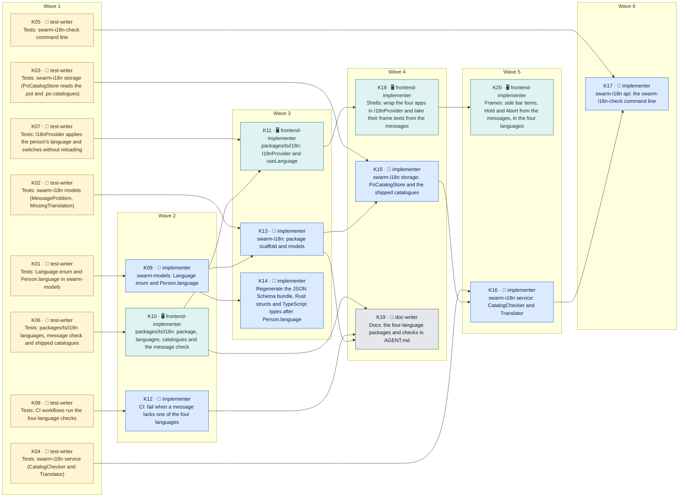

# T0.15: Plan

**Plan:** 🟢 Approved

**Push:** 🟢 Approved

<!-- ticket:specs -->
## 📚 Specifications

The technical pages, features, use cases and business rules of [TICKET.md](TICKET.md), copied by `python3 .claude/scripts/tickets/ticket_refs.py sync`.

- [🖥️ GUI and WebUI: apps and shared packages](../../specs/technical/10-frontends.md#apps)
- [🔩 Engine and services](../../specs/technical/04-engine.md)
- [📏 BR-017: Every screen in four languages](../../specs/functional/business-rules/BR-017-every-screen-in-four-languages.md)
- [📘 FS-012: Operators, deployment and languages](../../specs/functional/features/FS-012-operators-deployment-and-languages.md)
- [🏗️ Architecture](../../specs/technical/01-architecture.md)
- [🎬 UC-023](../../specs/functional/use-cases/UC-023-configure-the-workspace-of-ground-control.md)
- [🎬 UC-015](../../specs/functional/use-cases/UC-015-invite-a-client-to-the-client-portal.md)
<!-- /ticket:specs -->

## Summary

T0.15 (Four languages) as 19 tasks in 6 waves.

Wave 1 has eight test-writer tasks:

- the shared `Language` enum and `Person.language` in swarm-models;
- the models, storage, service and CLI layers of a new Python package `swarm-i18n` (Babel catalogues);
- the language helpers, the message check and the React provider of `packages/ts/i18n` (FormatJS through react-intl);
- the CI workflow tests.

The implementation follows the layers:

- swarm-models first, then the regenerated schema, Rust and TypeScript types;
- in swarm-i18n: package and models, then storage with the shipped `.po` catalogues, then service (checker and translator), then the `swarm-i18n-check` CLI;
- the TS i18n package (languages, catalogues, `check-messages` script), then its `I18nProvider`;
- the CI steps in `python.yml` and `typescript.yml` that fail when a message lacks a language;
- wiring the four T0.14 shells into the provider, with their frame texts as messages.

A doc-writer task updates AGENT.md. No capture task: the ticket's area has no `frontends/` and `TICKET.md` lists no screen (TKT-21). The language switch is proven at package level.

## Assumptions

- No screen is linked: the four shells are the empty frames of T0.14 and show no use case state; the ticket only takes their side bar items, Hold, Abort and the status bar language from the messages in four languages.
- Criterion 3 comes from FS-012 AC-2; only the stored language and its application at sign-in are verified here, as the Client portal comes later.
- The ticket anchor is the sprint anchor `#s03`, as the roadmap has no anchor per ticket.
- UC-023 and UC-015 are cited for BR-017 criteria as they apply BR-017; the check script was not run by me.
- The prerequisites T0.12 and T0.14 are not built yet: there is no `frontends/` folder and no gateway person store. The plan assumes T0.14 creates each shell with `src/main.tsx` (root) and `src/App.tsx` (frame). If it does not, K18 reports the real paths as blocked.
- The language is stored with the person through a new `language` field on the shared `Person` model of swarm-models (default English, values en, fr, de, es). Persisting it in a database, Keycloak or a gateway endpoint is outside this ticket's area, which is `packages/ts/i18n`, `packages/python` and `.github/workflows`; `services/gateway` is not in it. That comes with the ticket that stores people.
- `Language` lives in a new `swarm_models/models/enums.py`, following the CLAUDE.md rule of one `enums.py` per models module. The existing `enums/` folders of swarm-models are not migrated: that is a follow-up.
- The Python catalogues sit in a new package `packages/python/swarm-i18n` (module `swarm_i18n`). They are read from `.po` files with Babel's `read_po`, so no compiled `.mo` binary is committed.
- All FormatJS messages are kept centrally in `packages/ts/i18n/src/messages/<lang>.json`, used through react-intl, so one check covers every front end.
- The seed message is the status bar text 'Language: {language}' from the mock-ups. Its French, German and Spanish texts ('Langue : ', 'Sprache: ', 'Idioma: ') and the frame texts added in K18 are translations proposed by the agents. No specification gives them, so the product owner should review them (T1.35 reviews every P1 text in the four languages).
- Language names are shown as endonyms (English, Français, Deutsch, Español) and are not translated, as on the UC-023 A3 mock-up. 'Swarm', the names of the parts and Client data are not translated (BR-017 exception).
- At run time, a Python message with an empty translation falls back to English, with a WARNING. A message id not in the template raises an error.
- The CI check is added as steps of the existing `python.yml` (packages job) and `typescript.yml` (check job), not as a new workflow. `detect_changes.py` already runs every check when `packages/` changes.
- The switch without reloading and the applying of the person's language at sign-in are proven by the Vitest test of `I18nProvider`. The shells are wired to it but gain no visible language control: the choice belongs to the UC-023 A3 and UC-015 A2 screens of later tickets, where a Playwright check can drive it. So the four shells get no shell-specific test of their own.
- K18 changes the four shells under `frontends/` although the roadmap area of T0.15 does not list `frontends/`. No use case screen changes, so `TICKET.md` keeps '➖ No screen' and the plan has no capture task (TKT-21 keys on the area and the listed screens).

<!-- plan:graph -->

> [!NOTE]
> Generated from the json block at the end of this page by `python3 .claude/scripts/tickets/plan.py render`.
> To change a task, edit the json block, then render again: never edit this view by hand.

## Waves

| Wave | Tasks | Agents running at once |
| --- | --- | --- |
| 1 | [K01](#k01), [K02](#k02), [K03](#k03), [K04](#k04), [K05](#k05), [K06](#k06), [K07](#k07), [K08](#k08) | 8 of 8 |
| 2 | [K09](#k09), [K10](#k10), [K12](#k12) | 3 of 3 |
| 3 | [K11](#k11), [K13](#k13), [K14](#k14) | 3 of 3 |
| 4 | [K15](#k15), [K18](#k18), [K19](#k19) | 3 of 3 |
| 5 | [K20](#k20), [K16](#k16) | 2 of 2 |
| 6 | [K17](#k17) | 1 of 1 |

| Wave | Task | Agent | Depends on | Unblocks |
| --- | --- | --- | --- | --- |
| 1 | [K01](#k01) Tests: Language enum and Person.language in swarm-models | 🧪 test-writer | none | [K09](#k09) |
| 1 | [K02](#k02) Tests: swarm-i18n models (MessageProblem, MissingTranslation) | 🧪 test-writer | none | [K13](#k13) |
| 1 | [K03](#k03) Tests: swarm-i18n storage (PoCatalogStore reads the .pot and .po catalogues) | 🧪 test-writer | none | [K15](#k15) |
| 1 | [K04](#k04) Tests: swarm-i18n service (CatalogChecker and Translator) | 🧪 test-writer | none | [K16](#k16) |
| 1 | [K05](#k05) Tests: swarm-i18n-check command line | 🧪 test-writer | none | [K17](#k17) |
| 1 | [K06](#k06) Tests: packages/ts/i18n languages, message check and shipped catalogues | 🧪 test-writer | none | [K10](#k10) |
| 1 | [K07](#k07) Tests: I18nProvider applies the person's language and switches without reloading | 🧪 test-writer | none | [K11](#k11) |
| 1 | [K08](#k08) Tests: CI workflows run the four-language checks | 🧪 test-writer | none | [K12](#k12) |
| 2 | [K09](#k09) swarm-models: Language enum and Person.language | 🐍 implementer | [K01](#k01) | [K13](#k13), [K14](#k14) |
| 2 | [K10](#k10) packages/ts/i18n: package, languages, catalogues and the message check | 🖥️ frontend-implementer | [K06](#k06) | [K11](#k11), [K19](#k19) |
| 2 | [K12](#k12) CI: fail when a message lacks one of the four languages | 🐍 implementer | [K08](#k08) | [K19](#k19) |
| 3 | [K11](#k11) packages/ts/i18n: I18nProvider and useLanguage | 🖥️ frontend-implementer | [K07](#k07), [K10](#k10) | [K18](#k18) |
| 3 | [K13](#k13) swarm-i18n: package scaffold and models | 🐍 implementer | [K02](#k02), [K09](#k09) | [K15](#k15), [K19](#k19) |
| 3 | [K14](#k14) Regenerate the JSON Schema bundle, Rust structs and TypeScript types after Person.language | 🐍 implementer | [K09](#k09) | none |
| 4 | [K15](#k15) swarm-i18n storage: PoCatalogStore and the shipped catalogues | 🐍 implementer | [K03](#k03), [K13](#k13) | [K16](#k16) |
| 4 | [K18](#k18) Shells: wrap the four apps in I18nProvider and take their frame texts from the messages | 🖥️ frontend-implementer | [K11](#k11) | [K20](#k20) |
| 5 | [K20](#k20) Frames: side bar items, Hold and Abort from the messages, in the four languages | 🖥️ frontend-implementer | [K18](#k18) | none |
| 4 | [K19](#k19) Docs: the four-language packages and checks in AGENT.md | 📝 doc-writer | [K10](#k10), [K12](#k12), [K13](#k13) | none |
| 5 | [K16](#k16) swarm-i18n service: CatalogChecker and Translator | 🐍 implementer | [K04](#k04), [K15](#k15) | [K17](#k17) |
| 6 | [K17](#k17) swarm-i18n api: the swarm-i18n-check command line | 🐍 implementer | [K05](#k05), [K16](#k16) | none |

## Dependency graph



## Tasks

### <a id="k01"></a>K01: Tests: Language enum and Person.language in swarm-models

| Agent | Wave | Depends on | Unblocks |
| --- | --- | --- | --- |
| 🧪 test-writer | 1 | none | [K09](#k09) |

**Files** (only this task may change them in its wave):

- `packages/python/swarm-models/tests/models/test_swarm_models_enums.py`
- `packages/python/swarm-models/tests/models/people/test_person.py`

**Done when:** `uv run ruff format --check` and `uv run ruff check` pass on both files. `uv run pytest packages/python/swarm-models/tests/models/test_swarm_models_enums.py packages/python/swarm-models/tests/models/people/test_person.py` fails only because `swarm_models.models.enums`, `SEPersonInvalidLanguage` or the `language` field does not exist yet.

**Brief:**

Write the tests, first, for the language stored with each person (docs/tickets/T0.15/TICKET.md, 'The language of each person stored with the person').

Specifications applied:
- docs/specs/functional/business-rules/BR-017-every-screen-in-four-languages.md (four languages, each person chooses theirs)
- docs/specs/functional/features/FS-012-operators-deployment-and-languages.md (AC-2)
- docs/specs/technical/02-data-models.md#models (`Person` is a shared global model)
- docs/specs/technical/01-architecture.md#layers

1. New file `packages/python/swarm-models/tests/models/test_swarm_models_enums.py`, class `TestSwarmModelsEnums`. It covers `Language`, imported from `swarm_models.models.enums`:
   - a `StrEnum` with exactly four members: `ENGLISH = "en"`, `FRENCH = "fr"`, `GERMAN = "de"`, `SPANISH = "es"`, in that order;
   - values unique, lower case, no hyphen.
2. Extend `packages/python/swarm-models/tests/models/people/test_person.py` (class `TestPerson`). Keep every existing test and the AGENT.md model test set. Add a field `language`:
   - the default is `Language.ENGLISH`, and `None` becomes the default;
   - every member and its value string (`"de"`) is accepted and comes back as the `Language` member;
   - bad values are rejected with `SEPersonInvalidLanguage`, imported from `swarm_models.models.people.exceptions`. Parametrise them: `True`, `1`, `""`, `"it"`, `"en-GB"`, `"EN"`, `[]`;
   - `SEPersonInvalidLanguage` subclasses `SEInvalidPersonException`, so extend `test_the_exceptions_share_their_base`;
   - a round trip with `Language.GERMAN` keeps it.

Rules (AGENT.md Tests and Data and enums):
- compare with the enum members, never raw strings, except as the raw input under test;
- one `Test<Subject>` class per file;
- no unittest.mock;
- no `Any` and no `object` as a type.

### <a id="k02"></a>K02: Tests: swarm-i18n models (MessageProblem, MissingTranslation)

| Agent | Wave | Depends on | Unblocks |
| --- | --- | --- | --- |
| 🧪 test-writer | 1 | none | [K13](#k13) |

**Files** (only this task may change them in its wave):

- `packages/python/swarm-i18n/tests/models/test_swarm_i18n_enums.py`
- `packages/python/swarm-i18n/tests/models/translations/test_missing_translation.py`

**Done when:** `uv run ruff format --check` and `uv run ruff check` pass on both files. `uv run pytest` on them fails only because `swarm_i18n` does not exist yet.

**Brief:**

Write the model tests of the new Python package `swarm-i18n` (module `swarm_i18n`). The package holds the Babel catalogues of Python messages, translated in the person's language.

Specifications applied:
- docs/specs/technical/04-engine.md#notifier ('texts translated with Babel in the person's language')
- docs/specs/functional/business-rules/BR-017-every-screen-in-four-languages.md
- docs/specs/technical/01-architecture.md#layers

1. `packages/python/swarm-i18n/tests/models/test_swarm_i18n_enums.py`, class `TestSwarmI18nEnums`. It covers `MessageProblem` from `swarm_i18n.models.enums`:
   - a `StrEnum` with exactly `MISSING = "missing"`, `EMPTY = "empty"` and `FUZZY = "fuzzy"`;
   - values unique, no hyphen.
2. `packages/python/swarm-i18n/tests/models/translations/test_missing_translation.py`, class `TestMissingTranslation`. It covers `MissingTranslation` from `swarm_i18n.models.translations.missing_translation`, a frozen Pydantic model with `extra="forbid"`, one message lacking in one language. Its fields:
   - `message_id` (str, stripped, empty refused);
   - `language` (`Language` from `swarm_models.models.enums`: `ENGLISH`, `FRENCH`, `GERMAN`, `SPANISH`; the value string is accepted);
   - `problem` (`MessageProblem`).

   Write the full AGENT.md model set: `test_defaults` (no field has a default, so construction without them fails), `test_full_valid_construction`, `test_rejects_bad_values` (bool, int, empty or blank string, unknown language or problem) and `test_rejects_unknown_keys`. Add `test_round_trip`, a test that the model is frozen, and a test that the exceptions share their base.

   Import the exceptions from `swarm_i18n.models.translations.exceptions`:
   - `SEInvalidMissingTranslationException` (the base);
   - `SEMissingTranslationInvalidMessageId`;
   - `SEMissingTranslationInvalidLanguage`;
   - `SEMissingTranslationInvalidProblem`.

Rules (AGENT.md Tests):
- no `__init__.py`;
- one class per file;
- compare with enum members;
- no `Any` or `object` types.

### <a id="k03"></a>K03: Tests: swarm-i18n storage (PoCatalogStore reads the .pot and .po catalogues)

| Agent | Wave | Depends on | Unblocks |
| --- | --- | --- | --- |
| 🧪 test-writer | 1 | none | [K15](#k15) |

**Files** (only this task may change them in its wave):

- `packages/python/swarm-i18n/tests/storage/catalogs/conftest.py`
- `packages/python/swarm-i18n/tests/storage/catalogs/test_po_catalog_store.py`

**Done when:** `uv run ruff format --check` and `uv run ruff check` pass on both files. `uv run pytest packages/python/swarm-i18n/tests/storage` fails only because `swarm_i18n` does not exist yet.

**Brief:**

Write the storage tests of `swarm_i18n`.

Specifications applied:
- docs/specs/technical/04-engine.md#notifier (Babel catalogues)
- docs/specs/functional/business-rules/BR-017-every-screen-in-four-languages.md
- docs/specs/technical/01-architecture.md#layers (storage reads data and nothing else)

Subject: `PoCatalogStore` from `swarm_i18n.storage.catalogs.po_catalog_store`, built as `PoCatalogStore(root: Path, logger: Optional[Logger] = None)`. It reads the gettext template `<root>/swarm.pot` and one catalogue per language, `<root>/<language value>/LC_MESSAGES/swarm.po`, with Babel's `babel.messages.pofile.read_po`. Nothing is compiled to `.mo`.

1. `conftest.py`: fixtures that write a locales folder in `tmp_path`:
   - one complete folder (a template with one message `Language: {language}` and four translated `.po` files);
   - one folder whose French `.po` is missing;
   - one with a malformed French `.po`.

   Constants sit at module level as AGENT.md allows in test helpers.
2. `test_po_catalog_store.py`, class `TestPoCatalogStore`:
   - `template()` returns a `babel.messages.catalog.Catalog` holding the message id;
   - `catalog(Language.FRENCH)` returns the French catalogue with its translation;
   - a missing file and a malformed file each raise `SECatalogUnreadableError` from `swarm_i18n.models.catalogs.exceptions`, a subclass of `SECatalogError`, with the original error as `__cause__`;
   - `PoCatalogStore.DOMAIN == "swarm"`;
   - `PoCatalogStore.DEFAULT_ROOT` is the `locales` folder shipped inside the package (`swarm_i18n/locales`), and holds `swarm.pot` and the four `.po` files.

`Language` comes from `swarm_models.models.enums`. Use real files, no mocks (AGENT.md Tests). Package tests cannot import `tests.` helpers, so share fixtures through this folder's `conftest.py` only.

### <a id="k04"></a>K04: Tests: swarm-i18n service (CatalogChecker and Translator)

| Agent | Wave | Depends on | Unblocks |
| --- | --- | --- | --- |
| 🧪 test-writer | 1 | none | [K16](#k16) |

**Files** (only this task may change them in its wave):

- `packages/python/swarm-i18n/tests/service/catalogs/conftest.py`
- `packages/python/swarm-i18n/tests/service/catalogs/test_catalog_checker.py`
- `packages/python/swarm-i18n/tests/service/translations/conftest.py`
- `packages/python/swarm-i18n/tests/service/translations/test_translator.py`

**Done when:** `uv run ruff format --check` and `uv run ruff check` pass on the four files. `uv run pytest packages/python/swarm-i18n/tests/service` fails only because `swarm_i18n` (or `Person.language`) does not exist yet.

**Brief:**

Write the service tests of `swarm_i18n`.

Specifications applied:
- docs/specs/functional/business-rules/BR-017-every-screen-in-four-languages.md
- docs/specs/technical/04-engine.md#notifier ('texts translated with Babel in the person's language')
- docs/specs/functional/features/FS-012-operators-deployment-and-languages.md (AC-2, the person's chosen language)
- docs/tickets/T0.15/TICKET.md acceptance criteria 1 and 3

Catalogue layout: `<root>/swarm.pot` and `<root>/<en|fr|de|es>/LC_MESSAGES/swarm.po`, read by `PoCatalogStore(root)` from `swarm_i18n.storage.catalogs.po_catalog_store`. Each folder's `conftest.py` writes its own catalogues in `tmp_path`. Package tests cannot import `tests.` helpers.

1. `service/catalogs/test_catalog_checker.py`, class `TestCatalogChecker`. Subject: `CatalogChecker(store, logger=None)` from `swarm_i18n.service.catalogs.catalog_checker`; `find_missing()` returns `List[MissingTranslation]`.
   - Complete catalogues give `[]`.
   - A message added in English only (in the template and `en`, absent from `fr`, `de`, `es`) gives three entries with `MessageProblem.MISSING`, in the order French, German, Spanish.
   - An empty `msgstr` gives `EMPTY`; a `#, fuzzy` entry gives `FUZZY`.
   - The order is template order, then `Language` order.
   - The shipped catalogues (`PoCatalogStore(PoCatalogStore.DEFAULT_ROOT)`) give `[]`.
2. `service/translations/test_translator.py`, class `TestTranslator`. Subject: `Translator(store, logger=None)` from `swarm_i18n.service.translations.translator`.
   - `translate(message_id, Language.GERMAN)` returns the German `msgstr`.
   - `translate_for(person, message_id)` uses `person.language`: a `Person` from `swarm_models.models.people.person` with `language=Language.GERMAN` gets German, and one with no language gets English. Build the version 7 ids as `packages/python/swarm-models/tests/models/people/test_person.py` does.
   - An id absent from the template raises `SECatalogUnknownMessageError` from `swarm_i18n.models.catalogs.exceptions`.
   - An empty translation falls back to the English text.

Models: `MissingTranslation` from `swarm_i18n.models.translations.missing_translation`, `MessageProblem` from `swarm_i18n.models.enums`, `Language` from `swarm_models.models.enums`. Compare with enum members. No mocks.

### <a id="k05"></a>K05: Tests: swarm-i18n-check command line

| Agent | Wave | Depends on | Unblocks |
| --- | --- | --- | --- |
| 🧪 test-writer | 1 | none | [K17](#k17) |

**Files** (only this task may change them in its wave):

- `packages/python/swarm-i18n/tests/api/cli/conftest.py`
- `packages/python/swarm-i18n/tests/api/cli/test_check_catalogs.py`

**Done when:** `uv run ruff format --check` and `uv run ruff check` pass on both files. `uv run pytest packages/python/swarm-i18n/tests/api` fails only because `swarm_i18n` does not exist yet.

**Brief:**

Write the tests of the console script that CI runs to fail on a Python message lacking one of the four languages (docs/tickets/T0.15/TICKET.md, acceptance criterion 1).

Specifications applied:
- docs/specs/functional/business-rules/BR-017-every-screen-in-four-languages.md (example 2: a screen in English only is not accepted)
- docs/specs/technical/01-architecture.md#layers (the command line lives in `api/cli`)

Subject: `main(argv: Optional[List[str]] = None) -> int` in `swarm_i18n.api.cli.check_catalogs`, the entry point of the console script `swarm-i18n-check`. Option `--locales <folder>`; the default is the shipped `PoCatalogStore.DEFAULT_ROOT`. Exit codes:
- `0`: prints one line on stdout saying every message is in English, French, German and Spanish;
- `1`: prints one line per `MissingTranslation` on stderr, naming the message id, the language value and the problem;
- `2`: a `SECatalogError`, printed on stderr.

1. `conftest.py`: fixtures writing, in `tmp_path`, a complete locales folder, a folder with a message in English only, and a folder with a malformed `.po`. Layout: `swarm.pot`, `<en|fr|de|es>/LC_MESSAGES/swarm.po`.
2. `test_check_catalogs.py`, class `TestCheckCatalogs`:
   - English only gives exit 1, and stderr names the id and `fr`, `de` and `es`;
   - complete gives 0;
   - malformed gives 2;
   - no argument (the shipped catalogues) gives 0.

Use `capsys`. Compare languages through `Language.FRENCH.value` and similar, never a bare literal. No mocks.

### <a id="k06"></a>K06: Tests: packages/ts/i18n languages, message check and shipped catalogues

| Agent | Wave | Depends on | Unblocks |
| --- | --- | --- | --- |
| 🧪 test-writer | 1 | none | [K10](#k10) |

**Files** (only this task may change them in its wave):

- `packages/ts/i18n/test/languages.test.ts`
- `packages/ts/i18n/test/find-missing.test.ts`
- `packages/ts/i18n/test/check-messages.test.ts`
- `packages/ts/i18n/test/catalogues.test.ts`
- `packages/ts/i18n/test/fixtures/english-only/en.json`
- `packages/ts/i18n/test/fixtures/english-only/fr.json`
- `packages/ts/i18n/test/fixtures/english-only/de.json`
- `packages/ts/i18n/test/fixtures/english-only/es.json`
- `packages/ts/i18n/test/fixtures/complete/en.json`
- `packages/ts/i18n/test/fixtures/complete/fr.json`
- `packages/ts/i18n/test/fixtures/complete/de.json`
- `packages/ts/i18n/test/fixtures/complete/es.json`

**Done when:** The files exist and are valid TypeScript and JSON. `pnpm --filter ./packages/ts/i18n run test` fails only because the package sources (`package.json`, `src/`, `scripts/`) do not exist yet.

**Brief:**

Write the Vitest tests of the new package `@swarm/i18n` (`packages/ts/i18n`): FormatJS messages in English, French, German and Spanish.

Specifications applied:
- docs/specs/technical/10-frontends.md#apps (`i18n`: 'FormatJS messages in English, French, German and Spanish')
- docs/specs/functional/business-rules/BR-017-every-screen-in-four-languages.md
- docs/specs/functional/use-cases/UC-023-configure-the-workspace-of-ground-control.md (step 4 and screen A3, where the languages are offered as English, Français, Deutsch, Español)
- docs/tickets/T0.15/TICKET.md acceptance criterion 1

The catalogues are `packages/ts/i18n/src/messages/<en|fr|de|es>.json`: flat objects of message id to ICU message.

1. `test/languages.test.ts` covers `src/languages.ts` (import from `../src/languages.ts`):
   - `LANGUAGES` is exactly `["en", "fr", "de", "es"]`, and `DEFAULT_LANGUAGE` is `"en"`;
   - `LANGUAGE_NAMES` holds the endonyms `{ en: "English", fr: "Français", de: "Deutsch", es: "Español" }`, as on UC-023 A3;
   - `isLanguage(value: unknown)` accepts only these four;
   - `resolveLanguage(personLanguage: string | null | undefined)` returns the person's language when it is one of the four, else `"en"` (`"de"` gives `"de"`; `null`, `"it"` and `"en-GB"` give `"en"`).
2. `test/find-missing.test.ts` covers `findMissing(catalogues)` from `../src/find-missing.ts`. The argument is one record of id to message per language. The result is an array of `{ id, language, problem }`, where `problem` is one of:
   - `"missing"`: an id of `en` absent from a translation;
   - `"empty"`: a blank message;
   - `"unknown"`: an id present in a translation but not in `en`.

   It is sorted by id, then in `LANGUAGES` order. A complete set gives `[]`.
3. `test/check-messages.test.ts` runs `node --experimental-strip-types scripts/check-messages.ts --dir <folder>` with `node:child_process` `spawnSync`, from the package folder:
   - `test/fixtures/english-only` exits 1, and stderr names the message id and `fr`, `de`, `es`;
   - `test/fixtures/complete` exits 0;
   - no `--dir` (the shipped `src/messages`) exits 0.
4. `test/catalogues.test.ts`:
   - `MESSAGES` from `../src/catalogues.ts` has one catalogue per language;
   - `findMissing(MESSAGES)` is `[]`;
   - the id `status.language` exists, and in English it is the ICU message `Language: {language}` (the status bar text of the mock-ups, docs/specs/visual-identity.md#components).
5. Fixtures:
   - `english-only`: one id `sample.greeting` in `en.json`, with `{}` in `fr`, `de` and `es`;
   - `complete`: the same id in all four.

Use Vitest (`import { describe, it, expect } from "vitest"`), strict TypeScript, no `any`.

### <a id="k07"></a>K07: Tests: I18nProvider applies the person's language and switches without reloading

| Agent | Wave | Depends on | Unblocks |
| --- | --- | --- | --- |
| 🧪 test-writer | 1 | none | [K11](#k11) |

**Files** (only this task may change them in its wave):

- `packages/ts/i18n/test/i18n-provider.test.tsx`

**Done when:** The file is valid TSX. `pnpm --filter ./packages/ts/i18n run test` fails only because the package sources do not exist yet.

**Brief:**

Write the Vitest component test, in jsdom with `@testing-library/react`, for the React provider of `@swarm/i18n`.

Specifications applied:
- docs/specs/technical/10-frontends.md#apps (React 19, FormatJS)
- docs/specs/functional/business-rules/BR-017-every-screen-in-four-languages.md (each person chooses their language)
- docs/specs/functional/features/FS-012-operators-deployment-and-languages.md (AC-2)
- docs/specs/functional/use-cases/UC-015-invite-a-client-to-the-client-portal.md (step 4, alternative flow A2: a Client who chose German sees German)
- docs/specs/functional/use-cases/UC-023-configure-the-workspace-of-ground-control.md (step 4)
- docs/tickets/T0.15/TICKET.md acceptance criteria 2 and 3

Subject: `packages/ts/i18n/test/i18n-provider.test.tsx`. Import from `../src/i18n-provider.tsx`:
- `I18nProvider`, props `{ language?: string | null; children: ReactNode }`. `language` is the signed-in person's language, resolved with `resolveLanguage`. It wraps react-intl's `IntlProvider` with `MESSAGES[language]`.
- `useLanguage()`, which returns `{ language: Language; setLanguage: (language: Language) => void }`.

Tests:
1. With `language="de"`, a consumer's `useIntl().formatMessage({ id: "status.language" }, { language: LANGUAGE_NAMES.de })` shows the German catalogue's text, which is applied at sign-in. Compute the expected text from `MESSAGES.de` with `IntlMessageFormat` or the same `formatMessage`; never hard-code a translation. Assert that it differs from the English one.
2. With no language, or an unknown one, the text is English.
3. Calling `setLanguage("fr")` inside `act` (no reload):
   - the same DOM element now shows the French text;
   - a consumer component counts its mounts with a ref or effect, and the count stays 1: the tree is not remounted;
   - `document.documentElement.lang` becomes `"fr"`;
   - `window.location.href` is unchanged.
4. `document.documentElement.lang` equals the initial language after the first render.

Vitest with the jsdom environment (`vitest.config.ts` is written by the implementer). No `any`.

### <a id="k08"></a>K08: Tests: CI workflows run the four-language checks

| Agent | Wave | Depends on | Unblocks |
| --- | --- | --- | --- |
| 🧪 test-writer | 1 | none | [K12](#k12) |

**Files** (only this task may change them in its wave):

- `tests/ci/workflows/test_python_workflow.py`
- `tests/ci/workflows/test_typescript_workflow.py`

**Done when:** `uv run ruff format --check` and `uv run ruff check` pass on both files. `uv run pytest tests/ci/workflows/test_python_workflow.py tests/ci/workflows/test_typescript_workflow.py` fails only on the new or changed assertions about `swarm-i18n-check` and `check-messages`.

**Brief:**

Extend the workflow tests so that CI must fail when a message lacks one of the four languages (docs/tickets/T0.15/TICKET.md: 'A CI check, in .github/workflows/', acceptance criterion 1).

Specifications applied:
- docs/specs/functional/business-rules/BR-017-every-screen-in-four-languages.md
- docs/specs/technical/10-frontends.md#apps
- docs/specs/technical/04-engine.md#notifier

1. `tests/ci/workflows/test_python_workflow.py`:
   - add `"uv run swarm-i18n-check"` as the last command of `test_the_packages_job_runs_its_checks_in_order`, after `uv run swarm-models-schemas --check`;
   - add a test that the `packages` job has a step running `uv run swarm-i18n-check` with no `${{` expression in it.
2. `tests/ci/workflows/test_typescript_workflow.py`:
   - the `check` job gets a fifth run step, `pnpm --filter "./$PROJECT" run --if-present check-messages`, after `test`;
   - extend the parametrised `test_each_script_runs_for_the_selected_project` with `(4, "check-messages")`;
   - change `test_there_are_exactly_four_run_steps` to five (rename it accordingly).

Keep every other test. Follow the existing style of these files.

### <a id="k09"></a>K09: swarm-models: Language enum and Person.language

| Agent | Wave | Depends on | Unblocks |
| --- | --- | --- | --- |
| 🐍 implementer | 2 | [K01](#k01) | [K13](#k13), [K14](#k14) |

**Files** (only this task may change them in its wave):

- `packages/python/swarm-models/src/swarm_models/models/enums.py`
- `packages/python/swarm-models/src/swarm_models/models/people/person.py`
- `packages/python/swarm-models/src/swarm_models/models/people/exceptions/__init__.py`
- `packages/python/swarm-models/src/swarm_models/models/people/exceptions/person/__init__.py`
- `packages/python/swarm-models/src/swarm_models/models/people/exceptions/person/preferences/__init__.py`
- `packages/python/swarm-models/src/swarm_models/models/people/exceptions/person/preferences/se_person_invalid_language.py`

**Done when:** `uv run pytest packages/python/swarm-models/tests -n 2` passes. `uv run mypy packages/python/swarm-models/src` passes. `uv run ruff check packages/python/swarm-models` passes. `uv run pytest tests/conventions/packages -n 2` passes.

**Brief:**

Store the language of each person with the person, in the shared model, so that the tests of K01 pass.

Specifications applied:
- docs/specs/functional/business-rules/BR-017-every-screen-in-four-languages.md
- docs/specs/functional/features/FS-012-operators-deployment-and-languages.md (AC-2)
- docs/specs/technical/02-data-models.md#models (`Person`, global)

1. Create `packages/python/swarm-models/src/swarm_models/models/enums.py`, holding only enums. It defines `Language`, a `@unique` `StrEnum` documented with its members under `Attributes:`: `ENGLISH = "en"`, `FRENCH = "fr"`, `GERMAN = "de"`, `SPANISH = "es"`. This follows AGENT.md: one `enums.py` at the root of the models module. The older `enums/` folders of swarm-models stay as they are: migrating them is out of scope.
2. In `person.py`:
   - add `language: Language = Field(default=Language.ENGLISH, description=...)`;
   - add a constant `LANGUAGE_FIELD: ClassVar[str]` and a `validate_language` validator in `mode="before"`. `None` becomes the default. A `bool`, a non-string or a string that is not exactly a member value raises `SEPersonInvalidLanguage` with `Invalid language: {value!r}.` then `Must be one of ...`;
   - update the class docstring.
3. Add `SEPersonInvalidLanguage(SEInvalidPersonException)` in a new sub-folder, `exceptions/person/preferences/`. `exceptions/person/` already holds five files, and AGENT.md allows at most five Python files per folder. Re-export it through the sorted `__all__` of `preferences/__init__.py`, `person/__init__.py` and `people/exceptions/__init__.py`.

Rules (AGENT.md Pydantic models, Exceptions and Naming):
- `models` never logs;
- no `Any` and no `object` as a type;
- no raw strings except constants and messages.

Do not touch `api/cli/export_schemas.py` or `models/commands/command.py`: they hold unrelated uncommitted work.

### <a id="k10"></a>K10: packages/ts/i18n: package, languages, catalogues and the message check

| Agent | Wave | Depends on | Unblocks |
| --- | --- | --- | --- |
| 🖥️ frontend-implementer | 2 | [K06](#k06) | [K11](#k11), [K19](#k19) |

**Files** (only this task may change them in its wave):

- `packages/ts/i18n/package.json`
- `packages/ts/i18n/tsconfig.json`
- `packages/ts/i18n/eslint.config.js`
- `packages/ts/i18n/vitest.config.ts`
- `packages/ts/i18n/src/index.ts`
- `packages/ts/i18n/src/languages.ts`
- `packages/ts/i18n/src/find-missing.ts`
- `packages/ts/i18n/src/catalogues.ts`
- `packages/ts/i18n/src/messages/en.json`
- `packages/ts/i18n/src/messages/fr.json`
- `packages/ts/i18n/src/messages/de.json`
- `packages/ts/i18n/src/messages/es.json`
- `packages/ts/i18n/scripts/check-messages.ts`
- `pnpm-lock.yaml`

**Done when:** `pnpm install` succeeds. `pnpm --filter ./packages/ts/i18n run lint` and `run typecheck` pass, the latter except for `test/i18n-provider.test.tsx`, whose subject K11 writes. `pnpm --filter ./packages/ts/i18n exec vitest run test/languages.test.ts test/find-missing.test.ts test/check-messages.test.ts test/catalogues.test.ts` passes. `pnpm --filter ./packages/ts/i18n run check-messages` exits 0.

**Brief:**

Create the shared package `@swarm/i18n` so that the tests of K06 pass. The tests are `packages/ts/i18n/test/languages.test.ts`, `find-missing.test.ts`, `check-messages.test.ts` and `catalogues.test.ts`.

Specifications applied:
- docs/specs/technical/10-frontends.md#apps
- docs/specs/technical/01-architecture.md#mono-repo (`packages/ts/` holds `i18n`)
- docs/specs/functional/business-rules/BR-017-every-screen-in-four-languages.md
- docs/specs/functional/use-cases/UC-023-configure-the-workspace-of-ground-control.md (screen A3: endonyms)

1. `package.json`, named `@swarm/i18n`, private, `type: module`, `exports` `./src/index.ts`, modelled on `packages/ts/live/package.json`:
   - scripts: `lint` (`eslint .`), `typecheck` (`tsc --noEmit -p tsconfig.json`), `test` (`vitest run`), `check-messages` (`node --experimental-strip-types scripts/check-messages.ts`);
   - dependencies: `react-intl` (FormatJS), with `react` and `react-dom` 19 as peer and dev dependencies;
   - dev dependencies: `vitest`, `jsdom`, `@testing-library/react`, `@types/react`, `@types/react-dom`, `@types/node`, `typescript`, `eslint`, `@eslint/js`, `typescript-eslint`, `@swarm/config` (`workspace:*`). Pin exact versions as `live` does.

   Run `pnpm install` to update `pnpm-lock.yaml`.
2. Configuration:
   - `tsconfig.json` extends `@swarm/config` `tsconfig.base.json`, adds the `DOM` lib, `jsx: react-jsx` and `resolveJsonModule`, and includes `src`, `scripts` and `test`;
   - `eslint.config.js` follows `live`;
   - `vitest.config.ts` uses `environment: "jsdom"`.
3. `src/languages.ts`: `LANGUAGES` (`as const`: `en`, `fr`, `de`, `es`), `type Language`, `DEFAULT_LANGUAGE`, `LANGUAGE_NAMES` (endonyms), `isLanguage`, `resolveLanguage`.
4. `src/find-missing.ts`: `findMissing` with the problems `missing`, `empty` and `unknown`, sorted as the tests expect.
5. `src/messages/<lang>.json`, the four catalogues. They hold one message, `status.language`, the status bar text of the mock-ups (docs/specs/visual-identity.md#components):
   - en `Language: {language}`;
   - fr `Langue : {language}`;
   - de `Sprache: {language}`;
   - es `Idioma: {language}`.

   `src/catalogues.ts` exports `MESSAGES: Record<Language, Record<MessageId, string>>`, with `type MessageId = keyof typeof en`.
6. `scripts/check-messages.ts`:
   - reads `--dir` (default `src/messages`, relative to the package) with `node:fs`;
   - applies the same rule as `findMissing` (import it);
   - prints one line per problem on stderr and exits 1, or prints one line and exits 0.
7. `src/index.ts` re-exports the public API.

The provider, `src/i18n-provider.tsx`, is task K11: do not write it. Strict TypeScript, no `any`.

### <a id="k12"></a>K12: CI: fail when a message lacks one of the four languages

| Agent | Wave | Depends on | Unblocks |
| --- | --- | --- | --- |
| 🐍 implementer | 2 | [K08](#k08) | [K19](#k19) |

**Files** (only this task may change them in its wave):

- `.github/workflows/python.yml`
- `.github/workflows/typescript.yml`

**Done when:** `uv run pytest tests/ci -n 2` passes. `uv run python -c "import yaml; [yaml.safe_load(open(p)) for p in ('.github/workflows/python.yml', '.github/workflows/typescript.yml')]"` succeeds.

**Brief:**

Add the four-language check to CI, so that the tests of K08 (`tests/ci/workflows/test_python_workflow.py` and `test_typescript_workflow.py`) pass.

Specifications applied:
- docs/specs/functional/business-rules/BR-017-every-screen-in-four-languages.md (example 2: English only is not accepted)
- docs/specs/technical/10-frontends.md#apps
- docs/specs/technical/04-engine.md#notifier
- docs/tickets/T0.15/TICKET.md acceptance criterion 1

1. In `.github/workflows/python.yml`, job `packages`, add a last step after 'JSON Schema bundle is up to date':
   - its name says every Python message is in English, French, German and Spanish;
   - it runs `uv run swarm-i18n-check`. The console script comes from the new package `packages/python/swarm-i18n` (tasks K13 to K17).
2. In `.github/workflows/typescript.yml`, job `check`, add a fifth run step after 'Test', named for the messages in four languages. It runs `pnpm --filter "./$PROJECT" run --if-present check-messages`. Only `@swarm/i18n` defines that script today.

No `${{` expression inside a `run`. Change nothing else. `detect_changes.py` already selects every check when `packages/` changes.

### <a id="k11"></a>K11: packages/ts/i18n: I18nProvider and useLanguage

| Agent | Wave | Depends on | Unblocks |
| --- | --- | --- | --- |
| 🖥️ frontend-implementer | 3 | [K07](#k07), [K10](#k10) | [K18](#k18) |

**Files** (only this task may change them in its wave):

- `packages/ts/i18n/src/i18n-provider.tsx`
- `packages/ts/i18n/src/language-context.ts`
- `packages/ts/i18n/src/index.ts`

**Done when:** `pnpm --filter ./packages/ts/i18n run lint`, `run typecheck` and `run test` all pass, with every Vitest file of the package green.

**Brief:**

Write the React provider that applies the signed-in person's language and switches language without reloading, so that `packages/ts/i18n/test/i18n-provider.test.tsx` (K07) passes.

Specifications applied:
- docs/specs/technical/10-frontends.md#apps (React 19, FormatJS)
- docs/specs/functional/business-rules/BR-017-every-screen-in-four-languages.md
- docs/specs/functional/features/FS-012-operators-deployment-and-languages.md (AC-2)
- docs/specs/functional/use-cases/UC-015-invite-a-client-to-the-client-portal.md
- docs/specs/functional/use-cases/UC-023-configure-the-workspace-of-ground-control.md
- docs/tickets/T0.15/TICKET.md acceptance criteria 2 and 3

1. `src/language-context.ts`: a React context holding `{ language: Language; setLanguage: (language: Language) => void }`.
2. `src/i18n-provider.tsx`:
   - `I18nProvider({ language, children })` keeps the current language in React state, initialised with `resolveLanguage(language)`, which is the person's language at sign-in;
   - it renders react-intl's `IntlProvider` with `locale` and `messages={MESSAGES[current]}` and `defaultLocale={DEFAULT_LANGUAGE}`, so that a switch re-renders in place: no `key` change, no remount, no `location.reload`;
   - it sets `document.documentElement.lang` in an effect;
   - it re-applies a new `language` prop when it changes, as at a later sign-in;
   - `useLanguage()` reads the context and throws a clear `Error` outside the provider.
3. Add both to `src/index.ts`.

No `any`. Do not change the catalogues or `package.json`. Everything needed is already declared by K10. If a dependency is missing, report it as `blocked` on K10's `package.json` (TKT-19).

### <a id="k13"></a>K13: swarm-i18n: package scaffold and models

| Agent | Wave | Depends on | Unblocks |
| --- | --- | --- | --- |
| 🐍 implementer | 3 | [K02](#k02), [K09](#k09) | [K15](#k15), [K19](#k19) |

**Files** (only this task may change them in its wave):

- `packages/python/swarm-i18n/pyproject.toml`
- `packages/python/swarm-i18n/src/swarm_i18n/__init__.py`
- `packages/python/swarm-i18n/src/swarm_i18n/py.typed`
- `packages/python/swarm-i18n/src/swarm_i18n/models/__init__.py`
- `packages/python/swarm-i18n/src/swarm_i18n/models/enums.py`
- `packages/python/swarm-i18n/src/swarm_i18n/models/translations/__init__.py`
- `packages/python/swarm-i18n/src/swarm_i18n/models/translations/missing_translation.py`
- `packages/python/swarm-i18n/src/swarm_i18n/models/translations/exceptions/__init__.py`
- `packages/python/swarm-i18n/src/swarm_i18n/models/translations/exceptions/se_invalid_missing_translation_exception.py`
- `packages/python/swarm-i18n/src/swarm_i18n/models/translations/exceptions/se_missing_translation_invalid_message_id.py`
- `packages/python/swarm-i18n/src/swarm_i18n/models/translations/exceptions/se_missing_translation_invalid_language.py`
- `packages/python/swarm-i18n/src/swarm_i18n/models/translations/exceptions/se_missing_translation_invalid_problem.py`
- `packages/python/swarm-i18n/src/swarm_i18n/models/catalogs/__init__.py`
- `packages/python/swarm-i18n/src/swarm_i18n/models/catalogs/exceptions/__init__.py`
- `packages/python/swarm-i18n/src/swarm_i18n/models/catalogs/exceptions/se_catalog_error.py`
- `packages/python/swarm-i18n/src/swarm_i18n/models/catalogs/exceptions/se_catalog_unreadable_error.py`
- `packages/python/swarm-i18n/src/swarm_i18n/models/catalogs/exceptions/se_catalog_unknown_message_error.py`
- `packages/python/swarm-i18n/src/swarm_i18n/storage/__init__.py`
- `packages/python/swarm-i18n/src/swarm_i18n/service/__init__.py`
- `packages/python/swarm-i18n/src/swarm_i18n/api/__init__.py`
- `packages/python/swarm-i18n/src/swarm_i18n/api/cli/__init__.py`
- `pyproject.toml`
- `uv.lock`

**Done when:** `uv sync` succeeds, and `uv run python -c "import swarm_i18n, babel"` succeeds. `uv run pytest packages/python/swarm-i18n/tests/models -n 2` passes. `uv run mypy packages/python/swarm-i18n/src` passes. `uv run ruff check packages/python/swarm-i18n/src` passes. `uv run pytest tests/conventions -n 2` passes.

**Brief:**

Create the Python package of the Babel catalogues, `packages/python/swarm-i18n` (module `swarm_i18n`), and its models, so that the tests of K02 pass.

Specifications applied:
- docs/specs/technical/04-engine.md#notifier ('texts translated with Babel in the person's language')
- docs/specs/technical/01-architecture.md#mono-repo and #layers
- docs/specs/functional/business-rules/BR-017-every-screen-in-four-languages.md

1. `pyproject.toml`, modelled on `packages/python/swarm-nats/pyproject.toml`:
   - dependencies `babel`, `pydantic>=2.14.3` and `swarm-models` (workspace source);
   - `[project.scripts] swarm-i18n-check = "swarm_i18n.api.cli.check_catalogs:main"`. K17 writes that module;
   - `uv_build` backend with `module-name = "swarm_i18n"`.

   Add `py.typed` and the empty `__init__.py` files of `storage`, `service`, `api` and `api/cli`.
2. `models/enums.py` holds only enums: `MessageProblem` (`MISSING`, `EMPTY`, `FUZZY`), `@unique` `StrEnum`.
3. `models/translations/missing_translation.py`: `MissingTranslation`, frozen, `extra="forbid"`. Fields `message_id: str`, `language: Language` (from `swarm_models.models.enums`) and `problem: MessageProblem`, each with `Field(description=...)` and a `mode="before"` validator that raises its own exception. Reject `bool`, strip strings and refuse empty ones.
4. Exceptions, each in its own file and re-exported through a sorted `__all__`:
   - `models/translations/exceptions/`: base `SEInvalidMissingTranslationException`, then `SEMissingTranslationInvalidMessageId`, `SEMissingTranslationInvalidLanguage`, `SEMissingTranslationInvalidProblem`;
   - `models/catalogs/exceptions/`: layer base `SECatalogError`, then `SECatalogUnreadableError` and `SECatalogUnknownMessageError`, both subclasses of `SECatalogError`.
5. Root `pyproject.toml`:
   - add `swarm_i18n` to ruff `known-first-party`;
   - add `packages/python/swarm-i18n/tests` to pytest `testpaths`;
   - add `packages/python/swarm-i18n/src` to mypy `files` and `mypy_path`;
   - if Babel lacks type information, add the minimal mypy override or stub dependency there.

   Then run `uv sync` to update `uv.lock`.

Rules: AGENT.md File shape, Pydantic models, Exceptions, Typing and Data and enums. `models` never logs. No `Any` or `object` as a type.

### <a id="k14"></a>K14: Regenerate the JSON Schema bundle, Rust structs and TypeScript types after Person.language

| Agent | Wave | Depends on | Unblocks |
| --- | --- | --- | --- |
| 🐍 implementer | 3 | [K09](#k09) | none |

**Files** (only this task may change them in its wave):

- `packages/python/swarm-models/schemas/swarm_models.schema.json`
- `packages/rust/swarm-models/src/generated.rs`
- `packages/ts/live/src/generated/models.ts`

**Done when:** `uv run swarm-models-schemas --check` exits 0. `cargo test -p swarm-models`, run in `packages/rust`, passes (including `generated_is_current`). `pnpm --filter ./packages/ts/live run test` passes.

**Brief:**

`Person` gained `language` and swarm-models gained the enum `Language` (K09). Regenerate the derived types in the order of AGENT.md 'Shared models':
1. `uv run swarm-models-schemas`, from the repository root, writes `packages/python/swarm-models/schemas/swarm_models.schema.json`.
2. `cargo run -p swarm-models-codegen`, from `packages/rust`, writes `packages/rust/swarm-models/src/generated.rs`.
3. `pnpm --filter ./packages/ts/live run generate` writes `packages/ts/live/src/generated/models.ts`.

Never edit these files by hand. They hold the person's language for Rust and the front ends.

Specifications applied:
- docs/specs/technical/02-data-models.md#conventions (Pydantic is the single source)
- docs/specs/functional/business-rules/BR-017-every-screen-in-four-languages.md

Regenerate from this ticket's worktree only. The main checkout holds unrelated uncommitted changes to `models/commands/command.py`, which must not leak into the bundle. If the Rust codegen or a Rust test fails on the new enum, report it as `blocked` with the exact error rather than editing generated output.

### <a id="k15"></a>K15: swarm-i18n storage: PoCatalogStore and the shipped catalogues

| Agent | Wave | Depends on | Unblocks |
| --- | --- | --- | --- |
| 🐍 implementer | 4 | [K03](#k03), [K13](#k13) | [K16](#k16) |

**Files** (only this task may change them in its wave):

- `packages/python/swarm-i18n/src/swarm_i18n/storage/catalogs/__init__.py`
- `packages/python/swarm-i18n/src/swarm_i18n/storage/catalogs/po_catalog_store.py`
- `packages/python/swarm-i18n/src/swarm_i18n/locales/swarm.pot`
- `packages/python/swarm-i18n/src/swarm_i18n/locales/en/LC_MESSAGES/swarm.po`
- `packages/python/swarm-i18n/src/swarm_i18n/locales/fr/LC_MESSAGES/swarm.po`
- `packages/python/swarm-i18n/src/swarm_i18n/locales/de/LC_MESSAGES/swarm.po`
- `packages/python/swarm-i18n/src/swarm_i18n/locales/es/LC_MESSAGES/swarm.po`

**Done when:** `uv run pytest packages/python/swarm-i18n/tests/storage -n 2` passes. `uv run mypy packages/python/swarm-i18n/src` passes. `uv run ruff check packages/python/swarm-i18n/src` passes. `uv run pytest tests/conventions -n 2` passes.

**Brief:**

Write the storage of the Babel catalogues so that `packages/python/swarm-i18n/tests/storage/catalogs/test_po_catalog_store.py` (K03) passes.

Specifications applied:
- docs/specs/technical/04-engine.md#notifier
- docs/specs/technical/01-architecture.md#layers (storage reads data, nothing else)
- docs/specs/functional/business-rules/BR-017-every-screen-in-four-languages.md

1. `storage/catalogs/po_catalog_store.py`: `PoCatalogStore(root: Path, logger: Optional[Logger] = None)`.
   - ClassVars: `DOMAIN = "swarm"`; `DEFAULT_ROOT`, the `locales` folder beside the package; `ENCODING = "utf-8"`; and the file name parts (`TEMPLATE_SUFFIX`, `CATALOG_SUFFIX`, `MESSAGES_FOLDER = "LC_MESSAGES"`).
   - `template()` reads `<root>/swarm.pot`, and `catalog(language: Language)` reads `<root>/<language.value>/LC_MESSAGES/swarm.po`. Both use `babel.messages.pofile.read_po` and return a `babel.messages.catalog.Catalog`.
   - On `OSError` or a parse error, log at ERROR with `type(error).__name__` and raise `SECatalogUnreadableError(...) from error`.
   - Log what was read at DEBUG or INFO.
2. The shipped catalogues hold one message, msgid `Language: {language}`, the status bar text of the mock-ups (docs/specs/visual-identity.md#components):
   - `swarm.pot`: the template, empty `msgstr`;
   - `en`: `Language: {language}`;
   - `fr`: `Langue : {language}`;
   - `de`: `Sprache: {language}`;
   - `es`: `Idioma: {language}`.

   Use proper gettext headers (Language, Content-Type UTF-8). No `.mo` is committed.

Rules (AGENT.md Logging, Exceptions and File shape):
- every branch logs;
- every `try` has an `except`;
- Google docstrings with banners;
- no raw strings outside constants and messages.

### <a id="k18"></a>K18: Shells: wrap the four apps in I18nProvider and take their frame texts from the messages

| Agent | Wave | Depends on | Unblocks |
| --- | --- | --- | --- |
| 🖥️ frontend-implementer | 4 | [K11](#k11) | [K20](#k20) |

**Files** (only this task may change them in its wave):

- `frontends/ground-control/package.json`
- `frontends/ground-control/src/main.tsx`
- `frontends/ground-control/src/App.tsx`
- `frontends/mission-studio/package.json`
- `frontends/mission-studio/src/main.tsx`
- `frontends/mission-studio/src/App.tsx`
- `frontends/back-office/package.json`
- `frontends/back-office/src/main.tsx`
- `frontends/back-office/src/App.tsx`
- `frontends/client-portal/package.json`
- `frontends/client-portal/src/main.tsx`
- `frontends/client-portal/src/App.tsx`
- `packages/ts/i18n/src/messages/en.json`
- `packages/ts/i18n/src/messages/fr.json`
- `packages/ts/i18n/src/messages/de.json`
- `packages/ts/i18n/src/messages/es.json`
- `pnpm-lock.yaml`

**Done when:** `pnpm install` succeeds. For each of the four shells, `pnpm --filter ./frontends/<app> run --if-present lint`, `typecheck` and `build` pass. `pnpm --filter ./packages/ts/i18n run test` passes. `pnpm --filter ./packages/ts/i18n run check-messages` exits 0.

**Brief:**

Make the four empty shells of T0.14 switch language without reloading (docs/tickets/T0.15/TICKET.md, 'The shells switching language without reloading', acceptance criterion 2).

Specifications applied:
- docs/specs/technical/10-frontends.md#apps
- docs/specs/visual-identity.md#components (the frame of each part: title bar, side bar, status bar)
- docs/specs/functional/business-rules/BR-017-every-screen-in-four-languages.md (and its exception)
- docs/specs/functional/use-cases/UC-023-configure-the-workspace-of-ground-control.md
- docs/specs/functional/use-cases/UC-015-invite-a-client-to-the-client-portal.md

For each of `ground-control`, `mission-studio`, `back-office` and `client-portal`:
1. Add `"@swarm/i18n": "workspace:*"` to its `package.json` and run `pnpm install`.
2. Wrap the shell's root in `<I18nProvider language={...}>` in `src/main.tsx`. Until sign-in hands the person to the shell, pass `undefined`, which gives English. When the signed-in person is available, pass its `language`.
3. In `src/App.tsx`, take every fixed frame text the shell shows from the messages with react-intl, as the frame table of the visual identity lists them: side bar items, status bar labels such as `status.language`. Add those ids to the four catalogues in `packages/ts/i18n/src/messages/`, with a French, German and Spanish translation for each. Do not translate:
   - `Swarm` or the names of the parts (Ground control, Mission studio, Back office, Client portal);
   - Client data (names of Sites and Drones, BR-017 exception).

If T0.14 put the shell root or the frame texts in files other than `src/main.tsx` and `src/App.tsx` of the shell, or inside `packages/ts/ui`, change only the files listed here. Report the exact other paths as `blocked`, and do not edit `packages/ts/ui`.

Add no visible language control: the choice of language belongs to UC-023 A3 and UC-015 A2. Their screens are later tickets. Strict TypeScript, no `any`.

### <a id="k20"></a>K20: Frames: side bar items, Hold and Abort from the messages, in the four languages

| Agent | Wave | Depends on | Unblocks |
| --- | --- | --- | --- |
| 🖥️ frontend-implementer | 5 | [K18](#k18) | none |

**Files** (only this task may change them in its wave):

- `packages/ts/ui/package.json`
- `packages/ts/ui/src/frames/parts.ts`
- `packages/ts/ui/src/frames/SideBar.tsx`
- `packages/ts/ui/src/frames/StatusBar.tsx`
- `packages/ts/ui/src/frames/TitleBar.tsx`
- `packages/ts/ui/src/frames/GroundControlFrame.tsx`
- `packages/ts/ui/src/frames/MissionStudioFrame.tsx`
- `packages/ts/ui/src/frames/BackOfficeFrame.tsx`
- `packages/ts/ui/src/frames/ClientPortalFrame.tsx`
- `packages/ts/ui/src/frames/SwarmAdministrationFrame.tsx`
- `packages/ts/ui/src/frames/index.ts`
- `packages/ts/ui/test/frames.test.tsx`
- `frontends/ground-control/src/App.tsx`
- `frontends/mission-studio/src/App.tsx`
- `frontends/back-office/src/App.tsx`
- `frontends/client-portal/src/App.tsx`
- `frontends/ground-control/test/app.test.tsx`
- `frontends/mission-studio/test/app.test.tsx`
- `frontends/back-office/test/app.test.tsx`
- `frontends/client-portal/test/app.test.tsx`
- `packages/ts/i18n/src/messages/en.json`
- `packages/ts/i18n/src/messages/fr.json`
- `packages/ts/i18n/src/messages/de.json`
- `packages/ts/i18n/src/messages/es.json`
- `AGENT.md`
- `pnpm-lock.yaml`

**Done when:** `pnpm install` succeeds. `pnpm --filter @swarm/ui run lint`, `typecheck` and `test` pass. For each of the four shells, `pnpm --filter ./frontends/<app> run --if-present lint`, `typecheck`, `test` and `build` pass. `pnpm --filter ./packages/ts/i18n run test` passes and `pnpm --filter ./packages/ts/i18n run check-messages` exits 0. No English text of a side bar item, Hold or Abort is left in packages/ts/ui/src/frames/parts.ts.

**Brief:**

Close the gap K18 reported (docs/tickets/T0.15/TICKET.md, acceptance criteria 2 and 3): the side bar items (GROUND_CONTROL_ITEMS, MISSION_STUDIO_ITEMS, BACK_OFFICE_ITEMS, CLIENT_PORTAL_ITEMS and the Swarm administration items) and GROUND_CONTROL_LABELS (Hold the Squad, Abort) are fixed English strings in packages/ts/ui/src/frames/parts.ts, so the shells cannot switch them to another language.

Specifications applied:
- docs/specs/visual-identity.md#components (the frame of each part: title bar, side bar, status bar)
- docs/specs/technical/10-frontends.md#apps
- docs/specs/functional/business-rules/BR-017-every-screen-in-four-languages.md (and its exception)
- docs/specs/functional/use-cases/UC-023-configure-the-workspace-of-ground-control.md
- docs/specs/functional/use-cases/UC-015-invite-a-client-to-the-client-portal.md

1. In parts.ts, every fixed frame text a person reads (side bar items, Hold and Abort, any other fixed label of the frames) becomes a message id, never English text. Do not translate `Swarm`, the names of the parts (Ground control, Mission studio, Back office, Client portal, Swarm administration) or Client data (BR-017 exception).
2. The frames render those ids with react-intl (`useIntl().formatMessage` or `FormattedMessage`), so that they switch language with the I18nProvider of the shell, without reloading. Add `"react-intl": "8.1.3"` to packages/ts/ui/package.json (the version @swarm/i18n pins), then `pnpm install`.
3. Add each id to the four catalogues of packages/ts/i18n/src/messages/, with the English text it had and a French, German and Spanish translation; `pnpm --filter ./packages/ts/i18n run check-messages` must exit 0.
4. Update packages/ts/ui/test/frames.test.tsx and the four shells' test/app.test.tsx so they render inside an IntlProvider or I18nProvider and assert the English texts, plus one test that a frame shows the French side bar items when the language is French. Change the shells' src/App.tsx only if they must pass something new.
5. In AGENT.md, the sentence on packages/ts/ui/src/frames/parts.ts says it holds the frames' message ids, and their words are in the catalogues of @swarm/i18n.

Add no file to packages/ts/ui/src/frames/ (it already holds more than five code files; the layout refactor sorts it). Strict TypeScript, no `any`. Add no visible language control.

### <a id="k19"></a>K19: Docs: the four-language packages and checks in AGENT.md

| Agent | Wave | Depends on | Unblocks |
| --- | --- | --- | --- |
| 📝 doc-writer | 4 | [K10](#k10), [K12](#k12), [K13](#k13) | none |

**Files** (only this task may change them in its wave):

- `AGENT.md`

**Done when:** `grep -n 'swarm-i18n-check' AGENT.md` and `grep -n 'check-messages' AGENT.md` each find the new lines. The file has no em dash: `grep -n '—' AGENT.md` prints nothing new.

**Brief:**

Document what T0.15 adds, in AGENT.md, in its existing plain British English style, with no em dash.

Specifications applied:
- docs/specs/technical/10-frontends.md#apps
- docs/specs/technical/04-engine.md#notifier
- docs/specs/technical/01-architecture.md#mono-repo
- docs/specs/functional/business-rules/BR-017-every-screen-in-four-languages.md

1. In 'Mono-repo', the paragraph listing the packages of `packages/python/`: add `swarm-i18n` (`swarm_i18n`), the Babel catalogues of Python messages in English, French, German and Spanish. Its catalogues live in `src/swarm_i18n/locales/` (`swarm.pot`, `<en|fr|de|es>/LC_MESSAGES/swarm.po`), and `Translator` gives a message in a person's language. Mention that swarm-models now holds `Language` and `Person.language`.
2. In 'Commands':
   - `uv run swarm-i18n-check` fails when a Python message lacks one of the four languages;
   - `pnpm --filter ./packages/ts/i18n run check-messages` does the same for the FormatJS messages of `packages/ts/i18n/src/messages/`.
3. In the CI list:
   - the `packages` job of `python.yml` runs `swarm-i18n-check`;
   - `typescript.yml` runs each project's `check-messages` script when present.

Change nothing else in AGENT.md.

### <a id="k16"></a>K16: swarm-i18n service: CatalogChecker and Translator

| Agent | Wave | Depends on | Unblocks |
| --- | --- | --- | --- |
| 🐍 implementer | 5 | [K04](#k04), [K15](#k15) | [K17](#k17) |

**Files** (only this task may change them in its wave):

- `packages/python/swarm-i18n/src/swarm_i18n/service/catalogs/__init__.py`
- `packages/python/swarm-i18n/src/swarm_i18n/service/catalogs/catalog_checker.py`
- `packages/python/swarm-i18n/src/swarm_i18n/service/translations/__init__.py`
- `packages/python/swarm-i18n/src/swarm_i18n/service/translations/translator.py`

**Done when:** `uv run pytest packages/python/swarm-i18n/tests/service -n 2` passes. `uv run mypy packages/python/swarm-i18n/src` passes. `uv run ruff check packages/python/swarm-i18n/src` passes. `uv run pytest tests/conventions -n 2` passes.

**Brief:**

Write the business rules of the catalogues so that the tests of K04 pass. They are in `packages/python/swarm-i18n/tests/service/catalogs/test_catalog_checker.py` and `tests/service/translations/test_translator.py`.

Specifications applied:
- docs/specs/functional/business-rules/BR-017-every-screen-in-four-languages.md (every message in four languages)
- docs/specs/technical/04-engine.md#notifier (texts translated in the person's language)
- docs/specs/functional/features/FS-012-operators-deployment-and-languages.md (AC-2)
- docs/specs/technical/01-architecture.md#layers

1. `service/catalogs/catalog_checker.py`: `CatalogChecker(store: PoCatalogStore, logger=None)`. `find_missing() -> List[MissingTranslation]` walks every message id of the template in order. For each `Language` in enum order it reports:
   - `MISSING` when the id is absent from that catalogue;
   - `EMPTY` when its `msgstr` is blank;
   - `FUZZY` when it is flagged fuzzy.

   It skips the header entry (empty id). Log the count at INFO and each problem at DEBUG.
2. `service/translations/translator.py`: `Translator(store: PoCatalogStore, logger=None)`.
   - `translate(message_id: str, language: Language) -> str` returns the `msgstr`, reading each catalogue once and keeping it.
   - An id absent from the template logs at ERROR and raises `SECatalogUnknownMessageError`.
   - An empty translation logs a WARNING and returns the English text: a degraded result the code recovers from.
   - `translate_for(person: Person, message_id: str) -> str` uses `person.language`.

Storage errors propagate unchanged. Rules (AGENT.md Logging, File shape and Typing):
- every branch logs; a conditional expression that chooses becomes an if/else;
- no dict with hard-coded keys inside a method;
- no `Any` or `object` as a type;
- docstrings with banners.

### <a id="k17"></a>K17: swarm-i18n api: the swarm-i18n-check command line

| Agent | Wave | Depends on | Unblocks |
| --- | --- | --- | --- |
| 🐍 implementer | 6 | [K05](#k05), [K16](#k16) | none |

**Files** (only this task may change them in its wave):

- `packages/python/swarm-i18n/src/swarm_i18n/api/cli/check_catalogs.py`

**Done when:** `uv run pytest packages/python/swarm-i18n/tests -n 2` passes. `uv run swarm-i18n-check` exits 0. `uv run mypy packages/python/swarm-i18n/src` passes. `uv run ruff check packages/python/swarm-i18n` passes. `uv run pytest tests/conventions -n 2` passes.

**Brief:**

Write the console script that CI runs (`uv run swarm-i18n-check`, already declared by K13 and called by `.github/workflows/python.yml` from K12). It must pass `packages/python/swarm-i18n/tests/api/cli/test_check_catalogs.py` (K05).

Specifications applied:
- docs/specs/functional/business-rules/BR-017-every-screen-in-four-languages.md (example 2)
- docs/tickets/T0.15/TICKET.md acceptance criterion 1
- docs/specs/technical/01-architecture.md#layers (`api/cli` calls `service` only, never `storage` directly)

`check_catalogs.py` holds a single module-level `main(argv: Optional[List[str]] = None) -> int`, as AGENT.md allows for a console script, modelled on `packages/python/swarm-models/src/swarm_models/api/cli/export_schemas.py`:
- it parses `--locales` with argparse;
- it builds the store and the `CatalogChecker`.

The api layer may not import storage. Where the checker needs a store, add a `@classmethod` constructor in the service, for example `CatalogChecker.at(root: Optional[Path])`, which builds its own `PoCatalogStore`. If that needs a change to `catalog_checker.py`, report it as `blocked` on K16 with the exact signature (TKT-19).

Output (only `api/cli` may `print`):
- each `MissingTranslation` as one line on stderr, `<message id>: <problem> in <language value>.`, then return 1;
- otherwise one line on stdout that every message is in English, French, German and Spanish, then return 0;
- a `SECatalogError` printed on stderr, then return 2.

<!-- /plan:graph -->

## Task graph

<details>
<summary>🤖 Task graph as read by <code>/ticket-run</code> (json)</summary>

```json
[
  {
    "id": "K01",
    "title": "Tests: Language enum and Person.language in swarm-models",
    "agent": "test-writer",
    "depends_on": [],
    "files": [
      "packages/python/swarm-models/tests/models/test_swarm_models_enums.py",
      "packages/python/swarm-models/tests/models/people/test_person.py"
    ],
    "brief": "Write the tests, first, for the language stored with each person (docs/tickets/T0.15/TICKET.md, 'The language of each person stored with the person').\n\nSpecifications applied:\n- docs/specs/functional/business-rules/BR-017-every-screen-in-four-languages.md (four languages, each person chooses theirs)\n- docs/specs/functional/features/FS-012-operators-deployment-and-languages.md (AC-2)\n- docs/specs/technical/02-data-models.md#models (`Person` is a shared global model)\n- docs/specs/technical/01-architecture.md#layers\n\n1. New file `packages/python/swarm-models/tests/models/test_swarm_models_enums.py`, class `TestSwarmModelsEnums`. It covers `Language`, imported from `swarm_models.models.enums`:\n   - a `StrEnum` with exactly four members: `ENGLISH = \"en\"`, `FRENCH = \"fr\"`, `GERMAN = \"de\"`, `SPANISH = \"es\"`, in that order;\n   - values unique, lower case, no hyphen.\n2. Extend `packages/python/swarm-models/tests/models/people/test_person.py` (class `TestPerson`). Keep every existing test and the AGENT.md model test set. Add a field `language`:\n   - the default is `Language.ENGLISH`, and `None` becomes the default;\n   - every member and its value string (`\"de\"`) is accepted and comes back as the `Language` member;\n   - bad values are rejected with `SEPersonInvalidLanguage`, imported from `swarm_models.models.people.exceptions`. Parametrise them: `True`, `1`, `\"\"`, `\"it\"`, `\"en-GB\"`, `\"EN\"`, `[]`;\n   - `SEPersonInvalidLanguage` subclasses `SEInvalidPersonException`, so extend `test_the_exceptions_share_their_base`;\n   - a round trip with `Language.GERMAN` keeps it.\n\nRules (AGENT.md Tests and Data and enums):\n- compare with the enum members, never raw strings, except as the raw input under test;\n- one `Test<Subject>` class per file;\n- no unittest.mock;\n- no `Any` and no `object` as a type.",
    "done_when": "`uv run ruff format --check` and `uv run ruff check` pass on both files. `uv run pytest packages/python/swarm-models/tests/models/test_swarm_models_enums.py packages/python/swarm-models/tests/models/people/test_person.py` fails only because `swarm_models.models.enums`, `SEPersonInvalidLanguage` or the `language` field does not exist yet.",
    "wave": 1
  },
  {
    "id": "K02",
    "title": "Tests: swarm-i18n models (MessageProblem, MissingTranslation)",
    "agent": "test-writer",
    "depends_on": [],
    "files": [
      "packages/python/swarm-i18n/tests/models/test_swarm_i18n_enums.py",
      "packages/python/swarm-i18n/tests/models/translations/test_missing_translation.py"
    ],
    "brief": "Write the model tests of the new Python package `swarm-i18n` (module `swarm_i18n`). The package holds the Babel catalogues of Python messages, translated in the person's language.\n\nSpecifications applied:\n- docs/specs/technical/04-engine.md#notifier ('texts translated with Babel in the person's language')\n- docs/specs/functional/business-rules/BR-017-every-screen-in-four-languages.md\n- docs/specs/technical/01-architecture.md#layers\n\n1. `packages/python/swarm-i18n/tests/models/test_swarm_i18n_enums.py`, class `TestSwarmI18nEnums`. It covers `MessageProblem` from `swarm_i18n.models.enums`:\n   - a `StrEnum` with exactly `MISSING = \"missing\"`, `EMPTY = \"empty\"` and `FUZZY = \"fuzzy\"`;\n   - values unique, no hyphen.\n2. `packages/python/swarm-i18n/tests/models/translations/test_missing_translation.py`, class `TestMissingTranslation`. It covers `MissingTranslation` from `swarm_i18n.models.translations.missing_translation`, a frozen Pydantic model with `extra=\"forbid\"`, one message lacking in one language. Its fields:\n   - `message_id` (str, stripped, empty refused);\n   - `language` (`Language` from `swarm_models.models.enums`: `ENGLISH`, `FRENCH`, `GERMAN`, `SPANISH`; the value string is accepted);\n   - `problem` (`MessageProblem`).\n\n   Write the full AGENT.md model set: `test_defaults` (no field has a default, so construction without them fails), `test_full_valid_construction`, `test_rejects_bad_values` (bool, int, empty or blank string, unknown language or problem) and `test_rejects_unknown_keys`. Add `test_round_trip`, a test that the model is frozen, and a test that the exceptions share their base.\n\n   Import the exceptions from `swarm_i18n.models.translations.exceptions`:\n   - `SEInvalidMissingTranslationException` (the base);\n   - `SEMissingTranslationInvalidMessageId`;\n   - `SEMissingTranslationInvalidLanguage`;\n   - `SEMissingTranslationInvalidProblem`.\n\nRules (AGENT.md Tests):\n- no `__init__.py`;\n- one class per file;\n- compare with enum members;\n- no `Any` or `object` types.",
    "done_when": "`uv run ruff format --check` and `uv run ruff check` pass on both files. `uv run pytest` on them fails only because `swarm_i18n` does not exist yet.",
    "wave": 1
  },
  {
    "id": "K03",
    "title": "Tests: swarm-i18n storage (PoCatalogStore reads the .pot and .po catalogues)",
    "agent": "test-writer",
    "depends_on": [],
    "files": [
      "packages/python/swarm-i18n/tests/storage/catalogs/conftest.py",
      "packages/python/swarm-i18n/tests/storage/catalogs/test_po_catalog_store.py"
    ],
    "brief": "Write the storage tests of `swarm_i18n`.\n\nSpecifications applied:\n- docs/specs/technical/04-engine.md#notifier (Babel catalogues)\n- docs/specs/functional/business-rules/BR-017-every-screen-in-four-languages.md\n- docs/specs/technical/01-architecture.md#layers (storage reads data and nothing else)\n\nSubject: `PoCatalogStore` from `swarm_i18n.storage.catalogs.po_catalog_store`, built as `PoCatalogStore(root: Path, logger: Optional[Logger] = None)`. It reads the gettext template `<root>/swarm.pot` and one catalogue per language, `<root>/<language value>/LC_MESSAGES/swarm.po`, with Babel's `babel.messages.pofile.read_po`. Nothing is compiled to `.mo`.\n\n1. `conftest.py`: fixtures that write a locales folder in `tmp_path`:\n   - one complete folder (a template with one message `Language: {language}` and four translated `.po` files);\n   - one folder whose French `.po` is missing;\n   - one with a malformed French `.po`.\n\n   Constants sit at module level as AGENT.md allows in test helpers.\n2. `test_po_catalog_store.py`, class `TestPoCatalogStore`:\n   - `template()` returns a `babel.messages.catalog.Catalog` holding the message id;\n   - `catalog(Language.FRENCH)` returns the French catalogue with its translation;\n   - a missing file and a malformed file each raise `SECatalogUnreadableError` from `swarm_i18n.models.catalogs.exceptions`, a subclass of `SECatalogError`, with the original error as `__cause__`;\n   - `PoCatalogStore.DOMAIN == \"swarm\"`;\n   - `PoCatalogStore.DEFAULT_ROOT` is the `locales` folder shipped inside the package (`swarm_i18n/locales`), and holds `swarm.pot` and the four `.po` files.\n\n`Language` comes from `swarm_models.models.enums`. Use real files, no mocks (AGENT.md Tests). Package tests cannot import `tests.` helpers, so share fixtures through this folder's `conftest.py` only.",
    "done_when": "`uv run ruff format --check` and `uv run ruff check` pass on both files. `uv run pytest packages/python/swarm-i18n/tests/storage` fails only because `swarm_i18n` does not exist yet.",
    "wave": 1
  },
  {
    "id": "K04",
    "title": "Tests: swarm-i18n service (CatalogChecker and Translator)",
    "agent": "test-writer",
    "depends_on": [],
    "files": [
      "packages/python/swarm-i18n/tests/service/catalogs/conftest.py",
      "packages/python/swarm-i18n/tests/service/catalogs/test_catalog_checker.py",
      "packages/python/swarm-i18n/tests/service/translations/conftest.py",
      "packages/python/swarm-i18n/tests/service/translations/test_translator.py"
    ],
    "brief": "Write the service tests of `swarm_i18n`.\n\nSpecifications applied:\n- docs/specs/functional/business-rules/BR-017-every-screen-in-four-languages.md\n- docs/specs/technical/04-engine.md#notifier ('texts translated with Babel in the person's language')\n- docs/specs/functional/features/FS-012-operators-deployment-and-languages.md (AC-2, the person's chosen language)\n- docs/tickets/T0.15/TICKET.md acceptance criteria 1 and 3\n\nCatalogue layout: `<root>/swarm.pot` and `<root>/<en|fr|de|es>/LC_MESSAGES/swarm.po`, read by `PoCatalogStore(root)` from `swarm_i18n.storage.catalogs.po_catalog_store`. Each folder's `conftest.py` writes its own catalogues in `tmp_path`. Package tests cannot import `tests.` helpers.\n\n1. `service/catalogs/test_catalog_checker.py`, class `TestCatalogChecker`. Subject: `CatalogChecker(store, logger=None)` from `swarm_i18n.service.catalogs.catalog_checker`; `find_missing()` returns `List[MissingTranslation]`.\n   - Complete catalogues give `[]`.\n   - A message added in English only (in the template and `en`, absent from `fr`, `de`, `es`) gives three entries with `MessageProblem.MISSING`, in the order French, German, Spanish.\n   - An empty `msgstr` gives `EMPTY`; a `#, fuzzy` entry gives `FUZZY`.\n   - The order is template order, then `Language` order.\n   - The shipped catalogues (`PoCatalogStore(PoCatalogStore.DEFAULT_ROOT)`) give `[]`.\n2. `service/translations/test_translator.py`, class `TestTranslator`. Subject: `Translator(store, logger=None)` from `swarm_i18n.service.translations.translator`.\n   - `translate(message_id, Language.GERMAN)` returns the German `msgstr`.\n   - `translate_for(person, message_id)` uses `person.language`: a `Person` from `swarm_models.models.people.person` with `language=Language.GERMAN` gets German, and one with no language gets English. Build the version 7 ids as `packages/python/swarm-models/tests/models/people/test_person.py` does.\n   - An id absent from the template raises `SECatalogUnknownMessageError` from `swarm_i18n.models.catalogs.exceptions`.\n   - An empty translation falls back to the English text.\n\nModels: `MissingTranslation` from `swarm_i18n.models.translations.missing_translation`, `MessageProblem` from `swarm_i18n.models.enums`, `Language` from `swarm_models.models.enums`. Compare with enum members. No mocks.",
    "done_when": "`uv run ruff format --check` and `uv run ruff check` pass on the four files. `uv run pytest packages/python/swarm-i18n/tests/service` fails only because `swarm_i18n` (or `Person.language`) does not exist yet.",
    "wave": 1
  },
  {
    "id": "K05",
    "title": "Tests: swarm-i18n-check command line",
    "agent": "test-writer",
    "depends_on": [],
    "files": [
      "packages/python/swarm-i18n/tests/api/cli/conftest.py",
      "packages/python/swarm-i18n/tests/api/cli/test_check_catalogs.py"
    ],
    "brief": "Write the tests of the console script that CI runs to fail on a Python message lacking one of the four languages (docs/tickets/T0.15/TICKET.md, acceptance criterion 1).\n\nSpecifications applied:\n- docs/specs/functional/business-rules/BR-017-every-screen-in-four-languages.md (example 2: a screen in English only is not accepted)\n- docs/specs/technical/01-architecture.md#layers (the command line lives in `api/cli`)\n\nSubject: `main(argv: Optional[List[str]] = None) -> int` in `swarm_i18n.api.cli.check_catalogs`, the entry point of the console script `swarm-i18n-check`. Option `--locales <folder>`; the default is the shipped `PoCatalogStore.DEFAULT_ROOT`. Exit codes:\n- `0`: prints one line on stdout saying every message is in English, French, German and Spanish;\n- `1`: prints one line per `MissingTranslation` on stderr, naming the message id, the language value and the problem;\n- `2`: a `SECatalogError`, printed on stderr.\n\n1. `conftest.py`: fixtures writing, in `tmp_path`, a complete locales folder, a folder with a message in English only, and a folder with a malformed `.po`. Layout: `swarm.pot`, `<en|fr|de|es>/LC_MESSAGES/swarm.po`.\n2. `test_check_catalogs.py`, class `TestCheckCatalogs`:\n   - English only gives exit 1, and stderr names the id and `fr`, `de` and `es`;\n   - complete gives 0;\n   - malformed gives 2;\n   - no argument (the shipped catalogues) gives 0.\n\nUse `capsys`. Compare languages through `Language.FRENCH.value` and similar, never a bare literal. No mocks.",
    "done_when": "`uv run ruff format --check` and `uv run ruff check` pass on both files. `uv run pytest packages/python/swarm-i18n/tests/api` fails only because `swarm_i18n` does not exist yet.",
    "wave": 1
  },
  {
    "id": "K06",
    "title": "Tests: packages/ts/i18n languages, message check and shipped catalogues",
    "agent": "test-writer",
    "depends_on": [],
    "files": [
      "packages/ts/i18n/test/languages.test.ts",
      "packages/ts/i18n/test/find-missing.test.ts",
      "packages/ts/i18n/test/check-messages.test.ts",
      "packages/ts/i18n/test/catalogues.test.ts",
      "packages/ts/i18n/test/fixtures/english-only/en.json",
      "packages/ts/i18n/test/fixtures/english-only/fr.json",
      "packages/ts/i18n/test/fixtures/english-only/de.json",
      "packages/ts/i18n/test/fixtures/english-only/es.json",
      "packages/ts/i18n/test/fixtures/complete/en.json",
      "packages/ts/i18n/test/fixtures/complete/fr.json",
      "packages/ts/i18n/test/fixtures/complete/de.json",
      "packages/ts/i18n/test/fixtures/complete/es.json"
    ],
    "brief": "Write the Vitest tests of the new package `@swarm/i18n` (`packages/ts/i18n`): FormatJS messages in English, French, German and Spanish.\n\nSpecifications applied:\n- docs/specs/technical/10-frontends.md#apps (`i18n`: 'FormatJS messages in English, French, German and Spanish')\n- docs/specs/functional/business-rules/BR-017-every-screen-in-four-languages.md\n- docs/specs/functional/use-cases/UC-023-configure-the-workspace-of-ground-control.md (step 4 and screen A3, where the languages are offered as English, Français, Deutsch, Español)\n- docs/tickets/T0.15/TICKET.md acceptance criterion 1\n\nThe catalogues are `packages/ts/i18n/src/messages/<en|fr|de|es>.json`: flat objects of message id to ICU message.\n\n1. `test/languages.test.ts` covers `src/languages.ts` (import from `../src/languages.ts`):\n   - `LANGUAGES` is exactly `[\"en\", \"fr\", \"de\", \"es\"]`, and `DEFAULT_LANGUAGE` is `\"en\"`;\n   - `LANGUAGE_NAMES` holds the endonyms `{ en: \"English\", fr: \"Français\", de: \"Deutsch\", es: \"Español\" }`, as on UC-023 A3;\n   - `isLanguage(value: unknown)` accepts only these four;\n   - `resolveLanguage(personLanguage: string | null | undefined)` returns the person's language when it is one of the four, else `\"en\"` (`\"de\"` gives `\"de\"`; `null`, `\"it\"` and `\"en-GB\"` give `\"en\"`).\n2. `test/find-missing.test.ts` covers `findMissing(catalogues)` from `../src/find-missing.ts`. The argument is one record of id to message per language. The result is an array of `{ id, language, problem }`, where `problem` is one of:\n   - `\"missing\"`: an id of `en` absent from a translation;\n   - `\"empty\"`: a blank message;\n   - `\"unknown\"`: an id present in a translation but not in `en`.\n\n   It is sorted by id, then in `LANGUAGES` order. A complete set gives `[]`.\n3. `test/check-messages.test.ts` runs `node --experimental-strip-types scripts/check-messages.ts --dir <folder>` with `node:child_process` `spawnSync`, from the package folder:\n   - `test/fixtures/english-only` exits 1, and stderr names the message id and `fr`, `de`, `es`;\n   - `test/fixtures/complete` exits 0;\n   - no `--dir` (the shipped `src/messages`) exits 0.\n4. `test/catalogues.test.ts`:\n   - `MESSAGES` from `../src/catalogues.ts` has one catalogue per language;\n   - `findMissing(MESSAGES)` is `[]`;\n   - the id `status.language` exists, and in English it is the ICU message `Language: {language}` (the status bar text of the mock-ups, docs/specs/visual-identity.md#components).\n5. Fixtures:\n   - `english-only`: one id `sample.greeting` in `en.json`, with `{}` in `fr`, `de` and `es`;\n   - `complete`: the same id in all four.\n\nUse Vitest (`import { describe, it, expect } from \"vitest\"`), strict TypeScript, no `any`.",
    "done_when": "The files exist and are valid TypeScript and JSON. `pnpm --filter ./packages/ts/i18n run test` fails only because the package sources (`package.json`, `src/`, `scripts/`) do not exist yet.",
    "wave": 1
  },
  {
    "id": "K07",
    "title": "Tests: I18nProvider applies the person's language and switches without reloading",
    "agent": "test-writer",
    "depends_on": [],
    "files": [
      "packages/ts/i18n/test/i18n-provider.test.tsx"
    ],
    "brief": "Write the Vitest component test, in jsdom with `@testing-library/react`, for the React provider of `@swarm/i18n`.\n\nSpecifications applied:\n- docs/specs/technical/10-frontends.md#apps (React 19, FormatJS)\n- docs/specs/functional/business-rules/BR-017-every-screen-in-four-languages.md (each person chooses their language)\n- docs/specs/functional/features/FS-012-operators-deployment-and-languages.md (AC-2)\n- docs/specs/functional/use-cases/UC-015-invite-a-client-to-the-client-portal.md (step 4, alternative flow A2: a Client who chose German sees German)\n- docs/specs/functional/use-cases/UC-023-configure-the-workspace-of-ground-control.md (step 4)\n- docs/tickets/T0.15/TICKET.md acceptance criteria 2 and 3\n\nSubject: `packages/ts/i18n/test/i18n-provider.test.tsx`. Import from `../src/i18n-provider.tsx`:\n- `I18nProvider`, props `{ language?: string | null; children: ReactNode }`. `language` is the signed-in person's language, resolved with `resolveLanguage`. It wraps react-intl's `IntlProvider` with `MESSAGES[language]`.\n- `useLanguage()`, which returns `{ language: Language; setLanguage: (language: Language) => void }`.\n\nTests:\n1. With `language=\"de\"`, a consumer's `useIntl().formatMessage({ id: \"status.language\" }, { language: LANGUAGE_NAMES.de })` shows the German catalogue's text, which is applied at sign-in. Compute the expected text from `MESSAGES.de` with `IntlMessageFormat` or the same `formatMessage`; never hard-code a translation. Assert that it differs from the English one.\n2. With no language, or an unknown one, the text is English.\n3. Calling `setLanguage(\"fr\")` inside `act` (no reload):\n   - the same DOM element now shows the French text;\n   - a consumer component counts its mounts with a ref or effect, and the count stays 1: the tree is not remounted;\n   - `document.documentElement.lang` becomes `\"fr\"`;\n   - `window.location.href` is unchanged.\n4. `document.documentElement.lang` equals the initial language after the first render.\n\nVitest with the jsdom environment (`vitest.config.ts` is written by the implementer). No `any`.",
    "done_when": "The file is valid TSX. `pnpm --filter ./packages/ts/i18n run test` fails only because the package sources do not exist yet.",
    "wave": 1
  },
  {
    "id": "K08",
    "title": "Tests: CI workflows run the four-language checks",
    "agent": "test-writer",
    "depends_on": [],
    "files": [
      "tests/ci/workflows/test_python_workflow.py",
      "tests/ci/workflows/test_typescript_workflow.py"
    ],
    "brief": "Extend the workflow tests so that CI must fail when a message lacks one of the four languages (docs/tickets/T0.15/TICKET.md: 'A CI check, in .github/workflows/', acceptance criterion 1).\n\nSpecifications applied:\n- docs/specs/functional/business-rules/BR-017-every-screen-in-four-languages.md\n- docs/specs/technical/10-frontends.md#apps\n- docs/specs/technical/04-engine.md#notifier\n\n1. `tests/ci/workflows/test_python_workflow.py`:\n   - add `\"uv run swarm-i18n-check\"` as the last command of `test_the_packages_job_runs_its_checks_in_order`, after `uv run swarm-models-schemas --check`;\n   - add a test that the `packages` job has a step running `uv run swarm-i18n-check` with no `${{` expression in it.\n2. `tests/ci/workflows/test_typescript_workflow.py`:\n   - the `check` job gets a fifth run step, `pnpm --filter \"./$PROJECT\" run --if-present check-messages`, after `test`;\n   - extend the parametrised `test_each_script_runs_for_the_selected_project` with `(4, \"check-messages\")`;\n   - change `test_there_are_exactly_four_run_steps` to five (rename it accordingly).\n\nKeep every other test. Follow the existing style of these files.",
    "done_when": "`uv run ruff format --check` and `uv run ruff check` pass on both files. `uv run pytest tests/ci/workflows/test_python_workflow.py tests/ci/workflows/test_typescript_workflow.py` fails only on the new or changed assertions about `swarm-i18n-check` and `check-messages`.",
    "wave": 1
  },
  {
    "id": "K09",
    "title": "swarm-models: Language enum and Person.language",
    "agent": "implementer",
    "depends_on": [
      "K01"
    ],
    "files": [
      "packages/python/swarm-models/src/swarm_models/models/enums.py",
      "packages/python/swarm-models/src/swarm_models/models/people/person.py",
      "packages/python/swarm-models/src/swarm_models/models/people/exceptions/__init__.py",
      "packages/python/swarm-models/src/swarm_models/models/people/exceptions/person/__init__.py",
      "packages/python/swarm-models/src/swarm_models/models/people/exceptions/person/preferences/__init__.py",
      "packages/python/swarm-models/src/swarm_models/models/people/exceptions/person/preferences/se_person_invalid_language.py"
    ],
    "brief": "Store the language of each person with the person, in the shared model, so that the tests of K01 pass.\n\nSpecifications applied:\n- docs/specs/functional/business-rules/BR-017-every-screen-in-four-languages.md\n- docs/specs/functional/features/FS-012-operators-deployment-and-languages.md (AC-2)\n- docs/specs/technical/02-data-models.md#models (`Person`, global)\n\n1. Create `packages/python/swarm-models/src/swarm_models/models/enums.py`, holding only enums. It defines `Language`, a `@unique` `StrEnum` documented with its members under `Attributes:`: `ENGLISH = \"en\"`, `FRENCH = \"fr\"`, `GERMAN = \"de\"`, `SPANISH = \"es\"`. This follows AGENT.md: one `enums.py` at the root of the models module. The older `enums/` folders of swarm-models stay as they are: migrating them is out of scope.\n2. In `person.py`:\n   - add `language: Language = Field(default=Language.ENGLISH, description=...)`;\n   - add a constant `LANGUAGE_FIELD: ClassVar[str]` and a `validate_language` validator in `mode=\"before\"`. `None` becomes the default. A `bool`, a non-string or a string that is not exactly a member value raises `SEPersonInvalidLanguage` with `Invalid language: {value!r}.` then `Must be one of ...`;\n   - update the class docstring.\n3. Add `SEPersonInvalidLanguage(SEInvalidPersonException)` in a new sub-folder, `exceptions/person/preferences/`. `exceptions/person/` already holds five files, and AGENT.md allows at most five Python files per folder. Re-export it through the sorted `__all__` of `preferences/__init__.py`, `person/__init__.py` and `people/exceptions/__init__.py`.\n\nRules (AGENT.md Pydantic models, Exceptions and Naming):\n- `models` never logs;\n- no `Any` and no `object` as a type;\n- no raw strings except constants and messages.\n\nDo not touch `api/cli/export_schemas.py` or `models/commands/command.py`: they hold unrelated uncommitted work.",
    "done_when": "`uv run pytest packages/python/swarm-models/tests -n 2` passes. `uv run mypy packages/python/swarm-models/src` passes. `uv run ruff check packages/python/swarm-models` passes. `uv run pytest tests/conventions/packages -n 2` passes.",
    "wave": 2
  },
  {
    "id": "K10",
    "title": "packages/ts/i18n: package, languages, catalogues and the message check",
    "agent": "frontend-implementer",
    "depends_on": [
      "K06"
    ],
    "files": [
      "packages/ts/i18n/package.json",
      "packages/ts/i18n/tsconfig.json",
      "packages/ts/i18n/eslint.config.js",
      "packages/ts/i18n/vitest.config.ts",
      "packages/ts/i18n/src/index.ts",
      "packages/ts/i18n/src/languages.ts",
      "packages/ts/i18n/src/find-missing.ts",
      "packages/ts/i18n/src/catalogues.ts",
      "packages/ts/i18n/src/messages/en.json",
      "packages/ts/i18n/src/messages/fr.json",
      "packages/ts/i18n/src/messages/de.json",
      "packages/ts/i18n/src/messages/es.json",
      "packages/ts/i18n/scripts/check-messages.ts",
      "pnpm-lock.yaml"
    ],
    "brief": "Create the shared package `@swarm/i18n` so that the tests of K06 pass. The tests are `packages/ts/i18n/test/languages.test.ts`, `find-missing.test.ts`, `check-messages.test.ts` and `catalogues.test.ts`.\n\nSpecifications applied:\n- docs/specs/technical/10-frontends.md#apps\n- docs/specs/technical/01-architecture.md#mono-repo (`packages/ts/` holds `i18n`)\n- docs/specs/functional/business-rules/BR-017-every-screen-in-four-languages.md\n- docs/specs/functional/use-cases/UC-023-configure-the-workspace-of-ground-control.md (screen A3: endonyms)\n\n1. `package.json`, named `@swarm/i18n`, private, `type: module`, `exports` `./src/index.ts`, modelled on `packages/ts/live/package.json`:\n   - scripts: `lint` (`eslint .`), `typecheck` (`tsc --noEmit -p tsconfig.json`), `test` (`vitest run`), `check-messages` (`node --experimental-strip-types scripts/check-messages.ts`);\n   - dependencies: `react-intl` (FormatJS), with `react` and `react-dom` 19 as peer and dev dependencies;\n   - dev dependencies: `vitest`, `jsdom`, `@testing-library/react`, `@types/react`, `@types/react-dom`, `@types/node`, `typescript`, `eslint`, `@eslint/js`, `typescript-eslint`, `@swarm/config` (`workspace:*`). Pin exact versions as `live` does.\n\n   Run `pnpm install` to update `pnpm-lock.yaml`.\n2. Configuration:\n   - `tsconfig.json` extends `@swarm/config` `tsconfig.base.json`, adds the `DOM` lib, `jsx: react-jsx` and `resolveJsonModule`, and includes `src`, `scripts` and `test`;\n   - `eslint.config.js` follows `live`;\n   - `vitest.config.ts` uses `environment: \"jsdom\"`.\n3. `src/languages.ts`: `LANGUAGES` (`as const`: `en`, `fr`, `de`, `es`), `type Language`, `DEFAULT_LANGUAGE`, `LANGUAGE_NAMES` (endonyms), `isLanguage`, `resolveLanguage`.\n4. `src/find-missing.ts`: `findMissing` with the problems `missing`, `empty` and `unknown`, sorted as the tests expect.\n5. `src/messages/<lang>.json`, the four catalogues. They hold one message, `status.language`, the status bar text of the mock-ups (docs/specs/visual-identity.md#components):\n   - en `Language: {language}`;\n   - fr `Langue : {language}`;\n   - de `Sprache: {language}`;\n   - es `Idioma: {language}`.\n\n   `src/catalogues.ts` exports `MESSAGES: Record<Language, Record<MessageId, string>>`, with `type MessageId = keyof typeof en`.\n6. `scripts/check-messages.ts`:\n   - reads `--dir` (default `src/messages`, relative to the package) with `node:fs`;\n   - applies the same rule as `findMissing` (import it);\n   - prints one line per problem on stderr and exits 1, or prints one line and exits 0.\n7. `src/index.ts` re-exports the public API.\n\nThe provider, `src/i18n-provider.tsx`, is task K11: do not write it. Strict TypeScript, no `any`.",
    "done_when": "`pnpm install` succeeds. `pnpm --filter ./packages/ts/i18n run lint` and `run typecheck` pass, the latter except for `test/i18n-provider.test.tsx`, whose subject K11 writes. `pnpm --filter ./packages/ts/i18n exec vitest run test/languages.test.ts test/find-missing.test.ts test/check-messages.test.ts test/catalogues.test.ts` passes. `pnpm --filter ./packages/ts/i18n run check-messages` exits 0.",
    "wave": 2
  },
  {
    "id": "K12",
    "title": "CI: fail when a message lacks one of the four languages",
    "agent": "implementer",
    "depends_on": [
      "K08"
    ],
    "files": [
      ".github/workflows/python.yml",
      ".github/workflows/typescript.yml"
    ],
    "brief": "Add the four-language check to CI, so that the tests of K08 (`tests/ci/workflows/test_python_workflow.py` and `test_typescript_workflow.py`) pass.\n\nSpecifications applied:\n- docs/specs/functional/business-rules/BR-017-every-screen-in-four-languages.md (example 2: English only is not accepted)\n- docs/specs/technical/10-frontends.md#apps\n- docs/specs/technical/04-engine.md#notifier\n- docs/tickets/T0.15/TICKET.md acceptance criterion 1\n\n1. In `.github/workflows/python.yml`, job `packages`, add a last step after 'JSON Schema bundle is up to date':\n   - its name says every Python message is in English, French, German and Spanish;\n   - it runs `uv run swarm-i18n-check`. The console script comes from the new package `packages/python/swarm-i18n` (tasks K13 to K17).\n2. In `.github/workflows/typescript.yml`, job `check`, add a fifth run step after 'Test', named for the messages in four languages. It runs `pnpm --filter \"./$PROJECT\" run --if-present check-messages`. Only `@swarm/i18n` defines that script today.\n\nNo `${{` expression inside a `run`. Change nothing else. `detect_changes.py` already selects every check when `packages/` changes.",
    "done_when": "`uv run pytest tests/ci -n 2` passes. `uv run python -c \"import yaml; [yaml.safe_load(open(p)) for p in ('.github/workflows/python.yml', '.github/workflows/typescript.yml')]\"` succeeds.",
    "wave": 2
  },
  {
    "id": "K11",
    "title": "packages/ts/i18n: I18nProvider and useLanguage",
    "agent": "frontend-implementer",
    "depends_on": [
      "K07",
      "K10"
    ],
    "files": [
      "packages/ts/i18n/src/i18n-provider.tsx",
      "packages/ts/i18n/src/language-context.ts",
      "packages/ts/i18n/src/index.ts"
    ],
    "brief": "Write the React provider that applies the signed-in person's language and switches language without reloading, so that `packages/ts/i18n/test/i18n-provider.test.tsx` (K07) passes.\n\nSpecifications applied:\n- docs/specs/technical/10-frontends.md#apps (React 19, FormatJS)\n- docs/specs/functional/business-rules/BR-017-every-screen-in-four-languages.md\n- docs/specs/functional/features/FS-012-operators-deployment-and-languages.md (AC-2)\n- docs/specs/functional/use-cases/UC-015-invite-a-client-to-the-client-portal.md\n- docs/specs/functional/use-cases/UC-023-configure-the-workspace-of-ground-control.md\n- docs/tickets/T0.15/TICKET.md acceptance criteria 2 and 3\n\n1. `src/language-context.ts`: a React context holding `{ language: Language; setLanguage: (language: Language) => void }`.\n2. `src/i18n-provider.tsx`:\n   - `I18nProvider({ language, children })` keeps the current language in React state, initialised with `resolveLanguage(language)`, which is the person's language at sign-in;\n   - it renders react-intl's `IntlProvider` with `locale` and `messages={MESSAGES[current]}` and `defaultLocale={DEFAULT_LANGUAGE}`, so that a switch re-renders in place: no `key` change, no remount, no `location.reload`;\n   - it sets `document.documentElement.lang` in an effect;\n   - it re-applies a new `language` prop when it changes, as at a later sign-in;\n   - `useLanguage()` reads the context and throws a clear `Error` outside the provider.\n3. Add both to `src/index.ts`.\n\nNo `any`. Do not change the catalogues or `package.json`. Everything needed is already declared by K10. If a dependency is missing, report it as `blocked` on K10's `package.json` (TKT-19).",
    "done_when": "`pnpm --filter ./packages/ts/i18n run lint`, `run typecheck` and `run test` all pass, with every Vitest file of the package green.",
    "wave": 3
  },
  {
    "id": "K13",
    "title": "swarm-i18n: package scaffold and models",
    "agent": "implementer",
    "depends_on": [
      "K02",
      "K09"
    ],
    "files": [
      "packages/python/swarm-i18n/pyproject.toml",
      "packages/python/swarm-i18n/src/swarm_i18n/__init__.py",
      "packages/python/swarm-i18n/src/swarm_i18n/py.typed",
      "packages/python/swarm-i18n/src/swarm_i18n/models/__init__.py",
      "packages/python/swarm-i18n/src/swarm_i18n/models/enums.py",
      "packages/python/swarm-i18n/src/swarm_i18n/models/translations/__init__.py",
      "packages/python/swarm-i18n/src/swarm_i18n/models/translations/missing_translation.py",
      "packages/python/swarm-i18n/src/swarm_i18n/models/translations/exceptions/__init__.py",
      "packages/python/swarm-i18n/src/swarm_i18n/models/translations/exceptions/se_invalid_missing_translation_exception.py",
      "packages/python/swarm-i18n/src/swarm_i18n/models/translations/exceptions/se_missing_translation_invalid_message_id.py",
      "packages/python/swarm-i18n/src/swarm_i18n/models/translations/exceptions/se_missing_translation_invalid_language.py",
      "packages/python/swarm-i18n/src/swarm_i18n/models/translations/exceptions/se_missing_translation_invalid_problem.py",
      "packages/python/swarm-i18n/src/swarm_i18n/models/catalogs/__init__.py",
      "packages/python/swarm-i18n/src/swarm_i18n/models/catalogs/exceptions/__init__.py",
      "packages/python/swarm-i18n/src/swarm_i18n/models/catalogs/exceptions/se_catalog_error.py",
      "packages/python/swarm-i18n/src/swarm_i18n/models/catalogs/exceptions/se_catalog_unreadable_error.py",
      "packages/python/swarm-i18n/src/swarm_i18n/models/catalogs/exceptions/se_catalog_unknown_message_error.py",
      "packages/python/swarm-i18n/src/swarm_i18n/storage/__init__.py",
      "packages/python/swarm-i18n/src/swarm_i18n/service/__init__.py",
      "packages/python/swarm-i18n/src/swarm_i18n/api/__init__.py",
      "packages/python/swarm-i18n/src/swarm_i18n/api/cli/__init__.py",
      "pyproject.toml",
      "uv.lock"
    ],
    "brief": "Create the Python package of the Babel catalogues, `packages/python/swarm-i18n` (module `swarm_i18n`), and its models, so that the tests of K02 pass.\n\nSpecifications applied:\n- docs/specs/technical/04-engine.md#notifier ('texts translated with Babel in the person's language')\n- docs/specs/technical/01-architecture.md#mono-repo and #layers\n- docs/specs/functional/business-rules/BR-017-every-screen-in-four-languages.md\n\n1. `pyproject.toml`, modelled on `packages/python/swarm-nats/pyproject.toml`:\n   - dependencies `babel`, `pydantic>=2.14.3` and `swarm-models` (workspace source);\n   - `[project.scripts] swarm-i18n-check = \"swarm_i18n.api.cli.check_catalogs:main\"`. K17 writes that module;\n   - `uv_build` backend with `module-name = \"swarm_i18n\"`.\n\n   Add `py.typed` and the empty `__init__.py` files of `storage`, `service`, `api` and `api/cli`.\n2. `models/enums.py` holds only enums: `MessageProblem` (`MISSING`, `EMPTY`, `FUZZY`), `@unique` `StrEnum`.\n3. `models/translations/missing_translation.py`: `MissingTranslation`, frozen, `extra=\"forbid\"`. Fields `message_id: str`, `language: Language` (from `swarm_models.models.enums`) and `problem: MessageProblem`, each with `Field(description=...)` and a `mode=\"before\"` validator that raises its own exception. Reject `bool`, strip strings and refuse empty ones.\n4. Exceptions, each in its own file and re-exported through a sorted `__all__`:\n   - `models/translations/exceptions/`: base `SEInvalidMissingTranslationException`, then `SEMissingTranslationInvalidMessageId`, `SEMissingTranslationInvalidLanguage`, `SEMissingTranslationInvalidProblem`;\n   - `models/catalogs/exceptions/`: layer base `SECatalogError`, then `SECatalogUnreadableError` and `SECatalogUnknownMessageError`, both subclasses of `SECatalogError`.\n5. Root `pyproject.toml`:\n   - add `swarm_i18n` to ruff `known-first-party`;\n   - add `packages/python/swarm-i18n/tests` to pytest `testpaths`;\n   - add `packages/python/swarm-i18n/src` to mypy `files` and `mypy_path`;\n   - if Babel lacks type information, add the minimal mypy override or stub dependency there.\n\n   Then run `uv sync` to update `uv.lock`.\n\nRules: AGENT.md File shape, Pydantic models, Exceptions, Typing and Data and enums. `models` never logs. No `Any` or `object` as a type.",
    "done_when": "`uv sync` succeeds, and `uv run python -c \"import swarm_i18n, babel\"` succeeds. `uv run pytest packages/python/swarm-i18n/tests/models -n 2` passes. `uv run mypy packages/python/swarm-i18n/src` passes. `uv run ruff check packages/python/swarm-i18n/src` passes. `uv run pytest tests/conventions -n 2` passes.",
    "wave": 3
  },
  {
    "id": "K14",
    "title": "Regenerate the JSON Schema bundle, Rust structs and TypeScript types after Person.language",
    "agent": "implementer",
    "depends_on": [
      "K09"
    ],
    "files": [
      "packages/python/swarm-models/schemas/swarm_models.schema.json",
      "packages/rust/swarm-models/src/generated.rs",
      "packages/ts/live/src/generated/models.ts"
    ],
    "brief": "`Person` gained `language` and swarm-models gained the enum `Language` (K09). Regenerate the derived types in the order of AGENT.md 'Shared models':\n1. `uv run swarm-models-schemas`, from the repository root, writes `packages/python/swarm-models/schemas/swarm_models.schema.json`.\n2. `cargo run -p swarm-models-codegen`, from `packages/rust`, writes `packages/rust/swarm-models/src/generated.rs`.\n3. `pnpm --filter ./packages/ts/live run generate` writes `packages/ts/live/src/generated/models.ts`.\n\nNever edit these files by hand. They hold the person's language for Rust and the front ends.\n\nSpecifications applied:\n- docs/specs/technical/02-data-models.md#conventions (Pydantic is the single source)\n- docs/specs/functional/business-rules/BR-017-every-screen-in-four-languages.md\n\nRegenerate from this ticket's worktree only. The main checkout holds unrelated uncommitted changes to `models/commands/command.py`, which must not leak into the bundle. If the Rust codegen or a Rust test fails on the new enum, report it as `blocked` with the exact error rather than editing generated output.",
    "done_when": "`uv run swarm-models-schemas --check` exits 0. `cargo test -p swarm-models`, run in `packages/rust`, passes (including `generated_is_current`). `pnpm --filter ./packages/ts/live run test` passes.",
    "wave": 3
  },
  {
    "id": "K15",
    "title": "swarm-i18n storage: PoCatalogStore and the shipped catalogues",
    "agent": "implementer",
    "depends_on": [
      "K03",
      "K13"
    ],
    "files": [
      "packages/python/swarm-i18n/src/swarm_i18n/storage/catalogs/__init__.py",
      "packages/python/swarm-i18n/src/swarm_i18n/storage/catalogs/po_catalog_store.py",
      "packages/python/swarm-i18n/src/swarm_i18n/locales/swarm.pot",
      "packages/python/swarm-i18n/src/swarm_i18n/locales/en/LC_MESSAGES/swarm.po",
      "packages/python/swarm-i18n/src/swarm_i18n/locales/fr/LC_MESSAGES/swarm.po",
      "packages/python/swarm-i18n/src/swarm_i18n/locales/de/LC_MESSAGES/swarm.po",
      "packages/python/swarm-i18n/src/swarm_i18n/locales/es/LC_MESSAGES/swarm.po"
    ],
    "brief": "Write the storage of the Babel catalogues so that `packages/python/swarm-i18n/tests/storage/catalogs/test_po_catalog_store.py` (K03) passes.\n\nSpecifications applied:\n- docs/specs/technical/04-engine.md#notifier\n- docs/specs/technical/01-architecture.md#layers (storage reads data, nothing else)\n- docs/specs/functional/business-rules/BR-017-every-screen-in-four-languages.md\n\n1. `storage/catalogs/po_catalog_store.py`: `PoCatalogStore(root: Path, logger: Optional[Logger] = None)`.\n   - ClassVars: `DOMAIN = \"swarm\"`; `DEFAULT_ROOT`, the `locales` folder beside the package; `ENCODING = \"utf-8\"`; and the file name parts (`TEMPLATE_SUFFIX`, `CATALOG_SUFFIX`, `MESSAGES_FOLDER = \"LC_MESSAGES\"`).\n   - `template()` reads `<root>/swarm.pot`, and `catalog(language: Language)` reads `<root>/<language.value>/LC_MESSAGES/swarm.po`. Both use `babel.messages.pofile.read_po` and return a `babel.messages.catalog.Catalog`.\n   - On `OSError` or a parse error, log at ERROR with `type(error).__name__` and raise `SECatalogUnreadableError(...) from error`.\n   - Log what was read at DEBUG or INFO.\n2. The shipped catalogues hold one message, msgid `Language: {language}`, the status bar text of the mock-ups (docs/specs/visual-identity.md#components):\n   - `swarm.pot`: the template, empty `msgstr`;\n   - `en`: `Language: {language}`;\n   - `fr`: `Langue : {language}`;\n   - `de`: `Sprache: {language}`;\n   - `es`: `Idioma: {language}`.\n\n   Use proper gettext headers (Language, Content-Type UTF-8). No `.mo` is committed.\n\nRules (AGENT.md Logging, Exceptions and File shape):\n- every branch logs;\n- every `try` has an `except`;\n- Google docstrings with banners;\n- no raw strings outside constants and messages.",
    "done_when": "`uv run pytest packages/python/swarm-i18n/tests/storage -n 2` passes. `uv run mypy packages/python/swarm-i18n/src` passes. `uv run ruff check packages/python/swarm-i18n/src` passes. `uv run pytest tests/conventions -n 2` passes.",
    "wave": 4
  },
  {
    "id": "K18",
    "title": "Shells: wrap the four apps in I18nProvider and take their frame texts from the messages",
    "agent": "frontend-implementer",
    "depends_on": [
      "K11"
    ],
    "files": [
      "frontends/ground-control/package.json",
      "frontends/ground-control/src/main.tsx",
      "frontends/ground-control/src/App.tsx",
      "frontends/mission-studio/package.json",
      "frontends/mission-studio/src/main.tsx",
      "frontends/mission-studio/src/App.tsx",
      "frontends/back-office/package.json",
      "frontends/back-office/src/main.tsx",
      "frontends/back-office/src/App.tsx",
      "frontends/client-portal/package.json",
      "frontends/client-portal/src/main.tsx",
      "frontends/client-portal/src/App.tsx",
      "packages/ts/i18n/src/messages/en.json",
      "packages/ts/i18n/src/messages/fr.json",
      "packages/ts/i18n/src/messages/de.json",
      "packages/ts/i18n/src/messages/es.json",
      "pnpm-lock.yaml"
    ],
    "brief": "Make the four empty shells of T0.14 switch language without reloading (docs/tickets/T0.15/TICKET.md, 'The shells switching language without reloading', acceptance criterion 2).\n\nSpecifications applied:\n- docs/specs/technical/10-frontends.md#apps\n- docs/specs/visual-identity.md#components (the frame of each part: title bar, side bar, status bar)\n- docs/specs/functional/business-rules/BR-017-every-screen-in-four-languages.md (and its exception)\n- docs/specs/functional/use-cases/UC-023-configure-the-workspace-of-ground-control.md\n- docs/specs/functional/use-cases/UC-015-invite-a-client-to-the-client-portal.md\n\nFor each of `ground-control`, `mission-studio`, `back-office` and `client-portal`:\n1. Add `\"@swarm/i18n\": \"workspace:*\"` to its `package.json` and run `pnpm install`.\n2. Wrap the shell's root in `<I18nProvider language={...}>` in `src/main.tsx`. Until sign-in hands the person to the shell, pass `undefined`, which gives English. When the signed-in person is available, pass its `language`.\n3. In `src/App.tsx`, take every fixed frame text the shell shows from the messages with react-intl, as the frame table of the visual identity lists them: side bar items, status bar labels such as `status.language`. Add those ids to the four catalogues in `packages/ts/i18n/src/messages/`, with a French, German and Spanish translation for each. Do not translate:\n   - `Swarm` or the names of the parts (Ground control, Mission studio, Back office, Client portal);\n   - Client data (names of Sites and Drones, BR-017 exception).\n\nIf T0.14 put the shell root or the frame texts in files other than `src/main.tsx` and `src/App.tsx` of the shell, or inside `packages/ts/ui`, change only the files listed here. Report the exact other paths as `blocked`, and do not edit `packages/ts/ui`.\n\nAdd no visible language control: the choice of language belongs to UC-023 A3 and UC-015 A2. Their screens are later tickets. Strict TypeScript, no `any`.",
    "done_when": "`pnpm install` succeeds. For each of the four shells, `pnpm --filter ./frontends/<app> run --if-present lint`, `typecheck` and `build` pass. `pnpm --filter ./packages/ts/i18n run test` passes. `pnpm --filter ./packages/ts/i18n run check-messages` exits 0.",
    "wave": 4
  },
  {
    "id": "K20",
    "title": "Frames: side bar items, Hold and Abort from the messages, in the four languages",
    "agent": "frontend-implementer",
    "depends_on": [
      "K18"
    ],
    "files": [
      "packages/ts/ui/package.json",
      "packages/ts/ui/src/frames/parts.ts",
      "packages/ts/ui/src/frames/SideBar.tsx",
      "packages/ts/ui/src/frames/StatusBar.tsx",
      "packages/ts/ui/src/frames/TitleBar.tsx",
      "packages/ts/ui/src/frames/GroundControlFrame.tsx",
      "packages/ts/ui/src/frames/MissionStudioFrame.tsx",
      "packages/ts/ui/src/frames/BackOfficeFrame.tsx",
      "packages/ts/ui/src/frames/ClientPortalFrame.tsx",
      "packages/ts/ui/src/frames/SwarmAdministrationFrame.tsx",
      "packages/ts/ui/src/frames/index.ts",
      "packages/ts/ui/test/frames.test.tsx",
      "frontends/ground-control/src/App.tsx",
      "frontends/mission-studio/src/App.tsx",
      "frontends/back-office/src/App.tsx",
      "frontends/client-portal/src/App.tsx",
      "frontends/ground-control/test/app.test.tsx",
      "frontends/mission-studio/test/app.test.tsx",
      "frontends/back-office/test/app.test.tsx",
      "frontends/client-portal/test/app.test.tsx",
      "packages/ts/i18n/src/messages/en.json",
      "packages/ts/i18n/src/messages/fr.json",
      "packages/ts/i18n/src/messages/de.json",
      "packages/ts/i18n/src/messages/es.json",
      "AGENT.md",
      "pnpm-lock.yaml"
    ],
    "brief": "Close the gap K18 reported (docs/tickets/T0.15/TICKET.md, acceptance criteria 2 and 3): the side bar items (GROUND_CONTROL_ITEMS, MISSION_STUDIO_ITEMS, BACK_OFFICE_ITEMS, CLIENT_PORTAL_ITEMS and the Swarm administration items) and GROUND_CONTROL_LABELS (Hold the Squad, Abort) are fixed English strings in packages/ts/ui/src/frames/parts.ts, so the shells cannot switch them to another language.\n\nSpecifications applied:\n- docs/specs/visual-identity.md#components (the frame of each part: title bar, side bar, status bar)\n- docs/specs/technical/10-frontends.md#apps\n- docs/specs/functional/business-rules/BR-017-every-screen-in-four-languages.md (and its exception)\n- docs/specs/functional/use-cases/UC-023-configure-the-workspace-of-ground-control.md\n- docs/specs/functional/use-cases/UC-015-invite-a-client-to-the-client-portal.md\n\n1. In parts.ts, every fixed frame text a person reads (side bar items, Hold and Abort, any other fixed label of the frames) becomes a message id, never English text. Do not translate `Swarm`, the names of the parts (Ground control, Mission studio, Back office, Client portal, Swarm administration) or Client data (BR-017 exception).\n2. The frames render those ids with react-intl (`useIntl().formatMessage` or `FormattedMessage`), so that they switch language with the I18nProvider of the shell, without reloading. Add `\"react-intl\": \"8.1.3\"` to packages/ts/ui/package.json (the version @swarm/i18n pins), then `pnpm install`.\n3. Add each id to the four catalogues of packages/ts/i18n/src/messages/, with the English text it had and a French, German and Spanish translation; `pnpm --filter ./packages/ts/i18n run check-messages` must exit 0.\n4. Update packages/ts/ui/test/frames.test.tsx and the four shells' test/app.test.tsx so they render inside an IntlProvider or I18nProvider and assert the English texts, plus one test that a frame shows the French side bar items when the language is French. Change the shells' src/App.tsx only if they must pass something new.\n5. In AGENT.md, the sentence on packages/ts/ui/src/frames/parts.ts says it holds the frames' message ids, and their words are in the catalogues of @swarm/i18n.\n\nAdd no file to packages/ts/ui/src/frames/ (it already holds more than five code files; the layout refactor sorts it). Strict TypeScript, no `any`. Add no visible language control.",
    "done_when": "`pnpm install` succeeds. `pnpm --filter @swarm/ui run lint`, `typecheck` and `test` pass. For each of the four shells, `pnpm --filter ./frontends/<app> run --if-present lint`, `typecheck`, `test` and `build` pass. `pnpm --filter ./packages/ts/i18n run test` passes and `pnpm --filter ./packages/ts/i18n run check-messages` exits 0. No English text of a side bar item, Hold or Abort is left in packages/ts/ui/src/frames/parts.ts.",
    "wave": 5
  },
  {
    "id": "K19",
    "title": "Docs: the four-language packages and checks in AGENT.md",
    "agent": "doc-writer",
    "depends_on": [
      "K10",
      "K12",
      "K13"
    ],
    "files": [
      "AGENT.md"
    ],
    "brief": "Document what T0.15 adds, in AGENT.md, in its existing plain British English style, with no em dash.\n\nSpecifications applied:\n- docs/specs/technical/10-frontends.md#apps\n- docs/specs/technical/04-engine.md#notifier\n- docs/specs/technical/01-architecture.md#mono-repo\n- docs/specs/functional/business-rules/BR-017-every-screen-in-four-languages.md\n\n1. In 'Mono-repo', the paragraph listing the packages of `packages/python/`: add `swarm-i18n` (`swarm_i18n`), the Babel catalogues of Python messages in English, French, German and Spanish. Its catalogues live in `src/swarm_i18n/locales/` (`swarm.pot`, `<en|fr|de|es>/LC_MESSAGES/swarm.po`), and `Translator` gives a message in a person's language. Mention that swarm-models now holds `Language` and `Person.language`.\n2. In 'Commands':\n   - `uv run swarm-i18n-check` fails when a Python message lacks one of the four languages;\n   - `pnpm --filter ./packages/ts/i18n run check-messages` does the same for the FormatJS messages of `packages/ts/i18n/src/messages/`.\n3. In the CI list:\n   - the `packages` job of `python.yml` runs `swarm-i18n-check`;\n   - `typescript.yml` runs each project's `check-messages` script when present.\n\nChange nothing else in AGENT.md.",
    "done_when": "`grep -n 'swarm-i18n-check' AGENT.md` and `grep -n 'check-messages' AGENT.md` each find the new lines. The file has no em dash: `grep -n '—' AGENT.md` prints nothing new.",
    "wave": 4
  },
  {
    "id": "K16",
    "title": "swarm-i18n service: CatalogChecker and Translator",
    "agent": "implementer",
    "depends_on": [
      "K04",
      "K15"
    ],
    "files": [
      "packages/python/swarm-i18n/src/swarm_i18n/service/catalogs/__init__.py",
      "packages/python/swarm-i18n/src/swarm_i18n/service/catalogs/catalog_checker.py",
      "packages/python/swarm-i18n/src/swarm_i18n/service/translations/__init__.py",
      "packages/python/swarm-i18n/src/swarm_i18n/service/translations/translator.py"
    ],
    "brief": "Write the business rules of the catalogues so that the tests of K04 pass. They are in `packages/python/swarm-i18n/tests/service/catalogs/test_catalog_checker.py` and `tests/service/translations/test_translator.py`.\n\nSpecifications applied:\n- docs/specs/functional/business-rules/BR-017-every-screen-in-four-languages.md (every message in four languages)\n- docs/specs/technical/04-engine.md#notifier (texts translated in the person's language)\n- docs/specs/functional/features/FS-012-operators-deployment-and-languages.md (AC-2)\n- docs/specs/technical/01-architecture.md#layers\n\n1. `service/catalogs/catalog_checker.py`: `CatalogChecker(store: PoCatalogStore, logger=None)`. `find_missing() -> List[MissingTranslation]` walks every message id of the template in order. For each `Language` in enum order it reports:\n   - `MISSING` when the id is absent from that catalogue;\n   - `EMPTY` when its `msgstr` is blank;\n   - `FUZZY` when it is flagged fuzzy.\n\n   It skips the header entry (empty id). Log the count at INFO and each problem at DEBUG.\n2. `service/translations/translator.py`: `Translator(store: PoCatalogStore, logger=None)`.\n   - `translate(message_id: str, language: Language) -> str` returns the `msgstr`, reading each catalogue once and keeping it.\n   - An id absent from the template logs at ERROR and raises `SECatalogUnknownMessageError`.\n   - An empty translation logs a WARNING and returns the English text: a degraded result the code recovers from.\n   - `translate_for(person: Person, message_id: str) -> str` uses `person.language`.\n\nStorage errors propagate unchanged. Rules (AGENT.md Logging, File shape and Typing):\n- every branch logs; a conditional expression that chooses becomes an if/else;\n- no dict with hard-coded keys inside a method;\n- no `Any` or `object` as a type;\n- docstrings with banners.",
    "done_when": "`uv run pytest packages/python/swarm-i18n/tests/service -n 2` passes. `uv run mypy packages/python/swarm-i18n/src` passes. `uv run ruff check packages/python/swarm-i18n/src` passes. `uv run pytest tests/conventions -n 2` passes.",
    "wave": 5
  },
  {
    "id": "K17",
    "title": "swarm-i18n api: the swarm-i18n-check command line",
    "agent": "implementer",
    "depends_on": [
      "K05",
      "K16"
    ],
    "files": [
      "packages/python/swarm-i18n/src/swarm_i18n/api/cli/check_catalogs.py"
    ],
    "brief": "Write the console script that CI runs (`uv run swarm-i18n-check`, already declared by K13 and called by `.github/workflows/python.yml` from K12). It must pass `packages/python/swarm-i18n/tests/api/cli/test_check_catalogs.py` (K05).\n\nSpecifications applied:\n- docs/specs/functional/business-rules/BR-017-every-screen-in-four-languages.md (example 2)\n- docs/tickets/T0.15/TICKET.md acceptance criterion 1\n- docs/specs/technical/01-architecture.md#layers (`api/cli` calls `service` only, never `storage` directly)\n\n`check_catalogs.py` holds a single module-level `main(argv: Optional[List[str]] = None) -> int`, as AGENT.md allows for a console script, modelled on `packages/python/swarm-models/src/swarm_models/api/cli/export_schemas.py`:\n- it parses `--locales` with argparse;\n- it builds the store and the `CatalogChecker`.\n\nThe api layer may not import storage. Where the checker needs a store, add a `@classmethod` constructor in the service, for example `CatalogChecker.at(root: Optional[Path])`, which builds its own `PoCatalogStore`. If that needs a change to `catalog_checker.py`, report it as `blocked` on K16 with the exact signature (TKT-19).\n\nOutput (only `api/cli` may `print`):\n- each `MissingTranslation` as one line on stderr, `<message id>: <problem> in <language value>.`, then return 1;\n- otherwise one line on stdout that every message is in English, French, German and Spanish, then return 0;\n- a `SECatalogError` printed on stderr, then return 2.",
    "done_when": "`uv run pytest packages/python/swarm-i18n/tests -n 2` passes. `uv run swarm-i18n-check` exits 0. `uv run mypy packages/python/swarm-i18n/src` passes. `uv run ruff check packages/python/swarm-i18n` passes. `uv run pytest tests/conventions -n 2` passes.",
    "wave": 6
  }
]
```

</details>
