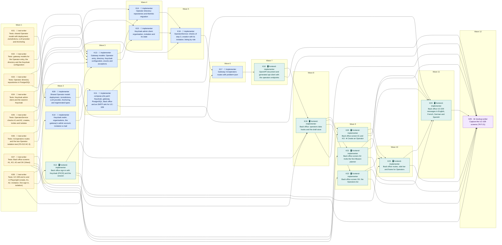

# T0.16: Create an Operator (UC-029), plan

**Plan:** 🟢 Approved

<!-- ticket:specs -->
## 📚 Specifications

The technical pages, features, use cases and business rules of [TICKET.md](TICKET.md), copied by `python3 .claude/scripts/tickets/ticket_refs.py sync`.

- [🖥️ GUI and WebUI: apps and shared packages](../../specs/technical/10-frontends.md#apps)
- [🔌 API layer: REST](../../specs/technical/05-api.md#rest)
- [🏗️ Architecture: cells and the global layer](../../specs/technical/01-architecture.md#cells)
- [🔐 Security: identity](../../specs/technical/06-security.md#identity)
- [📘 FS-012: Operators, deployment and languages](../../specs/functional/features/FS-012-operators-deployment-and-languages.md)
- [🎬 UC-029: Create an Operator](../../specs/functional/use-cases/UC-029-create-an-operator.md)
- [📏 BR-008: Operator isolation](../../specs/functional/business-rules/BR-008-operator-isolation.md)
- [🔐 Security: roles and Operator isolation](../../specs/technical/06-security.md#authorisation)
- [🖼️ UC-029 A1: Enter the Operator](../../specs/functional/use-cases/UC-029-create-an-operator.md#screen-a1)
- [🖼️ UC-029 KO: Operator not created](../../specs/functional/use-cases/UC-029-create-an-operator.md#screen-ko)
- [🖼️ UC-029 A2: Invite the first Mission planner](../../specs/functional/use-cases/UC-029-create-an-operator.md#screen-a2)
- [🖼️ UC-029 OK: Operator created and isolated](../../specs/functional/use-cases/UC-029-create-an-operator.md#screen-ok)
<!-- /ticket:specs -->

## 🧭 Summary

T0.16 delivers UC-029 (Create an Operator) end to end. Work starts with eight test-writer tasks in wave 1, one per layer or app: the shared Operator model, the gateway's models, storage, Keycloak client, service and /v1 API (the API tests include the two-Operator isolation test for FS-012 AC-3 and BR-008), the Back office's Vitest tests and its Playwright e2e tests. The implementation then climbs the gateway's layers in order. First the shared Operator model in swarm-models gains deployment, Jurisdictions, LLM provider and Anchoring, and its generated JSON Schema, Rust and TypeScript types are regenerated. Next come the gateway models, configuration and exceptions, then the Operator directory repositories with their cell assignment, beside the Keycloak admin client. After them come the OperatorService (checks A1 and A2 together, creation with compensation, listing by role), then the /v1/operators routes, then the regenerated api-client. The Keycloak realm (organisations, the gateway's admin account, SMTP) and compose.e2e.yaml run beside them, as does the Back office sign-in. The Back office then gets its data hooks and draft store, the three pages A1/KO, A2 and OK in parallel, its routes and frame, and its four-language messages. A final mockup-writer capture task (TKT-21) owns the four UC-029 screens: T0.20 depends on this ticket, so it cannot be merged yet, and the task updates the mock-ups to what the app shows and renders them again, with screenshots as the path once the T0.20 pipeline exists. The graph has 25 tasks in 12 waves. Several file paths created by prerequisites T0.11, T0.12, T0.14 and T0.15, which are not merged yet, are assumed and listed under the assumptions.

## 🧩 Assumptions

- The roadmap row has no anchor of its own, so the ticket links to the S04 section that holds it, and the epic to the epics table.
- The three acceptance criteria are drawn from AC-3 of FS-012 and from alternative flows A1 and A2 of UC-029, which the roadmap row names as 'done when'.
- The screens are listed as touched because the ticket changes frontends/back-office (TKT-21); the capture is planned by this ticket's plan.
- check_ticket.py was not run by me; the workflow runs it next.
- T0.16's prerequisites are not merged yet: T0.11 and T0.14, T0.15, and T0.12 through T0.15. So several paths their tickets create are assumed: deploy/charts/keycloak/ (realm), services/gateway/src/gateway/models/config/gateway_config.py, services/gateway/src/gateway/api/rest/gateway_rest_app.py, services/gateway/migrations/versions/, services/gateway/openapi/, packages/ts/api-client/src/generated/, frontends/back-office/src/App.tsx and frontends/back-office/src/messages/<lang>.json. The same goes for the gateway's test fixtures: PostgreSQL, the T0.11 token helper and the caller model. Before /ticket-run, the plan's file lists are checked against what those tickets delivered and amended (TKT-11). A task that finds another path reports blocked.
- AGENT.md says shared models live only in swarm-models, so the shared Operator model is extended there, and its JSON Schema, Rust and TypeScript types are regenerated. That touches packages/python/swarm-models, packages/rust/swarm-models and packages/ts/live/src/generated, outside the ticket graph's area ('frontends/back-office, services/gateway, Keycloak'). T0.17 (packages/python) and T0.19 (packages/ts/live) are not locked out by the area check, so the integrator watches for conflicts in the generated files.
- The four new enums go in swarm_models/models/enums.py, following the CLAUDE.md rule of one enums.py per models module. The package's older enums stay in their per-concern enums/ folders.
- Enum values: Jurisdiction eu_easa and us_faa (glossary); Deployment cloud and on_premises; AnchoringChoice qualified_timestamping_authority, public_blockchain and none (UC-029 step 2). LlmProvider has claude and open_weight, because the specifications name only Claude and 'an open-weight model'. No model names per provider are specified, so only the provider is stored. The default is Claude whatever the deployment, since an on-premises default belongs to A3 (P7).
- The Operator directory and the cell assignments are stored in the gateway's own PostgreSQL schema, through its Alembic migrations. They are global-layer tables, not Operator-owned rows, so they get no row-level security. The gateway service enforces the role and the Operator: a Swarm administrator lists every Operator's directory entry, anyone else only their own Operator. The Operators' data keeps T0.12's row-level security.
- Every new Operator is assigned to one configured default cell (DirectoryConfig.default_cell, the dev cell's name), because P0 has only the dev cell.
- A name is taken when it matches an existing one after trimming, in any case. This is the conservative reading of 'no Operator has that name'.
- A1 and A2 come back together as one 422 application/problem+json with an errors list of {field, reason}, because the KO mock-up shows both at once and the specifications give no status code. The Back office shows its own translated text from the field and the reason, not the server's English detail.
- Step 3 runs before step 4 (the checks show on the A1 screen), so a POST /v1/operators:validate endpoint checks the entry. POST /v1/operators checks everything again, the first Mission planner's e-mail included.
- The invitation uses Keycloak itself. The Operator's organisation has the Operator's id as its alias. The user is a member with the mission_planner realm role, and Keycloak's execute-actions e-mail asks her to set her password and second factor and to verify her e-mail. The invitation is read as accepted once no required action remains.
- The Operator is created only if the Keycloak steps succeed. Otherwise the directory transaction is rolled back, any organisation already created is deleted, and the gateway answers 502.
- The gateway's Keycloak admin client is a confidential service-account client of the realm with the least realm-management roles that suffice. Its secret, and the SMTP password, come from the vault, never from a file.
- The end-to-end test uses an SMTP sink container and a seeded Swarm administrator test account. Both exist only in compose.e2e.yaml and the e2e realm overlay, never in a deployed cell.
- The Back office sign-in (PKCE) may not be wired by T0.11 or T0.14, so K12 adds what is missing and reuses what exists.
- The OK screen shows the first Mission planner's invitation state when the list loads. The mock-up's live toast ('Léa Martin signed in…') is not built, because no live notification is specified for P0.
- The default Keycloak admin timeout of 10 seconds is a configuration default written in conf/app.yaml, not a specified budget.
- The name of the second Operator in the isolation tests is test data, not a fact of the specifications.
- T0.20 depends on T0.16, so its screenshot pipeline cannot be merged when this ticket runs. The capture task K25 updates the four UC-029 mock-ups to what the app shows and renders them again, keeping them as ✏️ Mock-up. T0.20 then captures the screenshots.
- There is no doc-writer task: the ticket changes no documentation or specification page other than the UC-029 screens, which the capture task owns.
- BR-017 (four languages) is not listed in TICKET.md, but epic E0.5 names 'UC-029 screens in four languages' and T0.15's CI check enforces it, so K24 writes the four catalogues.

<!-- plan:graph -->

> [!NOTE]
> Generated from the json block at the end of this page by `python3 .claude/scripts/tickets/plan.py render`.
> To change a task, edit the json block, then render again: never edit this view by hand.

## Waves

| Wave | Tasks | Agents running at once |
| --- | --- | --- |
| 1 | [K01](#k01), [K02](#k02), [K03](#k03), [K04](#k04), [K05](#k05), [K06](#k06), [K07](#k07), [K08](#k08) | 8 of 8 |
| 2 | [K09](#k09), [K10](#k10), [K12](#k12) | 3 of 3 |
| 3 | [K11](#k11), [K13](#k13) | 2 of 2 |
| 4 | [K14](#k14), [K15](#k15) | 2 of 2 |
| 5 | [K16](#k16) | 1 of 1 |
| 6 | [K17](#k17) | 1 of 1 |
| 7 | [K18](#k18) | 1 of 1 |
| 8 | [K19](#k19) | 1 of 1 |
| 9 | [K20](#k20), [K21](#k21), [K22](#k22) | 3 of 3 |
| 10 | [K23](#k23) | 1 of 1 |
| 11 | [K24](#k24) | 1 of 1 |
| 12 | [K25](#k25) | 1 of 1 |

| Wave | Task | Agent | Depends on | Unblocks |
| --- | --- | --- | --- | --- |
| 1 | [K01](#k01) Tests: shared Operator model with deployment, Jurisdictions, LLM provider and Anchoring | 🧪 test-writer | none | [K09](#k09) |
| 1 | [K02](#k02) Tests: gateway models for the Operator entry, the directory and the Keycloak configuration | 🧪 test-writer | none | [K13](#k13) |
| 1 | [K03](#k03) Tests: Operator directory repositories in PostgreSQL | 🧪 test-writer | none | [K13](#k13), [K14](#k14) |
| 1 | [K04](#k04) Tests: Keycloak admin client and the stand-in Keycloak | 🧪 test-writer | none | [K13](#k13), [K15](#k15) |
| 1 | [K05](#k05) Tests: OperatorService checks A1 and A2, creates, invites and isolates | 🧪 test-writer | none | [K13](#k13), [K16](#k16) |
| 1 | [K06](#k06) Tests: /v1/operators routes and the two-Operator isolation test (FS-012 AC-3) | 🧪 test-writer | none | [K13](#k13), [K17](#k17) |
| 1 | [K07](#k07) Tests: Back office screens A1, KO, A2 and OK (Vitest) | 🧪 test-writer | none | [K19](#k19), [K20](#k20), [K21](#k21), [K22](#k22) |
| 1 | [K08](#k08) Tests: UC-029 end to end in Playwright (create, A1, A2, invitation, first sign-in, isolation) | 🧪 test-writer | none | [K10](#k10), [K12](#k12), [K11](#k11) |
| 2 | [K09](#k09) Shared Operator model: deployment, Jurisdictions, LLM provider, Anchoring, and regenerated types | 🐍 implementer | [K01](#k01) | [K13](#k13) |
| 2 | [K10](#k10) Keycloak realm: organisations, the gateway's admin account, invitation e-mail | 🐍 implementer | [K08](#k08) | [K11](#k11) |
| 2 | [K12](#k12) Back office sign-in with Keycloak (PKCE) and the session | 🖥️ frontend-implementer | [K08](#k08) | [K19](#k19), [K23](#k23), [K25](#k25) |
| 3 | [K11](#k11) compose.e2e.yaml: Keycloak, gateway, PostgreSQL, Back office and an SMTP sink for UC-029 | 🐍 implementer | [K08](#k08), [K10](#k10) | [K24](#k24), [K25](#k25) |
| 3 | [K13](#k13) Gateway models: Operator entry, directory, Keycloak configuration, enums and exceptions | 🐍 implementer | [K02](#k02), [K03](#k03), [K04](#k04), [K05](#k05), [K06](#k06), [K09](#k09) | [K14](#k14), [K15](#k15) |
| 4 | [K14](#k14) Operator directory: repositories and Alembic migration | 🐍 implementer | [K03](#k03), [K13](#k13) | [K16](#k16) |
| 4 | [K15](#k15) Keycloak admin client: organisation, invitation and its state | 🐍 implementer | [K04](#k04), [K13](#k13) | [K16](#k16) |
| 5 | [K16](#k16) OperatorService: checks of step 3, creation with its invitation, listing by role | 🐍 implementer | [K05](#k05), [K14](#k14), [K15](#k15) | [K17](#k17) |
| 6 | [K17](#k17) Gateway /v1/operators routes with problem+json | 🐍 implementer | [K06](#k06), [K16](#k16) | [K18](#k18) |
| 7 | [K18](#k18) OpenAPI document and generated api-client with the operators endpoints | 🖥️ frontend-implementer | [K17](#k17) | [K19](#k19), [K25](#k25) |
| 8 | [K19](#k19) Back office: operators data hooks and the draft store | 🖥️ frontend-implementer | [K07](#k07), [K12](#k12), [K18](#k18) | [K20](#k20), [K21](#k21), [K22](#k22), [K25](#k25) |
| 9 | [K20](#k20) Back office screen A1 and KO: ➕ Create an Operator | 🖥️ frontend-implementer | [K07](#k07), [K19](#k19) | [K23](#k23), [K24](#k24), [K25](#k25) |
| 9 | [K21](#k21) Back office screen A2: invite the first Mission planner | 🖥️ frontend-implementer | [K07](#k07), [K19](#k19) | [K23](#k23), [K24](#k24), [K25](#k25) |
| 9 | [K22](#k22) Back office screen OK: the Operators list | 🖥️ frontend-implementer | [K07](#k07), [K19](#k19) | [K23](#k23), [K24](#k24), [K25](#k25) |
| 10 | [K23](#k23) Back office routes, side bar and frame for Operators | 🖥️ frontend-implementer | [K12](#k12), [K20](#k20), [K21](#k21), [K22](#k22) | [K24](#k24), [K25](#k25) |
| 11 | [K24](#k24) Back office UC-029 messages in English, French, German and Spanish | 🖥️ frontend-implementer | [K11](#k11), [K20](#k20), [K21](#k21), [K22](#k22), [K23](#k23) | [K25](#k25) |
| 12 | [K25](#k25) Capture the UC-029 screens (TKT-21) | ✏️ mockup-writer | [K11](#k11), [K12](#k12), [K18](#k18), [K19](#k19), [K20](#k20), [K21](#k21), [K22](#k22), [K23](#k23), [K24](#k24) | none |

## Dependency graph



## Tasks

### <a id="k01"></a>K01: Tests: shared Operator model with deployment, Jurisdictions, LLM provider and Anchoring

| Agent | Wave | Depends on | Unblocks |
| --- | --- | --- | --- |
| 🧪 test-writer | 1 | none | [K09](#k09) |

**Files** (only this task may change them in its wave):

- `packages/python/swarm-models/tests/models/test_enums.py`
- `packages/python/swarm-models/tests/models/operators/test_operator.py`
- `packages/python/swarm-models/tests/service/schemas/test_schema_exporter.py`

**Done when:** `uv run ruff format --check` and `uv run ruff check` pass on the three files. `uv run pytest packages/python/swarm-models/tests/models/test_enums.py packages/python/swarm-models/tests/models/operators/test_operator.py` fails only because swarm_models.models.enums and the new exceptions do not exist yet.

**Brief:**

Write the tests first for the shared Operator model, which the Swarm administrator creates with its name, deployment, Jurisdictions, LLM provider and Anchoring. Spec: docs/specs/functional/use-cases/UC-029-create-an-operator.md (steps 1 and 2, alternative flow A2: required are the name, the deployment and at least one Jurisdiction; the LLM provider and the Anchoring have defaults), docs/specs/functional/features/FS-012-operators-deployment-and-languages.md ('Required to create an Operator': LLM provider Claude in the cloud, Anchoring a qualified timestamping authority by default), docs/specs/technical/02-data-models.md#conventions (Operator is a global model of swarm-models), docs/specs/technical/01-architecture.md#cells. Ticket: docs/tickets/T0.16/TICKET.md.

1) packages/python/swarm-models/tests/models/test_enums.py, class TestEnums. It pins the four new enums of swarm_models.models.enums (the one enums.py of the models module, CLAUDE.md rule). Pin them the way tests/models/people/test_role_name.py pins RoleName: exact members, StrEnum, @unique, values in lower snake case with no hyphen.
   - Deployment: CLOUD='cloud', ON_PREMISES='on_premises'.
   - Jurisdiction: EU_EASA='eu_easa', US_FAA='us_faa'.
   - LlmProvider: CLAUDE='claude', OPEN_WEIGHT='open_weight'.
   - AnchoringChoice: QUALIFIED_TIMESTAMPING_AUTHORITY='qualified_timestamping_authority', PUBLIC_BLOCKCHAIN='public_blockchain', NONE='none'.
2) Extend TestOperator in packages/python/swarm-models/tests/models/operators/test_operator.py and keep the six model tests of AGENT.md (Tests). Its valid() becomes Aerowing Services, deployment 'cloud', jurisdictions ['eu_easa'].
   - Required fields: id, name, deployment, jurisdictions.
   - Defaults: llm_provider is LlmProvider.CLAUDE and anchoring is AnchoringChoice.QUALIFIED_TIMESTAMPING_AUTHORITY, and None becomes the default for both. None on id, name, deployment or jurisdictions raises that field's exception.
   - Refused deployment values (an unknown string, a bool, an int) raise SEOperatorInvalidDeployment.
   - Refused jurisdictions values (missing, empty list, not a list, unknown member, a duplicate, a bool) raise SEOperatorInvalidJurisdictions.
   - Unknown llm_provider and anchoring values raise SEOperatorInvalidLlmProvider and SEOperatorInvalidAnchoring.
   - Enum values given as strings are accepted.
   - Round trip through model_dump and JSON.
   - Every field exception, the four new ones included, imports from swarm_models.models.operators.exceptions and subclasses SEInvalidOperatorException, not ValueError.
3) packages/python/swarm-models/tests/service/schemas/test_schema_exporter.py: add 'Deployment', 'Jurisdiction', 'LlmProvider' and 'AnchoringChoice' to EXPECTED_DEFS, and rename the test that counts them to the new count. Change nothing else.
Rules: AGENT.md Tests (one Test class per file, sentence names, parametrize, specific exceptions, no unittest.mock). Compare with enum members, never raw values, except where a test pins an enum's values.

### <a id="k02"></a>K02: Tests: gateway models for the Operator entry, the directory and the Keycloak configuration

| Agent | Wave | Depends on | Unblocks |
| --- | --- | --- | --- |
| 🧪 test-writer | 1 | none | [K13](#k13) |

**Files** (only this task may change them in its wave):

- `services/gateway/tests/models/test_enums.py`
- `services/gateway/tests/models/operators/test_operator_entry.py`
- `services/gateway/tests/models/operators/test_first_mission_planner_entry.py`
- `services/gateway/tests/models/operators/test_operator_creation.py`
- `services/gateway/tests/models/operators/test_operator_entry_problem.py`
- `services/gateway/tests/models/operators/test_operator_directory_entry.py`
- `services/gateway/tests/models/keycloak/test_keycloak_admin_config.py`
- `services/gateway/tests/models/keycloak/test_mission_planner_invitation.py`
- `services/gateway/tests/models/directory/test_directory_config.py`

**Done when:** `uv run ruff format --check` and `uv run ruff check` pass on the nine files. `uv run pytest services/gateway/tests/models -n 2` fails only because the new gateway models, enums and exceptions do not exist yet.

**Brief:**

Write the tests first for the gateway models that carry UC-029. Spec: docs/specs/functional/use-cases/UC-029-create-an-operator.md (steps 1 to 5, A1 name taken, A2 required field missing: name, deployment, at least one Jurisdiction, the first Mission planner's e-mail; the LLM provider and the Anchoring have defaults), docs/specs/functional/features/FS-012-operators-deployment-and-languages.md, docs/specs/technical/01-architecture.md#cells (Operator directory and cell assignment), docs/specs/technical/06-security.md#identity (Keycloak, each Operator an organisation), docs/specs/technical/02-data-models.md#conventions. Ticket: docs/tickets/T0.16/TICKET.md.

Every model gets the six model tests of AGENT.md. Each field exception subclasses its model base and not ValueError. Bool is refused where a number is expected. Strings are stripped and empty ones refused. The new enums Deployment, Jurisdiction, LlmProvider and AnchoringChoice come from swarm_models.models.enums.
- tests/models/test_enums.py (gateway.models.enums; extend the file if T0.11 or T0.12 created it):
  - InvitationState: INVITED='invited', ACCEPTED='accepted'.
  - OperatorField: NAME='name', DEPLOYMENT='deployment', JURISDICTIONS='jurisdictions', LLM_PROVIDER='llm_provider', ANCHORING='anchoring', FIRST_MISSION_PLANNER_NAME='first_mission_planner_name', FIRST_MISSION_PLANNER_EMAIL='first_mission_planner_email'.
  - OperatorProblemReason: REQUIRED='required', TAKEN='taken', INVALID='invalid'.
- OperatorEntry (gateway.models.operators.operator_entry), frozen, extra forbid. Base SEInvalidOperatorEntryException.
  - name: SEOperatorEntryInvalidName.
  - deployment: required, SEOperatorEntryInvalidDeployment.
  - jurisdictions: at least one, no duplicates, SEOperatorEntryInvalidJurisdictions.
  - llm_provider: default CLAUDE, SEOperatorEntryInvalidLlmProvider.
  - anchoring: default QUALIFIED_TIMESTAMPING_AUTHORITY, SEOperatorEntryInvalidAnchoring.
  - to_operator(operator_id) returns the shared swarm_models Operator with the same values.
- FirstMissionPlannerEntry. Base SEInvalidFirstMissionPlannerEntryException.
  - name: SEFirstMissionPlannerEntryInvalidName.
  - email: stripped, one '@' with text on both sides, no space, SEFirstMissionPlannerEntryInvalidEmail.
- OperatorCreation: operator (OperatorEntry) and first_mission_planner (FirstMissionPlannerEntry). Exceptions SEOperatorCreationInvalidOperator and SEOperatorCreationInvalidFirstMissionPlanner, base SEInvalidOperatorCreationException.
- OperatorEntryProblem, frozen: field (OperatorField) and reason (OperatorProblemReason). Exceptions SEOperatorEntryProblemInvalidField and SEOperatorEntryProblemInvalidReason, base SEInvalidOperatorEntryProblemException.
- MissionPlannerInvitation (gateway.models.keycloak.mission_planner_invitation): name (str) and state (InvitationState). Exceptions SEMissionPlannerInvitationInvalidName and SEMissionPlannerInvitationInvalidState, base SEInvalidMissionPlannerInvitationException.
- OperatorDirectoryEntry, frozen: operator (swarm_models Operator), cell_assignment (swarm_models CellAssignment), first_mission_planner (Optional[MissionPlannerInvitation], default None).
  - Field exceptions SEOperatorDirectoryEntryInvalidOperator, SEOperatorDirectoryEntryInvalidCellAssignment and SEOperatorDirectoryEntryInvalidFirstMissionPlanner.
  - A cell_assignment.operator_id other than operator.id raises SEOperatorDirectoryEntryCellMismatch.
  - Base SEInvalidOperatorDirectoryEntryException.
- DirectoryConfig (gateway.models.directory.directory_config), validate_default: default_cell (str, required: the cell every new Operator is assigned to). Exception SEDirectoryConfigInvalidDefaultCell, base SEInvalidDirectoryConfigException.
- KeycloakAdminConfig (gateway.models.keycloak.keycloak_admin_config), validate_default. Base SEInvalidKeycloakAdminConfigException.
  - base_url: http or https, trailing slash stripped.
  - realm, client_id.
  - client_secret_key: names a secret store entry and never holds the secret.
  - timeout_s: float above 0, default 10.0.
  - Exceptions SEKeycloakAdminConfigInvalidBaseUrl, SEKeycloakAdminConfigInvalidRealm, SEKeycloakAdminConfigInvalidClientId, SEKeycloakAdminConfigInvalidClientSecretKey and SEKeycloakAdminConfigInvalidTimeoutS.
The exceptions import from the package next to each model: gateway.models.operators.exceptions, gateway.models.keycloak.exceptions, gateway.models.directory.exceptions.
Rules: AGENT.md Tests and Pydantic models; compare with enums and ClassVar constants.

### <a id="k03"></a>K03: Tests: Operator directory repositories in PostgreSQL

| Agent | Wave | Depends on | Unblocks |
| --- | --- | --- | --- |
| 🧪 test-writer | 1 | none | [K13](#k13), [K14](#k14) |

**Files** (only this task may change them in its wave):

- `services/gateway/tests/storage/postgres/directory/conftest.py`
- `services/gateway/tests/storage/postgres/directory/test_operator_repository.py`
- `services/gateway/tests/storage/postgres/directory/test_cell_assignment_repository.py`

**Done when:** `uv run ruff format --check` and `uv run ruff check` pass on the three files. `uv run pytest services/gateway/tests/storage/postgres/directory` fails or is skipped only because the repositories and exceptions do not exist yet.

**Brief:**

Write the tests first for the two repositories of the Operator directory. The directory is part of the global layer, and each Operator is assigned to exactly one cell (docs/specs/technical/01-architecture.md#cells). Each repository holds one entity in storage/postgres/ (docs/specs/technical/03-storage.md#repositories, docs/specs/technical/03-storage.md#postgresql). A name already taken is refused (A1 of docs/specs/functional/use-cases/UC-029-create-an-operator.md). Ticket: docs/tickets/T0.16/TICKET.md.

Use the real PostgreSQL fixtures and transaction pattern T0.12 left for the gateway's storage tests (read services/gateway/tests/storage/ and services/gateway/src/gateway/storage/). Skip the tests without a database, as those do. The fixture runs the gateway's Alembic migrations. conftest.py gives a clean directory per test.
- OperatorRepository (gateway.storage.postgres.directory.operator_repository), async:
  - add(operator) stores a swarm_models Operator with all its fields (deployment, jurisdictions, llm_provider, anchoring).
  - get(operator_id) returns it equal to what was added, or raises SEDirectoryOperatorNotFoundError.
  - list_all() returns every Operator ordered by name.
  - name_taken(name) is True for the same name after stripping, in any case ('aerowing services ' matches 'Aerowing Services').
  - add with a taken name raises SEDirectoryOperatorNameTakenError, even when name_taken was not asked (unique index, to cover a race).
- CellAssignmentRepository (gateway.storage.postgres.directory.cell_assignment_repository), async:
  - assign(assignment) stores a swarm_models CellAssignment.
  - of(operator_id) returns it, assigned_at in UTC to the microsecond, or raises SEDirectoryOperatorNotFoundError.
  - A second assign for the same Operator raises SEDirectoryCellAlreadyAssignedError.
- A rolled-back transaction leaves neither the Operator nor its assignment.
Exceptions import from gateway.models.directory.exceptions, all subclasses of SEDirectoryError. Sample data: Aerowing Services, cloud, EU (EASA). Rules: AGENT.md Tests; no unittest.mock.

### <a id="k04"></a>K04: Tests: Keycloak admin client and the stand-in Keycloak

| Agent | Wave | Depends on | Unblocks |
| --- | --- | --- | --- |
| 🧪 test-writer | 1 | none | [K13](#k13), [K15](#k15) |

**Files** (only this task may change them in its wave):

- `services/gateway/tests/clients/keycloak/conftest.py`
- `services/gateway/tests/clients/keycloak/stand_in_keycloak.py`
- `services/gateway/tests/clients/keycloak/test_keycloak_admin_client.py`

**Done when:** `uv run ruff format --check` and `uv run ruff check` pass on the three files. `uv run pytest services/gateway/tests/clients/keycloak` fails only because gateway.clients.keycloak and the gateway models do not exist yet.

**Brief:**

Write the tests first for the gateway's client of the Keycloak admin API, and the stand-in server they run against. Spec: docs/specs/technical/06-security.md#identity (Keycloak, one realm, each Operator an organisation, multi-factor authentication for Mission planners), docs/specs/technical/06-security.md#authorisation (roles per persona), docs/specs/functional/use-cases/UC-029-create-an-operator.md (steps 4 to 6: the invitation by e-mail and the first sign-in), docs/specs/technical/01-architecture.md#cells. Ticket: docs/tickets/T0.16/TICKET.md.

1) stand_in_keycloak.py: class StandInKeycloak (AGENT.md Tests: a helper class in its own file), a context manager (no start or stop methods; the lifecycle rule covers tests). It serves on 127.0.0.1 and a free port, in a thread, the subset of the Keycloak 26 API the client uses:
   - the client-credentials token endpoint, checking client_id and client_secret;
   - organisations: create, delete, get by alias, members;
   - users: create, get, required actions;
   - realm role mapping;
   - the execute-actions e-mail.
   Exact public API, which K05 and K06 use too:
   - attributes base_url, realm, client_id, client_secret;
   - organizations: Dict[str, Dict[str, JsonValue]], keyed by alias;
   - users: Dict[str, Dict[str, JsonValue]], keyed by e-mail;
   - invitations: List[str], the e-mails an execute-actions e-mail went to;
   - fail_invitations: bool; when True the execute-actions e-mail answers 500;
   - accept_invitation(email) clears that user's required actions, as her first sign-in does.
   Its constants are UPPER_CASE ClassVars. conftest.py yields a running StandInKeycloak and a KeycloakAdminConfig pointing at it.
2) test_keycloak_admin_client.py, class TestKeycloakAdminClient, for KeycloakAdminClient(config: KeycloakAdminConfig, client_secret: str, logger) in gateway.clients.keycloak.keycloak_admin_client. All methods are async.
   - create_organization(operator) creates an organisation named after the Operator, with alias str(operator.id) and an operator_id attribute, and returns its id.
   - invite_mission_planner(organization_id, entry: FirstMissionPlannerEntry) does four things: it creates the user (e-mail, name, enabled), makes her a member, maps the realm role named RoleName.MISSION_PLANNER, and sends one execute-actions e-mail with the required actions of a new Mission planner.
   - delete_organization(organization_id) removes the organisation.
   - mission_planner_invitation(operator_id) returns a MissionPlannerInvitation: INVITED while required actions remain, ACCEPTED after accept_invitation. It returns None when there is no member.
   - An unreachable server or a timeout raises SEKeycloakAdminUnavailableError, and an error status raises SEKeycloakAdminRefusedError, both subclasses of SEKeycloakAdminError from gateway.models.keycloak.exceptions.
   - No log record holds the client secret, a token or the e-mail address (caplog).
Rules: AGENT.md Tests; no unittest.mock, the stand-in is the real thing tested against.

### <a id="k05"></a>K05: Tests: OperatorService checks A1 and A2, creates, invites and isolates

| Agent | Wave | Depends on | Unblocks |
| --- | --- | --- | --- |
| 🧪 test-writer | 1 | none | [K13](#k13), [K16](#k16) |

**Files** (only this task may change them in its wave):

- `services/gateway/tests/service/operators/conftest.py`
- `services/gateway/tests/service/operators/test_operator_entry_checker.py`
- `services/gateway/tests/service/operators/test_operator_service.py`

**Done when:** `uv run ruff format --check` and `uv run ruff check` pass on the three files. `uv run pytest services/gateway/tests/service/operators` fails or is skipped only because the service, the repositories, the client or the models do not exist yet.

**Brief:**

Write the tests first for the business rules of UC-029 in the gateway's service layer. Spec: docs/specs/functional/use-cases/UC-029-create-an-operator.md (steps 3 and 5, A1, A2, postconditions), docs/specs/functional/business-rules/BR-008-operator-isolation.md (data visible to its own Operator only; another Operator's attempt gets not found and is logged), docs/specs/functional/features/FS-012-operators-deployment-and-languages.md (AC-3, required fields), docs/specs/technical/06-security.md#authorisation (the Swarm administrator creates Operators and their first accounts; the gateway checks the role and the Operator of every call), docs/specs/technical/01-architecture.md#cells. Ticket: docs/tickets/T0.16/TICKET.md.

1) OperatorEntryChecker(logger) in gateway.service.operators.operator_entry_checker. It is pure: problems(entry: Dict[str, JsonValue], with_first_mission_planner: bool) returns List[OperatorEntryProblem] with every problem at once.
   - REQUIRED for a missing or empty name, deployment or jurisdictions, and, when with_first_mission_planner, for the first Mission planner's name or e-mail.
   - INVALID for a value present but wrong.
   - No problem for a missing llm_provider or anchoring, which have defaults.
   - Fields are OperatorField members.
2) OperatorService in gateway.service.operators.operator_service, async. Build it with real repositories on the PostgreSQL fixtures of T0.12 (skip without a database, as they do) and a real KeycloakAdminClient. The client points at StandInKeycloak, imported by its full path from services/gateway/tests/clients/keycloak/stand_in_keycloak.py (written in parallel by K04 with this API: base_url, realm, client_id, client_secret, organizations, users, invitations, fail_invitations, accept_invitation(email)). Constructor: OperatorService(config: DirectoryConfig, operators: OperatorRepository, cells: CellAssignmentRepository, keycloak: KeycloakAdminClient, plus the transaction handle T0.12's repositories take, logger). The caller is the verified caller model T0.11 gives the gateway (person, Operator, roles). Behaviours:
   - check(caller, entry) for a Swarm administrator: [] for Aerowing Services, cloud, EU (EASA). Once Aerowing Services exists, entering it again gives TAKEN on NAME, in any case (A1). Taken name and no Jurisdiction together give both problems (A2, as the KO screen shows both).
   - create(caller, creation) succeeds. The Operator has a UUIDv7 id and is stored with its defaults (Claude, qualified timestamping authority). It is assigned to config.default_cell, with assigned_at in UTC. A Keycloak organisation exists for it, and exactly one invitation went to the first Mission planner's e-mail. The returned OperatorDirectoryEntry shows her invitation INVITED.
   - create with problems raises SEOperatorEntryRefusedError carrying the problems, and creates nothing: no row, no organisation, no e-mail.
   - create when the invitation fails (fail_invitations) raises SEOperatorCreationFailedError and leaves no directory row and no organisation.
   - A caller without RoleName.SWARM_ADMINISTRATOR gets SEOperatorForbiddenError from check and create.
   - list(caller): a Swarm administrator gets every Operator. The Mission planner of Aerowing Services gets only Aerowing Services, even with a second Operator present. After accept_invitation her invitation reads ACCEPTED.
   - get(caller, id): her own Operator is returned. Another Operator's id raises SEOperatorNotFoundError and the attempt is logged (caplog), as BR-008 example 2 says.
Exceptions import from gateway.models.operators.exceptions, subclasses of SEOperatorError. The second Operator's name is test data. Rules: AGENT.md Tests; no unittest.mock.

### <a id="k06"></a>K06: Tests: /v1/operators routes and the two-Operator isolation test (FS-012 AC-3)

| Agent | Wave | Depends on | Unblocks |
| --- | --- | --- | --- |
| 🧪 test-writer | 1 | none | [K13](#k13), [K17](#k17) |

**Files** (only this task may change them in its wave):

- `services/gateway/tests/api/rest/v1/operators/conftest.py`
- `services/gateway/tests/api/rest/v1/operators/test_operator_routes.py`
- `services/gateway/tests/api/rest/v1/operators/test_operator_isolation.py`

**Done when:** `uv run ruff format --check` and `uv run ruff check` pass on the three files. `uv run pytest services/gateway/tests/api/rest/v1/operators` fails or is skipped only because the routes and the layers below them do not exist yet.

**Brief:**

Write the tests first for the gateway's REST API of UC-029, and the acceptance test with two Operators. Spec: docs/specs/technical/05-api.md#rest (/v1, Idempotency-Key on every POST, errors as application/problem+json), docs/specs/technical/06-security.md#authorisation (the gateway checks the role and the Operator of every call), docs/specs/technical/06-security.md#identity, docs/specs/functional/use-cases/UC-029-create-an-operator.md (A1, A2), docs/specs/functional/business-rules/BR-008-operator-isolation.md, docs/specs/functional/features/FS-012-operators-deployment-and-languages.md (AC-3). Ticket: docs/tickets/T0.16/TICKET.md, criteria 1 to 3.

Build the gateway's FastAPI app as T0.12's API tests do, with the token helper T0.11 left for the gateway tests. Use the PostgreSQL fixtures (skip without a database, as they do) and StandInKeycloak, imported by its full path from services/gateway/tests/clients/keycloak/stand_in_keycloak.py. K04 writes it in parallel with this API: base_url, realm, client_id, client_secret, organizations, users, invitations, fail_invitations, accept_invitation(email). conftest.py wires them. Every POST sends an Idempotency-Key.
1) test_operator_routes.py, class TestOperatorRoutes:
   - POST /v1/operators:validate with the Operator's fields answers 204. A taken name answers 422 problem+json with errors [{field: name, reason: taken}] (A1). No Jurisdiction answers 422 with [{field: jurisdictions, reason: required}] (A2). Both at once list both.
   - POST /v1/operators with {operator: {...}, first_mission_planner: {name, email}} answers 201 with the OperatorDirectoryEntry and a Location of /v1/operators/{id}. The stand-in received one invitation.
   - A missing first Mission planner e-mail answers 422 naming first_mission_planner_email. The same Idempotency-Key replays the first answer and creates nothing twice.
   - A Mission planner token on either POST answers 403. No token answers 401 (T0.11).
   - fail_invitations answers 502 problem+json and creates nothing.
   - GET /v1/operators and GET /v1/operators/{id} return directory entries.
2) test_operator_isolation.py, class TestOperatorIsolation, for acceptance criterion 1 (FS-012 AC-3, BR-008):
   - The Swarm administrator creates Aerowing Services and a second Operator through the API, and each first Mission planner accepts her invitation.
   - With each one's token, GET /v1/operators lists only her own Operator. GET /v1/operators/{the other id} answers 404 problem+json, and the attempt is logged (caplog).
   - The Swarm administrator lists both.
Compare with the gateway enums and constants. Rules: AGENT.md Tests; no unittest.mock.

### <a id="k07"></a>K07: Tests: Back office screens A1, KO, A2 and OK (Vitest)

| Agent | Wave | Depends on | Unblocks |
| --- | --- | --- | --- |
| 🧪 test-writer | 1 | none | [K19](#k19), [K20](#k20), [K21](#k21), [K22](#k22) |

**Files** (only this task may change them in its wave):

- `frontends/back-office/src/operators/testing/standInGateway.ts`
- `frontends/back-office/src/operators/state/operatorDraftStore.test.ts`
- `frontends/back-office/src/operators/create/CreateOperatorPage.test.tsx`
- `frontends/back-office/src/operators/invite/InviteFirstMissionPlannerPage.test.tsx`
- `frontends/back-office/src/operators/list/OperatorsPage.test.tsx`

**Done when:** `pnpm --filter ./frontends/back-office exec eslint src/operators` passes on the five files. `pnpm --filter ./frontends/back-office exec vitest run src/operators` fails only because the pages and the store do not exist yet.

**Brief:**

Write the Vitest component tests first for the four UC-029 screens of the Back office. Spec: docs/specs/functional/use-cases/UC-029-create-an-operator.md (main flow, screens A1, KO, A2 and OK, A1 and A2), the mock-ups docs/specs/screens/mockups/UC-029/a1.html, ko.html, a2.html and ok.html (wording and layout), docs/specs/technical/10-frontends.md#apps (back-office, React 19, TanStack Query, Zustand, Vitest), docs/specs/technical/05-api.md#rest. Ticket: docs/tickets/T0.16/TICKET.md.

Use the test setup T0.14 and T0.15 left in frontends/back-office: providers, router, English messages. No hand-written module mocks.
- standInGateway.ts answers fetch for the /v1/operators routes from in-memory state:
  - POST /v1/operators:validate gives 204 or 422 problem+json {errors: [{field, reason}]};
  - POST /v1/operators gives 201 with a directory entry;
  - GET /v1/operators gives the list.
  It records each request and its Idempotency-Key.
Components and modules, with named exports:
- CreateOperatorPage at src/operators/create/CreateOperatorPage.tsx, route /operators/new.
- InviteFirstMissionPlannerPage at src/operators/invite/InviteFirstMissionPlannerPage.tsx, route /operators/new/first-mission-planner.
- OperatorsPage at src/operators/list/OperatorsPage.tsx, route /operators.
- useOperatorDraft, a Zustand store at src/operators/state/operatorDraftStore.ts, with entry, firstMissionPlanner, problems, setEntry, setFirstMissionPlanner, setProblems and reset.
Behaviours:
- A1. The page shows these fields:
  - Operator name;
  - Deployment (Cloud or On premises), with none chosen first, because it is required;
  - Jurisdictions (EU (EASA), US (FAA)), several allowed;
  - LLM provider and models (Claude (default), an open-weight model), with Claude preselected and the hint for on premises;
  - Anchoring (Qualified timestamping authority (eIDAS, RFC 3161), the default, preselected; Public blockchain, through an aggregator; No Anchoring: signed and chained only).
  'Next: first Mission planner' posts :validate, and on 204 goes to the A2 route with the draft kept.
- KO (A1 and A2). On 422 the page stays and shows a banner starting '❌ Operator not created'. A taken name shows 'An Operator named Aerowing Services already exists.' under the name. No Jurisdiction shows 'Choose at least one Jurisdiction: it is required.'. Each missing field is named.
- A2. Name, E-mail address and a fixed Role of Mission planner, with a summary card of the Operator from the draft. '◀️ Back' returns to A1 with the draft. 'Create the Operator and send the invitation' posts /v1/operators once, with an Idempotency-Key. A 422 shows the KO banner naming the field. A 201 resets the draft and goes to /operators with the banner '✅ Aerowing Services created. Its data is isolated: no other Operator can see it.'.
- OK. The table has the columns Operator, Deployment, Jurisdictions, Anchoring, First Mission planner (name and invitation state: Invitation sent or Invitation accepted) and State.
Query by role and accessible name. On-screen words use the glossary names (docs/specs/glossary.md). Its 'Do not say' words (tenant, superuser, admin console, notarisation) never appear.

### <a id="k08"></a>K08: Tests: UC-029 end to end in Playwright (create, A1, A2, invitation, first sign-in, isolation)

| Agent | Wave | Depends on | Unblocks |
| --- | --- | --- | --- |
| 🧪 test-writer | 1 | none | [K10](#k10), [K12](#k12), [K11](#k11) |

**Files** (only this task may change them in its wave):

- `frontends/back-office/e2e/create-an-operator.spec.ts`
- `frontends/back-office/e2e/support/mailbox.ts`
- `frontends/back-office/e2e/support/second-factor.ts`

**Done when:** `pnpm --filter ./frontends/back-office exec eslint e2e` passes on the three files. `pnpm --filter ./frontends/back-office exec playwright test --list e2e/create-an-operator.spec.ts` lists the five tests.

**Brief:**

Write the Playwright tests first for UC-029 against the real images started by compose.e2e.yaml (AGENT.md, Front-end tests). Spec: docs/specs/functional/use-cases/UC-029-create-an-operator.md (every step, A1, A2), docs/specs/functional/business-rules/BR-008-operator-isolation.md, docs/specs/functional/features/FS-012-operators-deployment-and-languages.md (AC-3), docs/specs/technical/06-security.md#identity (PKCE sign-in, multi-factor authentication for Mission planners), docs/specs/technical/10-frontends.md#apps. Ticket: docs/tickets/T0.16/TICKET.md, criteria 1 to 3.

K11 adds to compose.e2e.yaml a Keycloak with the e2e realm, its seeded Swarm administrator test account, and an SMTP sink with an HTTP API. Read their addresses and credentials from environment variables with defaults named in the spec file's constants: E2E_BACK_OFFICE_URL, E2E_ADMIN_USERNAME, E2E_ADMIN_PASSWORD, E2E_MAILBOX_URL.
- support/mailbox.ts finds the last e-mail sent to an address in the SMTP sink and returns its action link.
- support/second-factor.ts computes the TOTP code from the secret Keycloak shows when the second factor is configured.
create-an-operator.spec.ts:
1. The Swarm administrator signs in, opens ➕ Operators and ➕ Create an Operator, and enters Aerowing Services, Cloud and EU (EASA), leaving the defaults. She goes to the first Mission planner, enters Léa Martin and her e-mail, and creates the Operator. The Operators list shows Aerowing Services with Invitation sent.
2. A1: entering Aerowing Services again shows that the name is taken, and nothing is created.
3. A2: submitting without a Jurisdiction names the Jurisdiction, and nothing is created.
4. Invitation and first sign-in: the e-mail reaches Léa Martin. She opens the link, sets her password and second factor, and signs in to the Back office of Aerowing Services.
5. Isolation (BR-008): with a second Operator created and its Mission planner signed in, each sees only her own Operator, and opening the other's /operators/{id} shows not found.
Use role and accessible-name locators, the English locale, and the mock-ups' wording.

### <a id="k09"></a>K09: Shared Operator model: deployment, Jurisdictions, LLM provider, Anchoring, and regenerated types

| Agent | Wave | Depends on | Unblocks |
| --- | --- | --- | --- |
| 🐍 implementer | 2 | [K01](#k01) | [K13](#k13) |

**Files** (only this task may change them in its wave):

- `packages/python/swarm-models/src/swarm_models/models/enums.py`
- `packages/python/swarm-models/src/swarm_models/models/operators/operator.py`
- `packages/python/swarm-models/src/swarm_models/models/operators/exceptions/__init__.py`
- `packages/python/swarm-models/src/swarm_models/models/operators/exceptions/operator/`
- `packages/python/swarm-models/schemas/swarm_models.schema.json`
- `packages/rust/swarm-models/src/generated.rs`
- `packages/ts/live/src/generated/models.ts`

**Done when:** These pass:
- `uv run pytest packages/python/swarm-models/tests -n 2`
- `uv run mypy packages/python/swarm-models/src`
- `uv run ruff check packages/python/swarm-models`
- `uv run pytest tests/conventions/packages -n 2`
- `uv run swarm-models-schemas --check`
- `cargo test -p swarm-models` (in packages/rust)
- `pnpm --filter ./packages/ts/live run test`

**Brief:**

Extend the shared Operator model exactly as packages/python/swarm-models/tests/models/test_enums.py, tests/models/operators/test_operator.py and tests/service/schemas/test_schema_exporter.py expect. Spec: docs/specs/functional/use-cases/UC-029-create-an-operator.md (steps 1 and 2, A2), docs/specs/functional/features/FS-012-operators-deployment-and-languages.md ('Required to create an Operator'), docs/specs/technical/02-data-models.md#conventions, docs/specs/technical/01-architecture.md#cells. Ticket: docs/tickets/T0.16/TICKET.md.

1) Create swarm_models/models/enums.py holding only the four new enums: Deployment, Jurisdiction, LlmProvider and AnchoringChoice. Each is @unique and documents its members under Attributes. Values are lower snake case with no hyphen. This follows the CLAUDE.md rule of one enums.py at the root of the models module; leave the older per-concern enums/ folders as they are.
2) Add to Operator, one validator each, mode before, each raising its own exception:
   - deployment and jurisdictions, required; jurisdictions is a non-empty List[Jurisdiction] without duplicates.
   - llm_provider, default LlmProvider.CLAUDE.
   - anchoring, default AnchoringChoice.QUALIFIED_TIMESTAMPING_AUTHORITY.
   - None becomes the default, bool is refused, and every field has a Field(description).
   Field-name strings become ClassVar constants (CLAUDE.md, no raw strings). Fix the class docstring to the glossary's Operator: the organisation that uses Swarm to fly Missions, whose data is isolated. It now wrongly reads 'a person who pilots drones'.
3) Add the four field exceptions: SEOperatorInvalidDeployment, SEOperatorInvalidJurisdictions, SEOperatorInvalidLlmProvider and SEOperatorInvalidAnchoring, one file each, subclasses of SEInvalidOperatorException. Keep at most five Python files per folder: split exceptions/operator/ into sub-folders (for example identity/ for id and name, choices/ for the four new ones). Re-export through sorted __all__ lists up to operators/exceptions/__init__.py, so every import from swarm_models.models.operators.exceptions still works.
4) Regenerate the generated types in the AGENT.md order and never edit them by hand:
   - `uv run swarm-models-schemas`;
   - `cargo run -p swarm-models-codegen`, run in packages/rust;
   - `pnpm --filter ./packages/ts/live run generate`.
   If Rust or TypeScript code that uses Operator stops compiling, report it as blocked; do not edit it.
Rules: AGENT.md Pydantic models, Exceptions, Docstrings, Data and enums.

### <a id="k10"></a>K10: Keycloak realm: organisations, the gateway's admin account, invitation e-mail

| Agent | Wave | Depends on | Unblocks |
| --- | --- | --- | --- |
| 🐍 implementer | 2 | [K08](#k08) | [K11](#k11) |

**Files** (only this task may change them in its wave):

- `deploy/charts/keycloak/`

**Done when:** `helm lint deploy/charts/keycloak` passes and every realm JSON file parses (`python3 -m json.tool` on each). `uv run pytest tests/deploy -n 2` passes.

**Brief:**

Extend the Keycloak realm that T0.11 delivered (global layer) so the gateway can create an Operator's organisation and invite its first Mission planner by e-mail. Spec: docs/specs/technical/06-security.md#identity (one realm, each Operator an organisation; multi-factor authentication for Mission planners; PKCE clients), docs/specs/technical/06-security.md#authorisation (the Swarm administrator creates Operators and their first accounts, with no access to Operators' data), docs/specs/technical/01-architecture.md#cells (Keycloak in the global layer), docs/specs/functional/use-cases/UC-029-create-an-operator.md (steps 4 to 6). Ticket: docs/tickets/T0.16/TICKET.md.

Work inside the Keycloak chart and realm files T0.11 left. This plan assumes deploy/charts/keycloak/; if T0.11 put them elsewhere, report blocked with the real path so the plan is amended.
- Turn on Organizations in the realm.
- Add a confidential client for the gateway with a service account, holding only the realm-management roles it needs: create and delete organisations, create users, add members, map the mission_planner realm role, send the execute-actions e-mail. Report the roles you chose as a decision. Its secret comes from the vault (T0.08), never from a file.
- Make a new Mission planner's required actions the ones T0.11's realm demands: password, second factor, verified e-mail.
- Configure the realm's SMTP server from chart values, with its password from the vault.
- Add an e2e realm overlay at deploy/charts/keycloak/realm/e2e/. It holds one seeded Swarm administrator test account and SMTP pointing at the e2e SMTP sink, for compose.e2e.yaml only, never in a deployed cell. frontends/back-office/e2e/create-an-operator.spec.ts (K08) shows what the e2e run needs.
Rules: no secret in any file (AGENT.md, Data and enums); the role names are those of RoleName in swarm-models.

### <a id="k12"></a>K12: Back office sign-in with Keycloak (PKCE) and the session

| Agent | Wave | Depends on | Unblocks |
| --- | --- | --- | --- |
| 🖥️ frontend-implementer | 2 | [K08](#k08) | [K19](#k19), [K23](#k23), [K25](#k25) |

**Files** (only this task may change them in its wave):

- `frontends/back-office/src/session/`

**Done when:** `pnpm --filter ./frontends/back-office run lint` and `pnpm --filter ./frontends/back-office run typecheck` pass.

**Brief:**

Give the Back office its sign-in, so that the Swarm administrator can work and the invited Mission planner can make her first sign-in (UC-029 step 6). Spec: docs/specs/technical/06-security.md#identity (authorisation code flow with PKCE, 5-minute access tokens with the person, the Operator and the roles, rotated refresh tokens), docs/specs/technical/06-security.md#authorisation, docs/specs/technical/10-frontends.md#apps (back-office, web browser, React 19), docs/specs/functional/use-cases/UC-029-create-an-operator.md. Ticket: docs/tickets/T0.16/TICKET.md.

First read what T0.11 (the PKCE client of back-office) and T0.14 (the back-office shell) already provide, and reuse it. Build only what is missing, under frontends/back-office/src/session/:
- sign in and sign out through Keycloak with PKCE;
- refresh the token;
- a useSession() hook giving the person's name, her Operator id (from her organisation) and her roles, so the frame can tell a Swarm administrator from a Mission planner;
- a way for the generated api-client (packages/ts/api-client) to send the bearer token with every call.
Report the OIDC library you use, or why none, as a decision. If the app's root must change to mount the session provider, report blocked with the file and the change; K23 owns the routes. Keep the tokens in memory only.

### <a id="k11"></a>K11: compose.e2e.yaml: Keycloak, gateway, PostgreSQL, Back office and an SMTP sink for UC-029

| Agent | Wave | Depends on | Unblocks |
| --- | --- | --- | --- |
| 🐍 implementer | 3 | [K08](#k08), [K10](#k10) | [K24](#k24), [K25](#k25) |

**Files** (only this task may change them in its wave):

- `compose.e2e.yaml`

**Done when:** `docker compose -f compose.e2e.yaml config --quiet` passes, and `uv run pytest tests/ci -n 2` passes.

**Brief:**

Make compose.e2e.yaml start everything the UC-029 Playwright test (frontends/back-office/e2e/create-an-operator.spec.ts) needs, from the real images (AGENT.md, Front-end tests: never a development server). Spec: docs/specs/technical/10-frontends.md#apps, docs/specs/technical/06-security.md#identity, docs/specs/technical/01-architecture.md#cells, docs/specs/functional/use-cases/UC-029-create-an-operator.md. Ticket: docs/tickets/T0.16/TICKET.md.

Start from the file T0.10 created and add or complete:
- the PostgreSQL image of deploy/images, with the gateway's Alembic migrations run before the gateway starts;
- Keycloak, importing the realm and its e2e overlay from deploy/charts/keycloak/realm/ (K10);
- the gateway image, configured by environment, including its Keycloak admin client and its secret;
- the back-office image;
- an SMTP sink with an HTTP API, used by Keycloak for the invitation e-mail.
Set the environment the spec file reads (E2E_BACK_OFFICE_URL, E2E_ADMIN_USERNAME, E2E_ADMIN_PASSWORD, E2E_MAILBOX_URL) as service outputs, and document them in a comment. Pick the SMTP sink image and report it as a decision. Add health checks so Playwright starts once every service is ready. No real secret: e2e-only values.

### <a id="k13"></a>K13: Gateway models: Operator entry, directory, Keycloak configuration, enums and exceptions

| Agent | Wave | Depends on | Unblocks |
| --- | --- | --- | --- |
| 🐍 implementer | 3 | [K02](#k02), [K03](#k03), [K04](#k04), [K05](#k05), [K06](#k06), [K09](#k09) | [K14](#k14), [K15](#k15) |

**Files** (only this task may change them in its wave):

- `services/gateway/src/gateway/models/enums.py`
- `services/gateway/src/gateway/models/operators/`
- `services/gateway/src/gateway/models/directory/`
- `services/gateway/src/gateway/models/keycloak/`
- `services/gateway/src/gateway/models/config/gateway_config.py`
- `services/gateway/conf/app.yaml`
- `services/gateway/pyproject.toml`
- `uv.lock`

**Done when:** These pass:
- `uv run pytest services/gateway/tests/models -n 2`
- `uv run mypy services/gateway/src`
- `uv run ruff check services/gateway`
- `uv run pytest tests/conventions/services -n 2`

**Brief:**

Write the gateway's models for UC-029, exactly as services/gateway/tests/models/ expects. Also write every layer exception that tests/storage/postgres/directory, tests/clients/keycloak, tests/service/operators and tests/api/rest/v1/operators name. Spec: docs/specs/functional/use-cases/UC-029-create-an-operator.md (A1, A2, required fields and defaults), docs/specs/functional/features/FS-012-operators-deployment-and-languages.md, docs/specs/technical/01-architecture.md#cells, docs/specs/technical/06-security.md#identity, docs/specs/technical/02-data-models.md#conventions. Ticket: docs/tickets/T0.16/TICKET.md.

- gateway/models/enums.py gets InvitationState, OperatorField and OperatorProblemReason (add them to the file if T0.11 or T0.12 created it).
- models/operators/ holds OperatorEntry (with to_operator), FirstMissionPlannerEntry, OperatorCreation, OperatorEntryProblem and OperatorDirectoryEntry, at most five files per folder. Its exceptions/ holds the model exceptions and the service-layer errors: SEOperatorError, SEOperatorEntryRefusedError (with a problems attribute, List[OperatorEntryProblem]), SEOperatorForbiddenError, SEOperatorNotFoundError and SEOperatorCreationFailedError.
- models/directory/ holds DirectoryConfig. Its exceptions/ holds the model exceptions and the storage errors: SEDirectoryError, SEDirectoryOperatorNameTakenError, SEDirectoryOperatorNotFoundError and SEDirectoryCellAlreadyAssignedError.
- models/keycloak/ holds KeycloakAdminConfig and MissionPlannerInvitation. Its exceptions/ holds the model exceptions and the client errors: SEKeycloakAdminError, SEKeycloakAdminUnavailableError and SEKeycloakAdminRefusedError.
- Every exception has its own file, in sub-folders of at most five files, re-exported through sorted __all__ lists.
- Reuse the shared Operator, CellAssignment and RoleName and the four enums of swarm_models.models.enums; never redefine a shared model.
- Add the directory and keycloak_admin sections to the gateway's root configuration model. This plan assumes T0.12 put it at models/config/gateway_config.py; if not, report blocked with the real path. Write every default in services/gateway/conf/app.yaml: default_cell is the dev cell's name as deploy/ names it, and client_secret_key names a secret store entry, never a secret.
- Add swarm-models and an async HTTP client (httpx, unless T0.11 already chose one) to services/gateway/pyproject.toml, then `uv lock`.
Rules: AGENT.md Pydantic models, Exceptions, Naming, Data and enums; models never log.

### <a id="k14"></a>K14: Operator directory: repositories and Alembic migration

| Agent | Wave | Depends on | Unblocks |
| --- | --- | --- | --- |
| 🐍 implementer | 4 | [K03](#k03), [K13](#k13) | [K16](#k16) |

**Files** (only this task may change them in its wave):

- `services/gateway/src/gateway/storage/postgres/directory/`
- `services/gateway/migrations/versions/`

**Done when:** `uv run pytest services/gateway/tests/storage -n 2` passes (against a database, as T0.12's tests run), and `uv run mypy services/gateway/src` and `uv run ruff check services/gateway` pass.

**Brief:**

Write OperatorRepository and CellAssignmentRepository, and the migration for their tables, exactly as services/gateway/tests/storage/postgres/directory/ expects. Spec: docs/specs/technical/01-architecture.md#cells (the Operator directory and the routing of each Operator to its cell, in the global layer; an Operator lives in exactly one cell), docs/specs/technical/03-storage.md#repositories (one repository per entity, in storage/postgres/), docs/specs/technical/03-storage.md#postgresql (asyncpg, Alembic, expand then contract), docs/specs/functional/use-cases/UC-029-create-an-operator.md (A1). Ticket: docs/tickets/T0.16/TICKET.md.

- Add a new Alembic revision after T0.12's head in the gateway's migrations (assumed services/gateway/migrations/versions/; report blocked if elsewhere) with two tables in the gateway's schema:
  - the Operators: id, name, deployment, jurisdictions, llm_provider, anchoring, created_at, with a unique index on lower(trim(name)) so A1 also holds under a race;
  - the cell assignments: operator_id as primary key and foreign key, cell, assigned_at.
- These are global-layer directory tables, not Operator-owned rows, so they carry no row-level security. The gateway service checks the role and the Operator.
- The repositories follow T0.12's repository and transaction pattern. They map the database's unique violations to SEDirectoryOperatorNameTakenError and SEDirectoryCellAlreadyAssignedError, and a missing row to SEDirectoryOperatorNotFoundError. They return swarm_models Operator and CellAssignment.
- Column names, SQL fragments and keys are ClassVar constants (CLAUDE.md, no raw strings).
- Every branch logs. Log at ERROR before raising, and never log a name typed by a person at INFO or above.
Rules: AGENT.md Layout (storage imports models only), Lifecycle, Logging, Exceptions.

### <a id="k15"></a>K15: Keycloak admin client: organisation, invitation and its state

| Agent | Wave | Depends on | Unblocks |
| --- | --- | --- | --- |
| 🐍 implementer | 4 | [K04](#k04), [K13](#k13) | [K16](#k16) |

**Files** (only this task may change them in its wave):

- `services/gateway/src/gateway/clients/keycloak/`

**Done when:** `uv run pytest services/gateway/tests/clients -n 2` passes, and `uv run mypy services/gateway/src` and `uv run ruff check services/gateway` pass.

**Brief:**

Write KeycloakAdminClient in gateway.clients.keycloak.keycloak_admin_client, exactly as services/gateway/tests/clients/keycloak/test_keycloak_admin_client.py expects against StandInKeycloak. Spec: docs/specs/technical/06-security.md#identity (each Operator an organisation; multi-factor authentication for Mission planners), docs/specs/technical/06-security.md#authorisation (roles per persona), docs/specs/technical/01-architecture.md#cells (Keycloak in the global layer), docs/specs/functional/use-cases/UC-029-create-an-operator.md (steps 4 to 6). Ticket: docs/tickets/T0.16/TICKET.md.

- It takes a client-credentials token for the gateway's service account and reuses it until shortly before it expires.
- create_organization(operator): name, alias str(operator.id), operator_id attribute.
- invite_mission_planner(organization_id, entry):
  - creates the user;
  - makes her a member;
  - maps the realm role named RoleName.MISSION_PLANNER;
  - sends the execute-actions e-mail with the required actions of a new Mission planner.
- delete_organization(organization_id).
- mission_planner_invitation(operator_id): INVITED while required actions remain, ACCEPTED otherwise, None without a member.
- Connection errors and timeouts (config.timeout_s) raise SEKeycloakAdminUnavailableError, and error statuses raise SEKeycloakAdminRefusedError, each logged at ERROR with type(error).__name__ and the status.
- Never log the secret, a token or an e-mail address.
- URL paths, JSON keys and action names are ClassVar constants or enum members (CLAUDE.md).
- The HTTP client is closed safely after use. Report how you hold it as a decision.
Rules: AGENT.md Layout (clients import models only; one class per remote system), Logging (every branch), Exceptions, Typing (JsonValue for parsed JSON, no Any).

### <a id="k16"></a>K16: OperatorService: checks of step 3, creation with its invitation, listing by role

| Agent | Wave | Depends on | Unblocks |
| --- | --- | --- | --- |
| 🐍 implementer | 5 | [K05](#k05), [K14](#k14), [K15](#k15) | [K17](#k17) |

**Files** (only this task may change them in its wave):

- `services/gateway/src/gateway/service/operators/`

**Done when:** `uv run pytest services/gateway/tests/service -n 2` passes, and `uv run mypy services/gateway/src`, `uv run ruff check services/gateway` and `uv run pytest tests/conventions/services -n 2` pass.

**Brief:**

Write OperatorEntryChecker and OperatorService in gateway.service.operators, exactly as services/gateway/tests/service/operators/ expects. Spec: docs/specs/functional/use-cases/UC-029-create-an-operator.md (step 3 checks, step 5 creation and isolation, A1, A2, postconditions: on failure no Operator is created), docs/specs/functional/business-rules/BR-008-operator-isolation.md (another Operator's attempt: not found, logged), docs/specs/functional/features/FS-012-operators-deployment-and-languages.md (AC-3), docs/specs/technical/06-security.md#authorisation (the Swarm administrator creates Operators and first accounts, with no access to Operators' data; the gateway checks the role and the Operator of every call), docs/specs/technical/01-architecture.md#cells. Ticket: docs/tickets/T0.16/TICKET.md.

- OperatorEntryChecker.problems returns every REQUIRED and INVALID problem at once, field by field, so the KO screen can name each one. A missing llm_provider or anchoring takes its default.
- check(caller, entry) requires RoleName.SWARM_ADMINISTRATOR, adds TAKEN through OperatorRepository.name_taken, and returns the problems.
- create(caller, creation):
  - It runs the same checks plus the first Mission planner's name and e-mail, and raises SEOperatorEntryRefusedError when any problem is found.
  - Otherwise, in one transaction, it adds the Operator (UUIDv7 id) and its CellAssignment to config.default_cell (now, UTC), creates the Keycloak organisation and invites the Mission planner, then commits.
  - If Keycloak fails, it rolls back, deletes any organisation it created, and raises SEOperatorCreationFailedError. A name taken in a race (SEDirectoryOperatorNameTakenError) becomes SEOperatorEntryRefusedError with TAKEN.
- list(caller): every Operator for a Swarm administrator; only the caller's own Operator for anyone else.
- get(caller, id): another Operator's id raises SEOperatorNotFoundError after logging the attempt (BR-008 example 2).
- Each returned OperatorDirectoryEntry holds the first Mission planner's invitation from the client.
- A from_config classmethod (under the public banner) builds the service with its repositories and client from the gateway's configuration and secret reader, so the api layer never imports storage or clients.
Rules: AGENT.md Layout (service imports storage, clients and models), Logging (every branch, ERROR before each raise, no typed value or e-mail in logs), Exceptions (every try has an except; raise from error), File shape (no hard-coded-key dicts, banners).

### <a id="k17"></a>K17: Gateway /v1/operators routes with problem+json

| Agent | Wave | Depends on | Unblocks |
| --- | --- | --- | --- |
| 🐍 implementer | 6 | [K06](#k06), [K16](#k16) | [K18](#k18) |

**Files** (only this task may change them in its wave):

- `services/gateway/src/gateway/api/rest/v1/operators/`
- `services/gateway/src/gateway/api/rest/gateway_rest_app.py`

**Done when:** `uv run pytest services/gateway/tests -n 2` passes (with a database, as T0.12's tests run), and `uv run mypy services/gateway/src`, `uv run ruff check services/gateway` and `uv run pytest tests/conventions/services -n 2` pass.

**Brief:**

Expose UC-029 through the gateway's /v1 API, exactly as services/gateway/tests/api/rest/v1/operators/ expects. Spec: docs/specs/technical/05-api.md#rest (resources follow the glossary, Idempotency-Key on every POST, ETag, errors as application/problem+json with the AGENT.md message rules, the OpenAPI document generated), docs/specs/technical/06-security.md#authorisation (role and Operator checked on every call), docs/specs/functional/use-cases/UC-029-create-an-operator.md (A1, A2), docs/specs/functional/business-rules/BR-008-operator-isolation.md, docs/specs/functional/features/FS-012-operators-deployment-and-languages.md (AC-3). Ticket: docs/tickets/T0.16/TICKET.md.

- In gateway/api/rest/v1/operators/, a class (no module-level functions, AGENT.md File shape) builds the APIRouter. Its methods are the handlers, which call OperatorService only and never storage or clients.
- Routes:
  - POST /v1/operators:validate answers 204, or 422.
  - POST /v1/operators answers 201 with a Location header, or 422, 403 or 502.
  - GET /v1/operators.
  - GET /v1/operators/{operator_id}, which answers 404 for another Operator's id.
- Map SEOperatorEntryRefusedError to 422 problem+json with an errors list of {field, reason} from OperatorEntryProblem, SEOperatorForbiddenError to 403, SEOperatorNotFoundError to 404, and SEOperatorCreationFailedError to 502. Use T0.12's problem+json and Idempotency-Key machinery and T0.11's caller dependency.
- Register the router in the gateway's FastAPI application. This plan assumes T0.12 builds it in services/gateway/src/gateway/api/rest/gateway_rest_app.py; if it is elsewhere, report blocked with the path.
- Route paths, problem types and keys are constants or enum members (CLAUDE.md).
Rules: AGENT.md Layout (api imports service and models only), Logging, Messages.

### <a id="k18"></a>K18: OpenAPI document and generated api-client with the operators endpoints

| Agent | Wave | Depends on | Unblocks |
| --- | --- | --- | --- |
| 🖥️ frontend-implementer | 7 | [K17](#k17) | [K19](#k19), [K25](#k25) |

**Files** (only this task may change them in its wave):

- `services/gateway/openapi/`
- `packages/ts/api-client/src/generated/`

**Done when:** The api-client's up-to-date check that T0.12 put in CI passes, and `pnpm --filter ./packages/ts/api-client run typecheck` passes.

**Brief:**

Publish the gateway's OpenAPI document with the new /v1/operators endpoints, and regenerate packages/ts/api-client from it, never by hand. Spec: docs/specs/technical/05-api.md#rest ('the OpenAPI document is generated and published; the TypeScript client in packages/ts/api-client is generated from it in CI'), docs/specs/technical/10-frontends.md#apps (api-client: generated REST client and types), docs/specs/functional/use-cases/UC-029-create-an-operator.md. Ticket: docs/tickets/T0.16/TICKET.md.

Run the export and generate commands T0.12 put in place. This plan assumes the document lives in services/gateway/openapi/ and the client's output in packages/ts/api-client/src/generated/; if the paths differ, report blocked with them. Check the generated types: OperatorDirectoryEntry, the 422 problem with its errors list, and the enum values of the deployment, Jurisdictions, LLM provider and Anchoring. Change nothing outside the generated output.

### <a id="k19"></a>K19: Back office: operators data hooks and the draft store

| Agent | Wave | Depends on | Unblocks |
| --- | --- | --- | --- |
| 🖥️ frontend-implementer | 8 | [K07](#k07), [K12](#k12), [K18](#k18) | [K20](#k20), [K21](#k21), [K22](#k22), [K25](#k25) |

**Files** (only this task may change them in its wave):

- `frontends/back-office/src/operators/api/`
- `frontends/back-office/src/operators/state/operatorDraftStore.ts`

**Done when:** `pnpm --filter ./frontends/back-office exec vitest run src/operators/state` passes, and `pnpm --filter ./frontends/back-office run lint` and `pnpm --filter ./frontends/back-office run typecheck` pass.

**Brief:**

Write the data layer of the UC-029 screens, as frontends/back-office/src/operators/state/operatorDraftStore.test.ts and the page tests (with src/operators/testing/standInGateway.ts) expect. Spec: docs/specs/technical/10-frontends.md#apps (TanStack Query for server data, Zustand for UI state, api-client generated), docs/specs/technical/05-api.md#rest (Idempotency-Key on every POST, problem+json), docs/specs/functional/use-cases/UC-029-create-an-operator.md (steps 1 to 5, A1, A2). Ticket: docs/tickets/T0.16/TICKET.md.

- src/operators/api/operatorsApi.ts uses the generated api-client with the session token (K12) and exports three TanStack Query hooks:
  - useOperators();
  - useValidateOperatorEntry(), posting /v1/operators:validate;
  - useCreateOperator(), posting /v1/operators.
  Each POST sends a fresh Idempotency-Key (crypto.randomUUID) per submission and reuses it on a retry of the same submission. A 422 problem becomes a typed list of {field, reason}.
- src/operators/state/operatorDraftStore.ts exports useOperatorDraft, a Zustand store with entry, firstMissionPlanner, problems, setEntry, setFirstMissionPlanner, setProblems and reset. The LLM provider defaults to Claude and the Anchoring to the qualified timestamping authority, and no deployment or Jurisdiction is preselected.
Use only the generated types; no hand-written copy of the API's shapes.

### <a id="k20"></a>K20: Back office screen A1 and KO: ➕ Create an Operator

| Agent | Wave | Depends on | Unblocks |
| --- | --- | --- | --- |
| 🖥️ frontend-implementer | 9 | [K07](#k07), [K19](#k19) | [K23](#k23), [K24](#k24), [K25](#k25) |

**Files** (only this task may change them in its wave):

- `frontends/back-office/src/operators/create/`

**Done when:** `pnpm --filter ./frontends/back-office exec vitest run src/operators/create` passes, and `pnpm --filter ./frontends/back-office run lint` and `pnpm --filter ./frontends/back-office run typecheck` pass.

**Brief:**

Build CreateOperatorPage (route /operators/new), which shows states A1 and KO, as frontends/back-office/src/operators/create/CreateOperatorPage.test.tsx expects. Do not change the test. Spec: docs/specs/functional/use-cases/UC-029-create-an-operator.md (steps 1 to 3, screens A1 and KO, A1 name taken, A2 required field missing), the mock-ups docs/specs/screens/mockups/UC-029/a1.html and ko.html (layout and wording), docs/specs/visual-identity.md#components, docs/specs/technical/10-frontends.md#apps (packages/ts/ui components on Radix, tokens only). Ticket: docs/tickets/T0.16/TICKET.md, criteria 2 and 3.

- Two cards, as in the mock-up:
  - Operator name, Deployment (Cloud, On premises), Jurisdictions (EU (EASA), US (FAA)), and LLM provider and models (Claude (default), an open-weight model) with the on-premises hint;
  - 🔏 Anchoring, with three choices (default marked) and the hint 'Only fingerprints of the Evidence records leave Swarm, never the data.'.
- Cancel. 'Next: first Mission planner ▶️' calls useValidateOperatorEntry, then goes to /operators/new/first-mission-planner with the draft kept.
- On problems, show the failure banner '❌ Operator not created: …' and an error under each named field, using the mock-up's wording.
- Every text is a FormatJS message (T0.15) with its English default; K24 writes the four catalogues.
- Use only packages/ts/ui components and tokens: no raw colour or size. Use glossary names, never the glossary's 'Do not say' words.

### <a id="k21"></a>K21: Back office screen A2: invite the first Mission planner

| Agent | Wave | Depends on | Unblocks |
| --- | --- | --- | --- |
| 🖥️ frontend-implementer | 9 | [K07](#k07), [K19](#k19) | [K23](#k23), [K24](#k24), [K25](#k25) |

**Files** (only this task may change them in its wave):

- `frontends/back-office/src/operators/invite/`

**Done when:** `pnpm --filter ./frontends/back-office exec vitest run src/operators/invite` passes, and `pnpm --filter ./frontends/back-office run lint` and `pnpm --filter ./frontends/back-office run typecheck` pass.

**Brief:**

Build InviteFirstMissionPlannerPage (route /operators/new/first-mission-planner), which shows state A2, as frontends/back-office/src/operators/invite/InviteFirstMissionPlannerPage.test.tsx expects. Do not change the test. Spec: docs/specs/functional/use-cases/UC-029-create-an-operator.md (steps 4 and 5, screen A2, A2 missing e-mail), the mock-up docs/specs/screens/mockups/UC-029/a2.html, docs/specs/functional/business-rules/BR-008-operator-isolation.md, docs/specs/technical/10-frontends.md#apps. Ticket: docs/tickets/T0.16/TICKET.md, criteria 1 and 3.

- Title '👥 First Mission planner of &lt;Operator name>'.
- A card with Name, E-mail address and a fixed Role of 👤 Mission planner, with the hint from the mock-up.
- A 🗃️ Operator summary card from the draft: Name, Deployment, Jurisdictions, LLM provider, Anchoring.
- '◀️ Back' returns to /operators/new with the draft.
- 'Create the Operator and send the invitation' calls useCreateOperator once. On 422 it shows the failure banner naming each field. On 201 it resets the draft and goes to /operators carrying the created Operator's name for the success banner.
- Every text is a FormatJS message with its English default. Use packages/ts/ui components and tokens only.

### <a id="k22"></a>K22: Back office screen OK: the Operators list

| Agent | Wave | Depends on | Unblocks |
| --- | --- | --- | --- |
| 🖥️ frontend-implementer | 9 | [K07](#k07), [K19](#k19) | [K23](#k23), [K24](#k24), [K25](#k25) |

**Files** (only this task may change them in its wave):

- `frontends/back-office/src/operators/list/`

**Done when:** `pnpm --filter ./frontends/back-office exec vitest run src/operators/list` passes, and `pnpm --filter ./frontends/back-office run lint` and `pnpm --filter ./frontends/back-office run typecheck` pass.

**Brief:**

Build OperatorsPage (route /operators), which shows state OK, as frontends/back-office/src/operators/list/OperatorsPage.test.tsx expects. Do not change the test. Spec: docs/specs/functional/use-cases/UC-029-create-an-operator.md (step 5, screen OK, postconditions), the mock-up docs/specs/screens/mockups/UC-029/ok.html, docs/specs/functional/business-rules/BR-008-operator-isolation.md (a Mission planner sees only her own Operator), docs/specs/technical/06-security.md#authorisation, docs/specs/technical/10-frontends.md#apps. Ticket: docs/tickets/T0.16/TICKET.md, criterion 1.

- Title '🗃️ Operators'.
- After a creation, the success banner '✅ &lt;name> created. Its data is isolated: no other Operator can see it.'.
- A table from useOperators with the columns Operator, Deployment, Jurisdictions, Anchoring, First Mission planner (👤 name and the invitation state, Invitation sent or Invitation accepted) and State (✅ Created).
- A '➕ Create an Operator' action, shown to a Swarm administrator only (useSession).
- The list refreshes when the page is opened again. There is no live toast: the sign-in of the Mission planner shows as Invitation accepted.
- Every text is a FormatJS message with its English default. Use packages/ts/ui components and tokens only.

### <a id="k23"></a>K23: Back office routes, side bar and frame for Operators

| Agent | Wave | Depends on | Unblocks |
| --- | --- | --- | --- |
| 🖥️ frontend-implementer | 10 | [K12](#k12), [K20](#k20), [K21](#k21), [K22](#k22) | [K24](#k24), [K25](#k25) |

**Files** (only this task may change them in its wave):

- `frontends/back-office/src/operators/operatorRoutes.tsx`
- `frontends/back-office/src/App.tsx`

**Done when:** `pnpm --filter ./frontends/back-office run test`, `pnpm --filter ./frontends/back-office run lint` and `pnpm --filter ./frontends/back-office run typecheck` pass.

**Brief:**

Wire the UC-029 screens into the back-office shell of T0.14. Spec: docs/specs/functional/use-cases/UC-029-create-an-operator.md (step 1 'opens ➕ Operators', step 4 'opens 👥 People', step 6 'signs in to the Back office of Aerowing Services'), the mock-ups docs/specs/screens/mockups/UC-029/*.html (title bar 'Back office · Swarm administration', side bar ➕ Operators, 👥 People, 🔧 Settings, status bar with the persona and the deployment), docs/specs/visual-identity.md#components (the frame of each part of Swarm), docs/specs/technical/10-frontends.md#apps, docs/specs/technical/06-security.md#authorisation. Ticket: docs/tickets/T0.16/TICKET.md.

- src/operators/operatorRoutes.tsx declares the routes /operators, /operators/new and /operators/new/first-mission-planner, open to a Swarm administrator. A Mission planner reaches /operators and her own Operator only.
- Mount the routes and the session provider of src/session in the app. This plan assumes the root is src/App.tsx; if T0.14 put the router or the side bar elsewhere, report blocked with the path.
- In the frame:
  - side bar: ➕ Operators is active on /operators and /operators/new, and 👥 People on the first Mission planner step;
  - title bar: 'Back office · Swarm administration' for a Swarm administrator, 'Back office · &lt;her Operator's name>' for a Mission planner;
  - status bar: the persona.
- Every text is a FormatJS message with its English default.

### <a id="k24"></a>K24: Back office UC-029 messages in English, French, German and Spanish

| Agent | Wave | Depends on | Unblocks |
| --- | --- | --- | --- |
| 🖥️ frontend-implementer | 11 | [K11](#k11), [K20](#k20), [K21](#k21), [K22](#k22), [K23](#k23) | [K25](#k25) |

**Files** (only this task may change them in its wave):

- `frontends/back-office/src/messages/en.json`
- `frontends/back-office/src/messages/fr.json`
- `frontends/back-office/src/messages/de.json`
- `frontends/back-office/src/messages/es.json`

**Done when:** T0.15's message check passes. `pnpm --filter ./frontends/back-office run test` passes. `docker compose -f compose.e2e.yaml up -d --build --wait` followed by `pnpm --filter ./frontends/back-office exec playwright test e2e/create-an-operator.spec.ts` passes.

**Brief:**

Write every message the UC-029 screens use in the four languages, so T0.15's CI check passes. Spec: docs/specs/functional/business-rules/BR-017-every-screen-in-four-languages.md (named by epic E0.5 as 'UC-029 screens in four languages'), docs/specs/technical/10-frontends.md#apps (i18n: FormatJS messages in English, French, German and Spanish), docs/specs/functional/use-cases/UC-029-create-an-operator.md, docs/specs/glossary.md (the names, and the 'Do not say' words never used). Ticket: docs/tickets/T0.16/TICKET.md.

- Extract every message id used under src/operators/ and by the routes and frame of K23. Write them in the back-office catalogues T0.15 set up, assumed at src/messages/&lt;lang>.json; report blocked with the path if T0.15 chose another.
- English is the defaults, unchanged. Translate French, German and Spanish faithfully. Keep the glossary's names (Operator, Mission planner, Jurisdiction, Anchoring, LLM provider) consistent with how the existing catalogues render them, and the placeholders identical.
- Then run the Playwright test of UC-029 against compose.e2e.yaml: it is the end-to-end proof of the whole ticket.

### <a id="k25"></a>K25: Capture the UC-029 screens (TKT-21)

| Agent | Wave | Depends on | Unblocks |
| --- | --- | --- | --- |
| ✏️ mockup-writer | 12 | [K11](#k11), [K12](#k12), [K18](#k18), [K19](#k19), [K20](#k20), [K21](#k21), [K22](#k22), [K23](#k23), [K24](#k24) | none |

**Files** (only this task may change them in its wave):

- `docs/specs/screens/UC-029/a1.png`
- `docs/specs/screens/UC-029/a1.dark.png`
- `docs/specs/screens/UC-029/ko.png`
- `docs/specs/screens/UC-029/ko.dark.png`
- `docs/specs/screens/UC-029/a2.png`
- `docs/specs/screens/UC-029/a2.dark.png`
- `docs/specs/screens/UC-029/ok.png`
- `docs/specs/screens/UC-029/ok.dark.png`
- `docs/specs/screens/mockups/UC-029/a1.html`
- `docs/specs/screens/mockups/UC-029/ko.html`
- `docs/specs/screens/mockups/UC-029/a2.html`
- `docs/specs/screens/mockups/UC-029/ok.html`
- `docs/specs/functional/use-cases/UC-029-create-an-operator.md`

**Done when:** `python3 .claude/skills/write-specs/scripts/specs.py check` prints nothing, and each of the four screens has both of its PNGs, each either captured from the app (📸 Screenshot) or rendered from its updated mock-up while T0.20 is not merged.

**Brief:**

Capture the four screens TICKET.md lists under 'Screens touched': UC-029 A1 (Enter the Operator), KO (Operator not created), A2 (Invite the first Mission planner) and OK (Operator created and isolated). Their rows are on docs/specs/functional/use-cases/UC-029-create-an-operator.md#screens. Rules: SPEC-12 and SPEC-13 (.claude/rules/specs.md), TKT-21 (.claude/rules/tickets.md), docs/specs/visual-identity.md#screens (screen size and sample data), docs/specs/technical/10-frontends.md#design-system. Ticket: docs/tickets/T0.16/TICKET.md.

If the screenshot pipeline of T0.20 is merged:
1. Start the app with compose.e2e.yaml. Bring each state up with the sample data of the use case: Aerowing Services, cloud, EU (EASA), Léa Martin; for KO, the taken name and no Jurisdiction.
2. Capture each screen in light and dark mode with that pipeline, at the visual identity's screen size, as 256-colour palette PNGs at docs/specs/screens/UC-029/&lt;node>.png and &lt;node>.dark.png.
3. Set each row's source to '📸 Screenshot' and delete its mock-up.
T0.20 is not merged yet, because it depends on this ticket. Until it is, the screens stay '✏️ Mock-up', and instead:
1. Update each mock-up so it shows what the app now shows for that state, with components.css classes only and the app's wording. For example, the OK screen has no live toast; its list shows Invitation accepted.
2. Run `python3 .claude/skills/write-specs/scripts/specs.py render` to write both PNGs of each.
In both cases run `python3 .claude/skills/write-specs/scripts/specs.py build`. Change nothing else on the use case page.

<!-- /plan:graph -->

## Task graph

<details>
<summary>🤖 Task graph as read by <code>/ticket-run</code> (json)</summary>

```json
[
  {
    "id": "K01",
    "title": "Tests: shared Operator model with deployment, Jurisdictions, LLM provider and Anchoring",
    "agent": "test-writer",
    "depends_on": [],
    "files": [
      "packages/python/swarm-models/tests/models/test_enums.py",
      "packages/python/swarm-models/tests/models/operators/test_operator.py",
      "packages/python/swarm-models/tests/service/schemas/test_schema_exporter.py"
    ],
    "brief": "Write the tests first for the shared Operator model, which the Swarm administrator creates with its name, deployment, Jurisdictions, LLM provider and Anchoring. Spec: docs/specs/functional/use-cases/UC-029-create-an-operator.md (steps 1 and 2, alternative flow A2: required are the name, the deployment and at least one Jurisdiction; the LLM provider and the Anchoring have defaults), docs/specs/functional/features/FS-012-operators-deployment-and-languages.md ('Required to create an Operator': LLM provider Claude in the cloud, Anchoring a qualified timestamping authority by default), docs/specs/technical/02-data-models.md#conventions (Operator is a global model of swarm-models), docs/specs/technical/01-architecture.md#cells. Ticket: docs/tickets/T0.16/TICKET.md.\n\n1) packages/python/swarm-models/tests/models/test_enums.py, class TestEnums. It pins the four new enums of swarm_models.models.enums (the one enums.py of the models module, CLAUDE.md rule). Pin them the way tests/models/people/test_role_name.py pins RoleName: exact members, StrEnum, @unique, values in lower snake case with no hyphen.\n   - Deployment: CLOUD='cloud', ON_PREMISES='on_premises'.\n   - Jurisdiction: EU_EASA='eu_easa', US_FAA='us_faa'.\n   - LlmProvider: CLAUDE='claude', OPEN_WEIGHT='open_weight'.\n   - AnchoringChoice: QUALIFIED_TIMESTAMPING_AUTHORITY='qualified_timestamping_authority', PUBLIC_BLOCKCHAIN='public_blockchain', NONE='none'.\n2) Extend TestOperator in packages/python/swarm-models/tests/models/operators/test_operator.py and keep the six model tests of AGENT.md (Tests). Its valid() becomes Aerowing Services, deployment 'cloud', jurisdictions ['eu_easa'].\n   - Required fields: id, name, deployment, jurisdictions.\n   - Defaults: llm_provider is LlmProvider.CLAUDE and anchoring is AnchoringChoice.QUALIFIED_TIMESTAMPING_AUTHORITY, and None becomes the default for both. None on id, name, deployment or jurisdictions raises that field's exception.\n   - Refused deployment values (an unknown string, a bool, an int) raise SEOperatorInvalidDeployment.\n   - Refused jurisdictions values (missing, empty list, not a list, unknown member, a duplicate, a bool) raise SEOperatorInvalidJurisdictions.\n   - Unknown llm_provider and anchoring values raise SEOperatorInvalidLlmProvider and SEOperatorInvalidAnchoring.\n   - Enum values given as strings are accepted.\n   - Round trip through model_dump and JSON.\n   - Every field exception, the four new ones included, imports from swarm_models.models.operators.exceptions and subclasses SEInvalidOperatorException, not ValueError.\n3) packages/python/swarm-models/tests/service/schemas/test_schema_exporter.py: add 'Deployment', 'Jurisdiction', 'LlmProvider' and 'AnchoringChoice' to EXPECTED_DEFS, and rename the test that counts them to the new count. Change nothing else.\nRules: AGENT.md Tests (one Test class per file, sentence names, parametrize, specific exceptions, no unittest.mock). Compare with enum members, never raw values, except where a test pins an enum's values.",
    "done_when": "`uv run ruff format --check` and `uv run ruff check` pass on the three files. `uv run pytest packages/python/swarm-models/tests/models/test_enums.py packages/python/swarm-models/tests/models/operators/test_operator.py` fails only because swarm_models.models.enums and the new exceptions do not exist yet.",
    "wave": 1
  },
  {
    "id": "K02",
    "title": "Tests: gateway models for the Operator entry, the directory and the Keycloak configuration",
    "agent": "test-writer",
    "depends_on": [],
    "files": [
      "services/gateway/tests/models/test_enums.py",
      "services/gateway/tests/models/operators/test_operator_entry.py",
      "services/gateway/tests/models/operators/test_first_mission_planner_entry.py",
      "services/gateway/tests/models/operators/test_operator_creation.py",
      "services/gateway/tests/models/operators/test_operator_entry_problem.py",
      "services/gateway/tests/models/operators/test_operator_directory_entry.py",
      "services/gateway/tests/models/keycloak/test_keycloak_admin_config.py",
      "services/gateway/tests/models/keycloak/test_mission_planner_invitation.py",
      "services/gateway/tests/models/directory/test_directory_config.py"
    ],
    "brief": "Write the tests first for the gateway models that carry UC-029. Spec: docs/specs/functional/use-cases/UC-029-create-an-operator.md (steps 1 to 5, A1 name taken, A2 required field missing: name, deployment, at least one Jurisdiction, the first Mission planner's e-mail; the LLM provider and the Anchoring have defaults), docs/specs/functional/features/FS-012-operators-deployment-and-languages.md, docs/specs/technical/01-architecture.md#cells (Operator directory and cell assignment), docs/specs/technical/06-security.md#identity (Keycloak, each Operator an organisation), docs/specs/technical/02-data-models.md#conventions. Ticket: docs/tickets/T0.16/TICKET.md.\n\nEvery model gets the six model tests of AGENT.md. Each field exception subclasses its model base and not ValueError. Bool is refused where a number is expected. Strings are stripped and empty ones refused. The new enums Deployment, Jurisdiction, LlmProvider and AnchoringChoice come from swarm_models.models.enums.\n- tests/models/test_enums.py (gateway.models.enums; extend the file if T0.11 or T0.12 created it):\n  - InvitationState: INVITED='invited', ACCEPTED='accepted'.\n  - OperatorField: NAME='name', DEPLOYMENT='deployment', JURISDICTIONS='jurisdictions', LLM_PROVIDER='llm_provider', ANCHORING='anchoring', FIRST_MISSION_PLANNER_NAME='first_mission_planner_name', FIRST_MISSION_PLANNER_EMAIL='first_mission_planner_email'.\n  - OperatorProblemReason: REQUIRED='required', TAKEN='taken', INVALID='invalid'.\n- OperatorEntry (gateway.models.operators.operator_entry), frozen, extra forbid. Base SEInvalidOperatorEntryException.\n  - name: SEOperatorEntryInvalidName.\n  - deployment: required, SEOperatorEntryInvalidDeployment.\n  - jurisdictions: at least one, no duplicates, SEOperatorEntryInvalidJurisdictions.\n  - llm_provider: default CLAUDE, SEOperatorEntryInvalidLlmProvider.\n  - anchoring: default QUALIFIED_TIMESTAMPING_AUTHORITY, SEOperatorEntryInvalidAnchoring.\n  - to_operator(operator_id) returns the shared swarm_models Operator with the same values.\n- FirstMissionPlannerEntry. Base SEInvalidFirstMissionPlannerEntryException.\n  - name: SEFirstMissionPlannerEntryInvalidName.\n  - email: stripped, one '@' with text on both sides, no space, SEFirstMissionPlannerEntryInvalidEmail.\n- OperatorCreation: operator (OperatorEntry) and first_mission_planner (FirstMissionPlannerEntry). Exceptions SEOperatorCreationInvalidOperator and SEOperatorCreationInvalidFirstMissionPlanner, base SEInvalidOperatorCreationException.\n- OperatorEntryProblem, frozen: field (OperatorField) and reason (OperatorProblemReason). Exceptions SEOperatorEntryProblemInvalidField and SEOperatorEntryProblemInvalidReason, base SEInvalidOperatorEntryProblemException.\n- MissionPlannerInvitation (gateway.models.keycloak.mission_planner_invitation): name (str) and state (InvitationState). Exceptions SEMissionPlannerInvitationInvalidName and SEMissionPlannerInvitationInvalidState, base SEInvalidMissionPlannerInvitationException.\n- OperatorDirectoryEntry, frozen: operator (swarm_models Operator), cell_assignment (swarm_models CellAssignment), first_mission_planner (Optional[MissionPlannerInvitation], default None).\n  - Field exceptions SEOperatorDirectoryEntryInvalidOperator, SEOperatorDirectoryEntryInvalidCellAssignment and SEOperatorDirectoryEntryInvalidFirstMissionPlanner.\n  - A cell_assignment.operator_id other than operator.id raises SEOperatorDirectoryEntryCellMismatch.\n  - Base SEInvalidOperatorDirectoryEntryException.\n- DirectoryConfig (gateway.models.directory.directory_config), validate_default: default_cell (str, required: the cell every new Operator is assigned to). Exception SEDirectoryConfigInvalidDefaultCell, base SEInvalidDirectoryConfigException.\n- KeycloakAdminConfig (gateway.models.keycloak.keycloak_admin_config), validate_default. Base SEInvalidKeycloakAdminConfigException.\n  - base_url: http or https, trailing slash stripped.\n  - realm, client_id.\n  - client_secret_key: names a secret store entry and never holds the secret.\n  - timeout_s: float above 0, default 10.0.\n  - Exceptions SEKeycloakAdminConfigInvalidBaseUrl, SEKeycloakAdminConfigInvalidRealm, SEKeycloakAdminConfigInvalidClientId, SEKeycloakAdminConfigInvalidClientSecretKey and SEKeycloakAdminConfigInvalidTimeoutS.\nThe exceptions import from the package next to each model: gateway.models.operators.exceptions, gateway.models.keycloak.exceptions, gateway.models.directory.exceptions.\nRules: AGENT.md Tests and Pydantic models; compare with enums and ClassVar constants.",
    "done_when": "`uv run ruff format --check` and `uv run ruff check` pass on the nine files. `uv run pytest services/gateway/tests/models -n 2` fails only because the new gateway models, enums and exceptions do not exist yet.",
    "wave": 1
  },
  {
    "id": "K03",
    "title": "Tests: Operator directory repositories in PostgreSQL",
    "agent": "test-writer",
    "depends_on": [],
    "files": [
      "services/gateway/tests/storage/postgres/directory/conftest.py",
      "services/gateway/tests/storage/postgres/directory/test_operator_repository.py",
      "services/gateway/tests/storage/postgres/directory/test_cell_assignment_repository.py"
    ],
    "brief": "Write the tests first for the two repositories of the Operator directory. The directory is part of the global layer, and each Operator is assigned to exactly one cell (docs/specs/technical/01-architecture.md#cells). Each repository holds one entity in storage/postgres/ (docs/specs/technical/03-storage.md#repositories, docs/specs/technical/03-storage.md#postgresql). A name already taken is refused (A1 of docs/specs/functional/use-cases/UC-029-create-an-operator.md). Ticket: docs/tickets/T0.16/TICKET.md.\n\nUse the real PostgreSQL fixtures and transaction pattern T0.12 left for the gateway's storage tests (read services/gateway/tests/storage/ and services/gateway/src/gateway/storage/). Skip the tests without a database, as those do. The fixture runs the gateway's Alembic migrations. conftest.py gives a clean directory per test.\n- OperatorRepository (gateway.storage.postgres.directory.operator_repository), async:\n  - add(operator) stores a swarm_models Operator with all its fields (deployment, jurisdictions, llm_provider, anchoring).\n  - get(operator_id) returns it equal to what was added, or raises SEDirectoryOperatorNotFoundError.\n  - list_all() returns every Operator ordered by name.\n  - name_taken(name) is True for the same name after stripping, in any case ('aerowing services ' matches 'Aerowing Services').\n  - add with a taken name raises SEDirectoryOperatorNameTakenError, even when name_taken was not asked (unique index, to cover a race).\n- CellAssignmentRepository (gateway.storage.postgres.directory.cell_assignment_repository), async:\n  - assign(assignment) stores a swarm_models CellAssignment.\n  - of(operator_id) returns it, assigned_at in UTC to the microsecond, or raises SEDirectoryOperatorNotFoundError.\n  - A second assign for the same Operator raises SEDirectoryCellAlreadyAssignedError.\n- A rolled-back transaction leaves neither the Operator nor its assignment.\nExceptions import from gateway.models.directory.exceptions, all subclasses of SEDirectoryError. Sample data: Aerowing Services, cloud, EU (EASA). Rules: AGENT.md Tests; no unittest.mock.",
    "done_when": "`uv run ruff format --check` and `uv run ruff check` pass on the three files. `uv run pytest services/gateway/tests/storage/postgres/directory` fails or is skipped only because the repositories and exceptions do not exist yet.",
    "wave": 1
  },
  {
    "id": "K04",
    "title": "Tests: Keycloak admin client and the stand-in Keycloak",
    "agent": "test-writer",
    "depends_on": [],
    "files": [
      "services/gateway/tests/clients/keycloak/conftest.py",
      "services/gateway/tests/clients/keycloak/stand_in_keycloak.py",
      "services/gateway/tests/clients/keycloak/test_keycloak_admin_client.py"
    ],
    "brief": "Write the tests first for the gateway's client of the Keycloak admin API, and the stand-in server they run against. Spec: docs/specs/technical/06-security.md#identity (Keycloak, one realm, each Operator an organisation, multi-factor authentication for Mission planners), docs/specs/technical/06-security.md#authorisation (roles per persona), docs/specs/functional/use-cases/UC-029-create-an-operator.md (steps 4 to 6: the invitation by e-mail and the first sign-in), docs/specs/technical/01-architecture.md#cells. Ticket: docs/tickets/T0.16/TICKET.md.\n\n1) stand_in_keycloak.py: class StandInKeycloak (AGENT.md Tests: a helper class in its own file), a context manager (no start or stop methods; the lifecycle rule covers tests). It serves on 127.0.0.1 and a free port, in a thread, the subset of the Keycloak 26 API the client uses:\n   - the client-credentials token endpoint, checking client_id and client_secret;\n   - organisations: create, delete, get by alias, members;\n   - users: create, get, required actions;\n   - realm role mapping;\n   - the execute-actions e-mail.\n   Exact public API, which K05 and K06 use too:\n   - attributes base_url, realm, client_id, client_secret;\n   - organizations: Dict[str, Dict[str, JsonValue]], keyed by alias;\n   - users: Dict[str, Dict[str, JsonValue]], keyed by e-mail;\n   - invitations: List[str], the e-mails an execute-actions e-mail went to;\n   - fail_invitations: bool; when True the execute-actions e-mail answers 500;\n   - accept_invitation(email) clears that user's required actions, as her first sign-in does.\n   Its constants are UPPER_CASE ClassVars. conftest.py yields a running StandInKeycloak and a KeycloakAdminConfig pointing at it.\n2) test_keycloak_admin_client.py, class TestKeycloakAdminClient, for KeycloakAdminClient(config: KeycloakAdminConfig, client_secret: str, logger) in gateway.clients.keycloak.keycloak_admin_client. All methods are async.\n   - create_organization(operator) creates an organisation named after the Operator, with alias str(operator.id) and an operator_id attribute, and returns its id.\n   - invite_mission_planner(organization_id, entry: FirstMissionPlannerEntry) does four things: it creates the user (e-mail, name, enabled), makes her a member, maps the realm role named RoleName.MISSION_PLANNER, and sends one execute-actions e-mail with the required actions of a new Mission planner.\n   - delete_organization(organization_id) removes the organisation.\n   - mission_planner_invitation(operator_id) returns a MissionPlannerInvitation: INVITED while required actions remain, ACCEPTED after accept_invitation. It returns None when there is no member.\n   - An unreachable server or a timeout raises SEKeycloakAdminUnavailableError, and an error status raises SEKeycloakAdminRefusedError, both subclasses of SEKeycloakAdminError from gateway.models.keycloak.exceptions.\n   - No log record holds the client secret, a token or the e-mail address (caplog).\nRules: AGENT.md Tests; no unittest.mock, the stand-in is the real thing tested against.",
    "done_when": "`uv run ruff format --check` and `uv run ruff check` pass on the three files. `uv run pytest services/gateway/tests/clients/keycloak` fails only because gateway.clients.keycloak and the gateway models do not exist yet.",
    "wave": 1
  },
  {
    "id": "K05",
    "title": "Tests: OperatorService checks A1 and A2, creates, invites and isolates",
    "agent": "test-writer",
    "depends_on": [],
    "files": [
      "services/gateway/tests/service/operators/conftest.py",
      "services/gateway/tests/service/operators/test_operator_entry_checker.py",
      "services/gateway/tests/service/operators/test_operator_service.py"
    ],
    "brief": "Write the tests first for the business rules of UC-029 in the gateway's service layer. Spec: docs/specs/functional/use-cases/UC-029-create-an-operator.md (steps 3 and 5, A1, A2, postconditions), docs/specs/functional/business-rules/BR-008-operator-isolation.md (data visible to its own Operator only; another Operator's attempt gets not found and is logged), docs/specs/functional/features/FS-012-operators-deployment-and-languages.md (AC-3, required fields), docs/specs/technical/06-security.md#authorisation (the Swarm administrator creates Operators and their first accounts; the gateway checks the role and the Operator of every call), docs/specs/technical/01-architecture.md#cells. Ticket: docs/tickets/T0.16/TICKET.md.\n\n1) OperatorEntryChecker(logger) in gateway.service.operators.operator_entry_checker. It is pure: problems(entry: Dict[str, JsonValue], with_first_mission_planner: bool) returns List[OperatorEntryProblem] with every problem at once.\n   - REQUIRED for a missing or empty name, deployment or jurisdictions, and, when with_first_mission_planner, for the first Mission planner's name or e-mail.\n   - INVALID for a value present but wrong.\n   - No problem for a missing llm_provider or anchoring, which have defaults.\n   - Fields are OperatorField members.\n2) OperatorService in gateway.service.operators.operator_service, async. Build it with real repositories on the PostgreSQL fixtures of T0.12 (skip without a database, as they do) and a real KeycloakAdminClient. The client points at StandInKeycloak, imported by its full path from services/gateway/tests/clients/keycloak/stand_in_keycloak.py (written in parallel by K04 with this API: base_url, realm, client_id, client_secret, organizations, users, invitations, fail_invitations, accept_invitation(email)). Constructor: OperatorService(config: DirectoryConfig, operators: OperatorRepository, cells: CellAssignmentRepository, keycloak: KeycloakAdminClient, plus the transaction handle T0.12's repositories take, logger). The caller is the verified caller model T0.11 gives the gateway (person, Operator, roles). Behaviours:\n   - check(caller, entry) for a Swarm administrator: [] for Aerowing Services, cloud, EU (EASA). Once Aerowing Services exists, entering it again gives TAKEN on NAME, in any case (A1). Taken name and no Jurisdiction together give both problems (A2, as the KO screen shows both).\n   - create(caller, creation) succeeds. The Operator has a UUIDv7 id and is stored with its defaults (Claude, qualified timestamping authority). It is assigned to config.default_cell, with assigned_at in UTC. A Keycloak organisation exists for it, and exactly one invitation went to the first Mission planner's e-mail. The returned OperatorDirectoryEntry shows her invitation INVITED.\n   - create with problems raises SEOperatorEntryRefusedError carrying the problems, and creates nothing: no row, no organisation, no e-mail.\n   - create when the invitation fails (fail_invitations) raises SEOperatorCreationFailedError and leaves no directory row and no organisation.\n   - A caller without RoleName.SWARM_ADMINISTRATOR gets SEOperatorForbiddenError from check and create.\n   - list(caller): a Swarm administrator gets every Operator. The Mission planner of Aerowing Services gets only Aerowing Services, even with a second Operator present. After accept_invitation her invitation reads ACCEPTED.\n   - get(caller, id): her own Operator is returned. Another Operator's id raises SEOperatorNotFoundError and the attempt is logged (caplog), as BR-008 example 2 says.\nExceptions import from gateway.models.operators.exceptions, subclasses of SEOperatorError. The second Operator's name is test data. Rules: AGENT.md Tests; no unittest.mock.",
    "done_when": "`uv run ruff format --check` and `uv run ruff check` pass on the three files. `uv run pytest services/gateway/tests/service/operators` fails or is skipped only because the service, the repositories, the client or the models do not exist yet.",
    "wave": 1
  },
  {
    "id": "K06",
    "title": "Tests: /v1/operators routes and the two-Operator isolation test (FS-012 AC-3)",
    "agent": "test-writer",
    "depends_on": [],
    "files": [
      "services/gateway/tests/api/rest/v1/operators/conftest.py",
      "services/gateway/tests/api/rest/v1/operators/test_operator_routes.py",
      "services/gateway/tests/api/rest/v1/operators/test_operator_isolation.py"
    ],
    "brief": "Write the tests first for the gateway's REST API of UC-029, and the acceptance test with two Operators. Spec: docs/specs/technical/05-api.md#rest (/v1, Idempotency-Key on every POST, errors as application/problem+json), docs/specs/technical/06-security.md#authorisation (the gateway checks the role and the Operator of every call), docs/specs/technical/06-security.md#identity, docs/specs/functional/use-cases/UC-029-create-an-operator.md (A1, A2), docs/specs/functional/business-rules/BR-008-operator-isolation.md, docs/specs/functional/features/FS-012-operators-deployment-and-languages.md (AC-3). Ticket: docs/tickets/T0.16/TICKET.md, criteria 1 to 3.\n\nBuild the gateway's FastAPI app as T0.12's API tests do, with the token helper T0.11 left for the gateway tests. Use the PostgreSQL fixtures (skip without a database, as they do) and StandInKeycloak, imported by its full path from services/gateway/tests/clients/keycloak/stand_in_keycloak.py. K04 writes it in parallel with this API: base_url, realm, client_id, client_secret, organizations, users, invitations, fail_invitations, accept_invitation(email). conftest.py wires them. Every POST sends an Idempotency-Key.\n1) test_operator_routes.py, class TestOperatorRoutes:\n   - POST /v1/operators:validate with the Operator's fields answers 204. A taken name answers 422 problem+json with errors [{field: name, reason: taken}] (A1). No Jurisdiction answers 422 with [{field: jurisdictions, reason: required}] (A2). Both at once list both.\n   - POST /v1/operators with {operator: {...}, first_mission_planner: {name, email}} answers 201 with the OperatorDirectoryEntry and a Location of /v1/operators/{id}. The stand-in received one invitation.\n   - A missing first Mission planner e-mail answers 422 naming first_mission_planner_email. The same Idempotency-Key replays the first answer and creates nothing twice.\n   - A Mission planner token on either POST answers 403. No token answers 401 (T0.11).\n   - fail_invitations answers 502 problem+json and creates nothing.\n   - GET /v1/operators and GET /v1/operators/{id} return directory entries.\n2) test_operator_isolation.py, class TestOperatorIsolation, for acceptance criterion 1 (FS-012 AC-3, BR-008):\n   - The Swarm administrator creates Aerowing Services and a second Operator through the API, and each first Mission planner accepts her invitation.\n   - With each one's token, GET /v1/operators lists only her own Operator. GET /v1/operators/{the other id} answers 404 problem+json, and the attempt is logged (caplog).\n   - The Swarm administrator lists both.\nCompare with the gateway enums and constants. Rules: AGENT.md Tests; no unittest.mock.",
    "done_when": "`uv run ruff format --check` and `uv run ruff check` pass on the three files. `uv run pytest services/gateway/tests/api/rest/v1/operators` fails or is skipped only because the routes and the layers below them do not exist yet.",
    "wave": 1
  },
  {
    "id": "K07",
    "title": "Tests: Back office screens A1, KO, A2 and OK (Vitest)",
    "agent": "test-writer",
    "depends_on": [],
    "files": [
      "frontends/back-office/src/operators/testing/standInGateway.ts",
      "frontends/back-office/src/operators/state/operatorDraftStore.test.ts",
      "frontends/back-office/src/operators/create/CreateOperatorPage.test.tsx",
      "frontends/back-office/src/operators/invite/InviteFirstMissionPlannerPage.test.tsx",
      "frontends/back-office/src/operators/list/OperatorsPage.test.tsx"
    ],
    "brief": "Write the Vitest component tests first for the four UC-029 screens of the Back office. Spec: docs/specs/functional/use-cases/UC-029-create-an-operator.md (main flow, screens A1, KO, A2 and OK, A1 and A2), the mock-ups docs/specs/screens/mockups/UC-029/a1.html, ko.html, a2.html and ok.html (wording and layout), docs/specs/technical/10-frontends.md#apps (back-office, React 19, TanStack Query, Zustand, Vitest), docs/specs/technical/05-api.md#rest. Ticket: docs/tickets/T0.16/TICKET.md.\n\nUse the test setup T0.14 and T0.15 left in frontends/back-office: providers, router, English messages. No hand-written module mocks.\n- standInGateway.ts answers fetch for the /v1/operators routes from in-memory state:\n  - POST /v1/operators:validate gives 204 or 422 problem+json {errors: [{field, reason}]};\n  - POST /v1/operators gives 201 with a directory entry;\n  - GET /v1/operators gives the list.\n  It records each request and its Idempotency-Key.\nComponents and modules, with named exports:\n- CreateOperatorPage at src/operators/create/CreateOperatorPage.tsx, route /operators/new.\n- InviteFirstMissionPlannerPage at src/operators/invite/InviteFirstMissionPlannerPage.tsx, route /operators/new/first-mission-planner.\n- OperatorsPage at src/operators/list/OperatorsPage.tsx, route /operators.\n- useOperatorDraft, a Zustand store at src/operators/state/operatorDraftStore.ts, with entry, firstMissionPlanner, problems, setEntry, setFirstMissionPlanner, setProblems and reset.\nBehaviours:\n- A1. The page shows these fields:\n  - Operator name;\n  - Deployment (Cloud or On premises), with none chosen first, because it is required;\n  - Jurisdictions (EU (EASA), US (FAA)), several allowed;\n  - LLM provider and models (Claude (default), an open-weight model), with Claude preselected and the hint for on premises;\n  - Anchoring (Qualified timestamping authority (eIDAS, RFC 3161), the default, preselected; Public blockchain, through an aggregator; No Anchoring: signed and chained only).\n  'Next: first Mission planner' posts :validate, and on 204 goes to the A2 route with the draft kept.\n- KO (A1 and A2). On 422 the page stays and shows a banner starting '❌ Operator not created'. A taken name shows 'An Operator named Aerowing Services already exists.' under the name. No Jurisdiction shows 'Choose at least one Jurisdiction: it is required.'. Each missing field is named.\n- A2. Name, E-mail address and a fixed Role of Mission planner, with a summary card of the Operator from the draft. '◀️ Back' returns to A1 with the draft. 'Create the Operator and send the invitation' posts /v1/operators once, with an Idempotency-Key. A 422 shows the KO banner naming the field. A 201 resets the draft and goes to /operators with the banner '✅ Aerowing Services created. Its data is isolated: no other Operator can see it.'.\n- OK. The table has the columns Operator, Deployment, Jurisdictions, Anchoring, First Mission planner (name and invitation state: Invitation sent or Invitation accepted) and State.\nQuery by role and accessible name. On-screen words use the glossary names (docs/specs/glossary.md). Its 'Do not say' words (tenant, superuser, admin console, notarisation) never appear.",
    "done_when": "`pnpm --filter ./frontends/back-office exec eslint src/operators` passes on the five files. `pnpm --filter ./frontends/back-office exec vitest run src/operators` fails only because the pages and the store do not exist yet.",
    "wave": 1
  },
  {
    "id": "K08",
    "title": "Tests: UC-029 end to end in Playwright (create, A1, A2, invitation, first sign-in, isolation)",
    "agent": "test-writer",
    "depends_on": [],
    "files": [
      "frontends/back-office/e2e/create-an-operator.spec.ts",
      "frontends/back-office/e2e/support/mailbox.ts",
      "frontends/back-office/e2e/support/second-factor.ts"
    ],
    "brief": "Write the Playwright tests first for UC-029 against the real images started by compose.e2e.yaml (AGENT.md, Front-end tests). Spec: docs/specs/functional/use-cases/UC-029-create-an-operator.md (every step, A1, A2), docs/specs/functional/business-rules/BR-008-operator-isolation.md, docs/specs/functional/features/FS-012-operators-deployment-and-languages.md (AC-3), docs/specs/technical/06-security.md#identity (PKCE sign-in, multi-factor authentication for Mission planners), docs/specs/technical/10-frontends.md#apps. Ticket: docs/tickets/T0.16/TICKET.md, criteria 1 to 3.\n\nK11 adds to compose.e2e.yaml a Keycloak with the e2e realm, its seeded Swarm administrator test account, and an SMTP sink with an HTTP API. Read their addresses and credentials from environment variables with defaults named in the spec file's constants: E2E_BACK_OFFICE_URL, E2E_ADMIN_USERNAME, E2E_ADMIN_PASSWORD, E2E_MAILBOX_URL.\n- support/mailbox.ts finds the last e-mail sent to an address in the SMTP sink and returns its action link.\n- support/second-factor.ts computes the TOTP code from the secret Keycloak shows when the second factor is configured.\ncreate-an-operator.spec.ts:\n1. The Swarm administrator signs in, opens ➕ Operators and ➕ Create an Operator, and enters Aerowing Services, Cloud and EU (EASA), leaving the defaults. She goes to the first Mission planner, enters Léa Martin and her e-mail, and creates the Operator. The Operators list shows Aerowing Services with Invitation sent.\n2. A1: entering Aerowing Services again shows that the name is taken, and nothing is created.\n3. A2: submitting without a Jurisdiction names the Jurisdiction, and nothing is created.\n4. Invitation and first sign-in: the e-mail reaches Léa Martin. She opens the link, sets her password and second factor, and signs in to the Back office of Aerowing Services.\n5. Isolation (BR-008): with a second Operator created and its Mission planner signed in, each sees only her own Operator, and opening the other's /operators/{id} shows not found.\nUse role and accessible-name locators, the English locale, and the mock-ups' wording.",
    "done_when": "`pnpm --filter ./frontends/back-office exec eslint e2e` passes on the three files. `pnpm --filter ./frontends/back-office exec playwright test --list e2e/create-an-operator.spec.ts` lists the five tests.",
    "wave": 1
  },
  {
    "id": "K09",
    "title": "Shared Operator model: deployment, Jurisdictions, LLM provider, Anchoring, and regenerated types",
    "agent": "implementer",
    "depends_on": [
      "K01"
    ],
    "files": [
      "packages/python/swarm-models/src/swarm_models/models/enums.py",
      "packages/python/swarm-models/src/swarm_models/models/operators/operator.py",
      "packages/python/swarm-models/src/swarm_models/models/operators/exceptions/__init__.py",
      "packages/python/swarm-models/src/swarm_models/models/operators/exceptions/operator/",
      "packages/python/swarm-models/schemas/swarm_models.schema.json",
      "packages/rust/swarm-models/src/generated.rs",
      "packages/ts/live/src/generated/models.ts"
    ],
    "brief": "Extend the shared Operator model exactly as packages/python/swarm-models/tests/models/test_enums.py, tests/models/operators/test_operator.py and tests/service/schemas/test_schema_exporter.py expect. Spec: docs/specs/functional/use-cases/UC-029-create-an-operator.md (steps 1 and 2, A2), docs/specs/functional/features/FS-012-operators-deployment-and-languages.md ('Required to create an Operator'), docs/specs/technical/02-data-models.md#conventions, docs/specs/technical/01-architecture.md#cells. Ticket: docs/tickets/T0.16/TICKET.md.\n\n1) Create swarm_models/models/enums.py holding only the four new enums: Deployment, Jurisdiction, LlmProvider and AnchoringChoice. Each is @unique and documents its members under Attributes. Values are lower snake case with no hyphen. This follows the CLAUDE.md rule of one enums.py at the root of the models module; leave the older per-concern enums/ folders as they are.\n2) Add to Operator, one validator each, mode before, each raising its own exception:\n   - deployment and jurisdictions, required; jurisdictions is a non-empty List[Jurisdiction] without duplicates.\n   - llm_provider, default LlmProvider.CLAUDE.\n   - anchoring, default AnchoringChoice.QUALIFIED_TIMESTAMPING_AUTHORITY.\n   - None becomes the default, bool is refused, and every field has a Field(description).\n   Field-name strings become ClassVar constants (CLAUDE.md, no raw strings). Fix the class docstring to the glossary's Operator: the organisation that uses Swarm to fly Missions, whose data is isolated. It now wrongly reads 'a person who pilots drones'.\n3) Add the four field exceptions: SEOperatorInvalidDeployment, SEOperatorInvalidJurisdictions, SEOperatorInvalidLlmProvider and SEOperatorInvalidAnchoring, one file each, subclasses of SEInvalidOperatorException. Keep at most five Python files per folder: split exceptions/operator/ into sub-folders (for example identity/ for id and name, choices/ for the four new ones). Re-export through sorted __all__ lists up to operators/exceptions/__init__.py, so every import from swarm_models.models.operators.exceptions still works.\n4) Regenerate the generated types in the AGENT.md order and never edit them by hand:\n   - `uv run swarm-models-schemas`;\n   - `cargo run -p swarm-models-codegen`, run in packages/rust;\n   - `pnpm --filter ./packages/ts/live run generate`.\n   If Rust or TypeScript code that uses Operator stops compiling, report it as blocked; do not edit it.\nRules: AGENT.md Pydantic models, Exceptions, Docstrings, Data and enums.",
    "done_when": "These pass:\n- `uv run pytest packages/python/swarm-models/tests -n 2`\n- `uv run mypy packages/python/swarm-models/src`\n- `uv run ruff check packages/python/swarm-models`\n- `uv run pytest tests/conventions/packages -n 2`\n- `uv run swarm-models-schemas --check`\n- `cargo test -p swarm-models` (in packages/rust)\n- `pnpm --filter ./packages/ts/live run test`",
    "wave": 2
  },
  {
    "id": "K10",
    "title": "Keycloak realm: organisations, the gateway's admin account, invitation e-mail",
    "agent": "implementer",
    "depends_on": [
      "K08"
    ],
    "files": [
      "deploy/charts/keycloak/"
    ],
    "brief": "Extend the Keycloak realm that T0.11 delivered (global layer) so the gateway can create an Operator's organisation and invite its first Mission planner by e-mail. Spec: docs/specs/technical/06-security.md#identity (one realm, each Operator an organisation; multi-factor authentication for Mission planners; PKCE clients), docs/specs/technical/06-security.md#authorisation (the Swarm administrator creates Operators and their first accounts, with no access to Operators' data), docs/specs/technical/01-architecture.md#cells (Keycloak in the global layer), docs/specs/functional/use-cases/UC-029-create-an-operator.md (steps 4 to 6). Ticket: docs/tickets/T0.16/TICKET.md.\n\nWork inside the Keycloak chart and realm files T0.11 left. This plan assumes deploy/charts/keycloak/; if T0.11 put them elsewhere, report blocked with the real path so the plan is amended.\n- Turn on Organizations in the realm.\n- Add a confidential client for the gateway with a service account, holding only the realm-management roles it needs: create and delete organisations, create users, add members, map the mission_planner realm role, send the execute-actions e-mail. Report the roles you chose as a decision. Its secret comes from the vault (T0.08), never from a file.\n- Make a new Mission planner's required actions the ones T0.11's realm demands: password, second factor, verified e-mail.\n- Configure the realm's SMTP server from chart values, with its password from the vault.\n- Add an e2e realm overlay at deploy/charts/keycloak/realm/e2e/. It holds one seeded Swarm administrator test account and SMTP pointing at the e2e SMTP sink, for compose.e2e.yaml only, never in a deployed cell. frontends/back-office/e2e/create-an-operator.spec.ts (K08) shows what the e2e run needs.\nRules: no secret in any file (AGENT.md, Data and enums); the role names are those of RoleName in swarm-models.",
    "done_when": "`helm lint deploy/charts/keycloak` passes and every realm JSON file parses (`python3 -m json.tool` on each). `uv run pytest tests/deploy -n 2` passes.",
    "wave": 2
  },
  {
    "id": "K12",
    "title": "Back office sign-in with Keycloak (PKCE) and the session",
    "agent": "frontend-implementer",
    "depends_on": [
      "K08"
    ],
    "files": [
      "frontends/back-office/src/session/"
    ],
    "brief": "Give the Back office its sign-in, so that the Swarm administrator can work and the invited Mission planner can make her first sign-in (UC-029 step 6). Spec: docs/specs/technical/06-security.md#identity (authorisation code flow with PKCE, 5-minute access tokens with the person, the Operator and the roles, rotated refresh tokens), docs/specs/technical/06-security.md#authorisation, docs/specs/technical/10-frontends.md#apps (back-office, web browser, React 19), docs/specs/functional/use-cases/UC-029-create-an-operator.md. Ticket: docs/tickets/T0.16/TICKET.md.\n\nFirst read what T0.11 (the PKCE client of back-office) and T0.14 (the back-office shell) already provide, and reuse it. Build only what is missing, under frontends/back-office/src/session/:\n- sign in and sign out through Keycloak with PKCE;\n- refresh the token;\n- a useSession() hook giving the person's name, her Operator id (from her organisation) and her roles, so the frame can tell a Swarm administrator from a Mission planner;\n- a way for the generated api-client (packages/ts/api-client) to send the bearer token with every call.\nReport the OIDC library you use, or why none, as a decision. If the app's root must change to mount the session provider, report blocked with the file and the change; K23 owns the routes. Keep the tokens in memory only.",
    "done_when": "`pnpm --filter ./frontends/back-office run lint` and `pnpm --filter ./frontends/back-office run typecheck` pass.",
    "wave": 2
  },
  {
    "id": "K11",
    "title": "compose.e2e.yaml: Keycloak, gateway, PostgreSQL, Back office and an SMTP sink for UC-029",
    "agent": "implementer",
    "depends_on": [
      "K08",
      "K10"
    ],
    "files": [
      "compose.e2e.yaml"
    ],
    "brief": "Make compose.e2e.yaml start everything the UC-029 Playwright test (frontends/back-office/e2e/create-an-operator.spec.ts) needs, from the real images (AGENT.md, Front-end tests: never a development server). Spec: docs/specs/technical/10-frontends.md#apps, docs/specs/technical/06-security.md#identity, docs/specs/technical/01-architecture.md#cells, docs/specs/functional/use-cases/UC-029-create-an-operator.md. Ticket: docs/tickets/T0.16/TICKET.md.\n\nStart from the file T0.10 created and add or complete:\n- the PostgreSQL image of deploy/images, with the gateway's Alembic migrations run before the gateway starts;\n- Keycloak, importing the realm and its e2e overlay from deploy/charts/keycloak/realm/ (K10);\n- the gateway image, configured by environment, including its Keycloak admin client and its secret;\n- the back-office image;\n- an SMTP sink with an HTTP API, used by Keycloak for the invitation e-mail.\nSet the environment the spec file reads (E2E_BACK_OFFICE_URL, E2E_ADMIN_USERNAME, E2E_ADMIN_PASSWORD, E2E_MAILBOX_URL) as service outputs, and document them in a comment. Pick the SMTP sink image and report it as a decision. Add health checks so Playwright starts once every service is ready. No real secret: e2e-only values.",
    "done_when": "`docker compose -f compose.e2e.yaml config --quiet` passes, and `uv run pytest tests/ci -n 2` passes.",
    "wave": 3
  },
  {
    "id": "K13",
    "title": "Gateway models: Operator entry, directory, Keycloak configuration, enums and exceptions",
    "agent": "implementer",
    "depends_on": [
      "K02",
      "K03",
      "K04",
      "K05",
      "K06",
      "K09"
    ],
    "files": [
      "services/gateway/src/gateway/models/enums.py",
      "services/gateway/src/gateway/models/operators/",
      "services/gateway/src/gateway/models/directory/",
      "services/gateway/src/gateway/models/keycloak/",
      "services/gateway/src/gateway/models/config/gateway_config.py",
      "services/gateway/conf/app.yaml",
      "services/gateway/pyproject.toml",
      "uv.lock"
    ],
    "brief": "Write the gateway's models for UC-029, exactly as services/gateway/tests/models/ expects. Also write every layer exception that tests/storage/postgres/directory, tests/clients/keycloak, tests/service/operators and tests/api/rest/v1/operators name. Spec: docs/specs/functional/use-cases/UC-029-create-an-operator.md (A1, A2, required fields and defaults), docs/specs/functional/features/FS-012-operators-deployment-and-languages.md, docs/specs/technical/01-architecture.md#cells, docs/specs/technical/06-security.md#identity, docs/specs/technical/02-data-models.md#conventions. Ticket: docs/tickets/T0.16/TICKET.md.\n\n- gateway/models/enums.py gets InvitationState, OperatorField and OperatorProblemReason (add them to the file if T0.11 or T0.12 created it).\n- models/operators/ holds OperatorEntry (with to_operator), FirstMissionPlannerEntry, OperatorCreation, OperatorEntryProblem and OperatorDirectoryEntry, at most five files per folder. Its exceptions/ holds the model exceptions and the service-layer errors: SEOperatorError, SEOperatorEntryRefusedError (with a problems attribute, List[OperatorEntryProblem]), SEOperatorForbiddenError, SEOperatorNotFoundError and SEOperatorCreationFailedError.\n- models/directory/ holds DirectoryConfig. Its exceptions/ holds the model exceptions and the storage errors: SEDirectoryError, SEDirectoryOperatorNameTakenError, SEDirectoryOperatorNotFoundError and SEDirectoryCellAlreadyAssignedError.\n- models/keycloak/ holds KeycloakAdminConfig and MissionPlannerInvitation. Its exceptions/ holds the model exceptions and the client errors: SEKeycloakAdminError, SEKeycloakAdminUnavailableError and SEKeycloakAdminRefusedError.\n- Every exception has its own file, in sub-folders of at most five files, re-exported through sorted __all__ lists.\n- Reuse the shared Operator, CellAssignment and RoleName and the four enums of swarm_models.models.enums; never redefine a shared model.\n- Add the directory and keycloak_admin sections to the gateway's root configuration model. This plan assumes T0.12 put it at models/config/gateway_config.py; if not, report blocked with the real path. Write every default in services/gateway/conf/app.yaml: default_cell is the dev cell's name as deploy/ names it, and client_secret_key names a secret store entry, never a secret.\n- Add swarm-models and an async HTTP client (httpx, unless T0.11 already chose one) to services/gateway/pyproject.toml, then `uv lock`.\nRules: AGENT.md Pydantic models, Exceptions, Naming, Data and enums; models never log.",
    "done_when": "These pass:\n- `uv run pytest services/gateway/tests/models -n 2`\n- `uv run mypy services/gateway/src`\n- `uv run ruff check services/gateway`\n- `uv run pytest tests/conventions/services -n 2`",
    "wave": 3
  },
  {
    "id": "K14",
    "title": "Operator directory: repositories and Alembic migration",
    "agent": "implementer",
    "depends_on": [
      "K03",
      "K13"
    ],
    "files": [
      "services/gateway/src/gateway/storage/postgres/directory/",
      "services/gateway/migrations/versions/"
    ],
    "brief": "Write OperatorRepository and CellAssignmentRepository, and the migration for their tables, exactly as services/gateway/tests/storage/postgres/directory/ expects. Spec: docs/specs/technical/01-architecture.md#cells (the Operator directory and the routing of each Operator to its cell, in the global layer; an Operator lives in exactly one cell), docs/specs/technical/03-storage.md#repositories (one repository per entity, in storage/postgres/), docs/specs/technical/03-storage.md#postgresql (asyncpg, Alembic, expand then contract), docs/specs/functional/use-cases/UC-029-create-an-operator.md (A1). Ticket: docs/tickets/T0.16/TICKET.md.\n\n- Add a new Alembic revision after T0.12's head in the gateway's migrations (assumed services/gateway/migrations/versions/; report blocked if elsewhere) with two tables in the gateway's schema:\n  - the Operators: id, name, deployment, jurisdictions, llm_provider, anchoring, created_at, with a unique index on lower(trim(name)) so A1 also holds under a race;\n  - the cell assignments: operator_id as primary key and foreign key, cell, assigned_at.\n- These are global-layer directory tables, not Operator-owned rows, so they carry no row-level security. The gateway service checks the role and the Operator.\n- The repositories follow T0.12's repository and transaction pattern. They map the database's unique violations to SEDirectoryOperatorNameTakenError and SEDirectoryCellAlreadyAssignedError, and a missing row to SEDirectoryOperatorNotFoundError. They return swarm_models Operator and CellAssignment.\n- Column names, SQL fragments and keys are ClassVar constants (CLAUDE.md, no raw strings).\n- Every branch logs. Log at ERROR before raising, and never log a name typed by a person at INFO or above.\nRules: AGENT.md Layout (storage imports models only), Lifecycle, Logging, Exceptions.",
    "done_when": "`uv run pytest services/gateway/tests/storage -n 2` passes (against a database, as T0.12's tests run), and `uv run mypy services/gateway/src` and `uv run ruff check services/gateway` pass.",
    "wave": 4
  },
  {
    "id": "K15",
    "title": "Keycloak admin client: organisation, invitation and its state",
    "agent": "implementer",
    "depends_on": [
      "K04",
      "K13"
    ],
    "files": [
      "services/gateway/src/gateway/clients/keycloak/"
    ],
    "brief": "Write KeycloakAdminClient in gateway.clients.keycloak.keycloak_admin_client, exactly as services/gateway/tests/clients/keycloak/test_keycloak_admin_client.py expects against StandInKeycloak. Spec: docs/specs/technical/06-security.md#identity (each Operator an organisation; multi-factor authentication for Mission planners), docs/specs/technical/06-security.md#authorisation (roles per persona), docs/specs/technical/01-architecture.md#cells (Keycloak in the global layer), docs/specs/functional/use-cases/UC-029-create-an-operator.md (steps 4 to 6). Ticket: docs/tickets/T0.16/TICKET.md.\n\n- It takes a client-credentials token for the gateway's service account and reuses it until shortly before it expires.\n- create_organization(operator): name, alias str(operator.id), operator_id attribute.\n- invite_mission_planner(organization_id, entry):\n  - creates the user;\n  - makes her a member;\n  - maps the realm role named RoleName.MISSION_PLANNER;\n  - sends the execute-actions e-mail with the required actions of a new Mission planner.\n- delete_organization(organization_id).\n- mission_planner_invitation(operator_id): INVITED while required actions remain, ACCEPTED otherwise, None without a member.\n- Connection errors and timeouts (config.timeout_s) raise SEKeycloakAdminUnavailableError, and error statuses raise SEKeycloakAdminRefusedError, each logged at ERROR with type(error).__name__ and the status.\n- Never log the secret, a token or an e-mail address.\n- URL paths, JSON keys and action names are ClassVar constants or enum members (CLAUDE.md).\n- The HTTP client is closed safely after use. Report how you hold it as a decision.\nRules: AGENT.md Layout (clients import models only; one class per remote system), Logging (every branch), Exceptions, Typing (JsonValue for parsed JSON, no Any).",
    "done_when": "`uv run pytest services/gateway/tests/clients -n 2` passes, and `uv run mypy services/gateway/src` and `uv run ruff check services/gateway` pass.",
    "wave": 4
  },
  {
    "id": "K16",
    "title": "OperatorService: checks of step 3, creation with its invitation, listing by role",
    "agent": "implementer",
    "depends_on": [
      "K05",
      "K14",
      "K15"
    ],
    "files": [
      "services/gateway/src/gateway/service/operators/"
    ],
    "brief": "Write OperatorEntryChecker and OperatorService in gateway.service.operators, exactly as services/gateway/tests/service/operators/ expects. Spec: docs/specs/functional/use-cases/UC-029-create-an-operator.md (step 3 checks, step 5 creation and isolation, A1, A2, postconditions: on failure no Operator is created), docs/specs/functional/business-rules/BR-008-operator-isolation.md (another Operator's attempt: not found, logged), docs/specs/functional/features/FS-012-operators-deployment-and-languages.md (AC-3), docs/specs/technical/06-security.md#authorisation (the Swarm administrator creates Operators and first accounts, with no access to Operators' data; the gateway checks the role and the Operator of every call), docs/specs/technical/01-architecture.md#cells. Ticket: docs/tickets/T0.16/TICKET.md.\n\n- OperatorEntryChecker.problems returns every REQUIRED and INVALID problem at once, field by field, so the KO screen can name each one. A missing llm_provider or anchoring takes its default.\n- check(caller, entry) requires RoleName.SWARM_ADMINISTRATOR, adds TAKEN through OperatorRepository.name_taken, and returns the problems.\n- create(caller, creation):\n  - It runs the same checks plus the first Mission planner's name and e-mail, and raises SEOperatorEntryRefusedError when any problem is found.\n  - Otherwise, in one transaction, it adds the Operator (UUIDv7 id) and its CellAssignment to config.default_cell (now, UTC), creates the Keycloak organisation and invites the Mission planner, then commits.\n  - If Keycloak fails, it rolls back, deletes any organisation it created, and raises SEOperatorCreationFailedError. A name taken in a race (SEDirectoryOperatorNameTakenError) becomes SEOperatorEntryRefusedError with TAKEN.\n- list(caller): every Operator for a Swarm administrator; only the caller's own Operator for anyone else.\n- get(caller, id): another Operator's id raises SEOperatorNotFoundError after logging the attempt (BR-008 example 2).\n- Each returned OperatorDirectoryEntry holds the first Mission planner's invitation from the client.\n- A from_config classmethod (under the public banner) builds the service with its repositories and client from the gateway's configuration and secret reader, so the api layer never imports storage or clients.\nRules: AGENT.md Layout (service imports storage, clients and models), Logging (every branch, ERROR before each raise, no typed value or e-mail in logs), Exceptions (every try has an except; raise from error), File shape (no hard-coded-key dicts, banners).",
    "done_when": "`uv run pytest services/gateway/tests/service -n 2` passes, and `uv run mypy services/gateway/src`, `uv run ruff check services/gateway` and `uv run pytest tests/conventions/services -n 2` pass.",
    "wave": 5
  },
  {
    "id": "K17",
    "title": "Gateway /v1/operators routes with problem+json",
    "agent": "implementer",
    "depends_on": [
      "K06",
      "K16"
    ],
    "files": [
      "services/gateway/src/gateway/api/rest/v1/operators/",
      "services/gateway/src/gateway/api/rest/gateway_rest_app.py"
    ],
    "brief": "Expose UC-029 through the gateway's /v1 API, exactly as services/gateway/tests/api/rest/v1/operators/ expects. Spec: docs/specs/technical/05-api.md#rest (resources follow the glossary, Idempotency-Key on every POST, ETag, errors as application/problem+json with the AGENT.md message rules, the OpenAPI document generated), docs/specs/technical/06-security.md#authorisation (role and Operator checked on every call), docs/specs/functional/use-cases/UC-029-create-an-operator.md (A1, A2), docs/specs/functional/business-rules/BR-008-operator-isolation.md, docs/specs/functional/features/FS-012-operators-deployment-and-languages.md (AC-3). Ticket: docs/tickets/T0.16/TICKET.md.\n\n- In gateway/api/rest/v1/operators/, a class (no module-level functions, AGENT.md File shape) builds the APIRouter. Its methods are the handlers, which call OperatorService only and never storage or clients.\n- Routes:\n  - POST /v1/operators:validate answers 204, or 422.\n  - POST /v1/operators answers 201 with a Location header, or 422, 403 or 502.\n  - GET /v1/operators.\n  - GET /v1/operators/{operator_id}, which answers 404 for another Operator's id.\n- Map SEOperatorEntryRefusedError to 422 problem+json with an errors list of {field, reason} from OperatorEntryProblem, SEOperatorForbiddenError to 403, SEOperatorNotFoundError to 404, and SEOperatorCreationFailedError to 502. Use T0.12's problem+json and Idempotency-Key machinery and T0.11's caller dependency.\n- Register the router in the gateway's FastAPI application. This plan assumes T0.12 builds it in services/gateway/src/gateway/api/rest/gateway_rest_app.py; if it is elsewhere, report blocked with the path.\n- Route paths, problem types and keys are constants or enum members (CLAUDE.md).\nRules: AGENT.md Layout (api imports service and models only), Logging, Messages.",
    "done_when": "`uv run pytest services/gateway/tests -n 2` passes (with a database, as T0.12's tests run), and `uv run mypy services/gateway/src`, `uv run ruff check services/gateway` and `uv run pytest tests/conventions/services -n 2` pass.",
    "wave": 6
  },
  {
    "id": "K18",
    "title": "OpenAPI document and generated api-client with the operators endpoints",
    "agent": "frontend-implementer",
    "depends_on": [
      "K17"
    ],
    "files": [
      "services/gateway/openapi/",
      "packages/ts/api-client/src/generated/"
    ],
    "brief": "Publish the gateway's OpenAPI document with the new /v1/operators endpoints, and regenerate packages/ts/api-client from it, never by hand. Spec: docs/specs/technical/05-api.md#rest ('the OpenAPI document is generated and published; the TypeScript client in packages/ts/api-client is generated from it in CI'), docs/specs/technical/10-frontends.md#apps (api-client: generated REST client and types), docs/specs/functional/use-cases/UC-029-create-an-operator.md. Ticket: docs/tickets/T0.16/TICKET.md.\n\nRun the export and generate commands T0.12 put in place. This plan assumes the document lives in services/gateway/openapi/ and the client's output in packages/ts/api-client/src/generated/; if the paths differ, report blocked with them. Check the generated types: OperatorDirectoryEntry, the 422 problem with its errors list, and the enum values of the deployment, Jurisdictions, LLM provider and Anchoring. Change nothing outside the generated output.",
    "done_when": "The api-client's up-to-date check that T0.12 put in CI passes, and `pnpm --filter ./packages/ts/api-client run typecheck` passes.",
    "wave": 7
  },
  {
    "id": "K19",
    "title": "Back office: operators data hooks and the draft store",
    "agent": "frontend-implementer",
    "depends_on": [
      "K07",
      "K12",
      "K18"
    ],
    "files": [
      "frontends/back-office/src/operators/api/",
      "frontends/back-office/src/operators/state/operatorDraftStore.ts"
    ],
    "brief": "Write the data layer of the UC-029 screens, as frontends/back-office/src/operators/state/operatorDraftStore.test.ts and the page tests (with src/operators/testing/standInGateway.ts) expect. Spec: docs/specs/technical/10-frontends.md#apps (TanStack Query for server data, Zustand for UI state, api-client generated), docs/specs/technical/05-api.md#rest (Idempotency-Key on every POST, problem+json), docs/specs/functional/use-cases/UC-029-create-an-operator.md (steps 1 to 5, A1, A2). Ticket: docs/tickets/T0.16/TICKET.md.\n\n- src/operators/api/operatorsApi.ts uses the generated api-client with the session token (K12) and exports three TanStack Query hooks:\n  - useOperators();\n  - useValidateOperatorEntry(), posting /v1/operators:validate;\n  - useCreateOperator(), posting /v1/operators.\n  Each POST sends a fresh Idempotency-Key (crypto.randomUUID) per submission and reuses it on a retry of the same submission. A 422 problem becomes a typed list of {field, reason}.\n- src/operators/state/operatorDraftStore.ts exports useOperatorDraft, a Zustand store with entry, firstMissionPlanner, problems, setEntry, setFirstMissionPlanner, setProblems and reset. The LLM provider defaults to Claude and the Anchoring to the qualified timestamping authority, and no deployment or Jurisdiction is preselected.\nUse only the generated types; no hand-written copy of the API's shapes.",
    "done_when": "`pnpm --filter ./frontends/back-office exec vitest run src/operators/state` passes, and `pnpm --filter ./frontends/back-office run lint` and `pnpm --filter ./frontends/back-office run typecheck` pass.",
    "wave": 8
  },
  {
    "id": "K20",
    "title": "Back office screen A1 and KO: ➕ Create an Operator",
    "agent": "frontend-implementer",
    "depends_on": [
      "K07",
      "K19"
    ],
    "files": [
      "frontends/back-office/src/operators/create/"
    ],
    "brief": "Build CreateOperatorPage (route /operators/new), which shows states A1 and KO, as frontends/back-office/src/operators/create/CreateOperatorPage.test.tsx expects. Do not change the test. Spec: docs/specs/functional/use-cases/UC-029-create-an-operator.md (steps 1 to 3, screens A1 and KO, A1 name taken, A2 required field missing), the mock-ups docs/specs/screens/mockups/UC-029/a1.html and ko.html (layout and wording), docs/specs/visual-identity.md#components, docs/specs/technical/10-frontends.md#apps (packages/ts/ui components on Radix, tokens only). Ticket: docs/tickets/T0.16/TICKET.md, criteria 2 and 3.\n\n- Two cards, as in the mock-up:\n  - Operator name, Deployment (Cloud, On premises), Jurisdictions (EU (EASA), US (FAA)), and LLM provider and models (Claude (default), an open-weight model) with the on-premises hint;\n  - 🔏 Anchoring, with three choices (default marked) and the hint 'Only fingerprints of the Evidence records leave Swarm, never the data.'.\n- Cancel. 'Next: first Mission planner ▶️' calls useValidateOperatorEntry, then goes to /operators/new/first-mission-planner with the draft kept.\n- On problems, show the failure banner '❌ Operator not created: …' and an error under each named field, using the mock-up's wording.\n- Every text is a FormatJS message (T0.15) with its English default; K24 writes the four catalogues.\n- Use only packages/ts/ui components and tokens: no raw colour or size. Use glossary names, never the glossary's 'Do not say' words.",
    "done_when": "`pnpm --filter ./frontends/back-office exec vitest run src/operators/create` passes, and `pnpm --filter ./frontends/back-office run lint` and `pnpm --filter ./frontends/back-office run typecheck` pass.",
    "wave": 9
  },
  {
    "id": "K21",
    "title": "Back office screen A2: invite the first Mission planner",
    "agent": "frontend-implementer",
    "depends_on": [
      "K07",
      "K19"
    ],
    "files": [
      "frontends/back-office/src/operators/invite/"
    ],
    "brief": "Build InviteFirstMissionPlannerPage (route /operators/new/first-mission-planner), which shows state A2, as frontends/back-office/src/operators/invite/InviteFirstMissionPlannerPage.test.tsx expects. Do not change the test. Spec: docs/specs/functional/use-cases/UC-029-create-an-operator.md (steps 4 and 5, screen A2, A2 missing e-mail), the mock-up docs/specs/screens/mockups/UC-029/a2.html, docs/specs/functional/business-rules/BR-008-operator-isolation.md, docs/specs/technical/10-frontends.md#apps. Ticket: docs/tickets/T0.16/TICKET.md, criteria 1 and 3.\n\n- Title '👥 First Mission planner of <Operator name>'.\n- A card with Name, E-mail address and a fixed Role of 👤 Mission planner, with the hint from the mock-up.\n- A 🗃️ Operator summary card from the draft: Name, Deployment, Jurisdictions, LLM provider, Anchoring.\n- '◀️ Back' returns to /operators/new with the draft.\n- 'Create the Operator and send the invitation' calls useCreateOperator once. On 422 it shows the failure banner naming each field. On 201 it resets the draft and goes to /operators carrying the created Operator's name for the success banner.\n- Every text is a FormatJS message with its English default. Use packages/ts/ui components and tokens only.",
    "done_when": "`pnpm --filter ./frontends/back-office exec vitest run src/operators/invite` passes, and `pnpm --filter ./frontends/back-office run lint` and `pnpm --filter ./frontends/back-office run typecheck` pass.",
    "wave": 9
  },
  {
    "id": "K22",
    "title": "Back office screen OK: the Operators list",
    "agent": "frontend-implementer",
    "depends_on": [
      "K07",
      "K19"
    ],
    "files": [
      "frontends/back-office/src/operators/list/"
    ],
    "brief": "Build OperatorsPage (route /operators), which shows state OK, as frontends/back-office/src/operators/list/OperatorsPage.test.tsx expects. Do not change the test. Spec: docs/specs/functional/use-cases/UC-029-create-an-operator.md (step 5, screen OK, postconditions), the mock-up docs/specs/screens/mockups/UC-029/ok.html, docs/specs/functional/business-rules/BR-008-operator-isolation.md (a Mission planner sees only her own Operator), docs/specs/technical/06-security.md#authorisation, docs/specs/technical/10-frontends.md#apps. Ticket: docs/tickets/T0.16/TICKET.md, criterion 1.\n\n- Title '🗃️ Operators'.\n- After a creation, the success banner '✅ <name> created. Its data is isolated: no other Operator can see it.'.\n- A table from useOperators with the columns Operator, Deployment, Jurisdictions, Anchoring, First Mission planner (👤 name and the invitation state, Invitation sent or Invitation accepted) and State (✅ Created).\n- A '➕ Create an Operator' action, shown to a Swarm administrator only (useSession).\n- The list refreshes when the page is opened again. There is no live toast: the sign-in of the Mission planner shows as Invitation accepted.\n- Every text is a FormatJS message with its English default. Use packages/ts/ui components and tokens only.",
    "done_when": "`pnpm --filter ./frontends/back-office exec vitest run src/operators/list` passes, and `pnpm --filter ./frontends/back-office run lint` and `pnpm --filter ./frontends/back-office run typecheck` pass.",
    "wave": 9
  },
  {
    "id": "K23",
    "title": "Back office routes, side bar and frame for Operators",
    "agent": "frontend-implementer",
    "depends_on": [
      "K12",
      "K20",
      "K21",
      "K22"
    ],
    "files": [
      "frontends/back-office/src/operators/operatorRoutes.tsx",
      "frontends/back-office/src/App.tsx"
    ],
    "brief": "Wire the UC-029 screens into the back-office shell of T0.14. Spec: docs/specs/functional/use-cases/UC-029-create-an-operator.md (step 1 'opens ➕ Operators', step 4 'opens 👥 People', step 6 'signs in to the Back office of Aerowing Services'), the mock-ups docs/specs/screens/mockups/UC-029/*.html (title bar 'Back office · Swarm administration', side bar ➕ Operators, 👥 People, 🔧 Settings, status bar with the persona and the deployment), docs/specs/visual-identity.md#components (the frame of each part of Swarm), docs/specs/technical/10-frontends.md#apps, docs/specs/technical/06-security.md#authorisation. Ticket: docs/tickets/T0.16/TICKET.md.\n\n- src/operators/operatorRoutes.tsx declares the routes /operators, /operators/new and /operators/new/first-mission-planner, open to a Swarm administrator. A Mission planner reaches /operators and her own Operator only.\n- Mount the routes and the session provider of src/session in the app. This plan assumes the root is src/App.tsx; if T0.14 put the router or the side bar elsewhere, report blocked with the path.\n- In the frame:\n  - side bar: ➕ Operators is active on /operators and /operators/new, and 👥 People on the first Mission planner step;\n  - title bar: 'Back office · Swarm administration' for a Swarm administrator, 'Back office · <her Operator's name>' for a Mission planner;\n  - status bar: the persona.\n- Every text is a FormatJS message with its English default.",
    "done_when": "`pnpm --filter ./frontends/back-office run test`, `pnpm --filter ./frontends/back-office run lint` and `pnpm --filter ./frontends/back-office run typecheck` pass.",
    "wave": 10
  },
  {
    "id": "K24",
    "title": "Back office UC-029 messages in English, French, German and Spanish",
    "agent": "frontend-implementer",
    "depends_on": [
      "K11",
      "K20",
      "K21",
      "K22",
      "K23"
    ],
    "files": [
      "frontends/back-office/src/messages/en.json",
      "frontends/back-office/src/messages/fr.json",
      "frontends/back-office/src/messages/de.json",
      "frontends/back-office/src/messages/es.json"
    ],
    "brief": "Write every message the UC-029 screens use in the four languages, so T0.15's CI check passes. Spec: docs/specs/functional/business-rules/BR-017-every-screen-in-four-languages.md (named by epic E0.5 as 'UC-029 screens in four languages'), docs/specs/technical/10-frontends.md#apps (i18n: FormatJS messages in English, French, German and Spanish), docs/specs/functional/use-cases/UC-029-create-an-operator.md, docs/specs/glossary.md (the names, and the 'Do not say' words never used). Ticket: docs/tickets/T0.16/TICKET.md.\n\n- Extract every message id used under src/operators/ and by the routes and frame of K23. Write them in the back-office catalogues T0.15 set up, assumed at src/messages/<lang>.json; report blocked with the path if T0.15 chose another.\n- English is the defaults, unchanged. Translate French, German and Spanish faithfully. Keep the glossary's names (Operator, Mission planner, Jurisdiction, Anchoring, LLM provider) consistent with how the existing catalogues render them, and the placeholders identical.\n- Then run the Playwright test of UC-029 against compose.e2e.yaml: it is the end-to-end proof of the whole ticket.",
    "done_when": "T0.15's message check passes. `pnpm --filter ./frontends/back-office run test` passes. `docker compose -f compose.e2e.yaml up -d --build --wait` followed by `pnpm --filter ./frontends/back-office exec playwright test e2e/create-an-operator.spec.ts` passes.",
    "wave": 11
  },
  {
    "id": "K25",
    "title": "Capture the UC-029 screens (TKT-21)",
    "agent": "mockup-writer",
    "depends_on": [
      "K11",
      "K12",
      "K18",
      "K19",
      "K20",
      "K21",
      "K22",
      "K23",
      "K24"
    ],
    "files": [
      "docs/specs/screens/UC-029/a1.png",
      "docs/specs/screens/UC-029/a1.dark.png",
      "docs/specs/screens/UC-029/ko.png",
      "docs/specs/screens/UC-029/ko.dark.png",
      "docs/specs/screens/UC-029/a2.png",
      "docs/specs/screens/UC-029/a2.dark.png",
      "docs/specs/screens/UC-029/ok.png",
      "docs/specs/screens/UC-029/ok.dark.png",
      "docs/specs/screens/mockups/UC-029/a1.html",
      "docs/specs/screens/mockups/UC-029/ko.html",
      "docs/specs/screens/mockups/UC-029/a2.html",
      "docs/specs/screens/mockups/UC-029/ok.html",
      "docs/specs/functional/use-cases/UC-029-create-an-operator.md"
    ],
    "brief": "Capture the four screens TICKET.md lists under 'Screens touched': UC-029 A1 (Enter the Operator), KO (Operator not created), A2 (Invite the first Mission planner) and OK (Operator created and isolated). Their rows are on docs/specs/functional/use-cases/UC-029-create-an-operator.md#screens. Rules: SPEC-12 and SPEC-13 (.claude/rules/specs.md), TKT-21 (.claude/rules/tickets.md), docs/specs/visual-identity.md#screens (screen size and sample data), docs/specs/technical/10-frontends.md#design-system. Ticket: docs/tickets/T0.16/TICKET.md.\n\nIf the screenshot pipeline of T0.20 is merged:\n1. Start the app with compose.e2e.yaml. Bring each state up with the sample data of the use case: Aerowing Services, cloud, EU (EASA), Léa Martin; for KO, the taken name and no Jurisdiction.\n2. Capture each screen in light and dark mode with that pipeline, at the visual identity's screen size, as 256-colour palette PNGs at docs/specs/screens/UC-029/<node>.png and <node>.dark.png.\n3. Set each row's source to '📸 Screenshot' and delete its mock-up.\nT0.20 is not merged yet, because it depends on this ticket. Until it is, the screens stay '✏️ Mock-up', and instead:\n1. Update each mock-up so it shows what the app now shows for that state, with components.css classes only and the app's wording. For example, the OK screen has no live toast; its list shows Invitation accepted.\n2. Run `python3 .claude/skills/write-specs/scripts/specs.py render` to write both PNGs of each.\nIn both cases run `python3 .claude/skills/write-specs/scripts/specs.py build`. Change nothing else on the use case page.",
    "done_when": "`python3 .claude/skills/write-specs/scripts/specs.py check` prints nothing, and each of the four screens has both of its PNGs, each either captured from the app (📸 Screenshot) or rendered from its updated mock-up while T0.20 is not merged.",
    "wave": 12
  }
]
```

</details>
