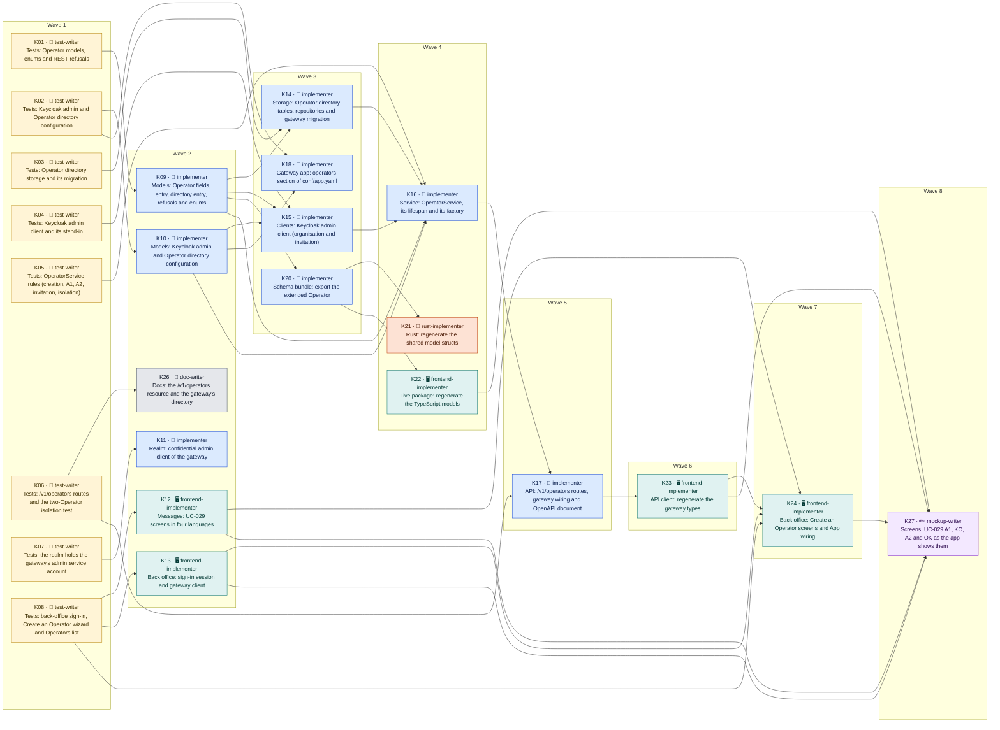

# T0.16: Create an Operator (UC-029), plan

**Plan:** 🟢 Approved

**Push:** 🟢 Approved

<!-- ticket:specs -->
## 📚 Specifications

The technical pages, features, use cases and business rules of [TICKET.md](TICKET.md), copied by `python3 .claude/scripts/tickets/ticket_refs.py sync`.

- [🖥️ GUI and WebUI: apps and shared packages](../../specs/technical/10-frontends.md#apps)
- [🔌 API layer: REST](../../specs/technical/05-api.md#rest)
- [🏗️ Architecture: cells and the global layer](../../specs/technical/01-architecture.md#cells)
- [🔐 Security: identity](../../specs/technical/06-security.md#identity)
- [📘 FS-012: Operators, deployment and languages](../../specs/functional/features/FS-012-operators-deployment-and-languages.md)
- [🎬 UC-029: Create an Operator](../../specs/functional/use-cases/UC-029-create-an-operator.md)
- [📏 BR-008: Operator isolation](../../specs/functional/business-rules/BR-008-operator-isolation.md)
- [🔐 Security: roles and Operator isolation](../../specs/technical/06-security.md#authorisation)
- [🖼️ UC-029 A1: Enter the Operator](../../specs/functional/use-cases/UC-029-create-an-operator.md#screen-a1)
- [🖼️ UC-029 KO: Operator not created](../../specs/functional/use-cases/UC-029-create-an-operator.md#screen-ko)
- [🖼️ UC-029 A2: Invite the first Mission planner](../../specs/functional/use-cases/UC-029-create-an-operator.md#screen-a2)
- [🖼️ UC-029 OK: Operator created and isolated](../../specs/functional/use-cases/UC-029-create-an-operator.md#screen-ok)
<!-- /ticket:specs -->

## Summary

T0.16 delivers UC-029 (Create an Operator) end to end. The 25 tasks split by layer: shared models and config, gateway storage (Operator directory tables plus a people table under row-level security), a Keycloak admin client, an OperatorService, and /v1/operators routes on the gateway. The back-office app gets OIDC sign-in and the create wizard (A1, then KO, then A2, then OK), and the Mission planner's first sign-in shows her own Operator. Generated artefacts are regenerated: the JSON Schema bundle, Rust structs, TypeScript live models, the OpenAPI document and the api-client. Wave 1 holds 8 test-writer tasks: models, config, storage, the Keycloak admin client with its stand-in, the service, the API with the two-Operator isolation test (FS-012 AC-3), the realm, and the back-office front end. The implementation waves follow layer order. A doc-writer task updates the REST resource list and backend/README.md. A mockup-writer capture task, which depends on every frontend-implementer task, owns the UC-029 screens. T0.20 is not merged yet, so the task updates the four mock-ups to what the app shows and re-renders them. If T0.20 is merged by run time, it captures screenshots instead.

## Assumptions

- TICKET.md and PROGRESS.md already existed and were complete; kept them. Only the paths were updated to the new layout (backend/apps/gateway, frontend/apps/back-office) as in the phase 7 roadmap.
- The roadmap row has no anchor of its own, so the ticket links to the S04 section and the epic to the epics table.
- The three acceptance criteria come from AC-3 of FS-012 and alternative flows A1 and A2 of UC-029, which the roadmap row names as done-when.
- Screens are listed as touched because the ticket changes frontend/apps/back-office (TKT-21).
- I could not run check_ticket.py (no shell tool available), so the check is still to run by the workflow.
- tests-evidences/ was created with a .gitkeep file, since no shell was available to make an empty folder.
- Operator itself, the shared model, gains deployment, Jurisdictions, LLM provider and Anchoring. No separate model holds them, because the glossary and UC-029 say the Operator is created with them. The schema bundle, the Rust structs and the TypeScript live models are regenerated (K20, K21, K22).
- The Jurisdiction values are EU (EASA) and US (FAA), the two that the glossary names.
- Only the LLM provider is stored, as claude or open_weight. Its default is Claude in the cloud and an open-weight model on premises (FS-012 details, glossary). The specification gives no list of models, so choosing models is left for later.
- The Anchoring choices are the qualified timestamping authority (the default), a public blockchain through an aggregator, or none, as UC-029 step 2 says.
- The Operator directory tables (operators, cell_assignments) sit in the gateway schema, are global and have no row-level security. The Swarm administrator has no Operator and must write and list them. The first Mission planner is stored as a Person in a people table under row-level security (BR-008, checked in two places).
- The security page says the Swarm administrator has no access to Operators' data. So the directory list leaves out the first Mission planner, and the OK screen shows the invitation as sent. The capture task adjusts the OK mock-up to this.
- Two names are the same Operator name when they match case-insensitively after trimming. This is the stricter reading of 'no Operator has that name'.
- The service checks the required fields first and answers 422, naming every missing field. It then checks the name and answers 409. The Back office runs the same checks before it submits, against the directory list, so the KO screen can show both errors at once. Problem details stay in English like the existing ones, and the Back office shows its own translated messages.
- The first Mission planner's name is optional, because UC-029 A2 lists only her e-mail as required. When no name is given, her Person record takes her e-mail address as its name.
- If Keycloak already has an account for the first Mission planner's e-mail, the request is refused with 409 and nothing is created. This is the conservative choice, since the specification is silent.
- The invitation uses the Keycloak admin API, in this order: create the user with the attribute operator_id and the required actions UPDATE_PASSWORD and CONFIGURE_TOTP (multi-factor authentication is required for Mission planners), give her the realm role mission_planner, add her to the Operator's organisation, then send the actions e-mail back to the back-office client. Accepting the invitation means completing those actions.
- The gateway calls Keycloak through a new confidential client, swarm-gateway-admin, with a service account that has the realm-management roles manage-users and manage-realm. Keycloak generates its secret, and the gateway reads it from the environment entry SWARM_GATEWAY_KEYCLOAK_CLIENT_SECRET, filled from the vault. KeycloakAdminClient is a separate class from KeycloakJwksClient because it uses a different API (the admin API).
- New Operators are assigned to the cell named in conf/app.yaml, which is dev by default. P0 has one cell per deployment.
- The specification does not give the realm's SMTP server or the back-office redirect URIs for each environment, so the realm file sets neither. They are follow-ups for the dev cell.
- Back office sign-in uses oidc-client-ts (code flow with PKCE S256) and server data uses TanStack Query, as the front-end stack says. The identity and gateway URLs come from the Vite variables VITE_SWARM_IDENTITY_URL and VITE_SWARM_GATEWAY_URL.
- GET /v1/operators/{operator_id} can be read by every role of that Operator. On her first sign-in, the Mission planner sees the Back office with her own Operator's name, and gets 404 for any other Operator.
- The Operator service opens its PostgreSQL pool on the first call. So the OpenAPI export, the existing router tests and the e2e images still run with no database.
- If a Keycloak call fails part-way through a creation, the database transaction rolls back and the service removes the organisation and user it created, as far as it can. The failure is answered 503, through the existing identity-unavailable handling.
- T0.20 is not merged at plan time. The capture task therefore updates the four UC-029 mock-ups to what the app shows (TKT-21). If T0.20 is merged by run time, the task captures screenshots instead and deletes the mock-ups.

<!-- plan:graph -->

> [!NOTE]
> Generated from the json block at the end of this page by `python3 .claude/scripts/tickets/plan.py render`.
> To change a task, edit the json block, then render again: never edit this view by hand.

## Waves

| Wave | Tasks | Agents running at once |
| --- | --- | --- |
| 1 | [K01](#k01), [K02](#k02), [K03](#k03), [K04](#k04), [K05](#k05), [K06](#k06), [K07](#k07), [K08](#k08) | 8 of 8 |
| 2 | [K09](#k09), [K10](#k10), [K11](#k11), [K12](#k12), [K13](#k13), [K26](#k26) | 6 of 6 |
| 3 | [K14](#k14), [K15](#k15), [K18](#k18), [K20](#k20) | 4 of 4 |
| 4 | [K16](#k16), [K21](#k21), [K22](#k22) | 3 of 3 |
| 5 | [K17](#k17) | 1 of 1 |
| 6 | [K23](#k23) | 1 of 1 |
| 7 | [K24](#k24) | 1 of 1 |
| 8 | [K27](#k27) | 1 of 1 |

| Wave | Task | Agent | Depends on | Unblocks |
| --- | --- | --- | --- | --- |
| 1 | [K01](#k01) Tests: Operator models, enums and REST refusals | 🧪 test-writer | none | [K09](#k09) |
| 1 | [K02](#k02) Tests: Keycloak admin and Operator directory configuration | 🧪 test-writer | none | [K10](#k10), [K18](#k18) |
| 1 | [K03](#k03) Tests: Operator directory storage and its migration | 🧪 test-writer | none | [K14](#k14) |
| 1 | [K04](#k04) Tests: Keycloak admin client and its stand-in | 🧪 test-writer | none | [K15](#k15) |
| 1 | [K05](#k05) Tests: OperatorService rules (creation, A1, A2, invitation, isolation) | 🧪 test-writer | none | [K16](#k16) |
| 1 | [K06](#k06) Tests: /v1/operators routes and the two-Operator isolation test | 🧪 test-writer | none | [K26](#k26), [K17](#k17) |
| 1 | [K07](#k07) Tests: the realm holds the gateway's admin service account | 🧪 test-writer | none | [K11](#k11) |
| 1 | [K08](#k08) Tests: back-office sign-in, Create an Operator wizard and Operators list | 🧪 test-writer | none | [K12](#k12), [K13](#k13), [K24](#k24) |
| 2 | [K09](#k09) Models: Operator fields, entry, directory entry, refusals and enums | 🐍 implementer | [K01](#k01) | [K14](#k14), [K15](#k15), [K20](#k20), [K16](#k16) |
| 2 | [K10](#k10) Models: Keycloak admin and Operator directory configuration | 🐍 implementer | [K02](#k02) | [K15](#k15), [K18](#k18), [K16](#k16) |
| 2 | [K11](#k11) Realm: confidential admin client of the gateway | 🐍 implementer | [K07](#k07) | none |
| 2 | [K12](#k12) Messages: UC-029 screens in four languages | 🖥️ frontend-implementer | [K08](#k08) | [K24](#k24), [K27](#k27) |
| 2 | [K13](#k13) Back office: sign-in session and gateway client | 🖥️ frontend-implementer | [K08](#k08) | [K24](#k24), [K27](#k27) |
| 2 | [K26](#k26) Docs: the /v1/operators resource and the gateway's directory | 📝 doc-writer | [K06](#k06) | none |
| 3 | [K14](#k14) Storage: Operator directory tables, repositories and gateway migration | 🐍 implementer | [K03](#k03), [K09](#k09) | [K16](#k16) |
| 3 | [K15](#k15) Clients: Keycloak admin client (organisation and invitation) | 🐍 implementer | [K04](#k04), [K09](#k09), [K10](#k10) | [K16](#k16) |
| 3 | [K18](#k18) Gateway app: operators section of conf/app.yaml | 🐍 implementer | [K02](#k02), [K10](#k10) | none |
| 3 | [K20](#k20) Schema bundle: export the extended Operator | 🐍 implementer | [K09](#k09) | [K21](#k21), [K22](#k22) |
| 4 | [K16](#k16) Service: OperatorService, its lifespan and its factory | 🐍 implementer | [K05](#k05), [K09](#k09), [K10](#k10), [K14](#k14), [K15](#k15) | [K17](#k17) |
| 4 | [K21](#k21) Rust: regenerate the shared model structs | 🦀 rust-implementer | [K20](#k20) | none |
| 4 | [K22](#k22) Live package: regenerate the TypeScript models | 🖥️ frontend-implementer | [K20](#k20) | [K27](#k27) |
| 5 | [K17](#k17) API: /v1/operators routes, gateway wiring and OpenAPI document | 🐍 implementer | [K06](#k06), [K16](#k16) | [K23](#k23) |
| 6 | [K23](#k23) API client: regenerate the gateway types | 🖥️ frontend-implementer | [K17](#k17) | [K24](#k24), [K27](#k27) |
| 7 | [K24](#k24) Back office: Create an Operator screens and App wiring | 🖥️ frontend-implementer | [K08](#k08), [K12](#k12), [K13](#k13), [K23](#k23) | [K27](#k27) |
| 8 | [K27](#k27) Screens: UC-029 A1, KO, A2 and OK as the app shows them | ✏️ mockup-writer | [K12](#k12), [K13](#k13), [K22](#k22), [K23](#k23), [K24](#k24) | none |

## Dependency graph



## Tasks

### <a id="k01"></a>K01: Tests: Operator models, enums and REST refusals

| Agent | Wave | Depends on | Unblocks |
| --- | --- | --- | --- |
| 🧪 test-writer | 1 | none | [K09](#k09) |

**Files** (only this task may change them in its wave):

- `tests/swarm_models/enums/operators/test_operator_enums.py`
- `tests/swarm_models/operators/test_operator.py`
- `tests/swarm_models/operators/test_operator_entry.py`
- `tests/swarm_models/operators/test_operator_directory_entry.py`
- `tests/swarm_models/operators/test_operator_created.py`
- `tests/swarm_models/operators/exceptions/test_operator_refusals.py`

**Done when:** `uv run ruff check tests/swarm_models/operators tests/swarm_models/enums/operators` and `uv run ruff format --check` on the listed files pass; `uv run pytest tests/swarm_models/operators tests/swarm_models/enums/operators -n 2` fails only because the new models, enums and exceptions do not exist yet.

**Brief:**

Write the failing tests of the shared models that UC-029 needs, before any code exists (TKT-4). Specification: [UC-029 main flow and alternative flows](docs/specs/functional/use-cases/UC-029-create-an-operator.md#alternative-flows), [FS-012 details (required fields and defaults)](docs/specs/functional/features/FS-012-operators-deployment-and-languages.md#details), [glossary: Jurisdiction](docs/specs/glossary.md#term-jurisdiction), [LLM provider](docs/specs/glossary.md#term-llm-provider), [Anchoring](docs/specs/glossary.md#term-anchoring), [BR-008](docs/specs/functional/business-rules/BR-008-operator-isolation.md), [API layer: REST errors as problem+json](docs/specs/technical/05-api.md#rest). Follow AGENT.md Tests (one `Test<Subject>` class per file, sentence names, the six model tests: defaults, full valid construction, none becomes the default, rejects bad values with the specific exception, rejects unknown keys, round trip; compare with enums and constants, never raw values).

Contract the implementer (K09) will satisfy:
- New enums in `swarm_models/enums.py` (import `from swarm_models.enums import ...`): `Deployment` {CLOUD="cloud", ON_PREMISES="on_premises"}, `Jurisdiction` {EU_EASA="eu_easa", US_FAA="us_faa"}, `LlmProvider` {CLAUDE="claude", OPEN_WEIGHT="open_weight"}, `Anchoring` {QUALIFIED_TIMESTAMPING="qualified_timestamping", PUBLIC_BLOCKCHAIN="public_blockchain", NONE="none"}, `OperatorField` {NAME="name", DEPLOYMENT="deployment", JURISDICTIONS="jurisdictions", FIRST_MISSION_PLANNER_EMAIL="first_mission_planner_email"}. Test: unique, lower snake case values without hyphens.
- `swarm_models.operators.operator.Operator` gains `deployment: Deployment` (required), `jurisdictions: List[Jurisdiction]` (required, at least one, no duplicates), `llm_provider: LlmProvider` (default CLAUDE), `anchoring: Anchoring` (default QUALIFIED_TIMESTAMPING), beside `id` (UUID v7) and `name`. Update the existing `tests/swarm_models/operators/test_operator.py` accordingly; each bad field raises its own `SEOperatorInvalid<Field>` from `swarm_models.operators.exceptions`.
- `swarm_models.operators.operator_entry.OperatorEntry`, the body of the create request, lenient on presence so that the service can name what is missing: `name: Optional[str]` (stripped, blank becomes None), `deployment: Optional[Deployment]`, `jurisdictions: List[Jurisdiction]` (default empty, duplicates refused), `llm_provider: Optional[LlmProvider]` (default None), `anchoring: Anchoring` (default QUALIFIED_TIMESTAMPING), `first_mission_planner_name: Optional[str]` (blank becomes None), `first_mission_planner_email: Optional[str]` (blank becomes None; when given, an address without one `@` and a dot in its domain is refused). Its exceptions derive from `SEInvalidOperatorEntryException`, which is a `ValueError` (so FastAPI answers 422 for a wrong type).
- `swarm_models.operators.operator_directory_entry.OperatorDirectoryEntry(operator: Operator, cell_assignment: CellAssignment)`: refused when `cell_assignment.operator_id != operator.id`.
- `swarm_models.operators.operator_created.OperatorCreated(operator: Operator, cell_assignment: CellAssignment, first_mission_planner: Person)`: refused when the cell assignment or the person does not belong to the Operator.
- REST refusals, `SERestError` subclasses importable from `swarm_models.operators.exceptions`: `SEOperatorFieldMissingError` (STATUS 422), `SEOperatorNameTakenError` (409), `SEOperatorPlannerEmailTakenError` (409), `SEOperatorNotFoundError` (404). Test their STATUS and that each is an `SERestError` (`swarm_web.models.rest.exceptions`).

The folder `tests/swarm_models/enums/` already holds five files, so the enum tests go in `tests/swarm_models/enums/operators/`. Test file base names must be unique across the workspace. Use Aerowing Services, the sample Operator of the visual identity.

### <a id="k02"></a>K02: Tests: Keycloak admin and Operator directory configuration

| Agent | Wave | Depends on | Unblocks |
| --- | --- | --- | --- |
| 🧪 test-writer | 1 | none | [K10](#k10), [K18](#k18) |

**Files** (only this task may change them in its wave):

- `tests/swarm_models/keycloak/test_keycloak_admin_config.py`
- `tests/swarm_models/config/gateway/test_operator_directory_config.py`
- `tests/swarm_models/config/gateway/test_gateway_config.py`

**Done when:** `uv run ruff check tests/swarm_models/keycloak tests/swarm_models/config/gateway` passes; `uv run pytest tests/swarm_models/keycloak/test_keycloak_admin_config.py tests/swarm_models/config/gateway -n 2` fails only because the new configuration models and the `operators` section do not exist yet.

**Brief:**

Write the failing tests of the configuration that the Operator directory of the gateway needs. Specification: [Architecture: cells and the global layer (Operator directory, routing of each Operator to its cell)](docs/specs/technical/01-architecture.md#cells), [Security: identity (Keycloak, each Operator an organisation)](docs/specs/technical/06-security.md#identity), [UC-029](docs/specs/functional/use-cases/UC-029-create-an-operator.md#main-flow). Follow AGENT.md Tests and Pydantic models (six model tests each, `None` becomes the default, `bool` refused for numbers, blank strings refused, `extra="forbid"`, configuration sections `validate_default=True`; a field ending in `_key` names an environment or secret store entry and never holds a secret).

Contract the implementer (K10) will satisfy:
- `swarm_models.keycloak.keycloak_admin_config.KeycloakAdminConfig`: `server_url` (default `http://keycloak.global.svc.cluster.local:8080`, no trailing slash kept), `realm` (default `swarm`), `client_id` (default `swarm-gateway-admin`), `client_secret_key` (default `SWARM_GATEWAY_KEYCLOAK_CLIENT_SECRET`, the environment entry of the secret), `sign_in_client_id` (default `back-office`, the client the invitation link returns to), `request_timeout_s` (default 5.0, a positive number). Each bad field raises its own `SEKeycloakAdminConfigInvalid<Field>` from `swarm_models.keycloak.exceptions`.
- `swarm_models.config.gateway.operator_directory_config.OperatorDirectoryConfig`: `cell` (default `dev`, the cell new Operators are assigned to, a non-blank lower case name) and `keycloak` (a `KeycloakAdminConfig`, default section when None).
- `GatewayConfig` gains `operators: OperatorDirectoryConfig` (default section when None, a non-mapping raises `SEGatewayConfigInvalidOperators` from `swarm_models.config.gateway.exceptions`). Update `tests/swarm_models/config/gateway/test_gateway_config.py`: the new section, its default, and that `backend/apps/gateway/conf/app.yaml` loads and writes out every default of the `operators` section (load the file with `GatewayConfig.load` and compare with `GatewayConfig()`; find the file from the repository root as the existing tests do, without `Path(__file__).parents[N]`).

### <a id="k03"></a>K03: Tests: Operator directory storage and its migration

| Agent | Wave | Depends on | Unblocks |
| --- | --- | --- | --- |
| 🧪 test-writer | 1 | none | [K14](#k14) |

**Files** (only this task may change them in its wave):

- `tests/swarm_storage/gateway/operators/test_operator_repository.py`
- `tests/swarm_storage/gateway/operators/test_cell_assignment_repository.py`
- `tests/swarm_storage/gateway/people/test_person_repository.py`
- `tests/swarm_storage/gateway/ddl/test_operator_directory_tables.py`
- `tests/scripts/migrations/test_migrations_scripts.py`

**Done when:** `uv run ruff check tests/swarm_storage/gateway tests/scripts/migrations` passes; `uv run pytest tests/swarm_storage/gateway tests/scripts/migrations -n 2` fails (or skips without PostgreSQL) only because the storage classes and the migration do not exist yet.

**Brief:**

Write the failing tests of the gateway storage of the Operator directory. Specification: [Architecture: the Operator directory in the global layer](docs/specs/technical/01-architecture.md#cells), [Security: checks in the gateway and in PostgreSQL row-level security](docs/specs/technical/06-security.md#authorisation), [BR-008: Operator isolation](docs/specs/functional/business-rules/BR-008-operator-isolation.md), [UC-029 step 3 (no Operator has that name)](docs/specs/functional/use-cases/UC-029-create-an-operator.md#main-flow). Use the real PostgreSQL fixtures `postgres_dsn` of the root conftest (they skip without the binaries) and follow `tests/swarm_storage/shared/postgres/repositories/test_outbox_repository.py` for the pool, the schema set-up and the Operator constants.

Contract the implementer (K14) will satisfy:
- `swarm_storage.gateway.ddl.operator_directory_tables.OperatorDirectoryTables` with `create(schema) -> List[str]` and `drop(schema) -> List[str]`, like `OutboxTable`: tables `operators` (one row per `Operator`, a unique index on the trimmed lower-case name), `cell_assignments` (one row per Operator, `CellAssignment`), both global and **without** row-level security because the Swarm administrator, who has no Operator, writes and lists them; and `people` (one row per `Person`, with `operator_id`) **with** the row-level security of `RowLevelSecurity().enable`.
- `swarm_storage.gateway.operators.operator_repository.OperatorRepository(unit_of_work, schema)`, a `PostgresRepository[Operator]`: `add` (round trip of every field, the Jurisdictions list included), `get`, `list`, and `find_by_name(name) -> Optional[Operator]` matching trimmed and case-insensitively; adding a second Operator whose name differs only by case or spaces raises `SEStorageDuplicateError` from `swarm_models.storage.exceptions`.
- `swarm_storage.gateway.operators.cell_assignment_repository.CellAssignmentRepository(unit_of_work, schema)`: `add`, `get(operator_id)`, `list`.
- `swarm_storage.gateway.people.person_repository.PersonRepository(unit_of_work, schema)`: `add`, `get`, `list`; a person of Operator A is invisible in a unit of work of Operator B and in one without an Operator, and adding a person of B in A's unit of work raises `SEStorageOperatorRefusedError` (BR-008, two Operators).
- Update `tests/scripts/migrations/test_migrations_scripts.py`: migrating the gateway also creates `gateway.operators`, `gateway.cell_assignments` and `gateway.people` (migration `0002` of `backend/apps/gateway/migrations/versions/`).

### <a id="k04"></a>K04: Tests: Keycloak admin client and its stand-in

| Agent | Wave | Depends on | Unblocks |
| --- | --- | --- | --- |
| 🧪 test-writer | 1 | none | [K15](#k15) |

**Files** (only this task may change them in its wave):

- `tests/fakes/keycloak/keycloak_admin_stand_in.py`
- `tests/fakes/keycloak/admin_request_handler.py`
- `tests/fakes/keycloak/helpers.py`
- `tests/conftest.py`
- `tests/swarm_clients/gateway/keycloak/test_keycloak_admin_client.py`

**Done when:** `uv run ruff check tests/fakes/keycloak tests/conftest.py tests/swarm_clients/gateway/keycloak` passes; the stand-in starts and answers its token endpoint in a quick check; `uv run pytest tests/swarm_clients/gateway/keycloak/test_keycloak_admin_client.py -n 2` fails only because `KeycloakAdminClient` and its new exception do not exist yet, and the existing tests of `tests/swarm_clients/gateway/keycloak` and `tests/swarm_api` still pass.

**Brief:**

Write a local stand-in of the Keycloak admin REST API and the failing tests of the client that creates an Operator's organisation and invites its first Mission planner by e-mail. Specification: [Security: identity (Keycloak, one realm, each Operator an organisation, multi-factor authentication for Mission planners)](docs/specs/technical/06-security.md#identity), [UC-029 steps 4 to 6](docs/specs/functional/use-cases/UC-029-create-an-operator.md#main-flow), [Architecture: Keycloak identity in the global layer](docs/specs/technical/01-architecture.md#cells). Prefer real things to mocks (AGENT.md Tests): a real local HTTP server, like `tests/fakes/keycloak/keycloak_stand_in.py`. The folder `tests/fakes/keycloak/` may hold at most five code files.

Stand-in contract, which K05 and K06 use in the same wave, so keep exactly these names:
- `tests.fakes.keycloak.keycloak_admin_stand_in.KeycloakAdminStandIn`, a context manager on `127.0.0.1` and a free port, with `server_url` (`http://127.0.0.1:<port>`), `realm` (`swarm`), `client_id` (`swarm-gateway-admin`) and `client_secret` (a random string); the fixture `keycloak_admin_stand_in` in `tests/conftest.py` yields one and sets the environment entry `SWARM_GATEWAY_KEYCLOAK_CLIENT_SECRET` to its secret (monkeypatch).
- It answers: `POST /realms/swarm/protocol/openid-connect/token` (client credentials, the right secret only), and, with that bearer token only, `POST /admin/realms/swarm/organizations` (201, `Location` with the id), `DELETE /admin/realms/swarm/organizations/{id}`, `POST /admin/realms/swarm/users` (201 with `Location`; 409 when the e-mail is already used), `DELETE /admin/realms/swarm/users/{id}`, `GET /admin/realms/swarm/roles/{name}`, `POST /admin/realms/swarm/users/{id}/role-mappings/realm`, `POST /admin/realms/swarm/organizations/{id}/members` (body: the user id), `PUT /admin/realms/swarm/users/{id}/execute-actions-email?client_id=...` (204).
- It records what it holds: `organisations` (id to representation), `users` (id to representation: email, username, firstName, attributes, requiredActions), `realm_roles` (user id to role names), `members` (organisation id to user ids), `action_emails` (list of (user id, actions, client_id)); `fail_path(fragment)` makes the next request whose path contains it answer 500, and `existing_email(address)` pre-registers a user.

Client contract the implementer (K15) will satisfy: `swarm_clients.gateway.keycloak.keycloak_admin_client.KeycloakAdminClient(config: KeycloakAdminConfig)` with `async create_organisation(operator: Operator) -> str` (named after the Operator, attribute `operator_id`), `async invite_mission_planner(organisation_id: str, person: Person) -> str` (creates the user with the e-mail as username, the person's name, the attribute `operator_id`, the required actions `UPDATE_PASSWORD` and `CONFIGURE_TOTP`; gives the realm role `mission_planner`; adds it to the organisation; sends the actions e-mail returning to `sign_in_client_id`; returns the user id), `async delete_organisation(organisation_id)`, `async delete_user(user_id)`. A 409 on the user raises `SEKeycloakConflictError`, any other failure, an unreachable server or a missing secret entry raises `SEKeycloakUnreachableError` (both from `swarm_models.keycloak.exceptions`); the secret is never logged.

### <a id="k05"></a>K05: Tests: OperatorService rules (creation, A1, A2, invitation, isolation)

| Agent | Wave | Depends on | Unblocks |
| --- | --- | --- | --- |
| 🧪 test-writer | 1 | none | [K16](#k16) |

**Files** (only this task may change them in its wave):

- `tests/swarm_service/gateway/operators/operator_service/test_operator_creation.py`
- `tests/swarm_service/gateway/operators/operator_service/test_operator_entry_checks.py`
- `tests/swarm_service/gateway/operators/operator_service/test_operator_directory_reads.py`
- `tests/swarm_service/gateway/operators/operator_service/conftest.py`
- `tests/swarm_service/gateway/operators/operator_service/helpers.py`
- `tests/swarm_service/gateway/operators/test_operator_lifespan.py`
- `tests/swarm_service/gateway/factories/operators/test_operator_service_factory.py`

**Done when:** `uv run ruff check tests/swarm_service/gateway/operators tests/swarm_service/gateway/factories/operators` passes; `uv run pytest tests/swarm_service/gateway/operators tests/swarm_service/gateway/factories/operators -n 2` fails (or skips without PostgreSQL) only because the service, its lifespan and its factory do not exist yet.

**Brief:**

Write the failing tests of the business rules of UC-029 in the service layer. Specification: [UC-029 main flow](docs/specs/functional/use-cases/UC-029-create-an-operator.md#main-flow), [alternative flows A1 and A2](docs/specs/functional/use-cases/UC-029-create-an-operator.md#alternative-flows), [postconditions](docs/specs/functional/use-cases/UC-029-create-an-operator.md#postconditions), [FS-012 details and AC-3](docs/specs/functional/features/FS-012-operators-deployment-and-languages.md#acceptance), [BR-008](docs/specs/functional/business-rules/BR-008-operator-isolation.md), [Architecture: cell assignment](docs/specs/technical/01-architecture.md#cells), [Security: identity](docs/specs/technical/06-security.md#identity). Use real PostgreSQL (`postgres_dsn`; create the schema and run `OperatorDirectoryTables().create(schema)`) and the fixture `keycloak_admin_stand_in` (the stand-in of K04, contract in K04's brief). No mocks. Use the models of K01's brief (`OperatorEntry`, `Operator`, `OperatorCreated`, `OperatorDirectoryEntry`, the enums and the four REST refusals).

Contract the implementer (K16) will satisfy:
- `swarm_service.gateway.operators.operator_service.OperatorService(pool: PostgresPool, schema_name: str, cell: str, keycloak: KeycloakAdminClient)` with `async create(entry: OperatorEntry) -> OperatorCreated`, `async list(after: Optional[UUID] = None, limit: int = 100) -> List[OperatorDirectoryEntry]`, `async get(operator_id: UUID) -> Operator`, `async close()`. The pool opens on the first call (so building the service needs no database) and `close` is safe before any call and twice.
- `create`: checks the required fields first and raises `SEOperatorFieldMissingError` whose message names every missing `OperatorField` value (name, deployment, at least one Jurisdiction, the first Mission planner's e-mail; parametrise each); then raises `SEOperatorNameTakenError` when an Operator of that name exists (same name, other case, extra spaces). Neither stores a row nor calls Keycloak. Otherwise, in one transaction, it stores the Operator (new UUID v7; `llm_provider` from the entry, or CLAUDE in the cloud and OPEN_WEIGHT on premises; `anchoring` from the entry, QUALIFIED_TIMESTAMPING by default), its `CellAssignment` to the configured cell, and the first Mission planner as a `Person` of that Operator (name entered, or the e-mail when none). It creates the Keycloak organisation and invites her: in the stand-in, one organisation, one user with the e-mail, attribute `operator_id` equal to the new Operator, realm role `mission_planner`, member of the organisation, and one actions e-mail.
- An e-mail Keycloak already knows raises `SEOperatorPlannerEmailTakenError`. A Keycloak failure (`fail_path`) raises `SEKeycloakUnreachableError`. In both cases no row is left and the organisation and the user it created are removed from the stand-in.
- `list` returns the directory entries in identifier order. `get` returns the Operator and raises `SEOperatorNotFoundError` for an unknown one.
- With two Operators created, the person of each is visible only in a unit of work of its own Operator (BR-008).
- `swarm_service.gateway.operators.operator_lifespan.OperatorLifespan(service, inner)` where `inner` is a lifespan callable `(FastAPI) -> async context manager`: `lifespan(app)` enters `inner`, yields, then closes the service, also when the block raises.
- `swarm_service.gateway.factories.operators.operator_service_factory.OperatorServiceFactory(config: GatewayConfig).create()` returns an `OperatorService` on `config.postgres`, `config.schema_name` and `config.operators`, without opening anything or reading the secret.

Shared fixtures go in the `conftest.py` and helpers in `helpers.py` of `operator_service/`, imported by their full path. Test base names must be unique across the workspace.

### <a id="k06"></a>K06: Tests: /v1/operators routes and the two-Operator isolation test

| Agent | Wave | Depends on | Unblocks |
| --- | --- | --- | --- |
| 🧪 test-writer | 1 | none | [K26](#k26), [K17](#k17) |

**Files** (only this task may change them in its wave):

- `tests/swarm_api/v1/gateway/operator_router/test_operator_router.py`
- `tests/swarm_api/v1/gateway/operator_router/test_operator_isolation.py`
- `tests/swarm_api/v1/gateway/operator_router/conftest.py`
- `tests/swarm_api/v1/gateway/operator_router/helpers.py`
- `tests/swarm_api/v1/gateway/gateway_router/test_gateway_router.py`

**Done when:** `uv run ruff check tests/swarm_api/v1/gateway` passes; `uv run pytest tests/swarm_api/v1/gateway -n 2` fails (or skips without PostgreSQL) only because the operator routes and their wiring do not exist yet.

**Brief:**

Write the failing tests of the gateway REST routes of UC-029 and the acceptance test of the ticket: FS-012 AC-3 as an automated test with two Operators. Specification: [API layer: REST (`/v1`, `Idempotency-Key` on every POST, errors as problem+json)](docs/specs/technical/05-api.md#rest), [Security: roles (Swarm administrator creates Operators, no access to their data; gateway checks role and Operator)](docs/specs/technical/06-security.md#authorisation), [Security: identity (tokens carry person, Operator, roles)](docs/specs/technical/06-security.md#identity), [UC-029 alternative flows](docs/specs/functional/use-cases/UC-029-create-an-operator.md#alternative-flows), [FS-012 AC-3](docs/specs/functional/features/FS-012-operators-deployment-and-languages.md#acceptance), [BR-008 examples (another Operator's resource is not found)](docs/specs/functional/business-rules/BR-008-operator-isolation.md#examples).

Set-up: build the real application with `GatewayRouter(config).application()` where `config` is a `GatewayConfig` whose `auth.issuer_url` is the `keycloak_stand_in` (tokens minted with `tests.fakes.keycloak.helpers.claims_for`), whose `operators.keycloak.server_url` is the `keycloak_admin_stand_in` (K04's brief), and whose `postgres.dsn_key` entry holds `postgres_dsn` with the gateway tables created (`OperatorDirectoryTables` of K03's brief). Use `httpx.AsyncClient(transport=ASGITransport(app=app))` in async tests so the pool stays on one event loop, and close the service at the end (`OperatorRouter.operators.close()`). Every POST sends an `Idempotency-Key`.

Contract the implementer (K17) will satisfy, in `swarm_api.v1.gateway.operator_router.OperatorRouter` included by `GatewayRouter`:
- `POST /v1/operators`, Swarm administrator only, body `OperatorEntry` (JSON fields: name, deployment, jurisdictions, llm_provider, anchoring, first_mission_planner_name, first_mission_planner_email): 201 with `OperatorCreated` (operator, cell_assignment, first_mission_planner); 422 problem+json whose `detail` names `jurisdictions` when no Jurisdiction is given (A2); 409 problem+json when the name is taken (A1); 401 without a token; 403 for a Mission planner; 400 without `Idempotency-Key`.
- `GET /v1/operators`, Swarm administrator only: 200 with the list of `OperatorDirectoryEntry`; 403 for a Mission planner.
- `GET /v1/operators/{operator_id}`, every role of an Operator: 200 with the `Operator` for its own people; 404 for another Operator's id (BR-008). For the Swarm administrator, assert the refusal that `swarm_service/gateway/auth/access_service.py` gives (read it).
- Acceptance (`test_operator_isolation.py`): the Swarm administrator creates Aerowing Services and a second Operator. Each first Mission planner is invited (her user, role, `operator_id` attribute and actions e-mail are in the admin stand-in). A token for Aerowing Services' Mission planner (`sub` = her stand-in user id, `operator_id` = the new Operator, role `mission_planner`) reads her Operator and gets 404 for the other and 403 for the directory list. The reverse holds for the other Operator's Mission planner.
- Update `test_gateway_router.py`: the OpenAPI document lists `/v1/operators` and `/v1/operators/{operator_id}`, and the application still builds and serves its document with no database and no Keycloak.

### <a id="k07"></a>K07: Tests: the realm holds the gateway's admin service account

| Agent | Wave | Depends on | Unblocks |
| --- | --- | --- | --- |
| 🧪 test-writer | 1 | none | [K11](#k11) |

**Files** (only this task may change them in its wave):

- `tests/infra/charts/keycloak/test_swarm_realm.py`

**Done when:** `uv run ruff check tests/infra/charts/keycloak` passes; `uv run pytest tests/infra/charts/keycloak -n 2` fails only on the new expectations about `swarm-gateway-admin`.

**Brief:**

Update the realm tests for the confidential client that the gateway uses to create organisations and invite people. Specification: [Security: identity (one realm per deployment, each Operator an organisation)](docs/specs/technical/06-security.md#identity), [Security: Swarm administrator creates Operators and their first accounts](docs/specs/technical/06-security.md#authorisation), [UC-029 steps 4 and 5](docs/specs/functional/use-cases/UC-029-create-an-operator.md#main-flow). Edit `tests/infra/charts/keycloak/test_swarm_realm.py`, the tests of `infra/charts/keycloak/files/swarm-realm.json`:
- the clients are the five front ends **and** `swarm-gateway-admin`; the five front ends stay public PKCE S256 code-flow clients, as now;
- `swarm-gateway-admin` is confidential (`publicClient` false), with only the client credentials grant (`serviceAccountsEnabled` true; standard, implicit and direct access flows false), no redirect URI or web origin, and **no `secret` in the file** (Keycloak generates it, and the gateway reads it from its environment entry);
- the realm holds no user except the service account of `swarm-gateway-admin` (`serviceAccountClientId`), with exactly the `realm-management` client roles `manage-users` and `manage-realm`, no password and no credential;
- no client accepts a wildcard redirect or origin, as now.
Keep every other test of the file.

### <a id="k08"></a>K08: Tests: back-office sign-in, Create an Operator wizard and Operators list

| Agent | Wave | Depends on | Unblocks |
| --- | --- | --- | --- |
| 🧪 test-writer | 1 | none | [K12](#k12), [K13](#k13), [K24](#k24) |

**Files** (only this task may change them in its wave):

- `frontend/apps/back-office/test/app.test.tsx`
- `frontend/apps/back-office/test/auth/session.test.tsx`
- `frontend/apps/back-office/test/operators/create-operator.test.tsx`
- `frontend/apps/back-office/test/operators/operators-list.test.tsx`
- `frontend/apps/back-office/test/stand-ins/stand-in-gateway.ts`

**Done when:** `pnpm --filter @swarm/back-office exec eslint test` passes; `pnpm --filter @swarm/back-office test` fails only because the modules of `src/auth`, `src/api` and `src/operators` and the new messages do not exist yet.

**Brief:**

Write the failing Vitest tests of UC-029 in the Back office. Specification: [UC-029 main flow, flow chart and screens A1, KO, A2, OK](docs/specs/functional/use-cases/UC-029-create-an-operator.md#screens), [alternative flows A1 and A2](docs/specs/functional/use-cases/UC-029-create-an-operator.md#alternative-flows), [FS-012 details](docs/specs/functional/features/FS-012-operators-deployment-and-languages.md#details), [GUI and WebUI: apps and shared packages (back-office, React 19, TanStack Query)](docs/specs/technical/10-frontends.md#apps), [Security: identity (authorisation code flow with PKCE; tokens carry the Operator and the roles)](docs/specs/technical/06-security.md#identity), [API layer: REST](docs/specs/technical/05-api.md#rest). The mock-ups `docs/specs/screens/mockups/UC-029/{a1,ko,a2,ok}.html` show the words. No real network: a stand-in `fetch`.

Contract the implementers (K13, K24) will satisfy, under `frontend/apps/back-office/src/`:
- `auth/session.ts`: `interface Session { accessToken: string; roles: readonly string[]; operatorId: string | null }`, `sessionFromToken(accessToken): Session` (reads, without checking it, the payload's `realm_access.roles` and `operator_id`), `isSwarmAdministrator(session): boolean`.
- `auth/SessionProvider.tsx`: `SessionProvider({ session, children })` and `useSession()`.
- `api/gateway.ts`: `createBackOfficeGateway({ baseUrl, accessToken, fetch })`, an `@swarm/api-client` gateway client that adds `Authorization: Bearer <token>` to every request and a fresh `Idempotency-Key` to every POST.
- `api/GatewayProvider.tsx`: `GatewayProvider({ client, children })` (it also provides a TanStack `QueryClient`), and `useGateway()`.
- `App` (no props) reads both: a Swarm administrator sees the Swarm administration frame (`➕ Operators` active) with the Operators screen; another person sees the Back office frame with her Operator's name in the title bar, read from `GET /v1/operators/{operatorId}`.
- `stand-ins/stand-in-gateway.ts` (yours): a `fetch` that answers `GET /v1/operators` (a list of `{operator, cell_assignment}`), `POST /v1/operators` (201 `{operator, cell_assignment, first_mission_planner}`; 409 or 422 `application/problem+json` on demand), `GET /v1/operators/{id}`, and records each request (method, URL, headers, JSON body). JSON fields and enum values: Operator `{id, name, deployment: cloud|on_premises, jurisdictions: [eu_easa|us_faa], llm_provider: claude|open_weight, anchoring: qualified_timestamping|public_blockchain|none}`; CellAssignment `{operator_id, cell, assigned_at}`; Person `{id, operator_id, name, email, language}`; entry body `{name, deployment, jurisdictions, llm_provider, anchoring, first_mission_planner_name, first_mission_planner_email}`.

Behaviours, rendered in English (`I18nProvider language="en"`) with `SessionProvider` and `GatewayProvider`:
- `session.test.tsx`: token to session, Swarm administrator detection.
- `create-operator.test.tsx`: A1 shows `➕ Create an Operator`, `Operator name`, `Deployment` (`Cloud`, `On premises`), `Jurisdictions` (`EU (EASA)`, `US (FAA)`), `LLM provider and models` (Claude by default), `🔏 Anchoring` with `Qualified timestamping authority (eIDAS, RFC 3161)` chosen by default, `Public blockchain, through an aggregator` and `No Anchoring: signed and chained only`, and `Next: first Mission planner ▶️`. Next without a Jurisdiction stays on A1, shows `❌ Operator not created.` and `Choose at least one Jurisdiction: it is required.`, and sends nothing (A2). Next with the name of a listed Operator (any case) shows `An Operator named Aerowing Services already exists.` (A1). Valid entry moves to `👥 First Mission planner of Aerowing Services` with `E-mail address`. Submitting without an e-mail names it as required. `Create the Operator and send the invitation` sends one POST with the entry, the bearer token and an `Idempotency-Key`. A 409 answer brings back A1 with the name error.
- `operators-list.test.tsx`: after creation, `✅ Aerowing Services created. Its data is isolated: no other Operator can see it.` and the table `🗃️ Operators` with columns Operator, Deployment, Jurisdictions, Anchoring, Cell and State.
- Update `app.test.tsx`: keep the frame tests (title bar, light and dark, tokens, root). A person of an Operator sees the six Back office items with her Operator's name in the title bar and an empty content area. A Swarm administrator sees `➕ Operators`, `👥 People` and `🔧 Settings`.
At most five code files per folder.

### <a id="k09"></a>K09: Models: Operator fields, entry, directory entry, refusals and enums

| Agent | Wave | Depends on | Unblocks |
| --- | --- | --- | --- |
| 🐍 implementer | 2 | [K01](#k01) | [K14](#k14), [K15](#k15), [K20](#k20), [K16](#k16) |

**Files** (only this task may change them in its wave):

- `backend/swarm-models/src/swarm_models/enums.py`
- `backend/swarm-models/src/swarm_models/operators/operator.py`
- `backend/swarm-models/src/swarm_models/operators/operator_entry.py`
- `backend/swarm-models/src/swarm_models/operators/operator_directory_entry.py`
- `backend/swarm-models/src/swarm_models/operators/operator_created.py`
- `backend/swarm-models/src/swarm_models/operators/exceptions/`
- `backend/swarm-models/src/swarm_models/storage/exceptions/`

**Done when:** `uv run pytest tests/swarm_models -n 2` passes; `uv run ruff check backend/swarm-models` and `uv run mypy backend/swarm-models/src` pass; `uv run pytest tests/conventions/backend -n 2` passes.

**Brief:**

Implement the shared models of UC-029 so that K01's tests pass. The contract (enums, `Operator` fields and defaults, `OperatorEntry`, `OperatorDirectoryEntry`, `OperatorCreated`, the four REST refusals) is in K01's brief and its tests. Specification: [UC-029](docs/specs/functional/use-cases/UC-029-create-an-operator.md#alternative-flows), [FS-012 details](docs/specs/functional/features/FS-012-operators-deployment-and-languages.md#details), [glossary: Operator](docs/specs/glossary.md#ent-operator), [Jurisdiction](docs/specs/glossary.md#term-jurisdiction), [LLM provider](docs/specs/glossary.md#term-llm-provider), [Anchoring](docs/specs/glossary.md#term-anchoring), [API layer: REST errors](docs/specs/technical/05-api.md#rest).
- The enums `Deployment`, `Jurisdiction`, `LlmProvider`, `Anchoring` and `OperatorField` go in `swarm_models/enums.py` only (`@unique StrEnum`, members under `Attributes:`, no hyphen).
- Extend `Operator` (and fix its docstring: an Operator is the organisation that flies Missions for its Clients, as the glossary says). Each new field has `Field(description=...)` and a `validate_<field>` before-validator raising its own `SEOperatorInvalid<Field>`.
- `OperatorEntry` exceptions derive from `SEInvalidOperatorEntryException(ValueError)`. The refusals subclass `SERestError` (`swarm_web.models.rest.exceptions`), with their STATUS (422, 409, 409, 404) and TITLE, as `SESimulationRunningError` does.
- Also add `SEStorageDuplicateError` ("Raised when a row breaks a unique constraint.") to `swarm_models/storage/exceptions/`, for the storage task K14.
- Every exceptions folder holds at most five files: dispatch them into themed sub-folders (`operator/fields/`, `entry/`, `errors/`). Each `exceptions/__init__.py` re-exports through a sorted `__all__`, and `swarm_models.operators.exceptions` exposes every one.
- Follow AGENT.md: Pydantic models, Exceptions, Typing, no raw strings, `models` never logs. Do not regenerate the schema bundle (K20 does).

### <a id="k10"></a>K10: Models: Keycloak admin and Operator directory configuration

| Agent | Wave | Depends on | Unblocks |
| --- | --- | --- | --- |
| 🐍 implementer | 2 | [K02](#k02) | [K15](#k15), [K18](#k18), [K16](#k16) |

**Files** (only this task may change them in its wave):

- `backend/swarm-models/src/swarm_models/keycloak/keycloak_admin_config.py`
- `backend/swarm-models/src/swarm_models/keycloak/exceptions/`
- `backend/swarm-models/src/swarm_models/config/gateway/operator_directory_config.py`
- `backend/swarm-models/src/swarm_models/config/gateway/gateway_config.py`
- `backend/swarm-models/src/swarm_models/config/gateway/exceptions/`

**Done when:** `uv run pytest tests/swarm_models/keycloak tests/swarm_models/config -n 2` passes, except the app.yaml defaults test left to K18; `uv run ruff check backend/swarm-models` and `uv run mypy backend/swarm-models/src` pass; `uv run pytest tests/conventions/backend -n 2` passes.

**Brief:**

Implement the configuration models of K02's brief so that its tests pass, except the test that reads `backend/apps/gateway/conf/app.yaml`, which K18 completes. Specification: [Architecture: cells and the global layer](docs/specs/technical/01-architecture.md#cells), [Security: identity](docs/specs/technical/06-security.md#identity), [UC-029](docs/specs/functional/use-cases/UC-029-create-an-operator.md#main-flow). Work in `swarm_models/keycloak/keycloak_admin_config.py` (`KeycloakAdminConfig`), `swarm_models/config/gateway/operator_directory_config.py` (`OperatorDirectoryConfig`) and the new `operators` section of `GatewayConfig` (a validator like `validate_live`, raising `SEGatewayConfigInvalidOperators` for a non-mapping). Also add to `swarm_models/keycloak/exceptions/` the error `SEKeycloakConflictError`, a subclass of `SEKeycloakError` raised when Keycloak answers 409 (for example an e-mail already used), for the client task K15. Every field has its description and its own validator exception. `client_secret_key` names the environment entry and never holds the secret. The folder `config/gateway/exceptions/` already holds five files: move them into themed sub-folders and keep every import from `swarm_models.config.gateway.exceptions` working. Follow AGENT.md Pydantic models, Exceptions and Naming (durations end in `_s`).

### <a id="k11"></a>K11: Realm: confidential admin client of the gateway

| Agent | Wave | Depends on | Unblocks |
| --- | --- | --- | --- |
| 🐍 implementer | 2 | [K07](#k07) | none |

**Files** (only this task may change them in its wave):

- `infra/charts/keycloak/files/swarm-realm.json`

**Done when:** `uv run pytest tests/infra/charts/keycloak -n 2` passes and the file is valid JSON (`python3 -m json.tool infra/charts/keycloak/files/swarm-realm.json` succeeds).

**Brief:**

Add to the Swarm realm the confidential client that the gateway uses to create each Operator's organisation and to invite its first Mission planner, so that K07's tests pass. Specification: [Security: identity (one realm, each Operator an organisation)](docs/specs/technical/06-security.md#identity), [Security: roles (Swarm administrator creates Operators and their first accounts)](docs/specs/technical/06-security.md#authorisation), [UC-029 steps 4 and 5](docs/specs/functional/use-cases/UC-029-create-an-operator.md#main-flow). In `infra/charts/keycloak/files/swarm-realm.json`:
- add the client `swarm-gateway-admin`: confidential, service account only, no redirect URI or origin, and no secret in the file (Keycloak generates it; it reaches the gateway through the vault as `SWARM_GATEWAY_KEYCLOAK_CLIENT_SECRET`);
- add its service-account user (`serviceAccountClientId`) with exactly the `realm-management` client roles `manage-users` and `manage-realm`.
Change nothing else. The back-office redirect URIs and the realm's SMTP server depend on each environment, and the specification does not give them, so they stay out of the file (recorded as an assumption).

### <a id="k12"></a>K12: Messages: UC-029 screens in four languages

| Agent | Wave | Depends on | Unblocks |
| --- | --- | --- | --- |
| 🖥️ frontend-implementer | 2 | [K08](#k08) | [K24](#k24), [K27](#k27) |

**Files** (only this task may change them in its wave):

- `frontend/packages/i18n/src/messages/en.json`
- `frontend/packages/i18n/src/messages/fr.json`
- `frontend/packages/i18n/src/messages/de.json`
- `frontend/packages/i18n/src/messages/es.json`

**Done when:** `pnpm --filter ./frontend/packages/i18n run check-messages` and `pnpm --filter ./frontend/packages/i18n test` pass.

**Brief:**

Add the FormatJS messages of the UC-029 screens in English, French, German and Spanish. Specification: [BR-017: every screen in four languages](docs/specs/functional/business-rules/BR-017-every-screen-in-four-languages.md), [UC-029 screens](docs/specs/functional/use-cases/UC-029-create-an-operator.md#screens) and their mock-ups in `docs/specs/screens/mockups/UC-029/`, [glossary](docs/specs/glossary.md) (write the glossary names; never a **Do not say** word such as tenant, superuser or admin console), [GUI and WebUI: i18n package](docs/specs/technical/10-frontends.md#apps). Use ids under `operators.` (and `people.` for the first Mission planner step). Cover:
- the A1 entry: title, field labels, the deployment, Jurisdiction, LLM provider and Anchoring options, the hints, `Cancel` and `Next: first Mission planner ▶️`;
- the KO errors: banner `❌ Operator not created.`, the name taken (`An Operator named {name} already exists.`), and one required-field message per required field (name, deployment, `Choose at least one Jurisdiction: it is required.`, the first Mission planner's e-mail);
- the A2 step: `👥 First Mission planner of {name}`, `Name`, `E-mail address`, `Role`, the Operator summary, `◀️ Back`, `Create the Operator and send the invitation`;
- the OK list: `✅ {name} created. Its data is isolated: no other Operator can see it.`, `🗃️ Operators`, the columns Operator, Deployment, Jurisdictions, Anchoring, Cell and State, and `✅ Invitation sent to {email}.`
The English texts must be exactly those K08's tests assert (read them in `frontend/apps/back-office/test/`). Keep the existing messages unchanged.

### <a id="k13"></a>K13: Back office: sign-in session and gateway client

| Agent | Wave | Depends on | Unblocks |
| --- | --- | --- | --- |
| 🖥️ frontend-implementer | 2 | [K08](#k08) | [K24](#k24), [K27](#k27) |

**Files** (only this task may change them in its wave):

- `frontend/apps/back-office/package.json`
- `pnpm-lock.yaml`
- `frontend/apps/back-office/src/config.ts`
- `frontend/apps/back-office/src/vite-env.d.ts`
- `frontend/apps/back-office/src/auth/session.ts`
- `frontend/apps/back-office/src/auth/SessionProvider.tsx`
- `frontend/apps/back-office/src/auth/oidc.ts`
- `frontend/apps/back-office/src/auth/SignInGate.tsx`
- `frontend/apps/back-office/src/api/gateway.ts`
- `frontend/apps/back-office/src/api/GatewayProvider.tsx`

**Done when:** `pnpm --filter @swarm/back-office exec vitest run test/auth` passes; `pnpm --filter @swarm/back-office exec eslint src/auth src/api src/config.ts` passes; `pnpm install --frozen-lockfile` succeeds from the root.

**Brief:**

Build the sign-in and server-data foundation of the Back office, so that the Swarm administrator signs in to create Operators and the invited Mission planner signs in for the first time (UC-029 step 6). Specification: [Security: identity (Keycloak OpenID Connect, authorisation code flow with PKCE for the web, 5-minute access tokens carrying the Operator and the roles)](docs/specs/technical/06-security.md#identity), [GUI and WebUI: back-office app, api-client package, TanStack Query](docs/specs/technical/10-frontends.md#apps), [API layer: REST (`Idempotency-Key` on every POST)](docs/specs/technical/05-api.md#rest), [UC-029 main flow](docs/specs/functional/use-cases/UC-029-create-an-operator.md#main-flow). The module contract (`auth/session.ts`, `auth/SessionProvider.tsx`, `api/gateway.ts`, `api/GatewayProvider.tsx`) is in K08's brief and its tests.
- Add the dependencies `@swarm/api-client` (workspace), `@tanstack/react-query` and `oidc-client-ts` to `frontend/apps/back-office/package.json`, pinned exactly like the others, and update `pnpm-lock.yaml` with `pnpm install` from the root.
- `auth/oidc.ts`: a `UserManager` of oidc-client-ts for the public client `back-office` of the realm `swarm` (code flow, PKCE S256), whose authority and redirect come from `config.ts`. `config.ts` reads `import.meta.env.VITE_SWARM_IDENTITY_URL` and `VITE_SWARM_GATEWAY_URL`, typed in `vite-env.d.ts`.
- `auth/SignInGate.tsx`: completes the redirect when it comes back, shows its children with a `SessionProvider` once there is a user, and starts the sign-in redirect otherwise.
- The token is never logged or stored outside the oidc-client-ts store.
Do not touch `src/App.tsx` or `src/main.tsx` (K24 wires them). The generated gateway types arrive with K23, so type the client with `Client<GatewayPaths>` from `@swarm/api-client`.

### <a id="k26"></a>K26: Docs: the /v1/operators resource and the gateway's directory

| Agent | Wave | Depends on | Unblocks |
| --- | --- | --- | --- |
| 📝 doc-writer | 2 | [K06](#k06) | none |

**Files** (only this task may change them in its wave):

- `docs/specs/technical/05-api.md`
- `backend/README.md`

**Done when:** `python3 .claude/skills/write-specs/scripts/specs.py build` then `python3 .claude/skills/write-specs/scripts/specs.py check` prints nothing.

**Brief:**

Document what this ticket adds, in the pages that describe it, without inventing a fact (SPEC-10). Specification: [API layer: REST](docs/specs/technical/05-api.md#rest), [Architecture: cells and the global layer](docs/specs/technical/01-architecture.md#cells), [Security: identity](docs/specs/technical/06-security.md#identity), [UC-029](docs/specs/functional/use-cases/UC-029-create-an-operator.md#main-flow).
- In `docs/specs/technical/05-api.md`, section REST: add `/v1/operators` and `/v1/operators/{id}` to the list of resources, and add [📘 FS-012](docs/specs/functional/features/FS-012-operators-deployment-and-languages.md) to the features the page implements if it is missing. Keep the page's sections, anchors and icons (SPEC-5, SPEC-8), plain British English, no em dash.
- In `backend/README.md`, gateway part: the Operator directory of the gateway domain. Say that the `operators` and `cell_assignments` tables are global and the `people` table is under row-level security, that `operators` in `conf/app.yaml` names the cell and the Keycloak admin client, and that the client secret comes from the environment entry `SWARM_GATEWAY_KEYCLOAK_CLIENT_SECRET`, filled from the vault. The contract to describe is the one of K06's and K05's briefs.
Then run `python3 .claude/skills/write-specs/scripts/specs.py build`.

### <a id="k14"></a>K14: Storage: Operator directory tables, repositories and gateway migration

| Agent | Wave | Depends on | Unblocks |
| --- | --- | --- | --- |
| 🐍 implementer | 3 | [K03](#k03), [K09](#k09) | [K16](#k16) |

**Files** (only this task may change them in its wave):

- `backend/swarm-storage/src/swarm_storage/gateway/__init__.py`
- `backend/swarm-storage/src/swarm_storage/gateway/ddl/__init__.py`
- `backend/swarm-storage/src/swarm_storage/gateway/ddl/operator_directory_tables.py`
- `backend/swarm-storage/src/swarm_storage/gateway/operators/__init__.py`
- `backend/swarm-storage/src/swarm_storage/gateway/operators/operator_repository.py`
- `backend/swarm-storage/src/swarm_storage/gateway/operators/cell_assignment_repository.py`
- `backend/swarm-storage/src/swarm_storage/gateway/people/__init__.py`
- `backend/swarm-storage/src/swarm_storage/gateway/people/person_repository.py`
- `backend/swarm-storage/src/swarm_storage/shared/postgres/repositories/postgres_repository.py`
- `backend/apps/gateway/migrations/versions/0002_create_operator_directory.py`

**Done when:** `uv run pytest tests/swarm_storage tests/scripts/migrations -n 2` passes (with PostgreSQL binaries on the machine); `uv run ruff check backend/swarm-storage backend/apps/gateway` and `uv run mypy backend/swarm-storage/src` pass; `uv run pytest tests/conventions/backend -n 2` passes.

**Brief:**

Implement the gateway storage of the Operator directory so that K03's tests pass. The contract is in K03's brief. Specification: [Architecture: the Operator directory and the cell assignment in the global layer](docs/specs/technical/01-architecture.md#cells), [Security: row-level security on every row of an Operator](docs/specs/technical/06-security.md#authorisation), [BR-008](docs/specs/functional/business-rules/BR-008-operator-isolation.md), [UC-029 step 3](docs/specs/functional/use-cases/UC-029-create-an-operator.md#main-flow).
- `OperatorDirectoryTables` builds the statements like `OutboxTable`, names checked with `RowLevelSecurity().check`. The `operators` and `cell_assignments` tables are global: no row-level security, because the Swarm administrator writes them without an Operator (say why in `Notes:`). `people` has `RowLevelSecurity().enable`. The unique index on `lower(btrim(name))` makes a duplicate raise `SEStorageDuplicateError` (from asyncpg's `UniqueViolationError`, logged at ERROR first).
- The three repositories subclass `PostgresRepository` (one class per entity, AGENT.md Layout). `OperatorRepository.find_by_name` matches trimmed and case-insensitively. Jurisdictions are stored as a PostgreSQL text array. Widen the value type of `PostgresRepository.to_values` to also accept `List[str]`, and change nothing else in that base class: `tests/swarm_storage/shared/postgres` must still pass.
- Migration `0002_create_operator_directory.py` (down revision `0001`) runs `OperatorDirectoryTables().create(schema)` on upgrade and `drop` on downgrade, like `0001_create_outbox.py`.
- Every branch logs (AGENT.md Logging), no raw strings, every `try` has an `except`, at most five code files per folder.

### <a id="k15"></a>K15: Clients: Keycloak admin client (organisation and invitation)

| Agent | Wave | Depends on | Unblocks |
| --- | --- | --- | --- |
| 🐍 implementer | 3 | [K04](#k04), [K09](#k09), [K10](#k10) | [K16](#k16) |

**Files** (only this task may change them in its wave):

- `backend/swarm-clients/src/swarm_clients/gateway/keycloak/keycloak_admin_client.py`

**Done when:** `uv run pytest tests/swarm_clients/gateway/keycloak -n 2` passes; `uv run ruff check backend/swarm-clients` and `uv run mypy backend/swarm-clients/src` pass; `uv run pytest tests/conventions/backend -n 2` passes.

**Brief:**

Implement `KeycloakAdminClient` so that K04's client tests pass. The contract (methods, Keycloak admin paths, required actions, errors) is in K04's brief and its tests. Specification: [Security: identity (Keycloak, each Operator an organisation, multi-factor authentication required for Mission planners)](docs/specs/technical/06-security.md#identity), [UC-029 steps 4 to 6 (invitation by e-mail, first sign-in)](docs/specs/functional/use-cases/UC-029-create-an-operator.md#main-flow), [Architecture: Keycloak in the global layer](docs/specs/technical/01-architecture.md#cells).
- Follow `keycloak_jwks_client.py`: a short-lived `httpx.AsyncClient` per call with `config.request_timeout_s`, and the endpoint paths, required actions and role names as `ClassVar` constants.
- Get a service-account token with the client credentials of `config.client_id`, the secret read from the environment entry `config.client_secret_key` when the call is made, never at construction. A missing entry raises `SEKeycloakUnreachableError`. **Never log the secret or a token.**
- Map a 409 on the user to `SEKeycloakConflictError` and every other failure to `SEKeycloakUnreachableError`, each logged at ERROR with `type(error).__name__`.
- It is a short request, so not an `AsyncRunnable`, like the JWKS client. One class, beside `KeycloakJwksClient`, because it speaks to the admin API.

### <a id="k18"></a>K18: Gateway app: operators section of conf/app.yaml

| Agent | Wave | Depends on | Unblocks |
| --- | --- | --- | --- |
| 🐍 implementer | 3 | [K02](#k02), [K10](#k10) | none |

**Files** (only this task may change them in its wave):

- `backend/apps/gateway/conf/app.yaml`

**Done when:** `uv run pytest tests/swarm_models/config/gateway tests/swarm_gateway -n 2` passes.

**Brief:**

Write the new `operators` section of the gateway configuration into `backend/apps/gateway/conf/app.yaml`, with every default written out (AGENT.md Layout: `app.yaml`, the configuration with every default written out): `cell: dev` and the `keycloak` subsection (`server_url`, `realm`, `client_id`, `client_secret_key: SWARM_GATEWAY_KEYCLOAK_CLIENT_SECRET`, `sign_in_client_id`, `request_timeout_s`), exactly as the defaults of `OperatorDirectoryConfig` and `KeycloakAdminConfig` (K10). The secret itself is never in the file. Specification: [Architecture: cells and the global layer (routing of each Operator to its cell)](docs/specs/technical/01-architecture.md#cells), [Security: identity](docs/specs/technical/06-security.md#identity), [UC-029](docs/specs/functional/use-cases/UC-029-create-an-operator.md#main-flow).

### <a id="k20"></a>K20: Schema bundle: export the extended Operator

| Agent | Wave | Depends on | Unblocks |
| --- | --- | --- | --- |
| 🐍 implementer | 3 | [K09](#k09) | [K21](#k21), [K22](#k22) |

**Files** (only this task may change them in its wave):

- `backend/swarm-models/schemas/swarm_models.schema.json`

**Done when:** `uv run swarm-schemas-check` passes and `uv run pytest tests/swarm_service/shared/schema -n 2` passes.

**Brief:**

Regenerate the JSON Schema bundle after the change to the shared model `Operator` (K09). AGENT.md (Commands, Shared models) says the bundle is generated, never edited by hand: run `uv run swarm-schemas-export` from the root, then check it. Do not add the new request and response models to the exporter's list: only the models it already exports. Specification: [UC-029: the Operator is created with its name, deployment, Jurisdictions, LLM provider and Anchoring choice](docs/specs/functional/use-cases/UC-029-create-an-operator.md#actors), [FS-012](docs/specs/functional/features/FS-012-operators-deployment-and-languages.md#details).

### <a id="k16"></a>K16: Service: OperatorService, its lifespan and its factory

| Agent | Wave | Depends on | Unblocks |
| --- | --- | --- | --- |
| 🐍 implementer | 4 | [K05](#k05), [K09](#k09), [K10](#k10), [K14](#k14), [K15](#k15) | [K17](#k17) |

**Files** (only this task may change them in its wave):

- `backend/swarm-service/src/swarm_service/gateway/operators/__init__.py`
- `backend/swarm-service/src/swarm_service/gateway/operators/operator_service.py`
- `backend/swarm-service/src/swarm_service/gateway/operators/operator_lifespan.py`
- `backend/swarm-service/src/swarm_service/gateway/factories/operators/__init__.py`
- `backend/swarm-service/src/swarm_service/gateway/factories/operators/operator_service_factory.py`

**Done when:** `uv run pytest tests/swarm_service/gateway -n 2` passes (with PostgreSQL binaries); `uv run ruff check backend/swarm-service` and `uv run mypy backend/swarm-service/src` pass; `uv run pytest tests/conventions/backend -n 2` passes.

**Brief:**

Implement the business rules of UC-029 so that K05's tests pass. The contract (constructor, `create`, `list`, `get`, `close`, the order of the checks, the defaults, the compensation, `OperatorLifespan`, `OperatorServiceFactory`) is in K05's brief and its tests. Specification: [UC-029 main flow](docs/specs/functional/use-cases/UC-029-create-an-operator.md#main-flow), [alternative flows A1 and A2](docs/specs/functional/use-cases/UC-029-create-an-operator.md#alternative-flows), [FS-012 details (required fields; LLM provider and Anchoring defaults)](docs/specs/functional/features/FS-012-operators-deployment-and-languages.md#details), [BR-008](docs/specs/functional/business-rules/BR-008-operator-isolation.md), [Architecture: Operator directory and cell assignment](docs/specs/technical/01-architecture.md#cells), [Security: identity](docs/specs/technical/06-security.md#identity).
- Check the required fields first (`SEOperatorFieldMissingError` naming every missing `OperatorField`), then the name (`SEOperatorNameTakenError`). Keep both in this service, the one place for the rules (AGENT.md Layout).
- Create in one unit of work opened for the new Operator (`pool.unit_of_work(operator_id)`), so that row-level security accepts its person and the global tables take its Operator and cell assignment. Inside it, call Keycloak (organisation, then invitation). On `SEKeycloakConflictError` raise `SEOperatorPlannerEmailTakenError`. On any Keycloak failure, remove what was created in Keycloak (a failed removal is logged at WARNING), let the transaction roll back, and raise again. A `SEStorageDuplicateError` from a race on the name becomes `SEOperatorNameTakenError`.
- `list` and `get` use a unit of work without an Operator, which reads only the global directory tables (the Swarm administrator has no access to Operators' data).
- Open the pool on the first call, under an `asyncio.Lock`, so that building the application, the OpenAPI export and the e2e images need no database.
- `OperatorLifespan` follows `live/live_feed_lifespan.py`. `OperatorServiceFactory` mirrors the existing service factories of `swarm_service/simulation/factories/`.
- AGENT.md: no logger handed on, every branch logs, every `try` has an `except`, no raw strings, Google docstrings.

### <a id="k21"></a>K21: Rust: regenerate the shared model structs

| Agent | Wave | Depends on | Unblocks |
| --- | --- | --- | --- |
| 🦀 rust-implementer | 4 | [K20](#k20) | none |

**Files** (only this task may change them in its wave):

- `rust/swarm-models/src/generated.rs`
- `rust/swarm-models/src/lib.rs`

**Done when:** In `rust/`: `cargo fmt --all --check`, `cargo clippy -p swarm-models --all-targets -- -D warnings` and `cargo test -p swarm-models` (with `generated_is_current`) pass.

**Brief:**

Regenerate the Rust structs from the updated schema bundle (K20), which now gives `Operator` its deployment, Jurisdictions, LLM provider and Anchoring. AGENT.md (Commands, Shared models): run `cargo run -p swarm-models-codegen` in `rust/`. It writes `rust/swarm-models/src/generated.rs`, which is never edited by hand. Then re-export from `rust/swarm-models/src/lib.rs` the new enum types beside `Operator`, the way it re-exports `RoleName`. Specification: [UC-029: the Operator's fields](docs/specs/functional/use-cases/UC-029-create-an-operator.md#actors), [FS-012 details](docs/specs/functional/features/FS-012-operators-deployment-and-languages.md#details).

### <a id="k22"></a>K22: Live package: regenerate the TypeScript models

| Agent | Wave | Depends on | Unblocks |
| --- | --- | --- | --- |
| 🖥️ frontend-implementer | 4 | [K20](#k20) | [K27](#k27) |

**Files** (only this task may change them in its wave):

- `frontend/packages/live/src/generated/models.ts`

**Done when:** `pnpm --filter ./frontend/packages/live test`, `lint` and `typecheck` pass (the test script runs `generate.ts --check`).

**Brief:**

Regenerate the TypeScript types of the shared models from the updated schema bundle (K20): run `pnpm --filter ./frontend/packages/live run generate` from the root (AGENT.md Commands, Shared models). The file `frontend/packages/live/src/generated/models.ts` is generated and never edited by hand. Specification: [UC-029: the Operator's fields](docs/specs/functional/use-cases/UC-029-create-an-operator.md#actors), [GUI and WebUI: the live package](docs/specs/technical/10-frontends.md#apps).

### <a id="k17"></a>K17: API: /v1/operators routes, gateway wiring and OpenAPI document

| Agent | Wave | Depends on | Unblocks |
| --- | --- | --- | --- |
| 🐍 implementer | 5 | [K06](#k06), [K16](#k16) | [K23](#k23) |

**Files** (only this task may change them in its wave):

- `backend/swarm-api/src/swarm_api/v1/gateway/operator_router.py`
- `backend/swarm-api/src/swarm_api/v1/gateway/gateway_router.py`
- `frontend/packages/api-client/openapi/gateway.json`

**Done when:** `uv run pytest tests/swarm_api tests/scripts/openapi tests/swarm_gateway -n 2` passes (with PostgreSQL binaries); `uv run swarm-openapi-check` passes; `uv run ruff check backend/swarm-api` and `uv run mypy backend/swarm-api/src` pass; `uv run pytest tests/conventions/backend -n 2` passes.

**Brief:**

Expose UC-029 on the gateway so that K06's tests pass. The contract (paths, roles, status codes, models) is in K06's brief and its tests. Specification: [API layer: REST (`/v1`, resources named after the glossary, `Idempotency-Key` on every POST, problem+json, the OpenAPI contract)](docs/specs/technical/05-api.md#rest), [Security: roles and Operator isolation (the gateway checks the role and the Operator of every call)](docs/specs/technical/06-security.md#authorisation), [UC-029 alternative flows](docs/specs/functional/use-cases/UC-029-create-an-operator.md#alternative-flows), [BR-008 (another Operator's resource is not found)](docs/specs/functional/business-rules/BR-008-operator-isolation.md#examples), [FS-012 AC-3](docs/specs/functional/features/FS-012-operators-deployment-and-languages.md#acceptance).
- `swarm_api/v1/gateway/operator_router.py`: `OperatorRouter(APIRouter)` taking the `OperatorService` in its constructor (attribute `operators`). Its routes add `Depends(RouteAccess([...]))` with the roles of the security page: `[RoleName.SWARM_ADMINISTRATOR]` for `GET` and `POST /operators`, and every Operator role for `GET /operators/{operator_id}`. Each route delegates to the service in one line. POST answers 201 with `response_model=OperatorCreated`. Paths and methods are `ClassVar` constants. The api layer holds only endpoints (AGENT.md Layout).
- `gateway_router.py`: in `application`, build the service with `OperatorServiceFactory(self.gateway_config).create()`, serve `OperatorRouter` under `/v1` beside `self` through `ProblemHandlers().application`, and set the lifespan to `OperatorLifespan(service, LiveFeedLifespan(feed).lifespan).lifespan`. Update the class `Notes:`.
- The application must still build and serve its OpenAPI document with no database and no Keycloak.
- Then regenerate the published contract: `uv run swarm-openapi-export` writes `frontend/packages/api-client/openapi/gateway.json`.

### <a id="k23"></a>K23: API client: regenerate the gateway types

| Agent | Wave | Depends on | Unblocks |
| --- | --- | --- | --- |
| 🖥️ frontend-implementer | 6 | [K17](#k17) | [K24](#k24), [K27](#k27) |

**Files** (only this task may change them in its wave):

- `frontend/packages/api-client/src/generated/gateway.ts`
- `frontend/packages/api-client/src/index.ts`

**Done when:** `pnpm --filter ./frontend/packages/api-client test` (with `generate.ts --check`), `lint` and `typecheck` pass.

**Brief:**

Regenerate the TypeScript gateway client from the new OpenAPI document (K17): run `pnpm --filter ./frontend/packages/api-client run generate` from the root (AGENT.md Commands). It writes `src/generated/gateway.ts`, which is never edited by hand. In `src/index.ts`, export type aliases of the new schemas beside `Problem`: `Operator`, `OperatorEntry`, `OperatorDirectoryEntry`, `OperatorCreated`, `CellAssignment` and `Person`. Specification: [API layer: REST contract (the TypeScript client generated from the OpenAPI document, checked in CI)](docs/specs/technical/05-api.md#rest), [GUI and WebUI: api-client package](docs/specs/technical/10-frontends.md#apps), [UC-029](docs/specs/functional/use-cases/UC-029-create-an-operator.md#main-flow).

### <a id="k24"></a>K24: Back office: Create an Operator screens and App wiring

| Agent | Wave | Depends on | Unblocks |
| --- | --- | --- | --- |
| 🖥️ frontend-implementer | 7 | [K08](#k08), [K12](#k12), [K13](#k13), [K23](#k23) | [K27](#k27) |

**Files** (only this task may change them in its wave):

- `frontend/apps/back-office/src/App.tsx`
- `frontend/apps/back-office/src/main.tsx`
- `frontend/apps/back-office/src/operators/OperatorsScreen.tsx`
- `frontend/apps/back-office/src/operators/OperatorEntryStep.tsx`
- `frontend/apps/back-office/src/operators/FirstMissionPlannerStep.tsx`
- `frontend/apps/back-office/src/operators/OperatorsTable.tsx`
- `frontend/apps/back-office/src/operators/entry-checks.ts`

**Done when:** `pnpm --filter @swarm/back-office test`, `lint`, `typecheck` and `build` pass.

**Brief:**

Build the UC-029 screens of the Back office and wire the app, so that every test of K08 passes. Specification: [UC-029 screens A1, KO, A2 and OK](docs/specs/functional/use-cases/UC-029-create-an-operator.md#screens) and their mock-ups `docs/specs/screens/mockups/UC-029/*.html`, [UC-029 main flow and alternative flows](docs/specs/functional/use-cases/UC-029-create-an-operator.md#alternative-flows), [FS-012 details (required fields and defaults)](docs/specs/functional/features/FS-012-operators-deployment-and-languages.md#details), [BR-008](docs/specs/functional/business-rules/BR-008-operator-isolation.md), [GUI and WebUI: apps and shared packages](docs/specs/technical/10-frontends.md#apps), [visual identity: screens](docs/specs/visual-identity.md#screens).
- Use only the components of `@swarm/ui` (Field, Button, Badge, Banner, Toast, Table, Card, Grid2, Stack, Row, the frames), styled by tokens. No colour or font of your own.
- Every word comes from the messages of `@swarm/i18n` that K12 added (read `frontend/packages/i18n/src/messages/en.json`). Use the generated types of `@swarm/api-client` (K23) and TanStack Query through `useGateway()` (K13).
- `OperatorsScreen`: the directory table (`GET /v1/operators`) and `➕ Create an Operator`. `OperatorEntryStep` (A1) has the defaults: Cloud, Claude in the cloud, the qualified timestamping authority. `entry-checks.ts` holds the required-field and name checks of step 3: the name is compared trimmed and case-insensitively with the directory, and every error is shown under its field with the KO banner. `FirstMissionPlannerStep` (A2, `👥 People` active) checks the e-mail, then sends one POST. A 409 brings back A1 with the name error, a 422 shows the KO banner, and success shows the OK banner, the invitation toast and the table.
- `App.tsx`: a Swarm administrator gets `SwarmAdministrationFrame`; anyone else gets `BackOfficeFrame` with `operatorName` from `GET /v1/operators/{operatorId}` and an empty content area. Keep the language status item.
- `main.tsx`: keep the tokens and styles imports and `#root`, and mount `I18nProvider`, `SignInGate`, then `GatewayProvider` (client from `createBackOfficeGateway` with `config.ts` and the session token), then `App`.
- At most five code files per folder.

### <a id="k27"></a>K27: Screens: UC-029 A1, KO, A2 and OK as the app shows them

| Agent | Wave | Depends on | Unblocks |
| --- | --- | --- | --- |
| ✏️ mockup-writer | 8 | [K12](#k12), [K13](#k13), [K22](#k22), [K23](#k23), [K24](#k24) | none |

**Files** (only this task may change them in its wave):

- `docs/specs/screens/UC-029/a1.png`
- `docs/specs/screens/UC-029/a1.dark.png`
- `docs/specs/screens/UC-029/ko.png`
- `docs/specs/screens/UC-029/ko.dark.png`
- `docs/specs/screens/UC-029/a2.png`
- `docs/specs/screens/UC-029/a2.dark.png`
- `docs/specs/screens/UC-029/ok.png`
- `docs/specs/screens/UC-029/ok.dark.png`
- `docs/specs/screens/mockups/UC-029/a1.html`
- `docs/specs/screens/mockups/UC-029/ko.html`
- `docs/specs/screens/mockups/UC-029/a2.html`
- `docs/specs/screens/mockups/UC-029/ok.html`
- `docs/specs/functional/use-cases/UC-029-create-an-operator.md`

**Done when:** `python3 .claude/skills/write-specs/scripts/specs.py check` prints nothing, and the four UC-029 screens (both modes) show the words and states of the back-office app.

**Brief:**

Capture task of TKT-21 for the four screens that `docs/tickets/T0.16/TICKET.md` lists under Screens touched: [UC-029 A1](docs/specs/functional/use-cases/UC-029-create-an-operator.md#screen-a1), [KO](docs/specs/functional/use-cases/UC-029-create-an-operator.md#screen-ko), [A2](docs/specs/functional/use-cases/UC-029-create-an-operator.md#screen-a2) and [OK](docs/specs/functional/use-cases/UC-029-create-an-operator.md#screen-ok). Specification: [SPEC-12 (a screen for every state, light and dark)](.claude/rules/specs.md), [visual identity: screens](docs/specs/visual-identity.md#screens), [BR-008](docs/specs/functional/business-rules/BR-008-operator-isolation.md), [GUI and WebUI: back-office](docs/specs/technical/10-frontends.md#apps).
- **If T0.20 is merged** (its `docs/tickets/T0.20/EXPLAIN.md` is on `origin/develop` and its screenshot pipeline exists): capture each screen from the running back-office app, in light and dark mode, with that pipeline and the sample data of the visual identity (Aerowing Services, Léa Martin, `lea.martin@aerowing.example`). Write `docs/specs/screens/UC-029/<node>.png` and `<node>.dark.png`, set each row's source to `📸 Screenshot` on the use case page, and delete `docs/specs/screens/mockups/UC-029/<node>.html`.
- **Otherwise (the case when this plan was written):** keep the mock-ups and change them to show what the app now shows. Read `frontend/apps/back-office/src/` and the English messages of `frontend/packages/i18n/src/messages/en.json`, and use their exact words, fields, defaults and errors. The OK directory table now has the columns Operator, Deployment, Jurisdictions, Anchoring, Cell and State, without the Mission planner column, because the Swarm administrator has no access to an Operator's people. It shows the invitation toast instead. Use only the classes of `components.css` and no style of your own (SPEC-13), and only glossary names (SPEC-2). Then run `specs.py render` for the two modes, and keep each row's source `✏️ Mock-up`.
Run `python3 .claude/skills/write-specs/scripts/specs.py build`, then `render`, then `check`.

<!-- /plan:graph -->

## Task graph

<details>
<summary>🤖 Task graph as read by <code>/ticket-run</code> (json)</summary>

```json
[
  {
    "id": "K01",
    "title": "Tests: Operator models, enums and REST refusals",
    "agent": "test-writer",
    "depends_on": [],
    "files": [
      "tests/swarm_models/enums/operators/test_operator_enums.py",
      "tests/swarm_models/operators/test_operator.py",
      "tests/swarm_models/operators/test_operator_entry.py",
      "tests/swarm_models/operators/test_operator_directory_entry.py",
      "tests/swarm_models/operators/test_operator_created.py",
      "tests/swarm_models/operators/exceptions/test_operator_refusals.py"
    ],
    "brief": "Write the failing tests of the shared models that UC-029 needs, before any code exists (TKT-4). Specification: [UC-029 main flow and alternative flows](docs/specs/functional/use-cases/UC-029-create-an-operator.md#alternative-flows), [FS-012 details (required fields and defaults)](docs/specs/functional/features/FS-012-operators-deployment-and-languages.md#details), [glossary: Jurisdiction](docs/specs/glossary.md#term-jurisdiction), [LLM provider](docs/specs/glossary.md#term-llm-provider), [Anchoring](docs/specs/glossary.md#term-anchoring), [BR-008](docs/specs/functional/business-rules/BR-008-operator-isolation.md), [API layer: REST errors as problem+json](docs/specs/technical/05-api.md#rest). Follow AGENT.md Tests (one `Test<Subject>` class per file, sentence names, the six model tests: defaults, full valid construction, none becomes the default, rejects bad values with the specific exception, rejects unknown keys, round trip; compare with enums and constants, never raw values).\n\nContract the implementer (K09) will satisfy:\n- New enums in `swarm_models/enums.py` (import `from swarm_models.enums import ...`): `Deployment` {CLOUD=\"cloud\", ON_PREMISES=\"on_premises\"}, `Jurisdiction` {EU_EASA=\"eu_easa\", US_FAA=\"us_faa\"}, `LlmProvider` {CLAUDE=\"claude\", OPEN_WEIGHT=\"open_weight\"}, `Anchoring` {QUALIFIED_TIMESTAMPING=\"qualified_timestamping\", PUBLIC_BLOCKCHAIN=\"public_blockchain\", NONE=\"none\"}, `OperatorField` {NAME=\"name\", DEPLOYMENT=\"deployment\", JURISDICTIONS=\"jurisdictions\", FIRST_MISSION_PLANNER_EMAIL=\"first_mission_planner_email\"}. Test: unique, lower snake case values without hyphens.\n- `swarm_models.operators.operator.Operator` gains `deployment: Deployment` (required), `jurisdictions: List[Jurisdiction]` (required, at least one, no duplicates), `llm_provider: LlmProvider` (default CLAUDE), `anchoring: Anchoring` (default QUALIFIED_TIMESTAMPING), beside `id` (UUID v7) and `name`. Update the existing `tests/swarm_models/operators/test_operator.py` accordingly; each bad field raises its own `SEOperatorInvalid<Field>` from `swarm_models.operators.exceptions`.\n- `swarm_models.operators.operator_entry.OperatorEntry`, the body of the create request, lenient on presence so that the service can name what is missing: `name: Optional[str]` (stripped, blank becomes None), `deployment: Optional[Deployment]`, `jurisdictions: List[Jurisdiction]` (default empty, duplicates refused), `llm_provider: Optional[LlmProvider]` (default None), `anchoring: Anchoring` (default QUALIFIED_TIMESTAMPING), `first_mission_planner_name: Optional[str]` (blank becomes None), `first_mission_planner_email: Optional[str]` (blank becomes None; when given, an address without one `@` and a dot in its domain is refused). Its exceptions derive from `SEInvalidOperatorEntryException`, which is a `ValueError` (so FastAPI answers 422 for a wrong type).\n- `swarm_models.operators.operator_directory_entry.OperatorDirectoryEntry(operator: Operator, cell_assignment: CellAssignment)`: refused when `cell_assignment.operator_id != operator.id`.\n- `swarm_models.operators.operator_created.OperatorCreated(operator: Operator, cell_assignment: CellAssignment, first_mission_planner: Person)`: refused when the cell assignment or the person does not belong to the Operator.\n- REST refusals, `SERestError` subclasses importable from `swarm_models.operators.exceptions`: `SEOperatorFieldMissingError` (STATUS 422), `SEOperatorNameTakenError` (409), `SEOperatorPlannerEmailTakenError` (409), `SEOperatorNotFoundError` (404). Test their STATUS and that each is an `SERestError` (`swarm_web.models.rest.exceptions`).\n\nThe folder `tests/swarm_models/enums/` already holds five files, so the enum tests go in `tests/swarm_models/enums/operators/`. Test file base names must be unique across the workspace. Use Aerowing Services, the sample Operator of the visual identity.",
    "done_when": "`uv run ruff check tests/swarm_models/operators tests/swarm_models/enums/operators` and `uv run ruff format --check` on the listed files pass; `uv run pytest tests/swarm_models/operators tests/swarm_models/enums/operators -n 2` fails only because the new models, enums and exceptions do not exist yet.",
    "wave": 1
  },
  {
    "id": "K02",
    "title": "Tests: Keycloak admin and Operator directory configuration",
    "agent": "test-writer",
    "depends_on": [],
    "files": [
      "tests/swarm_models/keycloak/test_keycloak_admin_config.py",
      "tests/swarm_models/config/gateway/test_operator_directory_config.py",
      "tests/swarm_models/config/gateway/test_gateway_config.py"
    ],
    "brief": "Write the failing tests of the configuration that the Operator directory of the gateway needs. Specification: [Architecture: cells and the global layer (Operator directory, routing of each Operator to its cell)](docs/specs/technical/01-architecture.md#cells), [Security: identity (Keycloak, each Operator an organisation)](docs/specs/technical/06-security.md#identity), [UC-029](docs/specs/functional/use-cases/UC-029-create-an-operator.md#main-flow). Follow AGENT.md Tests and Pydantic models (six model tests each, `None` becomes the default, `bool` refused for numbers, blank strings refused, `extra=\"forbid\"`, configuration sections `validate_default=True`; a field ending in `_key` names an environment or secret store entry and never holds a secret).\n\nContract the implementer (K10) will satisfy:\n- `swarm_models.keycloak.keycloak_admin_config.KeycloakAdminConfig`: `server_url` (default `http://keycloak.global.svc.cluster.local:8080`, no trailing slash kept), `realm` (default `swarm`), `client_id` (default `swarm-gateway-admin`), `client_secret_key` (default `SWARM_GATEWAY_KEYCLOAK_CLIENT_SECRET`, the environment entry of the secret), `sign_in_client_id` (default `back-office`, the client the invitation link returns to), `request_timeout_s` (default 5.0, a positive number). Each bad field raises its own `SEKeycloakAdminConfigInvalid<Field>` from `swarm_models.keycloak.exceptions`.\n- `swarm_models.config.gateway.operator_directory_config.OperatorDirectoryConfig`: `cell` (default `dev`, the cell new Operators are assigned to, a non-blank lower case name) and `keycloak` (a `KeycloakAdminConfig`, default section when None).\n- `GatewayConfig` gains `operators: OperatorDirectoryConfig` (default section when None, a non-mapping raises `SEGatewayConfigInvalidOperators` from `swarm_models.config.gateway.exceptions`). Update `tests/swarm_models/config/gateway/test_gateway_config.py`: the new section, its default, and that `backend/apps/gateway/conf/app.yaml` loads and writes out every default of the `operators` section (load the file with `GatewayConfig.load` and compare with `GatewayConfig()`; find the file from the repository root as the existing tests do, without `Path(__file__).parents[N]`).",
    "done_when": "`uv run ruff check tests/swarm_models/keycloak tests/swarm_models/config/gateway` passes; `uv run pytest tests/swarm_models/keycloak/test_keycloak_admin_config.py tests/swarm_models/config/gateway -n 2` fails only because the new configuration models and the `operators` section do not exist yet.",
    "wave": 1
  },
  {
    "id": "K03",
    "title": "Tests: Operator directory storage and its migration",
    "agent": "test-writer",
    "depends_on": [],
    "files": [
      "tests/swarm_storage/gateway/operators/test_operator_repository.py",
      "tests/swarm_storage/gateway/operators/test_cell_assignment_repository.py",
      "tests/swarm_storage/gateway/people/test_person_repository.py",
      "tests/swarm_storage/gateway/ddl/test_operator_directory_tables.py",
      "tests/scripts/migrations/test_migrations_scripts.py"
    ],
    "brief": "Write the failing tests of the gateway storage of the Operator directory. Specification: [Architecture: the Operator directory in the global layer](docs/specs/technical/01-architecture.md#cells), [Security: checks in the gateway and in PostgreSQL row-level security](docs/specs/technical/06-security.md#authorisation), [BR-008: Operator isolation](docs/specs/functional/business-rules/BR-008-operator-isolation.md), [UC-029 step 3 (no Operator has that name)](docs/specs/functional/use-cases/UC-029-create-an-operator.md#main-flow). Use the real PostgreSQL fixtures `postgres_dsn` of the root conftest (they skip without the binaries) and follow `tests/swarm_storage/shared/postgres/repositories/test_outbox_repository.py` for the pool, the schema set-up and the Operator constants.\n\nContract the implementer (K14) will satisfy:\n- `swarm_storage.gateway.ddl.operator_directory_tables.OperatorDirectoryTables` with `create(schema) -> List[str]` and `drop(schema) -> List[str]`, like `OutboxTable`: tables `operators` (one row per `Operator`, a unique index on the trimmed lower-case name), `cell_assignments` (one row per Operator, `CellAssignment`), both global and **without** row-level security because the Swarm administrator, who has no Operator, writes and lists them; and `people` (one row per `Person`, with `operator_id`) **with** the row-level security of `RowLevelSecurity().enable`.\n- `swarm_storage.gateway.operators.operator_repository.OperatorRepository(unit_of_work, schema)`, a `PostgresRepository[Operator]`: `add` (round trip of every field, the Jurisdictions list included), `get`, `list`, and `find_by_name(name) -> Optional[Operator]` matching trimmed and case-insensitively; adding a second Operator whose name differs only by case or spaces raises `SEStorageDuplicateError` from `swarm_models.storage.exceptions`.\n- `swarm_storage.gateway.operators.cell_assignment_repository.CellAssignmentRepository(unit_of_work, schema)`: `add`, `get(operator_id)`, `list`.\n- `swarm_storage.gateway.people.person_repository.PersonRepository(unit_of_work, schema)`: `add`, `get`, `list`; a person of Operator A is invisible in a unit of work of Operator B and in one without an Operator, and adding a person of B in A's unit of work raises `SEStorageOperatorRefusedError` (BR-008, two Operators).\n- Update `tests/scripts/migrations/test_migrations_scripts.py`: migrating the gateway also creates `gateway.operators`, `gateway.cell_assignments` and `gateway.people` (migration `0002` of `backend/apps/gateway/migrations/versions/`).",
    "done_when": "`uv run ruff check tests/swarm_storage/gateway tests/scripts/migrations` passes; `uv run pytest tests/swarm_storage/gateway tests/scripts/migrations -n 2` fails (or skips without PostgreSQL) only because the storage classes and the migration do not exist yet.",
    "wave": 1
  },
  {
    "id": "K04",
    "title": "Tests: Keycloak admin client and its stand-in",
    "agent": "test-writer",
    "depends_on": [],
    "files": [
      "tests/fakes/keycloak/keycloak_admin_stand_in.py",
      "tests/fakes/keycloak/admin_request_handler.py",
      "tests/fakes/keycloak/helpers.py",
      "tests/conftest.py",
      "tests/swarm_clients/gateway/keycloak/test_keycloak_admin_client.py"
    ],
    "brief": "Write a local stand-in of the Keycloak admin REST API and the failing tests of the client that creates an Operator's organisation and invites its first Mission planner by e-mail. Specification: [Security: identity (Keycloak, one realm, each Operator an organisation, multi-factor authentication for Mission planners)](docs/specs/technical/06-security.md#identity), [UC-029 steps 4 to 6](docs/specs/functional/use-cases/UC-029-create-an-operator.md#main-flow), [Architecture: Keycloak identity in the global layer](docs/specs/technical/01-architecture.md#cells). Prefer real things to mocks (AGENT.md Tests): a real local HTTP server, like `tests/fakes/keycloak/keycloak_stand_in.py`. The folder `tests/fakes/keycloak/` may hold at most five code files.\n\nStand-in contract, which K05 and K06 use in the same wave, so keep exactly these names:\n- `tests.fakes.keycloak.keycloak_admin_stand_in.KeycloakAdminStandIn`, a context manager on `127.0.0.1` and a free port, with `server_url` (`http://127.0.0.1:<port>`), `realm` (`swarm`), `client_id` (`swarm-gateway-admin`) and `client_secret` (a random string); the fixture `keycloak_admin_stand_in` in `tests/conftest.py` yields one and sets the environment entry `SWARM_GATEWAY_KEYCLOAK_CLIENT_SECRET` to its secret (monkeypatch).\n- It answers: `POST /realms/swarm/protocol/openid-connect/token` (client credentials, the right secret only), and, with that bearer token only, `POST /admin/realms/swarm/organizations` (201, `Location` with the id), `DELETE /admin/realms/swarm/organizations/{id}`, `POST /admin/realms/swarm/users` (201 with `Location`; 409 when the e-mail is already used), `DELETE /admin/realms/swarm/users/{id}`, `GET /admin/realms/swarm/roles/{name}`, `POST /admin/realms/swarm/users/{id}/role-mappings/realm`, `POST /admin/realms/swarm/organizations/{id}/members` (body: the user id), `PUT /admin/realms/swarm/users/{id}/execute-actions-email?client_id=...` (204).\n- It records what it holds: `organisations` (id to representation), `users` (id to representation: email, username, firstName, attributes, requiredActions), `realm_roles` (user id to role names), `members` (organisation id to user ids), `action_emails` (list of (user id, actions, client_id)); `fail_path(fragment)` makes the next request whose path contains it answer 500, and `existing_email(address)` pre-registers a user.\n\nClient contract the implementer (K15) will satisfy: `swarm_clients.gateway.keycloak.keycloak_admin_client.KeycloakAdminClient(config: KeycloakAdminConfig)` with `async create_organisation(operator: Operator) -> str` (named after the Operator, attribute `operator_id`), `async invite_mission_planner(organisation_id: str, person: Person) -> str` (creates the user with the e-mail as username, the person's name, the attribute `operator_id`, the required actions `UPDATE_PASSWORD` and `CONFIGURE_TOTP`; gives the realm role `mission_planner`; adds it to the organisation; sends the actions e-mail returning to `sign_in_client_id`; returns the user id), `async delete_organisation(organisation_id)`, `async delete_user(user_id)`. A 409 on the user raises `SEKeycloakConflictError`, any other failure, an unreachable server or a missing secret entry raises `SEKeycloakUnreachableError` (both from `swarm_models.keycloak.exceptions`); the secret is never logged.",
    "done_when": "`uv run ruff check tests/fakes/keycloak tests/conftest.py tests/swarm_clients/gateway/keycloak` passes; the stand-in starts and answers its token endpoint in a quick check; `uv run pytest tests/swarm_clients/gateway/keycloak/test_keycloak_admin_client.py -n 2` fails only because `KeycloakAdminClient` and its new exception do not exist yet, and the existing tests of `tests/swarm_clients/gateway/keycloak` and `tests/swarm_api` still pass.",
    "wave": 1
  },
  {
    "id": "K05",
    "title": "Tests: OperatorService rules (creation, A1, A2, invitation, isolation)",
    "agent": "test-writer",
    "depends_on": [],
    "files": [
      "tests/swarm_service/gateway/operators/operator_service/test_operator_creation.py",
      "tests/swarm_service/gateway/operators/operator_service/test_operator_entry_checks.py",
      "tests/swarm_service/gateway/operators/operator_service/test_operator_directory_reads.py",
      "tests/swarm_service/gateway/operators/operator_service/conftest.py",
      "tests/swarm_service/gateway/operators/operator_service/helpers.py",
      "tests/swarm_service/gateway/operators/test_operator_lifespan.py",
      "tests/swarm_service/gateway/factories/operators/test_operator_service_factory.py"
    ],
    "brief": "Write the failing tests of the business rules of UC-029 in the service layer. Specification: [UC-029 main flow](docs/specs/functional/use-cases/UC-029-create-an-operator.md#main-flow), [alternative flows A1 and A2](docs/specs/functional/use-cases/UC-029-create-an-operator.md#alternative-flows), [postconditions](docs/specs/functional/use-cases/UC-029-create-an-operator.md#postconditions), [FS-012 details and AC-3](docs/specs/functional/features/FS-012-operators-deployment-and-languages.md#acceptance), [BR-008](docs/specs/functional/business-rules/BR-008-operator-isolation.md), [Architecture: cell assignment](docs/specs/technical/01-architecture.md#cells), [Security: identity](docs/specs/technical/06-security.md#identity). Use real PostgreSQL (`postgres_dsn`; create the schema and run `OperatorDirectoryTables().create(schema)`) and the fixture `keycloak_admin_stand_in` (the stand-in of K04, contract in K04's brief). No mocks. Use the models of K01's brief (`OperatorEntry`, `Operator`, `OperatorCreated`, `OperatorDirectoryEntry`, the enums and the four REST refusals).\n\nContract the implementer (K16) will satisfy:\n- `swarm_service.gateway.operators.operator_service.OperatorService(pool: PostgresPool, schema_name: str, cell: str, keycloak: KeycloakAdminClient)` with `async create(entry: OperatorEntry) -> OperatorCreated`, `async list(after: Optional[UUID] = None, limit: int = 100) -> List[OperatorDirectoryEntry]`, `async get(operator_id: UUID) -> Operator`, `async close()`. The pool opens on the first call (so building the service needs no database) and `close` is safe before any call and twice.\n- `create`: checks the required fields first and raises `SEOperatorFieldMissingError` whose message names every missing `OperatorField` value (name, deployment, at least one Jurisdiction, the first Mission planner's e-mail; parametrise each); then raises `SEOperatorNameTakenError` when an Operator of that name exists (same name, other case, extra spaces). Neither stores a row nor calls Keycloak. Otherwise, in one transaction, it stores the Operator (new UUID v7; `llm_provider` from the entry, or CLAUDE in the cloud and OPEN_WEIGHT on premises; `anchoring` from the entry, QUALIFIED_TIMESTAMPING by default), its `CellAssignment` to the configured cell, and the first Mission planner as a `Person` of that Operator (name entered, or the e-mail when none). It creates the Keycloak organisation and invites her: in the stand-in, one organisation, one user with the e-mail, attribute `operator_id` equal to the new Operator, realm role `mission_planner`, member of the organisation, and one actions e-mail.\n- An e-mail Keycloak already knows raises `SEOperatorPlannerEmailTakenError`. A Keycloak failure (`fail_path`) raises `SEKeycloakUnreachableError`. In both cases no row is left and the organisation and the user it created are removed from the stand-in.\n- `list` returns the directory entries in identifier order. `get` returns the Operator and raises `SEOperatorNotFoundError` for an unknown one.\n- With two Operators created, the person of each is visible only in a unit of work of its own Operator (BR-008).\n- `swarm_service.gateway.operators.operator_lifespan.OperatorLifespan(service, inner)` where `inner` is a lifespan callable `(FastAPI) -> async context manager`: `lifespan(app)` enters `inner`, yields, then closes the service, also when the block raises.\n- `swarm_service.gateway.factories.operators.operator_service_factory.OperatorServiceFactory(config: GatewayConfig).create()` returns an `OperatorService` on `config.postgres`, `config.schema_name` and `config.operators`, without opening anything or reading the secret.\n\nShared fixtures go in the `conftest.py` and helpers in `helpers.py` of `operator_service/`, imported by their full path. Test base names must be unique across the workspace.",
    "done_when": "`uv run ruff check tests/swarm_service/gateway/operators tests/swarm_service/gateway/factories/operators` passes; `uv run pytest tests/swarm_service/gateway/operators tests/swarm_service/gateway/factories/operators -n 2` fails (or skips without PostgreSQL) only because the service, its lifespan and its factory do not exist yet.",
    "wave": 1
  },
  {
    "id": "K06",
    "title": "Tests: /v1/operators routes and the two-Operator isolation test",
    "agent": "test-writer",
    "depends_on": [],
    "files": [
      "tests/swarm_api/v1/gateway/operator_router/test_operator_router.py",
      "tests/swarm_api/v1/gateway/operator_router/test_operator_isolation.py",
      "tests/swarm_api/v1/gateway/operator_router/conftest.py",
      "tests/swarm_api/v1/gateway/operator_router/helpers.py",
      "tests/swarm_api/v1/gateway/gateway_router/test_gateway_router.py"
    ],
    "brief": "Write the failing tests of the gateway REST routes of UC-029 and the acceptance test of the ticket: FS-012 AC-3 as an automated test with two Operators. Specification: [API layer: REST (`/v1`, `Idempotency-Key` on every POST, errors as problem+json)](docs/specs/technical/05-api.md#rest), [Security: roles (Swarm administrator creates Operators, no access to their data; gateway checks role and Operator)](docs/specs/technical/06-security.md#authorisation), [Security: identity (tokens carry person, Operator, roles)](docs/specs/technical/06-security.md#identity), [UC-029 alternative flows](docs/specs/functional/use-cases/UC-029-create-an-operator.md#alternative-flows), [FS-012 AC-3](docs/specs/functional/features/FS-012-operators-deployment-and-languages.md#acceptance), [BR-008 examples (another Operator's resource is not found)](docs/specs/functional/business-rules/BR-008-operator-isolation.md#examples).\n\nSet-up: build the real application with `GatewayRouter(config).application()` where `config` is a `GatewayConfig` whose `auth.issuer_url` is the `keycloak_stand_in` (tokens minted with `tests.fakes.keycloak.helpers.claims_for`), whose `operators.keycloak.server_url` is the `keycloak_admin_stand_in` (K04's brief), and whose `postgres.dsn_key` entry holds `postgres_dsn` with the gateway tables created (`OperatorDirectoryTables` of K03's brief). Use `httpx.AsyncClient(transport=ASGITransport(app=app))` in async tests so the pool stays on one event loop, and close the service at the end (`OperatorRouter.operators.close()`). Every POST sends an `Idempotency-Key`.\n\nContract the implementer (K17) will satisfy, in `swarm_api.v1.gateway.operator_router.OperatorRouter` included by `GatewayRouter`:\n- `POST /v1/operators`, Swarm administrator only, body `OperatorEntry` (JSON fields: name, deployment, jurisdictions, llm_provider, anchoring, first_mission_planner_name, first_mission_planner_email): 201 with `OperatorCreated` (operator, cell_assignment, first_mission_planner); 422 problem+json whose `detail` names `jurisdictions` when no Jurisdiction is given (A2); 409 problem+json when the name is taken (A1); 401 without a token; 403 for a Mission planner; 400 without `Idempotency-Key`.\n- `GET /v1/operators`, Swarm administrator only: 200 with the list of `OperatorDirectoryEntry`; 403 for a Mission planner.\n- `GET /v1/operators/{operator_id}`, every role of an Operator: 200 with the `Operator` for its own people; 404 for another Operator's id (BR-008). For the Swarm administrator, assert the refusal that `swarm_service/gateway/auth/access_service.py` gives (read it).\n- Acceptance (`test_operator_isolation.py`): the Swarm administrator creates Aerowing Services and a second Operator. Each first Mission planner is invited (her user, role, `operator_id` attribute and actions e-mail are in the admin stand-in). A token for Aerowing Services' Mission planner (`sub` = her stand-in user id, `operator_id` = the new Operator, role `mission_planner`) reads her Operator and gets 404 for the other and 403 for the directory list. The reverse holds for the other Operator's Mission planner.\n- Update `test_gateway_router.py`: the OpenAPI document lists `/v1/operators` and `/v1/operators/{operator_id}`, and the application still builds and serves its document with no database and no Keycloak.",
    "done_when": "`uv run ruff check tests/swarm_api/v1/gateway` passes; `uv run pytest tests/swarm_api/v1/gateway -n 2` fails (or skips without PostgreSQL) only because the operator routes and their wiring do not exist yet.",
    "wave": 1
  },
  {
    "id": "K07",
    "title": "Tests: the realm holds the gateway's admin service account",
    "agent": "test-writer",
    "depends_on": [],
    "files": [
      "tests/infra/charts/keycloak/test_swarm_realm.py"
    ],
    "brief": "Update the realm tests for the confidential client that the gateway uses to create organisations and invite people. Specification: [Security: identity (one realm per deployment, each Operator an organisation)](docs/specs/technical/06-security.md#identity), [Security: Swarm administrator creates Operators and their first accounts](docs/specs/technical/06-security.md#authorisation), [UC-029 steps 4 and 5](docs/specs/functional/use-cases/UC-029-create-an-operator.md#main-flow). Edit `tests/infra/charts/keycloak/test_swarm_realm.py`, the tests of `infra/charts/keycloak/files/swarm-realm.json`:\n- the clients are the five front ends **and** `swarm-gateway-admin`; the five front ends stay public PKCE S256 code-flow clients, as now;\n- `swarm-gateway-admin` is confidential (`publicClient` false), with only the client credentials grant (`serviceAccountsEnabled` true; standard, implicit and direct access flows false), no redirect URI or web origin, and **no `secret` in the file** (Keycloak generates it, and the gateway reads it from its environment entry);\n- the realm holds no user except the service account of `swarm-gateway-admin` (`serviceAccountClientId`), with exactly the `realm-management` client roles `manage-users` and `manage-realm`, no password and no credential;\n- no client accepts a wildcard redirect or origin, as now.\nKeep every other test of the file.",
    "done_when": "`uv run ruff check tests/infra/charts/keycloak` passes; `uv run pytest tests/infra/charts/keycloak -n 2` fails only on the new expectations about `swarm-gateway-admin`.",
    "wave": 1
  },
  {
    "id": "K08",
    "title": "Tests: back-office sign-in, Create an Operator wizard and Operators list",
    "agent": "test-writer",
    "depends_on": [],
    "files": [
      "frontend/apps/back-office/test/app.test.tsx",
      "frontend/apps/back-office/test/auth/session.test.tsx",
      "frontend/apps/back-office/test/operators/create-operator.test.tsx",
      "frontend/apps/back-office/test/operators/operators-list.test.tsx",
      "frontend/apps/back-office/test/stand-ins/stand-in-gateway.ts"
    ],
    "brief": "Write the failing Vitest tests of UC-029 in the Back office. Specification: [UC-029 main flow, flow chart and screens A1, KO, A2, OK](docs/specs/functional/use-cases/UC-029-create-an-operator.md#screens), [alternative flows A1 and A2](docs/specs/functional/use-cases/UC-029-create-an-operator.md#alternative-flows), [FS-012 details](docs/specs/functional/features/FS-012-operators-deployment-and-languages.md#details), [GUI and WebUI: apps and shared packages (back-office, React 19, TanStack Query)](docs/specs/technical/10-frontends.md#apps), [Security: identity (authorisation code flow with PKCE; tokens carry the Operator and the roles)](docs/specs/technical/06-security.md#identity), [API layer: REST](docs/specs/technical/05-api.md#rest). The mock-ups `docs/specs/screens/mockups/UC-029/{a1,ko,a2,ok}.html` show the words. No real network: a stand-in `fetch`.\n\nContract the implementers (K13, K24) will satisfy, under `frontend/apps/back-office/src/`:\n- `auth/session.ts`: `interface Session { accessToken: string; roles: readonly string[]; operatorId: string | null }`, `sessionFromToken(accessToken): Session` (reads, without checking it, the payload's `realm_access.roles` and `operator_id`), `isSwarmAdministrator(session): boolean`.\n- `auth/SessionProvider.tsx`: `SessionProvider({ session, children })` and `useSession()`.\n- `api/gateway.ts`: `createBackOfficeGateway({ baseUrl, accessToken, fetch })`, an `@swarm/api-client` gateway client that adds `Authorization: Bearer <token>` to every request and a fresh `Idempotency-Key` to every POST.\n- `api/GatewayProvider.tsx`: `GatewayProvider({ client, children })` (it also provides a TanStack `QueryClient`), and `useGateway()`.\n- `App` (no props) reads both: a Swarm administrator sees the Swarm administration frame (`➕ Operators` active) with the Operators screen; another person sees the Back office frame with her Operator's name in the title bar, read from `GET /v1/operators/{operatorId}`.\n- `stand-ins/stand-in-gateway.ts` (yours): a `fetch` that answers `GET /v1/operators` (a list of `{operator, cell_assignment}`), `POST /v1/operators` (201 `{operator, cell_assignment, first_mission_planner}`; 409 or 422 `application/problem+json` on demand), `GET /v1/operators/{id}`, and records each request (method, URL, headers, JSON body). JSON fields and enum values: Operator `{id, name, deployment: cloud|on_premises, jurisdictions: [eu_easa|us_faa], llm_provider: claude|open_weight, anchoring: qualified_timestamping|public_blockchain|none}`; CellAssignment `{operator_id, cell, assigned_at}`; Person `{id, operator_id, name, email, language}`; entry body `{name, deployment, jurisdictions, llm_provider, anchoring, first_mission_planner_name, first_mission_planner_email}`.\n\nBehaviours, rendered in English (`I18nProvider language=\"en\"`) with `SessionProvider` and `GatewayProvider`:\n- `session.test.tsx`: token to session, Swarm administrator detection.\n- `create-operator.test.tsx`: A1 shows `➕ Create an Operator`, `Operator name`, `Deployment` (`Cloud`, `On premises`), `Jurisdictions` (`EU (EASA)`, `US (FAA)`), `LLM provider and models` (Claude by default), `🔏 Anchoring` with `Qualified timestamping authority (eIDAS, RFC 3161)` chosen by default, `Public blockchain, through an aggregator` and `No Anchoring: signed and chained only`, and `Next: first Mission planner ▶️`. Next without a Jurisdiction stays on A1, shows `❌ Operator not created.` and `Choose at least one Jurisdiction: it is required.`, and sends nothing (A2). Next with the name of a listed Operator (any case) shows `An Operator named Aerowing Services already exists.` (A1). Valid entry moves to `👥 First Mission planner of Aerowing Services` with `E-mail address`. Submitting without an e-mail names it as required. `Create the Operator and send the invitation` sends one POST with the entry, the bearer token and an `Idempotency-Key`. A 409 answer brings back A1 with the name error.\n- `operators-list.test.tsx`: after creation, `✅ Aerowing Services created. Its data is isolated: no other Operator can see it.` and the table `🗃️ Operators` with columns Operator, Deployment, Jurisdictions, Anchoring, Cell and State.\n- Update `app.test.tsx`: keep the frame tests (title bar, light and dark, tokens, root). A person of an Operator sees the six Back office items with her Operator's name in the title bar and an empty content area. A Swarm administrator sees `➕ Operators`, `👥 People` and `🔧 Settings`.\nAt most five code files per folder.",
    "done_when": "`pnpm --filter @swarm/back-office exec eslint test` passes; `pnpm --filter @swarm/back-office test` fails only because the modules of `src/auth`, `src/api` and `src/operators` and the new messages do not exist yet.",
    "wave": 1
  },
  {
    "id": "K09",
    "title": "Models: Operator fields, entry, directory entry, refusals and enums",
    "agent": "implementer",
    "depends_on": [
      "K01"
    ],
    "files": [
      "backend/swarm-models/src/swarm_models/enums.py",
      "backend/swarm-models/src/swarm_models/operators/operator.py",
      "backend/swarm-models/src/swarm_models/operators/operator_entry.py",
      "backend/swarm-models/src/swarm_models/operators/operator_directory_entry.py",
      "backend/swarm-models/src/swarm_models/operators/operator_created.py",
      "backend/swarm-models/src/swarm_models/operators/exceptions/",
      "backend/swarm-models/src/swarm_models/storage/exceptions/"
    ],
    "brief": "Implement the shared models of UC-029 so that K01's tests pass. The contract (enums, `Operator` fields and defaults, `OperatorEntry`, `OperatorDirectoryEntry`, `OperatorCreated`, the four REST refusals) is in K01's brief and its tests. Specification: [UC-029](docs/specs/functional/use-cases/UC-029-create-an-operator.md#alternative-flows), [FS-012 details](docs/specs/functional/features/FS-012-operators-deployment-and-languages.md#details), [glossary: Operator](docs/specs/glossary.md#ent-operator), [Jurisdiction](docs/specs/glossary.md#term-jurisdiction), [LLM provider](docs/specs/glossary.md#term-llm-provider), [Anchoring](docs/specs/glossary.md#term-anchoring), [API layer: REST errors](docs/specs/technical/05-api.md#rest).\n- The enums `Deployment`, `Jurisdiction`, `LlmProvider`, `Anchoring` and `OperatorField` go in `swarm_models/enums.py` only (`@unique StrEnum`, members under `Attributes:`, no hyphen).\n- Extend `Operator` (and fix its docstring: an Operator is the organisation that flies Missions for its Clients, as the glossary says). Each new field has `Field(description=...)` and a `validate_<field>` before-validator raising its own `SEOperatorInvalid<Field>`.\n- `OperatorEntry` exceptions derive from `SEInvalidOperatorEntryException(ValueError)`. The refusals subclass `SERestError` (`swarm_web.models.rest.exceptions`), with their STATUS (422, 409, 409, 404) and TITLE, as `SESimulationRunningError` does.\n- Also add `SEStorageDuplicateError` (\"Raised when a row breaks a unique constraint.\") to `swarm_models/storage/exceptions/`, for the storage task K14.\n- Every exceptions folder holds at most five files: dispatch them into themed sub-folders (`operator/fields/`, `entry/`, `errors/`). Each `exceptions/__init__.py` re-exports through a sorted `__all__`, and `swarm_models.operators.exceptions` exposes every one.\n- Follow AGENT.md: Pydantic models, Exceptions, Typing, no raw strings, `models` never logs. Do not regenerate the schema bundle (K20 does).",
    "done_when": "`uv run pytest tests/swarm_models -n 2` passes; `uv run ruff check backend/swarm-models` and `uv run mypy backend/swarm-models/src` pass; `uv run pytest tests/conventions/backend -n 2` passes.",
    "wave": 2
  },
  {
    "id": "K10",
    "title": "Models: Keycloak admin and Operator directory configuration",
    "agent": "implementer",
    "depends_on": [
      "K02"
    ],
    "files": [
      "backend/swarm-models/src/swarm_models/keycloak/keycloak_admin_config.py",
      "backend/swarm-models/src/swarm_models/keycloak/exceptions/",
      "backend/swarm-models/src/swarm_models/config/gateway/operator_directory_config.py",
      "backend/swarm-models/src/swarm_models/config/gateway/gateway_config.py",
      "backend/swarm-models/src/swarm_models/config/gateway/exceptions/"
    ],
    "brief": "Implement the configuration models of K02's brief so that its tests pass, except the test that reads `backend/apps/gateway/conf/app.yaml`, which K18 completes. Specification: [Architecture: cells and the global layer](docs/specs/technical/01-architecture.md#cells), [Security: identity](docs/specs/technical/06-security.md#identity), [UC-029](docs/specs/functional/use-cases/UC-029-create-an-operator.md#main-flow). Work in `swarm_models/keycloak/keycloak_admin_config.py` (`KeycloakAdminConfig`), `swarm_models/config/gateway/operator_directory_config.py` (`OperatorDirectoryConfig`) and the new `operators` section of `GatewayConfig` (a validator like `validate_live`, raising `SEGatewayConfigInvalidOperators` for a non-mapping). Also add to `swarm_models/keycloak/exceptions/` the error `SEKeycloakConflictError`, a subclass of `SEKeycloakError` raised when Keycloak answers 409 (for example an e-mail already used), for the client task K15. Every field has its description and its own validator exception. `client_secret_key` names the environment entry and never holds the secret. The folder `config/gateway/exceptions/` already holds five files: move them into themed sub-folders and keep every import from `swarm_models.config.gateway.exceptions` working. Follow AGENT.md Pydantic models, Exceptions and Naming (durations end in `_s`).",
    "done_when": "`uv run pytest tests/swarm_models/keycloak tests/swarm_models/config -n 2` passes, except the app.yaml defaults test left to K18; `uv run ruff check backend/swarm-models` and `uv run mypy backend/swarm-models/src` pass; `uv run pytest tests/conventions/backend -n 2` passes.",
    "wave": 2
  },
  {
    "id": "K11",
    "title": "Realm: confidential admin client of the gateway",
    "agent": "implementer",
    "depends_on": [
      "K07"
    ],
    "files": [
      "infra/charts/keycloak/files/swarm-realm.json"
    ],
    "brief": "Add to the Swarm realm the confidential client that the gateway uses to create each Operator's organisation and to invite its first Mission planner, so that K07's tests pass. Specification: [Security: identity (one realm, each Operator an organisation)](docs/specs/technical/06-security.md#identity), [Security: roles (Swarm administrator creates Operators and their first accounts)](docs/specs/technical/06-security.md#authorisation), [UC-029 steps 4 and 5](docs/specs/functional/use-cases/UC-029-create-an-operator.md#main-flow). In `infra/charts/keycloak/files/swarm-realm.json`:\n- add the client `swarm-gateway-admin`: confidential, service account only, no redirect URI or origin, and no secret in the file (Keycloak generates it; it reaches the gateway through the vault as `SWARM_GATEWAY_KEYCLOAK_CLIENT_SECRET`);\n- add its service-account user (`serviceAccountClientId`) with exactly the `realm-management` client roles `manage-users` and `manage-realm`.\nChange nothing else. The back-office redirect URIs and the realm's SMTP server depend on each environment, and the specification does not give them, so they stay out of the file (recorded as an assumption).",
    "done_when": "`uv run pytest tests/infra/charts/keycloak -n 2` passes and the file is valid JSON (`python3 -m json.tool infra/charts/keycloak/files/swarm-realm.json` succeeds).",
    "wave": 2
  },
  {
    "id": "K12",
    "title": "Messages: UC-029 screens in four languages",
    "agent": "frontend-implementer",
    "depends_on": [
      "K08"
    ],
    "files": [
      "frontend/packages/i18n/src/messages/en.json",
      "frontend/packages/i18n/src/messages/fr.json",
      "frontend/packages/i18n/src/messages/de.json",
      "frontend/packages/i18n/src/messages/es.json"
    ],
    "brief": "Add the FormatJS messages of the UC-029 screens in English, French, German and Spanish. Specification: [BR-017: every screen in four languages](docs/specs/functional/business-rules/BR-017-every-screen-in-four-languages.md), [UC-029 screens](docs/specs/functional/use-cases/UC-029-create-an-operator.md#screens) and their mock-ups in `docs/specs/screens/mockups/UC-029/`, [glossary](docs/specs/glossary.md) (write the glossary names; never a **Do not say** word such as tenant, superuser or admin console), [GUI and WebUI: i18n package](docs/specs/technical/10-frontends.md#apps). Use ids under `operators.` (and `people.` for the first Mission planner step). Cover:\n- the A1 entry: title, field labels, the deployment, Jurisdiction, LLM provider and Anchoring options, the hints, `Cancel` and `Next: first Mission planner ▶️`;\n- the KO errors: banner `❌ Operator not created.`, the name taken (`An Operator named {name} already exists.`), and one required-field message per required field (name, deployment, `Choose at least one Jurisdiction: it is required.`, the first Mission planner's e-mail);\n- the A2 step: `👥 First Mission planner of {name}`, `Name`, `E-mail address`, `Role`, the Operator summary, `◀️ Back`, `Create the Operator and send the invitation`;\n- the OK list: `✅ {name} created. Its data is isolated: no other Operator can see it.`, `🗃️ Operators`, the columns Operator, Deployment, Jurisdictions, Anchoring, Cell and State, and `✅ Invitation sent to {email}.`\nThe English texts must be exactly those K08's tests assert (read them in `frontend/apps/back-office/test/`). Keep the existing messages unchanged.",
    "done_when": "`pnpm --filter ./frontend/packages/i18n run check-messages` and `pnpm --filter ./frontend/packages/i18n test` pass.",
    "wave": 2
  },
  {
    "id": "K13",
    "title": "Back office: sign-in session and gateway client",
    "agent": "frontend-implementer",
    "depends_on": [
      "K08"
    ],
    "files": [
      "frontend/apps/back-office/package.json",
      "pnpm-lock.yaml",
      "frontend/apps/back-office/src/config.ts",
      "frontend/apps/back-office/src/vite-env.d.ts",
      "frontend/apps/back-office/src/auth/session.ts",
      "frontend/apps/back-office/src/auth/SessionProvider.tsx",
      "frontend/apps/back-office/src/auth/oidc.ts",
      "frontend/apps/back-office/src/auth/SignInGate.tsx",
      "frontend/apps/back-office/src/api/gateway.ts",
      "frontend/apps/back-office/src/api/GatewayProvider.tsx"
    ],
    "brief": "Build the sign-in and server-data foundation of the Back office, so that the Swarm administrator signs in to create Operators and the invited Mission planner signs in for the first time (UC-029 step 6). Specification: [Security: identity (Keycloak OpenID Connect, authorisation code flow with PKCE for the web, 5-minute access tokens carrying the Operator and the roles)](docs/specs/technical/06-security.md#identity), [GUI and WebUI: back-office app, api-client package, TanStack Query](docs/specs/technical/10-frontends.md#apps), [API layer: REST (`Idempotency-Key` on every POST)](docs/specs/technical/05-api.md#rest), [UC-029 main flow](docs/specs/functional/use-cases/UC-029-create-an-operator.md#main-flow). The module contract (`auth/session.ts`, `auth/SessionProvider.tsx`, `api/gateway.ts`, `api/GatewayProvider.tsx`) is in K08's brief and its tests.\n- Add the dependencies `@swarm/api-client` (workspace), `@tanstack/react-query` and `oidc-client-ts` to `frontend/apps/back-office/package.json`, pinned exactly like the others, and update `pnpm-lock.yaml` with `pnpm install` from the root.\n- `auth/oidc.ts`: a `UserManager` of oidc-client-ts for the public client `back-office` of the realm `swarm` (code flow, PKCE S256), whose authority and redirect come from `config.ts`. `config.ts` reads `import.meta.env.VITE_SWARM_IDENTITY_URL` and `VITE_SWARM_GATEWAY_URL`, typed in `vite-env.d.ts`.\n- `auth/SignInGate.tsx`: completes the redirect when it comes back, shows its children with a `SessionProvider` once there is a user, and starts the sign-in redirect otherwise.\n- The token is never logged or stored outside the oidc-client-ts store.\nDo not touch `src/App.tsx` or `src/main.tsx` (K24 wires them). The generated gateway types arrive with K23, so type the client with `Client<GatewayPaths>` from `@swarm/api-client`.",
    "done_when": "`pnpm --filter @swarm/back-office exec vitest run test/auth` passes; `pnpm --filter @swarm/back-office exec eslint src/auth src/api src/config.ts` passes; `pnpm install --frozen-lockfile` succeeds from the root.",
    "wave": 2
  },
  {
    "id": "K26",
    "title": "Docs: the /v1/operators resource and the gateway's directory",
    "agent": "doc-writer",
    "depends_on": [
      "K06"
    ],
    "files": [
      "docs/specs/technical/05-api.md",
      "backend/README.md"
    ],
    "brief": "Document what this ticket adds, in the pages that describe it, without inventing a fact (SPEC-10). Specification: [API layer: REST](docs/specs/technical/05-api.md#rest), [Architecture: cells and the global layer](docs/specs/technical/01-architecture.md#cells), [Security: identity](docs/specs/technical/06-security.md#identity), [UC-029](docs/specs/functional/use-cases/UC-029-create-an-operator.md#main-flow).\n- In `docs/specs/technical/05-api.md`, section REST: add `/v1/operators` and `/v1/operators/{id}` to the list of resources, and add [📘 FS-012](docs/specs/functional/features/FS-012-operators-deployment-and-languages.md) to the features the page implements if it is missing. Keep the page's sections, anchors and icons (SPEC-5, SPEC-8), plain British English, no em dash.\n- In `backend/README.md`, gateway part: the Operator directory of the gateway domain. Say that the `operators` and `cell_assignments` tables are global and the `people` table is under row-level security, that `operators` in `conf/app.yaml` names the cell and the Keycloak admin client, and that the client secret comes from the environment entry `SWARM_GATEWAY_KEYCLOAK_CLIENT_SECRET`, filled from the vault. The contract to describe is the one of K06's and K05's briefs.\nThen run `python3 .claude/skills/write-specs/scripts/specs.py build`.",
    "done_when": "`python3 .claude/skills/write-specs/scripts/specs.py build` then `python3 .claude/skills/write-specs/scripts/specs.py check` prints nothing.",
    "wave": 2
  },
  {
    "id": "K14",
    "title": "Storage: Operator directory tables, repositories and gateway migration",
    "agent": "implementer",
    "depends_on": [
      "K03",
      "K09"
    ],
    "files": [
      "backend/swarm-storage/src/swarm_storage/gateway/__init__.py",
      "backend/swarm-storage/src/swarm_storage/gateway/ddl/__init__.py",
      "backend/swarm-storage/src/swarm_storage/gateway/ddl/operator_directory_tables.py",
      "backend/swarm-storage/src/swarm_storage/gateway/operators/__init__.py",
      "backend/swarm-storage/src/swarm_storage/gateway/operators/operator_repository.py",
      "backend/swarm-storage/src/swarm_storage/gateway/operators/cell_assignment_repository.py",
      "backend/swarm-storage/src/swarm_storage/gateway/people/__init__.py",
      "backend/swarm-storage/src/swarm_storage/gateway/people/person_repository.py",
      "backend/swarm-storage/src/swarm_storage/shared/postgres/repositories/postgres_repository.py",
      "backend/apps/gateway/migrations/versions/0002_create_operator_directory.py"
    ],
    "brief": "Implement the gateway storage of the Operator directory so that K03's tests pass. The contract is in K03's brief. Specification: [Architecture: the Operator directory and the cell assignment in the global layer](docs/specs/technical/01-architecture.md#cells), [Security: row-level security on every row of an Operator](docs/specs/technical/06-security.md#authorisation), [BR-008](docs/specs/functional/business-rules/BR-008-operator-isolation.md), [UC-029 step 3](docs/specs/functional/use-cases/UC-029-create-an-operator.md#main-flow).\n- `OperatorDirectoryTables` builds the statements like `OutboxTable`, names checked with `RowLevelSecurity().check`. The `operators` and `cell_assignments` tables are global: no row-level security, because the Swarm administrator writes them without an Operator (say why in `Notes:`). `people` has `RowLevelSecurity().enable`. The unique index on `lower(btrim(name))` makes a duplicate raise `SEStorageDuplicateError` (from asyncpg's `UniqueViolationError`, logged at ERROR first).\n- The three repositories subclass `PostgresRepository` (one class per entity, AGENT.md Layout). `OperatorRepository.find_by_name` matches trimmed and case-insensitively. Jurisdictions are stored as a PostgreSQL text array. Widen the value type of `PostgresRepository.to_values` to also accept `List[str]`, and change nothing else in that base class: `tests/swarm_storage/shared/postgres` must still pass.\n- Migration `0002_create_operator_directory.py` (down revision `0001`) runs `OperatorDirectoryTables().create(schema)` on upgrade and `drop` on downgrade, like `0001_create_outbox.py`.\n- Every branch logs (AGENT.md Logging), no raw strings, every `try` has an `except`, at most five code files per folder.",
    "done_when": "`uv run pytest tests/swarm_storage tests/scripts/migrations -n 2` passes (with PostgreSQL binaries on the machine); `uv run ruff check backend/swarm-storage backend/apps/gateway` and `uv run mypy backend/swarm-storage/src` pass; `uv run pytest tests/conventions/backend -n 2` passes.",
    "wave": 3
  },
  {
    "id": "K15",
    "title": "Clients: Keycloak admin client (organisation and invitation)",
    "agent": "implementer",
    "depends_on": [
      "K04",
      "K09",
      "K10"
    ],
    "files": [
      "backend/swarm-clients/src/swarm_clients/gateway/keycloak/keycloak_admin_client.py"
    ],
    "brief": "Implement `KeycloakAdminClient` so that K04's client tests pass. The contract (methods, Keycloak admin paths, required actions, errors) is in K04's brief and its tests. Specification: [Security: identity (Keycloak, each Operator an organisation, multi-factor authentication required for Mission planners)](docs/specs/technical/06-security.md#identity), [UC-029 steps 4 to 6 (invitation by e-mail, first sign-in)](docs/specs/functional/use-cases/UC-029-create-an-operator.md#main-flow), [Architecture: Keycloak in the global layer](docs/specs/technical/01-architecture.md#cells).\n- Follow `keycloak_jwks_client.py`: a short-lived `httpx.AsyncClient` per call with `config.request_timeout_s`, and the endpoint paths, required actions and role names as `ClassVar` constants.\n- Get a service-account token with the client credentials of `config.client_id`, the secret read from the environment entry `config.client_secret_key` when the call is made, never at construction. A missing entry raises `SEKeycloakUnreachableError`. **Never log the secret or a token.**\n- Map a 409 on the user to `SEKeycloakConflictError` and every other failure to `SEKeycloakUnreachableError`, each logged at ERROR with `type(error).__name__`.\n- It is a short request, so not an `AsyncRunnable`, like the JWKS client. One class, beside `KeycloakJwksClient`, because it speaks to the admin API.",
    "done_when": "`uv run pytest tests/swarm_clients/gateway/keycloak -n 2` passes; `uv run ruff check backend/swarm-clients` and `uv run mypy backend/swarm-clients/src` pass; `uv run pytest tests/conventions/backend -n 2` passes.",
    "wave": 3
  },
  {
    "id": "K18",
    "title": "Gateway app: operators section of conf/app.yaml",
    "agent": "implementer",
    "depends_on": [
      "K02",
      "K10"
    ],
    "files": [
      "backend/apps/gateway/conf/app.yaml"
    ],
    "brief": "Write the new `operators` section of the gateway configuration into `backend/apps/gateway/conf/app.yaml`, with every default written out (AGENT.md Layout: `app.yaml`, the configuration with every default written out): `cell: dev` and the `keycloak` subsection (`server_url`, `realm`, `client_id`, `client_secret_key: SWARM_GATEWAY_KEYCLOAK_CLIENT_SECRET`, `sign_in_client_id`, `request_timeout_s`), exactly as the defaults of `OperatorDirectoryConfig` and `KeycloakAdminConfig` (K10). The secret itself is never in the file. Specification: [Architecture: cells and the global layer (routing of each Operator to its cell)](docs/specs/technical/01-architecture.md#cells), [Security: identity](docs/specs/technical/06-security.md#identity), [UC-029](docs/specs/functional/use-cases/UC-029-create-an-operator.md#main-flow).",
    "done_when": "`uv run pytest tests/swarm_models/config/gateway tests/swarm_gateway -n 2` passes.",
    "wave": 3
  },
  {
    "id": "K20",
    "title": "Schema bundle: export the extended Operator",
    "agent": "implementer",
    "depends_on": [
      "K09"
    ],
    "files": [
      "backend/swarm-models/schemas/swarm_models.schema.json"
    ],
    "brief": "Regenerate the JSON Schema bundle after the change to the shared model `Operator` (K09). AGENT.md (Commands, Shared models) says the bundle is generated, never edited by hand: run `uv run swarm-schemas-export` from the root, then check it. Do not add the new request and response models to the exporter's list: only the models it already exports. Specification: [UC-029: the Operator is created with its name, deployment, Jurisdictions, LLM provider and Anchoring choice](docs/specs/functional/use-cases/UC-029-create-an-operator.md#actors), [FS-012](docs/specs/functional/features/FS-012-operators-deployment-and-languages.md#details).",
    "done_when": "`uv run swarm-schemas-check` passes and `uv run pytest tests/swarm_service/shared/schema -n 2` passes.",
    "wave": 3
  },
  {
    "id": "K16",
    "title": "Service: OperatorService, its lifespan and its factory",
    "agent": "implementer",
    "depends_on": [
      "K05",
      "K09",
      "K10",
      "K14",
      "K15"
    ],
    "files": [
      "backend/swarm-service/src/swarm_service/gateway/operators/__init__.py",
      "backend/swarm-service/src/swarm_service/gateway/operators/operator_service.py",
      "backend/swarm-service/src/swarm_service/gateway/operators/operator_lifespan.py",
      "backend/swarm-service/src/swarm_service/gateway/factories/operators/__init__.py",
      "backend/swarm-service/src/swarm_service/gateway/factories/operators/operator_service_factory.py"
    ],
    "brief": "Implement the business rules of UC-029 so that K05's tests pass. The contract (constructor, `create`, `list`, `get`, `close`, the order of the checks, the defaults, the compensation, `OperatorLifespan`, `OperatorServiceFactory`) is in K05's brief and its tests. Specification: [UC-029 main flow](docs/specs/functional/use-cases/UC-029-create-an-operator.md#main-flow), [alternative flows A1 and A2](docs/specs/functional/use-cases/UC-029-create-an-operator.md#alternative-flows), [FS-012 details (required fields; LLM provider and Anchoring defaults)](docs/specs/functional/features/FS-012-operators-deployment-and-languages.md#details), [BR-008](docs/specs/functional/business-rules/BR-008-operator-isolation.md), [Architecture: Operator directory and cell assignment](docs/specs/technical/01-architecture.md#cells), [Security: identity](docs/specs/technical/06-security.md#identity).\n- Check the required fields first (`SEOperatorFieldMissingError` naming every missing `OperatorField`), then the name (`SEOperatorNameTakenError`). Keep both in this service, the one place for the rules (AGENT.md Layout).\n- Create in one unit of work opened for the new Operator (`pool.unit_of_work(operator_id)`), so that row-level security accepts its person and the global tables take its Operator and cell assignment. Inside it, call Keycloak (organisation, then invitation). On `SEKeycloakConflictError` raise `SEOperatorPlannerEmailTakenError`. On any Keycloak failure, remove what was created in Keycloak (a failed removal is logged at WARNING), let the transaction roll back, and raise again. A `SEStorageDuplicateError` from a race on the name becomes `SEOperatorNameTakenError`.\n- `list` and `get` use a unit of work without an Operator, which reads only the global directory tables (the Swarm administrator has no access to Operators' data).\n- Open the pool on the first call, under an `asyncio.Lock`, so that building the application, the OpenAPI export and the e2e images need no database.\n- `OperatorLifespan` follows `live/live_feed_lifespan.py`. `OperatorServiceFactory` mirrors the existing service factories of `swarm_service/simulation/factories/`.\n- AGENT.md: no logger handed on, every branch logs, every `try` has an `except`, no raw strings, Google docstrings.",
    "done_when": "`uv run pytest tests/swarm_service/gateway -n 2` passes (with PostgreSQL binaries); `uv run ruff check backend/swarm-service` and `uv run mypy backend/swarm-service/src` pass; `uv run pytest tests/conventions/backend -n 2` passes.",
    "wave": 4
  },
  {
    "id": "K21",
    "title": "Rust: regenerate the shared model structs",
    "agent": "rust-implementer",
    "depends_on": [
      "K20"
    ],
    "files": [
      "rust/swarm-models/src/generated.rs",
      "rust/swarm-models/src/lib.rs"
    ],
    "brief": "Regenerate the Rust structs from the updated schema bundle (K20), which now gives `Operator` its deployment, Jurisdictions, LLM provider and Anchoring. AGENT.md (Commands, Shared models): run `cargo run -p swarm-models-codegen` in `rust/`. It writes `rust/swarm-models/src/generated.rs`, which is never edited by hand. Then re-export from `rust/swarm-models/src/lib.rs` the new enum types beside `Operator`, the way it re-exports `RoleName`. Specification: [UC-029: the Operator's fields](docs/specs/functional/use-cases/UC-029-create-an-operator.md#actors), [FS-012 details](docs/specs/functional/features/FS-012-operators-deployment-and-languages.md#details).",
    "done_when": "In `rust/`: `cargo fmt --all --check`, `cargo clippy -p swarm-models --all-targets -- -D warnings` and `cargo test -p swarm-models` (with `generated_is_current`) pass.",
    "wave": 4
  },
  {
    "id": "K22",
    "title": "Live package: regenerate the TypeScript models",
    "agent": "frontend-implementer",
    "depends_on": [
      "K20"
    ],
    "files": [
      "frontend/packages/live/src/generated/models.ts"
    ],
    "brief": "Regenerate the TypeScript types of the shared models from the updated schema bundle (K20): run `pnpm --filter ./frontend/packages/live run generate` from the root (AGENT.md Commands, Shared models). The file `frontend/packages/live/src/generated/models.ts` is generated and never edited by hand. Specification: [UC-029: the Operator's fields](docs/specs/functional/use-cases/UC-029-create-an-operator.md#actors), [GUI and WebUI: the live package](docs/specs/technical/10-frontends.md#apps).",
    "done_when": "`pnpm --filter ./frontend/packages/live test`, `lint` and `typecheck` pass (the test script runs `generate.ts --check`).",
    "wave": 4
  },
  {
    "id": "K17",
    "title": "API: /v1/operators routes, gateway wiring and OpenAPI document",
    "agent": "implementer",
    "depends_on": [
      "K06",
      "K16"
    ],
    "files": [
      "backend/swarm-api/src/swarm_api/v1/gateway/operator_router.py",
      "backend/swarm-api/src/swarm_api/v1/gateway/gateway_router.py",
      "frontend/packages/api-client/openapi/gateway.json"
    ],
    "brief": "Expose UC-029 on the gateway so that K06's tests pass. The contract (paths, roles, status codes, models) is in K06's brief and its tests. Specification: [API layer: REST (`/v1`, resources named after the glossary, `Idempotency-Key` on every POST, problem+json, the OpenAPI contract)](docs/specs/technical/05-api.md#rest), [Security: roles and Operator isolation (the gateway checks the role and the Operator of every call)](docs/specs/technical/06-security.md#authorisation), [UC-029 alternative flows](docs/specs/functional/use-cases/UC-029-create-an-operator.md#alternative-flows), [BR-008 (another Operator's resource is not found)](docs/specs/functional/business-rules/BR-008-operator-isolation.md#examples), [FS-012 AC-3](docs/specs/functional/features/FS-012-operators-deployment-and-languages.md#acceptance).\n- `swarm_api/v1/gateway/operator_router.py`: `OperatorRouter(APIRouter)` taking the `OperatorService` in its constructor (attribute `operators`). Its routes add `Depends(RouteAccess([...]))` with the roles of the security page: `[RoleName.SWARM_ADMINISTRATOR]` for `GET` and `POST /operators`, and every Operator role for `GET /operators/{operator_id}`. Each route delegates to the service in one line. POST answers 201 with `response_model=OperatorCreated`. Paths and methods are `ClassVar` constants. The api layer holds only endpoints (AGENT.md Layout).\n- `gateway_router.py`: in `application`, build the service with `OperatorServiceFactory(self.gateway_config).create()`, serve `OperatorRouter` under `/v1` beside `self` through `ProblemHandlers().application`, and set the lifespan to `OperatorLifespan(service, LiveFeedLifespan(feed).lifespan).lifespan`. Update the class `Notes:`.\n- The application must still build and serve its OpenAPI document with no database and no Keycloak.\n- Then regenerate the published contract: `uv run swarm-openapi-export` writes `frontend/packages/api-client/openapi/gateway.json`.",
    "done_when": "`uv run pytest tests/swarm_api tests/scripts/openapi tests/swarm_gateway -n 2` passes (with PostgreSQL binaries); `uv run swarm-openapi-check` passes; `uv run ruff check backend/swarm-api` and `uv run mypy backend/swarm-api/src` pass; `uv run pytest tests/conventions/backend -n 2` passes.",
    "wave": 5
  },
  {
    "id": "K23",
    "title": "API client: regenerate the gateway types",
    "agent": "frontend-implementer",
    "depends_on": [
      "K17"
    ],
    "files": [
      "frontend/packages/api-client/src/generated/gateway.ts",
      "frontend/packages/api-client/src/index.ts"
    ],
    "brief": "Regenerate the TypeScript gateway client from the new OpenAPI document (K17): run `pnpm --filter ./frontend/packages/api-client run generate` from the root (AGENT.md Commands). It writes `src/generated/gateway.ts`, which is never edited by hand. In `src/index.ts`, export type aliases of the new schemas beside `Problem`: `Operator`, `OperatorEntry`, `OperatorDirectoryEntry`, `OperatorCreated`, `CellAssignment` and `Person`. Specification: [API layer: REST contract (the TypeScript client generated from the OpenAPI document, checked in CI)](docs/specs/technical/05-api.md#rest), [GUI and WebUI: api-client package](docs/specs/technical/10-frontends.md#apps), [UC-029](docs/specs/functional/use-cases/UC-029-create-an-operator.md#main-flow).",
    "done_when": "`pnpm --filter ./frontend/packages/api-client test` (with `generate.ts --check`), `lint` and `typecheck` pass.",
    "wave": 6
  },
  {
    "id": "K24",
    "title": "Back office: Create an Operator screens and App wiring",
    "agent": "frontend-implementer",
    "depends_on": [
      "K08",
      "K12",
      "K13",
      "K23"
    ],
    "files": [
      "frontend/apps/back-office/src/App.tsx",
      "frontend/apps/back-office/src/main.tsx",
      "frontend/apps/back-office/src/operators/OperatorsScreen.tsx",
      "frontend/apps/back-office/src/operators/OperatorEntryStep.tsx",
      "frontend/apps/back-office/src/operators/FirstMissionPlannerStep.tsx",
      "frontend/apps/back-office/src/operators/OperatorsTable.tsx",
      "frontend/apps/back-office/src/operators/entry-checks.ts"
    ],
    "brief": "Build the UC-029 screens of the Back office and wire the app, so that every test of K08 passes. Specification: [UC-029 screens A1, KO, A2 and OK](docs/specs/functional/use-cases/UC-029-create-an-operator.md#screens) and their mock-ups `docs/specs/screens/mockups/UC-029/*.html`, [UC-029 main flow and alternative flows](docs/specs/functional/use-cases/UC-029-create-an-operator.md#alternative-flows), [FS-012 details (required fields and defaults)](docs/specs/functional/features/FS-012-operators-deployment-and-languages.md#details), [BR-008](docs/specs/functional/business-rules/BR-008-operator-isolation.md), [GUI and WebUI: apps and shared packages](docs/specs/technical/10-frontends.md#apps), [visual identity: screens](docs/specs/visual-identity.md#screens).\n- Use only the components of `@swarm/ui` (Field, Button, Badge, Banner, Toast, Table, Card, Grid2, Stack, Row, the frames), styled by tokens. No colour or font of your own.\n- Every word comes from the messages of `@swarm/i18n` that K12 added (read `frontend/packages/i18n/src/messages/en.json`). Use the generated types of `@swarm/api-client` (K23) and TanStack Query through `useGateway()` (K13).\n- `OperatorsScreen`: the directory table (`GET /v1/operators`) and `➕ Create an Operator`. `OperatorEntryStep` (A1) has the defaults: Cloud, Claude in the cloud, the qualified timestamping authority. `entry-checks.ts` holds the required-field and name checks of step 3: the name is compared trimmed and case-insensitively with the directory, and every error is shown under its field with the KO banner. `FirstMissionPlannerStep` (A2, `👥 People` active) checks the e-mail, then sends one POST. A 409 brings back A1 with the name error, a 422 shows the KO banner, and success shows the OK banner, the invitation toast and the table.\n- `App.tsx`: a Swarm administrator gets `SwarmAdministrationFrame`; anyone else gets `BackOfficeFrame` with `operatorName` from `GET /v1/operators/{operatorId}` and an empty content area. Keep the language status item.\n- `main.tsx`: keep the tokens and styles imports and `#root`, and mount `I18nProvider`, `SignInGate`, then `GatewayProvider` (client from `createBackOfficeGateway` with `config.ts` and the session token), then `App`.\n- At most five code files per folder.",
    "done_when": "`pnpm --filter @swarm/back-office test`, `lint`, `typecheck` and `build` pass.",
    "wave": 7
  },
  {
    "id": "K27",
    "title": "Screens: UC-029 A1, KO, A2 and OK as the app shows them",
    "agent": "mockup-writer",
    "depends_on": [
      "K12",
      "K13",
      "K22",
      "K23",
      "K24"
    ],
    "files": [
      "docs/specs/screens/UC-029/a1.png",
      "docs/specs/screens/UC-029/a1.dark.png",
      "docs/specs/screens/UC-029/ko.png",
      "docs/specs/screens/UC-029/ko.dark.png",
      "docs/specs/screens/UC-029/a2.png",
      "docs/specs/screens/UC-029/a2.dark.png",
      "docs/specs/screens/UC-029/ok.png",
      "docs/specs/screens/UC-029/ok.dark.png",
      "docs/specs/screens/mockups/UC-029/a1.html",
      "docs/specs/screens/mockups/UC-029/ko.html",
      "docs/specs/screens/mockups/UC-029/a2.html",
      "docs/specs/screens/mockups/UC-029/ok.html",
      "docs/specs/functional/use-cases/UC-029-create-an-operator.md"
    ],
    "brief": "Capture task of TKT-21 for the four screens that `docs/tickets/T0.16/TICKET.md` lists under Screens touched: [UC-029 A1](docs/specs/functional/use-cases/UC-029-create-an-operator.md#screen-a1), [KO](docs/specs/functional/use-cases/UC-029-create-an-operator.md#screen-ko), [A2](docs/specs/functional/use-cases/UC-029-create-an-operator.md#screen-a2) and [OK](docs/specs/functional/use-cases/UC-029-create-an-operator.md#screen-ok). Specification: [SPEC-12 (a screen for every state, light and dark)](.claude/rules/specs.md), [visual identity: screens](docs/specs/visual-identity.md#screens), [BR-008](docs/specs/functional/business-rules/BR-008-operator-isolation.md), [GUI and WebUI: back-office](docs/specs/technical/10-frontends.md#apps).\n- **If T0.20 is merged** (its `docs/tickets/T0.20/EXPLAIN.md` is on `origin/develop` and its screenshot pipeline exists): capture each screen from the running back-office app, in light and dark mode, with that pipeline and the sample data of the visual identity (Aerowing Services, Léa Martin, `lea.martin@aerowing.example`). Write `docs/specs/screens/UC-029/<node>.png` and `<node>.dark.png`, set each row's source to `📸 Screenshot` on the use case page, and delete `docs/specs/screens/mockups/UC-029/<node>.html`.\n- **Otherwise (the case when this plan was written):** keep the mock-ups and change them to show what the app now shows. Read `frontend/apps/back-office/src/` and the English messages of `frontend/packages/i18n/src/messages/en.json`, and use their exact words, fields, defaults and errors. The OK directory table now has the columns Operator, Deployment, Jurisdictions, Anchoring, Cell and State, without the Mission planner column, because the Swarm administrator has no access to an Operator's people. It shows the invitation toast instead. Use only the classes of `components.css` and no style of your own (SPEC-13), and only glossary names (SPEC-2). Then run `specs.py render` for the two modes, and keep each row's source `✏️ Mock-up`.\nRun `python3 .claude/skills/write-specs/scripts/specs.py build`, then `render`, then `check`.",
    "done_when": "`python3 .claude/skills/write-specs/scripts/specs.py check` prints nothing, and the four UC-029 screens (both modes) show the words and states of the back-office app.",
    "wave": 8
  }
]
```

</details>
