# T0.17: Plan

**Plan:** 🟢 Approved

**Push:** 🟢 Approved

**Ticket:** [TICKET.md](TICKET.md) · **Progress:** [PROGRESS.md](PROGRESS.md)

<!-- ticket:specs -->
## 📚 Specifications

The technical pages, features, use cases and business rules of [TICKET.md](TICKET.md), copied by `python3 .claude/scripts/tickets/ticket_refs.py sync`.

- [🩺 Observability: signals](../../specs/technical/08-observability.md#signals)
<!-- /ticket:specs -->

## 🔭 Summary

T0.17 is planned as 43 tasks: 13 test-writer tasks in wave 1, then 29 implementation tasks and 1 documentation task, so the work runs in parallel layer by layer.

**Python.** OpenTelemetry setup goes in the kernel library `swarm_web`, so the package import table stays as it is:

- `SignalsConfig`, the `SignalAttribute` enum and a reference catalogue of attribute keys to remove.
- `SignalsConfigurator`, with a redacting span exporter, a Mission span processor and a metric guard that drops `drone_id`.
- REST tracing in `RestAppBuilder`.

Each app gets a `signals` section in `AppConfig` and calls the configurator from `main()`.

**Trace path over NATS.** `swarm_nats` gets the W3C header names and an inject/extract helper. With it, the trace context goes over NATS in both directions:

- Out: the event publisher, the requester and the SquadFrame publisher add it to the message headers.
- In: the Mission feed client, the responder and the durable consumer read it back.

The flight engine opens one span per tick with `operator_id` and `mission_id` (no `drone_id`, no position). It writes the tick's trace parent into a new optional `trace_parent` field of `SquadFrame`, because a WebSocket message has no headers. The schema, Rust and TypeScript types are then regenerated.

**Rust.** A new crate `rust/swarm-observability` sets up the SDK, removes secret keys and keeps `drone_id` off metrics. `swarm-synthetic-drones` uses it, and a missing collector never stops a flight.

**TypeScript.**

- A new package `@swarm/observability` continues a W3C trace parent in the browser.
- `@swarm/live` adds `traceSquadFrame`, which opens the browser span of each frame.

**Dev cell.** There is one hand-written Helm chart per building block: the collector, Prometheus, Loki, Tempo and Grafana. Retention and sampling follow the spec. The cell chart, the dev environment values and the simulator chart are wired to them.

A doc-writer task updates `AGENT.md`, `backend/README.md` and `infra/README.md` last. The ticket's area in the ticket graph holds no `frontend/apps/` folder and the ticket lists no screen, so there is no capture task.

## 🧭 Assumptions

- The roadmap row names no feature, use case or business rule, so none is linked; the technical page section Observability: signals settles what the ticket builds.
- The row names no row of the budgets table, so the ticket touches no budget.
- The row names no use case, so the ticket touches no screen.
- The done-when trace from the Simulator to the browser depends on T0.13, T0.18 and T0.19, which the row does not list as prerequisites; the criterion is written as the roadmap states it.
- TICKET.md and PROGRESS.md already existed and were complete; only the two paths made stale by the layout refactor were updated to the roadmap row's `backend/`, `rust`, `frontend/packages` and `infra/charts`.
- MAVLink 2 has no field for a trace context, so the trace of a Telemetry frame starts at the flight engine's tick span, where the Simulator's frames enter Swarm. The synthetic Drones export their own spans and counters, which are not linked to that trace.
- A WebSocket message has no headers, so the trace context reaches the browser in a new optional `trace_parent` field (W3C traceparent) of the shared `SquadFrame` model. NATS messages carry it in the W3C `traceparent`, `tracestate` and `baggage` headers.
- `cell` is a true resource attribute of every process. One process serves several Operators and Missions, so `operator_id` and `mission_id` are carried as baggage and copied onto every span, and are metric attributes. `drone_id` may appear on spans but is removed from every metric.
- The Python OpenTelemetry setup goes in the kernel library `swarm_web`. App configs in `swarm_models` may already import `swarm_web.models`, and every app imports `swarm_web`, so the AGENT.md package import table and its convention test stay unchanged.
- `SignalsConfig` defaults are conservative: `enabled` is false (nothing is exported unless configured), `endpoint` is `http://otel-collector:4318` (the collector Service on the standard OTLP/HTTP port), `cell` is `local`, `metrics_interval_s` is 60 (the SDK default), and `service_name` is `swarm` in the model and `swarm-<app>` in each `app.yaml`.
- Sampling follows the spec (100 % of errors and slow requests, 5 % of the rest) and is done in the collector with tail sampling. The spec gives no number for 'slow', so the default threshold is 250 ms, the REST write budget of 07-scalability#budgets, the most conservative budget available.
- Each building block (collector, Prometheus, Loki, Tempo, Grafana) gets its own hand-written chart, like the existing ones, so that `helm dependency build` needs no network. Retention follows the spec: Tempo 14 days, Prometheus 15 days, Loki 30 days. Mimir, Pyroscope, Alertmanager, the dashboards, the SLOs and the edge collector are not named by the roadmap row and are left out.
- The list of attribute keys removed from signals (authorization, cookie, password, secret, token, credential, api_key, email, phone, enduser, person.name, url.query, and query strings of URL attributes) is a conservative reading of 'no secrets, no personal data'. The SDKs and the collector both apply it.
- Logs reach Loki through the OpenTelemetry log bridge to the collector, and JSON log lines gain `trace_id` and `span_id`, so logs and traces link in Grafana.
- Grafana admin credentials come from a Kubernetes Secret named in the values (`grafana-admin` by default). Creating that Secret in the dev cell is left to the person or to vault, since no secret may sit in a chart.
- The ticket's area in the ticket graph holds no `frontend/apps/` folder and the ticket lists no screen. So the Ground control app is not changed, there is no capture task, and the browser exports spans only when the live client's caller passes a collector endpoint. Passing that endpoint from Ground control, and exposing the collector to browsers (ingress and CORS origin), are follow-ups.
- T0.19 had not fixed the name of the `@swarm/live` Web Worker's decode file when this plan was written. If K31 needs that file, it reports blocked under TKT-19 and the file list is amended and approved before the retry.
- No chart deploys the gateway or the flight engine in the dev cell yet. The 'one trace from the Simulator to the browser' criterion is therefore proven by automated tests along the path (tick span, the frame's `trace_parent`, the NATS producer and consumer spans, the browser span in the same trace), and checked in the dev cell once those services are deployed.

<!-- plan:graph -->

> [!NOTE]
> Generated from the json block at the end of this page by `python3 .claude/scripts/tickets/plan.py render`.
> To change a task, edit the json block, then render again: never edit this view by hand.

## Waves

| Wave | Tasks | Agents running at once |
| --- | --- | --- |
| 1 | [K01](#k01), [K02](#k02), [K03](#k03), [K04](#k04), [K05](#k05), [K06](#k06), [K07](#k07), [K08](#k08), [K09](#k09), [K10](#k10), [K11](#k11), [K12](#k12), [K13](#k13) | 8 of 13 |
| 2 | [K14](#k14), [K15](#k15), [K18](#k18), [K28](#k28), [K30](#k30), [K32](#k32), [K33](#k33), [K34](#k34), [K35](#k35), [K36](#k36) | 8 of 10 |
| 3 | [K16](#k16), [K17](#k17), [K19](#k19), [K20](#k20), [K25](#k25), [K26](#k26), [K27](#k27), [K29](#k29), [K37](#k37) | 8 of 9 |
| 4 | [K21](#k21), [K22](#k22), [K23](#k23), [K24](#k24), [K31](#k31), [K38](#k38), [K39](#k39), [K40](#k40), [K41](#k41), [K42](#k42) | 8 of 10 |
| 5 | [K43](#k43) | 1 of 1 |

| Wave | Task | Agent | Depends on | Unblocks |
| --- | --- | --- | --- | --- |
| 1 | [K01](#k01) Tests: swarm_web signals models (SignalsConfig, redaction catalogue, enums) | 🧪 test-writer | none | [K14](#k14), [K15](#k15) |
| 1 | [K02](#k02) Tests: swarm_web signals runtime (configurator, exporters, processor, REST tracing) and the shared signal fixtures | 🧪 test-writer | none | [K14](#k14), [K16](#k16) |
| 1 | [K03](#k03) Tests: trace context in NATS headers (swarm_nats) | 🧪 test-writer | none | [K14](#k14), [K17](#k17) |
| 1 | [K04](#k04) Tests: NATS clients carry and continue the trace context (swarm_clients) | 🧪 test-writer | none | [K14](#k14), [K21](#k21), [K22](#k22), [K23](#k23) |
| 1 | [K05](#k05) Tests: bus runnables and the flight engine tick trace (swarm_service) | 🧪 test-writer | none | [K14](#k14), [K25](#k25), [K24](#k24) |
| 1 | [K06](#k06) Tests: SquadFrame trace_parent and the signals section of AppConfig (swarm_models) | 🧪 test-writer | none | [K18](#k18), [K19](#k19) |
| 1 | [K07](#k07) Tests: JSON log lines carry the trace and span ids (swarm_logging) | 🧪 test-writer | none | [K14](#k14), [K20](#k20) |
| 1 | [K08](#k08) Tests: Rust signals crate and the synthetic Drones flying with signals | 🧪 test-writer | none | [K28](#k28), [K29](#k29) |
| 1 | [K09](#k09) Tests: @swarm/observability, the browser trace continuation | 🧪 test-writer | none | [K30](#k30) |
| 1 | [K10](#k10) Tests: @swarm/live opens the browser span of a SquadFrame | 🧪 test-writer | none | [K31](#k31) |
| 1 | [K11](#k11) Tests: the OpenTelemetry collector chart | 🧪 test-writer | none | [K32](#k32) |
| 1 | [K12](#k12) Tests: the Prometheus, Loki, Tempo and Grafana charts | 🧪 test-writer | none | [K33](#k33), [K34](#k34), [K35](#k35), [K36](#k36) |
| 1 | [K13](#k13) Tests: the cell, the dev environment and the simulator chart wired to the observability base | 🧪 test-writer | none | [K37](#k37) |
| 2 | [K14](#k14) Python dependencies: OpenTelemetry in the kernel and layer packages | 🐍 implementer | [K01](#k01), [K02](#k02), [K03](#k03), [K04](#k04), [K05](#k05), [K07](#k07) | [K16](#k16), [K17](#k17), [K20](#k20) |
| 2 | [K15](#k15) swarm_web models: SignalsConfig, SignalAttribute and the redaction catalogue | 🐍 implementer | [K01](#k01) | [K16](#k16), [K19](#k19), [K25](#k25) |
| 2 | [K18](#k18) SquadFrame carries its trace parent; schema bundle regenerated | 🐍 implementer | [K06](#k06) | [K25](#k25), [K26](#k26), [K27](#k27) |
| 2 | [K28](#k28) Rust crate swarm-observability | 🦀 rust-implementer | [K08](#k08) | [K29](#k29), [K43](#k43) |
| 2 | [K30](#k30) TypeScript package @swarm/observability | 🖥️ frontend-implementer | [K09](#k09) | [K31](#k31), [K43](#k43) |
| 2 | [K32](#k32) Chart: the OpenTelemetry collector | 🐍 implementer | [K11](#k11) | [K37](#k37) |
| 2 | [K33](#k33) Chart: Prometheus | 🐍 implementer | [K12](#k12) | [K37](#k37) |
| 2 | [K34](#k34) Chart: Loki | 🐍 implementer | [K12](#k12) | [K37](#k37) |
| 2 | [K35](#k35) Chart: Tempo | 🐍 implementer | [K12](#k12) | [K37](#k37) |
| 2 | [K36](#k36) Chart: Grafana with its data sources | 🐍 implementer | [K12](#k12) | [K37](#k37) |
| 3 | [K16](#k16) swarm_web signals runtime: configurator, redacting exporter, Mission span processor, metric guard, REST tracing | 🐍 implementer | [K02](#k02), [K14](#k14), [K15](#k15) | [K38](#k38), [K39](#k39), [K40](#k40), [K41](#k41), [K42](#k42), [K43](#k43) |
| 3 | [K17](#k17) swarm_nats: trace context header names and NatsTraceContext | 🐍 implementer | [K03](#k03), [K14](#k14) | [K21](#k21), [K22](#k22), [K23](#k23), [K24](#k24), [K43](#k43) |
| 3 | [K19](#k19) AppConfig gains the signals section | 🐍 implementer | [K06](#k06), [K15](#k15) | [K38](#k38), [K39](#k39), [K40](#k40), [K41](#k41), [K42](#k42) |
| 3 | [K20](#k20) JSON log lines carry trace_id and span_id | 🐍 implementer | [K07](#k07), [K14](#k14) | none |
| 3 | [K25](#k25) The flight engine starts the trace of each SquadFrame | 🐍 implementer | [K05](#k05), [K15](#k15), [K18](#k18) | [K43](#k43) |
| 3 | [K26](#k26) Rust generated models: SquadFrame.trace_parent | 🦀 rust-implementer | [K18](#k18) | none |
| 3 | [K27](#k27) TypeScript generated models: SquadFrame.trace_parent | 🖥️ frontend-implementer | [K18](#k18) | [K31](#k31) |
| 3 | [K29](#k29) The synthetic Drones export their signals | 🦀 rust-implementer | [K08](#k08), [K28](#k28) | none |
| 3 | [K37](#k37) Cell, dev environment and simulator chart wired to the observability base | 🐍 implementer | [K13](#k13), [K32](#k32), [K33](#k33), [K34](#k34), [K35](#k35), [K36](#k36) | [K43](#k43) |
| 4 | [K21](#k21) Events and requests carry their trace context (swarm_clients shared NATS) | 🐍 implementer | [K04](#k04), [K17](#k17) | none |
| 4 | [K22](#k22) The SquadFrame publisher carries the trace context to the leaf node | 🐍 implementer | [K04](#k04), [K17](#k17) | none |
| 4 | [K23](#k23) The gateway's Mission feed continues the trace of each frame | 🐍 implementer | [K04](#k04), [K17](#k17) | none |
| 4 | [K24](#k24) Bus responder and durable consumer continue the trace context | 🐍 implementer | [K05](#k05), [K17](#k17) | none |
| 4 | [K31](#k31) @swarm/live opens the browser span of each SquadFrame | 🖥️ frontend-implementer | [K10](#k10), [K27](#k27), [K30](#k30) | [K43](#k43) |
| 4 | [K38](#k38) Gateway app configures its signals | 🐍 implementer | [K16](#k16), [K19](#k19) | none |
| 4 | [K39](#k39) Fleet app configures its signals | 🐍 implementer | [K16](#k16), [K19](#k19) | none |
| 4 | [K40](#k40) Missions app configures its signals | 🐍 implementer | [K16](#k16), [K19](#k19) | none |
| 4 | [K41](#k41) Simulator app configures its signals | 🐍 implementer | [K16](#k16), [K19](#k19) | none |
| 4 | [K42](#k42) Flight engine app configures its signals | 🐍 implementer | [K16](#k16), [K19](#k19) | none |
| 5 | [K43](#k43) Documentation: the observability base in AGENT.md, backend and infra READMEs | 📝 doc-writer | [K16](#k16), [K17](#k17), [K25](#k25), [K28](#k28), [K30](#k30), [K31](#k31), [K37](#k37) | none |

## Dependency graph

```mermaid
flowchart LR
  subgraph W1["Wave 1"]
    direction TB
    K01["K01 · 🧪 test-writer<br/>Tests: swarm_web signals models (SignalsConfig, redaction catalogue, enums)"]:::test_writer
    K02["K02 · 🧪 test-writer<br/>Tests: swarm_web signals runtime (configurator, exporters, processor, REST tracing) and the shared signal fixtures"]:::test_writer
    K03["K03 · 🧪 test-writer<br/>Tests: trace context in NATS headers (swarm_nats)"]:::test_writer
    K04["K04 · 🧪 test-writer<br/>Tests: NATS clients carry and continue the trace context (swarm_clients)"]:::test_writer
    K05["K05 · 🧪 test-writer<br/>Tests: bus runnables and the flight engine tick trace (swarm_service)"]:::test_writer
    K06["K06 · 🧪 test-writer<br/>Tests: SquadFrame trace_parent and the signals section of AppConfig (swarm_models)"]:::test_writer
    K07["K07 · 🧪 test-writer<br/>Tests: JSON log lines carry the trace and span ids (swarm_logging)"]:::test_writer
    K08["K08 · 🧪 test-writer<br/>Tests: Rust signals crate and the synthetic Drones flying with signals"]:::test_writer
    K09["K09 · 🧪 test-writer<br/>Tests: @swarm/observability, the browser trace continuation"]:::test_writer
    K10["K10 · 🧪 test-writer<br/>Tests: @swarm/live opens the browser span of a SquadFrame"]:::test_writer
    K11["K11 · 🧪 test-writer<br/>Tests: the OpenTelemetry collector chart"]:::test_writer
    K12["K12 · 🧪 test-writer<br/>Tests: the Prometheus, Loki, Tempo and Grafana charts"]:::test_writer
    K13["K13 · 🧪 test-writer<br/>Tests: the cell, the dev environment and the simulator chart wired to the observability base"]:::test_writer
  end
  subgraph W2["Wave 2"]
    direction TB
    K14["K14 · 🐍 implementer<br/>Python dependencies: OpenTelemetry in the kernel and layer packages"]:::implementer
    K15["K15 · 🐍 implementer<br/>swarm_web models: SignalsConfig, SignalAttribute and the redaction catalogue"]:::implementer
    K18["K18 · 🐍 implementer<br/>SquadFrame carries its trace parent; schema bundle regenerated"]:::implementer
    K28["K28 · 🦀 rust-implementer<br/>Rust crate swarm-observability"]:::rust_implementer
    K30["K30 · 🖥️ frontend-implementer<br/>TypeScript package @swarm/observability"]:::frontend_implementer
    K32["K32 · 🐍 implementer<br/>Chart: the OpenTelemetry collector"]:::implementer
    K33["K33 · 🐍 implementer<br/>Chart: Prometheus"]:::implementer
    K34["K34 · 🐍 implementer<br/>Chart: Loki"]:::implementer
    K35["K35 · 🐍 implementer<br/>Chart: Tempo"]:::implementer
    K36["K36 · 🐍 implementer<br/>Chart: Grafana with its data sources"]:::implementer
  end
  subgraph W3["Wave 3"]
    direction TB
    K16["K16 · 🐍 implementer<br/>swarm_web signals runtime: configurator, redacting exporter, Mission span processor, metric guard, REST tracing"]:::implementer
    K17["K17 · 🐍 implementer<br/>swarm_nats: trace context header names and NatsTraceContext"]:::implementer
    K19["K19 · 🐍 implementer<br/>AppConfig gains the signals section"]:::implementer
    K20["K20 · 🐍 implementer<br/>JSON log lines carry trace_id and span_id"]:::implementer
    K25["K25 · 🐍 implementer<br/>The flight engine starts the trace of each SquadFrame"]:::implementer
    K26["K26 · 🦀 rust-implementer<br/>Rust generated models: SquadFrame.trace_parent"]:::rust_implementer
    K27["K27 · 🖥️ frontend-implementer<br/>TypeScript generated models: SquadFrame.trace_parent"]:::frontend_implementer
    K29["K29 · 🦀 rust-implementer<br/>The synthetic Drones export their signals"]:::rust_implementer
    K37["K37 · 🐍 implementer<br/>Cell, dev environment and simulator chart wired to the observability base"]:::implementer
  end
  subgraph W4["Wave 4"]
    direction TB
    K21["K21 · 🐍 implementer<br/>Events and requests carry their trace context (swarm_clients shared NATS)"]:::implementer
    K22["K22 · 🐍 implementer<br/>The SquadFrame publisher carries the trace context to the leaf node"]:::implementer
    K23["K23 · 🐍 implementer<br/>The gateway's Mission feed continues the trace of each frame"]:::implementer
    K24["K24 · 🐍 implementer<br/>Bus responder and durable consumer continue the trace context"]:::implementer
    K31["K31 · 🖥️ frontend-implementer<br/>@swarm/live opens the browser span of each SquadFrame"]:::frontend_implementer
    K38["K38 · 🐍 implementer<br/>Gateway app configures its signals"]:::implementer
    K39["K39 · 🐍 implementer<br/>Fleet app configures its signals"]:::implementer
    K40["K40 · 🐍 implementer<br/>Missions app configures its signals"]:::implementer
    K41["K41 · 🐍 implementer<br/>Simulator app configures its signals"]:::implementer
    K42["K42 · 🐍 implementer<br/>Flight engine app configures its signals"]:::implementer
  end
  subgraph W5["Wave 5"]
    direction TB
    K43["K43 · 📝 doc-writer<br/>Documentation: the observability base in AGENT.md, backend and infra READMEs"]:::doc_writer
  end
  K01 --> K14
  K02 --> K14
  K03 --> K14
  K04 --> K14
  K05 --> K14
  K07 --> K14
  K01 --> K15
  K06 --> K18
  K08 --> K28
  K09 --> K30
  K11 --> K32
  K12 --> K33
  K12 --> K34
  K12 --> K35
  K12 --> K36
  K02 --> K16
  K14 --> K16
  K15 --> K16
  K03 --> K17
  K14 --> K17
  K06 --> K19
  K15 --> K19
  K07 --> K20
  K14 --> K20
  K05 --> K25
  K15 --> K25
  K18 --> K25
  K18 --> K26
  K18 --> K27
  K08 --> K29
  K28 --> K29
  K13 --> K37
  K32 --> K37
  K33 --> K37
  K34 --> K37
  K35 --> K37
  K36 --> K37
  K04 --> K21
  K17 --> K21
  K04 --> K22
  K17 --> K22
  K04 --> K23
  K17 --> K23
  K05 --> K24
  K17 --> K24
  K10 --> K31
  K27 --> K31
  K30 --> K31
  K16 --> K38
  K19 --> K38
  K16 --> K39
  K19 --> K39
  K16 --> K40
  K19 --> K40
  K16 --> K41
  K19 --> K41
  K16 --> K42
  K19 --> K42
  K16 --> K43
  K17 --> K43
  K25 --> K43
  K28 --> K43
  K30 --> K43
  K31 --> K43
  K37 --> K43
  classDef doc_writer fill:#e5e7eb,stroke:#4b5563,color:#111827
  classDef frontend_implementer fill:#e0f2f1,stroke:#0f766e,color:#053b36
  classDef implementer fill:#dbeafe,stroke:#1d4ed8,color:#0b1f4d
  classDef rust_implementer fill:#fde2d4,stroke:#c2410c,color:#4a1a05
  classDef test_writer fill:#fff4d6,stroke:#b8860b,color:#3d2e00
```



## Tasks

### <a id="k01"></a>K01: Tests: swarm_web signals models (SignalsConfig, redaction catalogue, enums)

| Agent | Wave | Depends on | Unblocks |
| --- | --- | --- | --- |
| 🧪 test-writer | 1 | none | [K14](#k14), [K15](#k15) |

**Files** (only this task may change them in its wave):

- `tests/swarm_web/models/config/test_signals_config.py`
- `tests/swarm_web/models/signals/test_signal_redaction_catalog.py`
- `tests/swarm_web/models/test_swarm_web_enums.py`

**Done when:** `uv run ruff check tests/swarm_web/models` and `uv run ruff format --check tests/swarm_web/models/config/test_signals_config.py tests/swarm_web/models/signals/test_signal_redaction_catalog.py tests/swarm_web/models/test_swarm_web_enums.py` pass, and `uv run pytest tests/swarm_web/models -n 2` fails only on the missing `swarm_web.models.enums`, `signals_config` and `signal_redaction_catalog` modules.

**Brief:**

Write the failing tests of the models that configure the OpenTelemetry signals of a Python app. Specification: docs/specs/technical/08-observability.md#signals (`operator_id`, `mission_id` and `cell` are resource attributes; `drone_id` never a metric label; no secrets and no personal data in signals), ticket docs/tickets/T0.17/TICKET.md, roadmap docs/specs/roadmap/01-p0-foundations.md#s04. Rules: AGENT.md Tests, Pydantic models, Data and enums. Tests compare with enums and ClassVar constants, never raw values.

The API the code of K15 will provide:
1. `swarm_web.models.enums.SignalAttribute`, a `@unique` `StrEnum`: `OPERATOR_ID = "operator_id"`, `MISSION_ID = "mission_id"`, `CELL = "cell"`, `DRONE_ID = "drone_id"`. Test file `tests/swarm_web/models/test_swarm_web_enums.py`: the members exist, are unique, and no value contains a hyphen.
2. `swarm_web.models.config.signals_config.SignalsConfig`: frozen, `extra="forbid"`, `validate_default=True`. Fields and defaults:
   - `enabled: bool = False`. A non-bool is refused with `SESignalsConfigInvalidEnabled`.
   - `endpoint: str = "http://otel-collector:4318"`. The OTLP/HTTP base URL: stripped, non-empty, `http://` or `https://`, else `SESignalsConfigInvalidEndpoint`.
   - `service_name: str = "swarm"`. Stripped and non-empty, else `SESignalsConfigInvalidServiceName`.
   - `cell: str = "local"`. Stripped and non-empty, else `SESignalsConfigInvalidCell`.
   - `metrics_interval_s: float = 60.0`. Positive, and a bool is refused: `SESignalsConfigInvalidMetricsInterval`.
   - `redactions_path: Optional[str] = None`. None means the reference catalogue. Otherwise a stripped, non-empty string, else `SESignalsConfigInvalidRedactionsPath`.
   Every exception subclasses `SEInvalidSignalsConfigException` and is imported from `swarm_web.models.config.exceptions`. Write the standard set of AGENT.md: `test_defaults`, `test_full_valid_construction`, `test_none_becomes_the_default` (parametrised), `test_rejects_bad_values` (parametrised with the exact exception), `test_rejects_unknown_keys`, `test_round_trip`.
3. `swarm_web.models.signals.signal_redaction_catalog.SignalRedactionCatalog`, a `YamlCatalog`:
   - `fragments: List[str]`: lower-case attribute-key fragments. Any attribute whose key contains one of them is removed.
   - `url_keys: List[str]`: attribute keys whose value is a URL whose query string is removed.
   - Both must be non-empty lists of stripped, non-empty, lower-case strings: `SESignalRedactionCatalogInvalidFragments` and `SESignalRedactionCatalogInvalidUrlKeys`. The base is `SEInvalidSignalRedactionCatalogException`, and `UNREADABLE` is `SESignalRedactionCatalogUnreadable`. All are imported from `swarm_web.models.signals.exceptions`.
   - `REFERENCE_PATH` is the reference file shipped in the package (`swarm_web/conf/signal_redactions.yaml`). Loading it gives fragments that include at least `authorization`, `cookie`, `password`, `secret`, `token`, `credential` and `email`, and `url_keys` that include `url.full` and `http.target`.
   - Test `load` of a valid file in `tmp_path`, an unreadable file, and the bad values.

Run the tests to see them fail because the code is missing, never because of a mistake in the test.

### <a id="k02"></a>K02: Tests: swarm_web signals runtime (configurator, exporters, processor, REST tracing) and the shared signal fixtures

| Agent | Wave | Depends on | Unblocks |
| --- | --- | --- | --- |
| 🧪 test-writer | 1 | none | [K14](#k14), [K16](#k16) |

**Files** (only this task may change them in its wave):

- `tests/conftest.py`
- `tests/fakes/signals/recorded_signals.py`
- `tests/fakes/otlp/otlp_stand_in_server.py`
- `tests/fakes/otlp/otlp_request_handler.py`
- `tests/swarm_web/signals/test_signals_configurator.py`
- `tests/swarm_web/signals/test_redacting_span_exporter.py`
- `tests/swarm_web/signals/test_mission_span_processor.py`
- `tests/swarm_web/signals/test_metric_label_guard.py`
- `tests/swarm_web/rest/test_rest_app_builder.py`

**Done when:** `uv run ruff check tests/conftest.py tests/fakes tests/swarm_web` and `uv run ruff format --check` on the listed files pass; `uv run pytest tests/swarm_web/signals tests/swarm_web/rest/test_rest_app_builder.py -n 2` fails only on the missing `swarm_web.signals` modules and on the REST tracing assertions, and the existing tests of `tests/swarm_web/rest` and `tests/conftest.py` fixtures still pass.

**Brief:**

Write the failing tests of the Python OpenTelemetry runtime in the kernel library `swarm_web`, and the shared test helpers that other test tasks use. Specification: docs/specs/technical/08-observability.md#signals: every request, event and command carries a trace context; `operator_id`, `mission_id` and `cell` are resource attributes; `drone_id` stays in traces and logs, never as a metric label; no secrets and no personal data in signals. Ticket docs/tickets/T0.17/TICKET.md, acceptance 2. Rules: AGENT.md Tests (real things, no `unittest.mock`, one class per file, helper classes in their own files, fixtures in `conftest.py`).

Shared helpers. Other test tasks rely on these exact names:
- `tests/fakes/signals/recorded_signals.py`, class `RecordedSignals`. Once per process, it installs a global SDK `TracerProvider` with a `SimpleSpanProcessor(InMemorySpanExporter)` and a global `MeterProvider` with an `InMemoryMetricReader`. If they are already installed, it reuses them. Methods:
  - `spans() -> List[ReadableSpan]`: the finished spans.
  - `metric_points(name: str) -> List[...]`: the data points of the metric with that name.
  - `clear() -> None`.
- Fixture `recorded_signals` in `tests/conftest.py`: returns the `RecordedSignals` singleton, cleared before each test. Add it without changing the existing fixtures.
- `tests/fakes/otlp/otlp_stand_in_server.py` (`OtlpStandInServer`) and `otlp_request_handler.py`: a local HTTP server on a free port that accepts OTLP/HTTP protobuf on `/v1/traces`, `/v1/metrics` and `/v1/logs`, decodes it with `opentelemetry-proto`, and keeps the received resource spans, metrics and logs for assertions.

The API K16 will provide. Configuration comes from `swarm_web.models.config.signals_config.SignalsConfig` (K15).
- `swarm_web.signals.signals_configurator.SignalsConfigurator(config)`:
  - `resource()` returns a `Resource` with `service.name` = `config.service_name` and `cell` = `config.cell`.
  - `tracer_provider()` and `meter_provider()` build SDK providers that export OTLP/HTTP to `config.endpoint` + `/v1/traces` and `/v1/metrics`, without installing them globally.
  - `configure() -> bool` returns False and installs nothing when `enabled` is False. When enabled, it installs the tracer, meter and logger providers globally, adds an OpenTelemetry logging handler to the root logger, and sets the W3C trace-context and baggage propagators. Test `configure()` when enabled only in a child process (it sets global state). Every other test uses the build methods against `OtlpStandInServer`.
- `swarm_web.signals.redacting_span_exporter.RedactingSpanExporter(inner, catalog)`: forwards copies of the spans in which every span and event attribute whose key contains a catalogue fragment is removed, and the query string of every `url_keys` value is cut.
- `swarm_web.signals.mission_span_processor.MissionSpanProcessor()`: on start, copies the baggage entries `operator_id` and `mission_id` (`SignalAttribute`) of the parent context onto the span.
- `swarm_web.signals.metric_label_guard.MetricLabelGuard(inner)`: a metric exporter that removes `drone_id` from every data point before forwarding. Points that become identical are merged, so a counter incremented by 1 with `drone_id` A and by 2 with `drone_id` B under one `mission_id` arrives as one point of value 3 with no `drone_id`.

Behaviours to test against the stand-in:
- a span arrives with `service.name` and `cell` on its resource;
- a span started under baggage `operator_id` and `mission_id` carries both as attributes;
- a span with attributes `http.request.header.authorization`, `user.email` and `url.full=https://x/v1/live?token=s3cret` arrives without the first two, and without `?token=s3cret`;
- a metric recorded with `drone_id` arrives without it.

REST, in `tests/swarm_web/rest/test_rest_app_builder.py`: keep the existing tests and add new ones using `recorded_signals`, against an app built by `RestAppBuilder`:
- a request carrying a `traceparent` gives a server span in that trace;
- a request with `Authorization: Bearer s3cret` and `?token=s3cret` gives spans in which `s3cret` appears in no attribute value.

### <a id="k03"></a>K03: Tests: trace context in NATS headers (swarm_nats)

| Agent | Wave | Depends on | Unblocks |
| --- | --- | --- | --- |
| 🧪 test-writer | 1 | none | [K14](#k14), [K17](#k17) |

**Files** (only this task may change them in its wave):

- `tests/swarm_nats/tracing/test_nats_trace_context.py`

**Done when:** `uv run ruff check tests/swarm_nats/tracing` and `uv run ruff format --check tests/swarm_nats/tracing/test_nats_trace_context.py` pass; `uv run pytest tests/swarm_nats/tracing -n 2` fails only on the missing `swarm_nats.tracing` module and `NatsHeaders` constants.

**Brief:**

Write the failing tests of the trace context carried in NATS headers. Specification: docs/specs/technical/08-observability.md#signals (every request, event and command carries a trace context). Ticket docs/tickets/T0.17/TICKET.md ("Trace context carried in NATS headers"). Rules: AGENT.md Tests and Data and enums: compare with `NatsHeaders` constants, never raw strings.

The API K17 will provide:
- `swarm_nats.models.bus.nats_headers.NatsHeaders` gains `TRACE_PARENT` (`traceparent`), `TRACE_STATE` (`tracestate`) and `BAGGAGE` (`baggage`), the W3C header names.
- `swarm_nats.tracing.nats_trace_context.NatsTraceContext()`:
  - `inject(headers: Dict[str, str]) -> Dict[str, str]` returns a new dict with the given headers plus the current context's `traceparent` (and `tracestate` and `baggage` when present). The given dict is not changed.
  - `extract(headers: Optional[Dict[str, str]]) -> Context` returns the context the headers carry. With no headers, or a malformed `traceparent`, it returns a context whose span is invalid, and raises nothing.

Test these with an SDK `TracerProvider` created in the test (no global state needed):
- inside a span, `inject` adds a `traceparent` holding that span's trace id and span id;
- outside any span it adds none;
- `extract` of injected headers gives a context whose span context has the same trace id and is remote;
- baggage `mission_id` round-trips;
- `extract(None)` and `extract({NatsHeaders.TRACE_PARENT: "bad"})` give an invalid span context.

### <a id="k04"></a>K04: Tests: NATS clients carry and continue the trace context (swarm_clients)

| Agent | Wave | Depends on | Unblocks |
| --- | --- | --- | --- |
| 🧪 test-writer | 1 | none | [K14](#k14), [K21](#k21), [K22](#k22), [K23](#k23) |

**Files** (only this task may change them in its wave):

- `tests/swarm_clients/shared/nats/test_event_publisher.py`
- `tests/swarm_clients/shared/nats/test_nats_requester.py`
- `tests/swarm_clients/flight/leaf/test_squad_frame_publisher.py`
- `tests/swarm_clients/gateway/nats/test_mission_feed_client.py`

**Done when:** `uv run ruff check tests/swarm_clients` and `uv run ruff format --check` on the four files pass; `uv run pytest tests/swarm_clients/shared/nats tests/swarm_clients/flight/leaf tests/swarm_clients/gateway/nats -n 2` shows the existing tests passing and the new ones failing only on the missing tracing.

**Brief:**

Add failing tests to the existing test files of the NATS clients, so that every event, request and SquadFrame carries its trace context in NATS headers and the gateway continues it. Specification: docs/specs/technical/08-observability.md#signals (every request, event and command carries a trace context; `drone_id` never a metric label; no secrets in signals). Ticket docs/tickets/T0.17/TICKET.md, acceptance 1: one trace follows a Telemetry frame. Rules: AGENT.md Tests (real nats-server through the `nats_url` fixture, which skips without the binary; no mocks). Keep every existing test.

Use the `recorded_signals` fixture (K02, in `tests/conftest.py`):
- `recorded_signals.spans()` lists the finished spans of the global SDK tracer provider;
- `recorded_signals.clear()` resets them.

Use header names from `swarm_nats.models.bus.nats_headers.NatsHeaders.TRACE_PARENT` and `NatsTraceContext` (K17) where needed.

Behaviours:
1. `EventPublisher.publish` (`swarm_clients/shared/nats/event_publisher.py`):
   - the stored message's headers hold `Nats-Msg-Id` and a `traceparent` whose trace id is that of a finished PRODUCER span of the publication;
   - under a test span, that producer span is its child.
2. `NatsRequester.request`:
   - the request seen by a test responder carries `traceparent` next to the idempotency key and the deadline;
   - a CLIENT span is finished;
   - when the responder returns the `Swarm-Error` header, the span status is ERROR.
3. `SquadFramePublisher.publish` (`swarm_clients/flight/leaf/squad_frame_publisher.py`):
   - the core-NATS message carries `traceparent`;
   - a PRODUCER span has attributes `operator_id` and `mission_id`;
   - no span attribute holds `drone_id` or the frame bytes.
4. `MissionFeedClient` (`swarm_clients/gateway/nats/mission_feed_client.py`):
   - a message published with headers built by `NatsTraceContext().inject(...)` inside a test producer span is delivered to the callback inside a CONSUMER span of the same trace, whose parent is the producer span;
   - a message without headers is still delivered.

### <a id="k05"></a>K05: Tests: bus runnables and the flight engine tick trace (swarm_service)

| Agent | Wave | Depends on | Unblocks |
| --- | --- | --- | --- |
| 🧪 test-writer | 1 | none | [K14](#k14), [K25](#k25), [K24](#k24) |

**Files** (only this task may change them in its wave):

- `tests/swarm_service/shared/bus/test_nats_responder.py`
- `tests/swarm_service/shared/bus/test_durable_consumer.py`
- `tests/swarm_service/flight/missions/test_mission_actor.py`
- `tests/swarm_service/flight/missions/test_squad_frame_builder.py`

**Done when:** `uv run ruff check tests/swarm_service` and `uv run ruff format --check` on the four files pass; `uv run pytest tests/swarm_service/shared/bus tests/swarm_service/flight/missions -n 2` shows the existing tests passing and the new ones failing only on the missing tracing and `trace_parent`.

**Brief:**

Add failing tests to the existing test files of the bus runnables and of the flight engine Mission actor. Specification: docs/specs/technical/08-observability.md#signals: every request, event and command carries a trace context; `operator_id` and `mission_id` correlate the signals; `drone_id` stays in traces and logs, never as a metric label; Drone Telemetry is not system telemetry, and only counts and latencies of its pipeline are metrics. Ticket docs/tickets/T0.17/TICKET.md, acceptance 1. Rules: AGENT.md Tests. Keep every existing test.

Use the `recorded_signals` fixture of K02:
- `spans()`;
- `metric_points(name)`;
- `clear()`.

Use `SignalAttribute` from `swarm_web.models.enums` (K15) for attribute keys.

Behaviours:
1. `NatsResponder` (`swarm_service/shared/bus/nats_responder.py`):
   - a request whose headers carry a `traceparent` is handled inside a SERVER span of that trace;
   - a handler failure sets the span status to ERROR.
2. `DurableConsumer`: a message whose headers carry a `traceparent` is handled inside a CONSUMER span of that trace.
3. `MissionActor` (`swarm_service/flight/missions/mission_actor.py`):
   - each tick produces exactly one root span, with attributes `operator_id` and `mission_id` of its Mission;
   - while the tick runs, the baggage holds `operator_id` and `mission_id`, so the sink is called inside that span's context (check with the recording sink of `tests/swarm_service/flight/`);
   - no span or metric attribute is `drone_id`, latitude or longitude;
   - the metrics `swarm.squad_frames` (a counter of frames emitted) and `swarm.tick.duration` (a histogram in ms) are recorded with attributes `operator_id` and `mission_id` only.
   Expose these names in the tests as the actor's ClassVars `FRAMES_METRIC` and `TICK_DURATION_METRIC`.
4. `SquadFrameBuilder.build` (`swarm_service/flight/missions/squad_frame_builder.py`):
   - called inside a valid span, it sets `SquadFrame.trace_parent` to that span's W3C `traceparent` (`00-<trace id>-<span id>-<flags>`);
   - outside any span, `trace_parent` is None.
   `trace_parent` is added to `SquadFrame` by K18.

### <a id="k06"></a>K06: Tests: SquadFrame trace_parent and the signals section of AppConfig (swarm_models)

| Agent | Wave | Depends on | Unblocks |
| --- | --- | --- | --- |
| 🧪 test-writer | 1 | none | [K18](#k18), [K19](#k19) |

**Files** (only this task may change them in its wave):

- `tests/swarm_models/telemetry/test_squad_frame.py`
- `tests/swarm_models/config/test_app_config.py`
- `tests/swarm_models/config/gateway/test_gateway_config.py`
- `tests/swarm_models/config/fleet/test_fleet_config.py`
- `tests/swarm_models/config/missions/test_missions_config.py`
- `tests/swarm_models/config/simulator/test_simulator_config.py`
- `tests/swarm_models/config/flight_engine/test_flight_engine_config.py`

**Done when:** `uv run ruff check tests/swarm_models` and `uv run ruff format --check` on the listed files pass; `uv run pytest tests/swarm_models/telemetry/test_squad_frame.py tests/swarm_models/config -n 2` fails only on the missing `trace_parent`, `signals` and their exceptions.

**Brief:**

Add failing tests for two shared-model changes. Specification: docs/specs/technical/08-observability.md#signals (every request, event and command carries a trace context). Ticket docs/tickets/T0.17/TICKET.md. Rules: AGENT.md Pydantic models and Tests (the standard model test set). Keep every existing test.

1. `swarm_models.telemetry.squad_frame.SquadFrame` gains `trace_parent: Optional[str] = None`. It is the W3C `traceparent` of the tick that built the frame, so that the browser continues the trace: a WebSocket message has no headers. Its validator:
   - None stays None;
   - a string must match `TRACE_PARENT_PATTERN`, a ClassVar for `^00-[0-9a-f]{32}-[0-9a-f]{16}-[0-9a-f]{2}$`, with a trace id and a span id that are not all zeros;
   - otherwise it raises `SESquadFrameInvalidTraceParent`, imported from `swarm_models.telemetry.exceptions`.
   Test: the default None; a valid value; the round trip with and without it; bad values (wrong version, upper case, all-zero trace id, an int, an empty string).
2. `swarm_models.config.app_config.AppConfig` gains `signals: SignalsConfig` (from `swarm_web.models.config.signals_config`, K15), defaulting to `SignalsConfig()`:
   - None becomes the default;
   - a value that is neither a mapping nor a `SignalsConfig` raises `SEAppConfigInvalidSignals`, from `swarm_models.config.exceptions`;
   - the errors of `SignalsConfig` itself are raised unchanged.
   In `test_app_config.py`, test it through a minimal subclass or an existing app config. Then read each app config test file listed. Where a test enumerates the fields, compares a full `model_dump()`, or checks unknown keys, update it so that it expects the `signals` section, and add one test per app config that a `signals` mapping from YAML is read.

### <a id="k07"></a>K07: Tests: JSON log lines carry the trace and span ids (swarm_logging)

| Agent | Wave | Depends on | Unblocks |
| --- | --- | --- | --- |
| 🧪 test-writer | 1 | none | [K14](#k14), [K20](#k20) |

**Files** (only this task may change them in its wave):

- `tests/swarm_logging/formatters/test_json_formatter.py`

**Done when:** `uv run ruff check tests/swarm_logging` and `uv run ruff format --check tests/swarm_logging/formatters/test_json_formatter.py` pass; `uv run pytest tests/swarm_logging/formatters/test_json_formatter.py -n 2` shows the existing tests passing and the new ones failing only on the missing keys.

**Brief:**

Add failing tests to `tests/swarm_logging/formatters/test_json_formatter.py`: a log line written inside a span can be found from its trace in Grafana. Specification: docs/specs/technical/08-observability.md#signals: logs follow the AGENT.md rules (JSON in production) and are stored in Loki; `drone_id` stays in traces and logs; correlation means every request, event and command carries a trace context. Ticket docs/tickets/T0.17/TICKET.md. Rules: AGENT.md Tests and Logging. Keep the existing tests.

Behaviour K20 will provide:
- a record formatted by `swarm_logging.formatters.json_formatter.JsonFormatter` while a valid span is current carries the keys `JsonFormatter.TRACE_ID_KEY` (`trace_id`, 32 lower-case hex) and `JsonFormatter.SPAN_ID_KEY` (`span_id`, 16 lower-case hex) of that span;
- a record formatted outside any span has neither key.

Create the span with an SDK `TracerProvider` built in the test; no global provider is needed.

### <a id="k08"></a>K08: Tests: Rust signals crate and the synthetic Drones flying with signals

| Agent | Wave | Depends on | Unblocks |
| --- | --- | --- | --- |
| 🧪 test-writer | 1 | none | [K28](#k28), [K29](#k29) |

**Files** (only this task may change them in its wave):

- `rust/swarm-observability/tests/signals.rs`
- `rust/swarm-synthetic-drones/tests/signals.rs`
- `tests/rust/swarm_observability/test_observability_layout.py`

**Done when:** `rustfmt --check --edition 2021 rust/swarm-observability/tests/signals.rs rust/swarm-synthetic-drones/tests/signals.rs` passes, `uv run ruff check tests/rust/swarm_observability` passes, and `uv run pytest tests/rust/swarm_observability -n 2` fails only because the crate does not exist yet.

**Brief:**

Write the failing tests of the Rust OpenTelemetry SDK setup. Specification: docs/specs/technical/08-observability.md#signals: traces come from the OpenTelemetry SDKs (Python, Rust, TypeScript); `cell` is a resource attribute; `drone_id` stays in traces and logs, never as a metric label; no secrets in signals. Ticket docs/tickets/T0.17/TICKET.md. Rules: AGENT.md (Rust workspace lints `[lints] workspace = true`; the five-code-files rule per folder).

The crate K28 creates: `rust/swarm-observability`, package `swarm-observability`, library `swarm_observability`, a workspace member with `edition.workspace = true` and `[lints] workspace = true`. Its API:
- `SignalsConfig { endpoint: Option<String>, service_name: String, cell: String }`, with `SignalsConfig::from_env(service_name: &str) -> SignalsConfig`. It reads `OTEL_EXPORTER_OTLP_ENDPOINT`, and the `cell` entry of `OTEL_RESOURCE_ATTRIBUTES` (default `local`).
- `Signals::start(&SignalsConfig) -> Result<Signals, SignalsError>`: with no endpoint, signals are disabled and nothing is exported.
- `Signals::with_exporters(&SignalsConfig, span_exporter, metric_exporter)`, for tests: use the in-memory exporters of `opentelemetry_sdk` (`testing` feature).
- `signals.tracer()`, `signals.meter()` and `signals.shutdown()`.
- `swarm_observability::trace_parent(&SpanContext) -> Option<String>`: the W3C `traceparent`, or None for an invalid context.

Tests in `rust/swarm-observability/tests/signals.rs`:
- an exported span's resource has `service.name` and `cell`;
- a span with attributes `http.request.header.authorization` and `user.email` is exported without them;
- a counter recorded with `drone_id` and `mission_id` is exported with `mission_id` and without `drone_id`;
- `trace_parent` gives `00-<32 hex>-<16 hex>-<2 hex>` for a valid span and None otherwise;
- `from_env` with no endpoint gives a disabled `Signals`.

Test in `rust/swarm-synthetic-drones/tests/signals.rs`, following the pattern of `rust/swarm-synthetic-drones/tests/udp.rs`: the binary (`env!("CARGO_BIN_EXE_swarm-synthetic-drones")`) started with `OTEL_EXPORTER_OTLP_ENDPOINT` pointing at a closed local port still sends MAVLink datagrams to a local UDP socket. A missing or unreachable collector never stops a flight.

`tests/rust/swarm_observability/test_observability_layout.py`, mirroring `tests/rust/swarm_synthetic_drones/test_synthetic_drones_layout.py`:
- the crate is a workspace member;
- its manifest follows the workspace (edition and lints);
- it sits outside the uv workspace.

### <a id="k09"></a>K09: Tests: @swarm/observability, the browser trace continuation

| Agent | Wave | Depends on | Unblocks |
| --- | --- | --- | --- |
| 🧪 test-writer | 1 | none | [K30](#k30) |

**Files** (only this task may change them in its wave):

- `frontend/packages/observability/test/trace_parent.test.ts`
- `frontend/packages/observability/test/signals.test.ts`
- `frontend/packages/observability/test/redaction.test.ts`

**Done when:** The three test files exist and parse: `node --experimental-strip-types --check` succeeds on each; running `node --experimental-strip-types --test frontend/packages/observability/test/*.test.ts` fails only because the package source does not exist yet.

**Brief:**

Write the failing Node tests (`node --experimental-strip-types --test`, as in `frontend/packages/live/test/render.test.ts`) of the new TypeScript package `@swarm/observability` (`frontend/packages/observability`). It continues in the browser a trace that arrives as a W3C `traceparent`. Specification: docs/specs/technical/08-observability.md#signals (OpenTelemetry SDKs in Python, Rust and TypeScript; every request, event and command carries a trace context; `cell` is a resource attribute; no secrets, no personal data in signals). Ticket docs/tickets/T0.17/TICKET.md, acceptance 1 (one trace up to the browser) and 2. Rules: AGENT.md front-end packages (strict TypeScript of `@swarm/config`); at most five code files per folder.

The API K30 will export from `frontend/packages/observability/src/index.ts`:
- `parseTraceParent(value: string | null | undefined): SpanContext | undefined`. It accepts version `00`, lower-case hex, and a trace id and span id that are not all zeros, and returns a remote span context. Anything else gives `undefined`.
- `createSignals({ serviceName, cell, exporter }): Signals`, where `exporter` is an OpenTelemetry `SpanExporter`. Tests use `InMemorySpanExporter` of `@opentelemetry/sdk-trace-base`.
- `startSignals({ endpoint, serviceName, cell }): Signals`: OTLP/HTTP to `${endpoint}/v1/traces`.
- `Signals.continueTrace<T>(traceParent, name, attributes, work: () => T): T`. With a valid `traceParent`, it runs `work` inside a span that is a child of it. Without one, it runs `work` with no span. Either way it returns `work`'s result.
- `Signals.flush(): Promise<void>` and `Signals.shutdown(): Promise<void>`.

Tests:
- valid and invalid trace parents;
- a continued span has the same trace id as the trace parent, and its parent span id;
- the exported span's resource has `service.name` and `cell`;
- attributes whose key contains `authorization`, `token`, `password`, `secret`, `cookie` or `email` are not exported;
- no span is exported without a trace parent.

### <a id="k10"></a>K10: Tests: @swarm/live opens the browser span of a SquadFrame

| Agent | Wave | Depends on | Unblocks |
| --- | --- | --- | --- |
| 🧪 test-writer | 1 | none | [K31](#k31) |

**Files** (only this task may change them in its wave):

- `frontend/packages/live/test/frame_tracing.test.ts`

**Done when:** The file exists and `node --experimental-strip-types --check frontend/packages/live/test/frame_tracing.test.ts` succeeds; running it fails only because `traceSquadFrame` and `@swarm/observability` do not exist yet.

**Brief:**

Write a failing Node test (`node --experimental-strip-types --test`, as in `frontend/packages/live/test/render.test.ts`) for `traceSquadFrame` of `@swarm/live`. Specification: docs/specs/technical/08-observability.md#signals (every request, event and command carries a trace context). Ticket docs/tickets/T0.17/TICKET.md, acceptance 1: one trace follows a Telemetry frame from the Simulator to the browser. Rules: AGENT.md front-end packages; at most five code files per folder (if `frontend/packages/live/test/` already holds five code files when you start, report it as blocked instead of adding a sixth).

The API K31 will export from `frontend/packages/live/src/index.ts`: `traceSquadFrame<T>(signals: Signals | undefined, frame: SquadFrame, work: () => T): T`.
- `Signals` comes from `@swarm/observability` (K30): `createSignals({ serviceName, cell, exporter })`, `continueTrace(...)` and `flush()`.
- `SquadFrame` is the generated type of `frontend/packages/live/src/generated/models.ts`, with the optional `trace_parent` added by K18 and K27.

Behaviour:
- with signals and a frame whose `trace_parent` is valid, `work` runs inside a span named `squad_frame receive`, in the same trace and child of the frame's span, with the attribute `mission_id`;
- `work`'s result is returned;
- with no `trace_parent`, or no signals, `work` runs and no span is exported;
- no exported attribute holds a Drone position.

Use `InMemorySpanExporter` of `@opentelemetry/sdk-trace-base`.

### <a id="k11"></a>K11: Tests: the OpenTelemetry collector chart

| Agent | Wave | Depends on | Unblocks |
| --- | --- | --- | --- |
| 🧪 test-writer | 1 | none | [K32](#k32) |

**Files** (only this task may change them in its wave):

- `tests/infra/charts/observability/test_otel_collector_chart.py`

**Done when:** `uv run ruff check tests/infra/charts/observability` and `uv run ruff format --check tests/infra/charts/observability/test_otel_collector_chart.py` pass; `uv run pytest tests/infra/charts/observability/test_otel_collector_chart.py -n 2` fails only because the chart does not exist.

**Brief:**

Write the failing tests of the Helm chart `infra/charts/otel-collector`, following the style of `tests/infra/charts/test_valkey_chart.py`: render with `helm template`, and skip the helm tests when `helm` is missing. Specification: docs/specs/technical/08-observability.md#signals:
- traces in Tempo, kept 14 days and sampled: 100 % of errors and slow requests, 5 % of the rest;
- metrics in Prometheus per cell;
- logs in Loki;
- `cell` is a resource attribute;
- `drone_id` is never a metric label;
- no secrets and no personal data in signals.
The 250 ms default of the slow threshold is the REST write budget of docs/specs/technical/07-scalability.md#budgets. Ticket docs/tickets/T0.17/TICKET.md, roadmap docs/specs/roadmap/01-p0-foundations.md#s04. Rules: AGENT.md Tests (constants as ClassVars, no dict with hard-coded keys inside a test method).

Expect:
- `Chart.yaml`: apiVersion v2, name `otel-collector`.
- `values.yaml`:
  - `image.repository` is `otel/opentelemetry-collector-contrib`, with a pinned tag that is not `latest`;
  - `cell` (default `local`);
  - `sampling.slowThresholdMs` (default 250) and `sampling.percentage` (default 5);
  - `redactedKeys`: a list holding at least `authorization`, `cookie`, `password`, `token`, `secret`, `email`;
  - `cors.allowedOrigins` (default empty list);
  - the endpoints `tempo:4317`, `http://prometheus:9090/api/v1/write` and `http://loki:3100/otlp`.
- Rendered:
  - a Deployment named `otel-collector` exposing container ports 4317 and 4318, and a Service exposing both;
  - a ConfigMap whose collector configuration has an `otlp` receiver with grpc and http protocols;
  - a `resource` processor that upserts `cell` from the values;
  - an `attributes` (or `transform`) processor that deletes every `redactedKeys` entry, on the traces, metrics and logs pipelines;
  - a metrics-pipeline processor that deletes `drone_id` from data points;
  - a `tail_sampling` processor on the traces pipeline with a `status_code` policy for ERROR, a `latency` policy whose `threshold_ms` is the value, and a `probabilistic` policy whose `sampling_percentage` is the value;
  - exporters to Tempo (otlp), Prometheus (prometheusremotewrite) and Loki (otlphttp);
  - the three pipelines traces, metrics and logs, each starting with `memory_limiter` and ending with `batch` before its exporters;
  - a NetworkPolicy admitting only pods of the same namespace.

### <a id="k12"></a>K12: Tests: the Prometheus, Loki, Tempo and Grafana charts

| Agent | Wave | Depends on | Unblocks |
| --- | --- | --- | --- |
| 🧪 test-writer | 1 | none | [K33](#k33), [K34](#k34), [K35](#k35), [K36](#k36) |

**Files** (only this task may change them in its wave):

- `tests/infra/charts/observability/test_prometheus_chart.py`
- `tests/infra/charts/observability/test_loki_chart.py`
- `tests/infra/charts/observability/test_tempo_chart.py`
- `tests/infra/charts/observability/test_grafana_chart.py`

**Done when:** `uv run ruff check tests/infra/charts/observability` and `uv run ruff format --check` on the four files pass; `uv run pytest tests/infra/charts/observability -n 2 -k 'prometheus or loki or tempo or grafana'` fails only because the charts do not exist.

**Brief:**

Write the failing tests of four Helm charts, one test file each, following the style of `tests/infra/charts/test_valkey_chart.py`: `helm template`, skipped without helm, and the image pinned and not `latest`. Specification: docs/specs/technical/08-observability.md#signals: metrics in Prometheus per cell, kept 15 days; logs in Loki, kept 30 days; traces in Tempo, kept 14 days; Grafana dashboards per cell (docs/specs/technical/08-observability.md#dashboards). Only the data sources are in this ticket: dashboards are not. Ticket docs/tickets/T0.17/TICKET.md, roadmap docs/specs/roadmap/01-p0-foundations.md#s04. Rules: AGENT.md Tests; secrets live in a secret store and never in values.

- `infra/charts/prometheus`:
  - name `prometheus`, image `prom/prometheus`;
  - a StatefulSet `prometheus` with a volume claim, whose args include `--storage.tsdb.retention.time=15d` and `--web.enable-remote-write-receiver`;
  - container port and Service port 9090;
  - a NetworkPolicy for the same namespace.
- `infra/charts/loki`:
  - name `loki`, image `grafana/loki`, single binary;
  - a StatefulSet `loki` with a volume claim, and port 3100 on the container and the Service;
  - a ConfigMap whose Loki configuration sets `limits_config.retention_period: 720h`, enables the compactor retention, and accepts OTLP ingestion;
  - a NetworkPolicy for the same namespace.
- `infra/charts/tempo`:
  - name `tempo`, image `grafana/tempo`;
  - a StatefulSet `tempo` with a volume claim, with ports 3200 and 4317 on the container and the Service;
  - a ConfigMap whose configuration has an OTLP grpc receiver and a block retention of `336h`;
  - a NetworkPolicy for the same namespace.
- `infra/charts/grafana`:
  - name `grafana`, image `grafana/grafana`;
  - a Deployment `grafana` with port 3000 on the container and the Service;
  - a provisioning ConfigMap of the data sources Prometheus (`http://prometheus:9090`), Loki (`http://loki:3100`) and Tempo (`http://tempo:3200`), with Tempo linked to Loki by trace id;
  - the admin user and password come from `env[].valueFrom.secretKeyRef` of the Secret named by `values.adminSecretName` (default `grafana-admin`), and no rendered document holds a literal password;
  - a NetworkPolicy for the same namespace.

### <a id="k13"></a>K13: Tests: the cell, the dev environment and the simulator chart wired to the observability base

| Agent | Wave | Depends on | Unblocks |
| --- | --- | --- | --- |
| 🧪 test-writer | 1 | none | [K37](#k37) |

**Files** (only this task may change them in its wave):

- `tests/infra/charts/test_cell_chart.py`
- `tests/infra/environments/test_dev_environment.py`
- `tests/infra/charts/simulator/test_simulator_chart.py`

**Done when:** `uv run ruff check tests/infra` and `uv run ruff format --check` on the three files pass; `uv run pytest tests/infra/charts/test_cell_chart.py tests/infra/environments/test_dev_environment.py tests/infra/charts/simulator/test_simulator_chart.py -n 2` fails only on the new expectations.

**Brief:**

Update the existing tests so that the cell brings the observability base, the dev environment sizes it, and the Simulator's signals reach the collector. Specification: docs/specs/technical/08-observability.md#signals (OpenTelemetry collector, Prometheus, Loki, Tempo and Grafana in the dev cell; `cell` as a resource attribute). Ticket docs/tickets/T0.17/TICKET.md, roadmap docs/specs/roadmap/01-p0-foundations.md#s04. Rules: AGENT.md Tests. Keep every existing assertion that still holds.

1. `tests/infra/charts/test_cell_chart.py`:
   - `EXPECTED_DEPENDENCIES` gains, after `simulator`:
     - `otel-collector` (alias `otelCollector`, repository `file://../otel-collector`, condition `otelCollector.enabled`);
     - `prometheus`, `loki`, `tempo` and `grafana`, each with `file://../<name>` and condition `<name>.enabled`.
   - `TOGGLES` gains the five, enabled by default.
   - The lock file names them.
   - The render test, with the dev values, also finds the Deployments `otel-collector` and `grafana`, and the StatefulSets `prometheus`, `loki` and `tempo`.
2. `tests/infra/environments/test_dev_environment.py`:
   - the dev values set `otelCollector.cell` to `dev` (the cell of `infra/terraform/cells/dev`);
   - they give `prometheus`, `loki` and `tempo` a `persistence.size`.
3. `tests/infra/charts/simulator/test_simulator_chart.py`:
   - the rendered `simulator-config` app.yaml holds a `signals` section with `enabled`, `endpoint` (default `http://otel-collector:4318`), `service_name: swarm-simulator` and `cell`, taken from the values `signals.enabled` (default false), `signals.endpoint` and `signals.cell`;
   - when `signals.enabled` is true, the synthetic Drones container has `OTEL_EXPORTER_OTLP_ENDPOINT` set to the endpoint, and `OTEL_RESOURCE_ATTRIBUTES` holding `cell=<cell>`;
   - when false, it has neither.

### <a id="k14"></a>K14: Python dependencies: OpenTelemetry in the kernel and layer packages

| Agent | Wave | Depends on | Unblocks |
| --- | --- | --- | --- |
| 🐍 implementer | 2 | [K01](#k01), [K02](#k02), [K03](#k03), [K04](#k04), [K05](#k05), [K07](#k07) | [K16](#k16), [K17](#k17), [K20](#k20) |

**Files** (only this task may change them in its wave):

- `backend/libs/swarm-web/pyproject.toml`
- `backend/libs/swarm-nats/pyproject.toml`
- `backend/libs/swarm-logging/pyproject.toml`
- `backend/swarm-clients/pyproject.toml`
- `backend/swarm-service/pyproject.toml`
- `uv.lock`

**Done when:** `uv lock --check` passes, `uv sync` succeeds, and `uv run python -c "import opentelemetry.sdk, opentelemetry.exporter.otlp.proto.http, opentelemetry.instrumentation.fastapi, opentelemetry.proto"` exits 0.

**Brief:**

Declare the OpenTelemetry Python distributions that the ticket's code needs, and lock them once, so that the code tasks of the next waves do not each change `uv.lock`. Specification: docs/specs/technical/08-observability.md#signals (OpenTelemetry SDKs in Python). Ticket docs/tickets/T0.17/TICKET.md. Rules: AGENT.md Layout (PackageDependencies: a layer package declares exactly the first-party packages its imports need) and Mono-repo (one `uv.lock`).

- `backend/libs/swarm-web/pyproject.toml`: add `opentelemetry-api`, `opentelemetry-sdk`, `opentelemetry-exporter-otlp-proto-http` and `opentelemetry-instrumentation-fastapi`. Add the first-party `swarm-catalog`, with its `[tool.uv.sources]` workspace entry: the redaction catalogue of K15 subclasses `YamlCatalog`.
- `backend/libs/swarm-nats/pyproject.toml`, `backend/libs/swarm-logging/pyproject.toml`, `backend/swarm-clients/pyproject.toml` and `backend/swarm-service/pyproject.toml`: add `opentelemetry-api`.
- Use `>=` lower bounds of the current releases, in the style of the existing entries. Choose a set of OpenTelemetry versions compatible with each other (the instrumentation's `0.x` matching the SDK's `1.x`).
- Run `uv lock`, then `uv sync`. Check that `opentelemetry-proto` is installed, since the test stand-in of K02 uses it.

Write no code. If a version conflict forces a choice, report it as a decision with its alternatives.

### <a id="k15"></a>K15: swarm_web models: SignalsConfig, SignalAttribute and the redaction catalogue

| Agent | Wave | Depends on | Unblocks |
| --- | --- | --- | --- |
| 🐍 implementer | 2 | [K01](#k01) | [K16](#k16), [K19](#k19), [K25](#k25) |

**Files** (only this task may change them in its wave):

- `backend/libs/swarm-web/src/swarm_web/models/enums.py`
- `backend/libs/swarm-web/src/swarm_web/models/config/__init__.py`
- `backend/libs/swarm-web/src/swarm_web/models/config/signals_config.py`
- `backend/libs/swarm-web/src/swarm_web/models/config/exceptions/__init__.py`
- `backend/libs/swarm-web/src/swarm_web/models/config/exceptions/signals/__init__.py`
- `backend/libs/swarm-web/src/swarm_web/models/config/exceptions/signals/se_invalid_signals_config_exception.py`
- `backend/libs/swarm-web/src/swarm_web/models/config/exceptions/signals/export/__init__.py`
- `backend/libs/swarm-web/src/swarm_web/models/config/exceptions/signals/export/se_signals_config_invalid_enabled.py`
- `backend/libs/swarm-web/src/swarm_web/models/config/exceptions/signals/export/se_signals_config_invalid_endpoint.py`
- `backend/libs/swarm-web/src/swarm_web/models/config/exceptions/signals/export/se_signals_config_invalid_metrics_interval.py`
- `backend/libs/swarm-web/src/swarm_web/models/config/exceptions/signals/identity/__init__.py`
- `backend/libs/swarm-web/src/swarm_web/models/config/exceptions/signals/identity/se_signals_config_invalid_service_name.py`
- `backend/libs/swarm-web/src/swarm_web/models/config/exceptions/signals/identity/se_signals_config_invalid_cell.py`
- `backend/libs/swarm-web/src/swarm_web/models/config/exceptions/signals/identity/se_signals_config_invalid_redactions_path.py`
- `backend/libs/swarm-web/src/swarm_web/models/signals/__init__.py`
- `backend/libs/swarm-web/src/swarm_web/models/signals/signal_redaction_catalog.py`
- `backend/libs/swarm-web/src/swarm_web/models/signals/exceptions/__init__.py`
- `backend/libs/swarm-web/src/swarm_web/models/signals/exceptions/se_invalid_signal_redaction_catalog_exception.py`
- `backend/libs/swarm-web/src/swarm_web/models/signals/exceptions/se_signal_redaction_catalog_unreadable.py`
- `backend/libs/swarm-web/src/swarm_web/models/signals/exceptions/se_signal_redaction_catalog_invalid_fragments.py`
- `backend/libs/swarm-web/src/swarm_web/models/signals/exceptions/se_signal_redaction_catalog_invalid_url_keys.py`
- `backend/libs/swarm-web/src/swarm_web/conf/signal_redactions.yaml`

**Done when:** `uv run pytest tests/swarm_web/models -n 2` passes, `uv run mypy backend/libs/swarm-web/src` and `uv run ruff check backend/libs/swarm-web` pass, and `uv run pytest tests/conventions -n 2` passes.

**Brief:**

Implement the models of the Python signals configuration in the kernel library `swarm_web`, so that the tests of K01 pass. Specification: docs/specs/technical/08-observability.md#signals (`operator_id`, `mission_id` and `cell` resource attributes; `drone_id` never a metric label; no secrets, no personal data in signals). Ticket docs/tickets/T0.17/TICKET.md.

Rules (AGENT.md):
- Pydantic models: a `Field(description=...)` and a `validate_<field>` before-validator per field, raising its own exception; None becomes the default; bool refused for numbers; strings stripped; `extra="forbid"`, `validate_default=True`, `frozen=True`.
- Data and enums: one `enums.py` at the root of `swarm_web/models/`, values lower snake case; no raw strings.
- Exceptions: one file each, re-exported through a sorted `__all__` in the package `__init__.py`.
- File shape: one class per file, at most five code files per folder.
- No module docstring; import groups.
- `models` never logs.

What to build:
- `SignalAttribute` (`OPERATOR_ID`, `MISSION_ID`, `CELL`, `DRONE_ID`) in `swarm_web/models/enums.py`.
- `SignalsConfig`, with fields `enabled=False`, `endpoint="http://otel-collector:4318"`, `service_name="swarm"`, `cell="local"`, `metrics_interval_s=60.0` and `redactions_path=None`, and its exceptions under `swarm_web/models/config/exceptions/signals/`. Re-export them from `swarm_web.models.config.exceptions` next to the REST ones.
- `SignalRedactionCatalog(YamlCatalog)` (from `swarm_catalog.models.yaml_catalog`), with:
  - `fragments` and `url_keys`;
  - `UNREADABLE = SESignalRedactionCatalogUnreadable`;
  - `REFERENCE_PATH`, built with `importlib.resources.files("swarm_web")` as `LoggingConfigurator.REFERENCE_PATH` is.
- The reference file `swarm_web/conf/signal_redactions.yaml`:
  - fragments `authorization`, `cookie`, `password`, `passwd`, `secret`, `token`, `credential`, `api_key`, `apikey`, `private_key`, `email`, `phone`, `enduser`, `person.name`, `url.query`;
  - url_keys `url.full`, `http.url`, `http.target`.
  Make sure it ships as package data, as `swarm_logging` ships its `conf/logger.yaml`.

The list is a conservative choice (TKT-8): report it as an assumption.

### <a id="k18"></a>K18: SquadFrame carries its trace parent; schema bundle regenerated

| Agent | Wave | Depends on | Unblocks |
| --- | --- | --- | --- |
| 🐍 implementer | 2 | [K06](#k06) | [K25](#k25), [K26](#k26), [K27](#k27) |

**Files** (only this task may change them in its wave):

- `backend/swarm-models/src/swarm_models/telemetry/squad_frame.py`
- `backend/swarm-models/src/swarm_models/telemetry/exceptions/squad_frame/__init__.py`
- `backend/swarm-models/src/swarm_models/telemetry/exceptions/squad_frame/se_squad_frame_invalid_trace_parent.py`
- `backend/swarm-models/src/swarm_models/telemetry/exceptions/__init__.py`
- `backend/swarm-models/schemas/swarm_models.schema.json`

**Done when:** `uv run pytest tests/swarm_models/telemetry -n 2` and `uv run swarm-schemas-check` pass, and `uv run mypy backend/swarm-models/src` and `uv run ruff check backend/swarm-models` pass.

**Brief:**

Add the optional W3C trace parent to the shared `SquadFrame` model, so that the browser continues the trace of the tick that built the frame (a WebSocket message has no headers), and make the `SquadFrame` tests of K06 pass. Specification: docs/specs/technical/08-observability.md#signals (every request, event and command carries a trace context). Ticket docs/tickets/T0.17/TICKET.md, acceptance 1. Rules (AGENT.md): Pydantic models; Shared models (the JSON Schema bundle is generated, never edited by hand); Exceptions (`SESquadFrameInvalidTraceParent` in its own file, re-exported); `models` never logs.

- `trace_parent: Optional[str] = Field(default=None, description=...)`.
- `TRACE_PARENT_PATTERN` is a ClassVar for `^00-[0-9a-f]{32}-[0-9a-f]{16}-[0-9a-f]{2}$`, and the trace id and span id must not be all zeros.
- `validate_trace_parent`: None stays None; anything else that does not match raises `SESquadFrameInvalidTraceParent` with `Invalid trace_parent: {value!r}.` then `Must be ...`.
- Update the Notes of the class docstring.
- Then run `uv run swarm-schemas-export` to regenerate `backend/swarm-models/schemas/swarm_models.schema.json`.

The Rust and TypeScript generated types are regenerated by K26 and K27.

### <a id="k28"></a>K28: Rust crate swarm-observability

| Agent | Wave | Depends on | Unblocks |
| --- | --- | --- | --- |
| 🦀 rust-implementer | 2 | [K08](#k08) | [K29](#k29), [K43](#k43) |

**Files** (only this task may change them in its wave):

- `rust/Cargo.toml`
- `rust/Cargo.lock`
- `rust/swarm-observability/Cargo.toml`
- `rust/swarm-observability/src/lib.rs`
- `rust/swarm-observability/src/config.rs`
- `rust/swarm-observability/src/signals.rs`
- `rust/swarm-observability/src/redaction.rs`
- `rust/swarm-observability/src/metric_guard.rs`
- `rust/swarm-observability/src/error.rs`

**Done when:** From `rust/`: `cargo fmt --all --check`, `cargo clippy --workspace --all-targets -- -D warnings` and `cargo test -p swarm-observability` pass; `uv run pytest tests/rust/swarm_observability -n 2` passes.

**Brief:**

Create the Rust OpenTelemetry SDK setup as a workspace crate, so that the tests of K08 (`rust/swarm-observability/tests/signals.rs` and `tests/rust/swarm_observability/`) pass. Specification: docs/specs/technical/08-observability.md#signals:
- the OpenTelemetry SDK in Rust;
- `cell` as a resource attribute;
- `drone_id` never a metric label;
- no secrets and no personal data in signals.
Ticket docs/tickets/T0.17/TICKET.md.

Rules (AGENT.md):
- Rust workspace: `edition.workspace = true`, `[lints] workspace = true`, `missing_docs`.
- `cargo fmt` and `clippy -D warnings`.
- At most five code files per folder (`lib.rs` does not count).

Build the API described in K08:
- `SignalsConfig` and `from_env`;
- `Signals::start`, `with_exporters`, `tracer`, `meter` and `shutdown`;
- `trace_parent`;
- `SignalsError`.
With no endpoint, signals are disabled and export nothing. With an endpoint, OTLP/HTTP protobuf goes to `<endpoint>/v1/traces` and `/v1/metrics`. Use a rustls-based HTTP client, not OpenSSL, so that the simulator image builds unchanged.

The resource carries `service.name` and `cell`. Spans go through a redacting exporter that removes the attributes whose key contains `authorization`, `cookie`, `password`, `secret`, `token`, `credential`, `api_key`, `email`, `phone`, `enduser` or `url.query`. Metric streams never carry `drone_id`: use the SDK's stream or view attribute filter, or a guard of your own.

Add the crate to `members` of `rust/Cargo.toml`, with its OpenTelemetry versions pinned. Keep the dependency set small: each new crate goes through OSV-Scanner on `Cargo.lock`. Record the choice of crates and features.

### <a id="k30"></a>K30: TypeScript package @swarm/observability

| Agent | Wave | Depends on | Unblocks |
| --- | --- | --- | --- |
| 🖥️ frontend-implementer | 2 | [K09](#k09) | [K31](#k31), [K43](#k43) |

**Files** (only this task may change them in its wave):

- `frontend/packages/observability/package.json`
- `frontend/packages/observability/tsconfig.json`
- `frontend/packages/observability/eslint.config.js`
- `frontend/packages/observability/src/index.ts`
- `frontend/packages/observability/src/signals.ts`
- `frontend/packages/observability/src/trace_parent.ts`
- `frontend/packages/observability/src/redaction.ts`
- `pnpm-lock.yaml`

**Done when:** `pnpm --filter @swarm/observability lint`, `pnpm --filter @swarm/observability typecheck` and `pnpm --filter @swarm/observability test` pass, and `uv run pytest tests/conventions/mono_repo/frontend tests/conventions/repository/test_five_code_files.py -n 2` passes.

**Brief:**

Create the shared TypeScript package `@swarm/observability` in `frontend/packages/observability`, so that its tests of K09 pass. Specification: docs/specs/technical/08-observability.md#signals:
- the OpenTelemetry SDK in TypeScript;
- every request, event and command carries a trace context;
- `cell` as a resource attribute;
- no secrets and no personal data in signals.
Ticket docs/tickets/T0.17/TICKET.md, acceptance 1 and 2.

Rules (AGENT.md and `tests/conventions/mono_repo/frontend/test_frontend_workspace.py`):
- `package.json`: private, `type: module`, name `@swarm/observability`, `exports` `{".": "./src/index.ts"}`.
- Every dependency pinned to an exact version, or `workspace:*`.
- `tsconfig.json` extends `@swarm/config/tsconfig.base.json`.
- `eslint.config.js` imports `@swarm/config/eslint`.
- `@swarm/config` is a workspace devDependency.
- The scripts are:
  - `lint` (`eslint .`);
  - `typecheck` (`tsc --noEmit -p tsconfig.json`);
  - `test` (`node --experimental-strip-types --test test/*.test.ts`).
  Follow `frontend/packages/live/package.json`.
- At most five code files per folder.

Build the API described in K09:
- `parseTraceParent`;
- `createSignals`;
- `startSignals` (OTLP/HTTP to `${endpoint}/v1/traces`);
- `Signals.continueTrace`, `flush` and `shutdown`.
Use `BasicTracerProvider` of `@opentelemetry/sdk-trace-base`, so that the code runs in a Web Worker and in Node. The resource carries `service.name` and `cell`. Before export, remove the attributes whose key contains `authorization`, `cookie`, `password`, `secret`, `token`, `credential`, `api_key`, `email`, `phone`, `enduser` or `url.query`.

Run `pnpm install` to update `pnpm-lock.yaml`.

### <a id="k32"></a>K32: Chart: the OpenTelemetry collector

| Agent | Wave | Depends on | Unblocks |
| --- | --- | --- | --- |
| 🐍 implementer | 2 | [K11](#k11) | [K37](#k37) |

**Files** (only this task may change them in its wave):

- `infra/charts/otel-collector/Chart.yaml`
- `infra/charts/otel-collector/values.yaml`
- `infra/charts/otel-collector/templates/_helpers.tpl`
- `infra/charts/otel-collector/templates/configmap.yaml`
- `infra/charts/otel-collector/templates/deployment.yaml`
- `infra/charts/otel-collector/templates/service.yaml`
- `infra/charts/otel-collector/templates/networkpolicy.yaml`

**Done when:** `uv run pytest tests/infra/charts/observability/test_otel_collector_chart.py -n 2` passes (or skips its helm tests only when helm is missing), and `helm lint infra/charts/otel-collector` passes where helm is installed.

**Brief:**

Write the Helm chart `infra/charts/otel-collector` (hand-written templates, as `infra/charts/valkey` and `infra/charts/nats` are), so that `tests/infra/charts/observability/test_otel_collector_chart.py` (K11) passes. Specification: docs/specs/technical/08-observability.md#signals:
- traces to Tempo, sampled at 100 % of errors and slow requests and 5 % of the rest;
- metrics to Prometheus;
- logs to Loki;
- `cell` as a resource attribute;
- `drone_id` never a metric label;
- no secrets and no personal data in signals.
The default slow threshold of 250 ms is the REST write budget of docs/specs/technical/07-scalability.md#budgets (an assumption of the plan). Ticket docs/tickets/T0.17/TICKET.md, roadmap docs/specs/roadmap/01-p0-foundations.md#s04 ("the collector ... in the dev cell"). Rules (AGENT.md CI/CD: OSV-Scanner and pinned images; secrets never in values).

- Values:
  - the image `otel/opentelemetry-collector-contrib` with a pinned tag;
  - `cell` (default `local`);
  - `sampling.slowThresholdMs` (250) and `sampling.percentage` (5);
  - `redactedKeys`;
  - `cors.allowedOrigins` (empty);
  - the exporter endpoints of the Tempo, Prometheus and Loki Services;
  - `resources`.
- Collector configuration:
  - an `otlp` receiver on grpc 4317 and http 4318, with CORS from the values;
  - the processors `memory_limiter`, `resource` (upsert `cell`), an attribute deletion of every redacted key on the three pipelines, the removal of `drone_id` from metric data points (`transform`), `tail_sampling` (status_code ERROR, latency threshold, probabilistic) on traces only, and `batch`;
  - the exporters `otlp` (Tempo), `prometheusremotewrite` and `otlphttp` (Loki);
  - the pipelines traces, metrics and logs.
- Deployment, Service and a NetworkPolicy admitting pods of the same namespace.

### <a id="k33"></a>K33: Chart: Prometheus

| Agent | Wave | Depends on | Unblocks |
| --- | --- | --- | --- |
| 🐍 implementer | 2 | [K12](#k12) | [K37](#k37) |

**Files** (only this task may change them in its wave):

- `infra/charts/prometheus/Chart.yaml`
- `infra/charts/prometheus/values.yaml`
- `infra/charts/prometheus/templates/_helpers.tpl`
- `infra/charts/prometheus/templates/configmap.yaml`
- `infra/charts/prometheus/templates/statefulset.yaml`
- `infra/charts/prometheus/templates/service.yaml`
- `infra/charts/prometheus/templates/networkpolicy.yaml`

**Done when:** `uv run pytest tests/infra/charts/observability/test_prometheus_chart.py -n 2` passes (helm tests skip only without helm), and `helm lint infra/charts/prometheus` passes where helm is installed.

**Brief:**

Write the Helm chart `infra/charts/prometheus` (hand-written, as `infra/charts/valkey`), so that `tests/infra/charts/observability/test_prometheus_chart.py` (K12) passes. Specification: docs/specs/technical/08-observability.md#signals (metrics in Prometheus per cell, kept 15 days; Mimir is not in this ticket). Ticket docs/tickets/T0.17/TICKET.md, roadmap docs/specs/roadmap/01-p0-foundations.md#s04. Rules: pinned image, no `latest`.

- The image `prom/prometheus` with a pinned tag.
- A StatefulSet with one replica and a volume claim of `persistence.size`.
- Args: `--storage.tsdb.retention.time=15d`, `--web.enable-remote-write-receiver` and the configuration file from the ConfigMap. The ConfigMap holds a minimal `prometheus.yml`, with no scrape target that the cell does not have.
- Port 9090 on the container and the Service.
- A NetworkPolicy admitting pods of the same namespace.
- `resources`.

### <a id="k34"></a>K34: Chart: Loki

| Agent | Wave | Depends on | Unblocks |
| --- | --- | --- | --- |
| 🐍 implementer | 2 | [K12](#k12) | [K37](#k37) |

**Files** (only this task may change them in its wave):

- `infra/charts/loki/Chart.yaml`
- `infra/charts/loki/values.yaml`
- `infra/charts/loki/templates/_helpers.tpl`
- `infra/charts/loki/templates/configmap.yaml`
- `infra/charts/loki/templates/statefulset.yaml`
- `infra/charts/loki/templates/service.yaml`
- `infra/charts/loki/templates/networkpolicy.yaml`

**Done when:** `uv run pytest tests/infra/charts/observability/test_loki_chart.py -n 2` passes (helm tests skip only without helm), and `helm lint infra/charts/loki` passes where helm is installed.

**Brief:**

Write the Helm chart `infra/charts/loki` (hand-written, single binary, filesystem storage), so that `tests/infra/charts/observability/test_loki_chart.py` (K12) passes. Specification: docs/specs/technical/08-observability.md#signals (logs in Loki, kept 30 days). Ticket docs/tickets/T0.17/TICKET.md, roadmap docs/specs/roadmap/01-p0-foundations.md#s04. Rules: pinned image.

- The image `grafana/loki` with a pinned tag.
- A StatefulSet with a volume claim of `persistence.size`.
- The ConfigMap's Loki configuration:
  - `auth_enabled: false` inside the cell network;
  - `limits_config.retention_period: 720h`;
  - the compactor with retention enabled;
  - OTLP ingestion on `/otlp`, with `trace_id` kept as structured metadata;
  - filesystem storage under the volume.
- Port 3100 on the container and the Service.
- A NetworkPolicy for the same namespace.
- `resources`.

### <a id="k35"></a>K35: Chart: Tempo

| Agent | Wave | Depends on | Unblocks |
| --- | --- | --- | --- |
| 🐍 implementer | 2 | [K12](#k12) | [K37](#k37) |

**Files** (only this task may change them in its wave):

- `infra/charts/tempo/Chart.yaml`
- `infra/charts/tempo/values.yaml`
- `infra/charts/tempo/templates/_helpers.tpl`
- `infra/charts/tempo/templates/configmap.yaml`
- `infra/charts/tempo/templates/statefulset.yaml`
- `infra/charts/tempo/templates/service.yaml`
- `infra/charts/tempo/templates/networkpolicy.yaml`

**Done when:** `uv run pytest tests/infra/charts/observability/test_tempo_chart.py -n 2` passes (helm tests skip only without helm), and `helm lint infra/charts/tempo` passes where helm is installed.

**Brief:**

Write the Helm chart `infra/charts/tempo` (hand-written, single binary, local storage), so that `tests/infra/charts/observability/test_tempo_chart.py` (K12) passes. Specification: docs/specs/technical/08-observability.md#signals (traces in Tempo, kept 14 days; sampling is done by the collector). Ticket docs/tickets/T0.17/TICKET.md, roadmap docs/specs/roadmap/01-p0-foundations.md#s04. Rules: pinned image.

- The image `grafana/tempo` with a pinned tag.
- A StatefulSet with a volume claim of `persistence.size`.
- The ConfigMap's configuration:
  - an OTLP grpc receiver on 4317;
  - the HTTP API on 3200;
  - the compactor's `block_retention: 336h`;
  - local storage under the volume.
- Ports 3200 and 4317 on the container and the Service.
- A NetworkPolicy for the same namespace.
- `resources`.

### <a id="k36"></a>K36: Chart: Grafana with its data sources

| Agent | Wave | Depends on | Unblocks |
| --- | --- | --- | --- |
| 🐍 implementer | 2 | [K12](#k12) | [K37](#k37) |

**Files** (only this task may change them in its wave):

- `infra/charts/grafana/Chart.yaml`
- `infra/charts/grafana/values.yaml`
- `infra/charts/grafana/templates/_helpers.tpl`
- `infra/charts/grafana/templates/datasources-configmap.yaml`
- `infra/charts/grafana/templates/deployment.yaml`
- `infra/charts/grafana/templates/service.yaml`
- `infra/charts/grafana/templates/networkpolicy.yaml`

**Done when:** `uv run pytest tests/infra/charts/observability/test_grafana_chart.py -n 2` passes (helm tests skip only without helm), and `helm lint infra/charts/grafana` passes where helm is installed.

**Brief:**

Write the Helm chart `infra/charts/grafana`, so that `tests/infra/charts/observability/test_grafana_chart.py` (K12) passes. Specification: docs/specs/technical/08-observability.md#signals (Prometheus, Loki and Tempo as the stores of the signals) and docs/specs/technical/08-observability.md#dashboards (Grafana per cell). Only the data sources are in this ticket: the dashboards and the Telemetry latency panel (T0.19) are not. Ticket docs/tickets/T0.17/TICKET.md, roadmap docs/specs/roadmap/01-p0-foundations.md#s04. Rules (AGENT.md Data and enums: secrets live in a secret store, never in configuration).

- The image `grafana/grafana` with a pinned tag.
- A Deployment with one replica and port 3000 on the container and the Service.
- `adminSecretName` (default `grafana-admin`): `GF_SECURITY_ADMIN_USER` and `GF_SECURITY_ADMIN_PASSWORD` come from `secretKeyRef` of that Secret, and no literal password appears anywhere.
- A provisioning ConfigMap of the data sources Prometheus (`http://prometheus:9090`), Loki (`http://loki:3100`) and Tempo (`http://tempo:3200`). Tempo links traces to Loki logs by `trace_id`, and Loki has a derived field `trace_id` that links back to Tempo.
- A NetworkPolicy for the same namespace.
- `resources`.

### <a id="k16"></a>K16: swarm_web signals runtime: configurator, redacting exporter, Mission span processor, metric guard, REST tracing

| Agent | Wave | Depends on | Unblocks |
| --- | --- | --- | --- |
| 🐍 implementer | 3 | [K02](#k02), [K14](#k14), [K15](#k15) | [K38](#k38), [K39](#k39), [K40](#k40), [K41](#k41), [K42](#k42), [K43](#k43) |

**Files** (only this task may change them in its wave):

- `backend/libs/swarm-web/src/swarm_web/signals/__init__.py`
- `backend/libs/swarm-web/src/swarm_web/signals/signals_configurator.py`
- `backend/libs/swarm-web/src/swarm_web/signals/redacting_span_exporter.py`
- `backend/libs/swarm-web/src/swarm_web/signals/mission_span_processor.py`
- `backend/libs/swarm-web/src/swarm_web/signals/metric_label_guard.py`
- `backend/libs/swarm-web/src/swarm_web/rest/rest_app_builder.py`

**Done when:** `uv run pytest tests/swarm_web -n 2` passes, `uv run mypy backend/libs/swarm-web/src` and `uv run ruff check backend/libs/swarm-web` pass, and `uv run pytest tests/conventions -n 2` passes.

**Brief:**

Implement the OpenTelemetry SDK setup of every Python app, and the tracing of REST requests, so that the tests of K02 pass. Specification: docs/specs/technical/08-observability.md#signals: every request, event and command carries a trace context; `operator_id`, `mission_id` and `cell` are resource attributes; `drone_id` stays in traces and logs, never as a metric label; no secrets, no personal data in signals; logs go to Loki. Ticket docs/tickets/T0.17/TICKET.md, acceptance 2.

Rules (AGENT.md): one class per file; logger as the last constructor argument and never handed on; every branch logs (except code the logging system calls); every `try` has an `except`; no raw strings (span names, URL suffixes, attribute keys and metric names are `UPPER_CASE` ClassVars or `SignalAttribute` members); no dict with hard-coded keys in a method; Google docstrings; never log a secret.

What to build:
1. `SignalsConfigurator(config: SignalsConfig, logger=None)`:
   - `resource()` gives `service.name` and `cell`.
   - `tracer_provider()` chains the processors: `MissionSpanProcessor`, then `BatchSpanProcessor(RedactingSpanExporter(OTLPSpanExporter(endpoint + /v1/traces), catalog))`. The catalogue is `SignalRedactionCatalog.load(redactions_path or REFERENCE_PATH)`.
   - `meter_provider()` uses a `PeriodicExportingMetricReader(MetricLabelGuard(OTLPMetricExporter(endpoint + /v1/metrics)), export_interval_millis=metrics_interval_s*1000)`.
   - `configure() -> bool`. When disabled: DEBUG log, return False. When enabled, install globally:
     - the tracer, meter and logger providers, the logger provider exporting OTLP logs to `endpoint + /v1/logs`;
     - an OpenTelemetry `LoggingHandler` on the root logger;
     - the composite W3C trace-context and baggage propagator.
     Log at INFO and return True.
   - The SDK's own shutdown at exit flushes the exporters.
2. `RedactingSpanExporter(inner, catalog)`: exports copies of the spans in which every span and event attribute whose key contains a fragment is removed, and the query string of every `url_keys` value is cut. `shutdown` and `force_flush` are delegated.
3. `MissionSpanProcessor()`: `on_start` copies the baggage `operator_id` and `mission_id` of the parent context onto the span. Since one process serves several Operators and Missions, these resource-like attributes are carried per span (an assumption of the plan).
4. `MetricLabelGuard(inner)`: removes `drone_id` from every data point and merges the points that become identical (sum of sums; counts, bucket counts, sum, min and max for histograms; last value for gauges). It delegates the temporality and aggregation preferences.
5. `RestAppBuilder` (`swarm_web/rest/rest_app_builder.py`): instrument the FastAPI app with `opentelemetry-instrumentation-fastapi`, so that each request (and the `/v1/live` handshake) gets a server span that continues an incoming `traceparent`. Capture no request or response header. Remove the query string from every attribute (through the instrumentation's hooks or its exclusion options), so that a token in a query never reaches a span.

Keep instrumentation off the per-frame hot paths. Record each choice where a reasonable alternative existed.

### <a id="k17"></a>K17: swarm_nats: trace context header names and NatsTraceContext

| Agent | Wave | Depends on | Unblocks |
| --- | --- | --- | --- |
| 🐍 implementer | 3 | [K03](#k03), [K14](#k14) | [K21](#k21), [K22](#k22), [K23](#k23), [K24](#k24), [K43](#k43) |

**Files** (only this task may change them in its wave):

- `backend/libs/swarm-nats/src/swarm_nats/models/bus/nats_headers.py`
- `backend/libs/swarm-nats/src/swarm_nats/tracing/__init__.py`
- `backend/libs/swarm-nats/src/swarm_nats/tracing/nats_trace_context.py`

**Done when:** `uv run pytest tests/swarm_nats -n 2` passes, `uv run mypy backend/libs/swarm-nats/src` and `uv run ruff check backend/libs/swarm-nats` pass.

**Brief:**

Carry the trace context in NATS headers, so that the tests of K03 pass. Specification: docs/specs/technical/08-observability.md#signals (every request, event and command carries a trace context). Ticket docs/tickets/T0.17/TICKET.md ("Trace context carried in NATS headers"). Rules (AGENT.md): kernel libraries import only the kernel (plus third-party `opentelemetry-api`, declared by K14); one class per file; logger as the last constructor argument; every branch logs at DEBUG; no raw strings; Google docstrings.

- `NatsHeaders` gains `TRACE_PARENT = "traceparent"`, `TRACE_STATE = "tracestate"` and `BAGGAGE = "baggage"`, listed under `Attributes:`.
- `NatsTraceContext(logger=None)` in `swarm_nats/tracing/nats_trace_context.py`:
  - `inject(headers)` returns a new `Dict[str, str]` with the headers plus what the global propagator (`opentelemetry.propagate`) injects for the current context;
  - `extract(headers)` returns the extracted `Context`, or an empty context for None, missing or malformed headers (DEBUG log), and never raises.

The propagator is the global one, so whatever the configurator of K16 installs (W3C trace context and baggage) is used.

### <a id="k19"></a>K19: AppConfig gains the signals section

| Agent | Wave | Depends on | Unblocks |
| --- | --- | --- | --- |
| 🐍 implementer | 3 | [K06](#k06), [K15](#k15) | [K38](#k38), [K39](#k39), [K40](#k40), [K41](#k41), [K42](#k42) |

**Files** (only this task may change them in its wave):

- `backend/swarm-models/src/swarm_models/config/app_config.py`
- `backend/swarm-models/src/swarm_models/config/exceptions/__init__.py`
- `backend/swarm-models/src/swarm_models/config/exceptions/se_app_config_invalid_signals.py`

**Done when:** `uv run pytest tests/swarm_models/config -n 2` passes, `uv run mypy backend/swarm-models/src` and `uv run ruff check backend/swarm-models` pass, and `uv run pytest tests/conventions -n 2` passes.

**Brief:**

Give every app's configuration a `signals` section, so that each app's `conf/app.yaml` configures its OpenTelemetry signals, and make the config tests of K06 pass. Specification: docs/specs/technical/08-observability.md#signals. Ticket docs/tickets/T0.17/TICKET.md. Rules (AGENT.md):
- Package imports: `swarm_models` may import `swarm_web.models`.
- Pydantic models: the field has its description and a before-validator.
- Exceptions: `SEAppConfigInvalidSignals` in `swarm_models/config/exceptions/`, re-exported through a sorted `__all__`.
- `models` never logs.

In `AppConfig` (`swarm_models/config/app_config.py`), add:
- `SIGNALS_FIELD`;
- `signals: SignalsConfig = Field(default_factory=SignalsConfig, description=...)`;
- `validate_signals`, where None becomes the default, a `SignalsConfig` or a mapping is accepted, and anything else raises `SEAppConfigInvalidSignals` (`Invalid signals: {value!r}.` then `Must be a mapping.`).

The subclasses (`GatewayConfig`, `FleetConfig`, `MissionsConfig`, `SimulatorConfig` and `FlightEngineConfig`) inherit it. Check that their `extra="forbid"` and their tests still hold. List under `Attributes:` what you add.

### <a id="k20"></a>K20: JSON log lines carry trace_id and span_id

| Agent | Wave | Depends on | Unblocks |
| --- | --- | --- | --- |
| 🐍 implementer | 3 | [K07](#k07), [K14](#k14) | none |

**Files** (only this task may change them in its wave):

- `backend/libs/swarm-logging/src/swarm_logging/formatters/json_formatter.py`

**Done when:** `uv run pytest tests/swarm_logging -n 2` passes, `uv run mypy backend/libs/swarm-logging/src` and `uv run ruff check backend/libs/swarm-logging` pass.

**Brief:**

Make a JSON log line written inside a span carry that span's ids, so that Loki lines link to Tempo traces, and make the tests of K07 pass. Specification: docs/specs/technical/08-observability.md#signals (logs as JSON in production, stored in Loki; correlation through the trace context). Ticket docs/tickets/T0.17/TICKET.md.

Rules (AGENT.md):
- The formatter is code the logging system calls, so it stays silent.
- Keys are the ClassVars `TRACE_ID_KEY = "trace_id"` and `SPAN_ID_KEY = "span_id"`, built as `{self.TRACE_ID_KEY: ...}`.
- No raw strings; Google docstrings.

Read the current span with `opentelemetry.trace.get_current_span().get_span_context()`. When it is valid, add the trace id as 32 lower-case hex digits and the span id as 16. Otherwise add neither. Keep every existing key and behaviour.

### <a id="k25"></a>K25: The flight engine starts the trace of each SquadFrame

| Agent | Wave | Depends on | Unblocks |
| --- | --- | --- | --- |
| 🐍 implementer | 3 | [K05](#k05), [K15](#k15), [K18](#k18) | [K43](#k43) |

**Files** (only this task may change them in its wave):

- `backend/swarm-service/src/swarm_service/flight/missions/mission_actor.py`
- `backend/swarm-service/src/swarm_service/flight/missions/squad_frame_builder.py`

**Done when:** `uv run pytest tests/swarm_service/flight -n 2` passes, `uv run mypy backend/swarm-service/src` and `uv run ruff check backend/swarm-service` pass.

**Brief:**

Start one trace per tick in the flight engine and carry it in the SquadFrame, so that the K05 tests of `MissionActor` and `SquadFrameBuilder` pass. Specification: docs/specs/technical/08-observability.md#signals:
- correlation through the trace context;
- `operator_id` and `mission_id` as attributes;
- `drone_id` in traces and logs, never as a metric label;
- Drone Telemetry is business data, and only counts and latencies of its pipeline are metrics;
- no coordinates in signals.
Ticket docs/tickets/T0.17/TICKET.md, acceptance 1.

Rules (AGENT.md): `MissionActor` stays an `AsyncRunnable`; every branch logs (DEBUG in per-tick code); no raw strings (span name, `FRAMES_METRIC = "swarm.squad_frames"` and `TICK_DURATION_METRIC = "swarm.tick.duration"` as ClassVars, keys from `swarm_web.models.enums.SignalAttribute`); no dict with hard-coded keys in a method.

- `MissionActor._tick`:
  - runs inside a new root span (no parent);
  - the span has the attributes `operator_id` and `mission_id`, and the same two are set as baggage for the tick's context, so that the sink's publication (K22) carries them;
  - after the tick it adds 1 to the counter and records the tick duration in ms on the histogram, both with `operator_id` and `mission_id` only.
  The MAVLink datagrams of the Simulator carry no trace context, so the trace starts at the tick (an assumption of the plan).
- `SquadFrameBuilder.build`: sets `trace_parent` to the W3C `traceparent` of the current span when its context is valid (inject through the global propagator into a carrier, or format it from the span context), and None otherwise.

Add no per-Drone span, no positions and no `drone_id` to any attribute. One span per tick keeps the tick budget.

### <a id="k26"></a>K26: Rust generated models: SquadFrame.trace_parent

| Agent | Wave | Depends on | Unblocks |
| --- | --- | --- | --- |
| 🦀 rust-implementer | 3 | [K18](#k18) | none |

**Files** (only this task may change them in its wave):

- `rust/swarm-models/src/generated.rs`

**Done when:** From `rust/`: `cargo test -p swarm-models` passes (including `generated_is_current`), and `cargo clippy -p swarm-models --all-targets -- -D warnings` passes.

**Brief:**

Regenerate the Rust structs from the JSON Schema bundle after `SquadFrame` gained `trace_parent` (K18). Specification: docs/specs/technical/08-observability.md#signals (every request, event and command carries a trace context). Ticket docs/tickets/T0.17/TICKET.md. Rules (AGENT.md Shared models): `generated.rs` is written by `cargo run -p swarm-models-codegen`, never by hand.

From `rust/`, run `cargo run -p swarm-models-codegen`. Check that the generated `SquadFrame` has an optional `trace_parent`, and that the existing deserialisation tests of `rust/swarm-models/tests/` still pass. If the generator cannot express an optional string, report it as blocked: do not edit the output.

### <a id="k27"></a>K27: TypeScript generated models: SquadFrame.trace_parent

| Agent | Wave | Depends on | Unblocks |
| --- | --- | --- | --- |
| 🖥️ frontend-implementer | 3 | [K18](#k18) | [K31](#k31) |

**Files** (only this task may change them in its wave):

- `frontend/packages/live/src/generated/models.ts`

**Done when:** `node --experimental-strip-types frontend/packages/live/scripts/generate.ts --check` exits 0 and `pnpm --filter @swarm/live typecheck` passes.

**Brief:**

Regenerate the TypeScript types of `@swarm/live` from the JSON Schema bundle after `SquadFrame` gained `trace_parent` (K18). Specification: docs/specs/technical/08-observability.md#signals (every request, event and command carries a trace context). Ticket docs/tickets/T0.17/TICKET.md. Rules (AGENT.md Shared models): `models.ts` is written by `pnpm --filter ./frontend/packages/live run generate`, never by hand.

Run the generator, and check that `SquadFrame` has an optional `trace_parent`. Change nothing else.

### <a id="k29"></a>K29: The synthetic Drones export their signals

| Agent | Wave | Depends on | Unblocks |
| --- | --- | --- | --- |
| 🦀 rust-implementer | 3 | [K08](#k08), [K28](#k28) | none |

**Files** (only this task may change them in its wave):

- `rust/swarm-synthetic-drones/Cargo.toml`
- `rust/swarm-synthetic-drones/src/main.rs`
- `rust/swarm-synthetic-drones/src/link.rs`
- `rust/Cargo.lock`

**Done when:** From `rust/`: `cargo fmt --all --check`, `cargo clippy --workspace --all-targets -- -D warnings` and `cargo test -p swarm-synthetic-drones` pass; `uv run pytest tests/rust/swarm_synthetic_drones tests/infra/images/test_simulator_image.py -n 2` passes or skips only for a missing tool.

**Brief:**

Make the Simulator's synthetic Drones export their OpenTelemetry signals through `swarm-observability` (K28), without ever stopping a flight for them. This makes `rust/swarm-synthetic-drones/tests/signals.rs` (K08) pass. Specification: docs/specs/technical/08-observability.md#signals: the OpenTelemetry SDK in Rust; `cell` as a resource attribute; `drone_id` never a metric label; only counts and latencies of the Telemetry pipeline are metrics. Ticket docs/tickets/T0.17/TICKET.md. Rules (AGENT.md): workspace lints, `cargo fmt`, `clippy -D warnings`; the criterion benchmark `step` must not slow down by more than 5 % (`.github/scripts/bench_gate.py`), so add nothing to the per-step path it measures.

- Add the path dependency `swarm-observability`.
- In `main.rs`:
  - start `Signals` from `SignalsConfig::from_env("swarm-synthetic-drones")`;
  - open one span for the flight run;
  - shut the signals down on exit.
  An unreachable collector logs and the flight goes on.
- Count the MAVLink frames sent with a counter `swarm.mavlink.frames_sent`, with no `drone_id` attribute, where the send loop is (`main.rs` or `link.rs`). Change `link.rs` only if the loop is there.

MAVLink 2 carries no trace context, so these spans are not linked to the flight engine's trace (an assumption of the plan).

### <a id="k37"></a>K37: Cell, dev environment and simulator chart wired to the observability base

| Agent | Wave | Depends on | Unblocks |
| --- | --- | --- | --- |
| 🐍 implementer | 3 | [K13](#k13), [K32](#k32), [K33](#k33), [K34](#k34), [K35](#k35), [K36](#k36) | [K43](#k43) |

**Files** (only this task may change them in its wave):

- `infra/charts/cell/Chart.yaml`
- `infra/charts/cell/Chart.lock`
- `infra/charts/cell/values.yaml`
- `infra/environments/dev/values.yaml`
- `infra/charts/simulator/values.yaml`
- `infra/charts/simulator/templates/configmap.yaml`
- `infra/charts/simulator/templates/synthetic-drones.yaml`

**Done when:** `uv run pytest tests/infra/charts tests/infra/environments -n 2` passes (helm tests skip only without helm).

**Brief:**

Bring the observability base into every cell, size it for the dev cell, and send the Simulator's signals to the collector, so that the K13 tests pass. Specification: docs/specs/technical/08-observability.md#signals (the OpenTelemetry collector, Prometheus, Loki, Tempo and Grafana; `cell` as a resource attribute). Ticket docs/tickets/T0.17/TICKET.md, roadmap docs/specs/roadmap/01-p0-foundations.md#s04 ("... in the dev cell"). Rules: AGENT.md Mono-repo (one chart per building block; the cell umbrella chart).

1. `infra/charts/cell/Chart.yaml`: add, after `simulator`:
   - `otel-collector` (alias `otelCollector`, `file://../otel-collector`, condition `otelCollector.enabled`);
   - `prometheus`, `loki`, `tempo` and `grafana`, each with `file://../<name>` and condition `<name>.enabled`.
   Enable all five in `values.yaml`. Regenerate `Chart.lock` with `helm dependency update infra/charts/cell`. Without helm, write the lock entries in the existing format and report it.
2. `infra/environments/dev/values.yaml`:
   - `otelCollector.cell: dev`, the cell of `infra/terraform/cells/dev`;
   - a small `persistence.size` for `prometheus`, `loki` and `tempo`, in the style of the existing entries (1Gi).
3. Simulator chart:
   - add `signals.enabled` (false), `signals.endpoint` (`http://otel-collector:4318`) and `signals.cell` (`local`) to `values.yaml`;
   - in `templates/configmap.yaml`, render the `signals` section of `app.yaml` (enabled, endpoint, `service_name: swarm-simulator`, cell), matching `SignalsConfig` of `swarm_web` (extra keys are refused);
   - in `templates/synthetic-drones.yaml`, set `OTEL_EXPORTER_OTLP_ENDPOINT` and `OTEL_RESOURCE_ATTRIBUTES=cell=<cell>` only when `signals.enabled` is true.

### <a id="k21"></a>K21: Events and requests carry their trace context (swarm_clients shared NATS)

| Agent | Wave | Depends on | Unblocks |
| --- | --- | --- | --- |
| 🐍 implementer | 4 | [K04](#k04), [K17](#k17) | none |

**Files** (only this task may change them in its wave):

- `backend/swarm-clients/src/swarm_clients/shared/nats/event_publisher.py`
- `backend/swarm-clients/src/swarm_clients/shared/nats/nats_requester.py`

**Done when:** `uv run pytest tests/swarm_clients/shared/nats -n 2` passes, `uv run mypy backend/swarm-clients/src` and `uv run ruff check backend/swarm-clients` pass.

**Brief:**

Make every published event and every NATS request carry its trace context, so that the tests of K04 for `EventPublisher` and `NatsRequester` pass. Specification: docs/specs/technical/08-observability.md#signals (every request, event and command carries a trace context; no secrets in signals). Ticket docs/tickets/T0.17/TICKET.md.

Rules (AGENT.md): every branch logs; logger never handed on; no raw strings (span names are ClassVars such as `PUBLISH_SPAN`); no dict with hard-coded keys in a method (keep the ClassVar key constants); never log or record a payload or the secret part of a key.

- `EventPublisher.publish`:
  - opens a PRODUCER span with the OpenTelemetry API (`opentelemetry.trace.get_tracer(__name__)`);
  - builds its headers with `NatsTraceContext().inject(...)`, so they hold `Nats-Msg-Id` and the trace context;
  - sets the span status to ERROR before raising `SENatsPublishError`.
- `NatsRequester.request`:
  - opens a CLIENT span and injects the trace context next to the idempotency key and the deadline;
  - sets the span status to ERROR on every failure path, including the `Swarm-Error` header.

Record the subject as a span attribute and nothing from the body.

### <a id="k22"></a>K22: The SquadFrame publisher carries the trace context to the leaf node

| Agent | Wave | Depends on | Unblocks |
| --- | --- | --- | --- |
| 🐍 implementer | 4 | [K04](#k04), [K17](#k17) | none |

**Files** (only this task may change them in its wave):

- `backend/swarm-clients/src/swarm_clients/flight/leaf/squad_frame_publisher.py`

**Done when:** `uv run pytest tests/swarm_clients/flight/leaf -n 2` passes, `uv run mypy backend/swarm-clients/src` and `uv run ruff check backend/swarm-clients` pass.

**Brief:**

Make each SquadFrame published to the leaf node carry the trace context of its tick, so that the K04 tests of `SquadFramePublisher` pass. Specification: docs/specs/technical/08-observability.md#signals: every event carries a trace context; `operator_id` and `mission_id` correlate; `drone_id` never a metric label; Drone Telemetry is business data and stays out of signals. Ticket docs/tickets/T0.17/TICKET.md, acceptance 1. Rules (AGENT.md): every branch logs; logger never handed on; no raw strings (span name as a ClassVar, attribute keys from `swarm_web.models.enums.SignalAttribute`, declared through `swarm-web`, which `swarm-clients` may import as kernel: add it to `backend/swarm-clients/pyproject.toml` only if the PackageDependencies rule asks for it, and if so report it as blocked so that K14's owner adds it).

In `publish`:
- open a PRODUCER span with the attributes `operator_id`, `mission_id` and the subject;
- publish with `headers=NatsTraceContext().inject({})`;
- set the status to ERROR before raising `SESquadFramePublishError`.

Never put the frame bytes, a `drone_id` or a position in an attribute. One span per frame is cheap at the tick rate; add nothing per Drone.

### <a id="k23"></a>K23: The gateway's Mission feed continues the trace of each frame

| Agent | Wave | Depends on | Unblocks |
| --- | --- | --- | --- |
| 🐍 implementer | 4 | [K04](#k04), [K17](#k17) | none |

**Files** (only this task may change them in its wave):

- `backend/swarm-clients/src/swarm_clients/gateway/nats/mission_feed_client.py`

**Done when:** `uv run pytest tests/swarm_clients/gateway/nats -n 2` passes, `uv run mypy backend/swarm-clients/src` and `uv run ruff check backend/swarm-clients` pass.

**Brief:**

Make the gateway continue, for every frame it receives from NATS, the trace the flight engine started, so that the K04 tests of `MissionFeedClient` pass. Specification: docs/specs/technical/08-observability.md#signals (every request, event and command carries a trace context). Ticket docs/tickets/T0.17/TICKET.md, acceptance 1: one trace follows a Telemetry frame to the browser. Rules (AGENT.md): every branch logs, at DEBUG in per-message code; logger never handed on; every `try` has an `except`; no raw strings (span name as a ClassVar).

In the NATS message handler:
- extract the context with `NatsTraceContext().extract(message.headers)`;
- run the deliver callback inside a CONSUMER span started with that context as parent, with the subject as an attribute;
- a message without headers is still delivered, in a root span;
- a callback failure keeps its current handling and sets the span status to ERROR.

Record nothing from the frame.

### <a id="k24"></a>K24: Bus responder and durable consumer continue the trace context

| Agent | Wave | Depends on | Unblocks |
| --- | --- | --- | --- |
| 🐍 implementer | 4 | [K05](#k05), [K17](#k17) | none |

**Files** (only this task may change them in its wave):

- `backend/swarm-service/src/swarm_service/shared/bus/nats_responder.py`
- `backend/swarm-service/src/swarm_service/shared/bus/durable_consumer.py`

**Done when:** `uv run pytest tests/swarm_service/shared/bus -n 2` passes, `uv run mypy backend/swarm-service/src` and `uv run ruff check backend/swarm-service` pass.

**Brief:**

Make every Command answered and every event consumed on the bus continue its caller's trace, so that the K05 tests of `NatsResponder` and `DurableConsumer` pass. Specification: docs/specs/technical/08-observability.md#signals (every request, event and command carries a trace context). Ticket docs/tickets/T0.17/TICKET.md. Rules (AGENT.md): Lifecycle (both stay `AsyncRunnable`s that yield their status); every branch logs; every `try` has an `except`; no raw strings (span names as ClassVars); never record a payload.

- `NatsResponder`: for each request, extract the context from its headers with `NatsTraceContext` and handle it inside a SERVER span of that context. A failure of the handler sets the span status to ERROR, and the existing `Swarm-Error` reply is kept.
- `DurableConsumer`: the same with a CONSUMER span per message.

### <a id="k31"></a>K31: @swarm/live opens the browser span of each SquadFrame

| Agent | Wave | Depends on | Unblocks |
| --- | --- | --- | --- |
| 🖥️ frontend-implementer | 4 | [K10](#k10), [K27](#k27), [K30](#k30) | [K43](#k43) |

**Files** (only this task may change them in its wave):

- `frontend/packages/live/package.json`
- `frontend/packages/live/src/index.ts`
- `frontend/packages/live/src/tracing/frame_tracing.ts`
- `frontend/packages/live/src/worker/live-worker-core.ts`
- `frontend/packages/live/src/worker/live-worker-messages.ts`
- `frontend/packages/live/src/client/live-client.ts`
- `pnpm-lock.yaml`

**Done when:** `pnpm --filter @swarm/live lint`, `pnpm --filter @swarm/live typecheck` and `pnpm --filter @swarm/live test` pass.

**Brief:**

Continue in the browser the trace each SquadFrame carries in its `trace_parent`, so that `frontend/packages/live/test/frame_tracing.test.ts` (K10) passes. Specification: docs/specs/technical/08-observability.md#signals (every request, event and command carries a trace context). Ticket docs/tickets/T0.17/TICKET.md, acceptance 1: one trace follows a Telemetry frame from the Simulator to the browser. Rules (AGENT.md front-end packages; exact versions or `workspace:*`; at most five code files per folder).

- Add `@swarm/observability` as `workspace:*` to `frontend/packages/live/package.json`, and run `pnpm install` for `pnpm-lock.yaml`.
- Write `traceSquadFrame<T>(signals: Signals | undefined, frame: SquadFrame, work: () => T): T` in `src/tracing/frame_tracing.ts`. It calls `signals.continueTrace(frame.trace_parent, "squad_frame receive", { mission_id: frame.mission_id }, work)` when both are present, and plain `work()` otherwise. Export it from `src/index.ts`.
- Wire it into the decode step of the Web Worker that T0.19 delivers in `frontend/packages/live/src/`, so that every decoded SquadFrame runs through it. The live client takes an optional collector endpoint from its caller, and builds `startSignals({ endpoint, serviceName: "swarm-ground-control", cell })` inside the worker only when one is given.
- **If that wiring needs a file of `frontend/packages/live/src/` that is not in this task's files**, change nothing in it. Report the task as blocked, naming the file and the exact change (TKT-19), so that the plan's file list is amended and approved before the retry.

Keep the span cheap: one per frame, no per-Drone attribute and no position. The budget is live frame to pixels under 50 ms in the browser.

Plan change approved by the person on 2026-11-27 (TKT-11): the wiring lives in the live Web Worker. In `frontend/packages/live/src/worker/live-worker-core.ts`, run every decoded SquadFrame through `traceSquadFrame` around the decode and merge step of `receive()`, and build the signals with `startSignals({ endpoint, serviceName: 'swarm-ground-control', cell })` only when the caller gives an optional collector endpoint. Carry that optional endpoint and cell in the connect message of `frontend/packages/live/src/worker/live-worker-messages.ts` and in the options of `frontend/packages/live/src/client/live-client.ts`. Without an endpoint, nothing changes. Keep `frontend/packages/live/tsconfig.json` as it is (`noUncheckedIndexedAccess` stays on): if `frontend/packages/observability/src/trace_parent.ts` (K30) or `frontend/packages/live/test/frame_tracing.test.ts` (K10) still fail the strict typecheck, report them in `blocked_by` with the exact change, so that their owners fix them.

### <a id="k38"></a>K38: Gateway app configures its signals

| Agent | Wave | Depends on | Unblocks |
| --- | --- | --- | --- |
| 🐍 implementer | 4 | [K16](#k16), [K19](#k19) | none |

**Files** (only this task may change them in its wave):

- `backend/apps/gateway/src/swarm_gateway/main.py`
- `backend/apps/gateway/conf/app.yaml`

**Done when:** `uv run pytest tests/swarm_gateway -n 2` passes (skipping only for a missing tool), and `uv run mypy backend/apps/gateway/src` and `uv run ruff check backend/apps/gateway` pass.

**Brief:**

Configure the OpenTelemetry signals of the gateway app at its entry point. Specification: docs/specs/technical/08-observability.md#signals (OpenTelemetry SDKs in every service; `cell` as a resource attribute). Ticket docs/tickets/T0.17/TICKET.md. Rules (AGENT.md):
- Layout: thin app, whose `main()` reads `conf/app.yaml`; an app may import `swarm_web`.
- `conf/app.yaml` writes every default out.
- Logging is configured once, in `main()`.

- In `main()`, right after `LoggingConfigurator(...).configure()`, call `SignalsConfigurator(config.signals).configure()`, from `swarm_web.signals.signals_configurator` (K16).
- In `conf/app.yaml`, add the `signals` section with every default written out: `enabled: false`, `endpoint: http://otel-collector:4318`, `service_name: swarm-gateway`, `cell: local`, `metrics_interval_s: 60.0`, `redactions_path: null`.
- Update the `Notes:` of `main`'s docstring.

### <a id="k39"></a>K39: Fleet app configures its signals

| Agent | Wave | Depends on | Unblocks |
| --- | --- | --- | --- |
| 🐍 implementer | 4 | [K16](#k16), [K19](#k19) | none |

**Files** (only this task may change them in its wave):

- `backend/apps/fleet/src/swarm_fleet/main.py`
- `backend/apps/fleet/conf/app.yaml`

**Done when:** `uv run pytest tests/swarm_fleet -n 2` passes (skipping only for a missing tool), and `uv run mypy backend/apps/fleet/src` and `uv run ruff check backend/apps/fleet` pass.

**Brief:**

Configure the OpenTelemetry signals of the fleet app at its entry point. Specification: docs/specs/technical/08-observability.md#signals (OpenTelemetry SDKs in every service; `cell` as a resource attribute). Ticket docs/tickets/T0.17/TICKET.md. Rules (AGENT.md): thin app; `conf/app.yaml` writes every default out; logging is configured once, in `main()`.

- In `main()`, right after logging is configured, call `SignalsConfigurator(config.signals).configure()`, from `swarm_web.signals.signals_configurator` (K16).
- In `conf/app.yaml`, add `signals` with every default written out: `enabled: false`, `endpoint: http://otel-collector:4318`, `service_name: swarm-fleet`, `cell: local`, `metrics_interval_s: 60.0`, `redactions_path: null`.
- Update the docstring's `Notes:`.

### <a id="k40"></a>K40: Missions app configures its signals

| Agent | Wave | Depends on | Unblocks |
| --- | --- | --- | --- |
| 🐍 implementer | 4 | [K16](#k16), [K19](#k19) | none |

**Files** (only this task may change them in its wave):

- `backend/apps/missions/src/swarm_missions/main.py`
- `backend/apps/missions/conf/app.yaml`

**Done when:** `uv run pytest tests/swarm_missions -n 2` passes (skipping only for a missing tool), and `uv run mypy backend/apps/missions/src` and `uv run ruff check backend/apps/missions` pass.

**Brief:**

Configure the OpenTelemetry signals of the missions app at its entry point. Specification: docs/specs/technical/08-observability.md#signals (OpenTelemetry SDKs in every service; `cell` as a resource attribute). Ticket docs/tickets/T0.17/TICKET.md. Rules (AGENT.md): thin app; `conf/app.yaml` writes every default out; logging is configured once, in `main()`.

- In `main()`, right after logging is configured, call `SignalsConfigurator(config.signals).configure()`, from `swarm_web.signals.signals_configurator` (K16).
- In `conf/app.yaml`, add `signals` with every default written out: `enabled: false`, `endpoint: http://otel-collector:4318`, `service_name: swarm-missions`, `cell: local`, `metrics_interval_s: 60.0`, `redactions_path: null`.
- Update the docstring's `Notes:`.

### <a id="k41"></a>K41: Simulator app configures its signals

| Agent | Wave | Depends on | Unblocks |
| --- | --- | --- | --- |
| 🐍 implementer | 4 | [K16](#k16), [K19](#k19) | none |

**Files** (only this task may change them in its wave):

- `backend/apps/simulator/src/swarm_simulator/main.py`
- `backend/apps/simulator/conf/app.yaml`

**Done when:** `uv run pytest tests/swarm_simulator -n 2` passes (skipping only for a missing tool such as cargo, nats-server or docker), and `uv run mypy backend/apps/simulator/src` and `uv run ruff check backend/apps/simulator` pass.

**Brief:**

Configure the OpenTelemetry signals of the simulator app at its entry point. Specification: docs/specs/technical/08-observability.md#signals (OpenTelemetry SDKs in every service; `cell` as a resource attribute). Ticket docs/tickets/T0.17/TICKET.md. Rules (AGENT.md): thin app; `conf/app.yaml` writes every default out; logging is configured once, in `main()`; the simulator still refuses to start without simulated credentials (BR-014, unchanged).

- In `main()`, right after logging is configured, call `SignalsConfigurator(config.signals).configure()`, from `swarm_web.signals.signals_configurator` (K16).
- In `conf/app.yaml`, add `signals` with every default written out: `enabled: false`, `endpoint: http://otel-collector:4318`, `service_name: swarm-simulator`, `cell: local`, `metrics_interval_s: 60.0`, `redactions_path: null`. The chart's ConfigMap (K37) writes the same keys.
- Update the docstring's `Notes:`.

### <a id="k42"></a>K42: Flight engine app configures its signals

| Agent | Wave | Depends on | Unblocks |
| --- | --- | --- | --- |
| 🐍 implementer | 4 | [K16](#k16), [K19](#k19) | none |

**Files** (only this task may change them in its wave):

- `backend/apps/flight-engine/src/swarm_flight_engine/main.py`
- `backend/apps/flight-engine/conf/app.yaml`

**Done when:** `uv run pytest tests/swarm_flight_engine -n 2` passes (skipping only for a missing tool or the `swarm_core` wheel), and `uv run mypy backend/apps/flight-engine/src` and `uv run ruff check backend/apps/flight-engine` pass.

**Brief:**

Configure the OpenTelemetry signals of the flight engine app at its entry point, so that the trace of each tick (K25) is exported. Specification: docs/specs/technical/08-observability.md#signals (OpenTelemetry SDKs in every service; `cell` as a resource attribute). The local edge collector of docs/specs/technical/08-observability.md#edge is not in this ticket. Ticket docs/tickets/T0.17/TICKET.md. Rules (AGENT.md): thin app; `conf/app.yaml` writes every default out; logging is configured once, in `main()`; the uvloop policy is unchanged.

- In `main()`, right after logging is configured, call `SignalsConfigurator(config.signals).configure()`, from `swarm_web.signals.signals_configurator` (K16).
- In `conf/app.yaml`, add `signals` with every default written out: `enabled: false`, `endpoint: http://otel-collector:4318`, `service_name: swarm-flight-engine`, `cell: local`, `metrics_interval_s: 60.0`, `redactions_path: null`.
- Update the docstring's `Notes:`.

### <a id="k43"></a>K43: Documentation: the observability base in AGENT.md, backend and infra READMEs

| Agent | Wave | Depends on | Unblocks |
| --- | --- | --- | --- |
| 📝 doc-writer | 5 | [K16](#k16), [K17](#k17), [K25](#k25), [K28](#k28), [K30](#k30), [K31](#k31), [K37](#k37) | none |

**Files** (only this task may change them in its wave):

- `AGENT.md`
- `backend/README.md`
- `infra/README.md`

**Done when:** The three files describe the delivered names exactly. Every path they name exists (check with `ls`), and `grep -n 'swarm-observability\|SignalsConfigurator\|otel-collector' AGENT.md` finds the new entries.

**Brief:**

Document what the ticket delivers. Write in plain British English, with no em dash, and change only what the ticket changes. Specification: docs/specs/technical/08-observability.md#signals. Ticket docs/tickets/T0.17/TICKET.md. Read the delivered code for the exact names before writing.

- `AGENT.md`:
  - In Layout and The kernel: `swarm_web` also holds the OpenTelemetry setup:
    - `SignalsConfig` in `swarm_web.models.config`;
    - `SignalAttribute` in `swarm_web.models.enums`;
    - the redaction catalogue `swarm_web/conf/signal_redactions.yaml`;
    - `swarm_web.signals.SignalsConfigurator`, called by every app's `main()` after logging;
    - REST requests are traced by `RestAppBuilder`.
    `swarm_nats` holds the trace context header names and `NatsTraceContext`.
  - In Shared NATS and REST code: events, requests, Commands and SquadFrames carry `traceparent` in their NATS headers. `SquadFrame.trace_parent` carries the trace to the browser.
  - In Mono-repo:
    - the TypeScript package `frontend/packages/observability` (`@swarm/observability`);
    - the Rust crate `rust/swarm-observability`, used by `swarm-synthetic-drones`;
    - the charts `otel-collector`, `prometheus`, `loki`, `tempo` and `grafana` in the cell;
    - the tests under `tests/infra/charts/observability/`.
  - Every app's `conf/app.yaml` now has a `signals` section.
- `backend/README.md`: the `signals` section of `app.yaml` (keys, defaults, how to point an app at a collector) and what never reaches a signal.
- `infra/README.md`:
  - the observability charts, with their ports and retentions (Tempo 14 days, Prometheus 15 days, Loki 30 days) and the collector's sampling (100 % of errors and of requests over the slow threshold, 5 % of the rest);
  - the Grafana admin Secret named by `adminSecretName`;
  - how to open Grafana in the dev cell and follow one SquadFrame's trace from the flight engine through the gateway.

<!-- /plan:graph -->

## Task graph

<details>
<summary>🤖 Task graph as read by <code>/ticket-run</code> (json)</summary>

```json
[
  {
    "id": "K01",
    "title": "Tests: swarm_web signals models (SignalsConfig, redaction catalogue, enums)",
    "agent": "test-writer",
    "depends_on": [],
    "files": [
      "tests/swarm_web/models/config/test_signals_config.py",
      "tests/swarm_web/models/signals/test_signal_redaction_catalog.py",
      "tests/swarm_web/models/test_swarm_web_enums.py"
    ],
    "brief": "Write the failing tests of the models that configure the OpenTelemetry signals of a Python app. Specification: docs/specs/technical/08-observability.md#signals (`operator_id`, `mission_id` and `cell` are resource attributes; `drone_id` never a metric label; no secrets and no personal data in signals), ticket docs/tickets/T0.17/TICKET.md, roadmap docs/specs/roadmap/01-p0-foundations.md#s04. Rules: AGENT.md Tests, Pydantic models, Data and enums. Tests compare with enums and ClassVar constants, never raw values.\n\nThe API the code of K15 will provide:\n1. `swarm_web.models.enums.SignalAttribute`, a `@unique` `StrEnum`: `OPERATOR_ID = \"operator_id\"`, `MISSION_ID = \"mission_id\"`, `CELL = \"cell\"`, `DRONE_ID = \"drone_id\"`. Test file `tests/swarm_web/models/test_swarm_web_enums.py`: the members exist, are unique, and no value contains a hyphen.\n2. `swarm_web.models.config.signals_config.SignalsConfig`: frozen, `extra=\"forbid\"`, `validate_default=True`. Fields and defaults:\n   - `enabled: bool = False`. A non-bool is refused with `SESignalsConfigInvalidEnabled`.\n   - `endpoint: str = \"http://otel-collector:4318\"`. The OTLP/HTTP base URL: stripped, non-empty, `http://` or `https://`, else `SESignalsConfigInvalidEndpoint`.\n   - `service_name: str = \"swarm\"`. Stripped and non-empty, else `SESignalsConfigInvalidServiceName`.\n   - `cell: str = \"local\"`. Stripped and non-empty, else `SESignalsConfigInvalidCell`.\n   - `metrics_interval_s: float = 60.0`. Positive, and a bool is refused: `SESignalsConfigInvalidMetricsInterval`.\n   - `redactions_path: Optional[str] = None`. None means the reference catalogue. Otherwise a stripped, non-empty string, else `SESignalsConfigInvalidRedactionsPath`.\n   Every exception subclasses `SEInvalidSignalsConfigException` and is imported from `swarm_web.models.config.exceptions`. Write the standard set of AGENT.md: `test_defaults`, `test_full_valid_construction`, `test_none_becomes_the_default` (parametrised), `test_rejects_bad_values` (parametrised with the exact exception), `test_rejects_unknown_keys`, `test_round_trip`.\n3. `swarm_web.models.signals.signal_redaction_catalog.SignalRedactionCatalog`, a `YamlCatalog`:\n   - `fragments: List[str]`: lower-case attribute-key fragments. Any attribute whose key contains one of them is removed.\n   - `url_keys: List[str]`: attribute keys whose value is a URL whose query string is removed.\n   - Both must be non-empty lists of stripped, non-empty, lower-case strings: `SESignalRedactionCatalogInvalidFragments` and `SESignalRedactionCatalogInvalidUrlKeys`. The base is `SEInvalidSignalRedactionCatalogException`, and `UNREADABLE` is `SESignalRedactionCatalogUnreadable`. All are imported from `swarm_web.models.signals.exceptions`.\n   - `REFERENCE_PATH` is the reference file shipped in the package (`swarm_web/conf/signal_redactions.yaml`). Loading it gives fragments that include at least `authorization`, `cookie`, `password`, `secret`, `token`, `credential` and `email`, and `url_keys` that include `url.full` and `http.target`.\n   - Test `load` of a valid file in `tmp_path`, an unreadable file, and the bad values.\n\nRun the tests to see them fail because the code is missing, never because of a mistake in the test.",
    "done_when": "`uv run ruff check tests/swarm_web/models` and `uv run ruff format --check tests/swarm_web/models/config/test_signals_config.py tests/swarm_web/models/signals/test_signal_redaction_catalog.py tests/swarm_web/models/test_swarm_web_enums.py` pass, and `uv run pytest tests/swarm_web/models -n 2` fails only on the missing `swarm_web.models.enums`, `signals_config` and `signal_redaction_catalog` modules.",
    "wave": 1
  },
  {
    "id": "K02",
    "title": "Tests: swarm_web signals runtime (configurator, exporters, processor, REST tracing) and the shared signal fixtures",
    "agent": "test-writer",
    "depends_on": [],
    "files": [
      "tests/conftest.py",
      "tests/fakes/signals/recorded_signals.py",
      "tests/fakes/otlp/otlp_stand_in_server.py",
      "tests/fakes/otlp/otlp_request_handler.py",
      "tests/swarm_web/signals/test_signals_configurator.py",
      "tests/swarm_web/signals/test_redacting_span_exporter.py",
      "tests/swarm_web/signals/test_mission_span_processor.py",
      "tests/swarm_web/signals/test_metric_label_guard.py",
      "tests/swarm_web/rest/test_rest_app_builder.py"
    ],
    "brief": "Write the failing tests of the Python OpenTelemetry runtime in the kernel library `swarm_web`, and the shared test helpers that other test tasks use. Specification: docs/specs/technical/08-observability.md#signals: every request, event and command carries a trace context; `operator_id`, `mission_id` and `cell` are resource attributes; `drone_id` stays in traces and logs, never as a metric label; no secrets and no personal data in signals. Ticket docs/tickets/T0.17/TICKET.md, acceptance 2. Rules: AGENT.md Tests (real things, no `unittest.mock`, one class per file, helper classes in their own files, fixtures in `conftest.py`).\n\nShared helpers. Other test tasks rely on these exact names:\n- `tests/fakes/signals/recorded_signals.py`, class `RecordedSignals`. Once per process, it installs a global SDK `TracerProvider` with a `SimpleSpanProcessor(InMemorySpanExporter)` and a global `MeterProvider` with an `InMemoryMetricReader`. If they are already installed, it reuses them. Methods:\n  - `spans() -> List[ReadableSpan]`: the finished spans.\n  - `metric_points(name: str) -> List[...]`: the data points of the metric with that name.\n  - `clear() -> None`.\n- Fixture `recorded_signals` in `tests/conftest.py`: returns the `RecordedSignals` singleton, cleared before each test. Add it without changing the existing fixtures.\n- `tests/fakes/otlp/otlp_stand_in_server.py` (`OtlpStandInServer`) and `otlp_request_handler.py`: a local HTTP server on a free port that accepts OTLP/HTTP protobuf on `/v1/traces`, `/v1/metrics` and `/v1/logs`, decodes it with `opentelemetry-proto`, and keeps the received resource spans, metrics and logs for assertions.\n\nThe API K16 will provide. Configuration comes from `swarm_web.models.config.signals_config.SignalsConfig` (K15).\n- `swarm_web.signals.signals_configurator.SignalsConfigurator(config)`:\n  - `resource()` returns a `Resource` with `service.name` = `config.service_name` and `cell` = `config.cell`.\n  - `tracer_provider()` and `meter_provider()` build SDK providers that export OTLP/HTTP to `config.endpoint` + `/v1/traces` and `/v1/metrics`, without installing them globally.\n  - `configure() -> bool` returns False and installs nothing when `enabled` is False. When enabled, it installs the tracer, meter and logger providers globally, adds an OpenTelemetry logging handler to the root logger, and sets the W3C trace-context and baggage propagators. Test `configure()` when enabled only in a child process (it sets global state). Every other test uses the build methods against `OtlpStandInServer`.\n- `swarm_web.signals.redacting_span_exporter.RedactingSpanExporter(inner, catalog)`: forwards copies of the spans in which every span and event attribute whose key contains a catalogue fragment is removed, and the query string of every `url_keys` value is cut.\n- `swarm_web.signals.mission_span_processor.MissionSpanProcessor()`: on start, copies the baggage entries `operator_id` and `mission_id` (`SignalAttribute`) of the parent context onto the span.\n- `swarm_web.signals.metric_label_guard.MetricLabelGuard(inner)`: a metric exporter that removes `drone_id` from every data point before forwarding. Points that become identical are merged, so a counter incremented by 1 with `drone_id` A and by 2 with `drone_id` B under one `mission_id` arrives as one point of value 3 with no `drone_id`.\n\nBehaviours to test against the stand-in:\n- a span arrives with `service.name` and `cell` on its resource;\n- a span started under baggage `operator_id` and `mission_id` carries both as attributes;\n- a span with attributes `http.request.header.authorization`, `user.email` and `url.full=https://x/v1/live?token=s3cret` arrives without the first two, and without `?token=s3cret`;\n- a metric recorded with `drone_id` arrives without it.\n\nREST, in `tests/swarm_web/rest/test_rest_app_builder.py`: keep the existing tests and add new ones using `recorded_signals`, against an app built by `RestAppBuilder`:\n- a request carrying a `traceparent` gives a server span in that trace;\n- a request with `Authorization: Bearer s3cret` and `?token=s3cret` gives spans in which `s3cret` appears in no attribute value.",
    "done_when": "`uv run ruff check tests/conftest.py tests/fakes tests/swarm_web` and `uv run ruff format --check` on the listed files pass; `uv run pytest tests/swarm_web/signals tests/swarm_web/rest/test_rest_app_builder.py -n 2` fails only on the missing `swarm_web.signals` modules and on the REST tracing assertions, and the existing tests of `tests/swarm_web/rest` and `tests/conftest.py` fixtures still pass.",
    "wave": 1
  },
  {
    "id": "K03",
    "title": "Tests: trace context in NATS headers (swarm_nats)",
    "agent": "test-writer",
    "depends_on": [],
    "files": [
      "tests/swarm_nats/tracing/test_nats_trace_context.py"
    ],
    "brief": "Write the failing tests of the trace context carried in NATS headers. Specification: docs/specs/technical/08-observability.md#signals (every request, event and command carries a trace context). Ticket docs/tickets/T0.17/TICKET.md (\"Trace context carried in NATS headers\"). Rules: AGENT.md Tests and Data and enums: compare with `NatsHeaders` constants, never raw strings.\n\nThe API K17 will provide:\n- `swarm_nats.models.bus.nats_headers.NatsHeaders` gains `TRACE_PARENT` (`traceparent`), `TRACE_STATE` (`tracestate`) and `BAGGAGE` (`baggage`), the W3C header names.\n- `swarm_nats.tracing.nats_trace_context.NatsTraceContext()`:\n  - `inject(headers: Dict[str, str]) -> Dict[str, str]` returns a new dict with the given headers plus the current context's `traceparent` (and `tracestate` and `baggage` when present). The given dict is not changed.\n  - `extract(headers: Optional[Dict[str, str]]) -> Context` returns the context the headers carry. With no headers, or a malformed `traceparent`, it returns a context whose span is invalid, and raises nothing.\n\nTest these with an SDK `TracerProvider` created in the test (no global state needed):\n- inside a span, `inject` adds a `traceparent` holding that span's trace id and span id;\n- outside any span it adds none;\n- `extract` of injected headers gives a context whose span context has the same trace id and is remote;\n- baggage `mission_id` round-trips;\n- `extract(None)` and `extract({NatsHeaders.TRACE_PARENT: \"bad\"})` give an invalid span context.",
    "done_when": "`uv run ruff check tests/swarm_nats/tracing` and `uv run ruff format --check tests/swarm_nats/tracing/test_nats_trace_context.py` pass; `uv run pytest tests/swarm_nats/tracing -n 2` fails only on the missing `swarm_nats.tracing` module and `NatsHeaders` constants.",
    "wave": 1
  },
  {
    "id": "K04",
    "title": "Tests: NATS clients carry and continue the trace context (swarm_clients)",
    "agent": "test-writer",
    "depends_on": [],
    "files": [
      "tests/swarm_clients/shared/nats/test_event_publisher.py",
      "tests/swarm_clients/shared/nats/test_nats_requester.py",
      "tests/swarm_clients/flight/leaf/test_squad_frame_publisher.py",
      "tests/swarm_clients/gateway/nats/test_mission_feed_client.py"
    ],
    "brief": "Add failing tests to the existing test files of the NATS clients, so that every event, request and SquadFrame carries its trace context in NATS headers and the gateway continues it. Specification: docs/specs/technical/08-observability.md#signals (every request, event and command carries a trace context; `drone_id` never a metric label; no secrets in signals). Ticket docs/tickets/T0.17/TICKET.md, acceptance 1: one trace follows a Telemetry frame. Rules: AGENT.md Tests (real nats-server through the `nats_url` fixture, which skips without the binary; no mocks). Keep every existing test.\n\nUse the `recorded_signals` fixture (K02, in `tests/conftest.py`):\n- `recorded_signals.spans()` lists the finished spans of the global SDK tracer provider;\n- `recorded_signals.clear()` resets them.\n\nUse header names from `swarm_nats.models.bus.nats_headers.NatsHeaders.TRACE_PARENT` and `NatsTraceContext` (K17) where needed.\n\nBehaviours:\n1. `EventPublisher.publish` (`swarm_clients/shared/nats/event_publisher.py`):\n   - the stored message's headers hold `Nats-Msg-Id` and a `traceparent` whose trace id is that of a finished PRODUCER span of the publication;\n   - under a test span, that producer span is its child.\n2. `NatsRequester.request`:\n   - the request seen by a test responder carries `traceparent` next to the idempotency key and the deadline;\n   - a CLIENT span is finished;\n   - when the responder returns the `Swarm-Error` header, the span status is ERROR.\n3. `SquadFramePublisher.publish` (`swarm_clients/flight/leaf/squad_frame_publisher.py`):\n   - the core-NATS message carries `traceparent`;\n   - a PRODUCER span has attributes `operator_id` and `mission_id`;\n   - no span attribute holds `drone_id` or the frame bytes.\n4. `MissionFeedClient` (`swarm_clients/gateway/nats/mission_feed_client.py`):\n   - a message published with headers built by `NatsTraceContext().inject(...)` inside a test producer span is delivered to the callback inside a CONSUMER span of the same trace, whose parent is the producer span;\n   - a message without headers is still delivered.",
    "done_when": "`uv run ruff check tests/swarm_clients` and `uv run ruff format --check` on the four files pass; `uv run pytest tests/swarm_clients/shared/nats tests/swarm_clients/flight/leaf tests/swarm_clients/gateway/nats -n 2` shows the existing tests passing and the new ones failing only on the missing tracing.",
    "wave": 1
  },
  {
    "id": "K05",
    "title": "Tests: bus runnables and the flight engine tick trace (swarm_service)",
    "agent": "test-writer",
    "depends_on": [],
    "files": [
      "tests/swarm_service/shared/bus/test_nats_responder.py",
      "tests/swarm_service/shared/bus/test_durable_consumer.py",
      "tests/swarm_service/flight/missions/test_mission_actor.py",
      "tests/swarm_service/flight/missions/test_squad_frame_builder.py"
    ],
    "brief": "Add failing tests to the existing test files of the bus runnables and of the flight engine Mission actor. Specification: docs/specs/technical/08-observability.md#signals: every request, event and command carries a trace context; `operator_id` and `mission_id` correlate the signals; `drone_id` stays in traces and logs, never as a metric label; Drone Telemetry is not system telemetry, and only counts and latencies of its pipeline are metrics. Ticket docs/tickets/T0.17/TICKET.md, acceptance 1. Rules: AGENT.md Tests. Keep every existing test.\n\nUse the `recorded_signals` fixture of K02:\n- `spans()`;\n- `metric_points(name)`;\n- `clear()`.\n\nUse `SignalAttribute` from `swarm_web.models.enums` (K15) for attribute keys.\n\nBehaviours:\n1. `NatsResponder` (`swarm_service/shared/bus/nats_responder.py`):\n   - a request whose headers carry a `traceparent` is handled inside a SERVER span of that trace;\n   - a handler failure sets the span status to ERROR.\n2. `DurableConsumer`: a message whose headers carry a `traceparent` is handled inside a CONSUMER span of that trace.\n3. `MissionActor` (`swarm_service/flight/missions/mission_actor.py`):\n   - each tick produces exactly one root span, with attributes `operator_id` and `mission_id` of its Mission;\n   - while the tick runs, the baggage holds `operator_id` and `mission_id`, so the sink is called inside that span's context (check with the recording sink of `tests/swarm_service/flight/`);\n   - no span or metric attribute is `drone_id`, latitude or longitude;\n   - the metrics `swarm.squad_frames` (a counter of frames emitted) and `swarm.tick.duration` (a histogram in ms) are recorded with attributes `operator_id` and `mission_id` only.\n   Expose these names in the tests as the actor's ClassVars `FRAMES_METRIC` and `TICK_DURATION_METRIC`.\n4. `SquadFrameBuilder.build` (`swarm_service/flight/missions/squad_frame_builder.py`):\n   - called inside a valid span, it sets `SquadFrame.trace_parent` to that span's W3C `traceparent` (`00-<trace id>-<span id>-<flags>`);\n   - outside any span, `trace_parent` is None.\n   `trace_parent` is added to `SquadFrame` by K18.",
    "done_when": "`uv run ruff check tests/swarm_service` and `uv run ruff format --check` on the four files pass; `uv run pytest tests/swarm_service/shared/bus tests/swarm_service/flight/missions -n 2` shows the existing tests passing and the new ones failing only on the missing tracing and `trace_parent`.",
    "wave": 1
  },
  {
    "id": "K06",
    "title": "Tests: SquadFrame trace_parent and the signals section of AppConfig (swarm_models)",
    "agent": "test-writer",
    "depends_on": [],
    "files": [
      "tests/swarm_models/telemetry/test_squad_frame.py",
      "tests/swarm_models/config/test_app_config.py",
      "tests/swarm_models/config/gateway/test_gateway_config.py",
      "tests/swarm_models/config/fleet/test_fleet_config.py",
      "tests/swarm_models/config/missions/test_missions_config.py",
      "tests/swarm_models/config/simulator/test_simulator_config.py",
      "tests/swarm_models/config/flight_engine/test_flight_engine_config.py"
    ],
    "brief": "Add failing tests for two shared-model changes. Specification: docs/specs/technical/08-observability.md#signals (every request, event and command carries a trace context). Ticket docs/tickets/T0.17/TICKET.md. Rules: AGENT.md Pydantic models and Tests (the standard model test set). Keep every existing test.\n\n1. `swarm_models.telemetry.squad_frame.SquadFrame` gains `trace_parent: Optional[str] = None`. It is the W3C `traceparent` of the tick that built the frame, so that the browser continues the trace: a WebSocket message has no headers. Its validator:\n   - None stays None;\n   - a string must match `TRACE_PARENT_PATTERN`, a ClassVar for `^00-[0-9a-f]{32}-[0-9a-f]{16}-[0-9a-f]{2}$`, with a trace id and a span id that are not all zeros;\n   - otherwise it raises `SESquadFrameInvalidTraceParent`, imported from `swarm_models.telemetry.exceptions`.\n   Test: the default None; a valid value; the round trip with and without it; bad values (wrong version, upper case, all-zero trace id, an int, an empty string).\n2. `swarm_models.config.app_config.AppConfig` gains `signals: SignalsConfig` (from `swarm_web.models.config.signals_config`, K15), defaulting to `SignalsConfig()`:\n   - None becomes the default;\n   - a value that is neither a mapping nor a `SignalsConfig` raises `SEAppConfigInvalidSignals`, from `swarm_models.config.exceptions`;\n   - the errors of `SignalsConfig` itself are raised unchanged.\n   In `test_app_config.py`, test it through a minimal subclass or an existing app config. Then read each app config test file listed. Where a test enumerates the fields, compares a full `model_dump()`, or checks unknown keys, update it so that it expects the `signals` section, and add one test per app config that a `signals` mapping from YAML is read.",
    "done_when": "`uv run ruff check tests/swarm_models` and `uv run ruff format --check` on the listed files pass; `uv run pytest tests/swarm_models/telemetry/test_squad_frame.py tests/swarm_models/config -n 2` fails only on the missing `trace_parent`, `signals` and their exceptions.",
    "wave": 1
  },
  {
    "id": "K07",
    "title": "Tests: JSON log lines carry the trace and span ids (swarm_logging)",
    "agent": "test-writer",
    "depends_on": [],
    "files": [
      "tests/swarm_logging/formatters/test_json_formatter.py"
    ],
    "brief": "Add failing tests to `tests/swarm_logging/formatters/test_json_formatter.py`: a log line written inside a span can be found from its trace in Grafana. Specification: docs/specs/technical/08-observability.md#signals: logs follow the AGENT.md rules (JSON in production) and are stored in Loki; `drone_id` stays in traces and logs; correlation means every request, event and command carries a trace context. Ticket docs/tickets/T0.17/TICKET.md. Rules: AGENT.md Tests and Logging. Keep the existing tests.\n\nBehaviour K20 will provide:\n- a record formatted by `swarm_logging.formatters.json_formatter.JsonFormatter` while a valid span is current carries the keys `JsonFormatter.TRACE_ID_KEY` (`trace_id`, 32 lower-case hex) and `JsonFormatter.SPAN_ID_KEY` (`span_id`, 16 lower-case hex) of that span;\n- a record formatted outside any span has neither key.\n\nCreate the span with an SDK `TracerProvider` built in the test; no global provider is needed.",
    "done_when": "`uv run ruff check tests/swarm_logging` and `uv run ruff format --check tests/swarm_logging/formatters/test_json_formatter.py` pass; `uv run pytest tests/swarm_logging/formatters/test_json_formatter.py -n 2` shows the existing tests passing and the new ones failing only on the missing keys.",
    "wave": 1
  },
  {
    "id": "K08",
    "title": "Tests: Rust signals crate and the synthetic Drones flying with signals",
    "agent": "test-writer",
    "depends_on": [],
    "files": [
      "rust/swarm-observability/tests/signals.rs",
      "rust/swarm-synthetic-drones/tests/signals.rs",
      "tests/rust/swarm_observability/test_observability_layout.py"
    ],
    "brief": "Write the failing tests of the Rust OpenTelemetry SDK setup. Specification: docs/specs/technical/08-observability.md#signals: traces come from the OpenTelemetry SDKs (Python, Rust, TypeScript); `cell` is a resource attribute; `drone_id` stays in traces and logs, never as a metric label; no secrets in signals. Ticket docs/tickets/T0.17/TICKET.md. Rules: AGENT.md (Rust workspace lints `[lints] workspace = true`; the five-code-files rule per folder).\n\nThe crate K28 creates: `rust/swarm-observability`, package `swarm-observability`, library `swarm_observability`, a workspace member with `edition.workspace = true` and `[lints] workspace = true`. Its API:\n- `SignalsConfig { endpoint: Option<String>, service_name: String, cell: String }`, with `SignalsConfig::from_env(service_name: &str) -> SignalsConfig`. It reads `OTEL_EXPORTER_OTLP_ENDPOINT`, and the `cell` entry of `OTEL_RESOURCE_ATTRIBUTES` (default `local`).\n- `Signals::start(&SignalsConfig) -> Result<Signals, SignalsError>`: with no endpoint, signals are disabled and nothing is exported.\n- `Signals::with_exporters(&SignalsConfig, span_exporter, metric_exporter)`, for tests: use the in-memory exporters of `opentelemetry_sdk` (`testing` feature).\n- `signals.tracer()`, `signals.meter()` and `signals.shutdown()`.\n- `swarm_observability::trace_parent(&SpanContext) -> Option<String>`: the W3C `traceparent`, or None for an invalid context.\n\nTests in `rust/swarm-observability/tests/signals.rs`:\n- an exported span's resource has `service.name` and `cell`;\n- a span with attributes `http.request.header.authorization` and `user.email` is exported without them;\n- a counter recorded with `drone_id` and `mission_id` is exported with `mission_id` and without `drone_id`;\n- `trace_parent` gives `00-<32 hex>-<16 hex>-<2 hex>` for a valid span and None otherwise;\n- `from_env` with no endpoint gives a disabled `Signals`.\n\nTest in `rust/swarm-synthetic-drones/tests/signals.rs`, following the pattern of `rust/swarm-synthetic-drones/tests/udp.rs`: the binary (`env!(\"CARGO_BIN_EXE_swarm-synthetic-drones\")`) started with `OTEL_EXPORTER_OTLP_ENDPOINT` pointing at a closed local port still sends MAVLink datagrams to a local UDP socket. A missing or unreachable collector never stops a flight.\n\n`tests/rust/swarm_observability/test_observability_layout.py`, mirroring `tests/rust/swarm_synthetic_drones/test_synthetic_drones_layout.py`:\n- the crate is a workspace member;\n- its manifest follows the workspace (edition and lints);\n- it sits outside the uv workspace.",
    "done_when": "`rustfmt --check --edition 2021 rust/swarm-observability/tests/signals.rs rust/swarm-synthetic-drones/tests/signals.rs` passes, `uv run ruff check tests/rust/swarm_observability` passes, and `uv run pytest tests/rust/swarm_observability -n 2` fails only because the crate does not exist yet.",
    "wave": 1
  },
  {
    "id": "K09",
    "title": "Tests: @swarm/observability, the browser trace continuation",
    "agent": "test-writer",
    "depends_on": [],
    "files": [
      "frontend/packages/observability/test/trace_parent.test.ts",
      "frontend/packages/observability/test/signals.test.ts",
      "frontend/packages/observability/test/redaction.test.ts"
    ],
    "brief": "Write the failing Node tests (`node --experimental-strip-types --test`, as in `frontend/packages/live/test/render.test.ts`) of the new TypeScript package `@swarm/observability` (`frontend/packages/observability`). It continues in the browser a trace that arrives as a W3C `traceparent`. Specification: docs/specs/technical/08-observability.md#signals (OpenTelemetry SDKs in Python, Rust and TypeScript; every request, event and command carries a trace context; `cell` is a resource attribute; no secrets, no personal data in signals). Ticket docs/tickets/T0.17/TICKET.md, acceptance 1 (one trace up to the browser) and 2. Rules: AGENT.md front-end packages (strict TypeScript of `@swarm/config`); at most five code files per folder.\n\nThe API K30 will export from `frontend/packages/observability/src/index.ts`:\n- `parseTraceParent(value: string | null | undefined): SpanContext | undefined`. It accepts version `00`, lower-case hex, and a trace id and span id that are not all zeros, and returns a remote span context. Anything else gives `undefined`.\n- `createSignals({ serviceName, cell, exporter }): Signals`, where `exporter` is an OpenTelemetry `SpanExporter`. Tests use `InMemorySpanExporter` of `@opentelemetry/sdk-trace-base`.\n- `startSignals({ endpoint, serviceName, cell }): Signals`: OTLP/HTTP to `${endpoint}/v1/traces`.\n- `Signals.continueTrace<T>(traceParent, name, attributes, work: () => T): T`. With a valid `traceParent`, it runs `work` inside a span that is a child of it. Without one, it runs `work` with no span. Either way it returns `work`'s result.\n- `Signals.flush(): Promise<void>` and `Signals.shutdown(): Promise<void>`.\n\nTests:\n- valid and invalid trace parents;\n- a continued span has the same trace id as the trace parent, and its parent span id;\n- the exported span's resource has `service.name` and `cell`;\n- attributes whose key contains `authorization`, `token`, `password`, `secret`, `cookie` or `email` are not exported;\n- no span is exported without a trace parent.",
    "done_when": "The three test files exist and parse: `node --experimental-strip-types --check` succeeds on each; running `node --experimental-strip-types --test frontend/packages/observability/test/*.test.ts` fails only because the package source does not exist yet.",
    "wave": 1
  },
  {
    "id": "K10",
    "title": "Tests: @swarm/live opens the browser span of a SquadFrame",
    "agent": "test-writer",
    "depends_on": [],
    "files": [
      "frontend/packages/live/test/frame_tracing.test.ts"
    ],
    "brief": "Write a failing Node test (`node --experimental-strip-types --test`, as in `frontend/packages/live/test/render.test.ts`) for `traceSquadFrame` of `@swarm/live`. Specification: docs/specs/technical/08-observability.md#signals (every request, event and command carries a trace context). Ticket docs/tickets/T0.17/TICKET.md, acceptance 1: one trace follows a Telemetry frame from the Simulator to the browser. Rules: AGENT.md front-end packages; at most five code files per folder (if `frontend/packages/live/test/` already holds five code files when you start, report it as blocked instead of adding a sixth).\n\nThe API K31 will export from `frontend/packages/live/src/index.ts`: `traceSquadFrame<T>(signals: Signals | undefined, frame: SquadFrame, work: () => T): T`.\n- `Signals` comes from `@swarm/observability` (K30): `createSignals({ serviceName, cell, exporter })`, `continueTrace(...)` and `flush()`.\n- `SquadFrame` is the generated type of `frontend/packages/live/src/generated/models.ts`, with the optional `trace_parent` added by K18 and K27.\n\nBehaviour:\n- with signals and a frame whose `trace_parent` is valid, `work` runs inside a span named `squad_frame receive`, in the same trace and child of the frame's span, with the attribute `mission_id`;\n- `work`'s result is returned;\n- with no `trace_parent`, or no signals, `work` runs and no span is exported;\n- no exported attribute holds a Drone position.\n\nUse `InMemorySpanExporter` of `@opentelemetry/sdk-trace-base`.",
    "done_when": "The file exists and `node --experimental-strip-types --check frontend/packages/live/test/frame_tracing.test.ts` succeeds; running it fails only because `traceSquadFrame` and `@swarm/observability` do not exist yet.",
    "wave": 1
  },
  {
    "id": "K11",
    "title": "Tests: the OpenTelemetry collector chart",
    "agent": "test-writer",
    "depends_on": [],
    "files": [
      "tests/infra/charts/observability/test_otel_collector_chart.py"
    ],
    "brief": "Write the failing tests of the Helm chart `infra/charts/otel-collector`, following the style of `tests/infra/charts/test_valkey_chart.py`: render with `helm template`, and skip the helm tests when `helm` is missing. Specification: docs/specs/technical/08-observability.md#signals:\n- traces in Tempo, kept 14 days and sampled: 100 % of errors and slow requests, 5 % of the rest;\n- metrics in Prometheus per cell;\n- logs in Loki;\n- `cell` is a resource attribute;\n- `drone_id` is never a metric label;\n- no secrets and no personal data in signals.\nThe 250 ms default of the slow threshold is the REST write budget of docs/specs/technical/07-scalability.md#budgets. Ticket docs/tickets/T0.17/TICKET.md, roadmap docs/specs/roadmap/01-p0-foundations.md#s04. Rules: AGENT.md Tests (constants as ClassVars, no dict with hard-coded keys inside a test method).\n\nExpect:\n- `Chart.yaml`: apiVersion v2, name `otel-collector`.\n- `values.yaml`:\n  - `image.repository` is `otel/opentelemetry-collector-contrib`, with a pinned tag that is not `latest`;\n  - `cell` (default `local`);\n  - `sampling.slowThresholdMs` (default 250) and `sampling.percentage` (default 5);\n  - `redactedKeys`: a list holding at least `authorization`, `cookie`, `password`, `token`, `secret`, `email`;\n  - `cors.allowedOrigins` (default empty list);\n  - the endpoints `tempo:4317`, `http://prometheus:9090/api/v1/write` and `http://loki:3100/otlp`.\n- Rendered:\n  - a Deployment named `otel-collector` exposing container ports 4317 and 4318, and a Service exposing both;\n  - a ConfigMap whose collector configuration has an `otlp` receiver with grpc and http protocols;\n  - a `resource` processor that upserts `cell` from the values;\n  - an `attributes` (or `transform`) processor that deletes every `redactedKeys` entry, on the traces, metrics and logs pipelines;\n  - a metrics-pipeline processor that deletes `drone_id` from data points;\n  - a `tail_sampling` processor on the traces pipeline with a `status_code` policy for ERROR, a `latency` policy whose `threshold_ms` is the value, and a `probabilistic` policy whose `sampling_percentage` is the value;\n  - exporters to Tempo (otlp), Prometheus (prometheusremotewrite) and Loki (otlphttp);\n  - the three pipelines traces, metrics and logs, each starting with `memory_limiter` and ending with `batch` before its exporters;\n  - a NetworkPolicy admitting only pods of the same namespace.",
    "done_when": "`uv run ruff check tests/infra/charts/observability` and `uv run ruff format --check tests/infra/charts/observability/test_otel_collector_chart.py` pass; `uv run pytest tests/infra/charts/observability/test_otel_collector_chart.py -n 2` fails only because the chart does not exist.",
    "wave": 1
  },
  {
    "id": "K12",
    "title": "Tests: the Prometheus, Loki, Tempo and Grafana charts",
    "agent": "test-writer",
    "depends_on": [],
    "files": [
      "tests/infra/charts/observability/test_prometheus_chart.py",
      "tests/infra/charts/observability/test_loki_chart.py",
      "tests/infra/charts/observability/test_tempo_chart.py",
      "tests/infra/charts/observability/test_grafana_chart.py"
    ],
    "brief": "Write the failing tests of four Helm charts, one test file each, following the style of `tests/infra/charts/test_valkey_chart.py`: `helm template`, skipped without helm, and the image pinned and not `latest`. Specification: docs/specs/technical/08-observability.md#signals: metrics in Prometheus per cell, kept 15 days; logs in Loki, kept 30 days; traces in Tempo, kept 14 days; Grafana dashboards per cell (docs/specs/technical/08-observability.md#dashboards). Only the data sources are in this ticket: dashboards are not. Ticket docs/tickets/T0.17/TICKET.md, roadmap docs/specs/roadmap/01-p0-foundations.md#s04. Rules: AGENT.md Tests; secrets live in a secret store and never in values.\n\n- `infra/charts/prometheus`:\n  - name `prometheus`, image `prom/prometheus`;\n  - a StatefulSet `prometheus` with a volume claim, whose args include `--storage.tsdb.retention.time=15d` and `--web.enable-remote-write-receiver`;\n  - container port and Service port 9090;\n  - a NetworkPolicy for the same namespace.\n- `infra/charts/loki`:\n  - name `loki`, image `grafana/loki`, single binary;\n  - a StatefulSet `loki` with a volume claim, and port 3100 on the container and the Service;\n  - a ConfigMap whose Loki configuration sets `limits_config.retention_period: 720h`, enables the compactor retention, and accepts OTLP ingestion;\n  - a NetworkPolicy for the same namespace.\n- `infra/charts/tempo`:\n  - name `tempo`, image `grafana/tempo`;\n  - a StatefulSet `tempo` with a volume claim, with ports 3200 and 4317 on the container and the Service;\n  - a ConfigMap whose configuration has an OTLP grpc receiver and a block retention of `336h`;\n  - a NetworkPolicy for the same namespace.\n- `infra/charts/grafana`:\n  - name `grafana`, image `grafana/grafana`;\n  - a Deployment `grafana` with port 3000 on the container and the Service;\n  - a provisioning ConfigMap of the data sources Prometheus (`http://prometheus:9090`), Loki (`http://loki:3100`) and Tempo (`http://tempo:3200`), with Tempo linked to Loki by trace id;\n  - the admin user and password come from `env[].valueFrom.secretKeyRef` of the Secret named by `values.adminSecretName` (default `grafana-admin`), and no rendered document holds a literal password;\n  - a NetworkPolicy for the same namespace.",
    "done_when": "`uv run ruff check tests/infra/charts/observability` and `uv run ruff format --check` on the four files pass; `uv run pytest tests/infra/charts/observability -n 2 -k 'prometheus or loki or tempo or grafana'` fails only because the charts do not exist.",
    "wave": 1
  },
  {
    "id": "K13",
    "title": "Tests: the cell, the dev environment and the simulator chart wired to the observability base",
    "agent": "test-writer",
    "depends_on": [],
    "files": [
      "tests/infra/charts/test_cell_chart.py",
      "tests/infra/environments/test_dev_environment.py",
      "tests/infra/charts/simulator/test_simulator_chart.py"
    ],
    "brief": "Update the existing tests so that the cell brings the observability base, the dev environment sizes it, and the Simulator's signals reach the collector. Specification: docs/specs/technical/08-observability.md#signals (OpenTelemetry collector, Prometheus, Loki, Tempo and Grafana in the dev cell; `cell` as a resource attribute). Ticket docs/tickets/T0.17/TICKET.md, roadmap docs/specs/roadmap/01-p0-foundations.md#s04. Rules: AGENT.md Tests. Keep every existing assertion that still holds.\n\n1. `tests/infra/charts/test_cell_chart.py`:\n   - `EXPECTED_DEPENDENCIES` gains, after `simulator`:\n     - `otel-collector` (alias `otelCollector`, repository `file://../otel-collector`, condition `otelCollector.enabled`);\n     - `prometheus`, `loki`, `tempo` and `grafana`, each with `file://../<name>` and condition `<name>.enabled`.\n   - `TOGGLES` gains the five, enabled by default.\n   - The lock file names them.\n   - The render test, with the dev values, also finds the Deployments `otel-collector` and `grafana`, and the StatefulSets `prometheus`, `loki` and `tempo`.\n2. `tests/infra/environments/test_dev_environment.py`:\n   - the dev values set `otelCollector.cell` to `dev` (the cell of `infra/terraform/cells/dev`);\n   - they give `prometheus`, `loki` and `tempo` a `persistence.size`.\n3. `tests/infra/charts/simulator/test_simulator_chart.py`:\n   - the rendered `simulator-config` app.yaml holds a `signals` section with `enabled`, `endpoint` (default `http://otel-collector:4318`), `service_name: swarm-simulator` and `cell`, taken from the values `signals.enabled` (default false), `signals.endpoint` and `signals.cell`;\n   - when `signals.enabled` is true, the synthetic Drones container has `OTEL_EXPORTER_OTLP_ENDPOINT` set to the endpoint, and `OTEL_RESOURCE_ATTRIBUTES` holding `cell=<cell>`;\n   - when false, it has neither.",
    "done_when": "`uv run ruff check tests/infra` and `uv run ruff format --check` on the three files pass; `uv run pytest tests/infra/charts/test_cell_chart.py tests/infra/environments/test_dev_environment.py tests/infra/charts/simulator/test_simulator_chart.py -n 2` fails only on the new expectations.",
    "wave": 1
  },
  {
    "id": "K14",
    "title": "Python dependencies: OpenTelemetry in the kernel and layer packages",
    "agent": "implementer",
    "depends_on": [
      "K01",
      "K02",
      "K03",
      "K04",
      "K05",
      "K07"
    ],
    "files": [
      "backend/libs/swarm-web/pyproject.toml",
      "backend/libs/swarm-nats/pyproject.toml",
      "backend/libs/swarm-logging/pyproject.toml",
      "backend/swarm-clients/pyproject.toml",
      "backend/swarm-service/pyproject.toml",
      "uv.lock"
    ],
    "brief": "Declare the OpenTelemetry Python distributions that the ticket's code needs, and lock them once, so that the code tasks of the next waves do not each change `uv.lock`. Specification: docs/specs/technical/08-observability.md#signals (OpenTelemetry SDKs in Python). Ticket docs/tickets/T0.17/TICKET.md. Rules: AGENT.md Layout (PackageDependencies: a layer package declares exactly the first-party packages its imports need) and Mono-repo (one `uv.lock`).\n\n- `backend/libs/swarm-web/pyproject.toml`: add `opentelemetry-api`, `opentelemetry-sdk`, `opentelemetry-exporter-otlp-proto-http` and `opentelemetry-instrumentation-fastapi`. Add the first-party `swarm-catalog`, with its `[tool.uv.sources]` workspace entry: the redaction catalogue of K15 subclasses `YamlCatalog`.\n- `backend/libs/swarm-nats/pyproject.toml`, `backend/libs/swarm-logging/pyproject.toml`, `backend/swarm-clients/pyproject.toml` and `backend/swarm-service/pyproject.toml`: add `opentelemetry-api`.\n- Use `>=` lower bounds of the current releases, in the style of the existing entries. Choose a set of OpenTelemetry versions compatible with each other (the instrumentation's `0.x` matching the SDK's `1.x`).\n- Run `uv lock`, then `uv sync`. Check that `opentelemetry-proto` is installed, since the test stand-in of K02 uses it.\n\nWrite no code. If a version conflict forces a choice, report it as a decision with its alternatives.",
    "done_when": "`uv lock --check` passes, `uv sync` succeeds, and `uv run python -c \"import opentelemetry.sdk, opentelemetry.exporter.otlp.proto.http, opentelemetry.instrumentation.fastapi, opentelemetry.proto\"` exits 0.",
    "wave": 2
  },
  {
    "id": "K15",
    "title": "swarm_web models: SignalsConfig, SignalAttribute and the redaction catalogue",
    "agent": "implementer",
    "depends_on": [
      "K01"
    ],
    "files": [
      "backend/libs/swarm-web/src/swarm_web/models/enums.py",
      "backend/libs/swarm-web/src/swarm_web/models/config/__init__.py",
      "backend/libs/swarm-web/src/swarm_web/models/config/signals_config.py",
      "backend/libs/swarm-web/src/swarm_web/models/config/exceptions/__init__.py",
      "backend/libs/swarm-web/src/swarm_web/models/config/exceptions/signals/__init__.py",
      "backend/libs/swarm-web/src/swarm_web/models/config/exceptions/signals/se_invalid_signals_config_exception.py",
      "backend/libs/swarm-web/src/swarm_web/models/config/exceptions/signals/export/__init__.py",
      "backend/libs/swarm-web/src/swarm_web/models/config/exceptions/signals/export/se_signals_config_invalid_enabled.py",
      "backend/libs/swarm-web/src/swarm_web/models/config/exceptions/signals/export/se_signals_config_invalid_endpoint.py",
      "backend/libs/swarm-web/src/swarm_web/models/config/exceptions/signals/export/se_signals_config_invalid_metrics_interval.py",
      "backend/libs/swarm-web/src/swarm_web/models/config/exceptions/signals/identity/__init__.py",
      "backend/libs/swarm-web/src/swarm_web/models/config/exceptions/signals/identity/se_signals_config_invalid_service_name.py",
      "backend/libs/swarm-web/src/swarm_web/models/config/exceptions/signals/identity/se_signals_config_invalid_cell.py",
      "backend/libs/swarm-web/src/swarm_web/models/config/exceptions/signals/identity/se_signals_config_invalid_redactions_path.py",
      "backend/libs/swarm-web/src/swarm_web/models/signals/__init__.py",
      "backend/libs/swarm-web/src/swarm_web/models/signals/signal_redaction_catalog.py",
      "backend/libs/swarm-web/src/swarm_web/models/signals/exceptions/__init__.py",
      "backend/libs/swarm-web/src/swarm_web/models/signals/exceptions/se_invalid_signal_redaction_catalog_exception.py",
      "backend/libs/swarm-web/src/swarm_web/models/signals/exceptions/se_signal_redaction_catalog_unreadable.py",
      "backend/libs/swarm-web/src/swarm_web/models/signals/exceptions/se_signal_redaction_catalog_invalid_fragments.py",
      "backend/libs/swarm-web/src/swarm_web/models/signals/exceptions/se_signal_redaction_catalog_invalid_url_keys.py",
      "backend/libs/swarm-web/src/swarm_web/conf/signal_redactions.yaml"
    ],
    "brief": "Implement the models of the Python signals configuration in the kernel library `swarm_web`, so that the tests of K01 pass. Specification: docs/specs/technical/08-observability.md#signals (`operator_id`, `mission_id` and `cell` resource attributes; `drone_id` never a metric label; no secrets, no personal data in signals). Ticket docs/tickets/T0.17/TICKET.md.\n\nRules (AGENT.md):\n- Pydantic models: a `Field(description=...)` and a `validate_<field>` before-validator per field, raising its own exception; None becomes the default; bool refused for numbers; strings stripped; `extra=\"forbid\"`, `validate_default=True`, `frozen=True`.\n- Data and enums: one `enums.py` at the root of `swarm_web/models/`, values lower snake case; no raw strings.\n- Exceptions: one file each, re-exported through a sorted `__all__` in the package `__init__.py`.\n- File shape: one class per file, at most five code files per folder.\n- No module docstring; import groups.\n- `models` never logs.\n\nWhat to build:\n- `SignalAttribute` (`OPERATOR_ID`, `MISSION_ID`, `CELL`, `DRONE_ID`) in `swarm_web/models/enums.py`.\n- `SignalsConfig`, with fields `enabled=False`, `endpoint=\"http://otel-collector:4318\"`, `service_name=\"swarm\"`, `cell=\"local\"`, `metrics_interval_s=60.0` and `redactions_path=None`, and its exceptions under `swarm_web/models/config/exceptions/signals/`. Re-export them from `swarm_web.models.config.exceptions` next to the REST ones.\n- `SignalRedactionCatalog(YamlCatalog)` (from `swarm_catalog.models.yaml_catalog`), with:\n  - `fragments` and `url_keys`;\n  - `UNREADABLE = SESignalRedactionCatalogUnreadable`;\n  - `REFERENCE_PATH`, built with `importlib.resources.files(\"swarm_web\")` as `LoggingConfigurator.REFERENCE_PATH` is.\n- The reference file `swarm_web/conf/signal_redactions.yaml`:\n  - fragments `authorization`, `cookie`, `password`, `passwd`, `secret`, `token`, `credential`, `api_key`, `apikey`, `private_key`, `email`, `phone`, `enduser`, `person.name`, `url.query`;\n  - url_keys `url.full`, `http.url`, `http.target`.\n  Make sure it ships as package data, as `swarm_logging` ships its `conf/logger.yaml`.\n\nThe list is a conservative choice (TKT-8): report it as an assumption.",
    "done_when": "`uv run pytest tests/swarm_web/models -n 2` passes, `uv run mypy backend/libs/swarm-web/src` and `uv run ruff check backend/libs/swarm-web` pass, and `uv run pytest tests/conventions -n 2` passes.",
    "wave": 2
  },
  {
    "id": "K18",
    "title": "SquadFrame carries its trace parent; schema bundle regenerated",
    "agent": "implementer",
    "depends_on": [
      "K06"
    ],
    "files": [
      "backend/swarm-models/src/swarm_models/telemetry/squad_frame.py",
      "backend/swarm-models/src/swarm_models/telemetry/exceptions/squad_frame/__init__.py",
      "backend/swarm-models/src/swarm_models/telemetry/exceptions/squad_frame/se_squad_frame_invalid_trace_parent.py",
      "backend/swarm-models/src/swarm_models/telemetry/exceptions/__init__.py",
      "backend/swarm-models/schemas/swarm_models.schema.json"
    ],
    "brief": "Add the optional W3C trace parent to the shared `SquadFrame` model, so that the browser continues the trace of the tick that built the frame (a WebSocket message has no headers), and make the `SquadFrame` tests of K06 pass. Specification: docs/specs/technical/08-observability.md#signals (every request, event and command carries a trace context). Ticket docs/tickets/T0.17/TICKET.md, acceptance 1. Rules (AGENT.md): Pydantic models; Shared models (the JSON Schema bundle is generated, never edited by hand); Exceptions (`SESquadFrameInvalidTraceParent` in its own file, re-exported); `models` never logs.\n\n- `trace_parent: Optional[str] = Field(default=None, description=...)`.\n- `TRACE_PARENT_PATTERN` is a ClassVar for `^00-[0-9a-f]{32}-[0-9a-f]{16}-[0-9a-f]{2}$`, and the trace id and span id must not be all zeros.\n- `validate_trace_parent`: None stays None; anything else that does not match raises `SESquadFrameInvalidTraceParent` with `Invalid trace_parent: {value!r}.` then `Must be ...`.\n- Update the Notes of the class docstring.\n- Then run `uv run swarm-schemas-export` to regenerate `backend/swarm-models/schemas/swarm_models.schema.json`.\n\nThe Rust and TypeScript generated types are regenerated by K26 and K27.",
    "done_when": "`uv run pytest tests/swarm_models/telemetry -n 2` and `uv run swarm-schemas-check` pass, and `uv run mypy backend/swarm-models/src` and `uv run ruff check backend/swarm-models` pass.",
    "wave": 2
  },
  {
    "id": "K28",
    "title": "Rust crate swarm-observability",
    "agent": "rust-implementer",
    "depends_on": [
      "K08"
    ],
    "files": [
      "rust/Cargo.toml",
      "rust/Cargo.lock",
      "rust/swarm-observability/Cargo.toml",
      "rust/swarm-observability/src/lib.rs",
      "rust/swarm-observability/src/config.rs",
      "rust/swarm-observability/src/signals.rs",
      "rust/swarm-observability/src/redaction.rs",
      "rust/swarm-observability/src/metric_guard.rs",
      "rust/swarm-observability/src/error.rs"
    ],
    "brief": "Create the Rust OpenTelemetry SDK setup as a workspace crate, so that the tests of K08 (`rust/swarm-observability/tests/signals.rs` and `tests/rust/swarm_observability/`) pass. Specification: docs/specs/technical/08-observability.md#signals:\n- the OpenTelemetry SDK in Rust;\n- `cell` as a resource attribute;\n- `drone_id` never a metric label;\n- no secrets and no personal data in signals.\nTicket docs/tickets/T0.17/TICKET.md.\n\nRules (AGENT.md):\n- Rust workspace: `edition.workspace = true`, `[lints] workspace = true`, `missing_docs`.\n- `cargo fmt` and `clippy -D warnings`.\n- At most five code files per folder (`lib.rs` does not count).\n\nBuild the API described in K08:\n- `SignalsConfig` and `from_env`;\n- `Signals::start`, `with_exporters`, `tracer`, `meter` and `shutdown`;\n- `trace_parent`;\n- `SignalsError`.\nWith no endpoint, signals are disabled and export nothing. With an endpoint, OTLP/HTTP protobuf goes to `<endpoint>/v1/traces` and `/v1/metrics`. Use a rustls-based HTTP client, not OpenSSL, so that the simulator image builds unchanged.\n\nThe resource carries `service.name` and `cell`. Spans go through a redacting exporter that removes the attributes whose key contains `authorization`, `cookie`, `password`, `secret`, `token`, `credential`, `api_key`, `email`, `phone`, `enduser` or `url.query`. Metric streams never carry `drone_id`: use the SDK's stream or view attribute filter, or a guard of your own.\n\nAdd the crate to `members` of `rust/Cargo.toml`, with its OpenTelemetry versions pinned. Keep the dependency set small: each new crate goes through OSV-Scanner on `Cargo.lock`. Record the choice of crates and features.",
    "done_when": "From `rust/`: `cargo fmt --all --check`, `cargo clippy --workspace --all-targets -- -D warnings` and `cargo test -p swarm-observability` pass; `uv run pytest tests/rust/swarm_observability -n 2` passes.",
    "wave": 2
  },
  {
    "id": "K30",
    "title": "TypeScript package @swarm/observability",
    "agent": "frontend-implementer",
    "depends_on": [
      "K09"
    ],
    "files": [
      "frontend/packages/observability/package.json",
      "frontend/packages/observability/tsconfig.json",
      "frontend/packages/observability/eslint.config.js",
      "frontend/packages/observability/src/index.ts",
      "frontend/packages/observability/src/signals.ts",
      "frontend/packages/observability/src/trace_parent.ts",
      "frontend/packages/observability/src/redaction.ts",
      "pnpm-lock.yaml"
    ],
    "brief": "Create the shared TypeScript package `@swarm/observability` in `frontend/packages/observability`, so that its tests of K09 pass. Specification: docs/specs/technical/08-observability.md#signals:\n- the OpenTelemetry SDK in TypeScript;\n- every request, event and command carries a trace context;\n- `cell` as a resource attribute;\n- no secrets and no personal data in signals.\nTicket docs/tickets/T0.17/TICKET.md, acceptance 1 and 2.\n\nRules (AGENT.md and `tests/conventions/mono_repo/frontend/test_frontend_workspace.py`):\n- `package.json`: private, `type: module`, name `@swarm/observability`, `exports` `{\".\": \"./src/index.ts\"}`.\n- Every dependency pinned to an exact version, or `workspace:*`.\n- `tsconfig.json` extends `@swarm/config/tsconfig.base.json`.\n- `eslint.config.js` imports `@swarm/config/eslint`.\n- `@swarm/config` is a workspace devDependency.\n- The scripts are:\n  - `lint` (`eslint .`);\n  - `typecheck` (`tsc --noEmit -p tsconfig.json`);\n  - `test` (`node --experimental-strip-types --test test/*.test.ts`).\n  Follow `frontend/packages/live/package.json`.\n- At most five code files per folder.\n\nBuild the API described in K09:\n- `parseTraceParent`;\n- `createSignals`;\n- `startSignals` (OTLP/HTTP to `${endpoint}/v1/traces`);\n- `Signals.continueTrace`, `flush` and `shutdown`.\nUse `BasicTracerProvider` of `@opentelemetry/sdk-trace-base`, so that the code runs in a Web Worker and in Node. The resource carries `service.name` and `cell`. Before export, remove the attributes whose key contains `authorization`, `cookie`, `password`, `secret`, `token`, `credential`, `api_key`, `email`, `phone`, `enduser` or `url.query`.\n\nRun `pnpm install` to update `pnpm-lock.yaml`.",
    "done_when": "`pnpm --filter @swarm/observability lint`, `pnpm --filter @swarm/observability typecheck` and `pnpm --filter @swarm/observability test` pass, and `uv run pytest tests/conventions/mono_repo/frontend tests/conventions/repository/test_five_code_files.py -n 2` passes.",
    "wave": 2
  },
  {
    "id": "K32",
    "title": "Chart: the OpenTelemetry collector",
    "agent": "implementer",
    "depends_on": [
      "K11"
    ],
    "files": [
      "infra/charts/otel-collector/Chart.yaml",
      "infra/charts/otel-collector/values.yaml",
      "infra/charts/otel-collector/templates/_helpers.tpl",
      "infra/charts/otel-collector/templates/configmap.yaml",
      "infra/charts/otel-collector/templates/deployment.yaml",
      "infra/charts/otel-collector/templates/service.yaml",
      "infra/charts/otel-collector/templates/networkpolicy.yaml"
    ],
    "brief": "Write the Helm chart `infra/charts/otel-collector` (hand-written templates, as `infra/charts/valkey` and `infra/charts/nats` are), so that `tests/infra/charts/observability/test_otel_collector_chart.py` (K11) passes. Specification: docs/specs/technical/08-observability.md#signals:\n- traces to Tempo, sampled at 100 % of errors and slow requests and 5 % of the rest;\n- metrics to Prometheus;\n- logs to Loki;\n- `cell` as a resource attribute;\n- `drone_id` never a metric label;\n- no secrets and no personal data in signals.\nThe default slow threshold of 250 ms is the REST write budget of docs/specs/technical/07-scalability.md#budgets (an assumption of the plan). Ticket docs/tickets/T0.17/TICKET.md, roadmap docs/specs/roadmap/01-p0-foundations.md#s04 (\"the collector ... in the dev cell\"). Rules (AGENT.md CI/CD: OSV-Scanner and pinned images; secrets never in values).\n\n- Values:\n  - the image `otel/opentelemetry-collector-contrib` with a pinned tag;\n  - `cell` (default `local`);\n  - `sampling.slowThresholdMs` (250) and `sampling.percentage` (5);\n  - `redactedKeys`;\n  - `cors.allowedOrigins` (empty);\n  - the exporter endpoints of the Tempo, Prometheus and Loki Services;\n  - `resources`.\n- Collector configuration:\n  - an `otlp` receiver on grpc 4317 and http 4318, with CORS from the values;\n  - the processors `memory_limiter`, `resource` (upsert `cell`), an attribute deletion of every redacted key on the three pipelines, the removal of `drone_id` from metric data points (`transform`), `tail_sampling` (status_code ERROR, latency threshold, probabilistic) on traces only, and `batch`;\n  - the exporters `otlp` (Tempo), `prometheusremotewrite` and `otlphttp` (Loki);\n  - the pipelines traces, metrics and logs.\n- Deployment, Service and a NetworkPolicy admitting pods of the same namespace.",
    "done_when": "`uv run pytest tests/infra/charts/observability/test_otel_collector_chart.py -n 2` passes (or skips its helm tests only when helm is missing), and `helm lint infra/charts/otel-collector` passes where helm is installed.",
    "wave": 2
  },
  {
    "id": "K33",
    "title": "Chart: Prometheus",
    "agent": "implementer",
    "depends_on": [
      "K12"
    ],
    "files": [
      "infra/charts/prometheus/Chart.yaml",
      "infra/charts/prometheus/values.yaml",
      "infra/charts/prometheus/templates/_helpers.tpl",
      "infra/charts/prometheus/templates/configmap.yaml",
      "infra/charts/prometheus/templates/statefulset.yaml",
      "infra/charts/prometheus/templates/service.yaml",
      "infra/charts/prometheus/templates/networkpolicy.yaml"
    ],
    "brief": "Write the Helm chart `infra/charts/prometheus` (hand-written, as `infra/charts/valkey`), so that `tests/infra/charts/observability/test_prometheus_chart.py` (K12) passes. Specification: docs/specs/technical/08-observability.md#signals (metrics in Prometheus per cell, kept 15 days; Mimir is not in this ticket). Ticket docs/tickets/T0.17/TICKET.md, roadmap docs/specs/roadmap/01-p0-foundations.md#s04. Rules: pinned image, no `latest`.\n\n- The image `prom/prometheus` with a pinned tag.\n- A StatefulSet with one replica and a volume claim of `persistence.size`.\n- Args: `--storage.tsdb.retention.time=15d`, `--web.enable-remote-write-receiver` and the configuration file from the ConfigMap. The ConfigMap holds a minimal `prometheus.yml`, with no scrape target that the cell does not have.\n- Port 9090 on the container and the Service.\n- A NetworkPolicy admitting pods of the same namespace.\n- `resources`.",
    "done_when": "`uv run pytest tests/infra/charts/observability/test_prometheus_chart.py -n 2` passes (helm tests skip only without helm), and `helm lint infra/charts/prometheus` passes where helm is installed.",
    "wave": 2
  },
  {
    "id": "K34",
    "title": "Chart: Loki",
    "agent": "implementer",
    "depends_on": [
      "K12"
    ],
    "files": [
      "infra/charts/loki/Chart.yaml",
      "infra/charts/loki/values.yaml",
      "infra/charts/loki/templates/_helpers.tpl",
      "infra/charts/loki/templates/configmap.yaml",
      "infra/charts/loki/templates/statefulset.yaml",
      "infra/charts/loki/templates/service.yaml",
      "infra/charts/loki/templates/networkpolicy.yaml"
    ],
    "brief": "Write the Helm chart `infra/charts/loki` (hand-written, single binary, filesystem storage), so that `tests/infra/charts/observability/test_loki_chart.py` (K12) passes. Specification: docs/specs/technical/08-observability.md#signals (logs in Loki, kept 30 days). Ticket docs/tickets/T0.17/TICKET.md, roadmap docs/specs/roadmap/01-p0-foundations.md#s04. Rules: pinned image.\n\n- The image `grafana/loki` with a pinned tag.\n- A StatefulSet with a volume claim of `persistence.size`.\n- The ConfigMap's Loki configuration:\n  - `auth_enabled: false` inside the cell network;\n  - `limits_config.retention_period: 720h`;\n  - the compactor with retention enabled;\n  - OTLP ingestion on `/otlp`, with `trace_id` kept as structured metadata;\n  - filesystem storage under the volume.\n- Port 3100 on the container and the Service.\n- A NetworkPolicy for the same namespace.\n- `resources`.",
    "done_when": "`uv run pytest tests/infra/charts/observability/test_loki_chart.py -n 2` passes (helm tests skip only without helm), and `helm lint infra/charts/loki` passes where helm is installed.",
    "wave": 2
  },
  {
    "id": "K35",
    "title": "Chart: Tempo",
    "agent": "implementer",
    "depends_on": [
      "K12"
    ],
    "files": [
      "infra/charts/tempo/Chart.yaml",
      "infra/charts/tempo/values.yaml",
      "infra/charts/tempo/templates/_helpers.tpl",
      "infra/charts/tempo/templates/configmap.yaml",
      "infra/charts/tempo/templates/statefulset.yaml",
      "infra/charts/tempo/templates/service.yaml",
      "infra/charts/tempo/templates/networkpolicy.yaml"
    ],
    "brief": "Write the Helm chart `infra/charts/tempo` (hand-written, single binary, local storage), so that `tests/infra/charts/observability/test_tempo_chart.py` (K12) passes. Specification: docs/specs/technical/08-observability.md#signals (traces in Tempo, kept 14 days; sampling is done by the collector). Ticket docs/tickets/T0.17/TICKET.md, roadmap docs/specs/roadmap/01-p0-foundations.md#s04. Rules: pinned image.\n\n- The image `grafana/tempo` with a pinned tag.\n- A StatefulSet with a volume claim of `persistence.size`.\n- The ConfigMap's configuration:\n  - an OTLP grpc receiver on 4317;\n  - the HTTP API on 3200;\n  - the compactor's `block_retention: 336h`;\n  - local storage under the volume.\n- Ports 3200 and 4317 on the container and the Service.\n- A NetworkPolicy for the same namespace.\n- `resources`.",
    "done_when": "`uv run pytest tests/infra/charts/observability/test_tempo_chart.py -n 2` passes (helm tests skip only without helm), and `helm lint infra/charts/tempo` passes where helm is installed.",
    "wave": 2
  },
  {
    "id": "K36",
    "title": "Chart: Grafana with its data sources",
    "agent": "implementer",
    "depends_on": [
      "K12"
    ],
    "files": [
      "infra/charts/grafana/Chart.yaml",
      "infra/charts/grafana/values.yaml",
      "infra/charts/grafana/templates/_helpers.tpl",
      "infra/charts/grafana/templates/datasources-configmap.yaml",
      "infra/charts/grafana/templates/deployment.yaml",
      "infra/charts/grafana/templates/service.yaml",
      "infra/charts/grafana/templates/networkpolicy.yaml"
    ],
    "brief": "Write the Helm chart `infra/charts/grafana`, so that `tests/infra/charts/observability/test_grafana_chart.py` (K12) passes. Specification: docs/specs/technical/08-observability.md#signals (Prometheus, Loki and Tempo as the stores of the signals) and docs/specs/technical/08-observability.md#dashboards (Grafana per cell). Only the data sources are in this ticket: the dashboards and the Telemetry latency panel (T0.19) are not. Ticket docs/tickets/T0.17/TICKET.md, roadmap docs/specs/roadmap/01-p0-foundations.md#s04. Rules (AGENT.md Data and enums: secrets live in a secret store, never in configuration).\n\n- The image `grafana/grafana` with a pinned tag.\n- A Deployment with one replica and port 3000 on the container and the Service.\n- `adminSecretName` (default `grafana-admin`): `GF_SECURITY_ADMIN_USER` and `GF_SECURITY_ADMIN_PASSWORD` come from `secretKeyRef` of that Secret, and no literal password appears anywhere.\n- A provisioning ConfigMap of the data sources Prometheus (`http://prometheus:9090`), Loki (`http://loki:3100`) and Tempo (`http://tempo:3200`). Tempo links traces to Loki logs by `trace_id`, and Loki has a derived field `trace_id` that links back to Tempo.\n- A NetworkPolicy for the same namespace.\n- `resources`.",
    "done_when": "`uv run pytest tests/infra/charts/observability/test_grafana_chart.py -n 2` passes (helm tests skip only without helm), and `helm lint infra/charts/grafana` passes where helm is installed.",
    "wave": 2
  },
  {
    "id": "K16",
    "title": "swarm_web signals runtime: configurator, redacting exporter, Mission span processor, metric guard, REST tracing",
    "agent": "implementer",
    "depends_on": [
      "K02",
      "K14",
      "K15"
    ],
    "files": [
      "backend/libs/swarm-web/src/swarm_web/signals/__init__.py",
      "backend/libs/swarm-web/src/swarm_web/signals/signals_configurator.py",
      "backend/libs/swarm-web/src/swarm_web/signals/redacting_span_exporter.py",
      "backend/libs/swarm-web/src/swarm_web/signals/mission_span_processor.py",
      "backend/libs/swarm-web/src/swarm_web/signals/metric_label_guard.py",
      "backend/libs/swarm-web/src/swarm_web/rest/rest_app_builder.py"
    ],
    "brief": "Implement the OpenTelemetry SDK setup of every Python app, and the tracing of REST requests, so that the tests of K02 pass. Specification: docs/specs/technical/08-observability.md#signals: every request, event and command carries a trace context; `operator_id`, `mission_id` and `cell` are resource attributes; `drone_id` stays in traces and logs, never as a metric label; no secrets, no personal data in signals; logs go to Loki. Ticket docs/tickets/T0.17/TICKET.md, acceptance 2.\n\nRules (AGENT.md): one class per file; logger as the last constructor argument and never handed on; every branch logs (except code the logging system calls); every `try` has an `except`; no raw strings (span names, URL suffixes, attribute keys and metric names are `UPPER_CASE` ClassVars or `SignalAttribute` members); no dict with hard-coded keys in a method; Google docstrings; never log a secret.\n\nWhat to build:\n1. `SignalsConfigurator(config: SignalsConfig, logger=None)`:\n   - `resource()` gives `service.name` and `cell`.\n   - `tracer_provider()` chains the processors: `MissionSpanProcessor`, then `BatchSpanProcessor(RedactingSpanExporter(OTLPSpanExporter(endpoint + /v1/traces), catalog))`. The catalogue is `SignalRedactionCatalog.load(redactions_path or REFERENCE_PATH)`.\n   - `meter_provider()` uses a `PeriodicExportingMetricReader(MetricLabelGuard(OTLPMetricExporter(endpoint + /v1/metrics)), export_interval_millis=metrics_interval_s*1000)`.\n   - `configure() -> bool`. When disabled: DEBUG log, return False. When enabled, install globally:\n     - the tracer, meter and logger providers, the logger provider exporting OTLP logs to `endpoint + /v1/logs`;\n     - an OpenTelemetry `LoggingHandler` on the root logger;\n     - the composite W3C trace-context and baggage propagator.\n     Log at INFO and return True.\n   - The SDK's own shutdown at exit flushes the exporters.\n2. `RedactingSpanExporter(inner, catalog)`: exports copies of the spans in which every span and event attribute whose key contains a fragment is removed, and the query string of every `url_keys` value is cut. `shutdown` and `force_flush` are delegated.\n3. `MissionSpanProcessor()`: `on_start` copies the baggage `operator_id` and `mission_id` of the parent context onto the span. Since one process serves several Operators and Missions, these resource-like attributes are carried per span (an assumption of the plan).\n4. `MetricLabelGuard(inner)`: removes `drone_id` from every data point and merges the points that become identical (sum of sums; counts, bucket counts, sum, min and max for histograms; last value for gauges). It delegates the temporality and aggregation preferences.\n5. `RestAppBuilder` (`swarm_web/rest/rest_app_builder.py`): instrument the FastAPI app with `opentelemetry-instrumentation-fastapi`, so that each request (and the `/v1/live` handshake) gets a server span that continues an incoming `traceparent`. Capture no request or response header. Remove the query string from every attribute (through the instrumentation's hooks or its exclusion options), so that a token in a query never reaches a span.\n\nKeep instrumentation off the per-frame hot paths. Record each choice where a reasonable alternative existed.",
    "done_when": "`uv run pytest tests/swarm_web -n 2` passes, `uv run mypy backend/libs/swarm-web/src` and `uv run ruff check backend/libs/swarm-web` pass, and `uv run pytest tests/conventions -n 2` passes.",
    "wave": 3
  },
  {
    "id": "K17",
    "title": "swarm_nats: trace context header names and NatsTraceContext",
    "agent": "implementer",
    "depends_on": [
      "K03",
      "K14"
    ],
    "files": [
      "backend/libs/swarm-nats/src/swarm_nats/models/bus/nats_headers.py",
      "backend/libs/swarm-nats/src/swarm_nats/tracing/__init__.py",
      "backend/libs/swarm-nats/src/swarm_nats/tracing/nats_trace_context.py"
    ],
    "brief": "Carry the trace context in NATS headers, so that the tests of K03 pass. Specification: docs/specs/technical/08-observability.md#signals (every request, event and command carries a trace context). Ticket docs/tickets/T0.17/TICKET.md (\"Trace context carried in NATS headers\"). Rules (AGENT.md): kernel libraries import only the kernel (plus third-party `opentelemetry-api`, declared by K14); one class per file; logger as the last constructor argument; every branch logs at DEBUG; no raw strings; Google docstrings.\n\n- `NatsHeaders` gains `TRACE_PARENT = \"traceparent\"`, `TRACE_STATE = \"tracestate\"` and `BAGGAGE = \"baggage\"`, listed under `Attributes:`.\n- `NatsTraceContext(logger=None)` in `swarm_nats/tracing/nats_trace_context.py`:\n  - `inject(headers)` returns a new `Dict[str, str]` with the headers plus what the global propagator (`opentelemetry.propagate`) injects for the current context;\n  - `extract(headers)` returns the extracted `Context`, or an empty context for None, missing or malformed headers (DEBUG log), and never raises.\n\nThe propagator is the global one, so whatever the configurator of K16 installs (W3C trace context and baggage) is used.",
    "done_when": "`uv run pytest tests/swarm_nats -n 2` passes, `uv run mypy backend/libs/swarm-nats/src` and `uv run ruff check backend/libs/swarm-nats` pass.",
    "wave": 3
  },
  {
    "id": "K19",
    "title": "AppConfig gains the signals section",
    "agent": "implementer",
    "depends_on": [
      "K06",
      "K15"
    ],
    "files": [
      "backend/swarm-models/src/swarm_models/config/app_config.py",
      "backend/swarm-models/src/swarm_models/config/exceptions/__init__.py",
      "backend/swarm-models/src/swarm_models/config/exceptions/se_app_config_invalid_signals.py"
    ],
    "brief": "Give every app's configuration a `signals` section, so that each app's `conf/app.yaml` configures its OpenTelemetry signals, and make the config tests of K06 pass. Specification: docs/specs/technical/08-observability.md#signals. Ticket docs/tickets/T0.17/TICKET.md. Rules (AGENT.md):\n- Package imports: `swarm_models` may import `swarm_web.models`.\n- Pydantic models: the field has its description and a before-validator.\n- Exceptions: `SEAppConfigInvalidSignals` in `swarm_models/config/exceptions/`, re-exported through a sorted `__all__`.\n- `models` never logs.\n\nIn `AppConfig` (`swarm_models/config/app_config.py`), add:\n- `SIGNALS_FIELD`;\n- `signals: SignalsConfig = Field(default_factory=SignalsConfig, description=...)`;\n- `validate_signals`, where None becomes the default, a `SignalsConfig` or a mapping is accepted, and anything else raises `SEAppConfigInvalidSignals` (`Invalid signals: {value!r}.` then `Must be a mapping.`).\n\nThe subclasses (`GatewayConfig`, `FleetConfig`, `MissionsConfig`, `SimulatorConfig` and `FlightEngineConfig`) inherit it. Check that their `extra=\"forbid\"` and their tests still hold. List under `Attributes:` what you add.",
    "done_when": "`uv run pytest tests/swarm_models/config -n 2` passes, `uv run mypy backend/swarm-models/src` and `uv run ruff check backend/swarm-models` pass, and `uv run pytest tests/conventions -n 2` passes.",
    "wave": 3
  },
  {
    "id": "K20",
    "title": "JSON log lines carry trace_id and span_id",
    "agent": "implementer",
    "depends_on": [
      "K07",
      "K14"
    ],
    "files": [
      "backend/libs/swarm-logging/src/swarm_logging/formatters/json_formatter.py"
    ],
    "brief": "Make a JSON log line written inside a span carry that span's ids, so that Loki lines link to Tempo traces, and make the tests of K07 pass. Specification: docs/specs/technical/08-observability.md#signals (logs as JSON in production, stored in Loki; correlation through the trace context). Ticket docs/tickets/T0.17/TICKET.md.\n\nRules (AGENT.md):\n- The formatter is code the logging system calls, so it stays silent.\n- Keys are the ClassVars `TRACE_ID_KEY = \"trace_id\"` and `SPAN_ID_KEY = \"span_id\"`, built as `{self.TRACE_ID_KEY: ...}`.\n- No raw strings; Google docstrings.\n\nRead the current span with `opentelemetry.trace.get_current_span().get_span_context()`. When it is valid, add the trace id as 32 lower-case hex digits and the span id as 16. Otherwise add neither. Keep every existing key and behaviour.",
    "done_when": "`uv run pytest tests/swarm_logging -n 2` passes, `uv run mypy backend/libs/swarm-logging/src` and `uv run ruff check backend/libs/swarm-logging` pass.",
    "wave": 3
  },
  {
    "id": "K25",
    "title": "The flight engine starts the trace of each SquadFrame",
    "agent": "implementer",
    "depends_on": [
      "K05",
      "K15",
      "K18"
    ],
    "files": [
      "backend/swarm-service/src/swarm_service/flight/missions/mission_actor.py",
      "backend/swarm-service/src/swarm_service/flight/missions/squad_frame_builder.py"
    ],
    "brief": "Start one trace per tick in the flight engine and carry it in the SquadFrame, so that the K05 tests of `MissionActor` and `SquadFrameBuilder` pass. Specification: docs/specs/technical/08-observability.md#signals:\n- correlation through the trace context;\n- `operator_id` and `mission_id` as attributes;\n- `drone_id` in traces and logs, never as a metric label;\n- Drone Telemetry is business data, and only counts and latencies of its pipeline are metrics;\n- no coordinates in signals.\nTicket docs/tickets/T0.17/TICKET.md, acceptance 1.\n\nRules (AGENT.md): `MissionActor` stays an `AsyncRunnable`; every branch logs (DEBUG in per-tick code); no raw strings (span name, `FRAMES_METRIC = \"swarm.squad_frames\"` and `TICK_DURATION_METRIC = \"swarm.tick.duration\"` as ClassVars, keys from `swarm_web.models.enums.SignalAttribute`); no dict with hard-coded keys in a method.\n\n- `MissionActor._tick`:\n  - runs inside a new root span (no parent);\n  - the span has the attributes `operator_id` and `mission_id`, and the same two are set as baggage for the tick's context, so that the sink's publication (K22) carries them;\n  - after the tick it adds 1 to the counter and records the tick duration in ms on the histogram, both with `operator_id` and `mission_id` only.\n  The MAVLink datagrams of the Simulator carry no trace context, so the trace starts at the tick (an assumption of the plan).\n- `SquadFrameBuilder.build`: sets `trace_parent` to the W3C `traceparent` of the current span when its context is valid (inject through the global propagator into a carrier, or format it from the span context), and None otherwise.\n\nAdd no per-Drone span, no positions and no `drone_id` to any attribute. One span per tick keeps the tick budget.",
    "done_when": "`uv run pytest tests/swarm_service/flight -n 2` passes, `uv run mypy backend/swarm-service/src` and `uv run ruff check backend/swarm-service` pass.",
    "wave": 3
  },
  {
    "id": "K26",
    "title": "Rust generated models: SquadFrame.trace_parent",
    "agent": "rust-implementer",
    "depends_on": [
      "K18"
    ],
    "files": [
      "rust/swarm-models/src/generated.rs"
    ],
    "brief": "Regenerate the Rust structs from the JSON Schema bundle after `SquadFrame` gained `trace_parent` (K18). Specification: docs/specs/technical/08-observability.md#signals (every request, event and command carries a trace context). Ticket docs/tickets/T0.17/TICKET.md. Rules (AGENT.md Shared models): `generated.rs` is written by `cargo run -p swarm-models-codegen`, never by hand.\n\nFrom `rust/`, run `cargo run -p swarm-models-codegen`. Check that the generated `SquadFrame` has an optional `trace_parent`, and that the existing deserialisation tests of `rust/swarm-models/tests/` still pass. If the generator cannot express an optional string, report it as blocked: do not edit the output.",
    "done_when": "From `rust/`: `cargo test -p swarm-models` passes (including `generated_is_current`), and `cargo clippy -p swarm-models --all-targets -- -D warnings` passes.",
    "wave": 3
  },
  {
    "id": "K27",
    "title": "TypeScript generated models: SquadFrame.trace_parent",
    "agent": "frontend-implementer",
    "depends_on": [
      "K18"
    ],
    "files": [
      "frontend/packages/live/src/generated/models.ts"
    ],
    "brief": "Regenerate the TypeScript types of `@swarm/live` from the JSON Schema bundle after `SquadFrame` gained `trace_parent` (K18). Specification: docs/specs/technical/08-observability.md#signals (every request, event and command carries a trace context). Ticket docs/tickets/T0.17/TICKET.md. Rules (AGENT.md Shared models): `models.ts` is written by `pnpm --filter ./frontend/packages/live run generate`, never by hand.\n\nRun the generator, and check that `SquadFrame` has an optional `trace_parent`. Change nothing else.",
    "done_when": "`node --experimental-strip-types frontend/packages/live/scripts/generate.ts --check` exits 0 and `pnpm --filter @swarm/live typecheck` passes.",
    "wave": 3
  },
  {
    "id": "K29",
    "title": "The synthetic Drones export their signals",
    "agent": "rust-implementer",
    "depends_on": [
      "K08",
      "K28"
    ],
    "files": [
      "rust/swarm-synthetic-drones/Cargo.toml",
      "rust/swarm-synthetic-drones/src/main.rs",
      "rust/swarm-synthetic-drones/src/link.rs",
      "rust/Cargo.lock"
    ],
    "brief": "Make the Simulator's synthetic Drones export their OpenTelemetry signals through `swarm-observability` (K28), without ever stopping a flight for them. This makes `rust/swarm-synthetic-drones/tests/signals.rs` (K08) pass. Specification: docs/specs/technical/08-observability.md#signals: the OpenTelemetry SDK in Rust; `cell` as a resource attribute; `drone_id` never a metric label; only counts and latencies of the Telemetry pipeline are metrics. Ticket docs/tickets/T0.17/TICKET.md. Rules (AGENT.md): workspace lints, `cargo fmt`, `clippy -D warnings`; the criterion benchmark `step` must not slow down by more than 5 % (`.github/scripts/bench_gate.py`), so add nothing to the per-step path it measures.\n\n- Add the path dependency `swarm-observability`.\n- In `main.rs`:\n  - start `Signals` from `SignalsConfig::from_env(\"swarm-synthetic-drones\")`;\n  - open one span for the flight run;\n  - shut the signals down on exit.\n  An unreachable collector logs and the flight goes on.\n- Count the MAVLink frames sent with a counter `swarm.mavlink.frames_sent`, with no `drone_id` attribute, where the send loop is (`main.rs` or `link.rs`). Change `link.rs` only if the loop is there.\n\nMAVLink 2 carries no trace context, so these spans are not linked to the flight engine's trace (an assumption of the plan).",
    "done_when": "From `rust/`: `cargo fmt --all --check`, `cargo clippy --workspace --all-targets -- -D warnings` and `cargo test -p swarm-synthetic-drones` pass; `uv run pytest tests/rust/swarm_synthetic_drones tests/infra/images/test_simulator_image.py -n 2` passes or skips only for a missing tool.",
    "wave": 3
  },
  {
    "id": "K37",
    "title": "Cell, dev environment and simulator chart wired to the observability base",
    "agent": "implementer",
    "depends_on": [
      "K13",
      "K32",
      "K33",
      "K34",
      "K35",
      "K36"
    ],
    "files": [
      "infra/charts/cell/Chart.yaml",
      "infra/charts/cell/Chart.lock",
      "infra/charts/cell/values.yaml",
      "infra/environments/dev/values.yaml",
      "infra/charts/simulator/values.yaml",
      "infra/charts/simulator/templates/configmap.yaml",
      "infra/charts/simulator/templates/synthetic-drones.yaml"
    ],
    "brief": "Bring the observability base into every cell, size it for the dev cell, and send the Simulator's signals to the collector, so that the K13 tests pass. Specification: docs/specs/technical/08-observability.md#signals (the OpenTelemetry collector, Prometheus, Loki, Tempo and Grafana; `cell` as a resource attribute). Ticket docs/tickets/T0.17/TICKET.md, roadmap docs/specs/roadmap/01-p0-foundations.md#s04 (\"... in the dev cell\"). Rules: AGENT.md Mono-repo (one chart per building block; the cell umbrella chart).\n\n1. `infra/charts/cell/Chart.yaml`: add, after `simulator`:\n   - `otel-collector` (alias `otelCollector`, `file://../otel-collector`, condition `otelCollector.enabled`);\n   - `prometheus`, `loki`, `tempo` and `grafana`, each with `file://../<name>` and condition `<name>.enabled`.\n   Enable all five in `values.yaml`. Regenerate `Chart.lock` with `helm dependency update infra/charts/cell`. Without helm, write the lock entries in the existing format and report it.\n2. `infra/environments/dev/values.yaml`:\n   - `otelCollector.cell: dev`, the cell of `infra/terraform/cells/dev`;\n   - a small `persistence.size` for `prometheus`, `loki` and `tempo`, in the style of the existing entries (1Gi).\n3. Simulator chart:\n   - add `signals.enabled` (false), `signals.endpoint` (`http://otel-collector:4318`) and `signals.cell` (`local`) to `values.yaml`;\n   - in `templates/configmap.yaml`, render the `signals` section of `app.yaml` (enabled, endpoint, `service_name: swarm-simulator`, cell), matching `SignalsConfig` of `swarm_web` (extra keys are refused);\n   - in `templates/synthetic-drones.yaml`, set `OTEL_EXPORTER_OTLP_ENDPOINT` and `OTEL_RESOURCE_ATTRIBUTES=cell=<cell>` only when `signals.enabled` is true.",
    "done_when": "`uv run pytest tests/infra/charts tests/infra/environments -n 2` passes (helm tests skip only without helm).",
    "wave": 3
  },
  {
    "id": "K21",
    "title": "Events and requests carry their trace context (swarm_clients shared NATS)",
    "agent": "implementer",
    "depends_on": [
      "K04",
      "K17"
    ],
    "files": [
      "backend/swarm-clients/src/swarm_clients/shared/nats/event_publisher.py",
      "backend/swarm-clients/src/swarm_clients/shared/nats/nats_requester.py"
    ],
    "brief": "Make every published event and every NATS request carry its trace context, so that the tests of K04 for `EventPublisher` and `NatsRequester` pass. Specification: docs/specs/technical/08-observability.md#signals (every request, event and command carries a trace context; no secrets in signals). Ticket docs/tickets/T0.17/TICKET.md.\n\nRules (AGENT.md): every branch logs; logger never handed on; no raw strings (span names are ClassVars such as `PUBLISH_SPAN`); no dict with hard-coded keys in a method (keep the ClassVar key constants); never log or record a payload or the secret part of a key.\n\n- `EventPublisher.publish`:\n  - opens a PRODUCER span with the OpenTelemetry API (`opentelemetry.trace.get_tracer(__name__)`);\n  - builds its headers with `NatsTraceContext().inject(...)`, so they hold `Nats-Msg-Id` and the trace context;\n  - sets the span status to ERROR before raising `SENatsPublishError`.\n- `NatsRequester.request`:\n  - opens a CLIENT span and injects the trace context next to the idempotency key and the deadline;\n  - sets the span status to ERROR on every failure path, including the `Swarm-Error` header.\n\nRecord the subject as a span attribute and nothing from the body.",
    "done_when": "`uv run pytest tests/swarm_clients/shared/nats -n 2` passes, `uv run mypy backend/swarm-clients/src` and `uv run ruff check backend/swarm-clients` pass.",
    "wave": 4
  },
  {
    "id": "K22",
    "title": "The SquadFrame publisher carries the trace context to the leaf node",
    "agent": "implementer",
    "depends_on": [
      "K04",
      "K17"
    ],
    "files": [
      "backend/swarm-clients/src/swarm_clients/flight/leaf/squad_frame_publisher.py"
    ],
    "brief": "Make each SquadFrame published to the leaf node carry the trace context of its tick, so that the K04 tests of `SquadFramePublisher` pass. Specification: docs/specs/technical/08-observability.md#signals: every event carries a trace context; `operator_id` and `mission_id` correlate; `drone_id` never a metric label; Drone Telemetry is business data and stays out of signals. Ticket docs/tickets/T0.17/TICKET.md, acceptance 1. Rules (AGENT.md): every branch logs; logger never handed on; no raw strings (span name as a ClassVar, attribute keys from `swarm_web.models.enums.SignalAttribute`, declared through `swarm-web`, which `swarm-clients` may import as kernel: add it to `backend/swarm-clients/pyproject.toml` only if the PackageDependencies rule asks for it, and if so report it as blocked so that K14's owner adds it).\n\nIn `publish`:\n- open a PRODUCER span with the attributes `operator_id`, `mission_id` and the subject;\n- publish with `headers=NatsTraceContext().inject({})`;\n- set the status to ERROR before raising `SESquadFramePublishError`.\n\nNever put the frame bytes, a `drone_id` or a position in an attribute. One span per frame is cheap at the tick rate; add nothing per Drone.",
    "done_when": "`uv run pytest tests/swarm_clients/flight/leaf -n 2` passes, `uv run mypy backend/swarm-clients/src` and `uv run ruff check backend/swarm-clients` pass.",
    "wave": 4
  },
  {
    "id": "K23",
    "title": "The gateway's Mission feed continues the trace of each frame",
    "agent": "implementer",
    "depends_on": [
      "K04",
      "K17"
    ],
    "files": [
      "backend/swarm-clients/src/swarm_clients/gateway/nats/mission_feed_client.py"
    ],
    "brief": "Make the gateway continue, for every frame it receives from NATS, the trace the flight engine started, so that the K04 tests of `MissionFeedClient` pass. Specification: docs/specs/technical/08-observability.md#signals (every request, event and command carries a trace context). Ticket docs/tickets/T0.17/TICKET.md, acceptance 1: one trace follows a Telemetry frame to the browser. Rules (AGENT.md): every branch logs, at DEBUG in per-message code; logger never handed on; every `try` has an `except`; no raw strings (span name as a ClassVar).\n\nIn the NATS message handler:\n- extract the context with `NatsTraceContext().extract(message.headers)`;\n- run the deliver callback inside a CONSUMER span started with that context as parent, with the subject as an attribute;\n- a message without headers is still delivered, in a root span;\n- a callback failure keeps its current handling and sets the span status to ERROR.\n\nRecord nothing from the frame.",
    "done_when": "`uv run pytest tests/swarm_clients/gateway/nats -n 2` passes, `uv run mypy backend/swarm-clients/src` and `uv run ruff check backend/swarm-clients` pass.",
    "wave": 4
  },
  {
    "id": "K24",
    "title": "Bus responder and durable consumer continue the trace context",
    "agent": "implementer",
    "depends_on": [
      "K05",
      "K17"
    ],
    "files": [
      "backend/swarm-service/src/swarm_service/shared/bus/nats_responder.py",
      "backend/swarm-service/src/swarm_service/shared/bus/durable_consumer.py"
    ],
    "brief": "Make every Command answered and every event consumed on the bus continue its caller's trace, so that the K05 tests of `NatsResponder` and `DurableConsumer` pass. Specification: docs/specs/technical/08-observability.md#signals (every request, event and command carries a trace context). Ticket docs/tickets/T0.17/TICKET.md. Rules (AGENT.md): Lifecycle (both stay `AsyncRunnable`s that yield their status); every branch logs; every `try` has an `except`; no raw strings (span names as ClassVars); never record a payload.\n\n- `NatsResponder`: for each request, extract the context from its headers with `NatsTraceContext` and handle it inside a SERVER span of that context. A failure of the handler sets the span status to ERROR, and the existing `Swarm-Error` reply is kept.\n- `DurableConsumer`: the same with a CONSUMER span per message.",
    "done_when": "`uv run pytest tests/swarm_service/shared/bus -n 2` passes, `uv run mypy backend/swarm-service/src` and `uv run ruff check backend/swarm-service` pass.",
    "wave": 4
  },
  {
    "id": "K31",
    "title": "@swarm/live opens the browser span of each SquadFrame",
    "agent": "frontend-implementer",
    "depends_on": [
      "K10",
      "K27",
      "K30"
    ],
    "files": [
      "frontend/packages/live/package.json",
      "frontend/packages/live/src/index.ts",
      "frontend/packages/live/src/tracing/frame_tracing.ts",
      "frontend/packages/live/src/worker/live-worker-core.ts",
      "frontend/packages/live/src/worker/live-worker-messages.ts",
      "frontend/packages/live/src/client/live-client.ts",
      "pnpm-lock.yaml"
    ],
    "brief": "Continue in the browser the trace each SquadFrame carries in its `trace_parent`, so that `frontend/packages/live/test/frame_tracing.test.ts` (K10) passes. Specification: docs/specs/technical/08-observability.md#signals (every request, event and command carries a trace context). Ticket docs/tickets/T0.17/TICKET.md, acceptance 1: one trace follows a Telemetry frame from the Simulator to the browser. Rules (AGENT.md front-end packages; exact versions or `workspace:*`; at most five code files per folder).\n\n- Add `@swarm/observability` as `workspace:*` to `frontend/packages/live/package.json`, and run `pnpm install` for `pnpm-lock.yaml`.\n- Write `traceSquadFrame<T>(signals: Signals | undefined, frame: SquadFrame, work: () => T): T` in `src/tracing/frame_tracing.ts`. It calls `signals.continueTrace(frame.trace_parent, \"squad_frame receive\", { mission_id: frame.mission_id }, work)` when both are present, and plain `work()` otherwise. Export it from `src/index.ts`.\n- Wire it into the decode step of the Web Worker that T0.19 delivers in `frontend/packages/live/src/`, so that every decoded SquadFrame runs through it. The live client takes an optional collector endpoint from its caller, and builds `startSignals({ endpoint, serviceName: \"swarm-ground-control\", cell })` inside the worker only when one is given.\n- **If that wiring needs a file of `frontend/packages/live/src/` that is not in this task's files**, change nothing in it. Report the task as blocked, naming the file and the exact change (TKT-19), so that the plan's file list is amended and approved before the retry.\n\nKeep the span cheap: one per frame, no per-Drone attribute and no position. The budget is live frame to pixels under 50 ms in the browser.\n\nPlan change approved by the person on 2026-11-27 (TKT-11): the wiring lives in the live Web Worker. In `frontend/packages/live/src/worker/live-worker-core.ts`, run every decoded SquadFrame through `traceSquadFrame` around the decode and merge step of `receive()`, and build the signals with `startSignals({ endpoint, serviceName: 'swarm-ground-control', cell })` only when the caller gives an optional collector endpoint. Carry that optional endpoint and cell in the connect message of `frontend/packages/live/src/worker/live-worker-messages.ts` and in the options of `frontend/packages/live/src/client/live-client.ts`. Without an endpoint, nothing changes. Keep `frontend/packages/live/tsconfig.json` as it is (`noUncheckedIndexedAccess` stays on): if `frontend/packages/observability/src/trace_parent.ts` (K30) or `frontend/packages/live/test/frame_tracing.test.ts` (K10) still fail the strict typecheck, report them in `blocked_by` with the exact change, so that their owners fix them.",
    "done_when": "`pnpm --filter @swarm/live lint`, `pnpm --filter @swarm/live typecheck` and `pnpm --filter @swarm/live test` pass.",
    "wave": 4
  },
  {
    "id": "K38",
    "title": "Gateway app configures its signals",
    "agent": "implementer",
    "depends_on": [
      "K16",
      "K19"
    ],
    "files": [
      "backend/apps/gateway/src/swarm_gateway/main.py",
      "backend/apps/gateway/conf/app.yaml"
    ],
    "brief": "Configure the OpenTelemetry signals of the gateway app at its entry point. Specification: docs/specs/technical/08-observability.md#signals (OpenTelemetry SDKs in every service; `cell` as a resource attribute). Ticket docs/tickets/T0.17/TICKET.md. Rules (AGENT.md):\n- Layout: thin app, whose `main()` reads `conf/app.yaml`; an app may import `swarm_web`.\n- `conf/app.yaml` writes every default out.\n- Logging is configured once, in `main()`.\n\n- In `main()`, right after `LoggingConfigurator(...).configure()`, call `SignalsConfigurator(config.signals).configure()`, from `swarm_web.signals.signals_configurator` (K16).\n- In `conf/app.yaml`, add the `signals` section with every default written out: `enabled: false`, `endpoint: http://otel-collector:4318`, `service_name: swarm-gateway`, `cell: local`, `metrics_interval_s: 60.0`, `redactions_path: null`.\n- Update the `Notes:` of `main`'s docstring.",
    "done_when": "`uv run pytest tests/swarm_gateway -n 2` passes (skipping only for a missing tool), and `uv run mypy backend/apps/gateway/src` and `uv run ruff check backend/apps/gateway` pass.",
    "wave": 4
  },
  {
    "id": "K39",
    "title": "Fleet app configures its signals",
    "agent": "implementer",
    "depends_on": [
      "K16",
      "K19"
    ],
    "files": [
      "backend/apps/fleet/src/swarm_fleet/main.py",
      "backend/apps/fleet/conf/app.yaml"
    ],
    "brief": "Configure the OpenTelemetry signals of the fleet app at its entry point. Specification: docs/specs/technical/08-observability.md#signals (OpenTelemetry SDKs in every service; `cell` as a resource attribute). Ticket docs/tickets/T0.17/TICKET.md. Rules (AGENT.md): thin app; `conf/app.yaml` writes every default out; logging is configured once, in `main()`.\n\n- In `main()`, right after logging is configured, call `SignalsConfigurator(config.signals).configure()`, from `swarm_web.signals.signals_configurator` (K16).\n- In `conf/app.yaml`, add `signals` with every default written out: `enabled: false`, `endpoint: http://otel-collector:4318`, `service_name: swarm-fleet`, `cell: local`, `metrics_interval_s: 60.0`, `redactions_path: null`.\n- Update the docstring's `Notes:`.",
    "done_when": "`uv run pytest tests/swarm_fleet -n 2` passes (skipping only for a missing tool), and `uv run mypy backend/apps/fleet/src` and `uv run ruff check backend/apps/fleet` pass.",
    "wave": 4
  },
  {
    "id": "K40",
    "title": "Missions app configures its signals",
    "agent": "implementer",
    "depends_on": [
      "K16",
      "K19"
    ],
    "files": [
      "backend/apps/missions/src/swarm_missions/main.py",
      "backend/apps/missions/conf/app.yaml"
    ],
    "brief": "Configure the OpenTelemetry signals of the missions app at its entry point. Specification: docs/specs/technical/08-observability.md#signals (OpenTelemetry SDKs in every service; `cell` as a resource attribute). Ticket docs/tickets/T0.17/TICKET.md. Rules (AGENT.md): thin app; `conf/app.yaml` writes every default out; logging is configured once, in `main()`.\n\n- In `main()`, right after logging is configured, call `SignalsConfigurator(config.signals).configure()`, from `swarm_web.signals.signals_configurator` (K16).\n- In `conf/app.yaml`, add `signals` with every default written out: `enabled: false`, `endpoint: http://otel-collector:4318`, `service_name: swarm-missions`, `cell: local`, `metrics_interval_s: 60.0`, `redactions_path: null`.\n- Update the docstring's `Notes:`.",
    "done_when": "`uv run pytest tests/swarm_missions -n 2` passes (skipping only for a missing tool), and `uv run mypy backend/apps/missions/src` and `uv run ruff check backend/apps/missions` pass.",
    "wave": 4
  },
  {
    "id": "K41",
    "title": "Simulator app configures its signals",
    "agent": "implementer",
    "depends_on": [
      "K16",
      "K19"
    ],
    "files": [
      "backend/apps/simulator/src/swarm_simulator/main.py",
      "backend/apps/simulator/conf/app.yaml"
    ],
    "brief": "Configure the OpenTelemetry signals of the simulator app at its entry point. Specification: docs/specs/technical/08-observability.md#signals (OpenTelemetry SDKs in every service; `cell` as a resource attribute). Ticket docs/tickets/T0.17/TICKET.md. Rules (AGENT.md): thin app; `conf/app.yaml` writes every default out; logging is configured once, in `main()`; the simulator still refuses to start without simulated credentials (BR-014, unchanged).\n\n- In `main()`, right after logging is configured, call `SignalsConfigurator(config.signals).configure()`, from `swarm_web.signals.signals_configurator` (K16).\n- In `conf/app.yaml`, add `signals` with every default written out: `enabled: false`, `endpoint: http://otel-collector:4318`, `service_name: swarm-simulator`, `cell: local`, `metrics_interval_s: 60.0`, `redactions_path: null`. The chart's ConfigMap (K37) writes the same keys.\n- Update the docstring's `Notes:`.",
    "done_when": "`uv run pytest tests/swarm_simulator -n 2` passes (skipping only for a missing tool such as cargo, nats-server or docker), and `uv run mypy backend/apps/simulator/src` and `uv run ruff check backend/apps/simulator` pass.",
    "wave": 4
  },
  {
    "id": "K42",
    "title": "Flight engine app configures its signals",
    "agent": "implementer",
    "depends_on": [
      "K16",
      "K19"
    ],
    "files": [
      "backend/apps/flight-engine/src/swarm_flight_engine/main.py",
      "backend/apps/flight-engine/conf/app.yaml"
    ],
    "brief": "Configure the OpenTelemetry signals of the flight engine app at its entry point, so that the trace of each tick (K25) is exported. Specification: docs/specs/technical/08-observability.md#signals (OpenTelemetry SDKs in every service; `cell` as a resource attribute). The local edge collector of docs/specs/technical/08-observability.md#edge is not in this ticket. Ticket docs/tickets/T0.17/TICKET.md. Rules (AGENT.md): thin app; `conf/app.yaml` writes every default out; logging is configured once, in `main()`; the uvloop policy is unchanged.\n\n- In `main()`, right after logging is configured, call `SignalsConfigurator(config.signals).configure()`, from `swarm_web.signals.signals_configurator` (K16).\n- In `conf/app.yaml`, add `signals` with every default written out: `enabled: false`, `endpoint: http://otel-collector:4318`, `service_name: swarm-flight-engine`, `cell: local`, `metrics_interval_s: 60.0`, `redactions_path: null`.\n- Update the docstring's `Notes:`.",
    "done_when": "`uv run pytest tests/swarm_flight_engine -n 2` passes (skipping only for a missing tool or the `swarm_core` wheel), and `uv run mypy backend/apps/flight-engine/src` and `uv run ruff check backend/apps/flight-engine` pass.",
    "wave": 4
  },
  {
    "id": "K43",
    "title": "Documentation: the observability base in AGENT.md, backend and infra READMEs",
    "agent": "doc-writer",
    "depends_on": [
      "K16",
      "K17",
      "K25",
      "K28",
      "K30",
      "K31",
      "K37"
    ],
    "files": [
      "AGENT.md",
      "backend/README.md",
      "infra/README.md"
    ],
    "brief": "Document what the ticket delivers. Write in plain British English, with no em dash, and change only what the ticket changes. Specification: docs/specs/technical/08-observability.md#signals. Ticket docs/tickets/T0.17/TICKET.md. Read the delivered code for the exact names before writing.\n\n- `AGENT.md`:\n  - In Layout and The kernel: `swarm_web` also holds the OpenTelemetry setup:\n    - `SignalsConfig` in `swarm_web.models.config`;\n    - `SignalAttribute` in `swarm_web.models.enums`;\n    - the redaction catalogue `swarm_web/conf/signal_redactions.yaml`;\n    - `swarm_web.signals.SignalsConfigurator`, called by every app's `main()` after logging;\n    - REST requests are traced by `RestAppBuilder`.\n    `swarm_nats` holds the trace context header names and `NatsTraceContext`.\n  - In Shared NATS and REST code: events, requests, Commands and SquadFrames carry `traceparent` in their NATS headers. `SquadFrame.trace_parent` carries the trace to the browser.\n  - In Mono-repo:\n    - the TypeScript package `frontend/packages/observability` (`@swarm/observability`);\n    - the Rust crate `rust/swarm-observability`, used by `swarm-synthetic-drones`;\n    - the charts `otel-collector`, `prometheus`, `loki`, `tempo` and `grafana` in the cell;\n    - the tests under `tests/infra/charts/observability/`.\n  - Every app's `conf/app.yaml` now has a `signals` section.\n- `backend/README.md`: the `signals` section of `app.yaml` (keys, defaults, how to point an app at a collector) and what never reaches a signal.\n- `infra/README.md`:\n  - the observability charts, with their ports and retentions (Tempo 14 days, Prometheus 15 days, Loki 30 days) and the collector's sampling (100 % of errors and of requests over the slow threshold, 5 % of the rest);\n  - the Grafana admin Secret named by `adminSecretName`;\n  - how to open Grafana in the dev cell and follow one SquadFrame's trace from the flight engine through the gateway.",
    "done_when": "The three files describe the delivered names exactly. Every path they name exists (check with `ls`), and `grep -n 'swarm-observability\\|SignalsConfigurator\\|otel-collector' AGENT.md` finds the new entries.",
    "wave": 5
  }
]
```

</details>
