# T0.17: Plan

**Plan:** 🟢 Approved

<!-- ticket:specs -->
## 📚 Specifications

The technical pages, features, use cases and business rules of [TICKET.md](TICKET.md), copied by `python3 .claude/scripts/tickets/ticket_refs.py sync`.

- [🩺 Observability: signals](../../specs/technical/08-observability.md#signals)
<!-- /ticket:specs -->

## Summary

T0.17 Observability base, planned as 30 tasks in 4 waves. The work stays inside the areas the roadmap gives the ticket: packages/python, packages/rust, packages/ts and deploy/charts, plus tests/ and the documentation.

**Wave 1: tests and documentation (15 tasks)**
- K01 to K13 write the tests:
  - the Python package swarm_observability: enums, configuration, propagator, metric label guard and configurator;
  - the trace context in swarm_nats, on the client side and on the bus side;
  - the Rust crate and the TypeScript package;
  - the five charts (collector, Prometheus, Loki, Tempo, Grafana);
  - the cell chart and the dev values;
  - two end-to-end tests for the acceptance criteria. One follows a single trace from Rust through a real nats-server and two Python hops to TypeScript (criterion 1). The other runs the chart's own collector configuration and checks that no secret or personal data comes out, and that drone_id is never a metric label (criterion 2).
- K14 updates AGENT.md and K15 updates two specification pages (01-architecture, 10-frontends).

**Wave 2 (8 tasks)**
- K16 scaffolds the Python package (and owns uv.lock).
- K17 builds the Rust crate swarm-observability: setup, NATS header carriers, metric label guard, and an example that prints the injected headers.
- K18 builds the TypeScript package @swarm/observability (and owns pnpm-lock.yaml).
- K19 to K23 write the five Helm charts.

**Wave 3 (4 tasks)**
- K24 writes the configuration model.
- K25 writes the W3C trace context propagator for NATS headers.
- K26 writes the drone_id metric label guard.
- K27 adds the five charts to the cell umbrella chart and gives them their dev values.

**Wave 4 (3 tasks)**
- K28 writes the configurator: resource attributes, sampler that keeps everything, OTLP export of traces, metrics and logs.
- K29 and K30 make swarm_nats carry the trace context: inject in the event publisher and the requester, continue the trace in the responder and the durable consumer.

**Design choices**
- Secrets and personal data are removed in the collector, once for all three languages. The 100 % / 5 % sampling of the spec is done there too, by tail sampling.
- Every implementation task depends on its tests, and no two tasks of a wave share a file.
- The ticket touches no front end and lists no screen, so there is no capture task.

**For the person to decide at approval**
- Wiring the SDKs into the gateway, flight-engine, simulator and ground-control is not in the roadmap's areas for this ticket, and those files do not exist yet. The plan proves criterion 1 at the package level, through a real nats-server. The dev-cell demo of criterion 1 needs that wiring as extra tasks at run time, or a follow-up ticket.

## Assumptions

- The roadmap row names no feature, use case or business rule, so none is linked; the Observability signals section settles what the ticket builds.
- The row names no budget row, so the ticket touches no budget.
- The row names no use case, so the ticket touches no screen.
- The done-when trace from Simulator to browser depends on T0.13, T0.18 and T0.19, which the row does not list as prerequisites; the criterion is written as the roadmap states it.
- Service wiring is not in this plan. The roadmap gives T0.17 the areas packages/python, packages/rust, packages/ts and deploy/charts only, and the files of the gateway, flight-engine, simulator and ground-control do not exist yet (T0.12, T0.13, T0.18, T0.19). So the plan delivers the SDKs, makes the trace context automatic in swarm_nats, and proves criterion 1 with a cross-language test through a real nats-server (K12). Seeing the trace in the dev cell, from the Simulator to the browser, also needs each service to call its SDK setup, and the gateway to put the traceparent into live WebSocket messages for the live client to extract. That work is left to the person: tasks added at run time (TKT-11) or a follow-up ticket.
- MAVLink carries no trace context. The trace of a Telemetry frame therefore starts where the frame first goes onto NATS. In K12 the Rust example stands for the Simulator side of that hop.
- The new packages are named swarm-observability (Python, module swarm_observability), swarm-observability (Rust crate) and @swarm/observability (TypeScript). No specification names them, so K14 records them in AGENT.md and K15 in 01-architecture.md and 10-frontends.md.
- The SDKs keep every span (parent-based, always on). The spec's '100 % of errors and slow requests, 5 % of the rest' is applied by the collector's tail sampling, because a head sampler would drop errors before they are known.
- The 'slow request' threshold is 250 ms, the REST write budget inside a cell in docs/specs/technical/07-scalability.md#budgets. It is configurable in the collector's values.
- Secrets and personal data are removed in one place, the cell's collector, for all three languages and every signal. Key patterns are deleted and secret-looking values are masked; the lists live in deploy/charts/otel-collector/values.yaml. drone_id is deleted from metrics in the collector, and refused as a metric label by a guard in each SDK. It is kept in traces and logs, as the spec says.
- Python logs reach Loki through an OpenTelemetry LoggingHandler on the root logger, over OTLP to the collector and then to Loki's OTLP endpoint. The console and file logging of swarm_logging is unchanged.
- Prometheus scrapes the collector's Prometheus exporter every 15 s. Resource attributes (operator_id, mission_id, cell) become metric labels.
- Out of scope, because the ticket links only the signals section: Mimir, Pyroscope, Alertmanager, SLOs, dashboards (T0.19 adds the latency panel) and the edge collector.
- In the dev cell, Loki, Tempo and Prometheus store on local volumes: 10Gi by default and 1Gi in the dev values. MinIO is not used for them.
- The Grafana admin credentials come from a Secret named grafana-admin, created outside the chart in the same way as the object-storage root Secret of T0.08. Anonymous access is off.
- The collector's OTLP HTTP port (4318) is reachable only from inside the namespace. How the browser reaches it (ingress, CORS origins) is left to the front-end tickets, which own the browser app.
- The TypeScript tests use node:test with --experimental-strip-types, like packages/ts/live, rather than Vitest.
- The end-to-end tests skip without their tools: cargo, node and nats-server for K12, and otelcol-contrib for the collector run of K13. CI is not changed to install them, because .github is outside the ticket's areas. The structural part of K13 always runs.
- The defaults of 60 s between metric exports and 10 s export timeout are the OpenTelemetry SDK defaults, written out in ObservabilityConfig.
- Image versions (collector contrib, Prometheus, Loki 3.x, Tempo, Grafana) and library versions are pinned by the implementers to the current stable releases, never 'latest'.
- T0.17 is planned before its prerequisite T0.19 (and through it T0.13 and T0.18) is merged. The plan only names files that exist today or that the plan itself creates.

<!-- plan:graph -->

> [!NOTE]
> Generated from the json block at the end of this page by `python3 .claude/scripts/tickets/plan.py render`.
> To change a task, edit the json block, then render again: never edit this view by hand.

## Waves

| Wave | Tasks | Agents running at once |
| --- | --- | --- |
| 1 | [K01](#k01), [K02](#k02), [K03](#k03), [K04](#k04), [K05](#k05), [K06](#k06), [K07](#k07), [K08](#k08), [K09](#k09), [K10](#k10), [K11](#k11), [K12](#k12), [K13](#k13), [K14](#k14), [K15](#k15) | 8 of 15 |
| 2 | [K16](#k16), [K17](#k17), [K18](#k18), [K19](#k19), [K20](#k20), [K21](#k21), [K22](#k22), [K23](#k23) | 8 of 8 |
| 3 | [K24](#k24), [K25](#k25), [K26](#k26), [K27](#k27) | 4 of 4 |
| 4 | [K28](#k28), [K29](#k29), [K30](#k30) | 3 of 3 |

| Wave | Task | Agent | Depends on | Unblocks |
| --- | --- | --- | --- | --- |
| 1 | [K01](#k01) Tests: swarm_observability enums and ObservabilityConfig | 🧪 test-writer | none | [K16](#k16), [K24](#k24) |
| 1 | [K02](#k02) Tests: W3C trace context propagator and the drone_id metric label guard | 🧪 test-writer | none | [K25](#k25), [K26](#k26) |
| 1 | [K03](#k03) Tests: ObservabilityConfigurator (resource attributes, sampling, OTLP export, global install) | 🧪 test-writer | none | [K28](#k28) |
| 1 | [K04](#k04) Tests: swarm_nats event publisher and requester carry the trace context in NATS headers | 🧪 test-writer | none | [K29](#k29) |
| 1 | [K05](#k05) Tests: swarm_nats responder and durable consumer continue the trace | 🧪 test-writer | none | [K30](#k30) |
| 1 | [K06](#k06) Tests: Rust crate swarm-observability (config, resource, NATS header carriers, metric labels) | 🧪 test-writer | none | [K17](#k17) |
| 1 | [K07](#k07) Tests: TypeScript package @swarm/observability | 🧪 test-writer | none | [K18](#k18) |
| 1 | [K08](#k08) Tests: otel-collector chart (pipelines, redaction, tail sampling, drone_id dropped from metrics) | 🧪 test-writer | none | [K19](#k19) |
| 1 | [K09](#k09) Tests: prometheus, loki and tempo charts (retention of the spec, local storage) | 🧪 test-writer | none | [K20](#k20), [K21](#k21), [K22](#k22) |
| 1 | [K10](#k10) Tests: grafana chart (three provisioned datasources, admin from a Secret) | 🧪 test-writer | none | [K23](#k23) |
| 1 | [K11](#k11) Tests: the cell chart brings the observability stack, and the dev values size it without secrets | 🧪 test-writer | none | [K27](#k27) |
| 1 | [K12](#k12) Tests: one trace follows a frame from Rust through NATS and Python to TypeScript (criterion 1) | 🧪 test-writer | none | [K17](#k17), [K18](#k18), [K25](#k25) |
| 1 | [K13](#k13) Tests: no secret or personal data leaves the collector, and drone_id is never a metric label (criterion 2) | 🧪 test-writer | none | [K19](#k19) |
| 1 | [K14](#k14) Docs: AGENT.md names the observability packages and how a service sets them up | 📝 doc-writer | none | none |
| 1 | [K15](#k15) Specs: name the observability packages in the architecture and front-end pages | 📝 doc-writer | none | none |
| 2 | [K16](#k16) Scaffold the swarm-observability Python package, its enums and the workspace entries | 🐍 implementer | [K01](#k01) | [K24](#k24), [K25](#k25), [K26](#k26) |
| 2 | [K17](#k17) Rust crate swarm-observability: setup, resource attributes, NATS header carriers, metric label guard | 🦀 rust-implementer | [K06](#k06), [K12](#k12) | none |
| 2 | [K18](#k18) TypeScript package @swarm/observability: tracer setup, W3C propagation, metric label guard | 🖥️ frontend-implementer | [K07](#k07), [K12](#k12) | none |
| 2 | [K19](#k19) Helm chart otel-collector: OTLP in, redaction, tail sampling, drone_id dropped from metrics, out to Tempo, Loki and Prometheus | 🐍 implementer | [K08](#k08), [K13](#k13) | [K27](#k27) |
| 2 | [K20](#k20) Helm chart prometheus: per-cell metrics, 15 days, scraping the collector | 🐍 implementer | [K09](#k09) | [K27](#k27) |
| 2 | [K21](#k21) Helm chart loki: logs for 30 days, OTLP endpoint, local storage | 🐍 implementer | [K09](#k09) | [K27](#k27) |
| 2 | [K22](#k22) Helm chart tempo: traces for 14 days, OTLP gRPC receiver, local storage | 🐍 implementer | [K09](#k09) | [K27](#k27) |
| 2 | [K23](#k23) Helm chart grafana: Prometheus, Loki and Tempo provisioned, admin from a Secret | 🐍 implementer | [K10](#k10) | [K27](#k27) |
| 3 | [K24](#k24) Model: ObservabilityConfig and its exceptions | 🐍 implementer | [K01](#k01), [K16](#k16) | [K28](#k28) |
| 3 | [K25](#k25) TraceContextPropagator: W3C trace context into and out of NATS headers | 🐍 implementer | [K02](#k02), [K16](#k16), [K12](#k12) | [K29](#k29), [K30](#k30) |
| 3 | [K26](#k26) MetricLabelGuard and the signal errors: drone_id is never a metric label | 🐍 implementer | [K02](#k02), [K16](#k16) | none |
| 3 | [K27](#k27) Cell umbrella chart brings the observability stack; dev values size it | 🐍 implementer | [K11](#k11), [K19](#k19), [K20](#k20), [K21](#k21), [K22](#k22), [K23](#k23) | none |
| 4 | [K28](#k28) ObservabilityConfigurator: resource attributes, always-on sampling, OTLP traces, metrics and logs | 🐍 implementer | [K03](#k03), [K24](#k24) | none |
| 4 | [K29](#k29) swarm_nats clients: the event publisher and the requester inject the trace context | 🐍 implementer | [K04](#k04), [K25](#k25) | none |
| 4 | [K30](#k30) swarm_nats bus: the responder and the durable consumer continue the sender's trace | 🐍 implementer | [K05](#k05), [K25](#k25) | none |

## Dependency graph

```mermaid
flowchart LR
  subgraph W1["Wave 1"]
    direction TB
    K01["K01 · 🧪 test-writer<br/>Tests: swarm_observability enums and ObservabilityConfig"]:::test_writer
    K02["K02 · 🧪 test-writer<br/>Tests: W3C trace context propagator and the drone_id metric label guard"]:::test_writer
    K03["K03 · 🧪 test-writer<br/>Tests: ObservabilityConfigurator (resource attributes, sampling, OTLP export, global install)"]:::test_writer
    K04["K04 · 🧪 test-writer<br/>Tests: swarm_nats event publisher and requester carry the trace context in NATS headers"]:::test_writer
    K05["K05 · 🧪 test-writer<br/>Tests: swarm_nats responder and durable consumer continue the trace"]:::test_writer
    K06["K06 · 🧪 test-writer<br/>Tests: Rust crate swarm-observability (config, resource, NATS header carriers, metric labels)"]:::test_writer
    K07["K07 · 🧪 test-writer<br/>Tests: TypeScript package @swarm/observability"]:::test_writer
    K08["K08 · 🧪 test-writer<br/>Tests: otel-collector chart (pipelines, redaction, tail sampling, drone_id dropped from metrics)"]:::test_writer
    K09["K09 · 🧪 test-writer<br/>Tests: prometheus, loki and tempo charts (retention of the spec, local storage)"]:::test_writer
    K10["K10 · 🧪 test-writer<br/>Tests: grafana chart (three provisioned datasources, admin from a Secret)"]:::test_writer
    K11["K11 · 🧪 test-writer<br/>Tests: the cell chart brings the observability stack, and the dev values size it without secrets"]:::test_writer
    K12["K12 · 🧪 test-writer<br/>Tests: one trace follows a frame from Rust through NATS and Python to TypeScript (criterion 1)"]:::test_writer
    K13["K13 · 🧪 test-writer<br/>Tests: no secret or personal data leaves the collector, and drone_id is never a metric label (criterion 2)"]:::test_writer
    K14["K14 · 📝 doc-writer<br/>Docs: AGENT.md names the observability packages and how a service sets them up"]:::doc_writer
    K15["K15 · 📝 doc-writer<br/>Specs: name the observability packages in the architecture and front-end pages"]:::doc_writer
  end
  subgraph W2["Wave 2"]
    direction TB
    K16["K16 · 🐍 implementer<br/>Scaffold the swarm-observability Python package, its enums and the workspace entries"]:::implementer
    K17["K17 · 🦀 rust-implementer<br/>Rust crate swarm-observability: setup, resource attributes, NATS header carriers, metric label guard"]:::rust_implementer
    K18["K18 · 🖥️ frontend-implementer<br/>TypeScript package @swarm/observability: tracer setup, W3C propagation, metric label guard"]:::frontend_implementer
    K19["K19 · 🐍 implementer<br/>Helm chart otel-collector: OTLP in, redaction, tail sampling, drone_id dropped from metrics, out to Tempo, Loki and Prometheus"]:::implementer
    K20["K20 · 🐍 implementer<br/>Helm chart prometheus: per-cell metrics, 15 days, scraping the collector"]:::implementer
    K21["K21 · 🐍 implementer<br/>Helm chart loki: logs for 30 days, OTLP endpoint, local storage"]:::implementer
    K22["K22 · 🐍 implementer<br/>Helm chart tempo: traces for 14 days, OTLP gRPC receiver, local storage"]:::implementer
    K23["K23 · 🐍 implementer<br/>Helm chart grafana: Prometheus, Loki and Tempo provisioned, admin from a Secret"]:::implementer
  end
  subgraph W3["Wave 3"]
    direction TB
    K24["K24 · 🐍 implementer<br/>Model: ObservabilityConfig and its exceptions"]:::implementer
    K25["K25 · 🐍 implementer<br/>TraceContextPropagator: W3C trace context into and out of NATS headers"]:::implementer
    K26["K26 · 🐍 implementer<br/>MetricLabelGuard and the signal errors: drone_id is never a metric label"]:::implementer
    K27["K27 · 🐍 implementer<br/>Cell umbrella chart brings the observability stack; dev values size it"]:::implementer
  end
  subgraph W4["Wave 4"]
    direction TB
    K28["K28 · 🐍 implementer<br/>ObservabilityConfigurator: resource attributes, always-on sampling, OTLP traces, metrics and logs"]:::implementer
    K29["K29 · 🐍 implementer<br/>swarm_nats clients: the event publisher and the requester inject the trace context"]:::implementer
    K30["K30 · 🐍 implementer<br/>swarm_nats bus: the responder and the durable consumer continue the sender's trace"]:::implementer
  end
  K01 --> K16
  K06 --> K17
  K12 --> K17
  K07 --> K18
  K12 --> K18
  K08 --> K19
  K13 --> K19
  K09 --> K20
  K09 --> K21
  K09 --> K22
  K10 --> K23
  K01 --> K24
  K16 --> K24
  K02 --> K25
  K16 --> K25
  K12 --> K25
  K02 --> K26
  K16 --> K26
  K11 --> K27
  K19 --> K27
  K20 --> K27
  K21 --> K27
  K22 --> K27
  K23 --> K27
  K03 --> K28
  K24 --> K28
  K04 --> K29
  K25 --> K29
  K05 --> K30
  K25 --> K30
  classDef doc_writer fill:#e5e7eb,stroke:#4b5563,color:#111827
  classDef frontend_implementer fill:#e0f2f1,stroke:#0f766e,color:#053b36
  classDef implementer fill:#dbeafe,stroke:#1d4ed8,color:#0b1f4d
  classDef rust_implementer fill:#fde2d4,stroke:#c2410c,color:#4a1a05
  classDef test_writer fill:#fff4d6,stroke:#b8860b,color:#3d2e00
```



## Tasks

### <a id="k01"></a>K01: Tests: swarm_observability enums and ObservabilityConfig

| Agent | Wave | Depends on | Unblocks |
| --- | --- | --- | --- |
| 🧪 test-writer | 1 | none | [K16](#k16), [K24](#k24) |

**Files** (only this task may change them in its wave):

- `packages/python/swarm-observability/tests/models/test_swarm_observability_enums.py`
- `packages/python/swarm-observability/tests/models/config/test_observability_config.py`

**Done when:** `uv run ruff format --check` passes on both files. `uv run ruff check --config "lint.isort.known-first-party = ['tests', 'gateway', 'swarm_catalog', 'swarm_lifecycle', 'swarm_logging', 'swarm_models', 'swarm_nats', 'swarm_observability']"` also passes on them. `uv run pytest` on them fails only because swarm_observability does not exist yet.

**Brief:**

Write the tests of the enums and of the configuration model of the new package packages/python/swarm-observability (module swarm_observability). This is the Python OpenTelemetry SDK of ticket T0.17 (docs/tickets/T0.17/TICKET.md).
Specs applied:
- docs/specs/technical/08-observability.md#signals: traces with the OpenTelemetry SDKs; `operator_id`, `mission_id` and `cell` are resource attributes; `drone_id` stays in traces and logs, never as a metric label.
- docs/specs/technical/01-architecture.md#mono-repo: shared Python in packages/python.

(1) tests/models/test_swarm_observability_enums.py, class TestSwarmObservabilityEnums, for swarm_observability.models.enums. The contract:
- ResourceAttribute: OPERATOR_ID 'operator_id', MISSION_ID 'mission_id', CELL 'cell'.
- ForbiddenMetricLabel: DRONE_ID 'drone_id'.
Assert, parametrized over both enums:
- the exact members and values, from an UPPER_CASE ClassVar table;
- that each enum is a StrEnum;
- that no value contains a hyphen.

(2) tests/models/config/test_observability_config.py, class TestObservabilityConfig, for swarm_observability.models.config.observability_config.ObservabilityConfig. It is a configuration section: frozen, extra forbid, validate_default. Write the AGENT.md model set: test_defaults, test_full_valid_construction, test_none_becomes_the_default, test_rejects_bad_values, test_rejects_unknown_keys and test_round_trip.
Fields:
- service_name: str, required. Stripped, non-empty, matching ^[a-z][a-z0-9-]*$ (services such as 'flight-engine').
- cell: str, required. Stripped, non-empty, no whitespace.
- operator_id: Optional[UUID], default None. A version 7 UUID when set.
- mission_id: Optional[UUID], default None. A version 7 UUID when set.
- otlp_endpoint: str, default 'http://otel-collector:4317'. Matches ^https?://[^\s/]+/?$.
- metric_export_interval_s: float, default 60.0, > 0. bool is refused.
- export_timeout_s: float, default 10.0, > 0. bool is refused.
Exceptions come from swarm_observability.models.config.exceptions:
- the base SEInvalidObservabilityConfigException;
- SEObservabilityConfigInvalidServiceName, SEObservabilityConfigInvalidCell, SEObservabilityConfigInvalidOperatorId, SEObservabilityConfigInvalidMissionId, SEObservabilityConfigInvalidOtlpEndpoint, SEObservabilityConfigInvalidMetricExportInterval and SEObservabilityConfigInvalidExportTimeout.
Assert with issubclass that each field exception subclasses the base. Use fixed v7 UUID constants such as 0190a5b2-7c3e-7d4f-8a1b-2c3d4e5f6a7b, and a v4 UUID as a refused value.

Test rules (AGENT.md Tests and the CLAUDE.md code rules, which hold in tests/ too):
- one Test&lt;Subject> class per file, test names as sentences;
- pytest.mark.parametrize for the cases of one behaviour, pytest.raises with the specific exception;
- no mocks, no __init__.py, no Pydantic model defined in a test;
- no Any or object as a type (JsonValue for raw values);
- no dict with hard-coded keys inside a method (UPPER_CASE ClassVars);
- no nested function, every try has an except;
- compare with enum members and ClassVar constants;
- swarm_observability imports in their own first-party block.

### <a id="k02"></a>K02: Tests: W3C trace context propagator and the drone_id metric label guard

| Agent | Wave | Depends on | Unblocks |
| --- | --- | --- | --- |
| 🧪 test-writer | 1 | none | [K25](#k25), [K26](#k26) |

**Files** (only this task may change them in its wave):

- `packages/python/swarm-observability/tests/propagation/test_trace_context_propagator.py`
- `packages/python/swarm-observability/tests/metrics/test_metric_label_guard.py`

**Done when:** `uv run ruff format --check` passes on both files. `uv run ruff check --config "lint.isort.known-first-party = ['tests', 'gateway', 'swarm_catalog', 'swarm_lifecycle', 'swarm_logging', 'swarm_models', 'swarm_nats', 'swarm_observability']"` also passes on them. `uv run pytest` on them fails only because swarm_observability does not exist yet.

**Brief:**

Write the tests of two building blocks of swarm_observability (ticket docs/tickets/T0.17/TICKET.md).
Specs applied:
- docs/specs/technical/08-observability.md#signals: every request, event and command carries a trace context, carried in NATS headers (TICKET.md, What it delivers); `drone_id` stays in traces and logs, never as a metric label (cardinality).

(1) tests/propagation/test_trace_context_propagator.py, class TestTraceContextPropagator, for swarm_observability.propagation.trace_context_propagator.TraceContextPropagator. Its constructor takes an optional logger.
- inject(headers: Optional[Dict[str, str]], context: Optional[Context] = None) -> Dict[str, str] returns a NEW dict. It holds the given headers plus the W3C 'traceparent' (and 'tracestate' when the span carries one) of the span in `context`, or of the current span when `context` is None. It never changes the given dict.
- extract(headers: Optional[Dict[str, str]]) -> Context returns an OpenTelemetry Context. Its span context is remote, with the trace id and span id of the traceparent. With None, {}, or a malformed traceparent, it returns a Context whose span context is not valid.
Create spans with a local opentelemetry.sdk.trace.TracerProvider (provider.get_tracer(...)) and never install a global provider. Tests:
- inject inside an active span writes traceparent '00-&lt;32 hex trace id>-&lt;16 hex span id>-01', matching the span;
- inject keeps the other headers (for example 'Nats-Msg-Id') and leaves the input dict unchanged;
- inject without any active span adds no traceparent;
- inject with an explicit context uses that context, not the current one;
- the round trip: extract(inject(...)) gives the same trace id and span id, with is_remote True;
- tracestate is carried through the round trip;
- extract of None, {}, and parametrized malformed traceparents ('', 'garbage', '00-xyz-abc-01', an all-zero trace id) gives an invalid span context;
- a child span started in the extracted context has the injected trace id and, as parent, the injected span id.

(2) tests/metrics/test_metric_label_guard.py, class TestMetricLabelGuard, for swarm_observability.metrics.metric_label_guard.MetricLabelGuard. Its constructor takes an optional logger.
check(attributes: Mapping[str, AttributeValue]) -> Dict[str, AttributeValue], where AttributeValue comes from opentelemetry.util.types:
- it returns a copy of allowed labels, for example operator_id, mission_id, cell and status;
- it raises SEMetricLabelForbiddenError when a key is a ForbiddenMetricLabel value. Use ForbiddenMetricLabel.DRONE_ID, never the raw string;
- an empty mapping returns {};
- the returned dict is not the given object.
Also assert that SEMetricLabelForbiddenError subclasses SEObservabilityError. Both come from swarm_observability.models.signals.exceptions, and the enums from swarm_observability.models.enums.

Test rules (AGENT.md Tests and the CLAUDE.md code rules):
- one Test class per file, sentence names, parametrize, the specific exception;
- no mocks, no __init__.py, no Pydantic model in a test;
- no Any or object as a type;
- no dict with hard-coded keys inside a method: header names and labels are UPPER_CASE ClassVars;
- no nested function;
- swarm_observability imports in their own first-party block.

### <a id="k03"></a>K03: Tests: ObservabilityConfigurator (resource attributes, sampling, OTLP export, global install)

| Agent | Wave | Depends on | Unblocks |
| --- | --- | --- | --- |
| 🧪 test-writer | 1 | none | [K28](#k28) |

**Files** (only this task may change them in its wave):

- `packages/python/swarm-observability/tests/configurators/test_observability_configurator.py`

**Done when:** `uv run ruff format --check` passes on the file. `uv run ruff check --config "lint.isort.known-first-party = ['tests', 'gateway', 'swarm_catalog', 'swarm_lifecycle', 'swarm_logging', 'swarm_models', 'swarm_nats', 'swarm_observability']"` also passes on it. `uv run pytest` on it fails only because swarm_observability does not exist yet.

**Brief:**

Write the tests of the class that sets up OpenTelemetry in a Python process: swarm_observability.configurators.observability_configurator.ObservabilityConfigurator (ticket docs/tickets/T0.17/TICKET.md).
Specs applied:
- docs/specs/technical/08-observability.md#signals: traces, metrics and logs produced by the OpenTelemetry SDKs; `operator_id`, `mission_id` and `cell` are resource attributes; traces kept at 100 % of errors and slow requests and 5 % of the rest. The SDK keeps every span and the collector samples them, so the SDK sampler is parent-based, always on.
- docs/specs/technical/01-architecture.md#mono-repo.

The class:
- Constructor: ObservabilityConfigurator(config: ObservabilityConfig, logger: Optional[Logger] = None). ObservabilityConfig comes from swarm_observability.models.config.observability_config.
- Attributes: config, tracer_provider, meter_provider and logger_provider (each Optional, None until built), handler (Optional logging handler), logger.
- resource() -> Resource. It holds 'service.name' = config.service_name, and ResourceAttribute.CELL = config.cell. It holds ResourceAttribute.OPERATOR_ID and ResourceAttribute.MISSION_ID as strings only when they are set.
- build() -> None. It creates the three SDK providers with that resource, without installing them globally:
  - a TracerProvider with a ParentBased sampler whose root is ALWAYS_ON, and a batch processor to an OTLP gRPC span exporter at config.otlp_endpoint;
  - a MeterProvider with a periodic reader at config.metric_export_interval_s;
  - a LoggerProvider with a batch processor.
  Every exporter has the timeout config.export_timeout_s.
- configure() -> None. It builds when not built yet, installs the three providers globally, sets the W3C trace context propagator, and attaches an OpenTelemetry LoggingHandler to the root logger.
- shutdown() -> None. It flushes and shuts down the providers and removes the handler. It is safe when nothing was built.

Tests (in process, using build() only, never configure()):
- the resource holds service.name and cell;
- operator_id and mission_id appear when set and are absent when None (parametrize);
- after build(), the three providers are set and share the resource;
- the tracer provider's sampler is parent-based with an always-on root (inspect sampler.get_description());
- a span started from the built tracer provider is sampled (span.get_span_context().trace_flags.sampled);
- shutdown() before build() does not raise;
- with otlp_endpoint at a free local port nobody listens on and export_timeout_s 0.5, shutdown() after a span returns within 5 s.
One test, test_configure_installs_the_providers_globally, runs a child process with sys.executable -c and a code text held in a ClassVar, so the pytest process keeps its own global provider. The child configures, then prints whether:
- opentelemetry.trace.get_tracer_provider() is configurator.tracer_provider;
- the root logger holds an opentelemetry LoggingHandler;
- it no longer does after shutdown().
The test asserts the printed lines.
Enums come from swarm_observability.models.enums.

Test rules (AGENT.md Tests and the CLAUDE.md code rules):
- one Test class, sentence names, parametrize;
- no mocks, no __init__.py, no Any or object;
- no dict with hard-coded keys inside a method;
- no nested function;
- first-party imports in their own block.

### <a id="k04"></a>K04: Tests: swarm_nats event publisher and requester carry the trace context in NATS headers

| Agent | Wave | Depends on | Unblocks |
| --- | --- | --- | --- |
| 🧪 test-writer | 1 | none | [K29](#k29) |

**Files** (only this task may change them in its wave):

- `packages/python/swarm-nats/tests/conftest.py`
- `packages/python/swarm-nats/tests/clients/test_event_publisher.py`
- `packages/python/swarm-nats/tests/clients/test_nats_requester.py`

**Done when:** `uv run ruff format --check` passes on the three files. `uv run ruff check --config "lint.isort.known-first-party = ['tests', 'gateway', 'swarm_catalog', 'swarm_lifecycle', 'swarm_logging', 'swarm_models', 'swarm_nats', 'swarm_observability']"` also passes on them. The existing tests of both files still pass with `uv run pytest packages/python/swarm-nats/tests/clients -k 'not trace and not span'` (or the equivalent selection). The new tests fail only because tracing is not implemented yet.

**Brief:**

Extend the tests of the swarm_nats clients so that they check the trace context is carried in NATS headers (ticket docs/tickets/T0.17/TICKET.md: 'Trace context carried in NATS headers').
Specs applied:
- docs/specs/technical/08-observability.md#signals: every request, event and command carries a trace context; `operator_id` and `mission_id` are attributes for correlation.
- docs/specs/technical/05-api.md#internal: the NATS request-reply and events of the shared client.
Keep every existing test unchanged. Read the existing files first.

(1) packages/python/swarm-nats/tests/conftest.py: add a fixture span_exporter (function scope) that yields an opentelemetry InMemorySpanExporter, cleared before each test.
- Install it once per process. If opentelemetry.trace.get_tracer_provider() is already an SDK TracerProvider (another test package may have set it), add a SimpleSpanProcessor with the exporter to it. Otherwise create a TracerProvider with that processor and install it with trace.set_tracer_provider.
- Keep the process-wide state in module-level constants of conftest, as the existing ones are.
- Also add a fixture tracer returning trace.get_tracer for the tests.

(2) tests/clients/test_event_publisher.py, class TestEventPublisher: new tests on a real nats-server (the existing nats_url and nats_client fixtures):
- publishing an event inside an active span stores a message whose headers hold 'traceparent' with that span's trace id, next to 'Nats-Msg-Id'. Read the stored message back through JetStream;
- EventPublisher.publish records one span named 'nats.publish', of kind PRODUCER, child of the active span. Its attributes: 'messaging.system' = 'nats', 'messaging.destination.name' = the subject, ResourceAttribute.OPERATOR_ID = str(event.operator_id), and ResourceAttribute.MISSION_ID when event.mission_id is set;
- the traceparent of the message names the 'nats.publish' span as parent;
- without an active span, the message still carries a traceparent: the publish span starts a new trace.

(3) tests/clients/test_nats_requester.py, class TestNatsRequester: new tests with a plain nats-py subscriber that replies and records the request headers:
- the request headers hold 'traceparent', next to the idempotency key and the deadline;
- NatsRequester.request records one span 'nats.request' of kind CLIENT with 'messaging.destination.name' = subject, child of the active span;
- the traceparent names that span as parent;
- when the request fails (no responder), the span's status is ERROR.
ResourceAttribute comes from swarm_observability.models.enums. Span names and attribute keys are UPPER_CASE ClassVars of the test class.

Test rules (AGENT.md Tests and the CLAUDE.md code rules):
- one Test class per file, sentence names;
- no mocks;
- no Any or object;
- no dict with hard-coded keys inside a method;
- no nested function;
- swarm_nats and swarm_observability imports in the first-party block.

### <a id="k05"></a>K05: Tests: swarm_nats responder and durable consumer continue the trace

| Agent | Wave | Depends on | Unblocks |
| --- | --- | --- | --- |
| 🧪 test-writer | 1 | none | [K30](#k30) |

**Files** (only this task may change them in its wave):

- `packages/python/swarm-nats/tests/api/bus/test_nats_responder.py`
- `packages/python/swarm-nats/tests/api/bus/test_durable_consumer.py`

**Done when:** `uv run ruff format --check` passes on both files. `uv run ruff check --config "lint.isort.known-first-party = ['tests', 'gateway', 'swarm_catalog', 'swarm_lifecycle', 'swarm_logging', 'swarm_models', 'swarm_nats', 'swarm_observability']"` also passes on them. Their existing tests still pass. The new ones fail only because tracing is not implemented yet.

**Brief:**

Extend the tests of the swarm_nats bus runnables so that the work done for a NATS message continues the trace of its sender (ticket docs/tickets/T0.17/TICKET.md: 'Trace context carried in NATS headers').
Specs applied:
- docs/specs/technical/08-observability.md#signals: every request, event and command carries a trace context.
- docs/specs/technical/05-api.md#internal.
- docs/specs/technical/01-architecture.md#layers: api/bus holds the NATS handlers and consumers.
Keep every existing test unchanged; read both files first.
Use the fixture span_exporter (an InMemorySpanExporter cleared before each test, installed on the global SDK TracerProvider). Task K04 adds it to packages/python/swarm-nats/tests/conftest.py, so do not define it here.

(1) tests/api/bus/test_nats_responder.py, class TestNatsResponder, on a real nats-server:
- a request whose headers hold a traceparent (built by injecting a span of the test's tracer) is handled inside a span 'nats.respond' of kind SERVER. Its trace id is the request's, and its parent span id is the traceparent's span id;
- the handler sees that span as current: the test's handler records trace.get_current_span().get_span_context();
- a request without traceparent is handled in a span that starts a new trace;
- when the handler raises, the 'nats.respond' span has status ERROR;
- a replayed request (same idempotency key) still records its span.
The attribute 'messaging.destination.name' is the subject.

(2) tests/api/bus/test_durable_consumer.py, class TestDurableConsumer: a message published to JetStream with a traceparent header is handled inside a span 'nats.consume' of kind CONSUMER, with the publisher's trace id and the publisher's span as parent. Its attribute 'messaging.destination.name' is the message's subject, and the handler sees it as current. A message without headers starts a new trace.
Span names and attribute keys are UPPER_CASE ClassVars of the test class.

Test rules (AGENT.md Tests and the CLAUDE.md code rules):
- one Test class per file;
- no mocks;
- no Any or object;
- no dict with hard-coded keys inside a method;
- no nested function: handlers are methods of a helper class in its own file only if one is needed, or bound methods of the test class;
- every try has an except.

### <a id="k06"></a>K06: Tests: Rust crate swarm-observability (config, resource, NATS header carriers, metric labels)

| Agent | Wave | Depends on | Unblocks |
| --- | --- | --- | --- |
| 🧪 test-writer | 1 | none | [K17](#k17) |

**Files** (only this task may change them in its wave):

- `packages/rust/swarm-observability/tests/config.rs`
- `packages/rust/swarm-observability/tests/resource.rs`
- `packages/rust/swarm-observability/tests/nats_headers.rs`
- `packages/rust/swarm-observability/tests/metric_labels.rs`

**Done when:** The four files exist and use only the API above. `cargo fmt --all --check` passes on them once the crate exists. They fail to compile only because the crate swarm-observability does not exist yet.

**Brief:**

Write the integration tests of the new Rust crate packages/rust/swarm-observability (lib swarm_observability): the Rust OpenTelemetry SDK of ticket docs/tickets/T0.17/TICKET.md.
Specs applied:
- docs/specs/technical/08-observability.md#signals: traces with the OpenTelemetry SDKs (Python, Rust, TypeScript); `operator_id`, `mission_id` and `cell` are resource attributes; `drone_id` never a metric label; trace context carried in NATS headers.
- docs/specs/technical/01-architecture.md#mono-repo: the Cargo workspace in packages/rust.

The public API, all re-exported at the crate root:
- constants OPERATOR_ID = "operator_id", MISSION_ID = "mission_id", CELL = "cell", DRONE_ID = "drone_id", FORBIDDEN_METRIC_LABELS: [&str; 1] = [DRONE_ID], DEFAULT_OTLP_ENDPOINT = "http://otel-collector:4317".
- enum ObservabilityError { InvalidConfig(String), ForbiddenMetricLabel(String), Setup(String) }, implementing Display and std::error::Error.
- struct ObservabilityConfig { pub service_name: String, pub cell: String, pub operator_id: Option&lt;String>, pub mission_id: Option&lt;String>, pub otlp_endpoint: String, pub export_timeout: std::time::Duration }, with:
  - ObservabilityConfig::new(service_name, cell) -> Result&lt;Self, ObservabilityError>. It refuses an empty or whitespace name or cell with InvalidConfig. Defaults: endpoint DEFAULT_OTLP_ENDPOINT, export_timeout 10 s;
  - with_operator_id(self, String) -> Self and with_mission_id(self, String) -> Self;
  - with_otlp_endpoint(self, String) -> Result&lt;Self, ObservabilityError>, refusing a value that does not start with http:// or https://.
- fn resource(config: &ObservabilityConfig) -> opentelemetry_sdk::Resource, with service.name, cell, and operator_id and mission_id only when set.
- fn inject_context(cx: &opentelemetry::Context, headers: &mut async_nats::HeaderMap) and fn extract_context(headers: &async_nats::HeaderMap) -> opentelemetry::Context. Both use the W3C traceparent and tracestate headers.
- fn check_metric_labels(labels: &[opentelemetry::KeyValue]) -> Result&lt;(), ObservabilityError>.
- fn init(config) -> Result&lt;ObservabilityGuard, ObservabilityError> also exists, but is not tested here: it needs a collector.

Tests (one file per concern, test names as sentences in snake case):
- config.rs: the defaults, and the refusals (parametrize by looping over a const table).
- resource.rs: service.name and cell are present; operator_id and mission_id are present when set and absent otherwise.
- nats_headers.rs:
  - inject from a context holding a span of an SDK tracer (opentelemetry_sdk::trace::SdkTracerProvider::builder().build(), never installed globally) writes traceparent '00-&lt;trace>-&lt;span>-01';
  - extract of those headers gives a remote span context with the same ids;
  - extract of empty headers or a malformed traceparent gives an invalid span context;
  - inject keeps the headers already there.
- metric_labels.rs: labels operator_id, mission_id and cell pass; any label with key DRONE_ID gives Err(ForbiddenMetricLabel).
Add no dev-dependency yourself. List in your report the dev-dependencies the tests need (for example opentelemetry_sdk with the testing feature), so that the implementer adds them.

### <a id="k07"></a>K07: Tests: TypeScript package @swarm/observability

| Agent | Wave | Depends on | Unblocks |
| --- | --- | --- | --- |
| 🧪 test-writer | 1 | none | [K18](#k18) |

**Files** (only this task may change them in its wave):

- `packages/ts/observability/test/propagation.test.ts`
- `packages/ts/observability/test/metric-labels.test.ts`
- `packages/ts/observability/test/setup.test.ts`

**Done when:** The three files exist and use only the API above. They fail only because packages/ts/observability/src does not exist yet.

**Brief:**

Write the tests of the new TypeScript package packages/ts/observability (@swarm/observability): the browser OpenTelemetry SDK of ticket docs/tickets/T0.17/TICKET.md.
Specs applied:
- docs/specs/technical/08-observability.md#signals: OpenTelemetry SDKs in TypeScript; `operator_id`, `mission_id` and `cell` are resource attributes; `drone_id` never a metric label; one trace follows a Telemetry frame to the browser.
- docs/specs/technical/10-frontends.md#apps: shared TypeScript packages in packages/ts.
Use the same runner as packages/ts/live: node:test (import { test } from 'node:test' and assert from 'node:assert/strict'), run with `node --experimental-strip-types --test test/*.test.ts`. So write only erasable TypeScript: no enum, no namespace, no parameter properties. Import the sources with their .ts extension from '../src/index.ts'.

The public API of src/index.ts:
- RESOURCE_ATTRIBUTE = { OPERATOR_ID: 'operator_id', MISSION_ID: 'mission_id', CELL: 'cell' } as const, and FORBIDDEN_METRIC_LABELS: readonly string[] = ['drone_id'].
- interface ObservabilityConfig { serviceName: string; cell: string; operatorId?: string; missionId?: string; otlpEndpoint: string }.
- class ObservabilityConfigError extends Error, and class ForbiddenMetricLabelError extends Error.
- buildResourceAttributes(config): Record&lt;string, string>. It returns 'service.name', 'cell', and 'operator_id' and 'mission_id' only when set. It throws ObservabilityConfigError for an empty serviceName or cell, or for an otlpEndpoint that is not http(s).
- setupObservability(config, options?: { spanExporter?: SpanExporter }): { tracerProvider; shutdown(): Promise&lt;void> }. It registers a global tracer provider with the resource, and the W3C trace context propagator. It exports to `${otlpEndpoint}/v1/traces` over OTLP HTTP, or to options.spanExporter when given.
- extractContext(carrier: Record&lt;string, string>, parent?: Context): Context.
- injectContext(carrier: Record&lt;string, string>, context?: Context): Record&lt;string, string>. It returns a new object with traceparent and tracestate.
- checkMetricLabels(attributes: Attributes): Attributes. It returns a copy, and throws ForbiddenMetricLabelError when a key is in FORBIDDEN_METRIC_LABELS.

Tests:
- propagation.test.ts: extract of a fixed traceparent '00-0af7651916cd43dd8448eb211c80319c-b7ad6b7169203331-01' gives a remote span context with those ids; a span started in it (with a tracer of setupObservability using an InMemorySpanExporter from @opentelemetry/sdk-trace-base) has that trace id and that parent; inject then extract round-trips; a malformed traceparent gives no valid span context; inject does not change its input.
- metric-labels.test.ts: allowed labels pass and are copied; drone_id throws ForbiddenMetricLabelError.
- setup.test.ts:
  - buildResourceAttributes with and without operatorId and missionId;
  - its refusals;
  - a span ended after setupObservability with an in-memory exporter is exported after shutdown(), and carries the resource attributes.

### <a id="k08"></a>K08: Tests: otel-collector chart (pipelines, redaction, tail sampling, drone_id dropped from metrics)

| Agent | Wave | Depends on | Unblocks |
| --- | --- | --- | --- |
| 🧪 test-writer | 1 | none | [K19](#k19) |

**Files** (only this task may change them in its wave):

- `tests/deploy/charts/observability/test_otel_collector_chart.py`

**Done when:** `uv run ruff check` and `uv run ruff format --check` pass on the file. `uv run pytest tests/deploy/charts/observability/test_otel_collector_chart.py` fails only because deploy/charts/otel-collector does not exist yet.

**Brief:**

Write tests/deploy/charts/observability/test_otel_collector_chart.py, class TestOtelCollectorChart, for the new Helm chart deploy/charts/otel-collector: the OpenTelemetry collector of a cell (ticket docs/tickets/T0.17/TICKET.md).
Specs applied:
- docs/specs/technical/08-observability.md#signals:
  - traces go to Tempo, kept sampled: 100 % of errors and slow requests, 5 % of the rest;
  - metrics go to Prometheus;
  - logs go to Loki;
  - no secrets and no personal data in signals;
  - `drone_id` never a metric label.
- docs/specs/technical/09-deployment.md#delivery: charts in deploy/charts.
Model the test on tests/deploy/charts/test_valkey_chart.py: load the YAML files, and render with `helm template` when helm is installed (skipif otherwise). The folder is one level deeper, so ROOT = Path(__file__).resolve().parents[4]. Keep the file self-contained: no helpers.py, because the folder will hold five test files.

The contract of the chart:
- Chart.yaml: apiVersion v2, name otel-collector, type application.
- values.yaml:
  - image.repository 'otel/opentelemetry-collector-contrib' with a pinned tag that is not 'latest';
  - replicas 1;
  - ports: otlpGrpc 4317, otlpHttp 4318, prometheus 8889, health 13133;
  - config: the full collector configuration as a mapping.
- config.receivers.otlp.protocols: grpc endpoint '0.0.0.0:4317' and http endpoint '0.0.0.0:4318'.
- config.processors:
  - memory_limiter;
  - batch;
  - 'attributes/sensitive': actions that all have action 'delete' and a 'pattern'. Their patterns match the keys password, api_key, authorization, token, secret, seed, email, phone and person_name. None matches drone_id, operator_id, mission_id or cell;
  - 'redaction': allow_all_keys true, and blocked_values with patterns that match an e-mail address, a JWT ('eyJ...'), a NATS nkey seed ('SU' + 56 base32 characters) and a 'Bearer ...' value;
  - 'attributes/drone_id': one action { key: drone_id, action: delete };
  - 'tail_sampling': policies named errors (type status_code, status_codes [ERROR]), slow (type latency, threshold_ms 250) and rest (type probabilistic, sampling_percentage 5).
- config.exporters: 'otlp/tempo' (endpoint 'tempo:4317'), 'otlphttp/loki' (endpoint 'http://loki:3100/otlp'), and 'prometheus' (endpoint '0.0.0.0:8889', with resource_to_telemetry_conversion enabled).
- config.extensions.health_check, and config.service.extensions holds health_check.
- config.service.pipelines:
  - traces: receivers [otlp], processors in this order [memory_limiter, attributes/sensitive, redaction, tail_sampling, batch], exporters [otlp/tempo];
  - metrics: [otlp], [memory_limiter, attributes/sensitive, redaction, attributes/drone_id, batch], [prometheus];
  - logs: [otlp], [memory_limiter, attributes/sensitive, redaction, batch], [otlphttp/loki].
  Assert that every pipeline holds attributes/sensitive and redaction, and that only metrics holds attributes/drone_id.
- Rendered (when helm is installed):
  - a ConfigMap otel-collector-config whose config.yaml parses to values.config;
  - a Deployment otel-collector running the pinned image with that config, with the four container ports and a readiness probe on the health port;
  - a Service otel-collector exposing 4317, 4318 and 8889;
  - a NetworkPolicy otel-collector admitting only pods of the same namespace ([{podSelector: {}}]).
Use the regular expressions of the values with Python's re to check what they match. Do not hard-code the patterns.

Test rules (AGENT.md Tests and the CLAUDE.md code rules):
- one Test class, sentence names, parametrize;
- no Any or object (JsonValue);
- no dict with hard-coded keys inside a method;
- no nested function.

### <a id="k09"></a>K09: Tests: prometheus, loki and tempo charts (retention of the spec, local storage)

| Agent | Wave | Depends on | Unblocks |
| --- | --- | --- | --- |
| 🧪 test-writer | 1 | none | [K20](#k20), [K21](#k21), [K22](#k22) |

**Files** (only this task may change them in its wave):

- `tests/deploy/charts/observability/test_prometheus_chart.py`
- `tests/deploy/charts/observability/test_loki_chart.py`
- `tests/deploy/charts/observability/test_tempo_chart.py`

**Done when:** `uv run ruff check` and `uv run ruff format --check` pass on the three files. `uv run pytest` on them fails only because the three charts do not exist yet.

**Brief:**

Write the tests of three new Helm charts of the dev cell's observability stack (ticket docs/tickets/T0.17/TICKET.md). Each file is self-contained and modelled on tests/deploy/charts/test_valkey_chart.py: load the YAML, and render with `helm template` when helm is installed (skipif). ROOT = Path(__file__).resolve().parents[4]. No helpers.py.
Specs applied:
- docs/specs/technical/08-observability.md#signals: the retention of each store:
  - Traces in Tempo, 14 days;
  - Metrics in Prometheus per cell, 15 days;
  - Logs in Loki, 30 days.
- docs/specs/technical/09-deployment.md#delivery.

(1) test_prometheus_chart.py, class TestPrometheusChart, for deploy/charts/prometheus:
- Chart.yaml: apiVersion v2, name prometheus.
- values: image.repository 'prom/prometheus' with a pinned tag that is not latest; port 9090; retention '15d'; scrapeInterval '15s'; a non-empty persistence.size.
- Rendered:
  - a ConfigMap prometheus-config whose prometheus.yml has a scrape job 'otel-collector' with the target 'otel-collector:8889' and the scrapeInterval;
  - a StatefulSet prometheus with 1 replica, a volumeClaimTemplate, and the args '--storage.tsdb.retention.time=15d' and '--config.file=...';
  - a Service prometheus on 9090;
  - a NetworkPolicy prometheus admitting only pods of the same namespace.

(2) test_loki_chart.py, class TestLokiChart, for deploy/charts/loki:
- values: image.repository 'grafana/loki' pinned; port 3100; retentionPeriod '720h' (30 days); persistence.size.
- Rendered:
  - a ConfigMap loki-config whose loki.yaml has auth_enabled false, filesystem storage on the volume, limits_config.retention_period '720h', limits_config.allow_structured_metadata true (needed by the OTLP endpoint), and compactor.retention_enabled true;
  - a StatefulSet loki with 1 replica and a volumeClaimTemplate;
  - a Service loki on 3100;
  - a NetworkPolicy loki admitting only pods of the same namespace.

(3) test_tempo_chart.py, class TestTempoChart, for deploy/charts/tempo:
- values: image.repository 'grafana/tempo' pinned; ports http 3200 and otlpGrpc 4317; blockRetention '336h' (14 days); persistence.size.
- Rendered:
  - a ConfigMap tempo-config whose tempo.yaml has distributor.receivers.otlp.protocols.grpc.endpoint '0.0.0.0:4317', storage.trace.backend 'local', and compactor.compaction.block_retention '336h';
  - a StatefulSet tempo with 1 replica and a volumeClaimTemplate;
  - a Service tempo on 3200 and 4317;
  - a NetworkPolicy tempo admitting only pods of the same namespace.
Write one test that converts each retention into days and compares it with the spec (14, 15 and 30): hold the expected days in an UPPER_CASE ClassVar.

Test rules (AGENT.md Tests and the CLAUDE.md code rules):
- one Test class per file, sentence names, parametrize;
- no Any or object;
- no dict with hard-coded keys inside a method;
- no nested function.

### <a id="k10"></a>K10: Tests: grafana chart (three provisioned datasources, admin from a Secret)

| Agent | Wave | Depends on | Unblocks |
| --- | --- | --- | --- |
| 🧪 test-writer | 1 | none | [K23](#k23) |

**Files** (only this task may change them in its wave):

- `tests/deploy/charts/observability/test_grafana_chart.py`

**Done when:** `uv run ruff check` and `uv run ruff format --check` pass on the file. `uv run pytest tests/deploy/charts/observability/test_grafana_chart.py` fails only because the chart does not exist yet.

**Brief:**

Write tests/deploy/charts/observability/test_grafana_chart.py, class TestGrafanaChart, for the new Helm chart deploy/charts/grafana (ticket docs/tickets/T0.17/TICKET.md).
Specs applied:
- docs/specs/technical/08-observability.md#signals: Grafana reads Tempo, Prometheus and Loki; no secrets in signals or configuration.
- docs/specs/technical/06-security.md#secrets: configuration holds names, never secrets.
- docs/specs/technical/09-deployment.md#delivery.
Model it on tests/deploy/charts/test_valkey_chart.py, with ROOT = Path(__file__).resolve().parents[4], self-contained, and helm rendering under skipif.

The contract:
- Chart.yaml: apiVersion v2, name grafana.
- values: image.repository 'grafana/grafana' with a pinned tag that is not latest; port 3000; adminCredentialsSecret 'grafana-admin'.
- values hold no key named password, token, secret or user (lower-cased).
- Rendered:
  - a ConfigMap grafana-datasources whose datasources.yaml holds exactly three datasources, with the uids prometheus, loki and tempo. Their types are prometheus, loki and tempo, and their urls http://prometheus:9090, http://loki:3100 and http://tempo:3200. Prometheus is the default. Tempo's jsonData.tracesToLogsV2.datasourceUid is 'loki';
  - a Deployment grafana running the pinned image on port 3000, with that ConfigMap mounted under /etc/grafana/provisioning/datasources. GF_SECURITY_ADMIN_USER and GF_SECURITY_ADMIN_PASSWORD come from secretKeyRef of the Secret adminCredentialsSecret (keys admin-user and admin-password), and GF_AUTH_ANONYMOUS_ENABLED is 'false';
  - a Service grafana on 3000;
  - a NetworkPolicy grafana admitting only pods of the same namespace.

Test rules (AGENT.md Tests and the CLAUDE.md code rules):
- one Test class, sentence names;
- no Any or object;
- no dict with hard-coded keys inside a method;
- no nested function.

### <a id="k11"></a>K11: Tests: the cell chart brings the observability stack, and the dev values size it without secrets

| Agent | Wave | Depends on | Unblocks |
| --- | --- | --- | --- |
| 🧪 test-writer | 1 | none | [K27](#k27) |

**Files** (only this task may change them in its wave):

- `tests/deploy/charts/test_cell_chart.py`
- `tests/deploy/environments/test_dev_environment.py`

**Done when:** `uv run ruff check` and `uv run ruff format --check` pass on both files. The tests of the existing charts and sections still pass, and the new ones fail only because the charts and dev values are missing.

**Brief:**

Update two existing test files so that the cell umbrella chart brings the observability stack of the dev cell (ticket docs/tickets/T0.17/TICKET.md: 'the OpenTelemetry collector, and Prometheus, Loki, Tempo and Grafana in the dev cell, in deploy/charts').
Specs applied:
- docs/specs/technical/08-observability.md#signals.
- docs/specs/technical/09-deployment.md#delivery: one umbrella chart per cell.
- docs/specs/technical/09-deployment.md#environments: the dev cell.
Read both files first and keep their style.

(1) tests/deploy/charts/test_cell_chart.py, class TestCellChart:
- EXPECTED_DEPENDENCIES gets five more entries, after nats, in this order:
  - {name: otel-collector, alias: otelCollector, repository: file://../otel-collector, condition: otelCollector.enabled};
  - {name: prometheus, repository: file://../prometheus, condition: prometheus.enabled};
  - the same shape for loki, tempo and grafana.
- Rename test_the_dependencies_are_exactly_the_five_sub_charts and test_the_lock_file_names_the_five_dependencies to say ten.
- TOGGLES adds otelCollector, prometheus, loki, tempo and grafana.
- EXPECTED_RESOURCES adds:
  - (apps/v1, Deployment, otel-collector), (v1, ConfigMap, otel-collector-config), (v1, Service, otel-collector);
  - (apps/v1, StatefulSet, prometheus), (v1, ConfigMap, prometheus-config);
  - (apps/v1, StatefulSet, loki), (v1, ConfigMap, loki-config);
  - (apps/v1, StatefulSet, tempo), (v1, ConfigMap, tempo-config);
  - (apps/v1, Deployment, grafana), (v1, ConfigMap, grafana-datasources);
  - (networking.k8s.io/v1, NetworkPolicy, X) for X in otel-collector, prometheus, loki, tempo and grafana.
- Keep the rendering test as it is: the new charts need no --set.

(2) tests/deploy/environments/test_dev_environment.py, class TestDevEnvironment:
- ALLOWED_TOP_KEYS adds otelCollector, prometheus, loki, tempo and grafana.
- Add test_the_dev_values_give_the_observability_stores_a_persistence_size: for prometheus, loki and tempo, persistence.size is a non-empty string, parametrized.
- Keep test_no_values_file_holds_a_secret: it now also covers the five new charts' values.yaml.

### <a id="k12"></a>K12: Tests: one trace follows a frame from Rust through NATS and Python to TypeScript (criterion 1)

| Agent | Wave | Depends on | Unblocks |
| --- | --- | --- | --- |
| 🧪 test-writer | 1 | none | [K17](#k17), [K18](#k18), [K25](#k25) |

**Files** (only this task may change them in its wave):

- `tests/observability/conftest.py`
- `tests/observability/test_trace_across_languages.py`

**Done when:** `uv run ruff format --check` passes on both files. `uv run ruff check --config "lint.isort.known-first-party = ['tests', 'gateway', 'swarm_catalog', 'swarm_lifecycle', 'swarm_logging', 'swarm_models', 'swarm_nats', 'swarm_observability']"` also passes on them. `uv run pytest tests/observability/test_trace_across_languages.py` skips or fails only because the SDKs do not exist yet.

**Brief:**

Write the end-to-end test of acceptance criterion 1 of docs/tickets/T0.17/TICKET.md: 'one trace follows a Telemetry frame from the Simulator to the browser'. It is checked here at the level of the three SDKs, across their language boundaries and a real nats-server.
Specs applied:
- docs/specs/technical/08-observability.md#signals: OpenTelemetry SDKs in Python, Rust and TypeScript; every request, event and command carries a trace context; trace context carried in NATS headers (TICKET.md).
- docs/specs/technical/07-scalability.md#budgets: the Telemetry path from Drone to screen through the cell, for context only.

(1) tests/observability/conftest.py, with fixtures:
- nats_url: start nats-server on a free local port (skip when the binary is not on PATH), modelled on packages/python/swarm-nats/tests/conftest.py.
- span_exporter: an InMemorySpanExporter on the process-wide SDK TracerProvider. If trace.get_tracer_provider() is already an SDK TracerProvider, add a SimpleSpanProcessor to it; otherwise install a new one. Clear it before each test.

(2) tests/observability/test_trace_across_languages.py, class TestTraceAcrossLanguages. One test, test_one_trace_follows_a_telemetry_frame_across_rust_nats_python_and_typescript. Skip unless cargo, node and nats-server are on PATH and packages/ts/observability/node_modules exists.
Steps:
- Rust, standing in for the Simulator side: run `cargo run --quiet -p swarm-observability --example inject_headers` with cwd packages/rust. It prints exactly one line, a JSON object with traceparent, trace_id (32 lower-case hex characters) and span_id (16).
- Hop 1, the flight engine: publish a frame body on 'op.&lt;v7 uuid>.mission.&lt;v7 uuid>.telemetry_frame' with nats-py, with headers {'traceparent': ...}. Subscribe to it. On receipt, extract with swarm_observability.propagation.trace_context_propagator.TraceContextPropagator().extract(msg.headers), and start the span 'flight_engine.telemetry_frame' in that context. Inside it, inject into new headers and publish to a second subject.
- Hop 2, the gateway: receive, extract, start 'gateway.live_frame', and inject into a headers dict.
- TypeScript, standing in for the browser: run `node --experimental-strip-types packages/ts/observability/scripts/print-trace-context.ts` with those headers as JSON on stdin. It prints one JSON line with trace_id, span_id and parent_span_id.
Assert:
- all trace ids equal Rust's;
- 'flight_engine.telemetry_frame' has Rust's span_id as parent;
- 'gateway.live_frame' has the flight engine span as parent;
- the TypeScript span's parent_span_id is the gateway span's id.
Keep the subjects, span names, header names and commands as UPPER_CASE ClassVars. Run the children with subprocess.run(check=True, capture_output=True, text=True, timeout=...).
The Rust example and the TypeScript script are written by tasks K17 and K18; the propagator by K25.

Test rules (AGENT.md Tests and the CLAUDE.md code rules):
- one Test class;
- no mocks;
- no Any or object (JsonValue for parsed JSON);
- no dict with hard-coded keys inside a method;
- no nested function: the message handlers are bound methods or asyncio queues;
- every try has an except.

### <a id="k13"></a>K13: Tests: no secret or personal data leaves the collector, and drone_id is never a metric label (criterion 2)

| Agent | Wave | Depends on | Unblocks |
| --- | --- | --- | --- |
| 🧪 test-writer | 1 | none | [K19](#k19) |

**Files** (only this task may change them in its wave):

- `tests/observability/test_no_secret_in_signals.py`

**Done when:** `uv run ruff check` and `uv run ruff format --check` pass on the file. `uv run pytest tests/observability/test_no_secret_in_signals.py` fails only because deploy/charts/otel-collector/values.yaml does not exist yet.

**Brief:**

Write the test of acceptance criterion 2 of docs/tickets/T0.17/TICKET.md: 'no secret or personal data appears in any of the signals'.
Specs applied:
- docs/specs/technical/08-observability.md#signals:
  - 'No secrets, no personal data in signals (AGENT.md); faces, names and coordinates of people never appear';
  - `drone_id` stays in traces and logs, never as a metric label.
- docs/specs/technical/06-security.md#secrets.
The collector of the cell is the single place where the signals of the three SDKs are cleaned. Its configuration is the mapping under the key `config` of deploy/charts/otel-collector/values.yaml, written by task K19.

tests/observability/test_no_secret_in_signals.py, class TestNoSecretInSignals. ROOT = Path(__file__).resolve().parents[2].

(1) Always run, reading values.yaml only:
- every pipeline of config.service.pipelines (traces, metrics, logs) holds 'attributes/sensitive' and 'redaction' before its exporters;
- the metrics pipeline holds 'attributes/drone_id', which deletes drone_id;
- the traces and logs pipelines do not delete drone_id: it stays in traces and logs.

(2) Run only when `otelcol-contrib` is on PATH (skipif otherwise):
- Write two files in tmp_path:
  - the values' config;
  - an override that replaces the exporters of every pipeline by one 'file' exporter per signal, writing JSON into tmp_path, sets tail_sampling.decision_wait to '1s', and moves the receivers to free local ports.
- Start `otelcol-contrib --config <base> --config <override>` and wait for its OTLP HTTP port.
- POST OTLP/JSON with urllib:
  - to /v1/traces: one span with status ERROR, so that tail sampling keeps it. Its attributes: password='hunter2-secret', user.email='lea.martin@example.org', authorization='Bearer abc.def.ghi', note='token eyJhbGciOiJIUzI1NiJ9.eyJzdWIiOiIxIn0.sig', drone_id='alpha', operator_id=&lt;uuid>;
  - to /v1/logs: one record with the same attributes and a body containing the e-mail;
  - to /v1/metrics: one sum with data point attributes drone_id='alpha' and cell='dev'.
- Stop the collector, then read the files.
Assert:
- none of the secret or personal values appear anywhere in the outputs: hunter2-secret, lea.martin@example.org, abc.def.ghi and the JWT;
- drone_id='alpha' is still on the span and on the log record;
- no metric data point has a drone_id attribute, and cell is kept.
Keep every sample value and key as an UPPER_CASE ClassVar.

Test rules (AGENT.md Tests and the CLAUDE.md code rules):
- one Test class;
- no mocks;
- no Any or object (JsonValue);
- no dict with hard-coded keys inside a method: build OTLP payloads from ClassVar constants;
- no nested function;
- every try has an except.

### <a id="k14"></a>K14: Docs: AGENT.md names the observability packages and how a service sets them up

| Agent | Wave | Depends on | Unblocks |
| --- | --- | --- | --- |
| 📝 doc-writer | 1 | none | none |

**Files** (only this task may change them in its wave):

- `AGENT.md`

**Done when:** AGENT.md has the four additions, `grep -n 'swarm-observability' AGENT.md` finds them, and no other section has changed (`git diff AGENT.md` shows additions only).

**Brief:**

Update AGENT.md for the observability base of ticket docs/tickets/T0.17/TICKET.md. Change only what is listed, in plain British English, with no em dash.
Specs applied:
- docs/specs/technical/08-observability.md#signals: OpenTelemetry SDKs in Python, Rust and TypeScript; trace context in NATS headers; `operator_id`, `mission_id` and `cell` as resource attributes; `drone_id` never a metric label; no secrets or personal data in signals.
- docs/specs/technical/01-architecture.md#mono-repo.

1) Mono-repo section, the paragraph that lists the packages of packages/python: add `swarm-observability` (`swarm_observability`). It holds the OpenTelemetry setup of a process (ObservabilityConfigurator with ObservabilityConfig), the W3C trace context propagator for NATS headers, and the metric label guard that refuses `drone_id`. Also say that `swarm_nats` now carries the trace context in its headers: the event publisher and the requester inject it, and the responder and the durable consumer continue the trace.
2) After the paragraph on the Rust core: the crate `packages/rust/swarm-observability` (OpenTelemetry setup, NATS header carriers, metric label guard).
3) In the front-end paragraph: the TypeScript package `packages/ts/observability` (`@swarm/observability`).
4) Logging section, after the paragraph on LoggingConfigurator: a service sets up observability once, at its entry point, after logging, with `swarm_observability.configurators.observability_configurator.ObservabilityConfigurator(ObservabilityConfig(...)).configure()`, and calls `shutdown()` on exit. It exports traces, metrics and logs over OTLP to the cell's collector, which removes secrets and personal data before storage. Add a bullet: **never put `drone_id` in a metric label**; check labels with `MetricLabelGuard`.
Do not change any other rule or section.

### <a id="k15"></a>K15: Specs: name the observability packages in the architecture and front-end pages

| Agent | Wave | Depends on | Unblocks |
| --- | --- | --- | --- |
| 📝 doc-writer | 1 | none | none |

**Files** (only this task may change them in its wave):

- `docs/specs/technical/01-architecture.md`
- `docs/specs/technical/10-frontends.md`

**Done when:** `python3 .claude/skills/write-specs/scripts/specs.py check` prints nothing, and the two pages hold the changes.

**Brief:**

Name the new shared observability packages in the technical specification, for ticket docs/tickets/T0.17/TICKET.md. Follow the SPEC rules (.claude/rules/specs.md): plain British English, no em dash, links that resolve, and generated content left to the script.
Specs applied:
- docs/specs/technical/08-observability.md#signals: OpenTelemetry SDKs (Python, Rust, TypeScript).
- docs/specs/technical/01-architecture.md#mono-repo.
- docs/specs/technical/10-frontends.md#apps.
Changes:
1) docs/specs/technical/01-architecture.md, section mono-repo, the tree:
- the comment of `python/` becomes 'shared Python: models, lifecycle, logging, NATS client, observability';
- the comment of `rust/` becomes 'swarm-core crates (safety, planner, mavlink) with PyO3, observability';
- the comment of `ts/` becomes 'shared TypeScript: ui, live, tokens, i18n, api-client, observability'.
Keep the alignment of the comments.
2) docs/specs/technical/10-frontends.md, section apps, the table 'Package (`packages/ts/`) | Holds': add a last row '| `observability` | OpenTelemetry in the browser: the tracer set up with the resource attributes, the trace context of live frames, and the metric label guard of [🩺 Observability](08-observability.md#signals) |'.
Then run `python3 .claude/skills/write-specs/scripts/specs.py build` and `python3 .claude/skills/write-specs/scripts/specs.py check`.

### <a id="k16"></a>K16: Scaffold the swarm-observability Python package, its enums and the workspace entries

| Agent | Wave | Depends on | Unblocks |
| --- | --- | --- | --- |
| 🐍 implementer | 2 | [K01](#k01) | [K24](#k24), [K25](#k25), [K26](#k26) |

**Files** (only this task may change them in its wave):

- `packages/python/swarm-observability/pyproject.toml`
- `packages/python/swarm-observability/src/swarm_observability/__init__.py`
- `packages/python/swarm-observability/src/swarm_observability/py.typed`
- `packages/python/swarm-observability/src/swarm_observability/models/__init__.py`
- `packages/python/swarm-observability/src/swarm_observability/models/enums.py`
- `packages/python/swarm-nats/pyproject.toml`
- `pyproject.toml`
- `uv.lock`

**Done when:** `uv sync` succeeds, and `uv run python -c "import swarm_observability, opentelemetry.sdk, opentelemetry.exporter.otlp.proto.grpc"` succeeds. `uv run pytest packages/python/swarm-observability/tests/models/test_swarm_observability_enums.py` passes. `uv run mypy packages/python/swarm-observability/src` passes. `uv run pytest tests/conventions -q` passes. `uv run pytest packages/python/swarm-nats/tests -q` still passes as before.

**Brief:**

Create the package packages/python/swarm-observability (module swarm_observability): the Python OpenTelemetry SDK of ticket docs/tickets/T0.17/TICKET.md.
Specs applied:
- docs/specs/technical/08-observability.md#signals: OpenTelemetry SDKs; `operator_id`, `mission_id` and `cell` as resource attributes; `drone_id` never a metric label.
- docs/specs/technical/01-architecture.md#mono-repo: shared Python in packages/python, one uv.lock.

1) packages/python/swarm-observability/pyproject.toml, modelled on packages/python/swarm-nats/pyproject.toml:
- name 'swarm-observability', version '0.1.0', description 'The OpenTelemetry setup of a Swarm process: resource attributes, OTLP export, trace context propagation and metric label guard.';
- readme '../../../README.md', and requires-python '>=3.12';
- dependencies pinned with >= to the current stable releases: opentelemetry-api, opentelemetry-sdk, opentelemetry-exporter-otlp-proto-grpc and pydantic>=2.14.3;
- [tool.uv.build-backend] module-name 'swarm_observability', and the same uv_build build-system.
2) packages/python/swarm-nats/pyproject.toml: add the dependencies swarm-observability (with [tool.uv.sources] swarm-observability = { workspace = true }) and opentelemetry-api. Keep everything else.
3) Root pyproject.toml. Keep every entry, and add:
- packages/python/swarm-observability/tests to the pytest testpaths;
- packages/python/swarm-observability/src to mypy files and mypy_path;
- swarm_observability to known-first-party.
Then run `uv lock` and `uv sync`.
4) src/swarm_observability/models/enums.py holds only enums: @unique StrEnums with their members under Attributes:, as tests/models/test_swarm_observability_enums.py expects.
- ResourceAttribute: OPERATOR_ID 'operator_id', MISSION_ID 'mission_id', CELL 'cell'.
- ForbiddenMetricLabel: DRONE_ID 'drone_id'.
5) __init__.py with a module docstring for swarm_observability and models, and an empty py.typed. Later tasks add models/config, models/signals, propagation, metrics and configurators, each with its own __init__.py.
Rules: AGENT.md (Mono-repo, File shape, Imports, Typing, Docstrings, Data and enums) and the CLAUDE.md code rules:
- all enums in models/enums.py, without hyphens;
- no Any or object;
- `from __future__ import annotations` first;
- British English.
Format only your files.

### <a id="k17"></a>K17: Rust crate swarm-observability: setup, resource attributes, NATS header carriers, metric label guard

| Agent | Wave | Depends on | Unblocks |
| --- | --- | --- | --- |
| 🦀 rust-implementer | 2 | [K06](#k06), [K12](#k12) | none |

**Files** (only this task may change them in its wave):

- `packages/rust/Cargo.toml`
- `packages/rust/Cargo.lock`
- `packages/rust/swarm-observability/Cargo.toml`
- `packages/rust/swarm-observability/src/lib.rs`
- `packages/rust/swarm-observability/src/attributes.rs`
- `packages/rust/swarm-observability/src/config.rs`
- `packages/rust/swarm-observability/src/error.rs`
- `packages/rust/swarm-observability/src/resource.rs`
- `packages/rust/swarm-observability/src/setup.rs`
- `packages/rust/swarm-observability/src/nats_headers.rs`
- `packages/rust/swarm-observability/src/metric_labels.rs`
- `packages/rust/swarm-observability/examples/inject_headers.rs`

**Done when:** In packages/rust, `cargo fmt --all --check`, `cargo clippy --workspace --all-targets -- -D warnings` and `cargo test -p swarm-observability` pass. `cargo run --quiet -p swarm-observability --example inject_headers` prints one JSON line with a valid traceparent.

**Brief:**

Write the crate packages/rust/swarm-observability (lib swarm_observability), the Rust OpenTelemetry SDK of ticket docs/tickets/T0.17/TICKET.md. Its integration tests in packages/rust/swarm-observability/tests/*.rs (task K06) define the API. Read them first and add the dev-dependencies they need.
Specs applied:
- docs/specs/technical/08-observability.md#signals: OpenTelemetry SDK in Rust; traces, metrics and OTLP export to the collector; `operator_id`, `mission_id` and `cell` as resource attributes; `drone_id` never a metric label; trace context carried in NATS headers.
- docs/specs/technical/01-architecture.md#mono-repo: the Cargo workspace in packages/rust.

- packages/rust/Cargo.toml: add the member 'swarm-observability', keeping the list sorted.
- The crate's Cargo.toml: edition.workspace, [lints] workspace = true, and current stable versions of opentelemetry, opentelemetry_sdk, opentelemetry-otlp (gRPC with tonic) and async-nats. Keep them mutually compatible: one OpenTelemetry release train. Dev-dependency serde_json for the example.
- The modules:
  - attributes.rs: the constants;
  - error.rs: ObservabilityError;
  - config.rs: ObservabilityConfig and its validation;
  - resource.rs: resource(), with service.name, cell, and operator_id and mission_id when set;
  - setup.rs: init(config) -> Result&lt;ObservabilityGuard, ObservabilityError>. It installs a global SdkTracerProvider (always-on sampler: the collector samples) with a batch exporter to config.otlp_endpoint, a global SdkMeterProvider with a periodic OTLP exporter, and the W3C TraceContextPropagator as global propagator. ObservabilityGuard::shutdown(self) flushes and shuts down both, returning Setup errors;
  - nats_headers.rs: inject_context and extract_context on async_nats::HeaderMap, through Injector/Extractor wrappers and TraceContextPropagator. Never a global propagator, so they work without init;
  - metric_labels.rs: check_metric_labels, refusing any key in FORBIDDEN_METRIC_LABELS.
  lib.rs re-exports the public API at the root.
- examples/inject_headers.rs: builds a local SdkTracerProvider (no exporter, not global), starts a span 'simulator.telemetry_frame', injects its context into an async_nats::HeaderMap with inject_context, and prints exactly one line, a JSON object {"traceparent": ..., "trace_id": ..., "span_id": ...} with lower-case hex ids. tests/observability/test_trace_across_languages.py (task K12) reads that line.
Rules:
- workspace lints: clippy all denied and pedantic warned, so fix pedantic warnings too, since CI runs `-D warnings`;
- missing_docs: document every public item;
- no unwrap or expect outside tests and the example.

### <a id="k18"></a>K18: TypeScript package @swarm/observability: tracer setup, W3C propagation, metric label guard

| Agent | Wave | Depends on | Unblocks |
| --- | --- | --- | --- |
| 🖥️ frontend-implementer | 2 | [K07](#k07), [K12](#k12) | none |

**Files** (only this task may change them in its wave):

- `packages/ts/observability/package.json`
- `packages/ts/observability/tsconfig.json`
- `packages/ts/observability/eslint.config.js`
- `packages/ts/observability/src/index.ts`
- `packages/ts/observability/src/attributes.ts`
- `packages/ts/observability/src/config.ts`
- `packages/ts/observability/src/errors.ts`
- `packages/ts/observability/src/resource.ts`
- `packages/ts/observability/src/setup.ts`
- `packages/ts/observability/src/propagation.ts`
- `packages/ts/observability/src/metric-labels.ts`
- `packages/ts/observability/scripts/print-trace-context.ts`
- `pnpm-lock.yaml`

**Done when:** From packages/ts: `pnpm --filter ./observability run lint`, `pnpm --filter ./observability run typecheck` and `pnpm --filter ./observability run test` pass. `echo '{"traceparent":"00-0af7651916cd43dd8448eb211c80319c-b7ad6b7169203331-01"}' | node --experimental-strip-types packages/ts/observability/scripts/print-trace-context.ts` prints a JSON line with trace_id 0af7651916cd43dd8448eb211c80319c and parent_span_id b7ad6b7169203331.

**Brief:**

Create the package packages/ts/observability (@swarm/observability), the browser OpenTelemetry SDK of ticket docs/tickets/T0.17/TICKET.md. Its tests in packages/ts/observability/test/*.test.ts (task K07) define the API: read them first.
Specs applied:
- docs/specs/technical/08-observability.md#signals: OpenTelemetry SDK in TypeScript; `operator_id`, `mission_id` and `cell` as resource attributes; `drone_id` never a metric label; one trace follows a Telemetry frame to the browser.
- docs/specs/technical/10-frontends.md#apps: shared packages in packages/ts, extending @swarm/config.

Model the package files on packages/ts/live:
- package.json: private, type module, exports './src/index.ts', with the scripts
  - lint 'eslint .';
  - typecheck 'tsc --noEmit -p tsconfig.json';
  - test 'node --experimental-strip-types --test test/*.test.ts'.
  Dependencies pinned to the current stable release train of @opentelemetry: api, core (W3CTraceContextPropagator), resources, sdk-trace-base, sdk-trace-web and exporter-trace-otlp-http. devDependencies like live's: @swarm/config workspace:*, eslint, typescript, typescript-eslint, @types/node.
- tsconfig.json and eslint.config.js as live's.

Sources, in erasable TypeScript only (no enum, no namespace, no parameter properties), with imports ending in .ts:
- attributes.ts: RESOURCE_ATTRIBUTE and FORBIDDEN_METRIC_LABELS;
- errors.ts: ObservabilityConfigError and ForbiddenMetricLabelError;
- config.ts: ObservabilityConfig and its validation;
- resource.ts: buildResourceAttributes;
- setup.ts: setupObservability. It uses WebTracerProvider with a BatchSpanProcessor to OTLP HTTP `${otlpEndpoint}/v1/traces`, or options.spanExporter (SimpleSpanProcessor) when given, registers it globally with W3CTraceContextPropagator, and returns the provider and shutdown. If WebTracerProvider cannot run under node, use BasicTracerProvider from sdk-trace-base and report it as a decision;
- propagation.ts: extractContext and injectContext through W3CTraceContextPropagator directly, never the global one;
- metric-labels.ts: checkMetricLabels;
- index.ts: re-exports.
scripts/print-trace-context.ts:
- reads a JSON object of string headers from stdin;
- calls setupObservability({serviceName: 'ground-control', cell: 'test', otlpEndpoint: 'http://127.0.0.1:4318'}, {spanExporter: new InMemorySpanExporter()});
- starts the span 'browser.live_frame' in extractContext(headers);
- prints one JSON line {trace_id, span_id, parent_span_id}, where parent_span_id is the extracted span id;
- ends the span and shuts down.
tests/observability/test_trace_across_languages.py (task K12) runs it.
Run `pnpm install` at the repository root to update pnpm-lock.yaml.

### <a id="k19"></a>K19: Helm chart otel-collector: OTLP in, redaction, tail sampling, drone_id dropped from metrics, out to Tempo, Loki and Prometheus

| Agent | Wave | Depends on | Unblocks |
| --- | --- | --- | --- |
| 🐍 implementer | 2 | [K08](#k08), [K13](#k13) | [K27](#k27) |

**Files** (only this task may change them in its wave):

- `deploy/charts/otel-collector/Chart.yaml`
- `deploy/charts/otel-collector/values.yaml`
- `deploy/charts/otel-collector/templates/configmap.yaml`
- `deploy/charts/otel-collector/templates/deployment.yaml`
- `deploy/charts/otel-collector/templates/service.yaml`
- `deploy/charts/otel-collector/templates/networkpolicy.yaml`

**Done when:** `uv run pytest tests/deploy/charts/observability/test_otel_collector_chart.py tests/observability/test_no_secret_in_signals.py tests/deploy/environments/test_dev_environment.py -k 'secret or collector'` passes. Rendering runs when helm is installed, and the collector run when otelcol-contrib is on PATH. When helm is installed, `helm lint deploy/charts/otel-collector` passes.

**Brief:**

Write the Helm chart deploy/charts/otel-collector, the OpenTelemetry collector of a cell, exactly as tests/deploy/charts/observability/test_otel_collector_chart.py (task K08) and tests/observability/test_no_secret_in_signals.py (task K13) expect. Read both first. Ticket: docs/tickets/T0.17/TICKET.md.
Specs applied:
- docs/specs/technical/08-observability.md#signals:
  - traces to Tempo, sampled at 100 % of errors and slow requests and 5 % of the rest;
  - metrics to Prometheus;
  - logs to Loki;
  - no secrets and no personal data in signals ('faces, names and coordinates of people never appear');
  - `drone_id` never a metric label, but kept in traces and logs.
- docs/specs/technical/07-scalability.md#budgets: the 'slow' threshold is 250 ms, the REST write budget inside a cell.
- docs/specs/technical/09-deployment.md#delivery.
- docs/specs/technical/06-security.md#secrets.
Model the style on deploy/charts/valkey: fixed resource names and the label app.kubernetes.io/name: otel-collector.

What the chart holds:
- Chart.yaml: apiVersion v2, type application, version 0.1.0, and appVersion set to the collector version you pin.
- values.yaml:
  - image otel/opentelemetry-collector-contrib with a pinned current stable tag;
  - replicas 1;
  - the ports;
  - resources {};
  - config: the whole collector configuration, as the test specifies: receivers, memory_limiter, 'attributes/sensitive' (delete actions with key patterns for secrets and personal data), 'redaction' (allow_all_keys true; blocked_values for e-mail addresses, JWTs, NATS nkey seeds, Bearer values and PEM private keys), 'attributes/drone_id', 'tail_sampling' (decision_wait 10s; policies errors, slow 250 ms and rest 5 %), batch, the exporters, health_check and the three pipelines.
  Check that every processor and its options exist in the pinned contrib version.
- templates:
  - the ConfigMap otel-collector-config with config.yaml = toYaml .Values.config;
  - the Deployment otel-collector with args --config=/etc/otelcol/config.yaml, the four container ports, and readiness and liveness on the health_check port;
  - the Service otel-collector;
  - the NetworkPolicy otel-collector admitting pods of the same namespace.
No key of values.yaml may be named password, token, secret, seed, creds, nkey, accesskey or secretkey: tests/deploy/environments/test_dev_environment.py refuses them. Patterns are values, not keys.

### <a id="k20"></a>K20: Helm chart prometheus: per-cell metrics, 15 days, scraping the collector

| Agent | Wave | Depends on | Unblocks |
| --- | --- | --- | --- |
| 🐍 implementer | 2 | [K09](#k09) | [K27](#k27) |

**Files** (only this task may change them in its wave):

- `deploy/charts/prometheus/Chart.yaml`
- `deploy/charts/prometheus/values.yaml`
- `deploy/charts/prometheus/templates/configmap.yaml`
- `deploy/charts/prometheus/templates/statefulset.yaml`
- `deploy/charts/prometheus/templates/service.yaml`
- `deploy/charts/prometheus/templates/networkpolicy.yaml`

**Done when:** `uv run pytest tests/deploy/charts/observability/test_prometheus_chart.py` passes, with rendering when helm is installed. When helm is installed, `helm lint deploy/charts/prometheus` passes.

**Brief:**

Write the Helm chart deploy/charts/prometheus, as tests/deploy/charts/observability/test_prometheus_chart.py (task K09) expects. Read it first. Ticket: docs/tickets/T0.17/TICKET.md.
Specs applied:
- docs/specs/technical/08-observability.md#signals: 'Metrics | OpenTelemetry and Prometheus exporters | Prometheus per cell ... | 15 days per cell'.
- docs/specs/technical/09-deployment.md#delivery.
Model the style on deploy/charts/valkey: fixed names, and app.kubernetes.io/name: prometheus.
- values: image prom/prometheus with a pinned current stable tag, port 9090, retention '15d', scrapeInterval '15s', persistence.size 10Gi, resources {}.
- The ConfigMap prometheus-config holds prometheus.yml: global.scrape_interval from values, and the scrape job 'otel-collector' with static target otel-collector:8889.
- The StatefulSet prometheus: 1 replica, args --config.file=/etc/prometheus/prometheus.yml, --storage.tsdb.path on the volume and --storage.tsdb.retention.time from values, readiness on /-/ready, and a volumeClaimTemplate sized by persistence.size.
- The Service prometheus on 9090.
- The NetworkPolicy prometheus admits pods of the same namespace.
Mimir, Alertmanager and dashboards are out of scope: the ticket links only the signals section.

### <a id="k21"></a>K21: Helm chart loki: logs for 30 days, OTLP endpoint, local storage

| Agent | Wave | Depends on | Unblocks |
| --- | --- | --- | --- |
| 🐍 implementer | 2 | [K09](#k09) | [K27](#k27) |

**Files** (only this task may change them in its wave):

- `deploy/charts/loki/Chart.yaml`
- `deploy/charts/loki/values.yaml`
- `deploy/charts/loki/templates/configmap.yaml`
- `deploy/charts/loki/templates/statefulset.yaml`
- `deploy/charts/loki/templates/service.yaml`
- `deploy/charts/loki/templates/networkpolicy.yaml`

**Done when:** `uv run pytest tests/deploy/charts/observability/test_loki_chart.py` passes, with rendering when helm is installed. When helm is installed, `helm lint deploy/charts/loki` passes.

**Brief:**

Write the Helm chart deploy/charts/loki, as tests/deploy/charts/observability/test_loki_chart.py (task K09) expects. Read it first. Ticket: docs/tickets/T0.17/TICKET.md.
Specs applied:
- docs/specs/technical/08-observability.md#signals: 'Logs | AGENT.md logging rules ... | Loki | 30 days'.
- docs/specs/technical/09-deployment.md#delivery.
Model the style on deploy/charts/valkey: fixed names, and app.kubernetes.io/name: loki.
- values: image grafana/loki with a pinned current stable 3.x tag (it has the OTLP endpoint), port 3100, retentionPeriod '720h', persistence.size 10Gi, resources {}.
- The ConfigMap loki-config holds loki.yaml for a single binary (target all):
  - auth_enabled false;
  - common storage on the filesystem of the volume, and a tsdb schema;
  - limits_config.retention_period from values, and allow_structured_metadata true;
  - compactor.retention_enabled true, with its delete_request_store.
- The StatefulSet loki: 1 replica, args -config.file, readiness on /ready, and a volumeClaimTemplate.
- The Service loki on 3100.
- The NetworkPolicy loki admits pods of the same namespace.
Check the configuration with the pinned version: `loki -verify-config` in its image, or the docs of that version.

### <a id="k22"></a>K22: Helm chart tempo: traces for 14 days, OTLP gRPC receiver, local storage

| Agent | Wave | Depends on | Unblocks |
| --- | --- | --- | --- |
| 🐍 implementer | 2 | [K09](#k09) | [K27](#k27) |

**Files** (only this task may change them in its wave):

- `deploy/charts/tempo/Chart.yaml`
- `deploy/charts/tempo/values.yaml`
- `deploy/charts/tempo/templates/configmap.yaml`
- `deploy/charts/tempo/templates/statefulset.yaml`
- `deploy/charts/tempo/templates/service.yaml`
- `deploy/charts/tempo/templates/networkpolicy.yaml`

**Done when:** `uv run pytest tests/deploy/charts/observability/test_tempo_chart.py` passes, with rendering when helm is installed. When helm is installed, `helm lint deploy/charts/tempo` passes.

**Brief:**

Write the Helm chart deploy/charts/tempo, as tests/deploy/charts/observability/test_tempo_chart.py (task K09) expects. Read it first. Ticket: docs/tickets/T0.17/TICKET.md.
Specs applied:
- docs/specs/technical/08-observability.md#signals: 'Traces | OpenTelemetry SDKs (Python, Rust, TypeScript) | Tempo | 14 days, sampled'. The sampling is done by the collector.
- docs/specs/technical/09-deployment.md#delivery.
Model the style on deploy/charts/valkey: fixed names, and app.kubernetes.io/name: tempo.
- values: image grafana/tempo with a pinned current stable tag, ports http 3200 and otlpGrpc 4317, blockRetention '336h', persistence.size 10Gi, resources {}.
- The ConfigMap tempo-config holds tempo.yaml for a single binary:
  - server.http_listen_port from values;
  - distributor.receivers.otlp.protocols.grpc.endpoint '0.0.0.0:4317';
  - storage.trace.backend local, with wal and local paths on the volume;
  - compactor.compaction.block_retention from values.
- The StatefulSet tempo: 1 replica, args -config.file, readiness on /ready, and a volumeClaimTemplate.
- The Service tempo on 3200 and 4317.
- The NetworkPolicy tempo admits pods of the same namespace.

### <a id="k23"></a>K23: Helm chart grafana: Prometheus, Loki and Tempo provisioned, admin from a Secret

| Agent | Wave | Depends on | Unblocks |
| --- | --- | --- | --- |
| 🐍 implementer | 2 | [K10](#k10) | [K27](#k27) |

**Files** (only this task may change them in its wave):

- `deploy/charts/grafana/Chart.yaml`
- `deploy/charts/grafana/values.yaml`
- `deploy/charts/grafana/templates/configmap.yaml`
- `deploy/charts/grafana/templates/deployment.yaml`
- `deploy/charts/grafana/templates/service.yaml`
- `deploy/charts/grafana/templates/networkpolicy.yaml`

**Done when:** `uv run pytest tests/deploy/charts/observability/test_grafana_chart.py tests/deploy/environments/test_dev_environment.py -k 'grafana or secret'` passes, with rendering when helm is installed. When helm is installed, `helm lint deploy/charts/grafana` passes.

**Brief:**

Write the Helm chart deploy/charts/grafana, as tests/deploy/charts/observability/test_grafana_chart.py (task K10) expects. Read it first. Ticket: docs/tickets/T0.17/TICKET.md.
Specs applied:
- docs/specs/technical/08-observability.md#signals: Grafana over Prometheus, Loki and Tempo, so that a trace leads to its logs.
- docs/specs/technical/06-security.md#secrets: the admin credentials come from a Secret named in values, never written in a file.
- docs/specs/technical/09-deployment.md#delivery.
Model the style on deploy/charts/object-storage, which names its root credentials Secret.
- values: image grafana/grafana with a pinned current stable tag, port 3000, adminCredentialsSecret 'grafana-admin', resources {}.
- The ConfigMap grafana-datasources holds datasources.yaml (apiVersion 1) with:
  - prometheus: uid prometheus, url http://prometheus:9090, isDefault true;
  - loki: uid loki, url http://loki:3100;
  - tempo: uid tempo, url http://tempo:3200, with jsonData.tracesToLogsV2.datasourceUid loki and serviceMap.datasourceUid prometheus.
- The Deployment grafana: 1 replica, the ConfigMap mounted at /etc/grafana/provisioning/datasources, and the env GF_SECURITY_ADMIN_USER and GF_SECURITY_ADMIN_PASSWORD from secretKeyRef (keys admin-user and admin-password), and GF_AUTH_ANONYMOUS_ENABLED 'false'. Readiness on /api/health.
- The Service grafana on 3000.
- The NetworkPolicy grafana admits pods of the same namespace.
Dashboards are out of scope: T0.19 adds the Telemetry latency panel.

### <a id="k24"></a>K24: Model: ObservabilityConfig and its exceptions

| Agent | Wave | Depends on | Unblocks |
| --- | --- | --- | --- |
| 🐍 implementer | 3 | [K01](#k01), [K16](#k16) | [K28](#k28) |

**Files** (only this task may change them in its wave):

- `packages/python/swarm-observability/src/swarm_observability/models/config/__init__.py`
- `packages/python/swarm-observability/src/swarm_observability/models/config/observability_config.py`
- `packages/python/swarm-observability/src/swarm_observability/models/config/exceptions/__init__.py`
- `packages/python/swarm-observability/src/swarm_observability/models/config/exceptions/se_invalid_observability_config_exception.py`
- `packages/python/swarm-observability/src/swarm_observability/models/config/exceptions/identity/__init__.py`
- `packages/python/swarm-observability/src/swarm_observability/models/config/exceptions/identity/se_observability_config_invalid_service_name.py`
- `packages/python/swarm-observability/src/swarm_observability/models/config/exceptions/identity/se_observability_config_invalid_cell.py`
- `packages/python/swarm-observability/src/swarm_observability/models/config/exceptions/identity/se_observability_config_invalid_operator_id.py`
- `packages/python/swarm-observability/src/swarm_observability/models/config/exceptions/identity/se_observability_config_invalid_mission_id.py`
- `packages/python/swarm-observability/src/swarm_observability/models/config/exceptions/export/__init__.py`
- `packages/python/swarm-observability/src/swarm_observability/models/config/exceptions/export/se_observability_config_invalid_otlp_endpoint.py`
- `packages/python/swarm-observability/src/swarm_observability/models/config/exceptions/export/se_observability_config_invalid_metric_export_interval.py`
- `packages/python/swarm-observability/src/swarm_observability/models/config/exceptions/export/se_observability_config_invalid_export_timeout.py`

**Done when:** `uv run pytest packages/python/swarm-observability/tests/models -n 2` passes. `uv run mypy packages/python/swarm-observability/src` passes. `uv run ruff check packages/python/swarm-observability` passes. `uv run pytest tests/conventions -q` passes.

**Brief:**

Write ObservabilityConfig, the configuration section of the observability of a Python process, exactly as packages/python/swarm-observability/tests/models/config/test_observability_config.py (task K01) expects. Ticket: docs/tickets/T0.17/TICKET.md.
Specs applied:
- docs/specs/technical/08-observability.md#signals: service, `cell`, `operator_id` and `mission_id` become resource attributes; OTLP export to the collector.
- docs/specs/technical/01-architecture.md#layers: models only load and validate, and never log.
Model the shape on packages/python/swarm-logging/src/swarm_logging/models/logging_config.py and the config models of swarm_nats:
- frozen, extra forbid, validate_default;
- one Field(description=...) per field;
- one validate_&lt;field> per field, mode=BEFORE, with the field name ClassVars;
- None becomes the default;
- bool is refused for numbers;
- strings are stripped.
Fields:
- service_name, matching ^[a-z][a-z0-9-]*$;
- cell;
- operator_id and mission_id: Optional UUID, version 7;
- otlp_endpoint, default 'http://otel-collector:4317', matching ^https?://[^\s/]+/?$;
- metric_export_interval_s, default 60.0;
- export_timeout_s, default 10.0.
The regular expressions and the defaults are UPPER_CASE ClassVars.
Exceptions: one file each.
- exceptions/ holds the base SEInvalidObservabilityConfigException.
- exceptions/identity/ holds service_name, cell, operator_id and mission_id.
- exceptions/export/ holds otlp_endpoint, metric_export_interval and export_timeout.
Each field exception subclasses the base. Each package's __init__.py re-exports everything under it through a sorted __all__, and exceptions/__init__.py re-exports the whole tree.
Messages: 'Invalid &lt;field>: {value!r}.' then 'Must be ...', following the exception-and-log-messages skill.
Rules: AGENT.md (Pydantic models, Exceptions, Naming, File shape, at most five Python files per folder) and the CLAUDE.md code rules (no Any or object, no raw string in src, no hyphen in enum values).

### <a id="k25"></a>K25: TraceContextPropagator: W3C trace context into and out of NATS headers

| Agent | Wave | Depends on | Unblocks |
| --- | --- | --- | --- |
| 🐍 implementer | 3 | [K02](#k02), [K16](#k16), [K12](#k12) | [K29](#k29), [K30](#k30) |

**Files** (only this task may change them in its wave):

- `packages/python/swarm-observability/src/swarm_observability/propagation/__init__.py`
- `packages/python/swarm-observability/src/swarm_observability/propagation/trace_context_propagator.py`

**Done when:** `uv run pytest packages/python/swarm-observability/tests/propagation -n 2` passes. `uv run mypy packages/python/swarm-observability/src` passes. `uv run ruff check packages/python/swarm-observability` passes. `uv run pytest tests/conventions -q` passes.

**Brief:**

Write swarm_observability.propagation.trace_context_propagator.TraceContextPropagator. It carries the trace context in NATS headers, exactly as packages/python/swarm-observability/tests/propagation/test_trace_context_propagator.py (task K02) expects; tests/observability/test_trace_across_languages.py (task K12) uses it too. Ticket: docs/tickets/T0.17/TICKET.md ('Trace context carried in NATS headers').
Specs applied:
- docs/specs/technical/08-observability.md#signals: every request, event and command carries a trace context.
- docs/specs/technical/05-api.md#internal: NATS request-reply and events.
The class:
- __init__(self, logger: Optional[Logger] = None). It holds one opentelemetry TraceContextTextMapPropagator, never the global propagator, so the class works before any setup.
- inject(headers, context=None) -> Dict[str, str]: copy the given headers (an empty dict for None), inject the context, return the copy.
- extract(headers) -> Context.
Notes for the docstring:
- the W3C header names are those of the propagator;
- **the input dict is never changed**, because nats-py may reuse it.
Rules:
- AGENT.md: File shape (banners, ClassVars), Docstrings, Typing (Dict, Optional; Context from opentelemetry.context);
- Logging: every branch logs, at DEBUG because this code runs for every message, and never a header value;
- the CLAUDE.md code rules (no Any or object, no raw string, no dict literal with hard-coded keys inside a method).
Add a docstring to the folder's __init__.py.

### <a id="k26"></a>K26: MetricLabelGuard and the signal errors: drone_id is never a metric label

| Agent | Wave | Depends on | Unblocks |
| --- | --- | --- | --- |
| 🐍 implementer | 3 | [K02](#k02), [K16](#k16) | none |

**Files** (only this task may change them in its wave):

- `packages/python/swarm-observability/src/swarm_observability/metrics/__init__.py`
- `packages/python/swarm-observability/src/swarm_observability/metrics/metric_label_guard.py`
- `packages/python/swarm-observability/src/swarm_observability/models/signals/__init__.py`
- `packages/python/swarm-observability/src/swarm_observability/models/signals/exceptions/__init__.py`
- `packages/python/swarm-observability/src/swarm_observability/models/signals/exceptions/se_observability_error.py`
- `packages/python/swarm-observability/src/swarm_observability/models/signals/exceptions/se_metric_label_forbidden_error.py`

**Done when:** `uv run pytest packages/python/swarm-observability/tests/metrics -n 2` passes. `uv run mypy packages/python/swarm-observability/src` passes. `uv run ruff check packages/python/swarm-observability` passes. `uv run pytest tests/conventions -q` passes.

**Brief:**

Write the guard that keeps `drone_id` out of metric labels, as packages/python/swarm-observability/tests/metrics/test_metric_label_guard.py (task K02) expects. Ticket: docs/tickets/T0.17/TICKET.md.
Specs applied:
- docs/specs/technical/08-observability.md#signals: '`drone_id` stays in traces and logs, never as a metric label (cardinality)'.
Files:
- models/signals/exceptions/se_observability_error.py: SEObservabilityError(Exception), the layer base. Docstring 'Base class for every error raised while producing a signal.'
- se_metric_label_forbidden_error.py: SEMetricLabelForbiddenError(SEObservabilityError).
- The exceptions/__init__.py re-exports both through a sorted __all__, and models/signals/__init__.py has a docstring.
- metrics/metric_label_guard.py: MetricLabelGuard(logger: Optional[Logger] = None) with check(attributes: Mapping[str, AttributeValue]) -> Dict[str, AttributeValue]. It refuses any key that is a ForbiddenMetricLabel value: it logs at ERROR, then raises SEMetricLabelForbiddenError with 'Invalid metric label: {key!r}. Must not be one of [...].', and never logs the label's value. Otherwise it returns a copy, with a DEBUG log.
- The forbidden set is built from ForbiddenMetricLabel (swarm_observability.models.enums), never from a raw string.
Rules: AGENT.md (Exceptions, Logging with every branch logged, File shape, Docstrings) and the CLAUDE.md code rules.

### <a id="k27"></a>K27: Cell umbrella chart brings the observability stack; dev values size it

| Agent | Wave | Depends on | Unblocks |
| --- | --- | --- | --- |
| 🐍 implementer | 3 | [K11](#k11), [K19](#k19), [K20](#k20), [K21](#k21), [K22](#k22), [K23](#k23) | none |

**Files** (only this task may change them in its wave):

- `deploy/charts/cell/Chart.yaml`
- `deploy/charts/cell/Chart.lock`
- `deploy/charts/cell/values.yaml`
- `deploy/environments/dev/values.yaml`

**Done when:** `uv run pytest tests/deploy/charts/test_cell_chart.py tests/deploy/environments/test_dev_environment.py` passes, with the rendering test when helm is installed.

**Brief:**

Add the observability stack to the cell umbrella chart, as tests/deploy/charts/test_cell_chart.py and tests/deploy/environments/test_dev_environment.py (task K11) expect. Ticket: docs/tickets/T0.17/TICKET.md ('the OpenTelemetry collector, and Prometheus, Loki, Tempo and Grafana in the dev cell').
Specs applied:
- docs/specs/technical/08-observability.md#signals.
- docs/specs/technical/09-deployment.md#delivery: one umbrella chart per cell, desired state in deploy/environments.
- docs/specs/technical/09-deployment.md#environments: the dev cell.
Changes:
- deploy/charts/cell/Chart.yaml: after nats, add these dependencies in this order:
  - otel-collector (alias otelCollector, repository file://../otel-collector, condition otelCollector.enabled);
  - prometheus, loki, tempo and grafana, each with repository file://../&lt;name> and condition &lt;name>.enabled.
  Update the description to name the observability stack.
- deploy/charts/cell/values.yaml: enabled: true for otelCollector, prometheus, loki, tempo and grafana.
- deploy/charts/cell/Chart.lock: regenerate with `helm dependency update deploy/charts/cell` when helm is installed. Otherwise add the five entries in the existing format, and report that the digest must be regenerated.
- deploy/environments/dev/values.yaml: persistence.size 1Gi for prometheus, loki and tempo. No secret, no other section.

### <a id="k28"></a>K28: ObservabilityConfigurator: resource attributes, always-on sampling, OTLP traces, metrics and logs

| Agent | Wave | Depends on | Unblocks |
| --- | --- | --- | --- |
| 🐍 implementer | 4 | [K03](#k03), [K24](#k24) | none |

**Files** (only this task may change them in its wave):

- `packages/python/swarm-observability/src/swarm_observability/configurators/__init__.py`
- `packages/python/swarm-observability/src/swarm_observability/configurators/observability_configurator.py`

**Done when:** `uv run pytest packages/python/swarm-observability/tests -n 2` passes. `uv run mypy packages/python/swarm-observability/src` passes. `uv run ruff check packages/python/swarm-observability` passes. `uv run pytest tests/conventions -q` passes.

**Brief:**

Write swarm_observability.configurators.observability_configurator.ObservabilityConfigurator, exactly as packages/python/swarm-observability/tests/configurators/test_observability_configurator.py (task K03) expects. Model its shape on swarm_logging.configurators.logging_configurator.LoggingConfigurator. Ticket: docs/tickets/T0.17/TICKET.md.
Specs applied:
- docs/specs/technical/08-observability.md#signals:
  - traces, metrics and logs from the OpenTelemetry SDK;
  - `operator_id`, `mission_id` and `cell` as resource attributes;
  - traces sampled at 100 % of errors and slow requests and 5 % of the rest. The collector does this, so the SDK sampler is ParentBased(ALWAYS_ON);
  - logs go to Loki through the collector.
- docs/specs/technical/01-architecture.md#mono-repo.
The class:
- __init__(self, config: ObservabilityConfig, logger: Optional[Logger] = None).
- resource(): service.name (opentelemetry.sdk.resources.SERVICE_NAME), plus the ResourceAttribute keys.
- build():
  - TracerProvider with a BatchSpanProcessor and an OTLPSpanExporter (gRPC; insecure when the endpoint is http; timeout export_timeout_s);
  - MeterProvider with a PeriodicExportingMetricReader (OTLPMetricExporter, export_interval_millis from metric_export_interval_s, the same timeout);
  - LoggerProvider with a BatchLogRecordProcessor and an OTLPLogExporter.
- configure(): build when needed, set the three global providers, set_global_textmap(TraceContextTextMapPropagator()), and add a LoggingHandler to the root logger.
- shutdown(): force_flush and shutdown each provider that exists, and remove the handler. It is safe when nothing was built.
Notes for the docstring:
- **globals can be set only once per process**, which is why build() is separate;
- secrets and personal data are removed by the cell's collector.
Rules:
- AGENT.md: Logging, where every branch logs; configure logs INFO with the service name and the endpoint; never a secret;
- every try has an except;
- File shape, Docstrings, Typing (no Any or object; type the providers as their SDK classes);
- the CLAUDE.md code rules: no raw string, attribute keys from the enums.
Add a docstring to the folder's __init__.py.

### <a id="k29"></a>K29: swarm_nats clients: the event publisher and the requester inject the trace context

| Agent | Wave | Depends on | Unblocks |
| --- | --- | --- | --- |
| 🐍 implementer | 4 | [K04](#k04), [K25](#k25) | none |

**Files** (only this task may change them in its wave):

- `packages/python/swarm-nats/src/swarm_nats/clients/event_publisher.py`
- `packages/python/swarm-nats/src/swarm_nats/clients/nats_requester.py`

**Done when:** `uv run pytest packages/python/swarm-nats/tests/clients -n 2` passes (the NATS tests need nats-server on PATH). `uv run mypy packages/python/swarm-nats/src` passes. `uv run ruff check packages/python/swarm-nats` passes. `uv run pytest tests/conventions -q` passes.

**Brief:**

Make the swarm_nats clients carry the trace context in NATS headers, as the new tests of packages/python/swarm-nats/tests/clients/test_event_publisher.py and test_nats_requester.py (task K04) expect. Read them first. Ticket: docs/tickets/T0.17/TICKET.md ('Trace context carried in NATS headers').
Specs applied:
- docs/specs/technical/08-observability.md#signals: every request, event and command carries a trace context; `operator_id` and `mission_id` for correlation.
- docs/specs/technical/05-api.md#internal.
- docs/specs/technical/01-architecture.md#layers: clients call external systems. The propagator comes from the shared package swarm_observability, which is allowed.
Changes:
- EventPublisher.publish runs inside a span 'nats.publish' of kind PRODUCER, from opentelemetry.trace.get_tracer(__name__) taken at call time. Its attributes: 'messaging.system' 'nats', 'messaging.destination.name' the subject, ResourceAttribute.OPERATOR_ID = str(event.operator_id), and ResourceAttribute.MISSION_ID when set. Its headers become TraceContextPropagator().inject({MSG_ID_KEY: ...}). On failure, record the exception, set status ERROR, and raise as today.
- NatsRequester.request runs inside a span 'nats.request' of kind CLIENT, with the same messaging attributes, and injects into its headers next to the idempotency key and the deadline. Every failure path sets status ERROR before raising.
Keep the propagator as an attribute built in the constructor, so the signatures stay as they are with the logger last. Span names and attribute keys are UPPER_CASE ClassVars listed under Attributes:.
Rules: AGENT.md (Logging: every branch logs, never a header value; Exceptions; Docstrings, updating Notes) and the CLAUDE.md code rules.

### <a id="k30"></a>K30: swarm_nats bus: the responder and the durable consumer continue the sender's trace

| Agent | Wave | Depends on | Unblocks |
| --- | --- | --- | --- |
| 🐍 implementer | 4 | [K05](#k05), [K25](#k25) | none |

**Files** (only this task may change them in its wave):

- `packages/python/swarm-nats/src/swarm_nats/api/bus/nats_responder.py`
- `packages/python/swarm-nats/src/swarm_nats/api/bus/durable_consumer.py`

**Done when:** `uv run pytest packages/python/swarm-nats/tests/api -n 2` passes (the NATS tests need nats-server on PATH). `uv run mypy packages/python/swarm-nats/src` passes. `uv run ruff check packages/python/swarm-nats` passes. `uv run pytest tests/conventions -q` passes.

**Brief:**

Make the swarm_nats bus runnables continue the trace of the message they handle, as the new tests of packages/python/swarm-nats/tests/api/bus/test_nats_responder.py and test_durable_consumer.py (task K05) expect. Read them first. Ticket: docs/tickets/T0.17/TICKET.md ('Trace context carried in NATS headers').
Specs applied:
- docs/specs/technical/08-observability.md#signals: every request, event and command carries a trace context.
- docs/specs/technical/05-api.md#internal.
- docs/specs/technical/01-architecture.md#layers: api/bus holds the NATS handlers and consumers. The propagator comes from the shared package swarm_observability.
Changes:
- NatsResponder: the handling of each request (from reading its headers to sending its reply, replays included) runs inside a span 'nats.respond' of kind SERVER. The span starts in TraceContextPropagator().extract(msg.headers), so it is the current span while the handler runs. Its attribute 'messaging.destination.name' is the subject. A failed request (handler error, bad key or deadline) sets status ERROR and records the exception before the error reply.
- DurableConsumer._handle: each message is handled inside a span 'nats.consume' of kind CONSUMER, started in the extracted context, with 'messaging.destination.name' = message.subject. A handler failure sets status ERROR before the existing nak or term logic.
Use opentelemetry.trace.get_tracer(__name__) at call time. Keep the propagator as an attribute built in the constructor, with the signatures unchanged. Span names and attribute keys are UPPER_CASE ClassVars.
Rules:
- AGENT.md: Lifecycle (the runnables still yield their status); Logging, where every branch logs at DEBUG on the per-message path; Exceptions;
- Docstrings: update Notes;
- the CLAUDE.md code rules.

<!-- /plan:graph -->

## Task graph

<details>
<summary>🤖 Task graph as read by <code>/ticket-run</code> (json)</summary>

```json
[
  {
    "id": "K01",
    "title": "Tests: swarm_observability enums and ObservabilityConfig",
    "agent": "test-writer",
    "depends_on": [],
    "files": [
      "packages/python/swarm-observability/tests/models/test_swarm_observability_enums.py",
      "packages/python/swarm-observability/tests/models/config/test_observability_config.py"
    ],
    "brief": "Write the tests of the enums and of the configuration model of the new package packages/python/swarm-observability (module swarm_observability). This is the Python OpenTelemetry SDK of ticket T0.17 (docs/tickets/T0.17/TICKET.md).\nSpecs applied:\n- docs/specs/technical/08-observability.md#signals: traces with the OpenTelemetry SDKs; `operator_id`, `mission_id` and `cell` are resource attributes; `drone_id` stays in traces and logs, never as a metric label.\n- docs/specs/technical/01-architecture.md#mono-repo: shared Python in packages/python.\n\n(1) tests/models/test_swarm_observability_enums.py, class TestSwarmObservabilityEnums, for swarm_observability.models.enums. The contract:\n- ResourceAttribute: OPERATOR_ID 'operator_id', MISSION_ID 'mission_id', CELL 'cell'.\n- ForbiddenMetricLabel: DRONE_ID 'drone_id'.\nAssert, parametrized over both enums:\n- the exact members and values, from an UPPER_CASE ClassVar table;\n- that each enum is a StrEnum;\n- that no value contains a hyphen.\n\n(2) tests/models/config/test_observability_config.py, class TestObservabilityConfig, for swarm_observability.models.config.observability_config.ObservabilityConfig. It is a configuration section: frozen, extra forbid, validate_default. Write the AGENT.md model set: test_defaults, test_full_valid_construction, test_none_becomes_the_default, test_rejects_bad_values, test_rejects_unknown_keys and test_round_trip.\nFields:\n- service_name: str, required. Stripped, non-empty, matching ^[a-z][a-z0-9-]*$ (services such as 'flight-engine').\n- cell: str, required. Stripped, non-empty, no whitespace.\n- operator_id: Optional[UUID], default None. A version 7 UUID when set.\n- mission_id: Optional[UUID], default None. A version 7 UUID when set.\n- otlp_endpoint: str, default 'http://otel-collector:4317'. Matches ^https?://[^\\s/]+/?$.\n- metric_export_interval_s: float, default 60.0, > 0. bool is refused.\n- export_timeout_s: float, default 10.0, > 0. bool is refused.\nExceptions come from swarm_observability.models.config.exceptions:\n- the base SEInvalidObservabilityConfigException;\n- SEObservabilityConfigInvalidServiceName, SEObservabilityConfigInvalidCell, SEObservabilityConfigInvalidOperatorId, SEObservabilityConfigInvalidMissionId, SEObservabilityConfigInvalidOtlpEndpoint, SEObservabilityConfigInvalidMetricExportInterval and SEObservabilityConfigInvalidExportTimeout.\nAssert with issubclass that each field exception subclasses the base. Use fixed v7 UUID constants such as 0190a5b2-7c3e-7d4f-8a1b-2c3d4e5f6a7b, and a v4 UUID as a refused value.\n\nTest rules (AGENT.md Tests and the CLAUDE.md code rules, which hold in tests/ too):\n- one Test<Subject> class per file, test names as sentences;\n- pytest.mark.parametrize for the cases of one behaviour, pytest.raises with the specific exception;\n- no mocks, no __init__.py, no Pydantic model defined in a test;\n- no Any or object as a type (JsonValue for raw values);\n- no dict with hard-coded keys inside a method (UPPER_CASE ClassVars);\n- no nested function, every try has an except;\n- compare with enum members and ClassVar constants;\n- swarm_observability imports in their own first-party block.",
    "done_when": "`uv run ruff format --check` passes on both files. `uv run ruff check --config \"lint.isort.known-first-party = ['tests', 'gateway', 'swarm_catalog', 'swarm_lifecycle', 'swarm_logging', 'swarm_models', 'swarm_nats', 'swarm_observability']\"` also passes on them. `uv run pytest` on them fails only because swarm_observability does not exist yet.",
    "wave": 1
  },
  {
    "id": "K02",
    "title": "Tests: W3C trace context propagator and the drone_id metric label guard",
    "agent": "test-writer",
    "depends_on": [],
    "files": [
      "packages/python/swarm-observability/tests/propagation/test_trace_context_propagator.py",
      "packages/python/swarm-observability/tests/metrics/test_metric_label_guard.py"
    ],
    "brief": "Write the tests of two building blocks of swarm_observability (ticket docs/tickets/T0.17/TICKET.md).\nSpecs applied:\n- docs/specs/technical/08-observability.md#signals: every request, event and command carries a trace context, carried in NATS headers (TICKET.md, What it delivers); `drone_id` stays in traces and logs, never as a metric label (cardinality).\n\n(1) tests/propagation/test_trace_context_propagator.py, class TestTraceContextPropagator, for swarm_observability.propagation.trace_context_propagator.TraceContextPropagator. Its constructor takes an optional logger.\n- inject(headers: Optional[Dict[str, str]], context: Optional[Context] = None) -> Dict[str, str] returns a NEW dict. It holds the given headers plus the W3C 'traceparent' (and 'tracestate' when the span carries one) of the span in `context`, or of the current span when `context` is None. It never changes the given dict.\n- extract(headers: Optional[Dict[str, str]]) -> Context returns an OpenTelemetry Context. Its span context is remote, with the trace id and span id of the traceparent. With None, {}, or a malformed traceparent, it returns a Context whose span context is not valid.\nCreate spans with a local opentelemetry.sdk.trace.TracerProvider (provider.get_tracer(...)) and never install a global provider. Tests:\n- inject inside an active span writes traceparent '00-<32 hex trace id>-<16 hex span id>-01', matching the span;\n- inject keeps the other headers (for example 'Nats-Msg-Id') and leaves the input dict unchanged;\n- inject without any active span adds no traceparent;\n- inject with an explicit context uses that context, not the current one;\n- the round trip: extract(inject(...)) gives the same trace id and span id, with is_remote True;\n- tracestate is carried through the round trip;\n- extract of None, {}, and parametrized malformed traceparents ('', 'garbage', '00-xyz-abc-01', an all-zero trace id) gives an invalid span context;\n- a child span started in the extracted context has the injected trace id and, as parent, the injected span id.\n\n(2) tests/metrics/test_metric_label_guard.py, class TestMetricLabelGuard, for swarm_observability.metrics.metric_label_guard.MetricLabelGuard. Its constructor takes an optional logger.\ncheck(attributes: Mapping[str, AttributeValue]) -> Dict[str, AttributeValue], where AttributeValue comes from opentelemetry.util.types:\n- it returns a copy of allowed labels, for example operator_id, mission_id, cell and status;\n- it raises SEMetricLabelForbiddenError when a key is a ForbiddenMetricLabel value. Use ForbiddenMetricLabel.DRONE_ID, never the raw string;\n- an empty mapping returns {};\n- the returned dict is not the given object.\nAlso assert that SEMetricLabelForbiddenError subclasses SEObservabilityError. Both come from swarm_observability.models.signals.exceptions, and the enums from swarm_observability.models.enums.\n\nTest rules (AGENT.md Tests and the CLAUDE.md code rules):\n- one Test class per file, sentence names, parametrize, the specific exception;\n- no mocks, no __init__.py, no Pydantic model in a test;\n- no Any or object as a type;\n- no dict with hard-coded keys inside a method: header names and labels are UPPER_CASE ClassVars;\n- no nested function;\n- swarm_observability imports in their own first-party block.",
    "done_when": "`uv run ruff format --check` passes on both files. `uv run ruff check --config \"lint.isort.known-first-party = ['tests', 'gateway', 'swarm_catalog', 'swarm_lifecycle', 'swarm_logging', 'swarm_models', 'swarm_nats', 'swarm_observability']\"` also passes on them. `uv run pytest` on them fails only because swarm_observability does not exist yet.",
    "wave": 1
  },
  {
    "id": "K03",
    "title": "Tests: ObservabilityConfigurator (resource attributes, sampling, OTLP export, global install)",
    "agent": "test-writer",
    "depends_on": [],
    "files": [
      "packages/python/swarm-observability/tests/configurators/test_observability_configurator.py"
    ],
    "brief": "Write the tests of the class that sets up OpenTelemetry in a Python process: swarm_observability.configurators.observability_configurator.ObservabilityConfigurator (ticket docs/tickets/T0.17/TICKET.md).\nSpecs applied:\n- docs/specs/technical/08-observability.md#signals: traces, metrics and logs produced by the OpenTelemetry SDKs; `operator_id`, `mission_id` and `cell` are resource attributes; traces kept at 100 % of errors and slow requests and 5 % of the rest. The SDK keeps every span and the collector samples them, so the SDK sampler is parent-based, always on.\n- docs/specs/technical/01-architecture.md#mono-repo.\n\nThe class:\n- Constructor: ObservabilityConfigurator(config: ObservabilityConfig, logger: Optional[Logger] = None). ObservabilityConfig comes from swarm_observability.models.config.observability_config.\n- Attributes: config, tracer_provider, meter_provider and logger_provider (each Optional, None until built), handler (Optional logging handler), logger.\n- resource() -> Resource. It holds 'service.name' = config.service_name, and ResourceAttribute.CELL = config.cell. It holds ResourceAttribute.OPERATOR_ID and ResourceAttribute.MISSION_ID as strings only when they are set.\n- build() -> None. It creates the three SDK providers with that resource, without installing them globally:\n  - a TracerProvider with a ParentBased sampler whose root is ALWAYS_ON, and a batch processor to an OTLP gRPC span exporter at config.otlp_endpoint;\n  - a MeterProvider with a periodic reader at config.metric_export_interval_s;\n  - a LoggerProvider with a batch processor.\n  Every exporter has the timeout config.export_timeout_s.\n- configure() -> None. It builds when not built yet, installs the three providers globally, sets the W3C trace context propagator, and attaches an OpenTelemetry LoggingHandler to the root logger.\n- shutdown() -> None. It flushes and shuts down the providers and removes the handler. It is safe when nothing was built.\n\nTests (in process, using build() only, never configure()):\n- the resource holds service.name and cell;\n- operator_id and mission_id appear when set and are absent when None (parametrize);\n- after build(), the three providers are set and share the resource;\n- the tracer provider's sampler is parent-based with an always-on root (inspect sampler.get_description());\n- a span started from the built tracer provider is sampled (span.get_span_context().trace_flags.sampled);\n- shutdown() before build() does not raise;\n- with otlp_endpoint at a free local port nobody listens on and export_timeout_s 0.5, shutdown() after a span returns within 5 s.\nOne test, test_configure_installs_the_providers_globally, runs a child process with sys.executable -c and a code text held in a ClassVar, so the pytest process keeps its own global provider. The child configures, then prints whether:\n- opentelemetry.trace.get_tracer_provider() is configurator.tracer_provider;\n- the root logger holds an opentelemetry LoggingHandler;\n- it no longer does after shutdown().\nThe test asserts the printed lines.\nEnums come from swarm_observability.models.enums.\n\nTest rules (AGENT.md Tests and the CLAUDE.md code rules):\n- one Test class, sentence names, parametrize;\n- no mocks, no __init__.py, no Any or object;\n- no dict with hard-coded keys inside a method;\n- no nested function;\n- first-party imports in their own block.",
    "done_when": "`uv run ruff format --check` passes on the file. `uv run ruff check --config \"lint.isort.known-first-party = ['tests', 'gateway', 'swarm_catalog', 'swarm_lifecycle', 'swarm_logging', 'swarm_models', 'swarm_nats', 'swarm_observability']\"` also passes on it. `uv run pytest` on it fails only because swarm_observability does not exist yet.",
    "wave": 1
  },
  {
    "id": "K04",
    "title": "Tests: swarm_nats event publisher and requester carry the trace context in NATS headers",
    "agent": "test-writer",
    "depends_on": [],
    "files": [
      "packages/python/swarm-nats/tests/conftest.py",
      "packages/python/swarm-nats/tests/clients/test_event_publisher.py",
      "packages/python/swarm-nats/tests/clients/test_nats_requester.py"
    ],
    "brief": "Extend the tests of the swarm_nats clients so that they check the trace context is carried in NATS headers (ticket docs/tickets/T0.17/TICKET.md: 'Trace context carried in NATS headers').\nSpecs applied:\n- docs/specs/technical/08-observability.md#signals: every request, event and command carries a trace context; `operator_id` and `mission_id` are attributes for correlation.\n- docs/specs/technical/05-api.md#internal: the NATS request-reply and events of the shared client.\nKeep every existing test unchanged. Read the existing files first.\n\n(1) packages/python/swarm-nats/tests/conftest.py: add a fixture span_exporter (function scope) that yields an opentelemetry InMemorySpanExporter, cleared before each test.\n- Install it once per process. If opentelemetry.trace.get_tracer_provider() is already an SDK TracerProvider (another test package may have set it), add a SimpleSpanProcessor with the exporter to it. Otherwise create a TracerProvider with that processor and install it with trace.set_tracer_provider.\n- Keep the process-wide state in module-level constants of conftest, as the existing ones are.\n- Also add a fixture tracer returning trace.get_tracer for the tests.\n\n(2) tests/clients/test_event_publisher.py, class TestEventPublisher: new tests on a real nats-server (the existing nats_url and nats_client fixtures):\n- publishing an event inside an active span stores a message whose headers hold 'traceparent' with that span's trace id, next to 'Nats-Msg-Id'. Read the stored message back through JetStream;\n- EventPublisher.publish records one span named 'nats.publish', of kind PRODUCER, child of the active span. Its attributes: 'messaging.system' = 'nats', 'messaging.destination.name' = the subject, ResourceAttribute.OPERATOR_ID = str(event.operator_id), and ResourceAttribute.MISSION_ID when event.mission_id is set;\n- the traceparent of the message names the 'nats.publish' span as parent;\n- without an active span, the message still carries a traceparent: the publish span starts a new trace.\n\n(3) tests/clients/test_nats_requester.py, class TestNatsRequester: new tests with a plain nats-py subscriber that replies and records the request headers:\n- the request headers hold 'traceparent', next to the idempotency key and the deadline;\n- NatsRequester.request records one span 'nats.request' of kind CLIENT with 'messaging.destination.name' = subject, child of the active span;\n- the traceparent names that span as parent;\n- when the request fails (no responder), the span's status is ERROR.\nResourceAttribute comes from swarm_observability.models.enums. Span names and attribute keys are UPPER_CASE ClassVars of the test class.\n\nTest rules (AGENT.md Tests and the CLAUDE.md code rules):\n- one Test class per file, sentence names;\n- no mocks;\n- no Any or object;\n- no dict with hard-coded keys inside a method;\n- no nested function;\n- swarm_nats and swarm_observability imports in the first-party block.",
    "done_when": "`uv run ruff format --check` passes on the three files. `uv run ruff check --config \"lint.isort.known-first-party = ['tests', 'gateway', 'swarm_catalog', 'swarm_lifecycle', 'swarm_logging', 'swarm_models', 'swarm_nats', 'swarm_observability']\"` also passes on them. The existing tests of both files still pass with `uv run pytest packages/python/swarm-nats/tests/clients -k 'not trace and not span'` (or the equivalent selection). The new tests fail only because tracing is not implemented yet.",
    "wave": 1
  },
  {
    "id": "K05",
    "title": "Tests: swarm_nats responder and durable consumer continue the trace",
    "agent": "test-writer",
    "depends_on": [],
    "files": [
      "packages/python/swarm-nats/tests/api/bus/test_nats_responder.py",
      "packages/python/swarm-nats/tests/api/bus/test_durable_consumer.py"
    ],
    "brief": "Extend the tests of the swarm_nats bus runnables so that the work done for a NATS message continues the trace of its sender (ticket docs/tickets/T0.17/TICKET.md: 'Trace context carried in NATS headers').\nSpecs applied:\n- docs/specs/technical/08-observability.md#signals: every request, event and command carries a trace context.\n- docs/specs/technical/05-api.md#internal.\n- docs/specs/technical/01-architecture.md#layers: api/bus holds the NATS handlers and consumers.\nKeep every existing test unchanged; read both files first.\nUse the fixture span_exporter (an InMemorySpanExporter cleared before each test, installed on the global SDK TracerProvider). Task K04 adds it to packages/python/swarm-nats/tests/conftest.py, so do not define it here.\n\n(1) tests/api/bus/test_nats_responder.py, class TestNatsResponder, on a real nats-server:\n- a request whose headers hold a traceparent (built by injecting a span of the test's tracer) is handled inside a span 'nats.respond' of kind SERVER. Its trace id is the request's, and its parent span id is the traceparent's span id;\n- the handler sees that span as current: the test's handler records trace.get_current_span().get_span_context();\n- a request without traceparent is handled in a span that starts a new trace;\n- when the handler raises, the 'nats.respond' span has status ERROR;\n- a replayed request (same idempotency key) still records its span.\nThe attribute 'messaging.destination.name' is the subject.\n\n(2) tests/api/bus/test_durable_consumer.py, class TestDurableConsumer: a message published to JetStream with a traceparent header is handled inside a span 'nats.consume' of kind CONSUMER, with the publisher's trace id and the publisher's span as parent. Its attribute 'messaging.destination.name' is the message's subject, and the handler sees it as current. A message without headers starts a new trace.\nSpan names and attribute keys are UPPER_CASE ClassVars of the test class.\n\nTest rules (AGENT.md Tests and the CLAUDE.md code rules):\n- one Test class per file;\n- no mocks;\n- no Any or object;\n- no dict with hard-coded keys inside a method;\n- no nested function: handlers are methods of a helper class in its own file only if one is needed, or bound methods of the test class;\n- every try has an except.",
    "done_when": "`uv run ruff format --check` passes on both files. `uv run ruff check --config \"lint.isort.known-first-party = ['tests', 'gateway', 'swarm_catalog', 'swarm_lifecycle', 'swarm_logging', 'swarm_models', 'swarm_nats', 'swarm_observability']\"` also passes on them. Their existing tests still pass. The new ones fail only because tracing is not implemented yet.",
    "wave": 1
  },
  {
    "id": "K06",
    "title": "Tests: Rust crate swarm-observability (config, resource, NATS header carriers, metric labels)",
    "agent": "test-writer",
    "depends_on": [],
    "files": [
      "packages/rust/swarm-observability/tests/config.rs",
      "packages/rust/swarm-observability/tests/resource.rs",
      "packages/rust/swarm-observability/tests/nats_headers.rs",
      "packages/rust/swarm-observability/tests/metric_labels.rs"
    ],
    "brief": "Write the integration tests of the new Rust crate packages/rust/swarm-observability (lib swarm_observability): the Rust OpenTelemetry SDK of ticket docs/tickets/T0.17/TICKET.md.\nSpecs applied:\n- docs/specs/technical/08-observability.md#signals: traces with the OpenTelemetry SDKs (Python, Rust, TypeScript); `operator_id`, `mission_id` and `cell` are resource attributes; `drone_id` never a metric label; trace context carried in NATS headers.\n- docs/specs/technical/01-architecture.md#mono-repo: the Cargo workspace in packages/rust.\n\nThe public API, all re-exported at the crate root:\n- constants OPERATOR_ID = \"operator_id\", MISSION_ID = \"mission_id\", CELL = \"cell\", DRONE_ID = \"drone_id\", FORBIDDEN_METRIC_LABELS: [&str; 1] = [DRONE_ID], DEFAULT_OTLP_ENDPOINT = \"http://otel-collector:4317\".\n- enum ObservabilityError { InvalidConfig(String), ForbiddenMetricLabel(String), Setup(String) }, implementing Display and std::error::Error.\n- struct ObservabilityConfig { pub service_name: String, pub cell: String, pub operator_id: Option<String>, pub mission_id: Option<String>, pub otlp_endpoint: String, pub export_timeout: std::time::Duration }, with:\n  - ObservabilityConfig::new(service_name, cell) -> Result<Self, ObservabilityError>. It refuses an empty or whitespace name or cell with InvalidConfig. Defaults: endpoint DEFAULT_OTLP_ENDPOINT, export_timeout 10 s;\n  - with_operator_id(self, String) -> Self and with_mission_id(self, String) -> Self;\n  - with_otlp_endpoint(self, String) -> Result<Self, ObservabilityError>, refusing a value that does not start with http:// or https://.\n- fn resource(config: &ObservabilityConfig) -> opentelemetry_sdk::Resource, with service.name, cell, and operator_id and mission_id only when set.\n- fn inject_context(cx: &opentelemetry::Context, headers: &mut async_nats::HeaderMap) and fn extract_context(headers: &async_nats::HeaderMap) -> opentelemetry::Context. Both use the W3C traceparent and tracestate headers.\n- fn check_metric_labels(labels: &[opentelemetry::KeyValue]) -> Result<(), ObservabilityError>.\n- fn init(config) -> Result<ObservabilityGuard, ObservabilityError> also exists, but is not tested here: it needs a collector.\n\nTests (one file per concern, test names as sentences in snake case):\n- config.rs: the defaults, and the refusals (parametrize by looping over a const table).\n- resource.rs: service.name and cell are present; operator_id and mission_id are present when set and absent otherwise.\n- nats_headers.rs:\n  - inject from a context holding a span of an SDK tracer (opentelemetry_sdk::trace::SdkTracerProvider::builder().build(), never installed globally) writes traceparent '00-<trace>-<span>-01';\n  - extract of those headers gives a remote span context with the same ids;\n  - extract of empty headers or a malformed traceparent gives an invalid span context;\n  - inject keeps the headers already there.\n- metric_labels.rs: labels operator_id, mission_id and cell pass; any label with key DRONE_ID gives Err(ForbiddenMetricLabel).\nAdd no dev-dependency yourself. List in your report the dev-dependencies the tests need (for example opentelemetry_sdk with the testing feature), so that the implementer adds them.",
    "done_when": "The four files exist and use only the API above. `cargo fmt --all --check` passes on them once the crate exists. They fail to compile only because the crate swarm-observability does not exist yet.",
    "wave": 1
  },
  {
    "id": "K07",
    "title": "Tests: TypeScript package @swarm/observability",
    "agent": "test-writer",
    "depends_on": [],
    "files": [
      "packages/ts/observability/test/propagation.test.ts",
      "packages/ts/observability/test/metric-labels.test.ts",
      "packages/ts/observability/test/setup.test.ts"
    ],
    "brief": "Write the tests of the new TypeScript package packages/ts/observability (@swarm/observability): the browser OpenTelemetry SDK of ticket docs/tickets/T0.17/TICKET.md.\nSpecs applied:\n- docs/specs/technical/08-observability.md#signals: OpenTelemetry SDKs in TypeScript; `operator_id`, `mission_id` and `cell` are resource attributes; `drone_id` never a metric label; one trace follows a Telemetry frame to the browser.\n- docs/specs/technical/10-frontends.md#apps: shared TypeScript packages in packages/ts.\nUse the same runner as packages/ts/live: node:test (import { test } from 'node:test' and assert from 'node:assert/strict'), run with `node --experimental-strip-types --test test/*.test.ts`. So write only erasable TypeScript: no enum, no namespace, no parameter properties. Import the sources with their .ts extension from '../src/index.ts'.\n\nThe public API of src/index.ts:\n- RESOURCE_ATTRIBUTE = { OPERATOR_ID: 'operator_id', MISSION_ID: 'mission_id', CELL: 'cell' } as const, and FORBIDDEN_METRIC_LABELS: readonly string[] = ['drone_id'].\n- interface ObservabilityConfig { serviceName: string; cell: string; operatorId?: string; missionId?: string; otlpEndpoint: string }.\n- class ObservabilityConfigError extends Error, and class ForbiddenMetricLabelError extends Error.\n- buildResourceAttributes(config): Record<string, string>. It returns 'service.name', 'cell', and 'operator_id' and 'mission_id' only when set. It throws ObservabilityConfigError for an empty serviceName or cell, or for an otlpEndpoint that is not http(s).\n- setupObservability(config, options?: { spanExporter?: SpanExporter }): { tracerProvider; shutdown(): Promise<void> }. It registers a global tracer provider with the resource, and the W3C trace context propagator. It exports to `${otlpEndpoint}/v1/traces` over OTLP HTTP, or to options.spanExporter when given.\n- extractContext(carrier: Record<string, string>, parent?: Context): Context.\n- injectContext(carrier: Record<string, string>, context?: Context): Record<string, string>. It returns a new object with traceparent and tracestate.\n- checkMetricLabels(attributes: Attributes): Attributes. It returns a copy, and throws ForbiddenMetricLabelError when a key is in FORBIDDEN_METRIC_LABELS.\n\nTests:\n- propagation.test.ts: extract of a fixed traceparent '00-0af7651916cd43dd8448eb211c80319c-b7ad6b7169203331-01' gives a remote span context with those ids; a span started in it (with a tracer of setupObservability using an InMemorySpanExporter from @opentelemetry/sdk-trace-base) has that trace id and that parent; inject then extract round-trips; a malformed traceparent gives no valid span context; inject does not change its input.\n- metric-labels.test.ts: allowed labels pass and are copied; drone_id throws ForbiddenMetricLabelError.\n- setup.test.ts:\n  - buildResourceAttributes with and without operatorId and missionId;\n  - its refusals;\n  - a span ended after setupObservability with an in-memory exporter is exported after shutdown(), and carries the resource attributes.",
    "done_when": "The three files exist and use only the API above. They fail only because packages/ts/observability/src does not exist yet.",
    "wave": 1
  },
  {
    "id": "K08",
    "title": "Tests: otel-collector chart (pipelines, redaction, tail sampling, drone_id dropped from metrics)",
    "agent": "test-writer",
    "depends_on": [],
    "files": [
      "tests/deploy/charts/observability/test_otel_collector_chart.py"
    ],
    "brief": "Write tests/deploy/charts/observability/test_otel_collector_chart.py, class TestOtelCollectorChart, for the new Helm chart deploy/charts/otel-collector: the OpenTelemetry collector of a cell (ticket docs/tickets/T0.17/TICKET.md).\nSpecs applied:\n- docs/specs/technical/08-observability.md#signals:\n  - traces go to Tempo, kept sampled: 100 % of errors and slow requests, 5 % of the rest;\n  - metrics go to Prometheus;\n  - logs go to Loki;\n  - no secrets and no personal data in signals;\n  - `drone_id` never a metric label.\n- docs/specs/technical/09-deployment.md#delivery: charts in deploy/charts.\nModel the test on tests/deploy/charts/test_valkey_chart.py: load the YAML files, and render with `helm template` when helm is installed (skipif otherwise). The folder is one level deeper, so ROOT = Path(__file__).resolve().parents[4]. Keep the file self-contained: no helpers.py, because the folder will hold five test files.\n\nThe contract of the chart:\n- Chart.yaml: apiVersion v2, name otel-collector, type application.\n- values.yaml:\n  - image.repository 'otel/opentelemetry-collector-contrib' with a pinned tag that is not 'latest';\n  - replicas 1;\n  - ports: otlpGrpc 4317, otlpHttp 4318, prometheus 8889, health 13133;\n  - config: the full collector configuration as a mapping.\n- config.receivers.otlp.protocols: grpc endpoint '0.0.0.0:4317' and http endpoint '0.0.0.0:4318'.\n- config.processors:\n  - memory_limiter;\n  - batch;\n  - 'attributes/sensitive': actions that all have action 'delete' and a 'pattern'. Their patterns match the keys password, api_key, authorization, token, secret, seed, email, phone and person_name. None matches drone_id, operator_id, mission_id or cell;\n  - 'redaction': allow_all_keys true, and blocked_values with patterns that match an e-mail address, a JWT ('eyJ...'), a NATS nkey seed ('SU' + 56 base32 characters) and a 'Bearer ...' value;\n  - 'attributes/drone_id': one action { key: drone_id, action: delete };\n  - 'tail_sampling': policies named errors (type status_code, status_codes [ERROR]), slow (type latency, threshold_ms 250) and rest (type probabilistic, sampling_percentage 5).\n- config.exporters: 'otlp/tempo' (endpoint 'tempo:4317'), 'otlphttp/loki' (endpoint 'http://loki:3100/otlp'), and 'prometheus' (endpoint '0.0.0.0:8889', with resource_to_telemetry_conversion enabled).\n- config.extensions.health_check, and config.service.extensions holds health_check.\n- config.service.pipelines:\n  - traces: receivers [otlp], processors in this order [memory_limiter, attributes/sensitive, redaction, tail_sampling, batch], exporters [otlp/tempo];\n  - metrics: [otlp], [memory_limiter, attributes/sensitive, redaction, attributes/drone_id, batch], [prometheus];\n  - logs: [otlp], [memory_limiter, attributes/sensitive, redaction, batch], [otlphttp/loki].\n  Assert that every pipeline holds attributes/sensitive and redaction, and that only metrics holds attributes/drone_id.\n- Rendered (when helm is installed):\n  - a ConfigMap otel-collector-config whose config.yaml parses to values.config;\n  - a Deployment otel-collector running the pinned image with that config, with the four container ports and a readiness probe on the health port;\n  - a Service otel-collector exposing 4317, 4318 and 8889;\n  - a NetworkPolicy otel-collector admitting only pods of the same namespace ([{podSelector: {}}]).\nUse the regular expressions of the values with Python's re to check what they match. Do not hard-code the patterns.\n\nTest rules (AGENT.md Tests and the CLAUDE.md code rules):\n- one Test class, sentence names, parametrize;\n- no Any or object (JsonValue);\n- no dict with hard-coded keys inside a method;\n- no nested function.",
    "done_when": "`uv run ruff check` and `uv run ruff format --check` pass on the file. `uv run pytest tests/deploy/charts/observability/test_otel_collector_chart.py` fails only because deploy/charts/otel-collector does not exist yet.",
    "wave": 1
  },
  {
    "id": "K09",
    "title": "Tests: prometheus, loki and tempo charts (retention of the spec, local storage)",
    "agent": "test-writer",
    "depends_on": [],
    "files": [
      "tests/deploy/charts/observability/test_prometheus_chart.py",
      "tests/deploy/charts/observability/test_loki_chart.py",
      "tests/deploy/charts/observability/test_tempo_chart.py"
    ],
    "brief": "Write the tests of three new Helm charts of the dev cell's observability stack (ticket docs/tickets/T0.17/TICKET.md). Each file is self-contained and modelled on tests/deploy/charts/test_valkey_chart.py: load the YAML, and render with `helm template` when helm is installed (skipif). ROOT = Path(__file__).resolve().parents[4]. No helpers.py.\nSpecs applied:\n- docs/specs/technical/08-observability.md#signals: the retention of each store:\n  - Traces in Tempo, 14 days;\n  - Metrics in Prometheus per cell, 15 days;\n  - Logs in Loki, 30 days.\n- docs/specs/technical/09-deployment.md#delivery.\n\n(1) test_prometheus_chart.py, class TestPrometheusChart, for deploy/charts/prometheus:\n- Chart.yaml: apiVersion v2, name prometheus.\n- values: image.repository 'prom/prometheus' with a pinned tag that is not latest; port 9090; retention '15d'; scrapeInterval '15s'; a non-empty persistence.size.\n- Rendered:\n  - a ConfigMap prometheus-config whose prometheus.yml has a scrape job 'otel-collector' with the target 'otel-collector:8889' and the scrapeInterval;\n  - a StatefulSet prometheus with 1 replica, a volumeClaimTemplate, and the args '--storage.tsdb.retention.time=15d' and '--config.file=...';\n  - a Service prometheus on 9090;\n  - a NetworkPolicy prometheus admitting only pods of the same namespace.\n\n(2) test_loki_chart.py, class TestLokiChart, for deploy/charts/loki:\n- values: image.repository 'grafana/loki' pinned; port 3100; retentionPeriod '720h' (30 days); persistence.size.\n- Rendered:\n  - a ConfigMap loki-config whose loki.yaml has auth_enabled false, filesystem storage on the volume, limits_config.retention_period '720h', limits_config.allow_structured_metadata true (needed by the OTLP endpoint), and compactor.retention_enabled true;\n  - a StatefulSet loki with 1 replica and a volumeClaimTemplate;\n  - a Service loki on 3100;\n  - a NetworkPolicy loki admitting only pods of the same namespace.\n\n(3) test_tempo_chart.py, class TestTempoChart, for deploy/charts/tempo:\n- values: image.repository 'grafana/tempo' pinned; ports http 3200 and otlpGrpc 4317; blockRetention '336h' (14 days); persistence.size.\n- Rendered:\n  - a ConfigMap tempo-config whose tempo.yaml has distributor.receivers.otlp.protocols.grpc.endpoint '0.0.0.0:4317', storage.trace.backend 'local', and compactor.compaction.block_retention '336h';\n  - a StatefulSet tempo with 1 replica and a volumeClaimTemplate;\n  - a Service tempo on 3200 and 4317;\n  - a NetworkPolicy tempo admitting only pods of the same namespace.\nWrite one test that converts each retention into days and compares it with the spec (14, 15 and 30): hold the expected days in an UPPER_CASE ClassVar.\n\nTest rules (AGENT.md Tests and the CLAUDE.md code rules):\n- one Test class per file, sentence names, parametrize;\n- no Any or object;\n- no dict with hard-coded keys inside a method;\n- no nested function.",
    "done_when": "`uv run ruff check` and `uv run ruff format --check` pass on the three files. `uv run pytest` on them fails only because the three charts do not exist yet.",
    "wave": 1
  },
  {
    "id": "K10",
    "title": "Tests: grafana chart (three provisioned datasources, admin from a Secret)",
    "agent": "test-writer",
    "depends_on": [],
    "files": [
      "tests/deploy/charts/observability/test_grafana_chart.py"
    ],
    "brief": "Write tests/deploy/charts/observability/test_grafana_chart.py, class TestGrafanaChart, for the new Helm chart deploy/charts/grafana (ticket docs/tickets/T0.17/TICKET.md).\nSpecs applied:\n- docs/specs/technical/08-observability.md#signals: Grafana reads Tempo, Prometheus and Loki; no secrets in signals or configuration.\n- docs/specs/technical/06-security.md#secrets: configuration holds names, never secrets.\n- docs/specs/technical/09-deployment.md#delivery.\nModel it on tests/deploy/charts/test_valkey_chart.py, with ROOT = Path(__file__).resolve().parents[4], self-contained, and helm rendering under skipif.\n\nThe contract:\n- Chart.yaml: apiVersion v2, name grafana.\n- values: image.repository 'grafana/grafana' with a pinned tag that is not latest; port 3000; adminCredentialsSecret 'grafana-admin'.\n- values hold no key named password, token, secret or user (lower-cased).\n- Rendered:\n  - a ConfigMap grafana-datasources whose datasources.yaml holds exactly three datasources, with the uids prometheus, loki and tempo. Their types are prometheus, loki and tempo, and their urls http://prometheus:9090, http://loki:3100 and http://tempo:3200. Prometheus is the default. Tempo's jsonData.tracesToLogsV2.datasourceUid is 'loki';\n  - a Deployment grafana running the pinned image on port 3000, with that ConfigMap mounted under /etc/grafana/provisioning/datasources. GF_SECURITY_ADMIN_USER and GF_SECURITY_ADMIN_PASSWORD come from secretKeyRef of the Secret adminCredentialsSecret (keys admin-user and admin-password), and GF_AUTH_ANONYMOUS_ENABLED is 'false';\n  - a Service grafana on 3000;\n  - a NetworkPolicy grafana admitting only pods of the same namespace.\n\nTest rules (AGENT.md Tests and the CLAUDE.md code rules):\n- one Test class, sentence names;\n- no Any or object;\n- no dict with hard-coded keys inside a method;\n- no nested function.",
    "done_when": "`uv run ruff check` and `uv run ruff format --check` pass on the file. `uv run pytest tests/deploy/charts/observability/test_grafana_chart.py` fails only because the chart does not exist yet.",
    "wave": 1
  },
  {
    "id": "K11",
    "title": "Tests: the cell chart brings the observability stack, and the dev values size it without secrets",
    "agent": "test-writer",
    "depends_on": [],
    "files": [
      "tests/deploy/charts/test_cell_chart.py",
      "tests/deploy/environments/test_dev_environment.py"
    ],
    "brief": "Update two existing test files so that the cell umbrella chart brings the observability stack of the dev cell (ticket docs/tickets/T0.17/TICKET.md: 'the OpenTelemetry collector, and Prometheus, Loki, Tempo and Grafana in the dev cell, in deploy/charts').\nSpecs applied:\n- docs/specs/technical/08-observability.md#signals.\n- docs/specs/technical/09-deployment.md#delivery: one umbrella chart per cell.\n- docs/specs/technical/09-deployment.md#environments: the dev cell.\nRead both files first and keep their style.\n\n(1) tests/deploy/charts/test_cell_chart.py, class TestCellChart:\n- EXPECTED_DEPENDENCIES gets five more entries, after nats, in this order:\n  - {name: otel-collector, alias: otelCollector, repository: file://../otel-collector, condition: otelCollector.enabled};\n  - {name: prometheus, repository: file://../prometheus, condition: prometheus.enabled};\n  - the same shape for loki, tempo and grafana.\n- Rename test_the_dependencies_are_exactly_the_five_sub_charts and test_the_lock_file_names_the_five_dependencies to say ten.\n- TOGGLES adds otelCollector, prometheus, loki, tempo and grafana.\n- EXPECTED_RESOURCES adds:\n  - (apps/v1, Deployment, otel-collector), (v1, ConfigMap, otel-collector-config), (v1, Service, otel-collector);\n  - (apps/v1, StatefulSet, prometheus), (v1, ConfigMap, prometheus-config);\n  - (apps/v1, StatefulSet, loki), (v1, ConfigMap, loki-config);\n  - (apps/v1, StatefulSet, tempo), (v1, ConfigMap, tempo-config);\n  - (apps/v1, Deployment, grafana), (v1, ConfigMap, grafana-datasources);\n  - (networking.k8s.io/v1, NetworkPolicy, X) for X in otel-collector, prometheus, loki, tempo and grafana.\n- Keep the rendering test as it is: the new charts need no --set.\n\n(2) tests/deploy/environments/test_dev_environment.py, class TestDevEnvironment:\n- ALLOWED_TOP_KEYS adds otelCollector, prometheus, loki, tempo and grafana.\n- Add test_the_dev_values_give_the_observability_stores_a_persistence_size: for prometheus, loki and tempo, persistence.size is a non-empty string, parametrized.\n- Keep test_no_values_file_holds_a_secret: it now also covers the five new charts' values.yaml.",
    "done_when": "`uv run ruff check` and `uv run ruff format --check` pass on both files. The tests of the existing charts and sections still pass, and the new ones fail only because the charts and dev values are missing.",
    "wave": 1
  },
  {
    "id": "K12",
    "title": "Tests: one trace follows a frame from Rust through NATS and Python to TypeScript (criterion 1)",
    "agent": "test-writer",
    "depends_on": [],
    "files": [
      "tests/observability/conftest.py",
      "tests/observability/test_trace_across_languages.py"
    ],
    "brief": "Write the end-to-end test of acceptance criterion 1 of docs/tickets/T0.17/TICKET.md: 'one trace follows a Telemetry frame from the Simulator to the browser'. It is checked here at the level of the three SDKs, across their language boundaries and a real nats-server.\nSpecs applied:\n- docs/specs/technical/08-observability.md#signals: OpenTelemetry SDKs in Python, Rust and TypeScript; every request, event and command carries a trace context; trace context carried in NATS headers (TICKET.md).\n- docs/specs/technical/07-scalability.md#budgets: the Telemetry path from Drone to screen through the cell, for context only.\n\n(1) tests/observability/conftest.py, with fixtures:\n- nats_url: start nats-server on a free local port (skip when the binary is not on PATH), modelled on packages/python/swarm-nats/tests/conftest.py.\n- span_exporter: an InMemorySpanExporter on the process-wide SDK TracerProvider. If trace.get_tracer_provider() is already an SDK TracerProvider, add a SimpleSpanProcessor to it; otherwise install a new one. Clear it before each test.\n\n(2) tests/observability/test_trace_across_languages.py, class TestTraceAcrossLanguages. One test, test_one_trace_follows_a_telemetry_frame_across_rust_nats_python_and_typescript. Skip unless cargo, node and nats-server are on PATH and packages/ts/observability/node_modules exists.\nSteps:\n- Rust, standing in for the Simulator side: run `cargo run --quiet -p swarm-observability --example inject_headers` with cwd packages/rust. It prints exactly one line, a JSON object with traceparent, trace_id (32 lower-case hex characters) and span_id (16).\n- Hop 1, the flight engine: publish a frame body on 'op.<v7 uuid>.mission.<v7 uuid>.telemetry_frame' with nats-py, with headers {'traceparent': ...}. Subscribe to it. On receipt, extract with swarm_observability.propagation.trace_context_propagator.TraceContextPropagator().extract(msg.headers), and start the span 'flight_engine.telemetry_frame' in that context. Inside it, inject into new headers and publish to a second subject.\n- Hop 2, the gateway: receive, extract, start 'gateway.live_frame', and inject into a headers dict.\n- TypeScript, standing in for the browser: run `node --experimental-strip-types packages/ts/observability/scripts/print-trace-context.ts` with those headers as JSON on stdin. It prints one JSON line with trace_id, span_id and parent_span_id.\nAssert:\n- all trace ids equal Rust's;\n- 'flight_engine.telemetry_frame' has Rust's span_id as parent;\n- 'gateway.live_frame' has the flight engine span as parent;\n- the TypeScript span's parent_span_id is the gateway span's id.\nKeep the subjects, span names, header names and commands as UPPER_CASE ClassVars. Run the children with subprocess.run(check=True, capture_output=True, text=True, timeout=...).\nThe Rust example and the TypeScript script are written by tasks K17 and K18; the propagator by K25.\n\nTest rules (AGENT.md Tests and the CLAUDE.md code rules):\n- one Test class;\n- no mocks;\n- no Any or object (JsonValue for parsed JSON);\n- no dict with hard-coded keys inside a method;\n- no nested function: the message handlers are bound methods or asyncio queues;\n- every try has an except.",
    "done_when": "`uv run ruff format --check` passes on both files. `uv run ruff check --config \"lint.isort.known-first-party = ['tests', 'gateway', 'swarm_catalog', 'swarm_lifecycle', 'swarm_logging', 'swarm_models', 'swarm_nats', 'swarm_observability']\"` also passes on them. `uv run pytest tests/observability/test_trace_across_languages.py` skips or fails only because the SDKs do not exist yet.",
    "wave": 1
  },
  {
    "id": "K13",
    "title": "Tests: no secret or personal data leaves the collector, and drone_id is never a metric label (criterion 2)",
    "agent": "test-writer",
    "depends_on": [],
    "files": [
      "tests/observability/test_no_secret_in_signals.py"
    ],
    "brief": "Write the test of acceptance criterion 2 of docs/tickets/T0.17/TICKET.md: 'no secret or personal data appears in any of the signals'.\nSpecs applied:\n- docs/specs/technical/08-observability.md#signals:\n  - 'No secrets, no personal data in signals (AGENT.md); faces, names and coordinates of people never appear';\n  - `drone_id` stays in traces and logs, never as a metric label.\n- docs/specs/technical/06-security.md#secrets.\nThe collector of the cell is the single place where the signals of the three SDKs are cleaned. Its configuration is the mapping under the key `config` of deploy/charts/otel-collector/values.yaml, written by task K19.\n\ntests/observability/test_no_secret_in_signals.py, class TestNoSecretInSignals. ROOT = Path(__file__).resolve().parents[2].\n\n(1) Always run, reading values.yaml only:\n- every pipeline of config.service.pipelines (traces, metrics, logs) holds 'attributes/sensitive' and 'redaction' before its exporters;\n- the metrics pipeline holds 'attributes/drone_id', which deletes drone_id;\n- the traces and logs pipelines do not delete drone_id: it stays in traces and logs.\n\n(2) Run only when `otelcol-contrib` is on PATH (skipif otherwise):\n- Write two files in tmp_path:\n  - the values' config;\n  - an override that replaces the exporters of every pipeline by one 'file' exporter per signal, writing JSON into tmp_path, sets tail_sampling.decision_wait to '1s', and moves the receivers to free local ports.\n- Start `otelcol-contrib --config <base> --config <override>` and wait for its OTLP HTTP port.\n- POST OTLP/JSON with urllib:\n  - to /v1/traces: one span with status ERROR, so that tail sampling keeps it. Its attributes: password='hunter2-secret', user.email='lea.martin@example.org', authorization='Bearer abc.def.ghi', note='token eyJhbGciOiJIUzI1NiJ9.eyJzdWIiOiIxIn0.sig', drone_id='alpha', operator_id=<uuid>;\n  - to /v1/logs: one record with the same attributes and a body containing the e-mail;\n  - to /v1/metrics: one sum with data point attributes drone_id='alpha' and cell='dev'.\n- Stop the collector, then read the files.\nAssert:\n- none of the secret or personal values appear anywhere in the outputs: hunter2-secret, lea.martin@example.org, abc.def.ghi and the JWT;\n- drone_id='alpha' is still on the span and on the log record;\n- no metric data point has a drone_id attribute, and cell is kept.\nKeep every sample value and key as an UPPER_CASE ClassVar.\n\nTest rules (AGENT.md Tests and the CLAUDE.md code rules):\n- one Test class;\n- no mocks;\n- no Any or object (JsonValue);\n- no dict with hard-coded keys inside a method: build OTLP payloads from ClassVar constants;\n- no nested function;\n- every try has an except.",
    "done_when": "`uv run ruff check` and `uv run ruff format --check` pass on the file. `uv run pytest tests/observability/test_no_secret_in_signals.py` fails only because deploy/charts/otel-collector/values.yaml does not exist yet.",
    "wave": 1
  },
  {
    "id": "K14",
    "title": "Docs: AGENT.md names the observability packages and how a service sets them up",
    "agent": "doc-writer",
    "depends_on": [],
    "files": [
      "AGENT.md"
    ],
    "brief": "Update AGENT.md for the observability base of ticket docs/tickets/T0.17/TICKET.md. Change only what is listed, in plain British English, with no em dash.\nSpecs applied:\n- docs/specs/technical/08-observability.md#signals: OpenTelemetry SDKs in Python, Rust and TypeScript; trace context in NATS headers; `operator_id`, `mission_id` and `cell` as resource attributes; `drone_id` never a metric label; no secrets or personal data in signals.\n- docs/specs/technical/01-architecture.md#mono-repo.\n\n1) Mono-repo section, the paragraph that lists the packages of packages/python: add `swarm-observability` (`swarm_observability`). It holds the OpenTelemetry setup of a process (ObservabilityConfigurator with ObservabilityConfig), the W3C trace context propagator for NATS headers, and the metric label guard that refuses `drone_id`. Also say that `swarm_nats` now carries the trace context in its headers: the event publisher and the requester inject it, and the responder and the durable consumer continue the trace.\n2) After the paragraph on the Rust core: the crate `packages/rust/swarm-observability` (OpenTelemetry setup, NATS header carriers, metric label guard).\n3) In the front-end paragraph: the TypeScript package `packages/ts/observability` (`@swarm/observability`).\n4) Logging section, after the paragraph on LoggingConfigurator: a service sets up observability once, at its entry point, after logging, with `swarm_observability.configurators.observability_configurator.ObservabilityConfigurator(ObservabilityConfig(...)).configure()`, and calls `shutdown()` on exit. It exports traces, metrics and logs over OTLP to the cell's collector, which removes secrets and personal data before storage. Add a bullet: **never put `drone_id` in a metric label**; check labels with `MetricLabelGuard`.\nDo not change any other rule or section.",
    "done_when": "AGENT.md has the four additions, `grep -n 'swarm-observability' AGENT.md` finds them, and no other section has changed (`git diff AGENT.md` shows additions only).",
    "wave": 1
  },
  {
    "id": "K15",
    "title": "Specs: name the observability packages in the architecture and front-end pages",
    "agent": "doc-writer",
    "depends_on": [],
    "files": [
      "docs/specs/technical/01-architecture.md",
      "docs/specs/technical/10-frontends.md"
    ],
    "brief": "Name the new shared observability packages in the technical specification, for ticket docs/tickets/T0.17/TICKET.md. Follow the SPEC rules (.claude/rules/specs.md): plain British English, no em dash, links that resolve, and generated content left to the script.\nSpecs applied:\n- docs/specs/technical/08-observability.md#signals: OpenTelemetry SDKs (Python, Rust, TypeScript).\n- docs/specs/technical/01-architecture.md#mono-repo.\n- docs/specs/technical/10-frontends.md#apps.\nChanges:\n1) docs/specs/technical/01-architecture.md, section mono-repo, the tree:\n- the comment of `python/` becomes 'shared Python: models, lifecycle, logging, NATS client, observability';\n- the comment of `rust/` becomes 'swarm-core crates (safety, planner, mavlink) with PyO3, observability';\n- the comment of `ts/` becomes 'shared TypeScript: ui, live, tokens, i18n, api-client, observability'.\nKeep the alignment of the comments.\n2) docs/specs/technical/10-frontends.md, section apps, the table 'Package (`packages/ts/`) | Holds': add a last row '| `observability` | OpenTelemetry in the browser: the tracer set up with the resource attributes, the trace context of live frames, and the metric label guard of [🩺 Observability](08-observability.md#signals) |'.\nThen run `python3 .claude/skills/write-specs/scripts/specs.py build` and `python3 .claude/skills/write-specs/scripts/specs.py check`.",
    "done_when": "`python3 .claude/skills/write-specs/scripts/specs.py check` prints nothing, and the two pages hold the changes.",
    "wave": 1
  },
  {
    "id": "K16",
    "title": "Scaffold the swarm-observability Python package, its enums and the workspace entries",
    "agent": "implementer",
    "depends_on": [
      "K01"
    ],
    "files": [
      "packages/python/swarm-observability/pyproject.toml",
      "packages/python/swarm-observability/src/swarm_observability/__init__.py",
      "packages/python/swarm-observability/src/swarm_observability/py.typed",
      "packages/python/swarm-observability/src/swarm_observability/models/__init__.py",
      "packages/python/swarm-observability/src/swarm_observability/models/enums.py",
      "packages/python/swarm-nats/pyproject.toml",
      "pyproject.toml",
      "uv.lock"
    ],
    "brief": "Create the package packages/python/swarm-observability (module swarm_observability): the Python OpenTelemetry SDK of ticket docs/tickets/T0.17/TICKET.md.\nSpecs applied:\n- docs/specs/technical/08-observability.md#signals: OpenTelemetry SDKs; `operator_id`, `mission_id` and `cell` as resource attributes; `drone_id` never a metric label.\n- docs/specs/technical/01-architecture.md#mono-repo: shared Python in packages/python, one uv.lock.\n\n1) packages/python/swarm-observability/pyproject.toml, modelled on packages/python/swarm-nats/pyproject.toml:\n- name 'swarm-observability', version '0.1.0', description 'The OpenTelemetry setup of a Swarm process: resource attributes, OTLP export, trace context propagation and metric label guard.';\n- readme '../../../README.md', and requires-python '>=3.12';\n- dependencies pinned with >= to the current stable releases: opentelemetry-api, opentelemetry-sdk, opentelemetry-exporter-otlp-proto-grpc and pydantic>=2.14.3;\n- [tool.uv.build-backend] module-name 'swarm_observability', and the same uv_build build-system.\n2) packages/python/swarm-nats/pyproject.toml: add the dependencies swarm-observability (with [tool.uv.sources] swarm-observability = { workspace = true }) and opentelemetry-api. Keep everything else.\n3) Root pyproject.toml. Keep every entry, and add:\n- packages/python/swarm-observability/tests to the pytest testpaths;\n- packages/python/swarm-observability/src to mypy files and mypy_path;\n- swarm_observability to known-first-party.\nThen run `uv lock` and `uv sync`.\n4) src/swarm_observability/models/enums.py holds only enums: @unique StrEnums with their members under Attributes:, as tests/models/test_swarm_observability_enums.py expects.\n- ResourceAttribute: OPERATOR_ID 'operator_id', MISSION_ID 'mission_id', CELL 'cell'.\n- ForbiddenMetricLabel: DRONE_ID 'drone_id'.\n5) __init__.py with a module docstring for swarm_observability and models, and an empty py.typed. Later tasks add models/config, models/signals, propagation, metrics and configurators, each with its own __init__.py.\nRules: AGENT.md (Mono-repo, File shape, Imports, Typing, Docstrings, Data and enums) and the CLAUDE.md code rules:\n- all enums in models/enums.py, without hyphens;\n- no Any or object;\n- `from __future__ import annotations` first;\n- British English.\nFormat only your files.",
    "done_when": "`uv sync` succeeds, and `uv run python -c \"import swarm_observability, opentelemetry.sdk, opentelemetry.exporter.otlp.proto.grpc\"` succeeds. `uv run pytest packages/python/swarm-observability/tests/models/test_swarm_observability_enums.py` passes. `uv run mypy packages/python/swarm-observability/src` passes. `uv run pytest tests/conventions -q` passes. `uv run pytest packages/python/swarm-nats/tests -q` still passes as before.",
    "wave": 2
  },
  {
    "id": "K17",
    "title": "Rust crate swarm-observability: setup, resource attributes, NATS header carriers, metric label guard",
    "agent": "rust-implementer",
    "depends_on": [
      "K06",
      "K12"
    ],
    "files": [
      "packages/rust/Cargo.toml",
      "packages/rust/Cargo.lock",
      "packages/rust/swarm-observability/Cargo.toml",
      "packages/rust/swarm-observability/src/lib.rs",
      "packages/rust/swarm-observability/src/attributes.rs",
      "packages/rust/swarm-observability/src/config.rs",
      "packages/rust/swarm-observability/src/error.rs",
      "packages/rust/swarm-observability/src/resource.rs",
      "packages/rust/swarm-observability/src/setup.rs",
      "packages/rust/swarm-observability/src/nats_headers.rs",
      "packages/rust/swarm-observability/src/metric_labels.rs",
      "packages/rust/swarm-observability/examples/inject_headers.rs"
    ],
    "brief": "Write the crate packages/rust/swarm-observability (lib swarm_observability), the Rust OpenTelemetry SDK of ticket docs/tickets/T0.17/TICKET.md. Its integration tests in packages/rust/swarm-observability/tests/*.rs (task K06) define the API. Read them first and add the dev-dependencies they need.\nSpecs applied:\n- docs/specs/technical/08-observability.md#signals: OpenTelemetry SDK in Rust; traces, metrics and OTLP export to the collector; `operator_id`, `mission_id` and `cell` as resource attributes; `drone_id` never a metric label; trace context carried in NATS headers.\n- docs/specs/technical/01-architecture.md#mono-repo: the Cargo workspace in packages/rust.\n\n- packages/rust/Cargo.toml: add the member 'swarm-observability', keeping the list sorted.\n- The crate's Cargo.toml: edition.workspace, [lints] workspace = true, and current stable versions of opentelemetry, opentelemetry_sdk, opentelemetry-otlp (gRPC with tonic) and async-nats. Keep them mutually compatible: one OpenTelemetry release train. Dev-dependency serde_json for the example.\n- The modules:\n  - attributes.rs: the constants;\n  - error.rs: ObservabilityError;\n  - config.rs: ObservabilityConfig and its validation;\n  - resource.rs: resource(), with service.name, cell, and operator_id and mission_id when set;\n  - setup.rs: init(config) -> Result<ObservabilityGuard, ObservabilityError>. It installs a global SdkTracerProvider (always-on sampler: the collector samples) with a batch exporter to config.otlp_endpoint, a global SdkMeterProvider with a periodic OTLP exporter, and the W3C TraceContextPropagator as global propagator. ObservabilityGuard::shutdown(self) flushes and shuts down both, returning Setup errors;\n  - nats_headers.rs: inject_context and extract_context on async_nats::HeaderMap, through Injector/Extractor wrappers and TraceContextPropagator. Never a global propagator, so they work without init;\n  - metric_labels.rs: check_metric_labels, refusing any key in FORBIDDEN_METRIC_LABELS.\n  lib.rs re-exports the public API at the root.\n- examples/inject_headers.rs: builds a local SdkTracerProvider (no exporter, not global), starts a span 'simulator.telemetry_frame', injects its context into an async_nats::HeaderMap with inject_context, and prints exactly one line, a JSON object {\"traceparent\": ..., \"trace_id\": ..., \"span_id\": ...} with lower-case hex ids. tests/observability/test_trace_across_languages.py (task K12) reads that line.\nRules:\n- workspace lints: clippy all denied and pedantic warned, so fix pedantic warnings too, since CI runs `-D warnings`;\n- missing_docs: document every public item;\n- no unwrap or expect outside tests and the example.",
    "done_when": "In packages/rust, `cargo fmt --all --check`, `cargo clippy --workspace --all-targets -- -D warnings` and `cargo test -p swarm-observability` pass. `cargo run --quiet -p swarm-observability --example inject_headers` prints one JSON line with a valid traceparent.",
    "wave": 2
  },
  {
    "id": "K18",
    "title": "TypeScript package @swarm/observability: tracer setup, W3C propagation, metric label guard",
    "agent": "frontend-implementer",
    "depends_on": [
      "K07",
      "K12"
    ],
    "files": [
      "packages/ts/observability/package.json",
      "packages/ts/observability/tsconfig.json",
      "packages/ts/observability/eslint.config.js",
      "packages/ts/observability/src/index.ts",
      "packages/ts/observability/src/attributes.ts",
      "packages/ts/observability/src/config.ts",
      "packages/ts/observability/src/errors.ts",
      "packages/ts/observability/src/resource.ts",
      "packages/ts/observability/src/setup.ts",
      "packages/ts/observability/src/propagation.ts",
      "packages/ts/observability/src/metric-labels.ts",
      "packages/ts/observability/scripts/print-trace-context.ts",
      "pnpm-lock.yaml"
    ],
    "brief": "Create the package packages/ts/observability (@swarm/observability), the browser OpenTelemetry SDK of ticket docs/tickets/T0.17/TICKET.md. Its tests in packages/ts/observability/test/*.test.ts (task K07) define the API: read them first.\nSpecs applied:\n- docs/specs/technical/08-observability.md#signals: OpenTelemetry SDK in TypeScript; `operator_id`, `mission_id` and `cell` as resource attributes; `drone_id` never a metric label; one trace follows a Telemetry frame to the browser.\n- docs/specs/technical/10-frontends.md#apps: shared packages in packages/ts, extending @swarm/config.\n\nModel the package files on packages/ts/live:\n- package.json: private, type module, exports './src/index.ts', with the scripts\n  - lint 'eslint .';\n  - typecheck 'tsc --noEmit -p tsconfig.json';\n  - test 'node --experimental-strip-types --test test/*.test.ts'.\n  Dependencies pinned to the current stable release train of @opentelemetry: api, core (W3CTraceContextPropagator), resources, sdk-trace-base, sdk-trace-web and exporter-trace-otlp-http. devDependencies like live's: @swarm/config workspace:*, eslint, typescript, typescript-eslint, @types/node.\n- tsconfig.json and eslint.config.js as live's.\n\nSources, in erasable TypeScript only (no enum, no namespace, no parameter properties), with imports ending in .ts:\n- attributes.ts: RESOURCE_ATTRIBUTE and FORBIDDEN_METRIC_LABELS;\n- errors.ts: ObservabilityConfigError and ForbiddenMetricLabelError;\n- config.ts: ObservabilityConfig and its validation;\n- resource.ts: buildResourceAttributes;\n- setup.ts: setupObservability. It uses WebTracerProvider with a BatchSpanProcessor to OTLP HTTP `${otlpEndpoint}/v1/traces`, or options.spanExporter (SimpleSpanProcessor) when given, registers it globally with W3CTraceContextPropagator, and returns the provider and shutdown. If WebTracerProvider cannot run under node, use BasicTracerProvider from sdk-trace-base and report it as a decision;\n- propagation.ts: extractContext and injectContext through W3CTraceContextPropagator directly, never the global one;\n- metric-labels.ts: checkMetricLabels;\n- index.ts: re-exports.\nscripts/print-trace-context.ts:\n- reads a JSON object of string headers from stdin;\n- calls setupObservability({serviceName: 'ground-control', cell: 'test', otlpEndpoint: 'http://127.0.0.1:4318'}, {spanExporter: new InMemorySpanExporter()});\n- starts the span 'browser.live_frame' in extractContext(headers);\n- prints one JSON line {trace_id, span_id, parent_span_id}, where parent_span_id is the extracted span id;\n- ends the span and shuts down.\ntests/observability/test_trace_across_languages.py (task K12) runs it.\nRun `pnpm install` at the repository root to update pnpm-lock.yaml.",
    "done_when": "From packages/ts: `pnpm --filter ./observability run lint`, `pnpm --filter ./observability run typecheck` and `pnpm --filter ./observability run test` pass. `echo '{\"traceparent\":\"00-0af7651916cd43dd8448eb211c80319c-b7ad6b7169203331-01\"}' | node --experimental-strip-types packages/ts/observability/scripts/print-trace-context.ts` prints a JSON line with trace_id 0af7651916cd43dd8448eb211c80319c and parent_span_id b7ad6b7169203331.",
    "wave": 2
  },
  {
    "id": "K19",
    "title": "Helm chart otel-collector: OTLP in, redaction, tail sampling, drone_id dropped from metrics, out to Tempo, Loki and Prometheus",
    "agent": "implementer",
    "depends_on": [
      "K08",
      "K13"
    ],
    "files": [
      "deploy/charts/otel-collector/Chart.yaml",
      "deploy/charts/otel-collector/values.yaml",
      "deploy/charts/otel-collector/templates/configmap.yaml",
      "deploy/charts/otel-collector/templates/deployment.yaml",
      "deploy/charts/otel-collector/templates/service.yaml",
      "deploy/charts/otel-collector/templates/networkpolicy.yaml"
    ],
    "brief": "Write the Helm chart deploy/charts/otel-collector, the OpenTelemetry collector of a cell, exactly as tests/deploy/charts/observability/test_otel_collector_chart.py (task K08) and tests/observability/test_no_secret_in_signals.py (task K13) expect. Read both first. Ticket: docs/tickets/T0.17/TICKET.md.\nSpecs applied:\n- docs/specs/technical/08-observability.md#signals:\n  - traces to Tempo, sampled at 100 % of errors and slow requests and 5 % of the rest;\n  - metrics to Prometheus;\n  - logs to Loki;\n  - no secrets and no personal data in signals ('faces, names and coordinates of people never appear');\n  - `drone_id` never a metric label, but kept in traces and logs.\n- docs/specs/technical/07-scalability.md#budgets: the 'slow' threshold is 250 ms, the REST write budget inside a cell.\n- docs/specs/technical/09-deployment.md#delivery.\n- docs/specs/technical/06-security.md#secrets.\nModel the style on deploy/charts/valkey: fixed resource names and the label app.kubernetes.io/name: otel-collector.\n\nWhat the chart holds:\n- Chart.yaml: apiVersion v2, type application, version 0.1.0, and appVersion set to the collector version you pin.\n- values.yaml:\n  - image otel/opentelemetry-collector-contrib with a pinned current stable tag;\n  - replicas 1;\n  - the ports;\n  - resources {};\n  - config: the whole collector configuration, as the test specifies: receivers, memory_limiter, 'attributes/sensitive' (delete actions with key patterns for secrets and personal data), 'redaction' (allow_all_keys true; blocked_values for e-mail addresses, JWTs, NATS nkey seeds, Bearer values and PEM private keys), 'attributes/drone_id', 'tail_sampling' (decision_wait 10s; policies errors, slow 250 ms and rest 5 %), batch, the exporters, health_check and the three pipelines.\n  Check that every processor and its options exist in the pinned contrib version.\n- templates:\n  - the ConfigMap otel-collector-config with config.yaml = toYaml .Values.config;\n  - the Deployment otel-collector with args --config=/etc/otelcol/config.yaml, the four container ports, and readiness and liveness on the health_check port;\n  - the Service otel-collector;\n  - the NetworkPolicy otel-collector admitting pods of the same namespace.\nNo key of values.yaml may be named password, token, secret, seed, creds, nkey, accesskey or secretkey: tests/deploy/environments/test_dev_environment.py refuses them. Patterns are values, not keys.",
    "done_when": "`uv run pytest tests/deploy/charts/observability/test_otel_collector_chart.py tests/observability/test_no_secret_in_signals.py tests/deploy/environments/test_dev_environment.py -k 'secret or collector'` passes. Rendering runs when helm is installed, and the collector run when otelcol-contrib is on PATH. When helm is installed, `helm lint deploy/charts/otel-collector` passes.",
    "wave": 2
  },
  {
    "id": "K20",
    "title": "Helm chart prometheus: per-cell metrics, 15 days, scraping the collector",
    "agent": "implementer",
    "depends_on": [
      "K09"
    ],
    "files": [
      "deploy/charts/prometheus/Chart.yaml",
      "deploy/charts/prometheus/values.yaml",
      "deploy/charts/prometheus/templates/configmap.yaml",
      "deploy/charts/prometheus/templates/statefulset.yaml",
      "deploy/charts/prometheus/templates/service.yaml",
      "deploy/charts/prometheus/templates/networkpolicy.yaml"
    ],
    "brief": "Write the Helm chart deploy/charts/prometheus, as tests/deploy/charts/observability/test_prometheus_chart.py (task K09) expects. Read it first. Ticket: docs/tickets/T0.17/TICKET.md.\nSpecs applied:\n- docs/specs/technical/08-observability.md#signals: 'Metrics | OpenTelemetry and Prometheus exporters | Prometheus per cell ... | 15 days per cell'.\n- docs/specs/technical/09-deployment.md#delivery.\nModel the style on deploy/charts/valkey: fixed names, and app.kubernetes.io/name: prometheus.\n- values: image prom/prometheus with a pinned current stable tag, port 9090, retention '15d', scrapeInterval '15s', persistence.size 10Gi, resources {}.\n- The ConfigMap prometheus-config holds prometheus.yml: global.scrape_interval from values, and the scrape job 'otel-collector' with static target otel-collector:8889.\n- The StatefulSet prometheus: 1 replica, args --config.file=/etc/prometheus/prometheus.yml, --storage.tsdb.path on the volume and --storage.tsdb.retention.time from values, readiness on /-/ready, and a volumeClaimTemplate sized by persistence.size.\n- The Service prometheus on 9090.\n- The NetworkPolicy prometheus admits pods of the same namespace.\nMimir, Alertmanager and dashboards are out of scope: the ticket links only the signals section.",
    "done_when": "`uv run pytest tests/deploy/charts/observability/test_prometheus_chart.py` passes, with rendering when helm is installed. When helm is installed, `helm lint deploy/charts/prometheus` passes.",
    "wave": 2
  },
  {
    "id": "K21",
    "title": "Helm chart loki: logs for 30 days, OTLP endpoint, local storage",
    "agent": "implementer",
    "depends_on": [
      "K09"
    ],
    "files": [
      "deploy/charts/loki/Chart.yaml",
      "deploy/charts/loki/values.yaml",
      "deploy/charts/loki/templates/configmap.yaml",
      "deploy/charts/loki/templates/statefulset.yaml",
      "deploy/charts/loki/templates/service.yaml",
      "deploy/charts/loki/templates/networkpolicy.yaml"
    ],
    "brief": "Write the Helm chart deploy/charts/loki, as tests/deploy/charts/observability/test_loki_chart.py (task K09) expects. Read it first. Ticket: docs/tickets/T0.17/TICKET.md.\nSpecs applied:\n- docs/specs/technical/08-observability.md#signals: 'Logs | AGENT.md logging rules ... | Loki | 30 days'.\n- docs/specs/technical/09-deployment.md#delivery.\nModel the style on deploy/charts/valkey: fixed names, and app.kubernetes.io/name: loki.\n- values: image grafana/loki with a pinned current stable 3.x tag (it has the OTLP endpoint), port 3100, retentionPeriod '720h', persistence.size 10Gi, resources {}.\n- The ConfigMap loki-config holds loki.yaml for a single binary (target all):\n  - auth_enabled false;\n  - common storage on the filesystem of the volume, and a tsdb schema;\n  - limits_config.retention_period from values, and allow_structured_metadata true;\n  - compactor.retention_enabled true, with its delete_request_store.\n- The StatefulSet loki: 1 replica, args -config.file, readiness on /ready, and a volumeClaimTemplate.\n- The Service loki on 3100.\n- The NetworkPolicy loki admits pods of the same namespace.\nCheck the configuration with the pinned version: `loki -verify-config` in its image, or the docs of that version.",
    "done_when": "`uv run pytest tests/deploy/charts/observability/test_loki_chart.py` passes, with rendering when helm is installed. When helm is installed, `helm lint deploy/charts/loki` passes.",
    "wave": 2
  },
  {
    "id": "K22",
    "title": "Helm chart tempo: traces for 14 days, OTLP gRPC receiver, local storage",
    "agent": "implementer",
    "depends_on": [
      "K09"
    ],
    "files": [
      "deploy/charts/tempo/Chart.yaml",
      "deploy/charts/tempo/values.yaml",
      "deploy/charts/tempo/templates/configmap.yaml",
      "deploy/charts/tempo/templates/statefulset.yaml",
      "deploy/charts/tempo/templates/service.yaml",
      "deploy/charts/tempo/templates/networkpolicy.yaml"
    ],
    "brief": "Write the Helm chart deploy/charts/tempo, as tests/deploy/charts/observability/test_tempo_chart.py (task K09) expects. Read it first. Ticket: docs/tickets/T0.17/TICKET.md.\nSpecs applied:\n- docs/specs/technical/08-observability.md#signals: 'Traces | OpenTelemetry SDKs (Python, Rust, TypeScript) | Tempo | 14 days, sampled'. The sampling is done by the collector.\n- docs/specs/technical/09-deployment.md#delivery.\nModel the style on deploy/charts/valkey: fixed names, and app.kubernetes.io/name: tempo.\n- values: image grafana/tempo with a pinned current stable tag, ports http 3200 and otlpGrpc 4317, blockRetention '336h', persistence.size 10Gi, resources {}.\n- The ConfigMap tempo-config holds tempo.yaml for a single binary:\n  - server.http_listen_port from values;\n  - distributor.receivers.otlp.protocols.grpc.endpoint '0.0.0.0:4317';\n  - storage.trace.backend local, with wal and local paths on the volume;\n  - compactor.compaction.block_retention from values.\n- The StatefulSet tempo: 1 replica, args -config.file, readiness on /ready, and a volumeClaimTemplate.\n- The Service tempo on 3200 and 4317.\n- The NetworkPolicy tempo admits pods of the same namespace.",
    "done_when": "`uv run pytest tests/deploy/charts/observability/test_tempo_chart.py` passes, with rendering when helm is installed. When helm is installed, `helm lint deploy/charts/tempo` passes.",
    "wave": 2
  },
  {
    "id": "K23",
    "title": "Helm chart grafana: Prometheus, Loki and Tempo provisioned, admin from a Secret",
    "agent": "implementer",
    "depends_on": [
      "K10"
    ],
    "files": [
      "deploy/charts/grafana/Chart.yaml",
      "deploy/charts/grafana/values.yaml",
      "deploy/charts/grafana/templates/configmap.yaml",
      "deploy/charts/grafana/templates/deployment.yaml",
      "deploy/charts/grafana/templates/service.yaml",
      "deploy/charts/grafana/templates/networkpolicy.yaml"
    ],
    "brief": "Write the Helm chart deploy/charts/grafana, as tests/deploy/charts/observability/test_grafana_chart.py (task K10) expects. Read it first. Ticket: docs/tickets/T0.17/TICKET.md.\nSpecs applied:\n- docs/specs/technical/08-observability.md#signals: Grafana over Prometheus, Loki and Tempo, so that a trace leads to its logs.\n- docs/specs/technical/06-security.md#secrets: the admin credentials come from a Secret named in values, never written in a file.\n- docs/specs/technical/09-deployment.md#delivery.\nModel the style on deploy/charts/object-storage, which names its root credentials Secret.\n- values: image grafana/grafana with a pinned current stable tag, port 3000, adminCredentialsSecret 'grafana-admin', resources {}.\n- The ConfigMap grafana-datasources holds datasources.yaml (apiVersion 1) with:\n  - prometheus: uid prometheus, url http://prometheus:9090, isDefault true;\n  - loki: uid loki, url http://loki:3100;\n  - tempo: uid tempo, url http://tempo:3200, with jsonData.tracesToLogsV2.datasourceUid loki and serviceMap.datasourceUid prometheus.\n- The Deployment grafana: 1 replica, the ConfigMap mounted at /etc/grafana/provisioning/datasources, and the env GF_SECURITY_ADMIN_USER and GF_SECURITY_ADMIN_PASSWORD from secretKeyRef (keys admin-user and admin-password), and GF_AUTH_ANONYMOUS_ENABLED 'false'. Readiness on /api/health.\n- The Service grafana on 3000.\n- The NetworkPolicy grafana admits pods of the same namespace.\nDashboards are out of scope: T0.19 adds the Telemetry latency panel.",
    "done_when": "`uv run pytest tests/deploy/charts/observability/test_grafana_chart.py tests/deploy/environments/test_dev_environment.py -k 'grafana or secret'` passes, with rendering when helm is installed. When helm is installed, `helm lint deploy/charts/grafana` passes.",
    "wave": 2
  },
  {
    "id": "K24",
    "title": "Model: ObservabilityConfig and its exceptions",
    "agent": "implementer",
    "depends_on": [
      "K01",
      "K16"
    ],
    "files": [
      "packages/python/swarm-observability/src/swarm_observability/models/config/__init__.py",
      "packages/python/swarm-observability/src/swarm_observability/models/config/observability_config.py",
      "packages/python/swarm-observability/src/swarm_observability/models/config/exceptions/__init__.py",
      "packages/python/swarm-observability/src/swarm_observability/models/config/exceptions/se_invalid_observability_config_exception.py",
      "packages/python/swarm-observability/src/swarm_observability/models/config/exceptions/identity/__init__.py",
      "packages/python/swarm-observability/src/swarm_observability/models/config/exceptions/identity/se_observability_config_invalid_service_name.py",
      "packages/python/swarm-observability/src/swarm_observability/models/config/exceptions/identity/se_observability_config_invalid_cell.py",
      "packages/python/swarm-observability/src/swarm_observability/models/config/exceptions/identity/se_observability_config_invalid_operator_id.py",
      "packages/python/swarm-observability/src/swarm_observability/models/config/exceptions/identity/se_observability_config_invalid_mission_id.py",
      "packages/python/swarm-observability/src/swarm_observability/models/config/exceptions/export/__init__.py",
      "packages/python/swarm-observability/src/swarm_observability/models/config/exceptions/export/se_observability_config_invalid_otlp_endpoint.py",
      "packages/python/swarm-observability/src/swarm_observability/models/config/exceptions/export/se_observability_config_invalid_metric_export_interval.py",
      "packages/python/swarm-observability/src/swarm_observability/models/config/exceptions/export/se_observability_config_invalid_export_timeout.py"
    ],
    "brief": "Write ObservabilityConfig, the configuration section of the observability of a Python process, exactly as packages/python/swarm-observability/tests/models/config/test_observability_config.py (task K01) expects. Ticket: docs/tickets/T0.17/TICKET.md.\nSpecs applied:\n- docs/specs/technical/08-observability.md#signals: service, `cell`, `operator_id` and `mission_id` become resource attributes; OTLP export to the collector.\n- docs/specs/technical/01-architecture.md#layers: models only load and validate, and never log.\nModel the shape on packages/python/swarm-logging/src/swarm_logging/models/logging_config.py and the config models of swarm_nats:\n- frozen, extra forbid, validate_default;\n- one Field(description=...) per field;\n- one validate_<field> per field, mode=BEFORE, with the field name ClassVars;\n- None becomes the default;\n- bool is refused for numbers;\n- strings are stripped.\nFields:\n- service_name, matching ^[a-z][a-z0-9-]*$;\n- cell;\n- operator_id and mission_id: Optional UUID, version 7;\n- otlp_endpoint, default 'http://otel-collector:4317', matching ^https?://[^\\s/]+/?$;\n- metric_export_interval_s, default 60.0;\n- export_timeout_s, default 10.0.\nThe regular expressions and the defaults are UPPER_CASE ClassVars.\nExceptions: one file each.\n- exceptions/ holds the base SEInvalidObservabilityConfigException.\n- exceptions/identity/ holds service_name, cell, operator_id and mission_id.\n- exceptions/export/ holds otlp_endpoint, metric_export_interval and export_timeout.\nEach field exception subclasses the base. Each package's __init__.py re-exports everything under it through a sorted __all__, and exceptions/__init__.py re-exports the whole tree.\nMessages: 'Invalid <field>: {value!r}.' then 'Must be ...', following the exception-and-log-messages skill.\nRules: AGENT.md (Pydantic models, Exceptions, Naming, File shape, at most five Python files per folder) and the CLAUDE.md code rules (no Any or object, no raw string in src, no hyphen in enum values).",
    "done_when": "`uv run pytest packages/python/swarm-observability/tests/models -n 2` passes. `uv run mypy packages/python/swarm-observability/src` passes. `uv run ruff check packages/python/swarm-observability` passes. `uv run pytest tests/conventions -q` passes.",
    "wave": 3
  },
  {
    "id": "K25",
    "title": "TraceContextPropagator: W3C trace context into and out of NATS headers",
    "agent": "implementer",
    "depends_on": [
      "K02",
      "K16",
      "K12"
    ],
    "files": [
      "packages/python/swarm-observability/src/swarm_observability/propagation/__init__.py",
      "packages/python/swarm-observability/src/swarm_observability/propagation/trace_context_propagator.py"
    ],
    "brief": "Write swarm_observability.propagation.trace_context_propagator.TraceContextPropagator. It carries the trace context in NATS headers, exactly as packages/python/swarm-observability/tests/propagation/test_trace_context_propagator.py (task K02) expects; tests/observability/test_trace_across_languages.py (task K12) uses it too. Ticket: docs/tickets/T0.17/TICKET.md ('Trace context carried in NATS headers').\nSpecs applied:\n- docs/specs/technical/08-observability.md#signals: every request, event and command carries a trace context.\n- docs/specs/technical/05-api.md#internal: NATS request-reply and events.\nThe class:\n- __init__(self, logger: Optional[Logger] = None). It holds one opentelemetry TraceContextTextMapPropagator, never the global propagator, so the class works before any setup.\n- inject(headers, context=None) -> Dict[str, str]: copy the given headers (an empty dict for None), inject the context, return the copy.\n- extract(headers) -> Context.\nNotes for the docstring:\n- the W3C header names are those of the propagator;\n- **the input dict is never changed**, because nats-py may reuse it.\nRules:\n- AGENT.md: File shape (banners, ClassVars), Docstrings, Typing (Dict, Optional; Context from opentelemetry.context);\n- Logging: every branch logs, at DEBUG because this code runs for every message, and never a header value;\n- the CLAUDE.md code rules (no Any or object, no raw string, no dict literal with hard-coded keys inside a method).\nAdd a docstring to the folder's __init__.py.",
    "done_when": "`uv run pytest packages/python/swarm-observability/tests/propagation -n 2` passes. `uv run mypy packages/python/swarm-observability/src` passes. `uv run ruff check packages/python/swarm-observability` passes. `uv run pytest tests/conventions -q` passes.",
    "wave": 3
  },
  {
    "id": "K26",
    "title": "MetricLabelGuard and the signal errors: drone_id is never a metric label",
    "agent": "implementer",
    "depends_on": [
      "K02",
      "K16"
    ],
    "files": [
      "packages/python/swarm-observability/src/swarm_observability/metrics/__init__.py",
      "packages/python/swarm-observability/src/swarm_observability/metrics/metric_label_guard.py",
      "packages/python/swarm-observability/src/swarm_observability/models/signals/__init__.py",
      "packages/python/swarm-observability/src/swarm_observability/models/signals/exceptions/__init__.py",
      "packages/python/swarm-observability/src/swarm_observability/models/signals/exceptions/se_observability_error.py",
      "packages/python/swarm-observability/src/swarm_observability/models/signals/exceptions/se_metric_label_forbidden_error.py"
    ],
    "brief": "Write the guard that keeps `drone_id` out of metric labels, as packages/python/swarm-observability/tests/metrics/test_metric_label_guard.py (task K02) expects. Ticket: docs/tickets/T0.17/TICKET.md.\nSpecs applied:\n- docs/specs/technical/08-observability.md#signals: '`drone_id` stays in traces and logs, never as a metric label (cardinality)'.\nFiles:\n- models/signals/exceptions/se_observability_error.py: SEObservabilityError(Exception), the layer base. Docstring 'Base class for every error raised while producing a signal.'\n- se_metric_label_forbidden_error.py: SEMetricLabelForbiddenError(SEObservabilityError).\n- The exceptions/__init__.py re-exports both through a sorted __all__, and models/signals/__init__.py has a docstring.\n- metrics/metric_label_guard.py: MetricLabelGuard(logger: Optional[Logger] = None) with check(attributes: Mapping[str, AttributeValue]) -> Dict[str, AttributeValue]. It refuses any key that is a ForbiddenMetricLabel value: it logs at ERROR, then raises SEMetricLabelForbiddenError with 'Invalid metric label: {key!r}. Must not be one of [...].', and never logs the label's value. Otherwise it returns a copy, with a DEBUG log.\n- The forbidden set is built from ForbiddenMetricLabel (swarm_observability.models.enums), never from a raw string.\nRules: AGENT.md (Exceptions, Logging with every branch logged, File shape, Docstrings) and the CLAUDE.md code rules.",
    "done_when": "`uv run pytest packages/python/swarm-observability/tests/metrics -n 2` passes. `uv run mypy packages/python/swarm-observability/src` passes. `uv run ruff check packages/python/swarm-observability` passes. `uv run pytest tests/conventions -q` passes.",
    "wave": 3
  },
  {
    "id": "K27",
    "title": "Cell umbrella chart brings the observability stack; dev values size it",
    "agent": "implementer",
    "depends_on": [
      "K11",
      "K19",
      "K20",
      "K21",
      "K22",
      "K23"
    ],
    "files": [
      "deploy/charts/cell/Chart.yaml",
      "deploy/charts/cell/Chart.lock",
      "deploy/charts/cell/values.yaml",
      "deploy/environments/dev/values.yaml"
    ],
    "brief": "Add the observability stack to the cell umbrella chart, as tests/deploy/charts/test_cell_chart.py and tests/deploy/environments/test_dev_environment.py (task K11) expect. Ticket: docs/tickets/T0.17/TICKET.md ('the OpenTelemetry collector, and Prometheus, Loki, Tempo and Grafana in the dev cell').\nSpecs applied:\n- docs/specs/technical/08-observability.md#signals.\n- docs/specs/technical/09-deployment.md#delivery: one umbrella chart per cell, desired state in deploy/environments.\n- docs/specs/technical/09-deployment.md#environments: the dev cell.\nChanges:\n- deploy/charts/cell/Chart.yaml: after nats, add these dependencies in this order:\n  - otel-collector (alias otelCollector, repository file://../otel-collector, condition otelCollector.enabled);\n  - prometheus, loki, tempo and grafana, each with repository file://../<name> and condition <name>.enabled.\n  Update the description to name the observability stack.\n- deploy/charts/cell/values.yaml: enabled: true for otelCollector, prometheus, loki, tempo and grafana.\n- deploy/charts/cell/Chart.lock: regenerate with `helm dependency update deploy/charts/cell` when helm is installed. Otherwise add the five entries in the existing format, and report that the digest must be regenerated.\n- deploy/environments/dev/values.yaml: persistence.size 1Gi for prometheus, loki and tempo. No secret, no other section.",
    "done_when": "`uv run pytest tests/deploy/charts/test_cell_chart.py tests/deploy/environments/test_dev_environment.py` passes, with the rendering test when helm is installed.",
    "wave": 3
  },
  {
    "id": "K28",
    "title": "ObservabilityConfigurator: resource attributes, always-on sampling, OTLP traces, metrics and logs",
    "agent": "implementer",
    "depends_on": [
      "K03",
      "K24"
    ],
    "files": [
      "packages/python/swarm-observability/src/swarm_observability/configurators/__init__.py",
      "packages/python/swarm-observability/src/swarm_observability/configurators/observability_configurator.py"
    ],
    "brief": "Write swarm_observability.configurators.observability_configurator.ObservabilityConfigurator, exactly as packages/python/swarm-observability/tests/configurators/test_observability_configurator.py (task K03) expects. Model its shape on swarm_logging.configurators.logging_configurator.LoggingConfigurator. Ticket: docs/tickets/T0.17/TICKET.md.\nSpecs applied:\n- docs/specs/technical/08-observability.md#signals:\n  - traces, metrics and logs from the OpenTelemetry SDK;\n  - `operator_id`, `mission_id` and `cell` as resource attributes;\n  - traces sampled at 100 % of errors and slow requests and 5 % of the rest. The collector does this, so the SDK sampler is ParentBased(ALWAYS_ON);\n  - logs go to Loki through the collector.\n- docs/specs/technical/01-architecture.md#mono-repo.\nThe class:\n- __init__(self, config: ObservabilityConfig, logger: Optional[Logger] = None).\n- resource(): service.name (opentelemetry.sdk.resources.SERVICE_NAME), plus the ResourceAttribute keys.\n- build():\n  - TracerProvider with a BatchSpanProcessor and an OTLPSpanExporter (gRPC; insecure when the endpoint is http; timeout export_timeout_s);\n  - MeterProvider with a PeriodicExportingMetricReader (OTLPMetricExporter, export_interval_millis from metric_export_interval_s, the same timeout);\n  - LoggerProvider with a BatchLogRecordProcessor and an OTLPLogExporter.\n- configure(): build when needed, set the three global providers, set_global_textmap(TraceContextTextMapPropagator()), and add a LoggingHandler to the root logger.\n- shutdown(): force_flush and shutdown each provider that exists, and remove the handler. It is safe when nothing was built.\nNotes for the docstring:\n- **globals can be set only once per process**, which is why build() is separate;\n- secrets and personal data are removed by the cell's collector.\nRules:\n- AGENT.md: Logging, where every branch logs; configure logs INFO with the service name and the endpoint; never a secret;\n- every try has an except;\n- File shape, Docstrings, Typing (no Any or object; type the providers as their SDK classes);\n- the CLAUDE.md code rules: no raw string, attribute keys from the enums.\nAdd a docstring to the folder's __init__.py.",
    "done_when": "`uv run pytest packages/python/swarm-observability/tests -n 2` passes. `uv run mypy packages/python/swarm-observability/src` passes. `uv run ruff check packages/python/swarm-observability` passes. `uv run pytest tests/conventions -q` passes.",
    "wave": 4
  },
  {
    "id": "K29",
    "title": "swarm_nats clients: the event publisher and the requester inject the trace context",
    "agent": "implementer",
    "depends_on": [
      "K04",
      "K25"
    ],
    "files": [
      "packages/python/swarm-nats/src/swarm_nats/clients/event_publisher.py",
      "packages/python/swarm-nats/src/swarm_nats/clients/nats_requester.py"
    ],
    "brief": "Make the swarm_nats clients carry the trace context in NATS headers, as the new tests of packages/python/swarm-nats/tests/clients/test_event_publisher.py and test_nats_requester.py (task K04) expect. Read them first. Ticket: docs/tickets/T0.17/TICKET.md ('Trace context carried in NATS headers').\nSpecs applied:\n- docs/specs/technical/08-observability.md#signals: every request, event and command carries a trace context; `operator_id` and `mission_id` for correlation.\n- docs/specs/technical/05-api.md#internal.\n- docs/specs/technical/01-architecture.md#layers: clients call external systems. The propagator comes from the shared package swarm_observability, which is allowed.\nChanges:\n- EventPublisher.publish runs inside a span 'nats.publish' of kind PRODUCER, from opentelemetry.trace.get_tracer(__name__) taken at call time. Its attributes: 'messaging.system' 'nats', 'messaging.destination.name' the subject, ResourceAttribute.OPERATOR_ID = str(event.operator_id), and ResourceAttribute.MISSION_ID when set. Its headers become TraceContextPropagator().inject({MSG_ID_KEY: ...}). On failure, record the exception, set status ERROR, and raise as today.\n- NatsRequester.request runs inside a span 'nats.request' of kind CLIENT, with the same messaging attributes, and injects into its headers next to the idempotency key and the deadline. Every failure path sets status ERROR before raising.\nKeep the propagator as an attribute built in the constructor, so the signatures stay as they are with the logger last. Span names and attribute keys are UPPER_CASE ClassVars listed under Attributes:.\nRules: AGENT.md (Logging: every branch logs, never a header value; Exceptions; Docstrings, updating Notes) and the CLAUDE.md code rules.",
    "done_when": "`uv run pytest packages/python/swarm-nats/tests/clients -n 2` passes (the NATS tests need nats-server on PATH). `uv run mypy packages/python/swarm-nats/src` passes. `uv run ruff check packages/python/swarm-nats` passes. `uv run pytest tests/conventions -q` passes.",
    "wave": 4
  },
  {
    "id": "K30",
    "title": "swarm_nats bus: the responder and the durable consumer continue the sender's trace",
    "agent": "implementer",
    "depends_on": [
      "K05",
      "K25"
    ],
    "files": [
      "packages/python/swarm-nats/src/swarm_nats/api/bus/nats_responder.py",
      "packages/python/swarm-nats/src/swarm_nats/api/bus/durable_consumer.py"
    ],
    "brief": "Make the swarm_nats bus runnables continue the trace of the message they handle, as the new tests of packages/python/swarm-nats/tests/api/bus/test_nats_responder.py and test_durable_consumer.py (task K05) expect. Read them first. Ticket: docs/tickets/T0.17/TICKET.md ('Trace context carried in NATS headers').\nSpecs applied:\n- docs/specs/technical/08-observability.md#signals: every request, event and command carries a trace context.\n- docs/specs/technical/05-api.md#internal.\n- docs/specs/technical/01-architecture.md#layers: api/bus holds the NATS handlers and consumers. The propagator comes from the shared package swarm_observability.\nChanges:\n- NatsResponder: the handling of each request (from reading its headers to sending its reply, replays included) runs inside a span 'nats.respond' of kind SERVER. The span starts in TraceContextPropagator().extract(msg.headers), so it is the current span while the handler runs. Its attribute 'messaging.destination.name' is the subject. A failed request (handler error, bad key or deadline) sets status ERROR and records the exception before the error reply.\n- DurableConsumer._handle: each message is handled inside a span 'nats.consume' of kind CONSUMER, started in the extracted context, with 'messaging.destination.name' = message.subject. A handler failure sets status ERROR before the existing nak or term logic.\nUse opentelemetry.trace.get_tracer(__name__) at call time. Keep the propagator as an attribute built in the constructor, with the signatures unchanged. Span names and attribute keys are UPPER_CASE ClassVars.\nRules:\n- AGENT.md: Lifecycle (the runnables still yield their status); Logging, where every branch logs at DEBUG on the per-message path; Exceptions;\n- Docstrings: update Notes;\n- the CLAUDE.md code rules.",
    "done_when": "`uv run pytest packages/python/swarm-nats/tests/api -n 2` passes (the NATS tests need nats-server on PATH). `uv run mypy packages/python/swarm-nats/src` passes. `uv run ruff check packages/python/swarm-nats` passes. `uv run pytest tests/conventions -q` passes.",
    "wave": 4
  }
]
```

</details>
