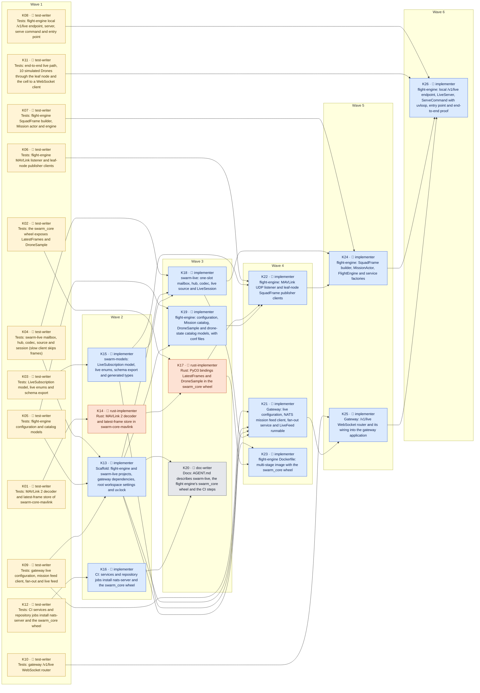

# T0.18: Plan

**Plan:** 🟢 Approved

**Push:** 🟢 Approved

<!-- ticket:specs -->
## 📚 Specifications

The technical pages, features, use cases and business rules of [TICKET.md](TICKET.md), copied by `python3 .claude/scripts/tickets/ticket_refs.py sync`.

- [📏 BR-014](../../specs/functional/business-rules/BR-014-simulation-isolation.md)
- [🔩 Engine and services: flight engine](../../specs/technical/04-engine.md#flight-engine)
- [📨 API layer: live data over WebSocket](../../specs/technical/05-api.md#live)
- [🚀 Scalability and performance: budgets](../../specs/technical/07-scalability.md#budgets)
<!-- /ticket:specs -->

## Summary

T0.18 builds the first live path: MAVLink 2 frames are decoded in Rust (`swarm-core-mavlink`, exposed through the `swarm_core` PyO3 wheel). A new AGENT.md service, `services/flight-engine`, runs one asyncio process under uvloop with one `MissionActor` per Mission. On every 50 ms tick each actor builds one `SquadFrame` and sends it as MessagePack to its local `/v1/live` WebSocket and to the leaf node, on `op.<operator_id>.mission.<mission_id>.squad`.

The gateway gets `/v1/live`: it opens one NATS subscription per Mission and gives each client a one-slot mailbox per topic. Code both services share goes into a new package, `packages/python/swarm-live` (mailbox, hub, codec, session). The client's subscribe message becomes a shared model in `swarm-models` (`LiveSubscription`), and the JSON Schema, Rust and TypeScript generated files are regenerated. The CI services and repository jobs get `nats-server` and the `swarm_core` wheel so these tests run.

The graph has 26 tasks in 6 waves:

- Wave 1 holds 12 test-writer tasks: the Rust crate, the wheel, `swarm-models`, `swarm-live`, the flight-engine models, clients, service and api, the gateway service and api, the end-to-end live path through a leaf nats-server and a cell nats-server, and the CI workflow.
- Wave 2 adds the workspace scaffold (the only owner of `uv.lock` and the pyprojects), the Rust decoder, the shared model and CI.
- Wave 3: the PyO3 binding, `swarm-live`, the flight-engine models and AGENT.md.
- Wave 4: the gateway live service, the flight-engine clients and the Dockerfile.
- Wave 5: the flight-engine service and the gateway router with its wiring.
- Wave 6: the flight-engine api, entry point and end-to-end proof.

Acceptance criterion 1 is proved by `tests/live/test_live_path.py`, criterion 2 by the `swarm-live` session and mailbox tests and the gateway fan-out tests. No screen is touched, so there is no capture task.

## Assumptions

- The roadmap row names no feature or use case. BR-014 is linked because the roadmap names it for epic E0.6, and the criteria cite it as the most conservative link.
- The row names no row of the budgets table, so the ticket touches no budget and no latency figure is asserted. The budgets page is linked as context only.
- The row names no screen or use case, so the ticket touches no screen.
- The row says "10 simulated Drones" and quantifies nothing else, so no other number is asserted.
- The roadmap ticket row has no anchor of its own, so the ticket link points to the sprint anchor `#s04`.
- I could not run `check_ticket.py` (no shell tool available), so the ticket is unchecked by the script.
- `tests-evidences/` holds an empty `.gitkeep` so the folder exists.
- Prerequisites T0.12 and T0.13 are neither planned nor merged. The plan assumes the T0.12 gateway has a FastAPI application and a root configuration model, guessed at `services/gateway/src/gateway/api/rest/gateway_rest_app.py` and `services/gateway/src/gateway/models/config/gateway_config.py`, with the gateway's authentication putting an Operator on each connection. If T0.12's plan names other files, K25's file list should be corrected before approval.
- T0.13's synthetic Drones and PX4 SITL send MAVLink 2 over UDP, including HEARTBEAT, SYS_STATUS and GLOBAL_POSITION_INT. The decoder reads these three and skips other messages. Signed frames are accepted with the signature skipped and not verified, since signing is not in this ticket.
- The lock-free ring buffer of `04-engine.md#flight-engine` is deferred: the Rust `LatestFrames` store keeps the latest state of each Drone and is fed from the event loop thread.
- Only the parts of `05-api.md#live` that the roadmap row names are built: a full (not delta-encoded) `SquadFrame` per 50 ms tick, sent as a bare MessagePack map. These are out of the skeleton: delta encoding, per-client rates other than `full` (decision T15), the alerts topic and consistent hashing across gateways.
- Client messages on `/v1/live` are MessagePack, as decision T23 says for WebSocket messages. The JSON in the specification is read as notation. An unreadable client message is logged at WARNING and ignored, and the connection stays open. Only `op: subscribe` exists: a client leaves by closing the socket.
- The gateway takes the Operator of a live connection from its authenticated identity, never from the client's message. A connection without an Operator is closed with code 1008. Hub keys and NATS subjects include the Operator (`op.<operator_id>.mission.<mission_id>.squad`), which keeps BR-008 isolation.
- SquadFrames are published with core NATS publish, not JetStream. JetStream buffering at the leaf node while the core is unreachable is left to a later ticket.
- The Missions an edge flies come from `services/flight-engine/conf/catalogs/missions.yaml` (empty by default) until the Pre-flight check copies them to the edge in a later ticket. Each entry gives its Operator, its MAVLink UDP port and its Drones, as MAVLink system id to drone id.
- MAVLink to TelemetryFrame mapping, which no specification fixes:
  - altitude comes from `relative_alt`;
  - speed is the horizontal speed;
  - heading reads 0.0 when unknown;
  - battery reads 0.0 when unknown, the conservative reading because it never overstates the energy left;
  - link quality comes from MAVLink sequence gaps;
  - the state comes from `system_status` through a catalog: standby is ready, active, critical and emergency are airborne, anything else is grounded;
  - a Drone is Lost after 5,000 ms without a frame, taken from the 5 s Link-loss Fail-safe;
  - `seq` is the engine's own counter per Drone;
  - `t_us` is the time the engine received the frame.
- The tick is 50 ms, from the 20 Hz safety tick of `04-engine.md#safety-loop`. Other defaults are recorded, not specified: `status_interval_s` 5, as in swarm-nats, and a local WebSocket on `127.0.0.1:8080`.
- `swarm_core` stays outside the uv workspace, as AGENT.md requires. Tests that import it skip without the wheel, as NATS tests skip without nats-server. The CI services job (for services that import it) and the repository job build and install the wheel, and the services job also installs nats-server. mypy reads the `.pyi` stub through the root `mypy_path`.
- A new shared package, `packages/python/swarm-live`, holds the mailbox, hub, codec and session used by both services, because AGENT.md puts code shared by services in `packages/`. The ticket therefore also touches `packages/python` (`swarm-live`, `swarm-models`) and regenerates `packages/ts/live/src/generated/models.ts`, beyond the areas the roadmap lists.
- New enums go in `swarm_models/models/enums.py`, following CLAUDE.md's one `enums.py` per models module. The existing per-concern enum folders of `swarm-models` are not moved by this ticket.
- "Through the cell" is proved by `tests/live/test_live_path.py`, with a leaf nats-server linked to a cell nats-server. The flight engine gets its Dockerfile, but deploying it and the gateway live path to the dev cell with Helm charts is outside the ticket's areas and is proposed as a follow-up.
- The slow-client criterion is proved at mailbox and session level, with a stand-in socket whose send is slow, and in the gateway fan-out tests. End to end, TCP buffers hide a slow reader.
- BR-014: the flight engine sends no command in this ticket and reads only the Drones of its Mission's registry. It connects to NATS with the credentials of its configuration, which are the simulated credentials of T0.09 for a simulated Squad.
- The CLI is `swarm-flight-engine --config PATH`. The default is `conf/app.yaml`, and relative catalog paths are resolved against the working directory.

<!-- plan:graph -->

> [!NOTE]
> Generated from the json block at the end of this page by `python3 .claude/scripts/tickets/plan.py render`.
> To change a task, edit the json block, then render again: never edit this view by hand.

## Waves

| Wave | Tasks | Agents running at once |
| --- | --- | --- |
| 1 | [K01](#k01), [K02](#k02), [K03](#k03), [K04](#k04), [K05](#k05), [K06](#k06), [K07](#k07), [K08](#k08), [K09](#k09), [K10](#k10), [K11](#k11), [K12](#k12) | 8 of 12 |
| 2 | [K13](#k13), [K14](#k14), [K15](#k15), [K16](#k16) | 4 of 4 |
| 3 | [K17](#k17), [K18](#k18), [K19](#k19), [K20](#k20) | 4 of 4 |
| 4 | [K21](#k21), [K22](#k22), [K23](#k23) | 3 of 3 |
| 5 | [K24](#k24), [K25](#k25) | 2 of 2 |
| 6 | [K26](#k26) | 1 of 1 |

| Wave | Task | Agent | Depends on | Unblocks |
| --- | --- | --- | --- | --- |
| 1 | [K01](#k01) Tests: MAVLink 2 decoder and latest-frame store of swarm-core-mavlink | 🧪 test-writer | none | [K14](#k14) |
| 1 | [K02](#k02) Tests: the swarm_core wheel exposes LatestFrames and DroneSample | 🧪 test-writer | none | [K17](#k17) |
| 1 | [K03](#k03) Tests: LiveSubscription model, live enums and schema export | 🧪 test-writer | none | [K15](#k15) |
| 1 | [K04](#k04) Tests: swarm-live mailbox, hub, codec, source and session (slow client skips frames) | 🧪 test-writer | none | [K13](#k13), [K18](#k18) |
| 1 | [K05](#k05) Tests: flight-engine configuration and catalog models | 🧪 test-writer | none | [K13](#k13), [K19](#k19) |
| 1 | [K06](#k06) Tests: flight-engine MAVLink listener and leaf-node publisher clients | 🧪 test-writer | none | [K22](#k22) |
| 1 | [K07](#k07) Tests: flight-engine SquadFrame builder, Mission actor and engine | 🧪 test-writer | none | [K24](#k24) |
| 1 | [K08](#k08) Tests: flight-engine local /v1/live endpoint, server, serve command and entry point | 🧪 test-writer | none | [K26](#k26) |
| 1 | [K09](#k09) Tests: gateway live configuration, mission feed client, fan-out and live feed | 🧪 test-writer | none | [K13](#k13), [K21](#k21) |
| 1 | [K10](#k10) Tests: gateway /v1/live WebSocket router | 🧪 test-writer | none | [K25](#k25) |
| 1 | [K11](#k11) Tests: end-to-end live path, 10 simulated Drones through the leaf node and the cell to a WebSocket client | 🧪 test-writer | none | [K26](#k26) |
| 1 | [K12](#k12) Tests: CI services and repository jobs install nats-server and the swarm_core wheel | 🧪 test-writer | none | [K16](#k16) |
| 2 | [K13](#k13) Scaffold: flight-engine and swarm-live projects, gateway dependencies, root workspace settings and uv.lock | 🐍 implementer | [K04](#k04), [K05](#k05), [K09](#k09) | [K18](#k18), [K19](#k19), [K20](#k20), [K21](#k21), [K23](#k23) |
| 2 | [K14](#k14) Rust: MAVLink 2 decoder and latest-frame store in swarm-core-mavlink | 🦀 rust-implementer | [K01](#k01) | [K17](#k17) |
| 2 | [K15](#k15) swarm-models: LiveSubscription model, live enums, schema export and generated types | 🐍 implementer | [K03](#k03) | [K18](#k18), [K21](#k21), [K22](#k22) |
| 2 | [K16](#k16) CI: services and repository jobs install nats-server and the swarm_core wheel | 🐍 implementer | [K12](#k12) | [K20](#k20) |
| 3 | [K17](#k17) Rust: PyO3 bindings LatestFrames and DroneSample in the swarm_core wheel | 🦀 rust-implementer | [K02](#k02), [K14](#k14) | [K22](#k22), [K23](#k23) |
| 3 | [K18](#k18) swarm-live: one-slot mailbox, hub, codec, live source and LiveSession | 🐍 implementer | [K04](#k04), [K13](#k13), [K15](#k15) | [K21](#k21), [K24](#k24) |
| 3 | [K19](#k19) flight-engine: configuration, Mission catalog, DroneSample and drone-state catalog models, with conf files | 🐍 implementer | [K05](#k05), [K13](#k13) | [K22](#k22) |
| 3 | [K20](#k20) Docs: AGENT.md describes swarm-live, the flight engine's swarm_core wheel and the CI steps | 📝 doc-writer | [K13](#k13), [K16](#k16) | none |
| 4 | [K21](#k21) Gateway: live configuration, NATS mission feed client, fan-out service and LiveFeed runnable | 🐍 implementer | [K09](#k09), [K13](#k13), [K15](#k15), [K18](#k18) | [K25](#k25) |
| 4 | [K22](#k22) flight-engine: MAVLink UDP listener and leaf-node SquadFrame publisher clients | 🐍 implementer | [K06](#k06), [K15](#k15), [K17](#k17), [K19](#k19) | [K24](#k24) |
| 4 | [K23](#k23) flight-engine Dockerfile: multi-stage image with the swarm_core wheel | 🐍 implementer | [K13](#k13), [K17](#k17) | none |
| 5 | [K24](#k24) flight-engine: SquadFrame builder, MissionActor, FlightEngine and service factories | 🐍 implementer | [K07](#k07), [K18](#k18), [K22](#k22) | [K26](#k26) |
| 5 | [K25](#k25) Gateway: /v1/live WebSocket router and its wiring into the gateway application | 🐍 implementer | [K10](#k10), [K21](#k21) | [K26](#k26) |
| 6 | [K26](#k26) flight-engine: local /v1/live endpoint, LiveServer, ServeCommand with uvloop, entry point and end-to-end proof | 🐍 implementer | [K08](#k08), [K11](#k11), [K24](#k24), [K25](#k25) | none |

## Dependency graph



## Tasks

### <a id="k01"></a>K01: Tests: MAVLink 2 decoder and latest-frame store of swarm-core-mavlink

| Agent | Wave | Depends on | Unblocks |
| --- | --- | --- | --- |
| 🧪 test-writer | 1 | none | [K14](#k14) |

**Files** (only this task may change them in its wave):

- `packages/rust/swarm-core/mavlink/tests/decode.rs`
- `packages/rust/swarm-core/mavlink/tests/latest_frames.rs`
- `packages/rust/swarm-core/mavlink/tests/common/mod.rs`

**Done when:** `cd packages/rust && cargo fmt --all --check` passes. `cargo test -p swarm-core-mavlink` fails only because `decode`, `Decoded`, `Frame`, `Message`, `LatestFrames` and `DroneSample` do not exist yet.

**Brief:**

Write the Rust integration tests of the MAVLink reader that the flight engine uses through swarm-core. Specs: docs/specs/technical/04-engine.md#flight-engine (frames read through the Rust core, the latest frame per Drone, the actor never waits for a slow Drone), docs/specs/technical/04-engine.md#adapters (Rust MAVLink 2 parser), docs/tickets/T0.18/TICKET.md. Keep the existing `encode` function and its tests untouched.

Public API under test (crate `swarm_core_mavlink`, implemented by K14):
- `pub fn decode(datagram: &[u8]) -> Decoded`, with `pub struct Decoded { pub frames: Vec<Frame>, pub rejected: usize }`.
- `pub struct Frame { pub system_id: u8, pub component_id: u8, pub sequence: u8, pub message: Message }`.
- `pub enum Message { Heartbeat { base_mode: u8, system_status: u8 }, SysStatus { battery_remaining: i8 }, GlobalPositionInt { time_boot_ms: u32, lat_e7: i32, lon_e7: i32, alt_mm: i32, relative_alt_mm: i32, vx_cm_s: i16, vy_cm_s: i16, vz_cm_s: i16, hdg_cdeg: u16 }, Other { message_id: u32 } }`.
- `pub struct LatestFrames` with `new()`, `ingest(&mut self, datagram: &[u8], now_us: u64) -> usize` (the number of well-formed frames taken) and `snapshot(&self) -> Vec<DroneSample>`, ordered by system id.
- `pub struct DroneSample { pub system_id: u8, pub has_position: bool, pub lat_e7: i32, pub lon_e7: i32, pub relative_alt_mm: i32, pub vx_cm_s: i16, pub vy_cm_s: i16, pub hdg_cdeg: u16, pub battery_remaining: i8, pub base_mode: u8, pub system_status: u8, pub received: u64, pub lost: u64, pub updated_at_us: u64 }`.

Wire format, which `tests/common/mod.rs` must rebuild independently:
- MAVLink 2 frames: 0xFD, payload length, incompat flags, compat flags, sequence, system id, component id, a 3-byte little-endian message id, the payload, then the CRC.
- The CRC is CRC-16/MCRF4XX (X.25, init 0xFFFF) over the bytes after 0xFD up to the end of the payload, then the CRC_EXTRA byte, little-endian.
- CRC_EXTRA is 50 for HEARTBEAT (id 0, 9-byte payload `<IBBBBB`: custom_mode, type, autopilot, base_mode, system_status, mavlink_version), 124 for SYS_STATUS (id 1, 31 bytes, battery_remaining an i8 at offset 30) and 104 for GLOBAL_POSITION_INT (id 33, 28 bytes `<IiiiihhhH`: time_boot_ms, lat, lon, alt, relative_alt, vx, vy, vz, hdg).
- Senders trim trailing zero bytes of the payload, and the decoder extends them back with zeros.
- Incompat flag 0x01 adds a 13-byte signature, which is skipped and not verified.

Cases for `decode`:
- each of the three messages decodes to its fields;
- a trimmed payload decodes;
- two frames in one datagram decode;
- garbage before 0xFD is skipped;
- a bad CRC, a truncated frame, a MAVLink 1 frame (0xFE) and an unknown incompat flag each count 1 in `rejected` and give no frame;
- an unknown message id gives `Message::Other`;
- an empty datagram gives no frame and 0 rejected;
- a few fixed arbitrary byte arrays never panic.

Cases for `LatestFrames`:
- the latest position replaces the earlier one;
- `battery_remaining` is -1 until a SYS_STATUS arrives;
- `has_position` is false until a GLOBAL_POSITION_INT arrives;
- `system_status` is 0 until a HEARTBEAT arrives;
- `lost` adds the sequence gaps per system: 10 then 13 loses 2, and 255 then 0 loses none;
- `Other` frames count in `received` and in the sequence;
- `updated_at_us` is the `now_us` of the last frame;
- a rejected frame changes nothing;
- systems are listed in system id order.

Test code is built by `cargo clippy --all-targets -- -D warnings` with the workspace's pedantic lints, so write it lint-clean.

### <a id="k02"></a>K02: Tests: the swarm_core wheel exposes LatestFrames and DroneSample

| Agent | Wave | Depends on | Unblocks |
| --- | --- | --- | --- |
| 🧪 test-writer | 1 | none | [K17](#k17) |

**Files** (only this task may change them in its wave):

- `tests/rust/swarm_core/test_swarm_core_wheel.py`
- `tests/rust/swarm_core/test_swarm_core_layout.py`
- `tests/rust/swarm_core/helpers.py`

**Done when:** `uv run ruff check tests/rust/swarm_core` and `uv run ruff format --check tests/rust/swarm_core` pass. `uv run pytest tests/rust/swarm_core -n 2` fails only on the new LatestFrames, DroneSample and stub tests.

**Brief:**

Extend the wheel and layout tests of `swarm_core` for the MAVLink reader that the flight engine imports. Specs: docs/specs/technical/04-engine.md#flight-engine (CPU-heavy steps in the Rust core, PyO3, GIL released), docs/tickets/T0.18/TICKET.md.

1. In `helpers.py`, add these module-level functions with exactly these signatures, so that K06 and K11 can import them from `tests.rust.swarm_core.helpers`:
   - `mavlink_crc(data: bytes, crc_extra: int) -> int`: CRC-16/MCRF4XX (X.25, init 0xFFFF), then the extra byte.
   - `mavlink_frame(system_id: int, sequence: int, message_id: int, payload: bytes, component_id: int = 1) -> bytes`: a MAVLink 2 frame. It starts 0xFD, length, incompat 0, compat 0, sequence, system id, component id and a 3-byte little-endian message id. The payload loses its trailing zero bytes but keeps at least one. The CRC is taken over the bytes after 0xFD, then CRC_EXTRA 50, 124 or 104 for ids 0, 1 or 33, little-endian.
   - `heartbeat_payload(base_mode: int, system_status: int) -> bytes`: 9 bytes `<IBBBBB` with custom_mode 0, type 2, autopilot 12 and mavlink_version 3.
   - `sys_status_payload(battery_remaining: int) -> bytes`: 31 bytes, with the i8 at offset 30.
   - `global_position_int_payload(lat_e7: int, lon_e7: int, relative_alt_mm: int, vx_cm_s: int, vy_cm_s: int, hdg_cdeg: int, time_boot_ms: int = 0, alt_mm: int = 0, vz_cm_s: int = 0) -> bytes`: 28 bytes `<IiiiihhhH`.
2. In `TestSwarmCoreWheel`, add tests that reuse the `built` fixture. Build the bytes in the parent process and pass them to the child as `bytes.fromhex(...)`:
   - `swarm_core.LatestFrames().ingest(frame, now_us)` returns 1;
   - `snapshot()` then holds one `DroneSample` whose `system_id`, `has_position`, `lat_e7`, `lon_e7`, `relative_alt_mm`, `hdg_cdeg`, `battery_remaining`, `system_status`, `received`, `lost` and `updated_at_us` match;
   - a frame with a corrupted CRC gives 0 and an empty snapshot;
   - `ingest` with a non-bytes datagram raises TypeError.
3. Keep the three existing functions and their tests.
4. In `TestSwarmCoreLayout`, assert that `swarm_core.pyi` declares `class LatestFrames` and `class DroneSample`.

Follow the existing style of the files: one class per file, sentence names, no unittest.mock.

### <a id="k03"></a>K03: Tests: LiveSubscription model, live enums and schema export

| Agent | Wave | Depends on | Unblocks |
| --- | --- | --- | --- |
| 🧪 test-writer | 1 | none | [K15](#k15) |

**Files** (only this task may change them in its wave):

- `packages/python/swarm-models/tests/models/live/test_live_subscription.py`
- `packages/python/swarm-models/tests/models/test_swarm_models_live_enums.py`
- `packages/python/swarm-models/tests/service/schemas/test_schema_exporter.py`

**Done when:** `uv run ruff check` and `uv run ruff format --check` pass on the three files. `uv run pytest packages/python/swarm-models/tests -n 2` fails only on the new or changed tests, for missing modules or the missing model.

**Brief:**

Write the tests of the client message of the live WebSocket, a shared model that both the gateway and the flight engine read and that packages/ts/live gets as a generated type. Specs: docs/specs/technical/05-api.md#live (`client → {"op": "subscribe", "topic": "mission/<id>/squad", "rate": "full"}`), docs/specs/technical/02-data-models.md#telemetry, docs/tickets/T0.18/TICKET.md. Rules: AGENT.md Tests and Pydantic models, with the six model tests.

The API, implemented by K15:
- `swarm_models.models.enums` holds `LiveOperation` (`SUBSCRIBE = "subscribe"`), `LiveTopicKind` (`SQUAD = "squad"`) and `LiveRate` (`FULL = "full"`), all `@unique` StrEnums.
- `swarm_models.models.live.live_subscription.LiveSubscription` is a frozen SwarmModel with `extra=forbid` and these fields:
  - `op: LiveOperation`, required;
  - `topic: str`, required, which must read `mission/<version 7 UUID>/<LiveTopicKind value>`;
  - `rate: LiveRate`, with default FULL, where None becomes the default.
- It has `mission() -> UUID`, `kind() -> LiveTopicKind`, and the classmethod `topic_of(mission_id: UUID, kind: LiveTopicKind) -> str`.
- Its exceptions come from `swarm_models.models.live.exceptions`: `SEInvalidLiveSubscriptionException` (base), `SELiveSubscriptionInvalidOp`, `SELiveSubscriptionInvalidTopic` and `SELiveSubscriptionInvalidRate`.

Cases:
- the six model tests;
- refused topics: an alerts topic, a non-UUID id, a UUID that is not version 7, a missing segment and extra segments;
- a bool for op;
- `topic_of` round-trips with `mission()` and `kind()`.

The enum test file checks the members and values. In `test_schema_exporter.py`, `SchemaExporter.MODELS` now ends with `LiveSubscription`, after `Command`; update the expected tuple and the list of names. Compare with the enums, never their raw values. Test file basenames must be unique in the repository.

### <a id="k04"></a>K04: Tests: swarm-live mailbox, hub, codec, source and session (slow client skips frames)

| Agent | Wave | Depends on | Unblocks |
| --- | --- | --- | --- |
| 🧪 test-writer | 1 | none | [K13](#k13), [K18](#k18) |

**Files** (only this task may change them in its wave):

- `packages/python/swarm-live/tests/models/config/test_live_session_config.py`
- `packages/python/swarm-live/tests/service/test_live_mailbox.py`
- `packages/python/swarm-live/tests/service/test_live_hub.py`
- `packages/python/swarm-live/tests/service/test_live_codec.py`
- `packages/python/swarm-live/tests/service/test_hub_live_source.py`
- `packages/python/swarm-live/tests/api/live/test_live_session.py`
- `packages/python/swarm-live/tests/api/live/conftest.py`
- `packages/python/swarm-live/tests/api/live/live_stand_in_socket.py`
- `packages/python/swarm-live/tests/api/factories/live/test_live_session_factory.py`

**Done when:** `uv run ruff check packages/python/swarm-live/tests` and `uv run ruff format --check packages/python/swarm-live/tests` pass. The tests fail only with ModuleNotFoundError for `swarm_live`.

**Brief:**

Write the tests of `swarm_live`, the new shared package that holds the live fan-out used by both the gateway and the flight engine. Specs: docs/specs/technical/05-api.md#live (one socket per client, many subscriptions; MessagePack; "each client has a one-slot mailbox per topic holding the latest state; a slow client skips intermediate frames instead of growing a queue"; at the edge the same protocol), docs/specs/technical/02-data-models.md#telemetry (ormsgpack), docs/specs/functional/business-rules/BR-014-simulation-isolation.md, and acceptance criterion 2 of docs/tickets/T0.18/TICKET.md. Rules: AGENT.md Tests and Lifecycle.

The API, implemented by K18:
- `swarm_live.models.config.live_session_config.LiveSessionConfig(status_interval_s: float = 5.0)`. It raises `SELiveSessionConfigInvalidStatusInterval`, from `swarm_live.models.config.exceptions`, for a value that is not positive or is a bool. It gets the six model tests.
- `swarm_live.models.exceptions` holds `SELiveError` and `SELiveMessageUnreadable`.
- `swarm_live.service.live_mailbox.LiveMailbox` has:
  - `put(data: bytes) -> None`, which replaces an unread frame and adds 1 to `skipped`;
  - `async take() -> bytes`, which waits for a frame, removes it and adds 1 to `delivered`;
  - `pending() -> bool`.
- `swarm_live.service.live_hub.LiveHub` has:
  - `subscribe(key: str) -> Tuple[LiveMailbox, bool]`, where the bool is True for the first watcher of the key;
  - `unsubscribe(key: str, mailbox: LiveMailbox) -> bool`, True when the last watcher left;
  - `publish(key: str, data: bytes) -> int`, the number of mailboxes reached;
  - `watchers(key: str) -> int`.
- `swarm_live.service.live_codec.LiveCodec` has `encode_squad_frame(SquadFrame) -> bytes`, `decode_squad_frame(bytes) -> SquadFrame`, `encode_subscription(LiveSubscription) -> bytes` and `decode_subscription(bytes) -> LiveSubscription`. All use MessagePack through ormsgpack, and bad MessagePack or an invalid model raises `SELiveMessageUnreadable`.
- `swarm_live.service.live_source.LiveSource` is an ABC with `async join(LiveSubscription) -> LiveMailbox` and `async leave(LiveSubscription, LiveMailbox) -> None`.
- `swarm_live.service.hub_live_source.HubLiveSource(hub)` keys the hub by `subscription.topic`.
- `swarm_live.api.live.live_socket.LiveSocket` is a Protocol with `async receive_bytes() -> bytes` and `async send_bytes(data: bytes) -> None`.
- `swarm_live.api.live.live_session.LiveSession(socket, source, codec, config, logger=None)` is an AsyncRunnable.
  - It reads subscribe messages and joins each topic.
  - It sends every mailbox frame with `send_bytes`.
  - An unreadable message is logged at WARNING and ignored.
  - It ends when the socket raises `starlette.websockets.WebSocketDisconnect`, and `close` leaves every topic.
  - It counts `sent: int`.
- `swarm_live.api.factories.live_runnable_factory.LiveRunnableFactory` is the abstract factory, and `swarm_live.api.factories.live.live_session_factory.LiveSessionFactory(socket, source, codec, config, logger=None)` builds a LiveSession.

Tests to write:
- The mailbox keeps one frame: three puts then one take give the last frame and `skipped == 2`.
- The hub reports first and last watcher, and a publish to a key with no watcher reaches 0.
- The codec round-trips a SquadFrame of 10 Drones and refuses garbage.
- A session with a stand-in socket receives frames published to its topic.
- **The slow client:** `send_bytes` sleeps 200 ms while 50 frames are published every 10 ms. The session sends far fewer than 50 frames, the last one sent is the last one published, and the mailbox never holds more than one frame.
- Disconnect ends `execute()` with the source left.
- `execute()` yields RunnableStatus values.

The stand-in socket lives in `live_stand_in_socket.py`. The conftest imports it by bare module name, after the precedent of packages/python/swarm-lifecycle/tests, and serves it as a fixture. No unittest.mock. Test file basenames must be unique in the repository.

### <a id="k05"></a>K05: Tests: flight-engine configuration and catalog models

| Agent | Wave | Depends on | Unblocks |
| --- | --- | --- | --- |
| 🧪 test-writer | 1 | none | [K13](#k13), [K19](#k19) |

**Files** (only this task may change them in its wave):

- `services/flight-engine/tests/models/config/test_flight_engine_config.py`
- `services/flight-engine/tests/models/config/test_live_server_config.py`
- `services/flight-engine/tests/models/missions/test_mission_catalog.py`
- `services/flight-engine/tests/models/missions/test_mission_entry.py`
- `services/flight-engine/tests/models/missions/test_drone_entry.py`
- `services/flight-engine/tests/models/telemetry/test_drone_sample.py`
- `services/flight-engine/tests/models/telemetry/test_drone_state_catalog.py`

**Done when:** `uv run ruff check services/flight-engine/tests/models` and `uv run ruff format --check services/flight-engine/tests/models` pass. The tests fail only with ModuleNotFoundError for `flight_engine`.

**Brief:**

Write the model tests of the new service `services/flight-engine`, module `flight_engine`. Specs: docs/specs/technical/04-engine.md#flight-engine (one actor per Mission, latest frame of each Drone), docs/specs/technical/04-engine.md#safety-loop (a tick per Mission at 20 Hz, so 50 ms; Link-loss Fail-safe after 5 s), docs/specs/technical/01-architecture.md#layers, docs/specs/functional/business-rules/BR-014-simulation-isolation.md, docs/tickets/T0.18/TICKET.md. Rules: AGENT.md Pydantic models, with the six tests for each model, and Data and enums.

The models, implemented by K19:
- `flight_engine.models.config.flight_engine_config.FlightEngineConfig` is a YamlCatalog with fields:
  - `tick_interval_ms: int = 50`, which must be positive;
  - `status_interval_s: float = 5.0`, which must be positive;
  - `link_lost_after_ms: int = 5000`, which must be positive;
  - `missions_catalog_path: str = "conf/catalogs/missions.yaml"`;
  - `drone_states_catalog_path: str = "conf/catalogs/drone_states.yaml"`;
  - `nats: NatsClientConfig`, from swarm_nats;
  - `live: LiveServerConfig`.
- `flight_engine.models.config.live_server_config.LiveServerConfig` has `host: str = "127.0.0.1"`, `port: int = 8080` (1 to 65535) and `status_interval_s: float = 5.0`.
- `flight_engine.models.missions.mission_catalog.MissionCatalog` is a YamlCatalog with `missions: List[MissionEntry] = []`. It refuses duplicate mission ids and duplicate MAVLink ports.
- `flight_engine.models.missions.mission_entry.MissionEntry` has:
  - `operator_id` and `mission_id`, version 7 UUIDs;
  - `mavlink_host: str = "0.0.0.0"`;
  - `mavlink_port: int`, 1 to 65535;
  - `drones: List[DroneEntry]`, which refuses a system id or a drone id used twice.
- `flight_engine.models.missions.drone_entry.DroneEntry` has `system_id: int`, 1 to 255, and `drone_id`, a version 7 UUID.
- `flight_engine.models.telemetry.drone_sample.DroneSample` is frozen and mirrors the Rust sample, with the bounds of its integer types:
  - `system_id`, 1 to 255, and `has_position: bool`;
  - `lat_e7`, `lon_e7` and `relative_alt_mm`, i32;
  - `vx_cm_s` and `vy_cm_s`, i16;
  - `hdg_cdeg`, u16;
  - `battery_remaining`, -1 to 100, where -1 means unknown;
  - `base_mode` and `system_status`, u8;
  - `received` and `lost`, 0 or more;
  - `updated_at_us`, 0 or more.
- `flight_engine.models.telemetry.drone_state_catalog.DroneStateCatalog` is a YamlCatalog with `system_status_states: Dict[int, DroneState]`, `default_state: DroneState = DroneState.GROUNDED` and `state_of(system_status: int) -> DroneState`.

Each model's exceptions come from the `exceptions` package of its folder, with names after AGENT.md: `SEInvalid<Model>Exception` and `SE<Model>Invalid<Field>`. Also test:
- `services/flight-engine/conf/app.yaml` loads into FlightEngineConfig and writes out every default;
- `conf/catalogs/missions.yaml` loads with no Missions;
- `conf/catalogs/drone_states.yaml` maps 3 to READY and 4, 5 and 6 to AIRBORNE, with GROUNDED as the default.

Reject bools for numbers. Compare with enums and ClassVar constants, never raw strings. Test file basenames must be unique in the repository: there are no `__init__.py` files and one pytest session.

### <a id="k06"></a>K06: Tests: flight-engine MAVLink listener and leaf-node publisher clients

| Agent | Wave | Depends on | Unblocks |
| --- | --- | --- | --- |
| 🧪 test-writer | 1 | none | [K22](#k22) |

**Files** (only this task may change them in its wave):

- `services/flight-engine/tests/conftest.py`
- `services/flight-engine/tests/clients/mavlink/test_mavlink_listener.py`
- `services/flight-engine/tests/clients/leaf/test_squad_frame_publisher.py`

**Done when:** `uv run ruff check` and `uv run ruff format --check` pass on the three files. The tests fail only with ModuleNotFoundError for `flight_engine`, or skip without nats-server or swarm_core.

**Brief:**

Write the tests of the two clients of the flight engine: Drone frames come in over UDP, and SquadFrames go out to the leaf node. Specs: docs/specs/technical/04-engine.md#flight-engine (input: the latest frame of each Drone in Rust; output: one SquadFrame per tick to the leaf node), docs/specs/technical/01-architecture.md#edge-and-core and #flows (MessagePack over NATS), docs/specs/technical/05-api.md#live, docs/specs/functional/business-rules/BR-014-simulation-isolation.md, docs/tickets/T0.18/TICKET.md. Rules: AGENT.md Tests, with real things and no unittest.mock.

`services/flight-engine/tests/conftest.py` gives the fixtures:
- `nats_url`: a real nats-server on a free port with `-js`, skipped when `nats-server` is not on PATH, copying packages/python/swarm-nats/tests/conftest.py;
- `nats_client`;
- `free_udp_port`.

K07 uses `nats_url` under that exact name.

The API, implemented by K22:
- `flight_engine.clients.mavlink.sample_source.SampleSource` is an ABC with `async open() -> None`, `snapshot() -> List[DroneSample]` and `async close() -> None`.
- `flight_engine.clients.mavlink.mavlink_listener.MavlinkListener(mission: MissionEntry, logger=None)` subclasses it. It binds a UDP endpoint on `mission.mavlink_host:mavlink_port`, feeds each datagram to `swarm_core.LatestFrames.ingest(data, now_us)`, and `snapshot()` converts the Rust samples into `flight_engine.models.telemetry.drone_sample.DroneSample`.
- `flight_engine.clients.leaf.frame_sink.FrameSink` is an ABC with `async publish(operator_id: UUID, mission_id: UUID, data: bytes) -> None`.
- `flight_engine.clients.leaf.squad_frame_publisher.SquadFramePublisher(connection: nats Client, logger=None)` subclasses it. It publishes on `OperatorSubjects(operator_id=...).mission(mission_id, LiveTopicKind.SQUAD)`, which is `op.<operator_id>.mission.<mission_id>.squad`, and wraps NATS errors in `SESquadFramePublishError`.
- Errors come from `flight_engine.models.clients.exceptions`: `SEFlightEngineClientError`, `SEMavlinkListenerError` (the port cannot be bound) and `SESquadFramePublishError`.

The listener test starts with `pytest.importorskip("swarm_core")`, because the wheel is installed outside `uv sync`, as AGENT.md explains. It builds frames with `mavlink_frame`, `heartbeat_payload`, `sys_status_payload` and `global_position_int_payload` from `tests.rust.swarm_core.helpers`, written by K02 with these exact signatures:
- `mavlink_frame(system_id, sequence, message_id, payload, component_id=1)`;
- `heartbeat_payload(base_mode, system_status)`;
- `sys_status_payload(battery_remaining)`;
- `global_position_int_payload(lat_e7, lon_e7, relative_alt_mm, vx_cm_s, vy_cm_s, hdg_cdeg, time_boot_ms=0, alt_mm=0, vz_cm_s=0)`.

Cases:
- frames sent by a UDP socket to the listener show up in `snapshot()` with their fields;
- two Drones give two samples;
- a corrupted datagram is ignored;
- binding a port already in use raises `SEMavlinkListenerError`;
- `close()` frees the port.

For the publisher, a subscriber on the expected subject receives exactly the published bytes. It must not see bytes of another Operator's subject (BR-008). Use a free port and unique basenames.

### <a id="k07"></a>K07: Tests: flight-engine SquadFrame builder, Mission actor and engine

| Agent | Wave | Depends on | Unblocks |
| --- | --- | --- | --- |
| 🧪 test-writer | 1 | none | [K24](#k24) |

**Files** (only this task may change them in its wave):

- `services/flight-engine/tests/service/conftest.py`
- `services/flight-engine/tests/service/flight_engine_stand_in_source.py`
- `services/flight-engine/tests/service/flight_engine_recording_sink.py`
- `services/flight-engine/tests/service/missions/test_squad_frame_builder.py`
- `services/flight-engine/tests/service/missions/test_mission_actor.py`
- `services/flight-engine/tests/service/engine/test_flight_engine.py`
- `services/flight-engine/tests/service/factories/test_flight_engine_service_factories.py`

**Done when:** `uv run ruff check services/flight-engine/tests/service` and `uv run ruff format --check services/flight-engine/tests/service` pass. The tests fail only with ModuleNotFoundError for `flight_engine`.

**Brief:**

Write the service-layer tests of the flight engine: one actor per Mission emits one SquadFrame per tick. Specs: docs/specs/technical/04-engine.md#flight-engine (one asyncio process, one actor per Mission holding its Squad state, the actor never waits for a slow Drone, one SquadFrame per tick to the local WebSocket and the leaf node), docs/specs/technical/04-engine.md#safety-loop (20 Hz tick), docs/specs/technical/02-data-models.md#telemetry (TelemetryFrame, SquadFrame), docs/specs/technical/01-architecture.md#edge-and-core (the edge keeps flying when it loses the core), docs/specs/functional/business-rules/BR-014-simulation-isolation.md, docs/tickets/T0.18/TICKET.md. Rules: AGENT.md Tests and Lifecycle (AsyncRunnable statuses).

Stand-ins, each in its own file, imported by bare name in `tests/service/conftest.py` and served as fixtures:
- `StandInSampleSource(SampleSource)` returns the samples a test sets;
- `RecordingFrameSink(FrameSink)` records `(operator_id, mission_id, data)` and can be told to raise `SESquadFramePublishError`.

The ABCs come from `flight_engine.clients.mavlink.sample_source` and `flight_engine.clients.leaf.frame_sink`; see K06.

`flight_engine.service.missions.squad_frame_builder.SquadFrameBuilder(mission, states: DroneStateCatalog, link_lost_after_ms: int, logger=None)` provides `build(samples: List[DroneSample], now_us: int) -> SquadFrame`, implemented by K24. Its rules:
- a sample whose system id is not a Drone of the Mission is ignored;
- a Drone appears once its position is known;
- `lat_e7` and `lon_e7` are copied;
- `altitude_m = relative_alt_mm / 1000`;
- `speed_m_s = hypot(vx, vy) / 100`;
- `heading_deg = hdg_cdeg / 100`, and 0.0 when hdg is 65535;
- `battery_pct` is battery_remaining, and 0.0 when it is -1;
- `link_quality_pct = 100 * received / (received + lost)`, and 100 with no loss;
- `state` is `states.state_of(system_status)`, but LOST when `now_us - updated_at_us > link_lost_after_ms * 1000`;
- `seq` counts from 0 per Drone and goes up by 1 at each build;
- `t_us` is updated_at_us, and the SquadFrame's `t_us` is now_us.

`flight_engine.service.missions.mission_actor.MissionActor(config: FlightEngineConfig, mission, source: SampleSource, builder, sink: FrameSink, hub: LiveHub, codec: LiveCodec, logger=None)` is an AsyncRunnable that every `tick_interval_ms`:
- builds the frame;
- encodes it with LiveCodec;
- publishes it to `hub` under `LiveSubscription.topic_of(mission_id, LiveTopicKind.SQUAD)`;
- calls `sink.publish`.

It counts `ticks`. A sink error is logged at WARNING and the next tick still runs. `close` closes the source.

`flight_engine.service.engine.flight_engine.FlightEngine(config, catalog: MissionCatalog, states, hub, codec, source_for: Callable[[MissionEntry], SampleSource], connector: NatsConnector, logger=None)` is an AsyncRunnable:
- it connects to NATS in `initialize`;
- it creates one MissionActor per Mission, in `actors`;
- it runs them concurrently and closes them all.

The factories are the abstract `flight_engine.service.factories.engine_factory.EngineFactory`, `flight_engine.service.factories.missions.mission_actor_factory.MissionActorFactory` and `flight_engine.service.factories.engine.flight_engine_factory.FlightEngineFactory(config, catalog, states, hub, codec, logger=None)`. The concrete FlightEngineFactory uses MavlinkListener, so its test calls `pytest.importorskip("swarm_core")`.

Cases:
- the mapping rules above;
- 10 Drones give one SquadFrame of 10 frames;
- an actor emits about one frame per tick for 0.5 s;
- a slow or failing sink does not stop the ticks;
- the hub mailbox gets the encoded frame;
- `execute()` yields RunnableStatus values;
- an engine with two Missions has two actors, and frames for each Mission arrive on its NATS subject, using the `nats_url` fixture of services/flight-engine/tests/conftest.py (written by K06).

Unique basenames, no unittest.mock.

### <a id="k08"></a>K08: Tests: flight-engine local /v1/live endpoint, server, serve command and entry point

| Agent | Wave | Depends on | Unblocks |
| --- | --- | --- | --- |
| 🧪 test-writer | 1 | none | [K26](#k26) |

**Files** (only this task may change them in its wave):

- `services/flight-engine/tests/api/live/test_flight_engine_live_endpoint.py`
- `services/flight-engine/tests/api/server/test_live_server.py`
- `services/flight-engine/tests/api/cli/test_flight_engine_main.py`
- `services/flight-engine/tests/api/cli/commands/test_flight_engine_serve_command.py`
- `services/flight-engine/tests/api/factories/test_flight_engine_api_factories.py`

**Done when:** `uv run ruff check services/flight-engine/tests/api` and `uv run ruff format --check services/flight-engine/tests/api` pass. The tests fail only with ModuleNotFoundError for `flight_engine`.

**Brief:**

Write the api-layer tests of the flight engine: the local WebSocket that Ground control uses at the edge, served with the same protocol as the gateway. Specs: docs/specs/technical/05-api.md#live ("At the edge Ground control connects straight to the flight engine with the same protocol"), docs/specs/technical/04-engine.md#flight-engine (one asyncio process with uvloop; SquadFrame to the local WebSocket), docs/specs/technical/01-architecture.md#layers (api/live, api/cli), docs/tickets/T0.18/TICKET.md. Rules: AGENT.md Tests, Lifecycle and factories.

The API, implemented by K26:
- `flight_engine.api.live.live_endpoint.LiveEndpoint(hub: LiveHub, codec: LiveCodec, config: LiveServerConfig, logger=None)` gives `router() -> APIRouter`, with a WebSocket at `/v1/live`.
  - Each connection runs a `swarm_live` LiveSession, built by its LiveSessionFactory over `HubLiveSource(hub)`.
  - The client sends MessagePack `LiveSubscription(op=SUBSCRIBE, topic=mission/<id>/squad)`.
  - The client receives the bytes the actors publish to the hub under that topic.
- `flight_engine.api.server.live_server.LiveServer(app: FastAPI, config: LiveServerConfig, logger=None)` is an AsyncRunnable running uvicorn. It serves when `initialize` returns and stops on close.
- `flight_engine.api.cli.commands.serve_command.ServeCommand` is a Runnable whose `run()` uses `uvloop.run` to run the FlightEngine and the LiveServer together until it is stopped. It has an `exit_code`.
- `flight_engine.api.cli.main.main()` reads `--config PATH`, default `conf/app.yaml`, configures logging with `conf/logger.yaml`, then runs the serve command.
- The factories are the abstract `flight_engine.api.factories.command_factory.CommandFactory`, `flight_engine.api.factories.serve.serve_command_factory.ServeCommandFactory(config_path: Path, logger=None)` and `flight_engine.api.factories.live.live_server_factory.LiveServerFactory(app, config, logger=None)`.

Cases:
- with Starlette's TestClient, a client that subscribes to a Mission receives the bytes published to the hub topic, and does not receive another Mission's;
- an unreadable message is ignored and the connection stays open;
- LiveServer on a free port accepts a WebSocket connection with the `websockets` client (a root dev dependency added by K13), and `close` frees the port;
- `execute()` yields RunnableStatus values;
- the console script `swarm-flight-engine` is declared and points at `flight_engine.api.cli.main:main` (see services/gateway/tests/api/cli/test_main.py for the pattern);
- the factories build the right types.

Test file basenames must be unique in the repository: `test_flight_engine_main.py`, never `test_main.py`. No unittest.mock.

### <a id="k09"></a>K09: Tests: gateway live configuration, mission feed client, fan-out and live feed

| Agent | Wave | Depends on | Unblocks |
| --- | --- | --- | --- |
| 🧪 test-writer | 1 | none | [K13](#k13), [K21](#k21) |

**Files** (only this task may change them in its wave):

- `services/gateway/tests/conftest.py`
- `services/gateway/tests/models/live/test_gateway_live_config.py`
- `services/gateway/tests/clients/nats/test_mission_feed_client.py`
- `services/gateway/tests/service/live/test_live_fan_out.py`
- `services/gateway/tests/service/live/test_operator_live_source.py`
- `services/gateway/tests/service/live/test_live_feed.py`
- `services/gateway/tests/service/factories/live/test_live_feed_factory.py`

**Done when:** `uv run ruff check` and `uv run ruff format --check` pass on these files. The tests fail only with ModuleNotFoundError for the missing gateway or swarm_live modules, or skip without nats-server.

**Brief:**

Write the tests of the gateway's live fan-out below the api layer. Specs: docs/specs/technical/05-api.md#live ("the gateway subscribes once per Mission to NATS and fans out to every client watching it"; a one-slot mailbox per topic; a slow client skips intermediate frames), docs/specs/technical/07-scalability.md#budgets (the Telemetry path through the cell, as context only), docs/specs/functional/business-rules/BR-014-simulation-isolation.md, docs/specs/functional/business-rules/BR-008-operator-isolation.md (subjects split by Operator), and acceptance criteria 1 and 2 of docs/tickets/T0.18/TICKET.md. Rules: AGENT.md Tests and layers.

`services/gateway/tests/conftest.py` gives a `nats_url` fixture: a real nats-server, skipped without the binary, as packages/python/swarm-nats/tests/conftest.py does. If T0.12 already created this conftest, add to it and keep what is there.

The API, implemented by K21:
- `gateway.models.live.live_config.LiveConfig` has `status_interval_s: float = 5.0`, `nats: NatsClientConfig` and `session: LiveSessionConfig`. It gets the six model tests, and its exceptions come from `gateway.models.live.exceptions`.
- `gateway.clients.nats.mission_feed_client.MissionFeedClient(connection, logger=None)` has:
  - `async subscribe(subject: str, handler: Callable[[str, bytes], None]) -> None`, with one NATS subscription per subject;
  - `async unsubscribe(subject: str) -> None`;
  - `subjects() -> List[str]`;
  - NATS errors raise `SEMissionFeedError`.
- `gateway.service.live.live_fan_out.LiveFanOut(hub: LiveHub, feed: MissionFeedClient, logger=None)` has:
  - `async join(operator_id: UUID, subscription: LiveSubscription) -> LiveMailbox`, which subscribes to `op.<operator_id>.mission.<mission>.squad` only for the first watcher;
  - `async leave(operator_id, subscription, mailbox)`, which unsubscribes when the last watcher leaves;
  - `deliver(subject: str, data: bytes) -> None`;
  - `subjects() -> List[str]`;
  - `source_for(operator_id) -> LiveSource`.
- `gateway.service.live.operator_live_source.OperatorLiveSource(operator_id, fan_out)` is a swarm_live LiveSource bound to one Operator.
- `gateway.service.live.live_feed.LiveFeed(config: LiveConfig, connector: NatsConnector, hub: LiveHub, logger=None)` is an AsyncRunnable:
  - `initialize` connects and builds `fan_out`;
  - `run` waits until closed;
  - `close` disconnects;
  - `source_for(operator_id)` delegates, and raises `SELiveFeedNotReadyError` before `initialize`.
- The factories are the abstract `gateway.service.factories.live_service_factory.LiveServiceFactory` and `gateway.service.factories.live.live_feed_factory.LiveFeedFactory(config: LiveConfig, logger=None)`.

Cases:
- two clients of one Mission make one NATS subscription, and both mailboxes get a frame published by a plain NATS client on the subject;
- the subscription stays while one client remains and goes when the last leaves;
- a client of Operator A subscribed to a Mission id gets nothing published under Operator B's subject for the same Mission id;
- **a client that does not take its mailbox while 20 frames are published holds only the last frame, with `skipped == 19`;**
- LiveFeed `execute()` yields RunnableStatus values and closes cleanly.

Unique basenames, no unittest.mock.

### <a id="k10"></a>K10: Tests: gateway /v1/live WebSocket router

| Agent | Wave | Depends on | Unblocks |
| --- | --- | --- | --- |
| 🧪 test-writer | 1 | none | [K25](#k25) |

**Files** (only this task may change them in its wave):

- `services/gateway/tests/api/live/test_gateway_live_router.py`
- `services/gateway/tests/api/live/test_live_operator.py`
- `services/gateway/tests/api/live/conftest.py`
- `services/gateway/tests/api/live/gateway_stand_in_live_source.py`

**Done when:** `uv run ruff check services/gateway/tests/api/live` and `uv run ruff format --check services/gateway/tests/api/live` pass. The tests fail only with ModuleNotFoundError for the missing modules.

**Brief:**

Write the api tests of the gateway's live WebSocket. Specs: docs/specs/technical/05-api.md#live (one socket per client, many subscriptions; `client → {"op": "subscribe", "topic": "mission/<id>/squad", "rate": "full"}`; server sends SquadFrame as MessagePack), docs/specs/technical/01-architecture.md#layers (api/live holds WebSocket handlers and no business rule), docs/specs/functional/business-rules/BR-014-simulation-isolation.md, docs/specs/functional/business-rules/BR-008-operator-isolation.md, docs/tickets/T0.18/TICKET.md. Rules: AGENT.md Tests.

The API, implemented by K25:
- `gateway.api.live.live_router.LiveRouter(source_for: Callable[[UUID], LiveSource], session_config: LiveSessionConfig, logger=None)` has:
  - the attribute `operator: LiveOperator`, the FastAPI dependency that gives the Operator of the connection;
  - `build() -> APIRouter`, with a WebSocket at `/v1/live`.
- Each connection takes its Operator from `operator` and runs a swarm_live LiveSession over `source_for(operator_id)`.
- `gateway.api.live.live_operator.LiveOperator(logger=None)` reads the Operator that the gateway's authentication (T0.11 and T0.12) put on the connection. Without one, it raises `fastapi.WebSocketException(code=1008)`, so the socket closes as a policy violation.

Tests use FastAPI's TestClient and `app.dependency_overrides[router.operator]`, a lambda returning a fixed Operator. The stand-in `GatewayStandInLiveSource(LiveSource)` lives in its own file, imported by bare name in the conftest. It records joins and leaves and hands out real `LiveMailbox` objects that the test fills.

Cases:
- a subscribe message sent as MessagePack (`LiveCodec.encode_subscription`) leads to a join with that Operator and topic;
- bytes put in the mailbox reach the client;
- an unreadable message is ignored and the socket stays open;
- disconnecting leaves every joined topic;
- without the override and without an Operator on the connection, the socket is closed with code 1008;
- the Operator never comes from the client's message.

Unique basenames, no unittest.mock.

### <a id="k11"></a>K11: Tests: end-to-end live path, 10 simulated Drones through the leaf node and the cell to a WebSocket client

| Agent | Wave | Depends on | Unblocks |
| --- | --- | --- | --- |
| 🧪 test-writer | 1 | none | [K26](#k26) |

**Files** (only this task may change them in its wave):

- `tests/live/conftest.py`
- `tests/live/test_live_path.py`
- `tests/live/simulated_drones.py`
- `tests/live/helpers.py`

**Done when:** `uv run ruff check tests/live` and `uv run ruff format --check tests/live` pass. `uv run pytest tests/live` fails only with ModuleNotFoundError for the missing modules, or skips without nats-server or swarm_core.

**Brief:**

Write the acceptance test of the ticket. Acceptance criterion 1 of docs/tickets/T0.18/TICKET.md: given 10 simulated Drones flying, when a WebSocket client subscribes to their Mission on `/v1/live`, then the client receives their frames through the cell. Specs: docs/specs/technical/01-architecture.md#flows (Drone → flight-engine → Ground control (local) and → leaf node → cell → gateway → viewers), docs/specs/technical/04-engine.md#flight-engine, docs/specs/technical/05-api.md#live, docs/specs/technical/07-scalability.md#budgets (context only: no latency figure is asserted), docs/specs/functional/business-rules/BR-014-simulation-isolation.md. Rules: AGENT.md Tests. Root `tests/` may import both services.

Fixtures in `conftest.py`:
- Skip when `nats-server` is not on PATH or `swarm_core` does not import.
- Start a cell nats-server with a `leafnodes` port, and a leaf nats-server whose leafnode remote is the cell. See tests/deploy/nats/nats_server_process.py and tests/deploy/nats/leaf/test_leaf_node_replay.py for running and linking servers.
- Write in tmp_path, with absolute paths and the helper functions of `helpers.py`:
  - a flight-engine `app.yaml` whose keys are fixed by K05: `tick_interval_ms` 50, `nats.servers` the leaf URL, `live.port` a free port, and the catalog paths;
  - a `missions.yaml` holding one Mission (version 7 UUIDs) on a free UDP port with 10 Drones, system ids 1 to 10;
  - a copy of `services/flight-engine/conf/catalogs/drone_states.yaml`.
- Start `swarm-flight-engine --config <app.yaml>`, the console script next to `sys.executable`, as a subprocess with cwd `services/flight-engine`, and terminate it at teardown.
- Start the gateway side in-process:
  - `LiveFeedFactory(LiveConfig(nats=NatsClientConfig(servers=[cell URL], ...))).create()`, its `execute()` consumed in a task;
  - a FastAPI app including `LiveRouter(feed.source_for, LiveSessionConfig()).build()`, with `app.dependency_overrides[router.operator]` returning the Mission's Operator;
  - the app served by `uvicorn.Server` on a free port.
  - These APIs are fixed in the briefs of K09 and K10.

`simulated_drones.py` holds the helper class `SimulatedDrones(port: int, system_ids: List[int], rate_hz: float)`. It sends HEARTBEAT (system_status 4), SYS_STATUS (battery 80) and moving GLOBAL_POSITION_INT frames for each Drone over UDP. Build the frames with `tests.rust.swarm_core.helpers.mavlink_frame`, `heartbeat_payload`, `sys_status_payload` and `global_position_int_payload`, written by K02 with the signatures given there.

Tests, with the `websockets` client:
- through the gateway at `ws://127.0.0.1:<port>/v1/live`: send `LiveCodec().encode_subscription(LiveSubscription(op=LiveOperation.SUBSCRIBE, topic=LiveSubscription.topic_of(mission_id, LiveTopicKind.SQUAD)))`, then, within 15 s, receive a SquadFrame (`LiveCodec.decode_squad_frame`) of the Mission whose 10 frames carry exactly the 10 configured drone ids;
- the same through the flight engine's local `/v1/live`;
- a client of another Operator subscribed to the same Mission id receives nothing for 2 s (BR-008).

Criterion 2, the slow client, is proved at mailbox level by K04 and K09, because TCP buffers hide a slow reader end to end. Say so in the module docstring. Unique basenames.

### <a id="k12"></a>K12: Tests: CI services and repository jobs install nats-server and the swarm_core wheel

| Agent | Wave | Depends on | Unblocks |
| --- | --- | --- | --- |
| 🧪 test-writer | 1 | none | [K16](#k16) |

**Files** (only this task may change them in its wave):

- `tests/ci/workflows/test_python_workflow.py`

**Done when:** `uv run ruff check tests/ci/workflows/test_python_workflow.py` and `uv run ruff format --check tests/ci/workflows/test_python_workflow.py` pass. `uv run pytest tests/ci/workflows/test_python_workflow.py` fails only on the new expectations.

**Brief:**

Extend `TestPythonWorkflow`. The `services` and `repository` jobs of `.github/workflows/python.yml` must give the flight-engine and live-path tests their real dependencies instead of skipping them. Specs: AGENT.md (Commands: the wheel is built with `uv run maturin build --release --manifest-path packages/rust/swarm-core/python/Cargo.toml --out dist`; the bindings are not a uv workspace member, so `uv sync` never builds Rust; NATS tests need nats-server and CI installs a pinned one), docs/specs/technical/04-engine.md#flight-engine (MAVLink frames read through swarm-core), docs/tickets/T0.18/TICKET.md.

New expectations, written in the existing style of the file:
- The `services` job pins `NATS_SERVER_VERSION` and installs a checked nats-server after `uv sync --locked` and before `uv run pytest`: add `services` to the parametrised `test_the_job_pins_the_nats_server_version`, `test_the_job_installs_nats_server_after_the_sync_and_before_the_tests` and `test_the_nats_server_download_is_checked`.
- The `services` job has a step whose run contains `maturin build`, `packages/rust/swarm-core/python/Cargo.toml` and `uv pip install`, after the sync and before `uv run pytest`. It is conditional in the shell on the service's `src` importing `swarm_core` (the run mentions `swarm_core` and `services/$SERVICE/src`), so other services do not build Rust.
- The `repository` job builds and installs the wheel after the sync and before `uv run pytest`, because `tests/live` needs it.
- No run expands `${{` (the existing tests already cover this).
- There are still exactly three jobs.

### <a id="k13"></a>K13: Scaffold: flight-engine and swarm-live projects, gateway dependencies, root workspace settings and uv.lock

| Agent | Wave | Depends on | Unblocks |
| --- | --- | --- | --- |
| 🐍 implementer | 2 | [K04](#k04), [K05](#k05), [K09](#k09) | [K18](#k18), [K19](#k19), [K20](#k20), [K21](#k21), [K23](#k23) |

**Files** (only this task may change them in its wave):

- `pyproject.toml`
- `uv.lock`
- `services/flight-engine/pyproject.toml`
- `services/flight-engine/src/flight_engine/__init__.py`
- `packages/python/swarm-live/pyproject.toml`
- `packages/python/swarm-live/src/swarm_live/__init__.py`
- `services/gateway/pyproject.toml`

**Done when:** `uv lock --check` passes. `uv sync` succeeds. `uv run python -c "import flight_engine, swarm_live, gateway"` exits 0. `uv run pytest tests/rust/swarm_core/test_swarm_core_layout.py -k outside_the_uv_workspace` passes.

**Brief:**

Create the project files that every later Python task needs. This task alone owns `uv.lock` and the pyprojects. Specs: docs/specs/technical/01-architecture.md#mono-repo (`services/flight-engine/`, uv workspace, one uv.lock), docs/specs/technical/04-engine.md#flight-engine (asyncio with uvloop), docs/specs/technical/02-data-models.md#telemetry (MessagePack with ormsgpack), docs/specs/technical/05-api.md#live, docs/tickets/T0.18/TICKET.md. Rules: AGENT.md Mono-repo, with services/gateway/pyproject.toml as the model.

1. `services/flight-engine/pyproject.toml`:
   - name `swarm-flight-engine`;
   - `[project.scripts] swarm-flight-engine = "flight_engine.api.cli.main:main"`;
   - build-backend uv_build with module-name `flight_engine`;
   - dependencies fastapi, `uvicorn[standard]`, uvloop, ormsgpack, nats-py, pydantic and pyyaml, plus the workspace packages swarm-lifecycle, swarm-logging, swarm-catalog, swarm-models, swarm-nats and swarm-live, each with `[tool.uv.sources]` `workspace = true`;
   - **not** swarm-core, whose wheel is installed apart so that `uv sync` never builds Rust.
2. `packages/python/swarm-live/pyproject.toml`: name `swarm-live`, module `swarm_live`, dependencies ormsgpack, pydantic, starlette, swarm-lifecycle and swarm-models (workspace).
3. `services/gateway/pyproject.toml`: add swarm-live, swarm-models, swarm-nats, ormsgpack and `uvicorn[standard]` if T0.12 did not already, keeping T0.11 and T0.12's entries.
4. Root `pyproject.toml`:
   - add `flight_engine` and `swarm_live` to ruff's `known-first-party`;
   - add `services/flight-engine/tests` and `packages/python/swarm-live/tests` to pytest `testpaths`;
   - add their `src` folders to mypy `files` and `mypy_path`;
   - add `packages/rust/swarm-core/python` to `mypy_path`, so that mypy reads `swarm_core.pyi` without the wheel;
   - add `websockets` to the `dev` dependency group, for the WebSocket tests.
5. Empty package markers `src/flight_engine/__init__.py` and `src/swarm_live/__init__.py`.
6. Run `uv lock`, then `uv sync`.

Do not create other source files: later tasks own them.

### <a id="k14"></a>K14: Rust: MAVLink 2 decoder and latest-frame store in swarm-core-mavlink

| Agent | Wave | Depends on | Unblocks |
| --- | --- | --- | --- |
| 🦀 rust-implementer | 2 | [K01](#k01) | [K17](#k17) |

**Files** (only this task may change them in its wave):

- `packages/rust/swarm-core/mavlink/src/lib.rs`
- `packages/rust/swarm-core/mavlink/src/frame.rs`
- `packages/rust/swarm-core/mavlink/src/latest_frames.rs`
- `packages/rust/swarm-core/mavlink/Cargo.toml`
- `packages/rust/swarm-core/mavlink/benches/decode.rs`

**Done when:** In `packages/rust`: `cargo fmt --all --check`, `cargo clippy --workspace --all-targets -- -D warnings`, `cargo test -p swarm-core-mavlink` and `cargo bench -p swarm-core-mavlink --bench decode --no-run` all pass.

**Brief:**

Implement, in the crate `swarm-core-mavlink`, the MAVLink 2 reader that the tests of K01 describe. Specs: docs/specs/technical/04-engine.md#flight-engine (input: the latest frame of each Drone kept in Rust, so the actor never waits for a slow Drone), docs/specs/technical/04-engine.md#adapters (Rust MAVLink 2 parser), docs/specs/technical/07-scalability.md#load-tests (criterion benchmarks of the encoders on every pull request, 5 % gate), docs/tickets/T0.18/TICKET.md.

- `frame.rs` holds `decode(datagram: &[u8]) -> Decoded`, `Decoded { frames, rejected }`, `Frame` and `Message`, with HEARTBEAT, SYS_STATUS, GLOBAL_POSITION_INT and `Other { message_id }`. It follows the wire format, CRC-16/MCRF4XX with CRC_EXTRA (50, 124, 104), payload zero-extension, signature skipping (incompat 0x01) and the rejection rules written in K01's brief and tests.
- `latest_frames.rs` holds `LatestFrames` (new, ingest, snapshot) and `DroneSample`, with the semantics of K01: -1 battery until known, `has_position`, sequence-gap loss with u8 wrap, `received`, and `updated_at_us` from `now_us`.
- `lib.rs` keeps `encode` unchanged and re-exports the new items.
- No new dependency, no `unsafe`, no panic on any input: use checked slicing.
- Write rustdoc on every public item, because the workspace sets `missing_docs`, and pass clippy pedantic with `-D warnings`.
- Add a criterion benchmark `benches/decode.rs`, declared in `Cargo.toml` as `[[bench]] name = "decode" harness = false`, which decodes a datagram of the three messages and ingests frames of 500 Drones. Keep the `encode` bench.

Record in your report each choice where a real alternative existed, such as the `mavlink` crate against a hand parser (TKT-14).

### <a id="k15"></a>K15: swarm-models: LiveSubscription model, live enums, schema export and generated types

| Agent | Wave | Depends on | Unblocks |
| --- | --- | --- | --- |
| 🐍 implementer | 2 | [K03](#k03) | [K18](#k18), [K21](#k21), [K22](#k22) |

**Files** (only this task may change them in its wave):

- `packages/python/swarm-models/src/swarm_models/models/enums.py`
- `packages/python/swarm-models/src/swarm_models/models/live/`
- `packages/python/swarm-models/src/swarm_models/service/schemas/schema_exporter.py`
- `packages/python/swarm-models/schemas/swarm_models.schema.json`
- `packages/rust/swarm-models/src/generated.rs`
- `packages/ts/live/src/generated/models.ts`

**Done when:** `uv run pytest packages/python/swarm-models/tests -n 2` passes, as do `uv run mypy packages/python/swarm-models/src` and `uv run swarm-models-schemas --check`. In packages/rust, `cargo test -p swarm-models` passes. `pnpm --filter ./packages/ts/live run test` passes.

**Brief:**

Add the shared model of the live WebSocket's client message, so that the gateway, the flight engine and the TypeScript live client (packages/ts/live, used by T0.19) share one definition. Specs: docs/specs/technical/05-api.md#live (`{"op": "subscribe", "topic": "mission/<id>/squad", "rate": "full"}`), docs/specs/technical/02-data-models.md#telemetry (Pydantic is the single source; Rust and TypeScript types are generated), docs/tickets/T0.18/TICKET.md. Rules: AGENT.md Shared models, Pydantic models and Data and enums.

- `swarm_models/models/enums.py` holds `LiveOperation` (SUBSCRIBE), `LiveTopicKind` (SQUAD) and `LiveRate` (FULL), `@unique` StrEnums with `Attributes:` docstrings. This follows CLAUDE.md's one `enums.py` at the root of the models module. The existing per-concern enum folders are not moved.
- `swarm_models/models/live/live_subscription.py` holds `LiveSubscription(SwarmModel)`, frozen, with `extra=forbid`:
  - `op` is required;
  - `topic` is required and must match `mission/<version 7 UUID>/<kind>`, through a pattern ClassVar and `parse_uuid7`;
  - `rate` defaults to FULL, and None becomes the default;
  - methods `mission() -> UUID`, `kind() -> LiveTopicKind` and the classmethod `topic_of(mission_id, kind) -> str`.
- Its exceptions go in `swarm_models/models/live/exceptions/`, one file each, re-exported through a sorted `__all__`: `SEInvalidLiveSubscriptionException`, `SELiveSubscriptionInvalidOp`, `SELiveSubscriptionInvalidTopic` and `SELiveSubscriptionInvalidRate`.
- Append `LiveSubscription` to `SchemaExporter.MODELS`, after `Command`.
- Regenerate, in order: `uv run swarm-models-schemas`; `cargo run -p swarm-models-codegen` in packages/rust; `pnpm --filter ./packages/ts/live run generate`.
- Make the tests of K03 pass.
- The working tree may already hold uncommitted changes to `command.py` and `export_schemas.py` from other work. Do not touch them; if they change the generated files, report it.

### <a id="k16"></a>K16: CI: services and repository jobs install nats-server and the swarm_core wheel

| Agent | Wave | Depends on | Unblocks |
| --- | --- | --- | --- |
| 🐍 implementer | 2 | [K12](#k12) | [K20](#k20) |

**Files** (only this task may change them in its wave):

- `.github/workflows/python.yml`

**Done when:** `uv run pytest tests/ci/workflows -n 2` passes.

**Brief:**

Change `.github/workflows/python.yml` so that the flight-engine, gateway and live-path tests run in CI instead of skipping. Specs: AGENT.md (Commands and CI/CD: the wheel built by maturin, `uv sync` never builds Rust, a pinned and checked nats-server), docs/specs/technical/04-engine.md#flight-engine, docs/specs/technical/05-api.md#live, docs/tickets/T0.18/TICKET.md.

- In the `services` job, add `env: NATS_SERVER_VERSION` with the same pinned version and the same checked install step as the other jobs, after `uv sync --locked` and before the tests.
- Add a step that builds and installs the wheel only when `services/$SERVICE/src` imports `swarm_core`: `grep -rqsE '(^|\s)(import|from) swarm_core' "services/$SERVICE/src"`, then `uv run maturin build --release --manifest-path packages/rust/swarm-core/python/Cargo.toml --out dist`, then `uv pip install --no-deps dist/swarm_core-*.whl`. Otherwise it echoes that the step is not applicable.
- In the `repository` job, build and install the wheel the same way, after the sync and before `uv run pytest tests -n 2`.
- Use `uv pip install` after `uv sync`, because `uv sync` removes packages that are not in the lock and `uv run` keeps them.
- Never expand `${{ }}` inside a `run`.
- Make the tests of K12 pass without breaking the others of the file.

### <a id="k17"></a>K17: Rust: PyO3 bindings LatestFrames and DroneSample in the swarm_core wheel

| Agent | Wave | Depends on | Unblocks |
| --- | --- | --- | --- |
| 🦀 rust-implementer | 3 | [K02](#k02), [K14](#k14) | [K22](#k22), [K23](#k23) |

**Files** (only this task may change them in its wave):

- `packages/rust/swarm-core/python/src/lib.rs`
- `packages/rust/swarm-core/python/swarm_core.pyi`

**Done when:** In packages/rust: `cargo fmt --all --check` and `cargo clippy --workspace --all-targets -- -D warnings` pass. `uv run pytest tests/rust/swarm_core -n 2` passes.

**Brief:**

Expose the MAVLink store of K14 to Python. Specs: docs/specs/technical/04-engine.md#flight-engine (CPU-heavy steps run in the Rust core, PyO3, which releases the GIL; MAVLink frames read through swarm-core), docs/tickets/T0.18/TICKET.md. Rules: AGENT.md (the bindings `swarm-core/python` are built by maturin, release the GIL, and stay outside the uv workspace).

- Add `#[pyclass] LatestFrames` with `#[new]`, `ingest(&mut self, py, datagram: &[u8] or PyBackedBytes, now_us: u64) -> usize`, which runs the Rust ingest inside `py.detach`, and `snapshot(&self) -> Vec<DroneSample>`.
- Add `#[pyclass(frozen, get_all)] DroneSample`, with the fields of K14's `DroneSample` as read-only Python ints and bools.
- Register both in the `swarm_core` module, and keep `safety_tick`, `planner_plan` and `mavlink_encode`.
- A non-bytes datagram raises TypeError.
- Declare both classes in `swarm_core.pyi` with typed attributes and methods, for mypy, since root mypy_path reads this stub.
- Keep clippy pedantic clean.

### <a id="k18"></a>K18: swarm-live: one-slot mailbox, hub, codec, live source and LiveSession

| Agent | Wave | Depends on | Unblocks |
| --- | --- | --- | --- |
| 🐍 implementer | 3 | [K04](#k04), [K13](#k13), [K15](#k15) | [K21](#k21), [K24](#k24) |

**Files** (only this task may change them in its wave):

- `packages/python/swarm-live/src/swarm_live/models/`
- `packages/python/swarm-live/src/swarm_live/service/`
- `packages/python/swarm-live/src/swarm_live/api/`

**Done when:** `uv run mypy packages/python/swarm-live/src` passes. `uv run pytest packages/python/swarm-live/tests -n 2` passes. `uv run pytest tests/conventions/packages/test_package_conventions.py -n 2` passes. `uv run ruff check packages/python/swarm-live` passes.

**Brief:**

Implement the shared package `swarm_live` exactly as the API in K04's brief and tests: the gateway and the flight engine both serve `/v1/live` with it. Specs: docs/specs/technical/05-api.md#live (one socket per client, many subscriptions; MessagePack; one-slot mailbox per topic holding the latest state; a slow client skips intermediate frames instead of growing a queue; same protocol at the edge), docs/specs/technical/02-data-models.md#telemetry (ormsgpack serialises Pydantic models), docs/specs/functional/business-rules/BR-014-simulation-isolation.md, acceptance criterion 2 of docs/tickets/T0.18/TICKET.md. Rules: AGENT.md and CLAUDE.md, in particular:
- one class per file and at most five Python files per folder;
- models only validate and never log;
- every branch logs, at DEBUG in per-frame code;
- no raw strings;
- every `try` has an `except`;
- `LiveSession` is an AsyncRunnable built by `LiveSessionFactory`, whose `execute()` yields RunnableStatus every `status_interval_s`.

Files:
- `models/config/live_session_config.py`, with its exceptions in `models/config/exceptions/`;
- `models/exceptions/` (`SELiveError`, `SELiveMessageUnreadable`);
- `service/live_mailbox.py`, `live_hub.py`, `live_codec.py`, `live_source.py` and `hub_live_source.py`;
- `api/live/live_socket.py` (a Protocol) and `live_session.py`;
- `api/factories/live_runnable_factory.py` (abstract) and `api/factories/live/live_session_factory.py`.

How the classes work:
- The mailbox is a single slot with an `asyncio.Event`. `put` overwrites and adds to `skipped` when the slot was full.
- The codec uses `ormsgpack.packb(..., option=ormsgpack.OPT_SERIALIZE_PYDANTIC)` and validates on decode.
- The session runs a reader and one sender per joined topic, writing to the socket one frame at a time, so frames never queue. It ends on `starlette.websockets.WebSocketDisconnect` and leaves every topic in `close`.

Add the package to nothing else: K13 owns its pyproject.

### <a id="k19"></a>K19: flight-engine: configuration, Mission catalog, DroneSample and drone-state catalog models, with conf files

| Agent | Wave | Depends on | Unblocks |
| --- | --- | --- | --- |
| 🐍 implementer | 3 | [K05](#k05), [K13](#k13) | [K22](#k22) |

**Files** (only this task may change them in its wave):

- `services/flight-engine/src/flight_engine/models/__init__.py`
- `services/flight-engine/src/flight_engine/models/config/`
- `services/flight-engine/src/flight_engine/models/missions/`
- `services/flight-engine/src/flight_engine/models/telemetry/`
- `services/flight-engine/conf/app.yaml`
- `services/flight-engine/conf/catalogs/missions.yaml`
- `services/flight-engine/conf/catalogs/drone_states.yaml`

**Done when:** `uv run mypy services/flight-engine/src` passes. `uv run pytest services/flight-engine/tests/models -n 2` passes. `uv run ruff check services/flight-engine` passes.

**Brief:**

Implement the models of `flight_engine` exactly as K05's brief and tests define them: FlightEngineConfig, LiveServerConfig, MissionCatalog, MissionEntry, DroneEntry, DroneSample and DroneStateCatalog, each with its exceptions package. Specs: docs/specs/technical/04-engine.md#flight-engine (one actor per Mission), docs/specs/technical/04-engine.md#safety-loop (tick per Mission at 20 Hz, giving the default `tick_interval_ms` 50; Link-loss after 5 s, giving the default `link_lost_after_ms` 5000), docs/specs/technical/01-architecture.md#layers, docs/specs/functional/business-rules/BR-014-simulation-isolation.md (only the Drones of the Mission's registry are read), docs/tickets/T0.18/TICKET.md. Rules: AGENT.md Pydantic models (`Field(description=...)`, a `validate_<field>` before-validator raising its own exception, bools refused, strings stripped, `extra=forbid`, `validate_default=True` on configuration sections, `<FIELD>_MIN`/`_MAX` ClassVars) and Data and enums. The catalogs subclass `swarm_catalog.models.yaml_catalog.YamlCatalog` and set `UNREADABLE`. Reuse `SwarmModel` parse helpers (parse_uuid7, parse_int, parse_float) where they fit.

Conf files:
- `conf/app.yaml` writes out every default, including the full `nats` section of NatsClientConfig and the `live` section.
- `conf/catalogs/missions.yaml` is `missions: []`. Until the Pre-flight check copy arrives in a later ticket, the edge's Missions come from this catalog.
- `conf/catalogs/drone_states.yaml` maps MAVLink `system_status` 3 (standby) to `ready` and 4, 5 and 6 (active, critical, emergency) to `airborne`, with default `grounded`.

Keep at most five Python files per folder, using sub-folders for exceptions.

### <a id="k20"></a>K20: Docs: AGENT.md describes swarm-live, the flight engine's swarm_core wheel and the CI steps

| Agent | Wave | Depends on | Unblocks |
| --- | --- | --- | --- |
| 📝 doc-writer | 3 | [K13](#k13), [K16](#k16) | none |

**Files** (only this task may change them in its wave):

- `AGENT.md`

**Done when:** `grep -n 'swarm-live' AGENT.md` and `grep -n 'swarm_core-\*.whl' AGENT.md` both find the new text. `uv run pytest tests/conventions -n 2` still passes.

**Brief:**

Update AGENT.md for what T0.18 adds, in plain British English with no em dash. Specs: docs/specs/technical/04-engine.md#flight-engine, docs/specs/technical/05-api.md#live, docs/specs/technical/01-architecture.md#mono-repo, docs/tickets/T0.18/TICKET.md.

1. In Mono-repo, where the packages of `packages/python/` are listed, add `swarm-live` (`swarm_live`): the live fan-out shared by the gateway and the flight engine, with the one-slot mailbox, the hub, the MessagePack codec and the `LiveSession` AsyncRunnable behind `/v1/live`.
2. Say that `services/flight-engine` imports `swarm_core` from the wheel, not from the uv workspace.
   - Give the commands to build and install it after `uv sync`: `uv run maturin build --release --manifest-path packages/rust/swarm-core/python/Cargo.toml --out dist`, then `uv pip install --no-deps dist/swarm_core-*.whl`.
   - Say that `uv sync` removes it again.
   - Say that tests needing it skip without it, as NATS tests skip without nats-server.
   - Say that mypy reads `packages/rust/swarm-core/python/swarm_core.pyi` through the root `mypy_path`.
3. In the CI/CD bullet list, say that the `services` job installs the pinned nats-server, and builds and installs the swarm_core wheel for a service whose `src` imports it. Say that the `repository` job builds it too, for `tests/live`.

Change nothing else.

### <a id="k21"></a>K21: Gateway: live configuration, NATS mission feed client, fan-out service and LiveFeed runnable

| Agent | Wave | Depends on | Unblocks |
| --- | --- | --- | --- |
| 🐍 implementer | 4 | [K09](#k09), [K13](#k13), [K15](#k15), [K18](#k18) | [K25](#k25) |

**Files** (only this task may change them in its wave):

- `services/gateway/src/gateway/models/live/`
- `services/gateway/src/gateway/clients/nats/`
- `services/gateway/src/gateway/service/live/`
- `services/gateway/src/gateway/service/factories/__init__.py`
- `services/gateway/src/gateway/service/factories/live_service_factory.py`
- `services/gateway/src/gateway/service/factories/live/`

**Done when:** `uv run mypy services/gateway/src` passes. `uv run pytest services/gateway/tests/models/live services/gateway/tests/clients/nats services/gateway/tests/service -n 2` passes with nats-server on PATH. `uv run pytest tests/conventions/services/test_service_conventions.py -k gateway- -n 2` passes.

**Brief:**

Implement the gateway's live fan-out below the api layer, exactly as K09's brief and tests define it. Specs: docs/specs/technical/05-api.md#live ("the gateway subscribes once per Mission to NATS and fans out to every client watching it"; one-slot mailbox per topic; a slow client skips intermediate frames), docs/specs/technical/01-architecture.md#layers (clients call external systems such as NATS; the service receives its clients and holds the rules), docs/specs/technical/07-scalability.md#budgets (context), docs/specs/functional/business-rules/BR-014-simulation-isolation.md, docs/specs/functional/business-rules/BR-008-operator-isolation.md, docs/tickets/T0.18/TICKET.md.

- `models/live/live_config.py` holds `LiveConfig`, with its exceptions in `models/live/exceptions/`, including `SEMissionFeedError` and `SELiveFeedNotReadyError`.
- `clients/nats/mission_feed_client.py` holds `MissionFeedClient`:
  - one core-NATS subscription per subject;
  - a single `_on_message(msg)` that dispatches `handler(msg.subject, msg.data)`;
  - NATS errors wrapped and logged at ERROR.
- `service/live/live_fan_out.py` holds `LiveFanOut`:
  - the hub key is the NATS subject `OperatorSubjects(operator_id=...).mission(subscription.mission(), subscription.kind())`, so the Operator always comes from the connection, never from the client;
  - it subscribes on the first watcher and unsubscribes on the last;
  - `deliver` publishes the raw bytes into the hub, without decoding them.
- `service/live/operator_live_source.py` holds `OperatorLiveSource`.
- `service/live/live_feed.py` holds `LiveFeed`, an AsyncRunnable: `initialize` connects through swarm_nats `NatsConnector` and builds the client and the fan-out; `close` disconnects and is safe after a partial initialize.
- `service/factories/live_service_factory.py` is the abstract factory and `service/factories/live/live_feed_factory.py` the concrete one.
- If T0.12 already created `service/factories/__init__.py`, keep its content.

Rules: AGENT.md and CLAUDE.md (layers, logging every branch, no raw strings, AsyncRunnable statuses, try/except). Record any choice with a real alternative (TKT-14).

### <a id="k22"></a>K22: flight-engine: MAVLink UDP listener and leaf-node SquadFrame publisher clients

| Agent | Wave | Depends on | Unblocks |
| --- | --- | --- | --- |
| 🐍 implementer | 4 | [K06](#k06), [K15](#k15), [K17](#k17), [K19](#k19) | [K24](#k24) |

**Files** (only this task may change them in its wave):

- `services/flight-engine/src/flight_engine/clients/`
- `services/flight-engine/src/flight_engine/models/clients/`

**Done when:** After installing the wheel: `uv run mypy services/flight-engine/src` passes. `uv run pytest services/flight-engine/tests/clients -n 2` passes with nats-server on PATH and no test skipped.

**Brief:**

Implement the clients of the flight engine exactly as K06's brief and tests define them. Specs: docs/specs/technical/04-engine.md#flight-engine (MAVLink frames read through swarm-core; latest frame of each Drone kept in Rust; one SquadFrame per tick to the leaf node), docs/specs/technical/04-engine.md#adapters, docs/specs/technical/01-architecture.md#edge-and-core and #flows (MessagePack over NATS), docs/specs/functional/business-rules/BR-014-simulation-isolation.md, docs/tickets/T0.18/TICKET.md.

- `clients/mavlink/sample_source.py` is the ABC.
- `clients/mavlink/mavlink_datagram_protocol.py` is an asyncio `DatagramProtocol` that hands each datagram to the listener.
- `clients/mavlink/mavlink_listener.py` holds `MavlinkListener(SampleSource)`:
  - it owns a `swarm_core.LatestFrames`;
  - `open` binds `loop.create_datagram_endpoint`, and a bind failure raises `SEMavlinkListenerError` after an ERROR log;
  - `ingest` runs with `now_us` from `time.time_ns() // 1000`, logged at DEBUG;
  - `snapshot` converts each `swarm_core.DroneSample` to `flight_engine.models.telemetry.drone_sample.DroneSample`;
  - `close` closes the transport.
- `clients/leaf/frame_sink.py` is the ABC.
- `clients/leaf/squad_frame_publisher.py` holds `SquadFramePublisher(FrameSink)`, a core NATS `publish` on `op.<operator_id>.mission.<mission_id>.squad`, built with `OperatorSubjects` and `LiveTopicKind.SQUAD`.
- `models/clients/exceptions/` holds `SEFlightEngineClientError`, `SEMavlinkListenerError` and `SESquadFramePublishError`.

The flight engine sends no command to any Drone, which keeps BR-014's command clause true.

Build and install the wheel before testing: `uv run maturin build --release --manifest-path packages/rust/swarm-core/python/Cargo.toml --out packages/rust/target/wheels`, then `uv pip install --no-deps --force-reinstall packages/rust/target/wheels/swarm_core-*.whl`. Rules: AGENT.md and CLAUDE.md.

### <a id="k23"></a>K23: flight-engine Dockerfile: multi-stage image with the swarm_core wheel

| Agent | Wave | Depends on | Unblocks |
| --- | --- | --- | --- |
| 🐍 implementer | 4 | [K13](#k13), [K17](#k17) | none |

**Files** (only this task may change them in its wave):

- `services/flight-engine/Dockerfile`

**Done when:** `docker build -f services/flight-engine/Dockerfile -t swarm-flight-engine:t018 .` succeeds from the repository root. `docker run --rm --entrypoint python swarm-flight-engine:t018 -c "import flight_engine, swarm_core; swarm_core.LatestFrames()"` exits 0.

**Brief:**

Give `services/flight-engine` its one image (AGENT.md Docker images: one multi-stage Dockerfile per service, built from the repository root because the shared `uv.lock` is there). Specs: docs/specs/technical/01-architecture.md#mono-repo, docs/specs/technical/04-engine.md#flight-engine (Python with the Rust core), docs/tickets/T0.18/TICKET.md.

Stages:
1. A Rust builder that builds the `swarm_core` wheel with maturin from `packages/rust/swarm-core/python/Cargo.toml`, honouring `packages/rust/rust-toolchain.toml`.
2. A Python 3.12 builder that runs `uv sync --locked --no-dev --package swarm-flight-engine` into a virtual environment, then installs the wheel with `uv pip install --no-deps`.
3. A slim runtime with the environment and `services/flight-engine/conf`, a non-root user, `WORKDIR` the service folder, and `ENTRYPOINT ["swarm-flight-engine"]` with `--config conf/app.yaml`.

If T0.10 has merged, follow the structure, base images and labels of the other services' Dockerfiles. If docker is not installed, report it as an environment problem rather than a failure.

### <a id="k24"></a>K24: flight-engine: SquadFrame builder, MissionActor, FlightEngine and service factories

| Agent | Wave | Depends on | Unblocks |
| --- | --- | --- | --- |
| 🐍 implementer | 5 | [K07](#k07), [K18](#k18), [K22](#k22) | [K26](#k26) |

**Files** (only this task may change them in its wave):

- `services/flight-engine/src/flight_engine/service/`

**Done when:** After installing the swarm_core wheel (see K22): `uv run mypy services/flight-engine/src` passes. `uv run pytest services/flight-engine/tests/service -n 2` passes with nats-server on PATH.

**Brief:**

Implement the service layer of the flight engine exactly as K07's brief and tests define it. Specs: docs/specs/technical/04-engine.md#flight-engine (one asyncio process per edge, one actor per Mission holding its Squad state, the actor never waits for a slow Drone, one SquadFrame per tick to the local WebSocket and to the leaf node), docs/specs/technical/04-engine.md#safety-loop (20 Hz tick), docs/specs/technical/02-data-models.md#telemetry (TelemetryFrame, SquadFrame, MessagePack), docs/specs/technical/01-architecture.md#edge-and-core (the edge keeps flying when it loses the core), docs/specs/functional/business-rules/BR-014-simulation-isolation.md, docs/tickets/T0.18/TICKET.md.

- `service/missions/squad_frame_builder.py` applies the mapping rules of K07's brief:
  - per-Drone `seq` counters;
  - LOST after `link_lost_after_ms`;
  - battery 0.0 and heading 0.0 when unknown;
  - Drones outside the Mission's registry ignored at DEBUG.
- `service/missions/mission_actor.py` holds `MissionActor`, an AsyncRunnable:
  - it ticks on a monotonic schedule (start plus n times the interval, skipping missed ticks);
  - each tick it snapshots the source, builds the frame, encodes it once with LiveCodec, publishes it to the hub under `LiveSubscription.topic_of(mission_id, LiveTopicKind.SQUAD)` and to the sink;
  - a `SESquadFramePublishError` is logged at WARNING and the loop goes on;
  - `close` closes the source.
- `service/engine/flight_engine.py` holds `FlightEngine`, an AsyncRunnable:
  - `initialize` connects through `NatsConnector` and builds a `SquadFramePublisher` on that connection and one actor per Mission through `MissionActorFactory`;
  - `run` consumes every actor's `execute()` concurrently;
  - `close` closes the actors and disconnects, and is safe after a partial initialize.
- The factories are `service/factories/engine_factory.py` (abstract), `service/factories/missions/mission_actor_factory.py` and `service/factories/engine/flight_engine_factory.py`. The concrete engine factory passes `MavlinkListener` as `source_for`.

Rules: AGENT.md and CLAUDE.md. Every branch logs, at DEBUG per tick; no raw strings; no dict literals with fixed keys in methods. Report any choice with a real alternative (TKT-14).

### <a id="k25"></a>K25: Gateway: /v1/live WebSocket router and its wiring into the gateway application

| Agent | Wave | Depends on | Unblocks |
| --- | --- | --- | --- |
| 🐍 implementer | 5 | [K10](#k10), [K21](#k21) | [K26](#k26) |

**Files** (only this task may change them in its wave):

- `services/gateway/src/gateway/api/live/`
- `services/gateway/conf/app.yaml`
- `services/gateway/src/gateway/api/rest/gateway_rest_app.py`
- `services/gateway/src/gateway/models/config/gateway_config.py`

**Done when:** `uv run mypy services/gateway/src` passes. `uv run pytest services/gateway/tests -n 2` passes with nats-server on PATH. `uv run pytest tests/conventions/services/test_service_conventions.py -k gateway- -n 2` passes.

**Brief:**

Serve the gateway's `/v1/live` WebSocket, exactly as K10's brief and tests define it, and wire it into the gateway that T0.12 (and T0.11) built. Specs: docs/specs/technical/05-api.md#live (one socket per client, many subscriptions, SquadFrame in MessagePack, one NATS subscription per Mission, one-slot mailboxes), docs/specs/technical/01-architecture.md#layers (api/live: WebSocket handlers, no rule, no client), docs/specs/functional/business-rules/BR-014-simulation-isolation.md, docs/specs/functional/business-rules/BR-008-operator-isolation.md, docs/tickets/T0.18/TICKET.md.

1. `api/live/live_router.py` holds `LiveRouter`:
   - `build()` returns an APIRouter with `@websocket('/v1/live')`, which accepts the socket, takes `operator_id` from `Depends(self.operator)`, and runs `LiveSessionFactory(websocket, source_for(operator_id), LiveCodec(), session_config).create()` with `async for status in session.execute()`.
   - Permessage-deflate is left to uvicorn's websockets implementation.
2. `api/live/live_operator.py` holds `LiveOperator`:
   - it reads the Operator that the gateway's authentication put on the connection, using the same identity as T0.12's `/v1` routes and T0.11's token checks;
   - with none, it logs at WARNING and raises `WebSocketException(code=1008)`;
   - it never reads the Operator from the client message.
3. Wiring:
   - add a `live:` section with every default written out to `services/gateway/conf/app.yaml`;
   - add a `live: LiveConfig` field to the gateway's root configuration model;
   - in the module where T0.12 assembles the FastAPI application, start a `LiveFeed` from `LiveFeedFactory` with the application (its `execute()` consumed in a task kept until shutdown, then closed), and include `LiveRouter(feed.source_for, config.live.session).build()`.
   - The two T0.12 paths listed in `files` (`api/rest/gateway_rest_app.py` and `models/config/gateway_config.py`) follow T0.12's plan. If T0.12 used other modules, change those instead and report the real paths as a decision.

Rules: AGENT.md and CLAUDE.md.

### <a id="k26"></a>K26: flight-engine: local /v1/live endpoint, LiveServer, ServeCommand with uvloop, entry point and end-to-end proof

| Agent | Wave | Depends on | Unblocks |
| --- | --- | --- | --- |
| 🐍 implementer | 6 | [K08](#k08), [K11](#k11), [K24](#k24), [K25](#k25) | none |

**Files** (only this task may change them in its wave):

- `services/flight-engine/src/flight_engine/api/`
- `services/flight-engine/conf/logger.yaml`

**Done when:** After installing the wheel: `uv run mypy services/flight-engine/src` passes. `uv run pytest services/flight-engine/tests -n 2` passes. `uv run pytest tests/conventions/services/test_service_conventions.py -k flight-engine- -n 2` passes. `uv run pytest tests/live -n 2 -rs` passes with no skip, with nats-server on PATH.

**Brief:**

Implement the api layer of the flight engine exactly as K08's brief and tests define it, then prove the whole ticket with K11's end-to-end test. Specs: docs/specs/technical/04-engine.md#flight-engine (one asyncio process per edge with uvloop; SquadFrame to the local WebSocket), docs/specs/technical/05-api.md#live (at the edge Ground control connects straight to the flight engine with the same protocol), docs/specs/technical/01-architecture.md#layers and #flows, docs/specs/technical/07-scalability.md#budgets (context only), docs/specs/functional/business-rules/BR-014-simulation-isolation.md, acceptance criteria 1 and 2 of docs/tickets/T0.18/TICKET.md.

- `api/live/live_endpoint.py` holds `LiveEndpoint`, whose `/v1/live` runs a swarm_live `LiveSession` over `HubLiveSource(hub)`.
- `api/server/live_server.py` holds `LiveServer`, an AsyncRunnable around `uvicorn.Server`. It serves once `initialize` returns, and `close` sets `should_exit` and waits.
- `api/cli/commands/command.py` holds the base Runnable, after the gateway's pattern, and `api/cli/commands/serve_command.py` holds `ServeCommand`:
  - it loads FlightEngineConfig, MissionCatalog and DroneStateCatalog;
  - it shares one `LiveHub` and one `LiveCodec`;
  - `run()` calls `uvloop.run(self._serve())`, which consumes the FlightEngine and LiveServer `execute()` generators together until SIGINT or SIGTERM;
  - it sets `exit_code`.
- `api/cli/main.py` holds `main()`: argparse `--config` with default `conf/app.yaml`; logging configured once with `LoggingConfigurator(LoggingConfig(path=conf/logger.yaml))`; then the serve command from its factory; `SystemExit` on a non-zero exit code.
- The factories are `api/factories/command_factory.py`, `api/factories/serve/serve_command_factory.py` and `api/factories/live/live_server_factory.py`.
- `conf/logger.yaml` copies the reference logger configuration: a coloured console and a rotating file in `logs/`.

Only `api/cli/` may print. Rules: AGENT.md and CLAUDE.md.

Finally, build and install the swarm_core wheel (see K22), run the whole flight-engine test suite and the convention tests, and run `tests/live`. With nats-server and the wheel present, it must pass and not skip.

<!-- /plan:graph -->

## Task graph

<details>
<summary>🤖 Task graph as read by <code>/ticket-run</code> (json)</summary>

```json
[
  {
    "id": "K01",
    "title": "Tests: MAVLink 2 decoder and latest-frame store of swarm-core-mavlink",
    "agent": "test-writer",
    "depends_on": [],
    "files": [
      "packages/rust/swarm-core/mavlink/tests/decode.rs",
      "packages/rust/swarm-core/mavlink/tests/latest_frames.rs",
      "packages/rust/swarm-core/mavlink/tests/common/mod.rs"
    ],
    "brief": "Write the Rust integration tests of the MAVLink reader that the flight engine uses through swarm-core. Specs: docs/specs/technical/04-engine.md#flight-engine (frames read through the Rust core, the latest frame per Drone, the actor never waits for a slow Drone), docs/specs/technical/04-engine.md#adapters (Rust MAVLink 2 parser), docs/tickets/T0.18/TICKET.md. Keep the existing `encode` function and its tests untouched.\n\nPublic API under test (crate `swarm_core_mavlink`, implemented by K14):\n- `pub fn decode(datagram: &[u8]) -> Decoded`, with `pub struct Decoded { pub frames: Vec<Frame>, pub rejected: usize }`.\n- `pub struct Frame { pub system_id: u8, pub component_id: u8, pub sequence: u8, pub message: Message }`.\n- `pub enum Message { Heartbeat { base_mode: u8, system_status: u8 }, SysStatus { battery_remaining: i8 }, GlobalPositionInt { time_boot_ms: u32, lat_e7: i32, lon_e7: i32, alt_mm: i32, relative_alt_mm: i32, vx_cm_s: i16, vy_cm_s: i16, vz_cm_s: i16, hdg_cdeg: u16 }, Other { message_id: u32 } }`.\n- `pub struct LatestFrames` with `new()`, `ingest(&mut self, datagram: &[u8], now_us: u64) -> usize` (the number of well-formed frames taken) and `snapshot(&self) -> Vec<DroneSample>`, ordered by system id.\n- `pub struct DroneSample { pub system_id: u8, pub has_position: bool, pub lat_e7: i32, pub lon_e7: i32, pub relative_alt_mm: i32, pub vx_cm_s: i16, pub vy_cm_s: i16, pub hdg_cdeg: u16, pub battery_remaining: i8, pub base_mode: u8, pub system_status: u8, pub received: u64, pub lost: u64, pub updated_at_us: u64 }`.\n\nWire format, which `tests/common/mod.rs` must rebuild independently:\n- MAVLink 2 frames: 0xFD, payload length, incompat flags, compat flags, sequence, system id, component id, a 3-byte little-endian message id, the payload, then the CRC.\n- The CRC is CRC-16/MCRF4XX (X.25, init 0xFFFF) over the bytes after 0xFD up to the end of the payload, then the CRC_EXTRA byte, little-endian.\n- CRC_EXTRA is 50 for HEARTBEAT (id 0, 9-byte payload `<IBBBBB`: custom_mode, type, autopilot, base_mode, system_status, mavlink_version), 124 for SYS_STATUS (id 1, 31 bytes, battery_remaining an i8 at offset 30) and 104 for GLOBAL_POSITION_INT (id 33, 28 bytes `<IiiiihhhH`: time_boot_ms, lat, lon, alt, relative_alt, vx, vy, vz, hdg).\n- Senders trim trailing zero bytes of the payload, and the decoder extends them back with zeros.\n- Incompat flag 0x01 adds a 13-byte signature, which is skipped and not verified.\n\nCases for `decode`:\n- each of the three messages decodes to its fields;\n- a trimmed payload decodes;\n- two frames in one datagram decode;\n- garbage before 0xFD is skipped;\n- a bad CRC, a truncated frame, a MAVLink 1 frame (0xFE) and an unknown incompat flag each count 1 in `rejected` and give no frame;\n- an unknown message id gives `Message::Other`;\n- an empty datagram gives no frame and 0 rejected;\n- a few fixed arbitrary byte arrays never panic.\n\nCases for `LatestFrames`:\n- the latest position replaces the earlier one;\n- `battery_remaining` is -1 until a SYS_STATUS arrives;\n- `has_position` is false until a GLOBAL_POSITION_INT arrives;\n- `system_status` is 0 until a HEARTBEAT arrives;\n- `lost` adds the sequence gaps per system: 10 then 13 loses 2, and 255 then 0 loses none;\n- `Other` frames count in `received` and in the sequence;\n- `updated_at_us` is the `now_us` of the last frame;\n- a rejected frame changes nothing;\n- systems are listed in system id order.\n\nTest code is built by `cargo clippy --all-targets -- -D warnings` with the workspace's pedantic lints, so write it lint-clean.",
    "done_when": "`cd packages/rust && cargo fmt --all --check` passes. `cargo test -p swarm-core-mavlink` fails only because `decode`, `Decoded`, `Frame`, `Message`, `LatestFrames` and `DroneSample` do not exist yet.",
    "wave": 1
  },
  {
    "id": "K02",
    "title": "Tests: the swarm_core wheel exposes LatestFrames and DroneSample",
    "agent": "test-writer",
    "depends_on": [],
    "files": [
      "tests/rust/swarm_core/test_swarm_core_wheel.py",
      "tests/rust/swarm_core/test_swarm_core_layout.py",
      "tests/rust/swarm_core/helpers.py"
    ],
    "brief": "Extend the wheel and layout tests of `swarm_core` for the MAVLink reader that the flight engine imports. Specs: docs/specs/technical/04-engine.md#flight-engine (CPU-heavy steps in the Rust core, PyO3, GIL released), docs/tickets/T0.18/TICKET.md.\n\n1. In `helpers.py`, add these module-level functions with exactly these signatures, so that K06 and K11 can import them from `tests.rust.swarm_core.helpers`:\n   - `mavlink_crc(data: bytes, crc_extra: int) -> int`: CRC-16/MCRF4XX (X.25, init 0xFFFF), then the extra byte.\n   - `mavlink_frame(system_id: int, sequence: int, message_id: int, payload: bytes, component_id: int = 1) -> bytes`: a MAVLink 2 frame. It starts 0xFD, length, incompat 0, compat 0, sequence, system id, component id and a 3-byte little-endian message id. The payload loses its trailing zero bytes but keeps at least one. The CRC is taken over the bytes after 0xFD, then CRC_EXTRA 50, 124 or 104 for ids 0, 1 or 33, little-endian.\n   - `heartbeat_payload(base_mode: int, system_status: int) -> bytes`: 9 bytes `<IBBBBB` with custom_mode 0, type 2, autopilot 12 and mavlink_version 3.\n   - `sys_status_payload(battery_remaining: int) -> bytes`: 31 bytes, with the i8 at offset 30.\n   - `global_position_int_payload(lat_e7: int, lon_e7: int, relative_alt_mm: int, vx_cm_s: int, vy_cm_s: int, hdg_cdeg: int, time_boot_ms: int = 0, alt_mm: int = 0, vz_cm_s: int = 0) -> bytes`: 28 bytes `<IiiiihhhH`.\n2. In `TestSwarmCoreWheel`, add tests that reuse the `built` fixture. Build the bytes in the parent process and pass them to the child as `bytes.fromhex(...)`:\n   - `swarm_core.LatestFrames().ingest(frame, now_us)` returns 1;\n   - `snapshot()` then holds one `DroneSample` whose `system_id`, `has_position`, `lat_e7`, `lon_e7`, `relative_alt_mm`, `hdg_cdeg`, `battery_remaining`, `system_status`, `received`, `lost` and `updated_at_us` match;\n   - a frame with a corrupted CRC gives 0 and an empty snapshot;\n   - `ingest` with a non-bytes datagram raises TypeError.\n3. Keep the three existing functions and their tests.\n4. In `TestSwarmCoreLayout`, assert that `swarm_core.pyi` declares `class LatestFrames` and `class DroneSample`.\n\nFollow the existing style of the files: one class per file, sentence names, no unittest.mock.",
    "done_when": "`uv run ruff check tests/rust/swarm_core` and `uv run ruff format --check tests/rust/swarm_core` pass. `uv run pytest tests/rust/swarm_core -n 2` fails only on the new LatestFrames, DroneSample and stub tests.",
    "wave": 1
  },
  {
    "id": "K03",
    "title": "Tests: LiveSubscription model, live enums and schema export",
    "agent": "test-writer",
    "depends_on": [],
    "files": [
      "packages/python/swarm-models/tests/models/live/test_live_subscription.py",
      "packages/python/swarm-models/tests/models/test_swarm_models_live_enums.py",
      "packages/python/swarm-models/tests/service/schemas/test_schema_exporter.py"
    ],
    "brief": "Write the tests of the client message of the live WebSocket, a shared model that both the gateway and the flight engine read and that packages/ts/live gets as a generated type. Specs: docs/specs/technical/05-api.md#live (`client → {\"op\": \"subscribe\", \"topic\": \"mission/<id>/squad\", \"rate\": \"full\"}`), docs/specs/technical/02-data-models.md#telemetry, docs/tickets/T0.18/TICKET.md. Rules: AGENT.md Tests and Pydantic models, with the six model tests.\n\nThe API, implemented by K15:\n- `swarm_models.models.enums` holds `LiveOperation` (`SUBSCRIBE = \"subscribe\"`), `LiveTopicKind` (`SQUAD = \"squad\"`) and `LiveRate` (`FULL = \"full\"`), all `@unique` StrEnums.\n- `swarm_models.models.live.live_subscription.LiveSubscription` is a frozen SwarmModel with `extra=forbid` and these fields:\n  - `op: LiveOperation`, required;\n  - `topic: str`, required, which must read `mission/<version 7 UUID>/<LiveTopicKind value>`;\n  - `rate: LiveRate`, with default FULL, where None becomes the default.\n- It has `mission() -> UUID`, `kind() -> LiveTopicKind`, and the classmethod `topic_of(mission_id: UUID, kind: LiveTopicKind) -> str`.\n- Its exceptions come from `swarm_models.models.live.exceptions`: `SEInvalidLiveSubscriptionException` (base), `SELiveSubscriptionInvalidOp`, `SELiveSubscriptionInvalidTopic` and `SELiveSubscriptionInvalidRate`.\n\nCases:\n- the six model tests;\n- refused topics: an alerts topic, a non-UUID id, a UUID that is not version 7, a missing segment and extra segments;\n- a bool for op;\n- `topic_of` round-trips with `mission()` and `kind()`.\n\nThe enum test file checks the members and values. In `test_schema_exporter.py`, `SchemaExporter.MODELS` now ends with `LiveSubscription`, after `Command`; update the expected tuple and the list of names. Compare with the enums, never their raw values. Test file basenames must be unique in the repository.",
    "done_when": "`uv run ruff check` and `uv run ruff format --check` pass on the three files. `uv run pytest packages/python/swarm-models/tests -n 2` fails only on the new or changed tests, for missing modules or the missing model.",
    "wave": 1
  },
  {
    "id": "K04",
    "title": "Tests: swarm-live mailbox, hub, codec, source and session (slow client skips frames)",
    "agent": "test-writer",
    "depends_on": [],
    "files": [
      "packages/python/swarm-live/tests/models/config/test_live_session_config.py",
      "packages/python/swarm-live/tests/service/test_live_mailbox.py",
      "packages/python/swarm-live/tests/service/test_live_hub.py",
      "packages/python/swarm-live/tests/service/test_live_codec.py",
      "packages/python/swarm-live/tests/service/test_hub_live_source.py",
      "packages/python/swarm-live/tests/api/live/test_live_session.py",
      "packages/python/swarm-live/tests/api/live/conftest.py",
      "packages/python/swarm-live/tests/api/live/live_stand_in_socket.py",
      "packages/python/swarm-live/tests/api/factories/live/test_live_session_factory.py"
    ],
    "brief": "Write the tests of `swarm_live`, the new shared package that holds the live fan-out used by both the gateway and the flight engine. Specs: docs/specs/technical/05-api.md#live (one socket per client, many subscriptions; MessagePack; \"each client has a one-slot mailbox per topic holding the latest state; a slow client skips intermediate frames instead of growing a queue\"; at the edge the same protocol), docs/specs/technical/02-data-models.md#telemetry (ormsgpack), docs/specs/functional/business-rules/BR-014-simulation-isolation.md, and acceptance criterion 2 of docs/tickets/T0.18/TICKET.md. Rules: AGENT.md Tests and Lifecycle.\n\nThe API, implemented by K18:\n- `swarm_live.models.config.live_session_config.LiveSessionConfig(status_interval_s: float = 5.0)`. It raises `SELiveSessionConfigInvalidStatusInterval`, from `swarm_live.models.config.exceptions`, for a value that is not positive or is a bool. It gets the six model tests.\n- `swarm_live.models.exceptions` holds `SELiveError` and `SELiveMessageUnreadable`.\n- `swarm_live.service.live_mailbox.LiveMailbox` has:\n  - `put(data: bytes) -> None`, which replaces an unread frame and adds 1 to `skipped`;\n  - `async take() -> bytes`, which waits for a frame, removes it and adds 1 to `delivered`;\n  - `pending() -> bool`.\n- `swarm_live.service.live_hub.LiveHub` has:\n  - `subscribe(key: str) -> Tuple[LiveMailbox, bool]`, where the bool is True for the first watcher of the key;\n  - `unsubscribe(key: str, mailbox: LiveMailbox) -> bool`, True when the last watcher left;\n  - `publish(key: str, data: bytes) -> int`, the number of mailboxes reached;\n  - `watchers(key: str) -> int`.\n- `swarm_live.service.live_codec.LiveCodec` has `encode_squad_frame(SquadFrame) -> bytes`, `decode_squad_frame(bytes) -> SquadFrame`, `encode_subscription(LiveSubscription) -> bytes` and `decode_subscription(bytes) -> LiveSubscription`. All use MessagePack through ormsgpack, and bad MessagePack or an invalid model raises `SELiveMessageUnreadable`.\n- `swarm_live.service.live_source.LiveSource` is an ABC with `async join(LiveSubscription) -> LiveMailbox` and `async leave(LiveSubscription, LiveMailbox) -> None`.\n- `swarm_live.service.hub_live_source.HubLiveSource(hub)` keys the hub by `subscription.topic`.\n- `swarm_live.api.live.live_socket.LiveSocket` is a Protocol with `async receive_bytes() -> bytes` and `async send_bytes(data: bytes) -> None`.\n- `swarm_live.api.live.live_session.LiveSession(socket, source, codec, config, logger=None)` is an AsyncRunnable.\n  - It reads subscribe messages and joins each topic.\n  - It sends every mailbox frame with `send_bytes`.\n  - An unreadable message is logged at WARNING and ignored.\n  - It ends when the socket raises `starlette.websockets.WebSocketDisconnect`, and `close` leaves every topic.\n  - It counts `sent: int`.\n- `swarm_live.api.factories.live_runnable_factory.LiveRunnableFactory` is the abstract factory, and `swarm_live.api.factories.live.live_session_factory.LiveSessionFactory(socket, source, codec, config, logger=None)` builds a LiveSession.\n\nTests to write:\n- The mailbox keeps one frame: three puts then one take give the last frame and `skipped == 2`.\n- The hub reports first and last watcher, and a publish to a key with no watcher reaches 0.\n- The codec round-trips a SquadFrame of 10 Drones and refuses garbage.\n- A session with a stand-in socket receives frames published to its topic.\n- **The slow client:** `send_bytes` sleeps 200 ms while 50 frames are published every 10 ms. The session sends far fewer than 50 frames, the last one sent is the last one published, and the mailbox never holds more than one frame.\n- Disconnect ends `execute()` with the source left.\n- `execute()` yields RunnableStatus values.\n\nThe stand-in socket lives in `live_stand_in_socket.py`. The conftest imports it by bare module name, after the precedent of packages/python/swarm-lifecycle/tests, and serves it as a fixture. No unittest.mock. Test file basenames must be unique in the repository.",
    "done_when": "`uv run ruff check packages/python/swarm-live/tests` and `uv run ruff format --check packages/python/swarm-live/tests` pass. The tests fail only with ModuleNotFoundError for `swarm_live`.",
    "wave": 1
  },
  {
    "id": "K05",
    "title": "Tests: flight-engine configuration and catalog models",
    "agent": "test-writer",
    "depends_on": [],
    "files": [
      "services/flight-engine/tests/models/config/test_flight_engine_config.py",
      "services/flight-engine/tests/models/config/test_live_server_config.py",
      "services/flight-engine/tests/models/missions/test_mission_catalog.py",
      "services/flight-engine/tests/models/missions/test_mission_entry.py",
      "services/flight-engine/tests/models/missions/test_drone_entry.py",
      "services/flight-engine/tests/models/telemetry/test_drone_sample.py",
      "services/flight-engine/tests/models/telemetry/test_drone_state_catalog.py"
    ],
    "brief": "Write the model tests of the new service `services/flight-engine`, module `flight_engine`. Specs: docs/specs/technical/04-engine.md#flight-engine (one actor per Mission, latest frame of each Drone), docs/specs/technical/04-engine.md#safety-loop (a tick per Mission at 20 Hz, so 50 ms; Link-loss Fail-safe after 5 s), docs/specs/technical/01-architecture.md#layers, docs/specs/functional/business-rules/BR-014-simulation-isolation.md, docs/tickets/T0.18/TICKET.md. Rules: AGENT.md Pydantic models, with the six tests for each model, and Data and enums.\n\nThe models, implemented by K19:\n- `flight_engine.models.config.flight_engine_config.FlightEngineConfig` is a YamlCatalog with fields:\n  - `tick_interval_ms: int = 50`, which must be positive;\n  - `status_interval_s: float = 5.0`, which must be positive;\n  - `link_lost_after_ms: int = 5000`, which must be positive;\n  - `missions_catalog_path: str = \"conf/catalogs/missions.yaml\"`;\n  - `drone_states_catalog_path: str = \"conf/catalogs/drone_states.yaml\"`;\n  - `nats: NatsClientConfig`, from swarm_nats;\n  - `live: LiveServerConfig`.\n- `flight_engine.models.config.live_server_config.LiveServerConfig` has `host: str = \"127.0.0.1\"`, `port: int = 8080` (1 to 65535) and `status_interval_s: float = 5.0`.\n- `flight_engine.models.missions.mission_catalog.MissionCatalog` is a YamlCatalog with `missions: List[MissionEntry] = []`. It refuses duplicate mission ids and duplicate MAVLink ports.\n- `flight_engine.models.missions.mission_entry.MissionEntry` has:\n  - `operator_id` and `mission_id`, version 7 UUIDs;\n  - `mavlink_host: str = \"0.0.0.0\"`;\n  - `mavlink_port: int`, 1 to 65535;\n  - `drones: List[DroneEntry]`, which refuses a system id or a drone id used twice.\n- `flight_engine.models.missions.drone_entry.DroneEntry` has `system_id: int`, 1 to 255, and `drone_id`, a version 7 UUID.\n- `flight_engine.models.telemetry.drone_sample.DroneSample` is frozen and mirrors the Rust sample, with the bounds of its integer types:\n  - `system_id`, 1 to 255, and `has_position: bool`;\n  - `lat_e7`, `lon_e7` and `relative_alt_mm`, i32;\n  - `vx_cm_s` and `vy_cm_s`, i16;\n  - `hdg_cdeg`, u16;\n  - `battery_remaining`, -1 to 100, where -1 means unknown;\n  - `base_mode` and `system_status`, u8;\n  - `received` and `lost`, 0 or more;\n  - `updated_at_us`, 0 or more.\n- `flight_engine.models.telemetry.drone_state_catalog.DroneStateCatalog` is a YamlCatalog with `system_status_states: Dict[int, DroneState]`, `default_state: DroneState = DroneState.GROUNDED` and `state_of(system_status: int) -> DroneState`.\n\nEach model's exceptions come from the `exceptions` package of its folder, with names after AGENT.md: `SEInvalid<Model>Exception` and `SE<Model>Invalid<Field>`. Also test:\n- `services/flight-engine/conf/app.yaml` loads into FlightEngineConfig and writes out every default;\n- `conf/catalogs/missions.yaml` loads with no Missions;\n- `conf/catalogs/drone_states.yaml` maps 3 to READY and 4, 5 and 6 to AIRBORNE, with GROUNDED as the default.\n\nReject bools for numbers. Compare with enums and ClassVar constants, never raw strings. Test file basenames must be unique in the repository: there are no `__init__.py` files and one pytest session.",
    "done_when": "`uv run ruff check services/flight-engine/tests/models` and `uv run ruff format --check services/flight-engine/tests/models` pass. The tests fail only with ModuleNotFoundError for `flight_engine`.",
    "wave": 1
  },
  {
    "id": "K06",
    "title": "Tests: flight-engine MAVLink listener and leaf-node publisher clients",
    "agent": "test-writer",
    "depends_on": [],
    "files": [
      "services/flight-engine/tests/conftest.py",
      "services/flight-engine/tests/clients/mavlink/test_mavlink_listener.py",
      "services/flight-engine/tests/clients/leaf/test_squad_frame_publisher.py"
    ],
    "brief": "Write the tests of the two clients of the flight engine: Drone frames come in over UDP, and SquadFrames go out to the leaf node. Specs: docs/specs/technical/04-engine.md#flight-engine (input: the latest frame of each Drone in Rust; output: one SquadFrame per tick to the leaf node), docs/specs/technical/01-architecture.md#edge-and-core and #flows (MessagePack over NATS), docs/specs/technical/05-api.md#live, docs/specs/functional/business-rules/BR-014-simulation-isolation.md, docs/tickets/T0.18/TICKET.md. Rules: AGENT.md Tests, with real things and no unittest.mock.\n\n`services/flight-engine/tests/conftest.py` gives the fixtures:\n- `nats_url`: a real nats-server on a free port with `-js`, skipped when `nats-server` is not on PATH, copying packages/python/swarm-nats/tests/conftest.py;\n- `nats_client`;\n- `free_udp_port`.\n\nK07 uses `nats_url` under that exact name.\n\nThe API, implemented by K22:\n- `flight_engine.clients.mavlink.sample_source.SampleSource` is an ABC with `async open() -> None`, `snapshot() -> List[DroneSample]` and `async close() -> None`.\n- `flight_engine.clients.mavlink.mavlink_listener.MavlinkListener(mission: MissionEntry, logger=None)` subclasses it. It binds a UDP endpoint on `mission.mavlink_host:mavlink_port`, feeds each datagram to `swarm_core.LatestFrames.ingest(data, now_us)`, and `snapshot()` converts the Rust samples into `flight_engine.models.telemetry.drone_sample.DroneSample`.\n- `flight_engine.clients.leaf.frame_sink.FrameSink` is an ABC with `async publish(operator_id: UUID, mission_id: UUID, data: bytes) -> None`.\n- `flight_engine.clients.leaf.squad_frame_publisher.SquadFramePublisher(connection: nats Client, logger=None)` subclasses it. It publishes on `OperatorSubjects(operator_id=...).mission(mission_id, LiveTopicKind.SQUAD)`, which is `op.<operator_id>.mission.<mission_id>.squad`, and wraps NATS errors in `SESquadFramePublishError`.\n- Errors come from `flight_engine.models.clients.exceptions`: `SEFlightEngineClientError`, `SEMavlinkListenerError` (the port cannot be bound) and `SESquadFramePublishError`.\n\nThe listener test starts with `pytest.importorskip(\"swarm_core\")`, because the wheel is installed outside `uv sync`, as AGENT.md explains. It builds frames with `mavlink_frame`, `heartbeat_payload`, `sys_status_payload` and `global_position_int_payload` from `tests.rust.swarm_core.helpers`, written by K02 with these exact signatures:\n- `mavlink_frame(system_id, sequence, message_id, payload, component_id=1)`;\n- `heartbeat_payload(base_mode, system_status)`;\n- `sys_status_payload(battery_remaining)`;\n- `global_position_int_payload(lat_e7, lon_e7, relative_alt_mm, vx_cm_s, vy_cm_s, hdg_cdeg, time_boot_ms=0, alt_mm=0, vz_cm_s=0)`.\n\nCases:\n- frames sent by a UDP socket to the listener show up in `snapshot()` with their fields;\n- two Drones give two samples;\n- a corrupted datagram is ignored;\n- binding a port already in use raises `SEMavlinkListenerError`;\n- `close()` frees the port.\n\nFor the publisher, a subscriber on the expected subject receives exactly the published bytes. It must not see bytes of another Operator's subject (BR-008). Use a free port and unique basenames.",
    "done_when": "`uv run ruff check` and `uv run ruff format --check` pass on the three files. The tests fail only with ModuleNotFoundError for `flight_engine`, or skip without nats-server or swarm_core.",
    "wave": 1
  },
  {
    "id": "K07",
    "title": "Tests: flight-engine SquadFrame builder, Mission actor and engine",
    "agent": "test-writer",
    "depends_on": [],
    "files": [
      "services/flight-engine/tests/service/conftest.py",
      "services/flight-engine/tests/service/flight_engine_stand_in_source.py",
      "services/flight-engine/tests/service/flight_engine_recording_sink.py",
      "services/flight-engine/tests/service/missions/test_squad_frame_builder.py",
      "services/flight-engine/tests/service/missions/test_mission_actor.py",
      "services/flight-engine/tests/service/engine/test_flight_engine.py",
      "services/flight-engine/tests/service/factories/test_flight_engine_service_factories.py"
    ],
    "brief": "Write the service-layer tests of the flight engine: one actor per Mission emits one SquadFrame per tick. Specs: docs/specs/technical/04-engine.md#flight-engine (one asyncio process, one actor per Mission holding its Squad state, the actor never waits for a slow Drone, one SquadFrame per tick to the local WebSocket and the leaf node), docs/specs/technical/04-engine.md#safety-loop (20 Hz tick), docs/specs/technical/02-data-models.md#telemetry (TelemetryFrame, SquadFrame), docs/specs/technical/01-architecture.md#edge-and-core (the edge keeps flying when it loses the core), docs/specs/functional/business-rules/BR-014-simulation-isolation.md, docs/tickets/T0.18/TICKET.md. Rules: AGENT.md Tests and Lifecycle (AsyncRunnable statuses).\n\nStand-ins, each in its own file, imported by bare name in `tests/service/conftest.py` and served as fixtures:\n- `StandInSampleSource(SampleSource)` returns the samples a test sets;\n- `RecordingFrameSink(FrameSink)` records `(operator_id, mission_id, data)` and can be told to raise `SESquadFramePublishError`.\n\nThe ABCs come from `flight_engine.clients.mavlink.sample_source` and `flight_engine.clients.leaf.frame_sink`; see K06.\n\n`flight_engine.service.missions.squad_frame_builder.SquadFrameBuilder(mission, states: DroneStateCatalog, link_lost_after_ms: int, logger=None)` provides `build(samples: List[DroneSample], now_us: int) -> SquadFrame`, implemented by K24. Its rules:\n- a sample whose system id is not a Drone of the Mission is ignored;\n- a Drone appears once its position is known;\n- `lat_e7` and `lon_e7` are copied;\n- `altitude_m = relative_alt_mm / 1000`;\n- `speed_m_s = hypot(vx, vy) / 100`;\n- `heading_deg = hdg_cdeg / 100`, and 0.0 when hdg is 65535;\n- `battery_pct` is battery_remaining, and 0.0 when it is -1;\n- `link_quality_pct = 100 * received / (received + lost)`, and 100 with no loss;\n- `state` is `states.state_of(system_status)`, but LOST when `now_us - updated_at_us > link_lost_after_ms * 1000`;\n- `seq` counts from 0 per Drone and goes up by 1 at each build;\n- `t_us` is updated_at_us, and the SquadFrame's `t_us` is now_us.\n\n`flight_engine.service.missions.mission_actor.MissionActor(config: FlightEngineConfig, mission, source: SampleSource, builder, sink: FrameSink, hub: LiveHub, codec: LiveCodec, logger=None)` is an AsyncRunnable that every `tick_interval_ms`:\n- builds the frame;\n- encodes it with LiveCodec;\n- publishes it to `hub` under `LiveSubscription.topic_of(mission_id, LiveTopicKind.SQUAD)`;\n- calls `sink.publish`.\n\nIt counts `ticks`. A sink error is logged at WARNING and the next tick still runs. `close` closes the source.\n\n`flight_engine.service.engine.flight_engine.FlightEngine(config, catalog: MissionCatalog, states, hub, codec, source_for: Callable[[MissionEntry], SampleSource], connector: NatsConnector, logger=None)` is an AsyncRunnable:\n- it connects to NATS in `initialize`;\n- it creates one MissionActor per Mission, in `actors`;\n- it runs them concurrently and closes them all.\n\nThe factories are the abstract `flight_engine.service.factories.engine_factory.EngineFactory`, `flight_engine.service.factories.missions.mission_actor_factory.MissionActorFactory` and `flight_engine.service.factories.engine.flight_engine_factory.FlightEngineFactory(config, catalog, states, hub, codec, logger=None)`. The concrete FlightEngineFactory uses MavlinkListener, so its test calls `pytest.importorskip(\"swarm_core\")`.\n\nCases:\n- the mapping rules above;\n- 10 Drones give one SquadFrame of 10 frames;\n- an actor emits about one frame per tick for 0.5 s;\n- a slow or failing sink does not stop the ticks;\n- the hub mailbox gets the encoded frame;\n- `execute()` yields RunnableStatus values;\n- an engine with two Missions has two actors, and frames for each Mission arrive on its NATS subject, using the `nats_url` fixture of services/flight-engine/tests/conftest.py (written by K06).\n\nUnique basenames, no unittest.mock.",
    "done_when": "`uv run ruff check services/flight-engine/tests/service` and `uv run ruff format --check services/flight-engine/tests/service` pass. The tests fail only with ModuleNotFoundError for `flight_engine`.",
    "wave": 1
  },
  {
    "id": "K08",
    "title": "Tests: flight-engine local /v1/live endpoint, server, serve command and entry point",
    "agent": "test-writer",
    "depends_on": [],
    "files": [
      "services/flight-engine/tests/api/live/test_flight_engine_live_endpoint.py",
      "services/flight-engine/tests/api/server/test_live_server.py",
      "services/flight-engine/tests/api/cli/test_flight_engine_main.py",
      "services/flight-engine/tests/api/cli/commands/test_flight_engine_serve_command.py",
      "services/flight-engine/tests/api/factories/test_flight_engine_api_factories.py"
    ],
    "brief": "Write the api-layer tests of the flight engine: the local WebSocket that Ground control uses at the edge, served with the same protocol as the gateway. Specs: docs/specs/technical/05-api.md#live (\"At the edge Ground control connects straight to the flight engine with the same protocol\"), docs/specs/technical/04-engine.md#flight-engine (one asyncio process with uvloop; SquadFrame to the local WebSocket), docs/specs/technical/01-architecture.md#layers (api/live, api/cli), docs/tickets/T0.18/TICKET.md. Rules: AGENT.md Tests, Lifecycle and factories.\n\nThe API, implemented by K26:\n- `flight_engine.api.live.live_endpoint.LiveEndpoint(hub: LiveHub, codec: LiveCodec, config: LiveServerConfig, logger=None)` gives `router() -> APIRouter`, with a WebSocket at `/v1/live`.\n  - Each connection runs a `swarm_live` LiveSession, built by its LiveSessionFactory over `HubLiveSource(hub)`.\n  - The client sends MessagePack `LiveSubscription(op=SUBSCRIBE, topic=mission/<id>/squad)`.\n  - The client receives the bytes the actors publish to the hub under that topic.\n- `flight_engine.api.server.live_server.LiveServer(app: FastAPI, config: LiveServerConfig, logger=None)` is an AsyncRunnable running uvicorn. It serves when `initialize` returns and stops on close.\n- `flight_engine.api.cli.commands.serve_command.ServeCommand` is a Runnable whose `run()` uses `uvloop.run` to run the FlightEngine and the LiveServer together until it is stopped. It has an `exit_code`.\n- `flight_engine.api.cli.main.main()` reads `--config PATH`, default `conf/app.yaml`, configures logging with `conf/logger.yaml`, then runs the serve command.\n- The factories are the abstract `flight_engine.api.factories.command_factory.CommandFactory`, `flight_engine.api.factories.serve.serve_command_factory.ServeCommandFactory(config_path: Path, logger=None)` and `flight_engine.api.factories.live.live_server_factory.LiveServerFactory(app, config, logger=None)`.\n\nCases:\n- with Starlette's TestClient, a client that subscribes to a Mission receives the bytes published to the hub topic, and does not receive another Mission's;\n- an unreadable message is ignored and the connection stays open;\n- LiveServer on a free port accepts a WebSocket connection with the `websockets` client (a root dev dependency added by K13), and `close` frees the port;\n- `execute()` yields RunnableStatus values;\n- the console script `swarm-flight-engine` is declared and points at `flight_engine.api.cli.main:main` (see services/gateway/tests/api/cli/test_main.py for the pattern);\n- the factories build the right types.\n\nTest file basenames must be unique in the repository: `test_flight_engine_main.py`, never `test_main.py`. No unittest.mock.",
    "done_when": "`uv run ruff check services/flight-engine/tests/api` and `uv run ruff format --check services/flight-engine/tests/api` pass. The tests fail only with ModuleNotFoundError for `flight_engine`.",
    "wave": 1
  },
  {
    "id": "K09",
    "title": "Tests: gateway live configuration, mission feed client, fan-out and live feed",
    "agent": "test-writer",
    "depends_on": [],
    "files": [
      "services/gateway/tests/conftest.py",
      "services/gateway/tests/models/live/test_gateway_live_config.py",
      "services/gateway/tests/clients/nats/test_mission_feed_client.py",
      "services/gateway/tests/service/live/test_live_fan_out.py",
      "services/gateway/tests/service/live/test_operator_live_source.py",
      "services/gateway/tests/service/live/test_live_feed.py",
      "services/gateway/tests/service/factories/live/test_live_feed_factory.py"
    ],
    "brief": "Write the tests of the gateway's live fan-out below the api layer. Specs: docs/specs/technical/05-api.md#live (\"the gateway subscribes once per Mission to NATS and fans out to every client watching it\"; a one-slot mailbox per topic; a slow client skips intermediate frames), docs/specs/technical/07-scalability.md#budgets (the Telemetry path through the cell, as context only), docs/specs/functional/business-rules/BR-014-simulation-isolation.md, docs/specs/functional/business-rules/BR-008-operator-isolation.md (subjects split by Operator), and acceptance criteria 1 and 2 of docs/tickets/T0.18/TICKET.md. Rules: AGENT.md Tests and layers.\n\n`services/gateway/tests/conftest.py` gives a `nats_url` fixture: a real nats-server, skipped without the binary, as packages/python/swarm-nats/tests/conftest.py does. If T0.12 already created this conftest, add to it and keep what is there.\n\nThe API, implemented by K21:\n- `gateway.models.live.live_config.LiveConfig` has `status_interval_s: float = 5.0`, `nats: NatsClientConfig` and `session: LiveSessionConfig`. It gets the six model tests, and its exceptions come from `gateway.models.live.exceptions`.\n- `gateway.clients.nats.mission_feed_client.MissionFeedClient(connection, logger=None)` has:\n  - `async subscribe(subject: str, handler: Callable[[str, bytes], None]) -> None`, with one NATS subscription per subject;\n  - `async unsubscribe(subject: str) -> None`;\n  - `subjects() -> List[str]`;\n  - NATS errors raise `SEMissionFeedError`.\n- `gateway.service.live.live_fan_out.LiveFanOut(hub: LiveHub, feed: MissionFeedClient, logger=None)` has:\n  - `async join(operator_id: UUID, subscription: LiveSubscription) -> LiveMailbox`, which subscribes to `op.<operator_id>.mission.<mission>.squad` only for the first watcher;\n  - `async leave(operator_id, subscription, mailbox)`, which unsubscribes when the last watcher leaves;\n  - `deliver(subject: str, data: bytes) -> None`;\n  - `subjects() -> List[str]`;\n  - `source_for(operator_id) -> LiveSource`.\n- `gateway.service.live.operator_live_source.OperatorLiveSource(operator_id, fan_out)` is a swarm_live LiveSource bound to one Operator.\n- `gateway.service.live.live_feed.LiveFeed(config: LiveConfig, connector: NatsConnector, hub: LiveHub, logger=None)` is an AsyncRunnable:\n  - `initialize` connects and builds `fan_out`;\n  - `run` waits until closed;\n  - `close` disconnects;\n  - `source_for(operator_id)` delegates, and raises `SELiveFeedNotReadyError` before `initialize`.\n- The factories are the abstract `gateway.service.factories.live_service_factory.LiveServiceFactory` and `gateway.service.factories.live.live_feed_factory.LiveFeedFactory(config: LiveConfig, logger=None)`.\n\nCases:\n- two clients of one Mission make one NATS subscription, and both mailboxes get a frame published by a plain NATS client on the subject;\n- the subscription stays while one client remains and goes when the last leaves;\n- a client of Operator A subscribed to a Mission id gets nothing published under Operator B's subject for the same Mission id;\n- **a client that does not take its mailbox while 20 frames are published holds only the last frame, with `skipped == 19`;**\n- LiveFeed `execute()` yields RunnableStatus values and closes cleanly.\n\nUnique basenames, no unittest.mock.",
    "done_when": "`uv run ruff check` and `uv run ruff format --check` pass on these files. The tests fail only with ModuleNotFoundError for the missing gateway or swarm_live modules, or skip without nats-server.",
    "wave": 1
  },
  {
    "id": "K10",
    "title": "Tests: gateway /v1/live WebSocket router",
    "agent": "test-writer",
    "depends_on": [],
    "files": [
      "services/gateway/tests/api/live/test_gateway_live_router.py",
      "services/gateway/tests/api/live/test_live_operator.py",
      "services/gateway/tests/api/live/conftest.py",
      "services/gateway/tests/api/live/gateway_stand_in_live_source.py"
    ],
    "brief": "Write the api tests of the gateway's live WebSocket. Specs: docs/specs/technical/05-api.md#live (one socket per client, many subscriptions; `client → {\"op\": \"subscribe\", \"topic\": \"mission/<id>/squad\", \"rate\": \"full\"}`; server sends SquadFrame as MessagePack), docs/specs/technical/01-architecture.md#layers (api/live holds WebSocket handlers and no business rule), docs/specs/functional/business-rules/BR-014-simulation-isolation.md, docs/specs/functional/business-rules/BR-008-operator-isolation.md, docs/tickets/T0.18/TICKET.md. Rules: AGENT.md Tests.\n\nThe API, implemented by K25:\n- `gateway.api.live.live_router.LiveRouter(source_for: Callable[[UUID], LiveSource], session_config: LiveSessionConfig, logger=None)` has:\n  - the attribute `operator: LiveOperator`, the FastAPI dependency that gives the Operator of the connection;\n  - `build() -> APIRouter`, with a WebSocket at `/v1/live`.\n- Each connection takes its Operator from `operator` and runs a swarm_live LiveSession over `source_for(operator_id)`.\n- `gateway.api.live.live_operator.LiveOperator(logger=None)` reads the Operator that the gateway's authentication (T0.11 and T0.12) put on the connection. Without one, it raises `fastapi.WebSocketException(code=1008)`, so the socket closes as a policy violation.\n\nTests use FastAPI's TestClient and `app.dependency_overrides[router.operator]`, a lambda returning a fixed Operator. The stand-in `GatewayStandInLiveSource(LiveSource)` lives in its own file, imported by bare name in the conftest. It records joins and leaves and hands out real `LiveMailbox` objects that the test fills.\n\nCases:\n- a subscribe message sent as MessagePack (`LiveCodec.encode_subscription`) leads to a join with that Operator and topic;\n- bytes put in the mailbox reach the client;\n- an unreadable message is ignored and the socket stays open;\n- disconnecting leaves every joined topic;\n- without the override and without an Operator on the connection, the socket is closed with code 1008;\n- the Operator never comes from the client's message.\n\nUnique basenames, no unittest.mock.",
    "done_when": "`uv run ruff check services/gateway/tests/api/live` and `uv run ruff format --check services/gateway/tests/api/live` pass. The tests fail only with ModuleNotFoundError for the missing modules.",
    "wave": 1
  },
  {
    "id": "K11",
    "title": "Tests: end-to-end live path, 10 simulated Drones through the leaf node and the cell to a WebSocket client",
    "agent": "test-writer",
    "depends_on": [],
    "files": [
      "tests/live/conftest.py",
      "tests/live/test_live_path.py",
      "tests/live/simulated_drones.py",
      "tests/live/helpers.py"
    ],
    "brief": "Write the acceptance test of the ticket. Acceptance criterion 1 of docs/tickets/T0.18/TICKET.md: given 10 simulated Drones flying, when a WebSocket client subscribes to their Mission on `/v1/live`, then the client receives their frames through the cell. Specs: docs/specs/technical/01-architecture.md#flows (Drone → flight-engine → Ground control (local) and → leaf node → cell → gateway → viewers), docs/specs/technical/04-engine.md#flight-engine, docs/specs/technical/05-api.md#live, docs/specs/technical/07-scalability.md#budgets (context only: no latency figure is asserted), docs/specs/functional/business-rules/BR-014-simulation-isolation.md. Rules: AGENT.md Tests. Root `tests/` may import both services.\n\nFixtures in `conftest.py`:\n- Skip when `nats-server` is not on PATH or `swarm_core` does not import.\n- Start a cell nats-server with a `leafnodes` port, and a leaf nats-server whose leafnode remote is the cell. See tests/deploy/nats/nats_server_process.py and tests/deploy/nats/leaf/test_leaf_node_replay.py for running and linking servers.\n- Write in tmp_path, with absolute paths and the helper functions of `helpers.py`:\n  - a flight-engine `app.yaml` whose keys are fixed by K05: `tick_interval_ms` 50, `nats.servers` the leaf URL, `live.port` a free port, and the catalog paths;\n  - a `missions.yaml` holding one Mission (version 7 UUIDs) on a free UDP port with 10 Drones, system ids 1 to 10;\n  - a copy of `services/flight-engine/conf/catalogs/drone_states.yaml`.\n- Start `swarm-flight-engine --config <app.yaml>`, the console script next to `sys.executable`, as a subprocess with cwd `services/flight-engine`, and terminate it at teardown.\n- Start the gateway side in-process:\n  - `LiveFeedFactory(LiveConfig(nats=NatsClientConfig(servers=[cell URL], ...))).create()`, its `execute()` consumed in a task;\n  - a FastAPI app including `LiveRouter(feed.source_for, LiveSessionConfig()).build()`, with `app.dependency_overrides[router.operator]` returning the Mission's Operator;\n  - the app served by `uvicorn.Server` on a free port.\n  - These APIs are fixed in the briefs of K09 and K10.\n\n`simulated_drones.py` holds the helper class `SimulatedDrones(port: int, system_ids: List[int], rate_hz: float)`. It sends HEARTBEAT (system_status 4), SYS_STATUS (battery 80) and moving GLOBAL_POSITION_INT frames for each Drone over UDP. Build the frames with `tests.rust.swarm_core.helpers.mavlink_frame`, `heartbeat_payload`, `sys_status_payload` and `global_position_int_payload`, written by K02 with the signatures given there.\n\nTests, with the `websockets` client:\n- through the gateway at `ws://127.0.0.1:<port>/v1/live`: send `LiveCodec().encode_subscription(LiveSubscription(op=LiveOperation.SUBSCRIBE, topic=LiveSubscription.topic_of(mission_id, LiveTopicKind.SQUAD)))`, then, within 15 s, receive a SquadFrame (`LiveCodec.decode_squad_frame`) of the Mission whose 10 frames carry exactly the 10 configured drone ids;\n- the same through the flight engine's local `/v1/live`;\n- a client of another Operator subscribed to the same Mission id receives nothing for 2 s (BR-008).\n\nCriterion 2, the slow client, is proved at mailbox level by K04 and K09, because TCP buffers hide a slow reader end to end. Say so in the module docstring. Unique basenames.",
    "done_when": "`uv run ruff check tests/live` and `uv run ruff format --check tests/live` pass. `uv run pytest tests/live` fails only with ModuleNotFoundError for the missing modules, or skips without nats-server or swarm_core.",
    "wave": 1
  },
  {
    "id": "K12",
    "title": "Tests: CI services and repository jobs install nats-server and the swarm_core wheel",
    "agent": "test-writer",
    "depends_on": [],
    "files": [
      "tests/ci/workflows/test_python_workflow.py"
    ],
    "brief": "Extend `TestPythonWorkflow`. The `services` and `repository` jobs of `.github/workflows/python.yml` must give the flight-engine and live-path tests their real dependencies instead of skipping them. Specs: AGENT.md (Commands: the wheel is built with `uv run maturin build --release --manifest-path packages/rust/swarm-core/python/Cargo.toml --out dist`; the bindings are not a uv workspace member, so `uv sync` never builds Rust; NATS tests need nats-server and CI installs a pinned one), docs/specs/technical/04-engine.md#flight-engine (MAVLink frames read through swarm-core), docs/tickets/T0.18/TICKET.md.\n\nNew expectations, written in the existing style of the file:\n- The `services` job pins `NATS_SERVER_VERSION` and installs a checked nats-server after `uv sync --locked` and before `uv run pytest`: add `services` to the parametrised `test_the_job_pins_the_nats_server_version`, `test_the_job_installs_nats_server_after_the_sync_and_before_the_tests` and `test_the_nats_server_download_is_checked`.\n- The `services` job has a step whose run contains `maturin build`, `packages/rust/swarm-core/python/Cargo.toml` and `uv pip install`, after the sync and before `uv run pytest`. It is conditional in the shell on the service's `src` importing `swarm_core` (the run mentions `swarm_core` and `services/$SERVICE/src`), so other services do not build Rust.\n- The `repository` job builds and installs the wheel after the sync and before `uv run pytest`, because `tests/live` needs it.\n- No run expands `${{` (the existing tests already cover this).\n- There are still exactly three jobs.",
    "done_when": "`uv run ruff check tests/ci/workflows/test_python_workflow.py` and `uv run ruff format --check tests/ci/workflows/test_python_workflow.py` pass. `uv run pytest tests/ci/workflows/test_python_workflow.py` fails only on the new expectations.",
    "wave": 1
  },
  {
    "id": "K13",
    "title": "Scaffold: flight-engine and swarm-live projects, gateway dependencies, root workspace settings and uv.lock",
    "agent": "implementer",
    "depends_on": [
      "K04",
      "K05",
      "K09"
    ],
    "files": [
      "pyproject.toml",
      "uv.lock",
      "services/flight-engine/pyproject.toml",
      "services/flight-engine/src/flight_engine/__init__.py",
      "packages/python/swarm-live/pyproject.toml",
      "packages/python/swarm-live/src/swarm_live/__init__.py",
      "services/gateway/pyproject.toml"
    ],
    "brief": "Create the project files that every later Python task needs. This task alone owns `uv.lock` and the pyprojects. Specs: docs/specs/technical/01-architecture.md#mono-repo (`services/flight-engine/`, uv workspace, one uv.lock), docs/specs/technical/04-engine.md#flight-engine (asyncio with uvloop), docs/specs/technical/02-data-models.md#telemetry (MessagePack with ormsgpack), docs/specs/technical/05-api.md#live, docs/tickets/T0.18/TICKET.md. Rules: AGENT.md Mono-repo, with services/gateway/pyproject.toml as the model.\n\n1. `services/flight-engine/pyproject.toml`:\n   - name `swarm-flight-engine`;\n   - `[project.scripts] swarm-flight-engine = \"flight_engine.api.cli.main:main\"`;\n   - build-backend uv_build with module-name `flight_engine`;\n   - dependencies fastapi, `uvicorn[standard]`, uvloop, ormsgpack, nats-py, pydantic and pyyaml, plus the workspace packages swarm-lifecycle, swarm-logging, swarm-catalog, swarm-models, swarm-nats and swarm-live, each with `[tool.uv.sources]` `workspace = true`;\n   - **not** swarm-core, whose wheel is installed apart so that `uv sync` never builds Rust.\n2. `packages/python/swarm-live/pyproject.toml`: name `swarm-live`, module `swarm_live`, dependencies ormsgpack, pydantic, starlette, swarm-lifecycle and swarm-models (workspace).\n3. `services/gateway/pyproject.toml`: add swarm-live, swarm-models, swarm-nats, ormsgpack and `uvicorn[standard]` if T0.12 did not already, keeping T0.11 and T0.12's entries.\n4. Root `pyproject.toml`:\n   - add `flight_engine` and `swarm_live` to ruff's `known-first-party`;\n   - add `services/flight-engine/tests` and `packages/python/swarm-live/tests` to pytest `testpaths`;\n   - add their `src` folders to mypy `files` and `mypy_path`;\n   - add `packages/rust/swarm-core/python` to `mypy_path`, so that mypy reads `swarm_core.pyi` without the wheel;\n   - add `websockets` to the `dev` dependency group, for the WebSocket tests.\n5. Empty package markers `src/flight_engine/__init__.py` and `src/swarm_live/__init__.py`.\n6. Run `uv lock`, then `uv sync`.\n\nDo not create other source files: later tasks own them.",
    "done_when": "`uv lock --check` passes. `uv sync` succeeds. `uv run python -c \"import flight_engine, swarm_live, gateway\"` exits 0. `uv run pytest tests/rust/swarm_core/test_swarm_core_layout.py -k outside_the_uv_workspace` passes.",
    "wave": 2
  },
  {
    "id": "K14",
    "title": "Rust: MAVLink 2 decoder and latest-frame store in swarm-core-mavlink",
    "agent": "rust-implementer",
    "depends_on": [
      "K01"
    ],
    "files": [
      "packages/rust/swarm-core/mavlink/src/lib.rs",
      "packages/rust/swarm-core/mavlink/src/frame.rs",
      "packages/rust/swarm-core/mavlink/src/latest_frames.rs",
      "packages/rust/swarm-core/mavlink/Cargo.toml",
      "packages/rust/swarm-core/mavlink/benches/decode.rs"
    ],
    "brief": "Implement, in the crate `swarm-core-mavlink`, the MAVLink 2 reader that the tests of K01 describe. Specs: docs/specs/technical/04-engine.md#flight-engine (input: the latest frame of each Drone kept in Rust, so the actor never waits for a slow Drone), docs/specs/technical/04-engine.md#adapters (Rust MAVLink 2 parser), docs/specs/technical/07-scalability.md#load-tests (criterion benchmarks of the encoders on every pull request, 5 % gate), docs/tickets/T0.18/TICKET.md.\n\n- `frame.rs` holds `decode(datagram: &[u8]) -> Decoded`, `Decoded { frames, rejected }`, `Frame` and `Message`, with HEARTBEAT, SYS_STATUS, GLOBAL_POSITION_INT and `Other { message_id }`. It follows the wire format, CRC-16/MCRF4XX with CRC_EXTRA (50, 124, 104), payload zero-extension, signature skipping (incompat 0x01) and the rejection rules written in K01's brief and tests.\n- `latest_frames.rs` holds `LatestFrames` (new, ingest, snapshot) and `DroneSample`, with the semantics of K01: -1 battery until known, `has_position`, sequence-gap loss with u8 wrap, `received`, and `updated_at_us` from `now_us`.\n- `lib.rs` keeps `encode` unchanged and re-exports the new items.\n- No new dependency, no `unsafe`, no panic on any input: use checked slicing.\n- Write rustdoc on every public item, because the workspace sets `missing_docs`, and pass clippy pedantic with `-D warnings`.\n- Add a criterion benchmark `benches/decode.rs`, declared in `Cargo.toml` as `[[bench]] name = \"decode\" harness = false`, which decodes a datagram of the three messages and ingests frames of 500 Drones. Keep the `encode` bench.\n\nRecord in your report each choice where a real alternative existed, such as the `mavlink` crate against a hand parser (TKT-14).",
    "done_when": "In `packages/rust`: `cargo fmt --all --check`, `cargo clippy --workspace --all-targets -- -D warnings`, `cargo test -p swarm-core-mavlink` and `cargo bench -p swarm-core-mavlink --bench decode --no-run` all pass.",
    "wave": 2
  },
  {
    "id": "K15",
    "title": "swarm-models: LiveSubscription model, live enums, schema export and generated types",
    "agent": "implementer",
    "depends_on": [
      "K03"
    ],
    "files": [
      "packages/python/swarm-models/src/swarm_models/models/enums.py",
      "packages/python/swarm-models/src/swarm_models/models/live/",
      "packages/python/swarm-models/src/swarm_models/service/schemas/schema_exporter.py",
      "packages/python/swarm-models/schemas/swarm_models.schema.json",
      "packages/rust/swarm-models/src/generated.rs",
      "packages/ts/live/src/generated/models.ts"
    ],
    "brief": "Add the shared model of the live WebSocket's client message, so that the gateway, the flight engine and the TypeScript live client (packages/ts/live, used by T0.19) share one definition. Specs: docs/specs/technical/05-api.md#live (`{\"op\": \"subscribe\", \"topic\": \"mission/<id>/squad\", \"rate\": \"full\"}`), docs/specs/technical/02-data-models.md#telemetry (Pydantic is the single source; Rust and TypeScript types are generated), docs/tickets/T0.18/TICKET.md. Rules: AGENT.md Shared models, Pydantic models and Data and enums.\n\n- `swarm_models/models/enums.py` holds `LiveOperation` (SUBSCRIBE), `LiveTopicKind` (SQUAD) and `LiveRate` (FULL), `@unique` StrEnums with `Attributes:` docstrings. This follows CLAUDE.md's one `enums.py` at the root of the models module. The existing per-concern enum folders are not moved.\n- `swarm_models/models/live/live_subscription.py` holds `LiveSubscription(SwarmModel)`, frozen, with `extra=forbid`:\n  - `op` is required;\n  - `topic` is required and must match `mission/<version 7 UUID>/<kind>`, through a pattern ClassVar and `parse_uuid7`;\n  - `rate` defaults to FULL, and None becomes the default;\n  - methods `mission() -> UUID`, `kind() -> LiveTopicKind` and the classmethod `topic_of(mission_id, kind) -> str`.\n- Its exceptions go in `swarm_models/models/live/exceptions/`, one file each, re-exported through a sorted `__all__`: `SEInvalidLiveSubscriptionException`, `SELiveSubscriptionInvalidOp`, `SELiveSubscriptionInvalidTopic` and `SELiveSubscriptionInvalidRate`.\n- Append `LiveSubscription` to `SchemaExporter.MODELS`, after `Command`.\n- Regenerate, in order: `uv run swarm-models-schemas`; `cargo run -p swarm-models-codegen` in packages/rust; `pnpm --filter ./packages/ts/live run generate`.\n- Make the tests of K03 pass.\n- The working tree may already hold uncommitted changes to `command.py` and `export_schemas.py` from other work. Do not touch them; if they change the generated files, report it.",
    "done_when": "`uv run pytest packages/python/swarm-models/tests -n 2` passes, as do `uv run mypy packages/python/swarm-models/src` and `uv run swarm-models-schemas --check`. In packages/rust, `cargo test -p swarm-models` passes. `pnpm --filter ./packages/ts/live run test` passes.",
    "wave": 2
  },
  {
    "id": "K16",
    "title": "CI: services and repository jobs install nats-server and the swarm_core wheel",
    "agent": "implementer",
    "depends_on": [
      "K12"
    ],
    "files": [
      ".github/workflows/python.yml"
    ],
    "brief": "Change `.github/workflows/python.yml` so that the flight-engine, gateway and live-path tests run in CI instead of skipping. Specs: AGENT.md (Commands and CI/CD: the wheel built by maturin, `uv sync` never builds Rust, a pinned and checked nats-server), docs/specs/technical/04-engine.md#flight-engine, docs/specs/technical/05-api.md#live, docs/tickets/T0.18/TICKET.md.\n\n- In the `services` job, add `env: NATS_SERVER_VERSION` with the same pinned version and the same checked install step as the other jobs, after `uv sync --locked` and before the tests.\n- Add a step that builds and installs the wheel only when `services/$SERVICE/src` imports `swarm_core`: `grep -rqsE '(^|\\s)(import|from) swarm_core' \"services/$SERVICE/src\"`, then `uv run maturin build --release --manifest-path packages/rust/swarm-core/python/Cargo.toml --out dist`, then `uv pip install --no-deps dist/swarm_core-*.whl`. Otherwise it echoes that the step is not applicable.\n- In the `repository` job, build and install the wheel the same way, after the sync and before `uv run pytest tests -n 2`.\n- Use `uv pip install` after `uv sync`, because `uv sync` removes packages that are not in the lock and `uv run` keeps them.\n- Never expand `${{ }}` inside a `run`.\n- Make the tests of K12 pass without breaking the others of the file.",
    "done_when": "`uv run pytest tests/ci/workflows -n 2` passes.",
    "wave": 2
  },
  {
    "id": "K17",
    "title": "Rust: PyO3 bindings LatestFrames and DroneSample in the swarm_core wheel",
    "agent": "rust-implementer",
    "depends_on": [
      "K02",
      "K14"
    ],
    "files": [
      "packages/rust/swarm-core/python/src/lib.rs",
      "packages/rust/swarm-core/python/swarm_core.pyi"
    ],
    "brief": "Expose the MAVLink store of K14 to Python. Specs: docs/specs/technical/04-engine.md#flight-engine (CPU-heavy steps run in the Rust core, PyO3, which releases the GIL; MAVLink frames read through swarm-core), docs/tickets/T0.18/TICKET.md. Rules: AGENT.md (the bindings `swarm-core/python` are built by maturin, release the GIL, and stay outside the uv workspace).\n\n- Add `#[pyclass] LatestFrames` with `#[new]`, `ingest(&mut self, py, datagram: &[u8] or PyBackedBytes, now_us: u64) -> usize`, which runs the Rust ingest inside `py.detach`, and `snapshot(&self) -> Vec<DroneSample>`.\n- Add `#[pyclass(frozen, get_all)] DroneSample`, with the fields of K14's `DroneSample` as read-only Python ints and bools.\n- Register both in the `swarm_core` module, and keep `safety_tick`, `planner_plan` and `mavlink_encode`.\n- A non-bytes datagram raises TypeError.\n- Declare both classes in `swarm_core.pyi` with typed attributes and methods, for mypy, since root mypy_path reads this stub.\n- Keep clippy pedantic clean.",
    "done_when": "In packages/rust: `cargo fmt --all --check` and `cargo clippy --workspace --all-targets -- -D warnings` pass. `uv run pytest tests/rust/swarm_core -n 2` passes.",
    "wave": 3
  },
  {
    "id": "K18",
    "title": "swarm-live: one-slot mailbox, hub, codec, live source and LiveSession",
    "agent": "implementer",
    "depends_on": [
      "K04",
      "K13",
      "K15"
    ],
    "files": [
      "packages/python/swarm-live/src/swarm_live/models/",
      "packages/python/swarm-live/src/swarm_live/service/",
      "packages/python/swarm-live/src/swarm_live/api/"
    ],
    "brief": "Implement the shared package `swarm_live` exactly as the API in K04's brief and tests: the gateway and the flight engine both serve `/v1/live` with it. Specs: docs/specs/technical/05-api.md#live (one socket per client, many subscriptions; MessagePack; one-slot mailbox per topic holding the latest state; a slow client skips intermediate frames instead of growing a queue; same protocol at the edge), docs/specs/technical/02-data-models.md#telemetry (ormsgpack serialises Pydantic models), docs/specs/functional/business-rules/BR-014-simulation-isolation.md, acceptance criterion 2 of docs/tickets/T0.18/TICKET.md. Rules: AGENT.md and CLAUDE.md, in particular:\n- one class per file and at most five Python files per folder;\n- models only validate and never log;\n- every branch logs, at DEBUG in per-frame code;\n- no raw strings;\n- every `try` has an `except`;\n- `LiveSession` is an AsyncRunnable built by `LiveSessionFactory`, whose `execute()` yields RunnableStatus every `status_interval_s`.\n\nFiles:\n- `models/config/live_session_config.py`, with its exceptions in `models/config/exceptions/`;\n- `models/exceptions/` (`SELiveError`, `SELiveMessageUnreadable`);\n- `service/live_mailbox.py`, `live_hub.py`, `live_codec.py`, `live_source.py` and `hub_live_source.py`;\n- `api/live/live_socket.py` (a Protocol) and `live_session.py`;\n- `api/factories/live_runnable_factory.py` (abstract) and `api/factories/live/live_session_factory.py`.\n\nHow the classes work:\n- The mailbox is a single slot with an `asyncio.Event`. `put` overwrites and adds to `skipped` when the slot was full.\n- The codec uses `ormsgpack.packb(..., option=ormsgpack.OPT_SERIALIZE_PYDANTIC)` and validates on decode.\n- The session runs a reader and one sender per joined topic, writing to the socket one frame at a time, so frames never queue. It ends on `starlette.websockets.WebSocketDisconnect` and leaves every topic in `close`.\n\nAdd the package to nothing else: K13 owns its pyproject.",
    "done_when": "`uv run mypy packages/python/swarm-live/src` passes. `uv run pytest packages/python/swarm-live/tests -n 2` passes. `uv run pytest tests/conventions/packages/test_package_conventions.py -n 2` passes. `uv run ruff check packages/python/swarm-live` passes.",
    "wave": 3
  },
  {
    "id": "K19",
    "title": "flight-engine: configuration, Mission catalog, DroneSample and drone-state catalog models, with conf files",
    "agent": "implementer",
    "depends_on": [
      "K05",
      "K13"
    ],
    "files": [
      "services/flight-engine/src/flight_engine/models/__init__.py",
      "services/flight-engine/src/flight_engine/models/config/",
      "services/flight-engine/src/flight_engine/models/missions/",
      "services/flight-engine/src/flight_engine/models/telemetry/",
      "services/flight-engine/conf/app.yaml",
      "services/flight-engine/conf/catalogs/missions.yaml",
      "services/flight-engine/conf/catalogs/drone_states.yaml"
    ],
    "brief": "Implement the models of `flight_engine` exactly as K05's brief and tests define them: FlightEngineConfig, LiveServerConfig, MissionCatalog, MissionEntry, DroneEntry, DroneSample and DroneStateCatalog, each with its exceptions package. Specs: docs/specs/technical/04-engine.md#flight-engine (one actor per Mission), docs/specs/technical/04-engine.md#safety-loop (tick per Mission at 20 Hz, giving the default `tick_interval_ms` 50; Link-loss after 5 s, giving the default `link_lost_after_ms` 5000), docs/specs/technical/01-architecture.md#layers, docs/specs/functional/business-rules/BR-014-simulation-isolation.md (only the Drones of the Mission's registry are read), docs/tickets/T0.18/TICKET.md. Rules: AGENT.md Pydantic models (`Field(description=...)`, a `validate_<field>` before-validator raising its own exception, bools refused, strings stripped, `extra=forbid`, `validate_default=True` on configuration sections, `<FIELD>_MIN`/`_MAX` ClassVars) and Data and enums. The catalogs subclass `swarm_catalog.models.yaml_catalog.YamlCatalog` and set `UNREADABLE`. Reuse `SwarmModel` parse helpers (parse_uuid7, parse_int, parse_float) where they fit.\n\nConf files:\n- `conf/app.yaml` writes out every default, including the full `nats` section of NatsClientConfig and the `live` section.\n- `conf/catalogs/missions.yaml` is `missions: []`. Until the Pre-flight check copy arrives in a later ticket, the edge's Missions come from this catalog.\n- `conf/catalogs/drone_states.yaml` maps MAVLink `system_status` 3 (standby) to `ready` and 4, 5 and 6 (active, critical, emergency) to `airborne`, with default `grounded`.\n\nKeep at most five Python files per folder, using sub-folders for exceptions.",
    "done_when": "`uv run mypy services/flight-engine/src` passes. `uv run pytest services/flight-engine/tests/models -n 2` passes. `uv run ruff check services/flight-engine` passes.",
    "wave": 3
  },
  {
    "id": "K20",
    "title": "Docs: AGENT.md describes swarm-live, the flight engine's swarm_core wheel and the CI steps",
    "agent": "doc-writer",
    "depends_on": [
      "K13",
      "K16"
    ],
    "files": [
      "AGENT.md"
    ],
    "brief": "Update AGENT.md for what T0.18 adds, in plain British English with no em dash. Specs: docs/specs/technical/04-engine.md#flight-engine, docs/specs/technical/05-api.md#live, docs/specs/technical/01-architecture.md#mono-repo, docs/tickets/T0.18/TICKET.md.\n\n1. In Mono-repo, where the packages of `packages/python/` are listed, add `swarm-live` (`swarm_live`): the live fan-out shared by the gateway and the flight engine, with the one-slot mailbox, the hub, the MessagePack codec and the `LiveSession` AsyncRunnable behind `/v1/live`.\n2. Say that `services/flight-engine` imports `swarm_core` from the wheel, not from the uv workspace.\n   - Give the commands to build and install it after `uv sync`: `uv run maturin build --release --manifest-path packages/rust/swarm-core/python/Cargo.toml --out dist`, then `uv pip install --no-deps dist/swarm_core-*.whl`.\n   - Say that `uv sync` removes it again.\n   - Say that tests needing it skip without it, as NATS tests skip without nats-server.\n   - Say that mypy reads `packages/rust/swarm-core/python/swarm_core.pyi` through the root `mypy_path`.\n3. In the CI/CD bullet list, say that the `services` job installs the pinned nats-server, and builds and installs the swarm_core wheel for a service whose `src` imports it. Say that the `repository` job builds it too, for `tests/live`.\n\nChange nothing else.",
    "done_when": "`grep -n 'swarm-live' AGENT.md` and `grep -n 'swarm_core-\\*.whl' AGENT.md` both find the new text. `uv run pytest tests/conventions -n 2` still passes.",
    "wave": 3
  },
  {
    "id": "K21",
    "title": "Gateway: live configuration, NATS mission feed client, fan-out service and LiveFeed runnable",
    "agent": "implementer",
    "depends_on": [
      "K09",
      "K13",
      "K15",
      "K18"
    ],
    "files": [
      "services/gateway/src/gateway/models/live/",
      "services/gateway/src/gateway/clients/nats/",
      "services/gateway/src/gateway/service/live/",
      "services/gateway/src/gateway/service/factories/__init__.py",
      "services/gateway/src/gateway/service/factories/live_service_factory.py",
      "services/gateway/src/gateway/service/factories/live/"
    ],
    "brief": "Implement the gateway's live fan-out below the api layer, exactly as K09's brief and tests define it. Specs: docs/specs/technical/05-api.md#live (\"the gateway subscribes once per Mission to NATS and fans out to every client watching it\"; one-slot mailbox per topic; a slow client skips intermediate frames), docs/specs/technical/01-architecture.md#layers (clients call external systems such as NATS; the service receives its clients and holds the rules), docs/specs/technical/07-scalability.md#budgets (context), docs/specs/functional/business-rules/BR-014-simulation-isolation.md, docs/specs/functional/business-rules/BR-008-operator-isolation.md, docs/tickets/T0.18/TICKET.md.\n\n- `models/live/live_config.py` holds `LiveConfig`, with its exceptions in `models/live/exceptions/`, including `SEMissionFeedError` and `SELiveFeedNotReadyError`.\n- `clients/nats/mission_feed_client.py` holds `MissionFeedClient`:\n  - one core-NATS subscription per subject;\n  - a single `_on_message(msg)` that dispatches `handler(msg.subject, msg.data)`;\n  - NATS errors wrapped and logged at ERROR.\n- `service/live/live_fan_out.py` holds `LiveFanOut`:\n  - the hub key is the NATS subject `OperatorSubjects(operator_id=...).mission(subscription.mission(), subscription.kind())`, so the Operator always comes from the connection, never from the client;\n  - it subscribes on the first watcher and unsubscribes on the last;\n  - `deliver` publishes the raw bytes into the hub, without decoding them.\n- `service/live/operator_live_source.py` holds `OperatorLiveSource`.\n- `service/live/live_feed.py` holds `LiveFeed`, an AsyncRunnable: `initialize` connects through swarm_nats `NatsConnector` and builds the client and the fan-out; `close` disconnects and is safe after a partial initialize.\n- `service/factories/live_service_factory.py` is the abstract factory and `service/factories/live/live_feed_factory.py` the concrete one.\n- If T0.12 already created `service/factories/__init__.py`, keep its content.\n\nRules: AGENT.md and CLAUDE.md (layers, logging every branch, no raw strings, AsyncRunnable statuses, try/except). Record any choice with a real alternative (TKT-14).",
    "done_when": "`uv run mypy services/gateway/src` passes. `uv run pytest services/gateway/tests/models/live services/gateway/tests/clients/nats services/gateway/tests/service -n 2` passes with nats-server on PATH. `uv run pytest tests/conventions/services/test_service_conventions.py -k gateway- -n 2` passes.",
    "wave": 4
  },
  {
    "id": "K22",
    "title": "flight-engine: MAVLink UDP listener and leaf-node SquadFrame publisher clients",
    "agent": "implementer",
    "depends_on": [
      "K06",
      "K15",
      "K17",
      "K19"
    ],
    "files": [
      "services/flight-engine/src/flight_engine/clients/",
      "services/flight-engine/src/flight_engine/models/clients/"
    ],
    "brief": "Implement the clients of the flight engine exactly as K06's brief and tests define them. Specs: docs/specs/technical/04-engine.md#flight-engine (MAVLink frames read through swarm-core; latest frame of each Drone kept in Rust; one SquadFrame per tick to the leaf node), docs/specs/technical/04-engine.md#adapters, docs/specs/technical/01-architecture.md#edge-and-core and #flows (MessagePack over NATS), docs/specs/functional/business-rules/BR-014-simulation-isolation.md, docs/tickets/T0.18/TICKET.md.\n\n- `clients/mavlink/sample_source.py` is the ABC.\n- `clients/mavlink/mavlink_datagram_protocol.py` is an asyncio `DatagramProtocol` that hands each datagram to the listener.\n- `clients/mavlink/mavlink_listener.py` holds `MavlinkListener(SampleSource)`:\n  - it owns a `swarm_core.LatestFrames`;\n  - `open` binds `loop.create_datagram_endpoint`, and a bind failure raises `SEMavlinkListenerError` after an ERROR log;\n  - `ingest` runs with `now_us` from `time.time_ns() // 1000`, logged at DEBUG;\n  - `snapshot` converts each `swarm_core.DroneSample` to `flight_engine.models.telemetry.drone_sample.DroneSample`;\n  - `close` closes the transport.\n- `clients/leaf/frame_sink.py` is the ABC.\n- `clients/leaf/squad_frame_publisher.py` holds `SquadFramePublisher(FrameSink)`, a core NATS `publish` on `op.<operator_id>.mission.<mission_id>.squad`, built with `OperatorSubjects` and `LiveTopicKind.SQUAD`.\n- `models/clients/exceptions/` holds `SEFlightEngineClientError`, `SEMavlinkListenerError` and `SESquadFramePublishError`.\n\nThe flight engine sends no command to any Drone, which keeps BR-014's command clause true.\n\nBuild and install the wheel before testing: `uv run maturin build --release --manifest-path packages/rust/swarm-core/python/Cargo.toml --out packages/rust/target/wheels`, then `uv pip install --no-deps --force-reinstall packages/rust/target/wheels/swarm_core-*.whl`. Rules: AGENT.md and CLAUDE.md.",
    "done_when": "After installing the wheel: `uv run mypy services/flight-engine/src` passes. `uv run pytest services/flight-engine/tests/clients -n 2` passes with nats-server on PATH and no test skipped.",
    "wave": 4
  },
  {
    "id": "K23",
    "title": "flight-engine Dockerfile: multi-stage image with the swarm_core wheel",
    "agent": "implementer",
    "depends_on": [
      "K13",
      "K17"
    ],
    "files": [
      "services/flight-engine/Dockerfile"
    ],
    "brief": "Give `services/flight-engine` its one image (AGENT.md Docker images: one multi-stage Dockerfile per service, built from the repository root because the shared `uv.lock` is there). Specs: docs/specs/technical/01-architecture.md#mono-repo, docs/specs/technical/04-engine.md#flight-engine (Python with the Rust core), docs/tickets/T0.18/TICKET.md.\n\nStages:\n1. A Rust builder that builds the `swarm_core` wheel with maturin from `packages/rust/swarm-core/python/Cargo.toml`, honouring `packages/rust/rust-toolchain.toml`.\n2. A Python 3.12 builder that runs `uv sync --locked --no-dev --package swarm-flight-engine` into a virtual environment, then installs the wheel with `uv pip install --no-deps`.\n3. A slim runtime with the environment and `services/flight-engine/conf`, a non-root user, `WORKDIR` the service folder, and `ENTRYPOINT [\"swarm-flight-engine\"]` with `--config conf/app.yaml`.\n\nIf T0.10 has merged, follow the structure, base images and labels of the other services' Dockerfiles. If docker is not installed, report it as an environment problem rather than a failure.",
    "done_when": "`docker build -f services/flight-engine/Dockerfile -t swarm-flight-engine:t018 .` succeeds from the repository root. `docker run --rm --entrypoint python swarm-flight-engine:t018 -c \"import flight_engine, swarm_core; swarm_core.LatestFrames()\"` exits 0.",
    "wave": 4
  },
  {
    "id": "K24",
    "title": "flight-engine: SquadFrame builder, MissionActor, FlightEngine and service factories",
    "agent": "implementer",
    "depends_on": [
      "K07",
      "K18",
      "K22"
    ],
    "files": [
      "services/flight-engine/src/flight_engine/service/"
    ],
    "brief": "Implement the service layer of the flight engine exactly as K07's brief and tests define it. Specs: docs/specs/technical/04-engine.md#flight-engine (one asyncio process per edge, one actor per Mission holding its Squad state, the actor never waits for a slow Drone, one SquadFrame per tick to the local WebSocket and to the leaf node), docs/specs/technical/04-engine.md#safety-loop (20 Hz tick), docs/specs/technical/02-data-models.md#telemetry (TelemetryFrame, SquadFrame, MessagePack), docs/specs/technical/01-architecture.md#edge-and-core (the edge keeps flying when it loses the core), docs/specs/functional/business-rules/BR-014-simulation-isolation.md, docs/tickets/T0.18/TICKET.md.\n\n- `service/missions/squad_frame_builder.py` applies the mapping rules of K07's brief:\n  - per-Drone `seq` counters;\n  - LOST after `link_lost_after_ms`;\n  - battery 0.0 and heading 0.0 when unknown;\n  - Drones outside the Mission's registry ignored at DEBUG.\n- `service/missions/mission_actor.py` holds `MissionActor`, an AsyncRunnable:\n  - it ticks on a monotonic schedule (start plus n times the interval, skipping missed ticks);\n  - each tick it snapshots the source, builds the frame, encodes it once with LiveCodec, publishes it to the hub under `LiveSubscription.topic_of(mission_id, LiveTopicKind.SQUAD)` and to the sink;\n  - a `SESquadFramePublishError` is logged at WARNING and the loop goes on;\n  - `close` closes the source.\n- `service/engine/flight_engine.py` holds `FlightEngine`, an AsyncRunnable:\n  - `initialize` connects through `NatsConnector` and builds a `SquadFramePublisher` on that connection and one actor per Mission through `MissionActorFactory`;\n  - `run` consumes every actor's `execute()` concurrently;\n  - `close` closes the actors and disconnects, and is safe after a partial initialize.\n- The factories are `service/factories/engine_factory.py` (abstract), `service/factories/missions/mission_actor_factory.py` and `service/factories/engine/flight_engine_factory.py`. The concrete engine factory passes `MavlinkListener` as `source_for`.\n\nRules: AGENT.md and CLAUDE.md. Every branch logs, at DEBUG per tick; no raw strings; no dict literals with fixed keys in methods. Report any choice with a real alternative (TKT-14).",
    "done_when": "After installing the swarm_core wheel (see K22): `uv run mypy services/flight-engine/src` passes. `uv run pytest services/flight-engine/tests/service -n 2` passes with nats-server on PATH.",
    "wave": 5
  },
  {
    "id": "K25",
    "title": "Gateway: /v1/live WebSocket router and its wiring into the gateway application",
    "agent": "implementer",
    "depends_on": [
      "K10",
      "K21"
    ],
    "files": [
      "services/gateway/src/gateway/api/live/",
      "services/gateway/conf/app.yaml",
      "services/gateway/src/gateway/api/rest/gateway_rest_app.py",
      "services/gateway/src/gateway/models/config/gateway_config.py"
    ],
    "brief": "Serve the gateway's `/v1/live` WebSocket, exactly as K10's brief and tests define it, and wire it into the gateway that T0.12 (and T0.11) built. Specs: docs/specs/technical/05-api.md#live (one socket per client, many subscriptions, SquadFrame in MessagePack, one NATS subscription per Mission, one-slot mailboxes), docs/specs/technical/01-architecture.md#layers (api/live: WebSocket handlers, no rule, no client), docs/specs/functional/business-rules/BR-014-simulation-isolation.md, docs/specs/functional/business-rules/BR-008-operator-isolation.md, docs/tickets/T0.18/TICKET.md.\n\n1. `api/live/live_router.py` holds `LiveRouter`:\n   - `build()` returns an APIRouter with `@websocket('/v1/live')`, which accepts the socket, takes `operator_id` from `Depends(self.operator)`, and runs `LiveSessionFactory(websocket, source_for(operator_id), LiveCodec(), session_config).create()` with `async for status in session.execute()`.\n   - Permessage-deflate is left to uvicorn's websockets implementation.\n2. `api/live/live_operator.py` holds `LiveOperator`:\n   - it reads the Operator that the gateway's authentication put on the connection, using the same identity as T0.12's `/v1` routes and T0.11's token checks;\n   - with none, it logs at WARNING and raises `WebSocketException(code=1008)`;\n   - it never reads the Operator from the client message.\n3. Wiring:\n   - add a `live:` section with every default written out to `services/gateway/conf/app.yaml`;\n   - add a `live: LiveConfig` field to the gateway's root configuration model;\n   - in the module where T0.12 assembles the FastAPI application, start a `LiveFeed` from `LiveFeedFactory` with the application (its `execute()` consumed in a task kept until shutdown, then closed), and include `LiveRouter(feed.source_for, config.live.session).build()`.\n   - The two T0.12 paths listed in `files` (`api/rest/gateway_rest_app.py` and `models/config/gateway_config.py`) follow T0.12's plan. If T0.12 used other modules, change those instead and report the real paths as a decision.\n\nRules: AGENT.md and CLAUDE.md.",
    "done_when": "`uv run mypy services/gateway/src` passes. `uv run pytest services/gateway/tests -n 2` passes with nats-server on PATH. `uv run pytest tests/conventions/services/test_service_conventions.py -k gateway- -n 2` passes.",
    "wave": 5
  },
  {
    "id": "K26",
    "title": "flight-engine: local /v1/live endpoint, LiveServer, ServeCommand with uvloop, entry point and end-to-end proof",
    "agent": "implementer",
    "depends_on": [
      "K08",
      "K11",
      "K24",
      "K25"
    ],
    "files": [
      "services/flight-engine/src/flight_engine/api/",
      "services/flight-engine/conf/logger.yaml"
    ],
    "brief": "Implement the api layer of the flight engine exactly as K08's brief and tests define it, then prove the whole ticket with K11's end-to-end test. Specs: docs/specs/technical/04-engine.md#flight-engine (one asyncio process per edge with uvloop; SquadFrame to the local WebSocket), docs/specs/technical/05-api.md#live (at the edge Ground control connects straight to the flight engine with the same protocol), docs/specs/technical/01-architecture.md#layers and #flows, docs/specs/technical/07-scalability.md#budgets (context only), docs/specs/functional/business-rules/BR-014-simulation-isolation.md, acceptance criteria 1 and 2 of docs/tickets/T0.18/TICKET.md.\n\n- `api/live/live_endpoint.py` holds `LiveEndpoint`, whose `/v1/live` runs a swarm_live `LiveSession` over `HubLiveSource(hub)`.\n- `api/server/live_server.py` holds `LiveServer`, an AsyncRunnable around `uvicorn.Server`. It serves once `initialize` returns, and `close` sets `should_exit` and waits.\n- `api/cli/commands/command.py` holds the base Runnable, after the gateway's pattern, and `api/cli/commands/serve_command.py` holds `ServeCommand`:\n  - it loads FlightEngineConfig, MissionCatalog and DroneStateCatalog;\n  - it shares one `LiveHub` and one `LiveCodec`;\n  - `run()` calls `uvloop.run(self._serve())`, which consumes the FlightEngine and LiveServer `execute()` generators together until SIGINT or SIGTERM;\n  - it sets `exit_code`.\n- `api/cli/main.py` holds `main()`: argparse `--config` with default `conf/app.yaml`; logging configured once with `LoggingConfigurator(LoggingConfig(path=conf/logger.yaml))`; then the serve command from its factory; `SystemExit` on a non-zero exit code.\n- The factories are `api/factories/command_factory.py`, `api/factories/serve/serve_command_factory.py` and `api/factories/live/live_server_factory.py`.\n- `conf/logger.yaml` copies the reference logger configuration: a coloured console and a rotating file in `logs/`.\n\nOnly `api/cli/` may print. Rules: AGENT.md and CLAUDE.md.\n\nFinally, build and install the swarm_core wheel (see K22), run the whole flight-engine test suite and the convention tests, and run `tests/live`. With nats-server and the wheel present, it must pass and not skip.",
    "done_when": "After installing the wheel: `uv run mypy services/flight-engine/src` passes. `uv run pytest services/flight-engine/tests -n 2` passes. `uv run pytest tests/conventions/services/test_service_conventions.py -k flight-engine- -n 2` passes. `uv run pytest tests/live -n 2 -rs` passes with no skip, with nats-server on PATH.",
    "wave": 6
  }
]
```

</details>
