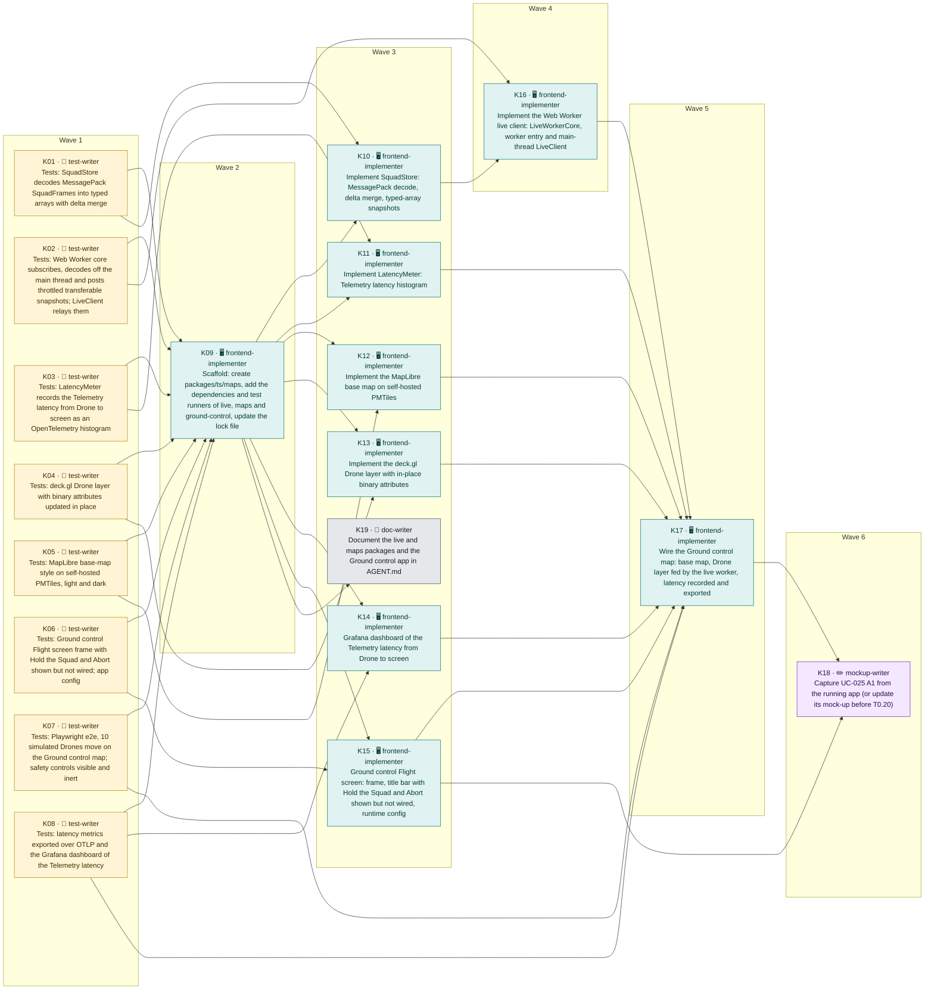

# T0.19: Plan

**Plan:** 🟢 Approved

<!-- ticket:specs -->
## 📚 Specifications

The technical pages, features, use cases and business rules of [TICKET.md](TICKET.md), copied by `python3 .claude/scripts/tickets/ticket_refs.py sync`.

- [📏 BR-014](../../specs/functional/business-rules/BR-014-simulation-isolation.md)
- [🖥️ GUI and WebUI: apps and shared packages](../../specs/technical/10-frontends.md#apps)
- [🗺️ GUI and WebUI: maps and 3D](../../specs/technical/10-frontends.md#maps)
- [📨 GUI and WebUI: live data in the browser](../../specs/technical/10-frontends.md#live-data)
- [📨 API layer: live data over WebSocket](../../specs/technical/05-api.md#live)
- [🎨 GUI and WebUI: design system](../../specs/technical/10-frontends.md#design-system)
- [📏 BR-023](../../specs/functional/business-rules/BR-023-fixed-safety-controls.md)
- [🩺 Observability: signals](../../specs/technical/08-observability.md#signals)
- [🎬 UC-025: Monitor a Mission in Ground control](../../specs/functional/use-cases/UC-025-monitor-a-mission-in-ground-control.md)
- [⏱️ GUI and WebUI: front-end budgets](../../specs/technical/10-frontends.md#performance)
- [🖼️ UC-025 A1](../../specs/functional/use-cases/UC-025-monitor-a-mission-in-ground-control.md#screen-a1)
- [⏱️ Telemetry, Drone to Pilot's screen](../../specs/technical/07-scalability.md#budgets)
<!-- /ticket:specs -->

## 🔭 Summary

T0.19 is planned as 19 tasks in 6 waves.

Wave 1 has 8 test-writers, one per behaviour:

- the SquadStore decoder (MessagePack to typed arrays, delta merge)
- the Web Worker core and the main-thread LiveClient
- the LatencyMeter
- the deck.gl Drone layer and its binary attributes
- the MapLibre PMTiles base-map style
- the Ground control Flight screen and its config
- the Playwright e2e against a stand-in live server
- the latency export to OTLP and the Grafana dashboard

Wave 2 has one scaffold task. It is the only owner of every `package.json`, `tsconfig.json`, test-runner config and `pnpm-lock.yaml`, so parallel tasks never fight over the lock file. It creates `packages/ts/maps` and declares subpath exports, so no two tasks share an `index.ts`.

Wave 3 runs 6 implementations in parallel plus the AGENT.md documentation:

- the SquadStore
- the LatencyMeter
- the base map
- the Drone layer
- the Flight screen with the not-wired Hold the Squad and Abort buttons
- the Grafana dashboard

Wave 4 builds the worker and the LiveClient. Wave 5 wires the map, the live client and the latency export into the Flight screen. Wave 6 is the TKT-21 capture task for UC-025 A1:

- if T0.20 is merged, it captures the screen as a screenshot;
- otherwise it updates the mock-up to what the app shows.

Every brief fixes the same module paths, exported names, metric name and DOM hooks, so the tests and the code agree.

## 🧩 Assumptions

- The roadmap row names no feature, use case or business rule. BR-014 is linked because epic E0.6 names it, BR-023 because the technical page ties Hold the Squad and abort to fixed controls, and UC-025 because it is the use case of the Ground control Flight view.
- The row names no screen. It is a front-end ticket (TKT-21), so UC-025 A1 is linked as the most conservative match, to be captured as a Screenshot.
- The row names no budget row. The Telemetry Drone to Pilot's screen budget is linked because the row measures that latency.
- The row gives no latency value for the done-when, so the criteria assert none beyond the budget row.
- The roadmap has no per-ticket anchor, so the ticket link points to the sprint anchor #s04 and the epic link to #epics.
- Created an empty tests-evidences/.gitkeep so the folder exists.
- T0.17, which brings the OpenTelemetry stack, Prometheus and Grafana, depends on T0.19 in ticket-graph.json, so no Grafana runs in the dev cell yet. T0.19 delivers the measure and its export to a configured OTLP/HTTP collector URL, plus a Grafana dashboard JSON at frontends/ground-control/observability/telemetry-latency-dashboard.json, which T0.17 provisions. Criterion 2 can be checked end to end in the dev cell only once T0.17's stack exists. Writing no chart under deploy/charts keeps the ticket inside its area lock.
- The Telemetry latency is measured in the browser as the paint time minus the Drone frame's t_us, one sample per Drone frame. This assumes the Simulator's clock and the browser's clock are synchronised (NTP). Negative samples, which come from clock skew, are skipped and counted, not recorded.
- The metric names are not given by the specifications. The instrument is the histogram swarm.live.telemetry_latency, in ms, which is swarm_live_telemetry_latency_milliseconds in Prometheus. Its resource attributes are service.name=ground-control, cell and mission_id, and it has no drone_id label, as the observability signals require. The dashboard draws the 400 ms through-the-cell budget as a threshold.
- The subscribe message and the frame batching follow the gateway /v1/live of T0.18, which is a prerequisite. Where it does not decide, the subscribe message is the JSON text written on the API page.
- Sign-in to Ground control is not part of this ticket. The live client takes an optional token, and how the dev cell supplies one follows what T0.11 and T0.18 set up.
- Ground control reads a runtime config.json served beside the app (liveUrl, pmtilesUrl, otlpMetricsUrl, cell), so that one image serves every cell, and takes the Mission from the query parameter mission. Writing the dev cell's config.json and hosting the PMTiles extract are deployment steps outside this ticket's area.
- The PMTiles layer names follow the Protomaps basemap schema of OpenStreetMap PMTiles. The specifications name no schema.
- The Drone layer is a deck.gl ScatterplotLayer coloured per Drone state from the design tokens. The specifications say only 'deck.gl GPU layers for Drones'.
- ✋ Hold the Squad and 🛑 Abort are rendered as the visual identity's secondary and danger buttons in the title bar, with no action attached and no fixed keyboard or gamepad input. The roadmap says they are shown but not yet wired, and no command can reach any Drone (BR-014).
- The title bar shows Ground control and the Mission id. The Mission name, its state badge and the status-bar contents need the Missions API and later tickets, and the frame of T0.14 is reused as it is.
- The file names of T0.14's shell (src/App.tsx, its test runner) and of T0.10's Playwright scaffold are not known yet. The tasks use them when they exist and fall back to Vitest and frontends/ground-control/playwright.config.ts when they do not.
- The four-language messages (BR-017, T0.15) are not linked by TICKET.md and T0.15 is not a prerequisite. The few new on-screen texts are written in English, using packages/ts/i18n when it exists, and no translation task is planned. The roadmap demo mentions translations in T0.19's task split, so the reviewer should confirm this.
- The packages live and maps keep the node:test runner that packages/ts/live already uses. Vitest is used for the React app, as the stack says.
- The capture task captures UC-025 A1 as a screenshot only if T0.20 is done. Otherwise it updates the mock-up to show the frame and the map as the app does, and keeps the video, Alerts and progress areas that UC-025 step 2 requires but this ticket does not build, so as not to contradict the approved use case.

<!-- plan:graph -->

> [!NOTE]
> Generated from the json block at the end of this page by `python3 .claude/scripts/tickets/plan.py render`.
> To change a task, edit the json block, then render again: never edit this view by hand.

## Waves

| Wave | Tasks | Agents running at once |
| --- | --- | --- |
| 1 | [K01](#k01), [K02](#k02), [K03](#k03), [K04](#k04), [K05](#k05), [K06](#k06), [K07](#k07), [K08](#k08) | 8 of 8 |
| 2 | [K09](#k09) | 1 of 1 |
| 3 | [K10](#k10), [K11](#k11), [K12](#k12), [K13](#k13), [K14](#k14), [K15](#k15), [K19](#k19) | 7 of 7 |
| 4 | [K16](#k16) | 1 of 1 |
| 5 | [K17](#k17) | 1 of 1 |
| 6 | [K18](#k18) | 1 of 1 |

| Wave | Task | Agent | Depends on | Unblocks |
| --- | --- | --- | --- | --- |
| 1 | [K01](#k01) Tests: SquadStore decodes MessagePack SquadFrames into typed arrays with delta merge | 🧪 test-writer | none | [K09](#k09), [K10](#k10) |
| 1 | [K02](#k02) Tests: Web Worker core subscribes, decodes off the main thread and posts throttled transferable snapshots; LiveClient relays them | 🧪 test-writer | none | [K09](#k09), [K16](#k16) |
| 1 | [K03](#k03) Tests: LatencyMeter records the Telemetry latency from Drone to screen as an OpenTelemetry histogram | 🧪 test-writer | none | [K09](#k09), [K11](#k11) |
| 1 | [K04](#k04) Tests: deck.gl Drone layer with binary attributes updated in place | 🧪 test-writer | none | [K09](#k09), [K13](#k13) |
| 1 | [K05](#k05) Tests: MapLibre base-map style on self-hosted PMTiles, light and dark | 🧪 test-writer | none | [K09](#k09), [K12](#k12) |
| 1 | [K06](#k06) Tests: Ground control Flight screen frame with Hold the Squad and Abort shown but not wired; app config | 🧪 test-writer | none | [K09](#k09), [K15](#k15) |
| 1 | [K07](#k07) Tests: Playwright e2e, 10 simulated Drones move on the Ground control map; safety controls visible and inert | 🧪 test-writer | none | [K09](#k09), [K17](#k17) |
| 1 | [K08](#k08) Tests: latency metrics exported over OTLP and the Grafana dashboard of the Telemetry latency | 🧪 test-writer | none | [K09](#k09), [K14](#k14), [K17](#k17) |
| 2 | [K09](#k09) Scaffold: create packages/ts/maps, add the dependencies and test runners of live, maps and ground-control, update the lock file | 🖥️ frontend-implementer | [K01](#k01), [K02](#k02), [K03](#k03), [K04](#k04), [K05](#k05), [K06](#k06), [K07](#k07), [K08](#k08) | [K10](#k10), [K11](#k11), [K12](#k12), [K13](#k13), [K14](#k14), [K15](#k15), [K19](#k19) |
| 3 | [K10](#k10) Implement SquadStore: MessagePack decode, delta merge, typed-array snapshots | 🖥️ frontend-implementer | [K01](#k01), [K09](#k09) | [K16](#k16) |
| 3 | [K11](#k11) Implement LatencyMeter: Telemetry latency histogram | 🖥️ frontend-implementer | [K03](#k03), [K09](#k09) | [K17](#k17) |
| 3 | [K12](#k12) Implement the MapLibre base map on self-hosted PMTiles | 🖥️ frontend-implementer | [K05](#k05), [K09](#k09) | [K17](#k17) |
| 3 | [K13](#k13) Implement the deck.gl Drone layer with in-place binary attributes | 🖥️ frontend-implementer | [K04](#k04), [K09](#k09) | [K17](#k17) |
| 3 | [K14](#k14) Grafana dashboard of the Telemetry latency from Drone to screen | 🖥️ frontend-implementer | [K08](#k08), [K09](#k09) | [K17](#k17) |
| 3 | [K15](#k15) Ground control Flight screen: frame, title bar with Hold the Squad and Abort shown but not wired, runtime config | 🖥️ frontend-implementer | [K06](#k06), [K09](#k09) | [K17](#k17), [K18](#k18) |
| 3 | [K19](#k19) Document the live and maps packages and the Ground control app in AGENT.md | 📝 doc-writer | [K09](#k09) | none |
| 4 | [K16](#k16) Implement the Web Worker live client: LiveWorkerCore, worker entry and main-thread LiveClient | 🖥️ frontend-implementer | [K02](#k02), [K10](#k10) | [K17](#k17) |
| 5 | [K17](#k17) Wire the Ground control map: base map, Drone layer fed by the live worker, latency recorded and exported | 🖥️ frontend-implementer | [K07](#k07), [K08](#k08), [K11](#k11), [K12](#k12), [K13](#k13), [K14](#k14), [K15](#k15), [K16](#k16) | [K18](#k18) |
| 6 | [K18](#k18) Capture UC-025 A1 from the running app (or update its mock-up before T0.20) | ✏️ mockup-writer | [K15](#k15), [K17](#k17) | none |

## Dependency graph



## Tasks

### <a id="k01"></a>K01: Tests: SquadStore decodes MessagePack SquadFrames into typed arrays with delta merge

| Agent | Wave | Depends on | Unblocks |
| --- | --- | --- | --- |
| 🧪 test-writer | 1 | none | [K09](#k09), [K10](#k10) |

**Files** (only this task may change them in its wave):

- `packages/ts/live/test/squad-store.test.ts`
- `packages/ts/live/test/helpers/squad-frames.ts`

**Done when:** `packages/ts/live/test/squad-store.test.ts` exists and covers every case of the brief. `pnpm --filter ./packages/ts/live run lint` passes on it. `node --experimental-strip-types --test packages/ts/live/test/squad-store.test.ts` fails only because `src/squad/*` does not exist yet.

**Brief:**

Write the failing tests of the live decoder of `packages/ts/live`. It is the part of the Web Worker that turns MessagePack frames into typed arrays and merges deltas. Specification: [📨 GUI and WebUI: live data in the browser](docs/specs/technical/10-frontends.md#live-data) ("Web Worker: MessagePack decode, delta merge, typed arrays (positions, states, battery)") and [📨 API layer: live data over WebSocket](docs/specs/technical/05-api.md#live) ("delta-encoded `SquadFrame`"). Use case: [🎬 UC-025](docs/specs/functional/use-cases/UC-025-monitor-a-mission-in-ground-control.md), where each Drone is shown with its state, battery and Link. Rule: [📏 BR-014](docs/specs/functional/business-rules/BR-014-simulation-isolation.md), which covers the simulated Squad being displayed.

The frame shape is `SquadFrame` and `TelemetryFrame` of `packages/ts/live/src/generated/models.ts`: fields `mission_id`, `t_us` and `frames[]`, with `drone_id`, `seq`, `t_us`, `lat_e7`, `lon_e7`, `altitude_m`, `speed_m_s`, `heading_deg`, `battery_pct`, `link_quality_pct` and `state`. Before you write, read how the gateway `/v1/live` of T0.18 (`services/gateway`) encodes a message: one SquadFrame per WebSocket message, or a batch. Encode test messages the same way with `@msgpack/msgpack` `encode`.

The API under test, imported by relative path with the `.ts` extension:
- `../src/squad/squad-store.ts`, `export class SquadStore`:
  - `merge(message: Uint8Array): number` merges and returns the number of Drone frames merged.
  - `snapshot(): SquadSnapshot | null` returns null when nothing changed since the last snapshot.
  - getters `size` (the number of Drones) and `rejectedMessages`.
- `../src/squad/squad-snapshot.ts`, `export interface SquadSnapshot`, with these fields:
  - `droneIds: string[]`
  - `positions: Float64Array`, holding lon, lat and altitude_m per Drone (stride 3, degrees = e7 / 1e7)
  - `states: Uint8Array`
  - `batteryPct: Float32Array`
  - `linkQualityPct: Float32Array`
  - `frameTimesUs: Float64Array`, the `t_us` of every Drone frame merged since the previous snapshot
- `../src/squad/drone-state-code.ts`, `export const DRONE_STATE_CODES`, mapping each `DroneState` to a code in the order of the generated enum: ready 0, grounded 1, airborne 2, returning 3, landed 4, lost 5.

Cases:
- 10 Drones merged give size 10 and correct positions, states and battery values.
- A later delta holding 3 Drones updates only those 3 slots. Every Drone keeps its slot index.
- A new `drone_id` is appended.
- An older `seq` for a Drone does not overwrite a newer one.
- The snapshot's arrays are fresh copies that can be transferred: their buffers are not reused by the store.
- `frameTimesUs` holds only the frames merged since the last snapshot.
- A malformed message is rejected and counted, and leaves the store unchanged.
- A frame of another `mission_id` is rejected.

Use `node:test` and `node:assert/strict`, like `packages/ts/live/test/render.test.ts`. The package's `test` script runs `test/*.test.ts`. Put the frame builders in `test/helpers/squad-frames.ts`. Name tests as sentences. Use no mocks.

### <a id="k02"></a>K02: Tests: Web Worker core subscribes, decodes off the main thread and posts throttled transferable snapshots; LiveClient relays them

| Agent | Wave | Depends on | Unblocks |
| --- | --- | --- | --- |
| 🧪 test-writer | 1 | none | [K09](#k09), [K16](#k16) |

**Files** (only this task may change them in its wave):

- `packages/ts/live/test/live-worker-core.test.ts`
- `packages/ts/live/test/live-client.test.ts`
- `packages/ts/live/test/helpers/frame-stream.ts`
- `packages/ts/live/test/helpers/live-test-server.ts`

**Done when:** Both test files exist and cover every case of the brief. `pnpm --filter ./packages/ts/live run lint` passes on them. Running them with `node --experimental-strip-types --test` fails only because `src/worker/*` and `src/client/*` do not exist yet.

**Brief:**

Write the failing tests of the live client of `packages/ts/live`. Specification:
- [📨 GUI and WebUI: live data in the browser](docs/specs/technical/10-frontends.md#live-data): "The main thread never decodes frames", and a transferable snapshot "at most 30 per second".
- [📨 API layer: live data over WebSocket](docs/specs/technical/05-api.md#live): one socket per client, with `{"op": "subscribe", "topic": "mission/<id>/squad", "rate": "full"}`, and server frames in MessagePack.
- [🗂️ GUI and WebUI: apps and shared packages](docs/specs/technical/10-frontends.md#apps): `live` holds the "WebSocket client, MessagePack decoder in a Web Worker".

Rules: [📏 BR-014](docs/specs/functional/business-rules/BR-014-simulation-isolation.md) says the client only subscribes and sends no command. Use case: [🎬 UC-025](docs/specs/functional/use-cases/UC-025-monitor-a-mission-in-ground-control.md).

Read the gateway `/v1/live` of T0.18 (`services/gateway`) first. Match its subscribe message encoding (a JSON text message as written on the API page, unless the gateway expects another), how a token is passed, and how frames are batched.

API under test, imported by relative path with `.ts`:
- `../src/worker/live-worker-core.ts`, `export class LiveWorkerCore`, constructed with `(port: LivePort, options?: { maxSnapshotsPerSecond?: number })`. The default is 30. `LivePort` is a `MessagePort`-like with `postMessage(message, transfer?)` and `onmessage`.
- `../src/worker/live-messages.ts`, the message types:
  - from the main thread: `{ kind: "start", url, missionId, token? }` and `{ kind: "stop" }`;
  - from the worker: `{ kind: "snapshot", snapshot: SquadSnapshot }`, with its typed-array buffers in the transfer list, and `{ kind: "status", status: "connecting" | "open" | "closed" | "error" }`.
- `../src/client/live-client.ts`, `export class LiveClient`, constructed with `(port: LivePort)`. Its methods are `start({ url, missionId, token? })`, `onSnapshot(callback): () => void`, `onStatus(callback): () => void` and `stop()`.

Cases:
- On `start`, the core opens one WebSocket to the URL and sends exactly the subscribe message for `mission/<missionId>/squad` at full rate.
- Binary frames from the server reach the main side as snapshots.
- Under a burst of 200 frames in one second, at most `maxSnapshotsPerSecond` snapshots are posted, and the last state is never lost.
- Snapshots' buffers are transferred: they are detached on the sending side after posting.
- Statuses go from connecting to open, then closed when the server closes.
- `stop` closes the socket.
- LiveClient never decodes MessagePack: it only receives snapshots.
- No message other than the subscribe is ever sent on the socket.

Use real things, with no mocks:
- a real local WebSocket server built with the `ws` package, in `test/helpers/live-test-server.ts`, which records what it receives and sends MessagePack frames built in `test/helpers/frame-stream.ts`. Do not import K01's helper;
- Node 22's global `WebSocket` client;
- a real `MessageChannel` joining LiveWorkerCore and LiveClient.

Use `node:test`, like `test/render.test.ts`.

### <a id="k03"></a>K03: Tests: LatencyMeter records the Telemetry latency from Drone to screen as an OpenTelemetry histogram

| Agent | Wave | Depends on | Unblocks |
| --- | --- | --- | --- |
| 🧪 test-writer | 1 | none | [K09](#k09), [K11](#k11) |

**Files** (only this task may change them in its wave):

- `packages/ts/live/test/latency-meter.test.ts`

**Done when:** `packages/ts/live/test/latency-meter.test.ts` exists and covers every case. Lint passes on it. Running it fails only because `src/latency/latency-meter.ts` does not exist yet.

**Brief:**

Write the failing tests of the latency measure in `packages/ts/live`. Specification:
- [🩺 Observability: signals](docs/specs/technical/08-observability.md#signals): metrics are OpenTelemetry, and `drone_id` is never a metric label.
- the budget [⏱️ Telemetry, Drone to Pilot's screen](docs/specs/technical/07-scalability.md#budgets): p95 &lt; 400 ms through the cell.
- [⏱️ GUI and WebUI: front-end budgets](docs/specs/technical/10-frontends.md#performance).

Use case: [🎬 UC-025](docs/specs/functional/use-cases/UC-025-monitor-a-mission-in-ground-control.md). Rule: [📏 BR-014](docs/specs/functional/business-rules/BR-014-simulation-isolation.md), since simulated Drones are measured.

API under test: `../src/latency/latency-meter.ts`, `export class LatencyMeter`, with:
- `static INSTRUMENT_NAME = "swarm.live.telemetry_latency"` and `static UNIT = "ms"`;
- the constructor `(meter: Meter)`, where `Meter` comes from `@opentelemetry/api`;
- `record(frameTimesUs: Float64Array, paintedAtMs: number): void`, which records one sample per Drone frame: `paintedAtMs - t_us / 1000`;
- the getter `skippedSamples`.

Cases:
- 10 frame times give 10 samples with the expected values.
- A negative latency, from a clock ahead of the browser, is not recorded and is counted in `skippedSamples`.
- The histogram has the instrument name and unit above.
- No sample carries a `drone_id` attribute, nor any attribute naming a Drone.
- An empty array records nothing.

Use a real `MeterProvider` from `@opentelemetry/sdk-metrics` with an `InMemoryMetricExporter` and a manual reader to read the histogram back. Do not use a mock. Use `node:test`.

### <a id="k04"></a>K04: Tests: deck.gl Drone layer with binary attributes updated in place

| Agent | Wave | Depends on | Unblocks |
| --- | --- | --- | --- |
| 🧪 test-writer | 1 | none | [K09](#k09), [K13](#k13) |

**Files** (only this task may change them in its wave):

- `packages/ts/maps/test/drone-layer.test.ts`

**Done when:** `packages/ts/maps/test/drone-layer.test.ts` exists and covers every case. Running it fails only because `packages/ts/maps/src/drone-layer/*` does not exist yet.

**Brief:**

Write the failing tests of the Drone layer of the new package `packages/ts/maps` (`@swarm/maps`). Specification:
- [🗺️ GUI and WebUI: maps and 3D](docs/specs/technical/10-frontends.md#maps): "deck.gl GPU layers for Drones ... binary attribute updates for moving Drones".
- [📨 GUI and WebUI: live data in the browser](docs/specs/technical/10-frontends.md#live-data): "deck.gl attributes updated in place", with a target of 5,000 moving Drones.
- [🗂️ GUI and WebUI: apps and shared packages](docs/specs/technical/10-frontends.md#apps).

Use case: [🎬 UC-025](docs/specs/functional/use-cases/UC-025-monitor-a-mission-in-ground-control.md), where each Drone is shown on the map with its state.

API under test, imported by relative path with `.ts`:
- `../src/drone-layer/drone-attributes.ts`, `export class DroneAttributes`, with `update(input: { positions: Float64Array; states: Uint8Array; length: number }, colours: ReadonlyArray<readonly [number, number, number, number]>): DroneLayerData`. `colours` is indexed by state code. `DroneLayerData` is `{ length, attributes: { getPosition: { value: Float64Array, size: 3 }, getFillColor: { value: Uint8Array, size: 4 } } }`.
- `../src/drone-layer/drone-layer.ts`, `export function createDroneLayer(data: DroneLayerData, options?: { id?: string; radiusPx?: number }): Layer`. It builds a deck.gl `ScatterplotLayer` from `@deck.gl/layers`.

Cases:
- Positions are copied, with stride 3.
- Each Drone's colour is the one of its state code.
- A second update with the same length reuses the same buffers (the same `ArrayBuffer`), which is the in-place update.
- A larger length allocates larger buffers.
- The layer has a stable id and receives the binary `data` with `length` and `attributes`.
- Updating 5,000 Drones allocates nothing after the first update.

The package does not depend on `@swarm/live`: the input is the plain interface above. Use `node:test` and `node:assert/strict`, as `packages/ts/live` does. The package's `test` script will run `test/*.test.ts`. Use no mocks.

### <a id="k05"></a>K05: Tests: MapLibre base-map style on self-hosted PMTiles, light and dark

| Agent | Wave | Depends on | Unblocks |
| --- | --- | --- | --- |
| 🧪 test-writer | 1 | none | [K09](#k09), [K12](#k12) |

**Files** (only this task may change them in its wave):

- `packages/ts/maps/test/base-map-style.test.ts`

**Done when:** `packages/ts/maps/test/base-map-style.test.ts` exists and covers every case. Running it fails only because `src/base-map/base-map-style.ts` does not exist yet.

**Brief:**

Write the failing tests of the base map of `packages/ts/maps`. Specification:
- [🗺️ GUI and WebUI: maps and 3D](docs/specs/technical/10-frontends.md#maps): "MapLibre GL JS with self-hosted vector tiles from OpenStreetMap (PMTiles files ...)".
- [🎨 GUI and WebUI: design system](docs/specs/technical/10-frontends.md#design-system): tokens only, light and dark.
- [🗂️ GUI and WebUI: apps and shared packages](docs/specs/technical/10-frontends.md#apps).

Use case: [🎬 UC-025](docs/specs/functional/use-cases/UC-025-monitor-a-mission-in-ground-control.md), which needs the map of step 2.

API under test: `../src/base-map/base-map-style.ts`, `export function buildBaseMapStyle(options: { pmtilesUrl: string; palette: BaseMapPalette }): StyleSpecification`. `BaseMapPalette` is exported from the same file and holds `background`, `water`, `land`, `road`, `building` and `label` colours, as `#rrggbb` strings that the caller resolves from the design tokens. `StyleSpecification` is MapLibre's type.

Cases:
- The style has version 8 and one vector source whose URL is `pmtiles://<pmtilesUrl>`.
- No layer or source points to a remote host other than `pmtilesUrl`, because the tiles are self-hosted.
- Every colour in the style's paint properties comes from the palette: no hard-coded colour.
- Two palettes, light and dark, give two styles that differ only in colours.
- An empty `pmtilesUrl` is refused with a thrown `Error`.

The layers use the layer names of the Protomaps basemap schema of OpenStreetMap PMTiles. Use `node:test`.

### <a id="k06"></a>K06: Tests: Ground control Flight screen frame with Hold the Squad and Abort shown but not wired; app config

| Agent | Wave | Depends on | Unblocks |
| --- | --- | --- | --- |
| 🧪 test-writer | 1 | none | [K09](#k09), [K15](#k15) |

**Files** (only this task may change them in its wave):

- `frontends/ground-control/test/flight-screen.test.tsx`
- `frontends/ground-control/test/app-config.test.ts`

**Done when:** Both test files exist and cover every case. The app's lint passes on them. The app's test command fails only because `src/flight/*` and `src/config/app-config.ts` do not exist yet.

**Brief:**

Write the failing component and config tests of the first screen of `frontends/ground-control`. Specification:
- [📏 BR-023: Fixed safety controls](docs/specs/functional/business-rules/BR-023-fixed-safety-controls.md): Hold the Squad and abort are visible on every screen.
- [🎬 UC-025 step 2 and screen A1](docs/specs/functional/use-cases/UC-025-monitor-a-mission-in-ground-control.md#screen-a1).
- [🎨 GUI and WebUI: design system](docs/specs/technical/10-frontends.md#design-system).
- [🗂️ GUI and WebUI: apps and shared packages](docs/specs/technical/10-frontends.md#apps).
- the Ground control frame row of `docs/specs/visual-identity.md#components`: the title bar reads `⚙️ Swarm` · Ground control · Mission, then on the right `✋ Hold the Squad` (button secondary) and `🛑 Abort` (button danger).
- [📏 BR-014](docs/specs/functional/business-rules/BR-014-simulation-isolation.md): nothing is sent.

First read the shell of T0.14 (`frontends/ground-control`, and the Ground control frame of `packages/ts/ui`) and the test runner it set up. If it set up none, write the tests for Vitest with jsdom and `@testing-library/react`. Task K09 adds those dependencies.

API under test:
- `../src/flight/flight-screen.tsx`, `export function FlightScreen(props: { missionId: string; map?: ReactNode })`.
- `../src/flight/safety-controls.tsx`, `export function SafetyControls()`.
- `../src/config/app-config.ts`:
  - `export interface AppConfig { liveUrl: string; pmtilesUrl: string; otlpMetricsUrl: string | null; cell: string; missionId: string }`;
  - `export class AppConfigError extends Error`;
  - `export function parseAppConfig(json: unknown, search: string): AppConfig`, where the Mission comes from the query parameter `mission` of `search`.

Cases:
- The title bar shows Ground control, the Mission id, then the buttons `✋ Hold the Squad` and `🛑 Abort`, in that order and on the right.
- Both buttons are visible and reachable by role `button` with those names.
- Clicking either button changes nothing and calls nothing: it is not wired. Check this with a real `window` event listener that sees no custom event and no network request, not with a mock.
- The `map` slot is rendered inside an element with `data-testid="flight-map"`.
- The screen renders in light and dark mode: `prefers-color-scheme` emulated through the token classes of `packages/ts/tokens`, if T0.14 provides them.
- `parseAppConfig` accepts a full config.
- `otlpMetricsUrl` absent becomes null.
- A missing or empty `liveUrl`, `pmtilesUrl` or `cell` throws `AppConfigError` naming the field.
- A missing or non-UUID `mission` parameter throws `AppConfigError`.

### <a id="k07"></a>K07: Tests: Playwright e2e, 10 simulated Drones move on the Ground control map; safety controls visible and inert

| Agent | Wave | Depends on | Unblocks |
| --- | --- | --- | --- |
| 🧪 test-writer | 1 | none | [K09](#k09), [K17](#k17) |

**Files** (only this task may change them in its wave):

- `frontends/ground-control/e2e/flight-map.spec.ts`
- `frontends/ground-control/e2e/live-stand-in-server.ts`

**Done when:** Both files exist. `pnpm --filter ./frontends/ground-control exec eslint e2e` passes on them once K09 has added the dependencies. The spec lists every assertion of the brief.

**Brief:**

Write the failing Playwright end-to-end test of acceptance criteria 1 and 3 of `docs/tickets/T0.19/TICKET.md`. The criteria are:
- 10 simulated Drones move on the map;
- ✋ Hold the Squad and 🛑 Abort are visible in the title bar and not wired.

Specification:
- [🎬 UC-025 screen A1](docs/specs/functional/use-cases/UC-025-monitor-a-mission-in-ground-control.md#screen-a1)
- [📏 BR-023](docs/specs/functional/business-rules/BR-023-fixed-safety-controls.md)
- [📏 BR-014](docs/specs/functional/business-rules/BR-014-simulation-isolation.md): no command leaves the screen
- [📨 API layer: live data over WebSocket](docs/specs/technical/05-api.md#live)
- [📨 GUI and WebUI: live data in the browser](docs/specs/technical/10-frontends.md#live-data)
- [🗺️ GUI and WebUI: maps and 3D](docs/specs/technical/10-frontends.md#maps)

AGENT.md, Front-end tests: Playwright tests live in `frontends/<frontend>/e2e/` and run against the real image, never a development server. Use the base URL of the Playwright scaffold of T0.10 if it exists, and read it first.

The stand-in live server goes in `e2e/live-stand-in-server.ts`. It is a real WebSocket server built with `ws` and `@msgpack/msgpack`, which K09 adds as dev dependencies. It speaks the gateway `/v1/live` protocol of T0.18: read `services/gateway` for the subscribe message and the frame batching. It streams MessagePack `SquadFrame`s of 10 Drones (`state` airborne, `mission_id` the test Mission) at 10 Hz, flying a square, with `t_us` taken from the clock. It records every message it receives.

The test serves the app's runtime `config.json` through `page.route` to point `liveUrl` at the stand-in, then opens `/?mission=<uuid>`. It asserts:
- the buttons `✋ Hold the Squad` and `🛑 Abort` are visible in the title bar;
- the element `[data-testid="flight-map"]` reaches `data-drone-count="10"`;
- its `data-snapshot-count` keeps increasing;
- two screenshots of the map canvas taken one second apart differ, because the Drones move;
- after clicking both buttons, the stand-in has received only the subscribe message.

Playwright's config, `frontends/ground-control/playwright.config.ts`, belongs to K09, which starts the stand-in as a `webServer` on port 8765. Write a short header comment in the spec saying so.

### <a id="k08"></a>K08: Tests: latency metrics exported over OTLP and the Grafana dashboard of the Telemetry latency

| Agent | Wave | Depends on | Unblocks |
| --- | --- | --- | --- |
| 🧪 test-writer | 1 | none | [K09](#k09), [K14](#k14), [K17](#k17) |

**Files** (only this task may change them in its wave):

- `frontends/ground-control/test/latency-metrics.test.ts`
- `frontends/ground-control/test/latency-dashboard.test.ts`

**Done when:** Both test files exist and cover every case. The app's lint passes on them. The app's tests fail only because `src/telemetry/latency-metrics.ts` and `observability/telemetry-latency-dashboard.json` do not exist yet.

**Brief:**

Write the failing tests of acceptance criterion 2 of `docs/tickets/T0.19/TICKET.md`: the Telemetry latency from Drone to screen through the cell is measured and shown in Grafana. Specification:
- [🩺 Observability: signals](docs/specs/technical/08-observability.md#signals): OpenTelemetry metrics, with `operator_id`, `mission_id` and `cell` as resource attributes, and `drone_id` never a metric label.
- [📊 Observability: dashboards](docs/specs/technical/08-observability.md#dashboards): budgets are drawn as thresholds on every latency panel.
- the budget [⏱️ Telemetry, Drone to Pilot's screen](docs/specs/technical/07-scalability.md#budgets): p95 &lt; 400 ms through the cell.
- [🎬 UC-025](docs/specs/functional/use-cases/UC-025-monitor-a-mission-in-ground-control.md) and [📏 BR-014](docs/specs/functional/business-rules/BR-014-simulation-isolation.md).

Use the test runner of the app: the one T0.14 set up, or Vitest if it set up none.

`test/latency-metrics.test.ts` tests `../src/telemetry/latency-metrics.ts`, `export function createLatencyMeterProvider(config: { otlpMetricsUrl: string | null; cell: string; missionId: string; exportIntervalMs?: number }): MeterProvider | null`. Cases:
- A null URL gives null, so nothing is exported.
- With the URL of a real local HTTP server started by the test, recording through `new LatencyMeter(provider.getMeter("ground-control"))` from `@swarm/live/latency` and then calling `forceFlush` makes the server receive one OTLP/HTTP metrics export.
- The export holds the histogram `swarm.live.telemetry_latency`, unit `ms`.
- Its resource has `service.name` = `ground-control`, `cell` and `mission_id`.
- No data point has a `drone_id` attribute.

`test/latency-dashboard.test.ts` reads `../observability/telemetry-latency-dashboard.json`. Cases:
- It is valid JSON, with the uid `swarm-telemetry-latency`.
- It has a time-series panel titled `Telemetry, Drone to Pilot's screen`.
- The panel's Prometheus query is the p95 `histogram_quantile(0.95, ...)` of `swarm_live_telemetry_latency_milliseconds_bucket`.
- The panel has a threshold at 400 (ms), the through-the-cell budget.
- It has a `cell` template variable.
- Nothing in it mentions `drone_id`.

### <a id="k09"></a>K09: Scaffold: create packages/ts/maps, add the dependencies and test runners of live, maps and ground-control, update the lock file

| Agent | Wave | Depends on | Unblocks |
| --- | --- | --- | --- |
| 🖥️ frontend-implementer | 2 | [K01](#k01), [K02](#k02), [K03](#k03), [K04](#k04), [K05](#k05), [K06](#k06), [K07](#k07), [K08](#k08) | [K10](#k10), [K11](#k11), [K12](#k12), [K13](#k13), [K14](#k14), [K15](#k15), [K19](#k19) |

**Files** (only this task may change them in its wave):

- `packages/ts/maps/package.json`
- `packages/ts/maps/tsconfig.json`
- `packages/ts/maps/eslint.config.js`
- `packages/ts/live/package.json`
- `packages/ts/live/tsconfig.json`
- `frontends/ground-control/package.json`
- `frontends/ground-control/tsconfig.json`
- `frontends/ground-control/vitest.config.ts`
- `frontends/ground-control/playwright.config.ts`
- `pnpm-lock.yaml`

**Done when:** `pnpm install --frozen-lockfile` succeeds from the root. `pnpm --filter ./packages/ts/maps run lint` and `pnpm --filter ./packages/ts/live run lint` pass. `pnpm --filter ./frontends/ground-control run lint` passes. The tests of K01 to K08 now fail only because of missing implementation modules, not missing dependencies.

**Brief:**

Prepare the workspace so that the tests of K01 to K08 can run. You are the only task that changes these manifests and `pnpm-lock.yaml`, so that the parallel tasks of wave 3 never conflict on them. Specification: [🗂️ GUI and WebUI: apps and shared packages](docs/specs/technical/10-frontends.md#apps) (packages `live` and `maps`, app `ground-control`; the stack is React 19, Vite, Vitest and Playwright), [🗺️ GUI and WebUI: maps and 3D](docs/specs/technical/10-frontends.md#maps), [📨 GUI and WebUI: live data in the browser](docs/specs/technical/10-frontends.md#live-data), [🩺 Observability: signals](docs/specs/technical/08-observability.md#signals) (OpenTelemetry SDK for TypeScript) and [🎬 UC-025](docs/specs/functional/use-cases/UC-025-monitor-a-mission-in-ground-control.md). Also follow AGENT.md: TypeScript packages extend `@swarm/config`, and the `lint`, `typecheck` and `test` scripts are run by CI.

1. **`packages/ts/maps`** (new, `@swarm/maps`). Copy the shape of `packages/ts/live` for `package.json`, `tsconfig.json` and `eslint.config.js`.
   - Scripts: `lint`, `typecheck`, and `test` = `node --experimental-strip-types --test test/*.test.ts`.
   - Subpath exports: `./base-map` → `./src/base-map/create-base-map.ts`, `./base-map-style` → `./src/base-map/base-map-style.ts`, `./drone-layer` → `./src/drone-layer/drone-layer.ts`, `./drone-attributes` → `./src/drone-layer/drone-attributes.ts`. There is no root `index.ts`, so the wave 3 tasks never share one.
   - Dependencies: `maplibre-gl`, `pmtiles`, `@deck.gl/core`, `@deck.gl/layers`, `@deck.gl/mapbox`, and `@protomaps/basemaps` if the style needs its layer names.
2. **`packages/ts/live`**.
   - Add the dependencies `@msgpack/msgpack` and `@opentelemetry/api`, and the dev dependencies `ws`, `@types/ws` and `@opentelemetry/sdk-metrics`.
   - Add these subpath exports beside `.`: `./squad` → `./src/squad/squad-store.ts`, `./snapshot` → `./src/squad/squad-snapshot.ts`, `./client` → `./src/client/live-client.ts`, `./latency` → `./src/latency/latency-meter.ts`. Do not edit `src/index.ts`.
   - Keep the existing `test` script, which also runs `generate.ts --check`.
   - Add the `DOM` lib to `tsconfig.json` if the client needs it. Leave the worker's lib to K16.
3. **`frontends/ground-control`** (the shell of T0.14).
   - Add the dependencies `@swarm/live`, `@swarm/maps` (workspace), `maplibre-gl`, `@deck.gl/core`, `@deck.gl/layers`, `@deck.gl/mapbox`, `@opentelemetry/api`, `@opentelemetry/sdk-metrics`, `@opentelemetry/exporter-metrics-otlp-http` and `@opentelemetry/resources`.
   - If T0.14 set up no test runner, add the dev dependencies `vitest`, `jsdom`, `@testing-library/react` and `@playwright/test`. Add `ws` and `@msgpack/msgpack` as dev dependencies for the e2e stand-in.
   - Set the `test` script to run Vitest, using `vitest.config.ts` with jsdom and `test/**/*.test.ts(x)`.
   - Write or extend `playwright.config.ts`, keeping T0.10's base URL and reporter if they exist. It starts `e2e/live-stand-in-server.ts` as a `webServer` on port 8765.
4. Pin exact versions, as `packages/ts/live/package.json` does, and run `pnpm install` to update `pnpm-lock.yaml`.

Write no source or test file.

### <a id="k10"></a>K10: Implement SquadStore: MessagePack decode, delta merge, typed-array snapshots

| Agent | Wave | Depends on | Unblocks |
| --- | --- | --- | --- |
| 🖥️ frontend-implementer | 3 | [K01](#k01), [K09](#k09) | [K16](#k16) |

**Files** (only this task may change them in its wave):

- `packages/ts/live/src/squad/squad-store.ts`
- `packages/ts/live/src/squad/squad-snapshot.ts`
- `packages/ts/live/src/squad/drone-state-code.ts`

**Done when:** `pnpm --filter ./packages/ts/live run lint` and `pnpm --filter ./packages/ts/live run typecheck` pass. `node --experimental-strip-types --test packages/ts/live/test/squad-store.test.ts` passes.

**Brief:**

Implement the decoder that runs inside the Web Worker of `packages/ts/live`, so that the tests of `packages/ts/live/test/squad-store.test.ts` (K01) pass. Specification:
- [📨 GUI and WebUI: live data in the browser](docs/specs/technical/10-frontends.md#live-data): MessagePack decode, delta merge, typed arrays for positions, states and battery, and a transferable snapshot.
- [📨 API layer: live data over WebSocket](docs/specs/technical/05-api.md#live): delta-encoded `SquadFrame`.
- [🎬 UC-025](docs/specs/functional/use-cases/UC-025-monitor-a-mission-in-ground-control.md).
- [📏 BR-014](docs/specs/functional/business-rules/BR-014-simulation-isolation.md).

The frame types are in `src/generated/models.ts`, which is never edited. Decode with `@msgpack/msgpack`, matching the encoding of the gateway `/v1/live` of T0.18.

Write the API fixed by K01:
- `SquadStore`, with `merge`, `snapshot`, `size` and `rejectedMessages`;
- the `SquadSnapshot` interface;
- `DRONE_STATE_CODES`.

Behaviour:
- Each Drone keeps a stable slot.
- A frame with an older `seq` never overwrites a newer one.
- Frames of another Mission are rejected.
- A malformed message is counted and changes nothing.
- The snapshot copies into fresh typed arrays, so that the worker can transfer them.

Keep the merge allocation-free in steady state, for the target of 5,000 Drones. Do not touch any manifest, test or other module. Report as `blocked` with the file and the change if a K01 test is wrong (TKT-19).

### <a id="k11"></a>K11: Implement LatencyMeter: Telemetry latency histogram

| Agent | Wave | Depends on | Unblocks |
| --- | --- | --- | --- |
| 🖥️ frontend-implementer | 3 | [K03](#k03), [K09](#k09) | [K17](#k17) |

**Files** (only this task may change them in its wave):

- `packages/ts/live/src/latency/latency-meter.ts`

**Done when:** `pnpm --filter ./packages/ts/live run lint` and `typecheck` pass. `node --experimental-strip-types --test packages/ts/live/test/latency-meter.test.ts` passes.

**Brief:**

Implement `packages/ts/live/src/latency/latency-meter.ts` so that `packages/ts/live/test/latency-meter.test.ts` (K03) passes. Specification:
- [🩺 Observability: signals](docs/specs/technical/08-observability.md#signals): OpenTelemetry metrics, and `drone_id` never a metric label.
- the budget [⏱️ Telemetry, Drone to Pilot's screen](docs/specs/technical/07-scalability.md#budgets).
- [🎬 UC-025](docs/specs/functional/use-cases/UC-025-monitor-a-mission-in-ground-control.md).
- [📏 BR-014](docs/specs/functional/business-rules/BR-014-simulation-isolation.md).

`LatencyMeter` holds `static INSTRUMENT_NAME = "swarm.live.telemetry_latency"` and `static UNIT = "ms"`. It creates one histogram from the `Meter` of `@opentelemetry/api` it is given. Choose explicit bucket boundaries that resolve the 150 ms edge budget and the 400 ms cell budget.

`record(frameTimesUs, paintedAtMs)` records `paintedAtMs - t_us / 1000` for each frame, with no attribute. A negative sample is skipped and counted in `skippedSamples`. The meter allocates nothing per sample.

Touch no other file. Report `blocked` if K03's test is wrong (TKT-19).

### <a id="k12"></a>K12: Implement the MapLibre base map on self-hosted PMTiles

| Agent | Wave | Depends on | Unblocks |
| --- | --- | --- | --- |
| 🖥️ frontend-implementer | 3 | [K05](#k05), [K09](#k09) | [K17](#k17) |

**Files** (only this task may change them in its wave):

- `packages/ts/maps/src/base-map/base-map-style.ts`
- `packages/ts/maps/src/base-map/create-base-map.ts`

**Done when:** `pnpm --filter ./packages/ts/maps run lint` and `typecheck` pass. `node --experimental-strip-types --test packages/ts/maps/test/base-map-style.test.ts` passes.

**Brief:**

Implement the base map of `@swarm/maps`, so that `packages/ts/maps/test/base-map-style.test.ts` (K05) passes. Specification: [🗺️ GUI and WebUI: maps and 3D](docs/specs/technical/10-frontends.md#maps) (MapLibre GL JS with self-hosted OpenStreetMap PMTiles; deck.gl layers above it), [🎨 GUI and WebUI: design system](docs/specs/technical/10-frontends.md#design-system) (colours from the tokens only, light and dark), [🗂️ GUI and WebUI: apps and shared packages](docs/specs/technical/10-frontends.md#apps) and [🎬 UC-025 step 2](docs/specs/functional/use-cases/UC-025-monitor-a-mission-in-ground-control.md#main-flow).

`base-map-style.ts` holds `BaseMapPalette` and `buildBaseMapStyle({ pmtilesUrl, palette })`. The style is a MapLibre style, version 8, with one vector source `pmtiles://<pmtilesUrl>` and the layers of the Protomaps basemap schema. Every colour comes from the palette. An empty URL is refused.

`create-base-map.ts` holds two functions:
- `registerPmtilesProtocol()` registers the `pmtiles` protocol on `maplibre-gl` once, and is idempotent.
- `createBaseMap(container: HTMLElement, options: { style: StyleSpecification; center: [number, number]; zoom: number }): { map: maplibregl.Map; overlay: MapboxOverlay }` creates the map and attaches a deck.gl `MapboxOverlay` from `@deck.gl/mapbox`, through which K17 adds the Drone layer.

Touch no other file. Report `blocked` if K05's test is wrong (TKT-19).

### <a id="k13"></a>K13: Implement the deck.gl Drone layer with in-place binary attributes

| Agent | Wave | Depends on | Unblocks |
| --- | --- | --- | --- |
| 🖥️ frontend-implementer | 3 | [K04](#k04), [K09](#k09) | [K17](#k17) |

**Files** (only this task may change them in its wave):

- `packages/ts/maps/src/drone-layer/drone-attributes.ts`
- `packages/ts/maps/src/drone-layer/drone-layer.ts`

**Done when:** `pnpm --filter ./packages/ts/maps run lint` and `typecheck` pass. `node --experimental-strip-types --test packages/ts/maps/test/drone-layer.test.ts` passes.

**Brief:**

Implement the Drone layer of `@swarm/maps`, so that `packages/ts/maps/test/drone-layer.test.ts` (K04) passes. Specification:
- [🗺️ GUI and WebUI: maps and 3D](docs/specs/technical/10-frontends.md#maps): deck.gl GPU layers for Drones, with binary attribute updates for moving Drones.
- [📨 GUI and WebUI: live data in the browser](docs/specs/technical/10-frontends.md#live-data): deck.gl attributes are updated in place, with a target of 5,000 moving Drones at 60 frames per second.
- [⏱️ GUI and WebUI: front-end budgets](docs/specs/technical/10-frontends.md#performance): live frame to pixels under 50 ms.
- [🎬 UC-025](docs/specs/functional/use-cases/UC-025-monitor-a-mission-in-ground-control.md).

Write `DroneAttributes.update(input, colours)` and `createDroneLayer(data, options)` as K04 fixes them:
- `update` reuses its `Float64Array` and `Uint8Array` buffers while the length does not grow.
- `createDroneLayer` returns a `ScatterplotLayer` with binary `data`, a stable id and a pixel radius.
- The layer is told the data changed without being given new JavaScript objects per Drone.
- The package does not import `@swarm/live`.

Touch no other file. Report `blocked` if K04's test is wrong (TKT-19).

### <a id="k14"></a>K14: Grafana dashboard of the Telemetry latency from Drone to screen

| Agent | Wave | Depends on | Unblocks |
| --- | --- | --- | --- |
| 🖥️ frontend-implementer | 3 | [K08](#k08), [K09](#k09) | [K17](#k17) |

**Files** (only this task may change them in its wave):

- `frontends/ground-control/observability/telemetry-latency-dashboard.json`

**Done when:** The JSON parses. The app's test run of `test/latency-dashboard.test.ts` passes.

**Brief:**

Write the Grafana dashboard that shows the Telemetry latency from Drone to screen, so that `frontends/ground-control/test/latency-dashboard.test.ts` (K08) passes. This is acceptance criterion 2 of `docs/tickets/T0.19/TICKET.md`. Specification:
- [🩺 Observability: signals](docs/specs/technical/08-observability.md#signals): metrics stored in Prometheus per cell, and `drone_id` never a label.
- [📊 Observability: dashboards](docs/specs/technical/08-observability.md#dashboards): budgets are drawn as thresholds on every latency panel.
- the budget [⏱️ Telemetry, Drone to Pilot's screen](docs/specs/technical/07-scalability.md#budgets): p95 &lt; 400 ms through the cell.
- [🎬 UC-025](docs/specs/functional/use-cases/UC-025-monitor-a-mission-in-ground-control.md).

Write a Grafana dashboard JSON model with:
- the uid `swarm-telemetry-latency`;
- a Prometheus data source variable and a `cell` variable;
- a time-series panel `Telemetry, Drone to Pilot's screen` with `histogram_quantile(0.95, sum by (le) (rate(swarm_live_telemetry_latency_milliseconds_bucket{cell=~"$cell"}[1m])))` and a threshold at 400 ms;
- a p50 series and a sample-rate panel beside it.

The Grafana that provisions this file arrives with the observability stack of T0.17. Write no chart. Touch no other file.

### <a id="k15"></a>K15: Ground control Flight screen: frame, title bar with Hold the Squad and Abort shown but not wired, runtime config

| Agent | Wave | Depends on | Unblocks |
| --- | --- | --- | --- |
| 🖥️ frontend-implementer | 3 | [K06](#k06), [K09](#k09) | [K17](#k17), [K18](#k18) |

**Files** (only this task may change them in its wave):

- `frontends/ground-control/src/flight/flight-screen.tsx`
- `frontends/ground-control/src/flight/safety-controls.tsx`
- `frontends/ground-control/src/config/app-config.ts`
- `frontends/ground-control/src/App.tsx`

**Done when:** `pnpm --filter ./frontends/ground-control run lint`, `typecheck` and `test -- test/flight-screen.test.tsx test/app-config.test.ts` pass.

**Brief:**

Build the first screen of Ground control, so that `frontends/ground-control/test/flight-screen.test.tsx` and `test/app-config.test.ts` (K06) pass. Specification:
- [📏 BR-023: Fixed safety controls](docs/specs/functional/business-rules/BR-023-fixed-safety-controls.md)
- [🎬 UC-025 step 2 and screen A1](docs/specs/functional/use-cases/UC-025-monitor-a-mission-in-ground-control.md#screen-a1)
- [🎨 GUI and WebUI: design system](docs/specs/technical/10-frontends.md#design-system): the frames are layout components of `packages/ts/ui` and use the tokens only.
- [🗂️ GUI and WebUI: apps and shared packages](docs/specs/technical/10-frontends.md#apps)
- the Ground control frame row of `docs/specs/visual-identity.md#components`
- [📏 BR-014](docs/specs/functional/business-rules/BR-014-simulation-isolation.md)

Use the Ground control frame and the button components that T0.14 put in `@swarm/ui`. Do not edit `packages/ts/ui`.

- `SafetyControls` renders `✋ Hold the Squad` (button secondary) and `🛑 Abort` (button danger) in the frame's title bar, with no action attached and no command sent, because the roadmap says they are not yet wired. If T0.14's frame already renders them, pass them through it.
- `FlightScreen({ missionId, map })` renders the frame with the 🛰️ Flight side bar item active, the title Ground control and the Mission id, and a content area `data-testid="flight-map"` holding `map`.
- `app-config.ts` holds `AppConfig`, `AppConfigError` and `parseAppConfig(json, search)`, as K06 fixes them, plus `loadAppConfig()`, which fetches the runtime `config.json` served beside the app and parses it with `location.search`.
- `App.tsx` is the root of T0.14's shell; if T0.14 named it otherwise, change that file and report it. It loads the config, then renders `FlightScreen`. On an `AppConfigError` it renders the frame with the error message.

Tokens only: no colour or font of your own. Report `blocked` if a K06 test is wrong (TKT-19).

### <a id="k19"></a>K19: Document the live and maps packages and the Ground control app in AGENT.md

| Agent | Wave | Depends on | Unblocks |
| --- | --- | --- | --- |
| 📝 doc-writer | 3 | [K09](#k09) | none |

**Files** (only this task may change them in its wave):

- `AGENT.md`

**Done when:** `AGENT.md` describes the three pieces in its Mono-repo section. `grep -n 'packages/ts/maps' AGENT.md` finds the new text, and the text has no em dash.

**Brief:**

Update the Mono-repo section of `AGENT.md`, the paragraph that lists the packages, to describe the TypeScript pieces this ticket adds. Specification: [🗂️ GUI and WebUI: apps and shared packages](docs/specs/technical/10-frontends.md#apps), [📨 GUI and WebUI: live data in the browser](docs/specs/technical/10-frontends.md#live-data), [🗺️ GUI and WebUI: maps and 3D](docs/specs/technical/10-frontends.md#maps) and [🩺 Observability: signals](docs/specs/technical/08-observability.md#signals).

Describe these three pieces:
- `packages/ts/live` (`@swarm/live`) holds the generated models, the `SquadStore` decoder and the Web Worker (`LiveWorkerCore`), which decodes MessagePack off the main thread and posts at most 30 transferable snapshots per second. It also holds the main-thread `LiveClient` and the `LatencyMeter` (histogram `swarm.live.telemetry_latency`, in ms). It is imported through subpath exports.
- `packages/ts/maps` (`@swarm/maps`) holds the MapLibre base map on self-hosted PMTiles and the deck.gl Drone layer with binary attributes updated in place.
- `frontends/ground-control` reads a runtime `config.json` (`liveUrl`, `pmtilesUrl`, `otlpMetricsUrl`, `cell`) and the Mission from `?mission=`. Its Grafana dashboard is in `observability/`, and its Playwright tests in `e2e/` use a stand-in live server.

Keep AGENT.md's style: plain British English, no em dash, lines up to 120 characters. Do not invent commands: use the scripts K09 defined in the three `package.json` files.

### <a id="k16"></a>K16: Implement the Web Worker live client: LiveWorkerCore, worker entry and main-thread LiveClient

| Agent | Wave | Depends on | Unblocks |
| --- | --- | --- | --- |
| 🖥️ frontend-implementer | 4 | [K02](#k02), [K10](#k10) | [K17](#k17) |

**Files** (only this task may change them in its wave):

- `packages/ts/live/src/worker/live-worker-core.ts`
- `packages/ts/live/src/worker/live-messages.ts`
- `packages/ts/live/src/worker/live-worker.ts`
- `packages/ts/live/src/client/live-client.ts`
- `packages/ts/live/tsconfig.json`

**Done when:** `pnpm --filter ./packages/ts/live run lint`, `typecheck` and `test` all pass, including the generator check and every test of K01 to K03.

**Brief:**

Implement the live path of `packages/ts/live`, so that `packages/ts/live/test/live-worker-core.test.ts` and `test/live-client.test.ts` (K02) pass. Specification:
- [📨 GUI and WebUI: live data in the browser](docs/specs/technical/10-frontends.md#live-data): WebSocket → Web Worker (decode, delta merge, typed arrays) → transferable snapshot at most 30 per second → main thread. The main thread never decodes frames.
- [📨 API layer: live data over WebSocket](docs/specs/technical/05-api.md#live): one socket per client, the subscribe message per Mission topic, MessagePack frames.
- [🗂️ GUI and WebUI: apps and shared packages](docs/specs/technical/10-frontends.md#apps)
- [🎬 UC-025](docs/specs/functional/use-cases/UC-025-monitor-a-mission-in-ground-control.md)
- [📏 BR-014](docs/specs/functional/business-rules/BR-014-simulation-isolation.md): the client sends nothing but its subscription.

Match the gateway `/v1/live` of T0.18 in `services/gateway` for the subscribe encoding and the token.

- `live-messages.ts` holds the message types fixed by K02.
- `LiveWorkerCore(port, { maxSnapshotsPerSecond = 30 })`:
  - On `start`, it opens one WebSocket with `binaryType = "arraybuffer"` and sends the subscribe message for `mission/<id>/squad` at full rate.
  - It merges each message into a `SquadStore` (K10).
  - It posts `{ kind: "snapshot" }` with the snapshot's buffers in the transfer list, at most `maxSnapshotsPerSecond` times per second and always ending on the latest state.
  - It posts the statuses connecting, open, closed and error. On `stop`, it closes the socket.
- `live-worker.ts` is the worker entry, `new LiveWorkerCore(self)`.
- `live-client.ts` holds two things:
  - `LiveClient(port)`, with `start`, `onSnapshot`, `onStatus` and `stop`. It only relays snapshots and statuses.
  - `createLiveWorker()`, which returns `new Worker(new URL("../worker/live-worker.ts", import.meta.url), { type: "module" })` for Vite.
- Adjust `tsconfig.json` so that the worker entry type-checks with the WebWorker lib, without breaking the DOM code: use a triple-slash lib reference or a separate include.

Report `blocked` if a K02 test is wrong (TKT-19).

### <a id="k17"></a>K17: Wire the Ground control map: base map, Drone layer fed by the live worker, latency recorded and exported

| Agent | Wave | Depends on | Unblocks |
| --- | --- | --- | --- |
| 🖥️ frontend-implementer | 5 | [K07](#k07), [K08](#k08), [K11](#k11), [K12](#k12), [K13](#k13), [K14](#k14), [K15](#k15), [K16](#k16) | [K18](#k18) |

**Files** (only this task may change them in its wave):

- `frontends/ground-control/src/flight/flight-map.tsx`
- `frontends/ground-control/src/flight/drone-colours.ts`
- `frontends/ground-control/src/telemetry/latency-metrics.ts`
- `frontends/ground-control/src/flight/flight-screen.tsx`
- `frontends/ground-control/src/App.tsx`

**Done when:** `pnpm --filter ./frontends/ground-control run lint`, `typecheck` and `test` pass. `pnpm --filter ./frontends/ground-control exec playwright test e2e/flight-map.spec.ts` passes against the app's image with the stand-in live server, or reports not applicable if T0.10's Playwright scaffold is missing.

**Brief:**

Put the simulated Squad on the Ground control map, so that `frontends/ground-control/test/latency-metrics.test.ts` (K08) and the Playwright spec `e2e/flight-map.spec.ts` (K07) pass, and every earlier test stays green. Specification:
- [🎬 UC-025 step 2 and screen A1](docs/specs/functional/use-cases/UC-025-monitor-a-mission-in-ground-control.md#screen-a1)
- [🗺️ GUI and WebUI: maps and 3D](docs/specs/technical/10-frontends.md#maps)
- [📨 GUI and WebUI: live data in the browser](docs/specs/technical/10-frontends.md#live-data): React only for panels, the map at the display rate, deck.gl attributes in place.
- [⏱️ GUI and WebUI: front-end budgets](docs/specs/technical/10-frontends.md#performance): live frame to pixels under 50 ms.
- [🩺 Observability: signals](docs/specs/technical/08-observability.md#signals)
- the budget [⏱️ Telemetry, Drone to Pilot's screen](docs/specs/technical/07-scalability.md#budgets)
- [📏 BR-014](docs/specs/functional/business-rules/BR-014-simulation-isolation.md) and [📏 BR-023](docs/specs/functional/business-rules/BR-023-fixed-safety-controls.md)

What to build:
- `drone-colours.ts` resolves, from the CSS variables of `packages/ts/tokens` at run time, the base-map palette and one RGBA colour per Drone state code, in light and dark mode. Use the tokens only.
- `flight-map.tsx`:
  - It calls `registerPmtilesProtocol()` and `createBaseMap()` from `@swarm/maps/base-map` with `buildBaseMapStyle()` on `config.pmtilesUrl`.
  - It starts `LiveClient` from `@swarm/live/client` on `createLiveWorker()` with `config.liveUrl` and the Mission.
  - On each snapshot, it updates `DroneAttributes` and sets the Drone layer on the overlay, outside React state.
  - After deck.gl has drawn (`onAfterRender`), it records `LatencyMeter.record(snapshot.frameTimesUs, performance.timeOrigin + performance.now())`.
  - It keeps `data-drone-count` and `data-snapshot-count` up to date on the `[data-testid="flight-map"]` element.
  - It switches the base-map style when the colour scheme changes.
- `latency-metrics.ts` holds `createLatencyMeterProvider(config)` as K08 fixes it: a `MeterProvider` with a periodic `OTLPMetricExporter` (HTTP) to `otlpMetricsUrl`, the resource `service.name=ground-control`, `cell` and `mission_id`, or null when no URL is set.
- `flight-screen.tsx` and `App.tsx` render `FlightMap` in the map slot and shut the client and the provider down on unmount.

Do not wire Hold the Squad or Abort. Report `blocked` with the file and the change if a test of K07 or K08 is wrong (TKT-19).

### <a id="k18"></a>K18: Capture UC-025 A1 from the running app (or update its mock-up before T0.20)

| Agent | Wave | Depends on | Unblocks |
| --- | --- | --- | --- |
| ✏️ mockup-writer | 6 | [K15](#k15), [K17](#k17) | none |

**Files** (only this task may change them in its wave):

- `docs/specs/screens/UC-025/a1.png`
- `docs/specs/screens/UC-025/a1.dark.png`
- `docs/specs/screens/mockups/UC-025/a1.html`
- `docs/specs/functional/use-cases/UC-025-monitor-a-mission-in-ground-control.md`

**Done when:** `python3 .claude/skills/write-specs/scripts/specs.py check` prints nothing. If T0.20 is done, the A1 row reads `📸 Screenshot`, both PNGs were written by this task and `docs/specs/screens/mockups/UC-025/a1.html` is gone.

**Brief:**

Carry out TKT-21 for the one screen listed under Screens touched of `docs/tickets/T0.19/TICKET.md`: [🖼️ UC-025 A1](docs/specs/functional/use-cases/UC-025-monitor-a-mission-in-ground-control.md#screen-a1). Rules: SPEC-12 and SPEC-13 of `.claude/rules/specs.md`, [📏 BR-023](docs/specs/functional/business-rules/BR-023-fixed-safety-controls.md) (Hold the Squad and Abort in the title bar) and [🎨 GUI and WebUI: design system](docs/specs/technical/10-frontends.md#design-system) (visual tests and screenshots).

First decide whether T0.20 is done: its `EXPLAIN.md` is on `origin/develop`, which is the definition of `done_tickets()` in `.claude/scripts/tickets/tickets.py`.

**If T0.20 is done:**
1. Run Ground control with the stand-in live server of `frontends/ground-control/e2e/live-stand-in-server.ts`, sending 10 airborne Drones.
2. Capture the A1 screen in light and dark mode with T0.20's screenshot pipeline, at the screen size of the visual identity, as 256-colour palette PNGs at `docs/specs/screens/UC-025/a1.png` and `a1.dark.png`.
3. Set the A1 row's source to `📸 Screenshot`.
4. Delete `docs/specs/screens/mockups/UC-025/a1.html`.

**If T0.20 is not done:**
1. Update `docs/specs/screens/mockups/UC-025/a1.html` to what the app shows. Use only the classes of `components.css` and keep the frame of the visual identity: the title bar with Ground control, the Mission, `✋ Hold the Squad` and `🛑 Abort`, and the map with the Squad's Drones.
2. Keep the areas that UC-025 step 2 requires and that the app does not show yet (video, Alerts and Co-pilot, progress), because the use case is approved.
3. Leave the row `✏️ Mock-up`.
4. Run `python3 .claude/skills/write-specs/scripts/specs.py render`.

In both cases, finish with `python3 .claude/skills/write-specs/scripts/specs.py build`, then `specs.py check`.

<!-- /plan:graph -->

## Task graph

<details>
<summary>🤖 Task graph as read by <code>/ticket-run</code> (json)</summary>

```json
[
  {
    "id": "K01",
    "title": "Tests: SquadStore decodes MessagePack SquadFrames into typed arrays with delta merge",
    "agent": "test-writer",
    "depends_on": [],
    "files": [
      "packages/ts/live/test/squad-store.test.ts",
      "packages/ts/live/test/helpers/squad-frames.ts"
    ],
    "brief": "Write the failing tests of the live decoder of `packages/ts/live`. It is the part of the Web Worker that turns MessagePack frames into typed arrays and merges deltas. Specification: [📨 GUI and WebUI: live data in the browser](docs/specs/technical/10-frontends.md#live-data) (\"Web Worker: MessagePack decode, delta merge, typed arrays (positions, states, battery)\") and [📨 API layer: live data over WebSocket](docs/specs/technical/05-api.md#live) (\"delta-encoded `SquadFrame`\"). Use case: [🎬 UC-025](docs/specs/functional/use-cases/UC-025-monitor-a-mission-in-ground-control.md), where each Drone is shown with its state, battery and Link. Rule: [📏 BR-014](docs/specs/functional/business-rules/BR-014-simulation-isolation.md), which covers the simulated Squad being displayed.\n\nThe frame shape is `SquadFrame` and `TelemetryFrame` of `packages/ts/live/src/generated/models.ts`: fields `mission_id`, `t_us` and `frames[]`, with `drone_id`, `seq`, `t_us`, `lat_e7`, `lon_e7`, `altitude_m`, `speed_m_s`, `heading_deg`, `battery_pct`, `link_quality_pct` and `state`. Before you write, read how the gateway `/v1/live` of T0.18 (`services/gateway`) encodes a message: one SquadFrame per WebSocket message, or a batch. Encode test messages the same way with `@msgpack/msgpack` `encode`.\n\nThe API under test, imported by relative path with the `.ts` extension:\n- `../src/squad/squad-store.ts`, `export class SquadStore`:\n  - `merge(message: Uint8Array): number` merges and returns the number of Drone frames merged.\n  - `snapshot(): SquadSnapshot | null` returns null when nothing changed since the last snapshot.\n  - getters `size` (the number of Drones) and `rejectedMessages`.\n- `../src/squad/squad-snapshot.ts`, `export interface SquadSnapshot`, with these fields:\n  - `droneIds: string[]`\n  - `positions: Float64Array`, holding lon, lat and altitude_m per Drone (stride 3, degrees = e7 / 1e7)\n  - `states: Uint8Array`\n  - `batteryPct: Float32Array`\n  - `linkQualityPct: Float32Array`\n  - `frameTimesUs: Float64Array`, the `t_us` of every Drone frame merged since the previous snapshot\n- `../src/squad/drone-state-code.ts`, `export const DRONE_STATE_CODES`, mapping each `DroneState` to a code in the order of the generated enum: ready 0, grounded 1, airborne 2, returning 3, landed 4, lost 5.\n\nCases:\n- 10 Drones merged give size 10 and correct positions, states and battery values.\n- A later delta holding 3 Drones updates only those 3 slots. Every Drone keeps its slot index.\n- A new `drone_id` is appended.\n- An older `seq` for a Drone does not overwrite a newer one.\n- The snapshot's arrays are fresh copies that can be transferred: their buffers are not reused by the store.\n- `frameTimesUs` holds only the frames merged since the last snapshot.\n- A malformed message is rejected and counted, and leaves the store unchanged.\n- A frame of another `mission_id` is rejected.\n\nUse `node:test` and `node:assert/strict`, like `packages/ts/live/test/render.test.ts`. The package's `test` script runs `test/*.test.ts`. Put the frame builders in `test/helpers/squad-frames.ts`. Name tests as sentences. Use no mocks.",
    "done_when": "`packages/ts/live/test/squad-store.test.ts` exists and covers every case of the brief. `pnpm --filter ./packages/ts/live run lint` passes on it. `node --experimental-strip-types --test packages/ts/live/test/squad-store.test.ts` fails only because `src/squad/*` does not exist yet.",
    "wave": 1
  },
  {
    "id": "K02",
    "title": "Tests: Web Worker core subscribes, decodes off the main thread and posts throttled transferable snapshots; LiveClient relays them",
    "agent": "test-writer",
    "depends_on": [],
    "files": [
      "packages/ts/live/test/live-worker-core.test.ts",
      "packages/ts/live/test/live-client.test.ts",
      "packages/ts/live/test/helpers/frame-stream.ts",
      "packages/ts/live/test/helpers/live-test-server.ts"
    ],
    "brief": "Write the failing tests of the live client of `packages/ts/live`. Specification:\n- [📨 GUI and WebUI: live data in the browser](docs/specs/technical/10-frontends.md#live-data): \"The main thread never decodes frames\", and a transferable snapshot \"at most 30 per second\".\n- [📨 API layer: live data over WebSocket](docs/specs/technical/05-api.md#live): one socket per client, with `{\"op\": \"subscribe\", \"topic\": \"mission/<id>/squad\", \"rate\": \"full\"}`, and server frames in MessagePack.\n- [🗂️ GUI and WebUI: apps and shared packages](docs/specs/technical/10-frontends.md#apps): `live` holds the \"WebSocket client, MessagePack decoder in a Web Worker\".\n\nRules: [📏 BR-014](docs/specs/functional/business-rules/BR-014-simulation-isolation.md) says the client only subscribes and sends no command. Use case: [🎬 UC-025](docs/specs/functional/use-cases/UC-025-monitor-a-mission-in-ground-control.md).\n\nRead the gateway `/v1/live` of T0.18 (`services/gateway`) first. Match its subscribe message encoding (a JSON text message as written on the API page, unless the gateway expects another), how a token is passed, and how frames are batched.\n\nAPI under test, imported by relative path with `.ts`:\n- `../src/worker/live-worker-core.ts`, `export class LiveWorkerCore`, constructed with `(port: LivePort, options?: { maxSnapshotsPerSecond?: number })`. The default is 30. `LivePort` is a `MessagePort`-like with `postMessage(message, transfer?)` and `onmessage`.\n- `../src/worker/live-messages.ts`, the message types:\n  - from the main thread: `{ kind: \"start\", url, missionId, token? }` and `{ kind: \"stop\" }`;\n  - from the worker: `{ kind: \"snapshot\", snapshot: SquadSnapshot }`, with its typed-array buffers in the transfer list, and `{ kind: \"status\", status: \"connecting\" | \"open\" | \"closed\" | \"error\" }`.\n- `../src/client/live-client.ts`, `export class LiveClient`, constructed with `(port: LivePort)`. Its methods are `start({ url, missionId, token? })`, `onSnapshot(callback): () => void`, `onStatus(callback): () => void` and `stop()`.\n\nCases:\n- On `start`, the core opens one WebSocket to the URL and sends exactly the subscribe message for `mission/<missionId>/squad` at full rate.\n- Binary frames from the server reach the main side as snapshots.\n- Under a burst of 200 frames in one second, at most `maxSnapshotsPerSecond` snapshots are posted, and the last state is never lost.\n- Snapshots' buffers are transferred: they are detached on the sending side after posting.\n- Statuses go from connecting to open, then closed when the server closes.\n- `stop` closes the socket.\n- LiveClient never decodes MessagePack: it only receives snapshots.\n- No message other than the subscribe is ever sent on the socket.\n\nUse real things, with no mocks:\n- a real local WebSocket server built with the `ws` package, in `test/helpers/live-test-server.ts`, which records what it receives and sends MessagePack frames built in `test/helpers/frame-stream.ts`. Do not import K01's helper;\n- Node 22's global `WebSocket` client;\n- a real `MessageChannel` joining LiveWorkerCore and LiveClient.\n\nUse `node:test`, like `test/render.test.ts`.",
    "done_when": "Both test files exist and cover every case of the brief. `pnpm --filter ./packages/ts/live run lint` passes on them. Running them with `node --experimental-strip-types --test` fails only because `src/worker/*` and `src/client/*` do not exist yet.",
    "wave": 1
  },
  {
    "id": "K03",
    "title": "Tests: LatencyMeter records the Telemetry latency from Drone to screen as an OpenTelemetry histogram",
    "agent": "test-writer",
    "depends_on": [],
    "files": [
      "packages/ts/live/test/latency-meter.test.ts"
    ],
    "brief": "Write the failing tests of the latency measure in `packages/ts/live`. Specification:\n- [🩺 Observability: signals](docs/specs/technical/08-observability.md#signals): metrics are OpenTelemetry, and `drone_id` is never a metric label.\n- the budget [⏱️ Telemetry, Drone to Pilot's screen](docs/specs/technical/07-scalability.md#budgets): p95 < 400 ms through the cell.\n- [⏱️ GUI and WebUI: front-end budgets](docs/specs/technical/10-frontends.md#performance).\n\nUse case: [🎬 UC-025](docs/specs/functional/use-cases/UC-025-monitor-a-mission-in-ground-control.md). Rule: [📏 BR-014](docs/specs/functional/business-rules/BR-014-simulation-isolation.md), since simulated Drones are measured.\n\nAPI under test: `../src/latency/latency-meter.ts`, `export class LatencyMeter`, with:\n- `static INSTRUMENT_NAME = \"swarm.live.telemetry_latency\"` and `static UNIT = \"ms\"`;\n- the constructor `(meter: Meter)`, where `Meter` comes from `@opentelemetry/api`;\n- `record(frameTimesUs: Float64Array, paintedAtMs: number): void`, which records one sample per Drone frame: `paintedAtMs - t_us / 1000`;\n- the getter `skippedSamples`.\n\nCases:\n- 10 frame times give 10 samples with the expected values.\n- A negative latency, from a clock ahead of the browser, is not recorded and is counted in `skippedSamples`.\n- The histogram has the instrument name and unit above.\n- No sample carries a `drone_id` attribute, nor any attribute naming a Drone.\n- An empty array records nothing.\n\nUse a real `MeterProvider` from `@opentelemetry/sdk-metrics` with an `InMemoryMetricExporter` and a manual reader to read the histogram back. Do not use a mock. Use `node:test`.",
    "done_when": "`packages/ts/live/test/latency-meter.test.ts` exists and covers every case. Lint passes on it. Running it fails only because `src/latency/latency-meter.ts` does not exist yet.",
    "wave": 1
  },
  {
    "id": "K04",
    "title": "Tests: deck.gl Drone layer with binary attributes updated in place",
    "agent": "test-writer",
    "depends_on": [],
    "files": [
      "packages/ts/maps/test/drone-layer.test.ts"
    ],
    "brief": "Write the failing tests of the Drone layer of the new package `packages/ts/maps` (`@swarm/maps`). Specification:\n- [🗺️ GUI and WebUI: maps and 3D](docs/specs/technical/10-frontends.md#maps): \"deck.gl GPU layers for Drones ... binary attribute updates for moving Drones\".\n- [📨 GUI and WebUI: live data in the browser](docs/specs/technical/10-frontends.md#live-data): \"deck.gl attributes updated in place\", with a target of 5,000 moving Drones.\n- [🗂️ GUI and WebUI: apps and shared packages](docs/specs/technical/10-frontends.md#apps).\n\nUse case: [🎬 UC-025](docs/specs/functional/use-cases/UC-025-monitor-a-mission-in-ground-control.md), where each Drone is shown on the map with its state.\n\nAPI under test, imported by relative path with `.ts`:\n- `../src/drone-layer/drone-attributes.ts`, `export class DroneAttributes`, with `update(input: { positions: Float64Array; states: Uint8Array; length: number }, colours: ReadonlyArray<readonly [number, number, number, number]>): DroneLayerData`. `colours` is indexed by state code. `DroneLayerData` is `{ length, attributes: { getPosition: { value: Float64Array, size: 3 }, getFillColor: { value: Uint8Array, size: 4 } } }`.\n- `../src/drone-layer/drone-layer.ts`, `export function createDroneLayer(data: DroneLayerData, options?: { id?: string; radiusPx?: number }): Layer`. It builds a deck.gl `ScatterplotLayer` from `@deck.gl/layers`.\n\nCases:\n- Positions are copied, with stride 3.\n- Each Drone's colour is the one of its state code.\n- A second update with the same length reuses the same buffers (the same `ArrayBuffer`), which is the in-place update.\n- A larger length allocates larger buffers.\n- The layer has a stable id and receives the binary `data` with `length` and `attributes`.\n- Updating 5,000 Drones allocates nothing after the first update.\n\nThe package does not depend on `@swarm/live`: the input is the plain interface above. Use `node:test` and `node:assert/strict`, as `packages/ts/live` does. The package's `test` script will run `test/*.test.ts`. Use no mocks.",
    "done_when": "`packages/ts/maps/test/drone-layer.test.ts` exists and covers every case. Running it fails only because `packages/ts/maps/src/drone-layer/*` does not exist yet.",
    "wave": 1
  },
  {
    "id": "K05",
    "title": "Tests: MapLibre base-map style on self-hosted PMTiles, light and dark",
    "agent": "test-writer",
    "depends_on": [],
    "files": [
      "packages/ts/maps/test/base-map-style.test.ts"
    ],
    "brief": "Write the failing tests of the base map of `packages/ts/maps`. Specification:\n- [🗺️ GUI and WebUI: maps and 3D](docs/specs/technical/10-frontends.md#maps): \"MapLibre GL JS with self-hosted vector tiles from OpenStreetMap (PMTiles files ...)\".\n- [🎨 GUI and WebUI: design system](docs/specs/technical/10-frontends.md#design-system): tokens only, light and dark.\n- [🗂️ GUI and WebUI: apps and shared packages](docs/specs/technical/10-frontends.md#apps).\n\nUse case: [🎬 UC-025](docs/specs/functional/use-cases/UC-025-monitor-a-mission-in-ground-control.md), which needs the map of step 2.\n\nAPI under test: `../src/base-map/base-map-style.ts`, `export function buildBaseMapStyle(options: { pmtilesUrl: string; palette: BaseMapPalette }): StyleSpecification`. `BaseMapPalette` is exported from the same file and holds `background`, `water`, `land`, `road`, `building` and `label` colours, as `#rrggbb` strings that the caller resolves from the design tokens. `StyleSpecification` is MapLibre's type.\n\nCases:\n- The style has version 8 and one vector source whose URL is `pmtiles://<pmtilesUrl>`.\n- No layer or source points to a remote host other than `pmtilesUrl`, because the tiles are self-hosted.\n- Every colour in the style's paint properties comes from the palette: no hard-coded colour.\n- Two palettes, light and dark, give two styles that differ only in colours.\n- An empty `pmtilesUrl` is refused with a thrown `Error`.\n\nThe layers use the layer names of the Protomaps basemap schema of OpenStreetMap PMTiles. Use `node:test`.",
    "done_when": "`packages/ts/maps/test/base-map-style.test.ts` exists and covers every case. Running it fails only because `src/base-map/base-map-style.ts` does not exist yet.",
    "wave": 1
  },
  {
    "id": "K06",
    "title": "Tests: Ground control Flight screen frame with Hold the Squad and Abort shown but not wired; app config",
    "agent": "test-writer",
    "depends_on": [],
    "files": [
      "frontends/ground-control/test/flight-screen.test.tsx",
      "frontends/ground-control/test/app-config.test.ts"
    ],
    "brief": "Write the failing component and config tests of the first screen of `frontends/ground-control`. Specification:\n- [📏 BR-023: Fixed safety controls](docs/specs/functional/business-rules/BR-023-fixed-safety-controls.md): Hold the Squad and abort are visible on every screen.\n- [🎬 UC-025 step 2 and screen A1](docs/specs/functional/use-cases/UC-025-monitor-a-mission-in-ground-control.md#screen-a1).\n- [🎨 GUI and WebUI: design system](docs/specs/technical/10-frontends.md#design-system).\n- [🗂️ GUI and WebUI: apps and shared packages](docs/specs/technical/10-frontends.md#apps).\n- the Ground control frame row of `docs/specs/visual-identity.md#components`: the title bar reads `⚙️ Swarm` · Ground control · Mission, then on the right `✋ Hold the Squad` (button secondary) and `🛑 Abort` (button danger).\n- [📏 BR-014](docs/specs/functional/business-rules/BR-014-simulation-isolation.md): nothing is sent.\n\nFirst read the shell of T0.14 (`frontends/ground-control`, and the Ground control frame of `packages/ts/ui`) and the test runner it set up. If it set up none, write the tests for Vitest with jsdom and `@testing-library/react`. Task K09 adds those dependencies.\n\nAPI under test:\n- `../src/flight/flight-screen.tsx`, `export function FlightScreen(props: { missionId: string; map?: ReactNode })`.\n- `../src/flight/safety-controls.tsx`, `export function SafetyControls()`.\n- `../src/config/app-config.ts`:\n  - `export interface AppConfig { liveUrl: string; pmtilesUrl: string; otlpMetricsUrl: string | null; cell: string; missionId: string }`;\n  - `export class AppConfigError extends Error`;\n  - `export function parseAppConfig(json: unknown, search: string): AppConfig`, where the Mission comes from the query parameter `mission` of `search`.\n\nCases:\n- The title bar shows Ground control, the Mission id, then the buttons `✋ Hold the Squad` and `🛑 Abort`, in that order and on the right.\n- Both buttons are visible and reachable by role `button` with those names.\n- Clicking either button changes nothing and calls nothing: it is not wired. Check this with a real `window` event listener that sees no custom event and no network request, not with a mock.\n- The `map` slot is rendered inside an element with `data-testid=\"flight-map\"`.\n- The screen renders in light and dark mode: `prefers-color-scheme` emulated through the token classes of `packages/ts/tokens`, if T0.14 provides them.\n- `parseAppConfig` accepts a full config.\n- `otlpMetricsUrl` absent becomes null.\n- A missing or empty `liveUrl`, `pmtilesUrl` or `cell` throws `AppConfigError` naming the field.\n- A missing or non-UUID `mission` parameter throws `AppConfigError`.",
    "done_when": "Both test files exist and cover every case. The app's lint passes on them. The app's test command fails only because `src/flight/*` and `src/config/app-config.ts` do not exist yet.",
    "wave": 1
  },
  {
    "id": "K07",
    "title": "Tests: Playwright e2e, 10 simulated Drones move on the Ground control map; safety controls visible and inert",
    "agent": "test-writer",
    "depends_on": [],
    "files": [
      "frontends/ground-control/e2e/flight-map.spec.ts",
      "frontends/ground-control/e2e/live-stand-in-server.ts"
    ],
    "brief": "Write the failing Playwright end-to-end test of acceptance criteria 1 and 3 of `docs/tickets/T0.19/TICKET.md`. The criteria are:\n- 10 simulated Drones move on the map;\n- ✋ Hold the Squad and 🛑 Abort are visible in the title bar and not wired.\n\nSpecification:\n- [🎬 UC-025 screen A1](docs/specs/functional/use-cases/UC-025-monitor-a-mission-in-ground-control.md#screen-a1)\n- [📏 BR-023](docs/specs/functional/business-rules/BR-023-fixed-safety-controls.md)\n- [📏 BR-014](docs/specs/functional/business-rules/BR-014-simulation-isolation.md): no command leaves the screen\n- [📨 API layer: live data over WebSocket](docs/specs/technical/05-api.md#live)\n- [📨 GUI and WebUI: live data in the browser](docs/specs/technical/10-frontends.md#live-data)\n- [🗺️ GUI and WebUI: maps and 3D](docs/specs/technical/10-frontends.md#maps)\n\nAGENT.md, Front-end tests: Playwright tests live in `frontends/<frontend>/e2e/` and run against the real image, never a development server. Use the base URL of the Playwright scaffold of T0.10 if it exists, and read it first.\n\nThe stand-in live server goes in `e2e/live-stand-in-server.ts`. It is a real WebSocket server built with `ws` and `@msgpack/msgpack`, which K09 adds as dev dependencies. It speaks the gateway `/v1/live` protocol of T0.18: read `services/gateway` for the subscribe message and the frame batching. It streams MessagePack `SquadFrame`s of 10 Drones (`state` airborne, `mission_id` the test Mission) at 10 Hz, flying a square, with `t_us` taken from the clock. It records every message it receives.\n\nThe test serves the app's runtime `config.json` through `page.route` to point `liveUrl` at the stand-in, then opens `/?mission=<uuid>`. It asserts:\n- the buttons `✋ Hold the Squad` and `🛑 Abort` are visible in the title bar;\n- the element `[data-testid=\"flight-map\"]` reaches `data-drone-count=\"10\"`;\n- its `data-snapshot-count` keeps increasing;\n- two screenshots of the map canvas taken one second apart differ, because the Drones move;\n- after clicking both buttons, the stand-in has received only the subscribe message.\n\nPlaywright's config, `frontends/ground-control/playwright.config.ts`, belongs to K09, which starts the stand-in as a `webServer` on port 8765. Write a short header comment in the spec saying so.",
    "done_when": "Both files exist. `pnpm --filter ./frontends/ground-control exec eslint e2e` passes on them once K09 has added the dependencies. The spec lists every assertion of the brief.",
    "wave": 1
  },
  {
    "id": "K08",
    "title": "Tests: latency metrics exported over OTLP and the Grafana dashboard of the Telemetry latency",
    "agent": "test-writer",
    "depends_on": [],
    "files": [
      "frontends/ground-control/test/latency-metrics.test.ts",
      "frontends/ground-control/test/latency-dashboard.test.ts"
    ],
    "brief": "Write the failing tests of acceptance criterion 2 of `docs/tickets/T0.19/TICKET.md`: the Telemetry latency from Drone to screen through the cell is measured and shown in Grafana. Specification:\n- [🩺 Observability: signals](docs/specs/technical/08-observability.md#signals): OpenTelemetry metrics, with `operator_id`, `mission_id` and `cell` as resource attributes, and `drone_id` never a metric label.\n- [📊 Observability: dashboards](docs/specs/technical/08-observability.md#dashboards): budgets are drawn as thresholds on every latency panel.\n- the budget [⏱️ Telemetry, Drone to Pilot's screen](docs/specs/technical/07-scalability.md#budgets): p95 < 400 ms through the cell.\n- [🎬 UC-025](docs/specs/functional/use-cases/UC-025-monitor-a-mission-in-ground-control.md) and [📏 BR-014](docs/specs/functional/business-rules/BR-014-simulation-isolation.md).\n\nUse the test runner of the app: the one T0.14 set up, or Vitest if it set up none.\n\n`test/latency-metrics.test.ts` tests `../src/telemetry/latency-metrics.ts`, `export function createLatencyMeterProvider(config: { otlpMetricsUrl: string | null; cell: string; missionId: string; exportIntervalMs?: number }): MeterProvider | null`. Cases:\n- A null URL gives null, so nothing is exported.\n- With the URL of a real local HTTP server started by the test, recording through `new LatencyMeter(provider.getMeter(\"ground-control\"))` from `@swarm/live/latency` and then calling `forceFlush` makes the server receive one OTLP/HTTP metrics export.\n- The export holds the histogram `swarm.live.telemetry_latency`, unit `ms`.\n- Its resource has `service.name` = `ground-control`, `cell` and `mission_id`.\n- No data point has a `drone_id` attribute.\n\n`test/latency-dashboard.test.ts` reads `../observability/telemetry-latency-dashboard.json`. Cases:\n- It is valid JSON, with the uid `swarm-telemetry-latency`.\n- It has a time-series panel titled `Telemetry, Drone to Pilot's screen`.\n- The panel's Prometheus query is the p95 `histogram_quantile(0.95, ...)` of `swarm_live_telemetry_latency_milliseconds_bucket`.\n- The panel has a threshold at 400 (ms), the through-the-cell budget.\n- It has a `cell` template variable.\n- Nothing in it mentions `drone_id`.",
    "done_when": "Both test files exist and cover every case. The app's lint passes on them. The app's tests fail only because `src/telemetry/latency-metrics.ts` and `observability/telemetry-latency-dashboard.json` do not exist yet.",
    "wave": 1
  },
  {
    "id": "K09",
    "title": "Scaffold: create packages/ts/maps, add the dependencies and test runners of live, maps and ground-control, update the lock file",
    "agent": "frontend-implementer",
    "depends_on": [
      "K01",
      "K02",
      "K03",
      "K04",
      "K05",
      "K06",
      "K07",
      "K08"
    ],
    "files": [
      "packages/ts/maps/package.json",
      "packages/ts/maps/tsconfig.json",
      "packages/ts/maps/eslint.config.js",
      "packages/ts/live/package.json",
      "packages/ts/live/tsconfig.json",
      "frontends/ground-control/package.json",
      "frontends/ground-control/tsconfig.json",
      "frontends/ground-control/vitest.config.ts",
      "frontends/ground-control/playwright.config.ts",
      "pnpm-lock.yaml"
    ],
    "brief": "Prepare the workspace so that the tests of K01 to K08 can run. You are the only task that changes these manifests and `pnpm-lock.yaml`, so that the parallel tasks of wave 3 never conflict on them. Specification: [🗂️ GUI and WebUI: apps and shared packages](docs/specs/technical/10-frontends.md#apps) (packages `live` and `maps`, app `ground-control`; the stack is React 19, Vite, Vitest and Playwright), [🗺️ GUI and WebUI: maps and 3D](docs/specs/technical/10-frontends.md#maps), [📨 GUI and WebUI: live data in the browser](docs/specs/technical/10-frontends.md#live-data), [🩺 Observability: signals](docs/specs/technical/08-observability.md#signals) (OpenTelemetry SDK for TypeScript) and [🎬 UC-025](docs/specs/functional/use-cases/UC-025-monitor-a-mission-in-ground-control.md). Also follow AGENT.md: TypeScript packages extend `@swarm/config`, and the `lint`, `typecheck` and `test` scripts are run by CI.\n\n1. **`packages/ts/maps`** (new, `@swarm/maps`). Copy the shape of `packages/ts/live` for `package.json`, `tsconfig.json` and `eslint.config.js`.\n   - Scripts: `lint`, `typecheck`, and `test` = `node --experimental-strip-types --test test/*.test.ts`.\n   - Subpath exports: `./base-map` → `./src/base-map/create-base-map.ts`, `./base-map-style` → `./src/base-map/base-map-style.ts`, `./drone-layer` → `./src/drone-layer/drone-layer.ts`, `./drone-attributes` → `./src/drone-layer/drone-attributes.ts`. There is no root `index.ts`, so the wave 3 tasks never share one.\n   - Dependencies: `maplibre-gl`, `pmtiles`, `@deck.gl/core`, `@deck.gl/layers`, `@deck.gl/mapbox`, and `@protomaps/basemaps` if the style needs its layer names.\n2. **`packages/ts/live`**.\n   - Add the dependencies `@msgpack/msgpack` and `@opentelemetry/api`, and the dev dependencies `ws`, `@types/ws` and `@opentelemetry/sdk-metrics`.\n   - Add these subpath exports beside `.`: `./squad` → `./src/squad/squad-store.ts`, `./snapshot` → `./src/squad/squad-snapshot.ts`, `./client` → `./src/client/live-client.ts`, `./latency` → `./src/latency/latency-meter.ts`. Do not edit `src/index.ts`.\n   - Keep the existing `test` script, which also runs `generate.ts --check`.\n   - Add the `DOM` lib to `tsconfig.json` if the client needs it. Leave the worker's lib to K16.\n3. **`frontends/ground-control`** (the shell of T0.14).\n   - Add the dependencies `@swarm/live`, `@swarm/maps` (workspace), `maplibre-gl`, `@deck.gl/core`, `@deck.gl/layers`, `@deck.gl/mapbox`, `@opentelemetry/api`, `@opentelemetry/sdk-metrics`, `@opentelemetry/exporter-metrics-otlp-http` and `@opentelemetry/resources`.\n   - If T0.14 set up no test runner, add the dev dependencies `vitest`, `jsdom`, `@testing-library/react` and `@playwright/test`. Add `ws` and `@msgpack/msgpack` as dev dependencies for the e2e stand-in.\n   - Set the `test` script to run Vitest, using `vitest.config.ts` with jsdom and `test/**/*.test.ts(x)`.\n   - Write or extend `playwright.config.ts`, keeping T0.10's base URL and reporter if they exist. It starts `e2e/live-stand-in-server.ts` as a `webServer` on port 8765.\n4. Pin exact versions, as `packages/ts/live/package.json` does, and run `pnpm install` to update `pnpm-lock.yaml`.\n\nWrite no source or test file.",
    "done_when": "`pnpm install --frozen-lockfile` succeeds from the root. `pnpm --filter ./packages/ts/maps run lint` and `pnpm --filter ./packages/ts/live run lint` pass. `pnpm --filter ./frontends/ground-control run lint` passes. The tests of K01 to K08 now fail only because of missing implementation modules, not missing dependencies.",
    "wave": 2
  },
  {
    "id": "K10",
    "title": "Implement SquadStore: MessagePack decode, delta merge, typed-array snapshots",
    "agent": "frontend-implementer",
    "depends_on": [
      "K01",
      "K09"
    ],
    "files": [
      "packages/ts/live/src/squad/squad-store.ts",
      "packages/ts/live/src/squad/squad-snapshot.ts",
      "packages/ts/live/src/squad/drone-state-code.ts"
    ],
    "brief": "Implement the decoder that runs inside the Web Worker of `packages/ts/live`, so that the tests of `packages/ts/live/test/squad-store.test.ts` (K01) pass. Specification:\n- [📨 GUI and WebUI: live data in the browser](docs/specs/technical/10-frontends.md#live-data): MessagePack decode, delta merge, typed arrays for positions, states and battery, and a transferable snapshot.\n- [📨 API layer: live data over WebSocket](docs/specs/technical/05-api.md#live): delta-encoded `SquadFrame`.\n- [🎬 UC-025](docs/specs/functional/use-cases/UC-025-monitor-a-mission-in-ground-control.md).\n- [📏 BR-014](docs/specs/functional/business-rules/BR-014-simulation-isolation.md).\n\nThe frame types are in `src/generated/models.ts`, which is never edited. Decode with `@msgpack/msgpack`, matching the encoding of the gateway `/v1/live` of T0.18.\n\nWrite the API fixed by K01:\n- `SquadStore`, with `merge`, `snapshot`, `size` and `rejectedMessages`;\n- the `SquadSnapshot` interface;\n- `DRONE_STATE_CODES`.\n\nBehaviour:\n- Each Drone keeps a stable slot.\n- A frame with an older `seq` never overwrites a newer one.\n- Frames of another Mission are rejected.\n- A malformed message is counted and changes nothing.\n- The snapshot copies into fresh typed arrays, so that the worker can transfer them.\n\nKeep the merge allocation-free in steady state, for the target of 5,000 Drones. Do not touch any manifest, test or other module. Report as `blocked` with the file and the change if a K01 test is wrong (TKT-19).",
    "done_when": "`pnpm --filter ./packages/ts/live run lint` and `pnpm --filter ./packages/ts/live run typecheck` pass. `node --experimental-strip-types --test packages/ts/live/test/squad-store.test.ts` passes.",
    "wave": 3
  },
  {
    "id": "K11",
    "title": "Implement LatencyMeter: Telemetry latency histogram",
    "agent": "frontend-implementer",
    "depends_on": [
      "K03",
      "K09"
    ],
    "files": [
      "packages/ts/live/src/latency/latency-meter.ts"
    ],
    "brief": "Implement `packages/ts/live/src/latency/latency-meter.ts` so that `packages/ts/live/test/latency-meter.test.ts` (K03) passes. Specification:\n- [🩺 Observability: signals](docs/specs/technical/08-observability.md#signals): OpenTelemetry metrics, and `drone_id` never a metric label.\n- the budget [⏱️ Telemetry, Drone to Pilot's screen](docs/specs/technical/07-scalability.md#budgets).\n- [🎬 UC-025](docs/specs/functional/use-cases/UC-025-monitor-a-mission-in-ground-control.md).\n- [📏 BR-014](docs/specs/functional/business-rules/BR-014-simulation-isolation.md).\n\n`LatencyMeter` holds `static INSTRUMENT_NAME = \"swarm.live.telemetry_latency\"` and `static UNIT = \"ms\"`. It creates one histogram from the `Meter` of `@opentelemetry/api` it is given. Choose explicit bucket boundaries that resolve the 150 ms edge budget and the 400 ms cell budget.\n\n`record(frameTimesUs, paintedAtMs)` records `paintedAtMs - t_us / 1000` for each frame, with no attribute. A negative sample is skipped and counted in `skippedSamples`. The meter allocates nothing per sample.\n\nTouch no other file. Report `blocked` if K03's test is wrong (TKT-19).",
    "done_when": "`pnpm --filter ./packages/ts/live run lint` and `typecheck` pass. `node --experimental-strip-types --test packages/ts/live/test/latency-meter.test.ts` passes.",
    "wave": 3
  },
  {
    "id": "K12",
    "title": "Implement the MapLibre base map on self-hosted PMTiles",
    "agent": "frontend-implementer",
    "depends_on": [
      "K05",
      "K09"
    ],
    "files": [
      "packages/ts/maps/src/base-map/base-map-style.ts",
      "packages/ts/maps/src/base-map/create-base-map.ts"
    ],
    "brief": "Implement the base map of `@swarm/maps`, so that `packages/ts/maps/test/base-map-style.test.ts` (K05) passes. Specification: [🗺️ GUI and WebUI: maps and 3D](docs/specs/technical/10-frontends.md#maps) (MapLibre GL JS with self-hosted OpenStreetMap PMTiles; deck.gl layers above it), [🎨 GUI and WebUI: design system](docs/specs/technical/10-frontends.md#design-system) (colours from the tokens only, light and dark), [🗂️ GUI and WebUI: apps and shared packages](docs/specs/technical/10-frontends.md#apps) and [🎬 UC-025 step 2](docs/specs/functional/use-cases/UC-025-monitor-a-mission-in-ground-control.md#main-flow).\n\n`base-map-style.ts` holds `BaseMapPalette` and `buildBaseMapStyle({ pmtilesUrl, palette })`. The style is a MapLibre style, version 8, with one vector source `pmtiles://<pmtilesUrl>` and the layers of the Protomaps basemap schema. Every colour comes from the palette. An empty URL is refused.\n\n`create-base-map.ts` holds two functions:\n- `registerPmtilesProtocol()` registers the `pmtiles` protocol on `maplibre-gl` once, and is idempotent.\n- `createBaseMap(container: HTMLElement, options: { style: StyleSpecification; center: [number, number]; zoom: number }): { map: maplibregl.Map; overlay: MapboxOverlay }` creates the map and attaches a deck.gl `MapboxOverlay` from `@deck.gl/mapbox`, through which K17 adds the Drone layer.\n\nTouch no other file. Report `blocked` if K05's test is wrong (TKT-19).",
    "done_when": "`pnpm --filter ./packages/ts/maps run lint` and `typecheck` pass. `node --experimental-strip-types --test packages/ts/maps/test/base-map-style.test.ts` passes.",
    "wave": 3
  },
  {
    "id": "K13",
    "title": "Implement the deck.gl Drone layer with in-place binary attributes",
    "agent": "frontend-implementer",
    "depends_on": [
      "K04",
      "K09"
    ],
    "files": [
      "packages/ts/maps/src/drone-layer/drone-attributes.ts",
      "packages/ts/maps/src/drone-layer/drone-layer.ts"
    ],
    "brief": "Implement the Drone layer of `@swarm/maps`, so that `packages/ts/maps/test/drone-layer.test.ts` (K04) passes. Specification:\n- [🗺️ GUI and WebUI: maps and 3D](docs/specs/technical/10-frontends.md#maps): deck.gl GPU layers for Drones, with binary attribute updates for moving Drones.\n- [📨 GUI and WebUI: live data in the browser](docs/specs/technical/10-frontends.md#live-data): deck.gl attributes are updated in place, with a target of 5,000 moving Drones at 60 frames per second.\n- [⏱️ GUI and WebUI: front-end budgets](docs/specs/technical/10-frontends.md#performance): live frame to pixels under 50 ms.\n- [🎬 UC-025](docs/specs/functional/use-cases/UC-025-monitor-a-mission-in-ground-control.md).\n\nWrite `DroneAttributes.update(input, colours)` and `createDroneLayer(data, options)` as K04 fixes them:\n- `update` reuses its `Float64Array` and `Uint8Array` buffers while the length does not grow.\n- `createDroneLayer` returns a `ScatterplotLayer` with binary `data`, a stable id and a pixel radius.\n- The layer is told the data changed without being given new JavaScript objects per Drone.\n- The package does not import `@swarm/live`.\n\nTouch no other file. Report `blocked` if K04's test is wrong (TKT-19).",
    "done_when": "`pnpm --filter ./packages/ts/maps run lint` and `typecheck` pass. `node --experimental-strip-types --test packages/ts/maps/test/drone-layer.test.ts` passes.",
    "wave": 3
  },
  {
    "id": "K14",
    "title": "Grafana dashboard of the Telemetry latency from Drone to screen",
    "agent": "frontend-implementer",
    "depends_on": [
      "K08",
      "K09"
    ],
    "files": [
      "frontends/ground-control/observability/telemetry-latency-dashboard.json"
    ],
    "brief": "Write the Grafana dashboard that shows the Telemetry latency from Drone to screen, so that `frontends/ground-control/test/latency-dashboard.test.ts` (K08) passes. This is acceptance criterion 2 of `docs/tickets/T0.19/TICKET.md`. Specification:\n- [🩺 Observability: signals](docs/specs/technical/08-observability.md#signals): metrics stored in Prometheus per cell, and `drone_id` never a label.\n- [📊 Observability: dashboards](docs/specs/technical/08-observability.md#dashboards): budgets are drawn as thresholds on every latency panel.\n- the budget [⏱️ Telemetry, Drone to Pilot's screen](docs/specs/technical/07-scalability.md#budgets): p95 < 400 ms through the cell.\n- [🎬 UC-025](docs/specs/functional/use-cases/UC-025-monitor-a-mission-in-ground-control.md).\n\nWrite a Grafana dashboard JSON model with:\n- the uid `swarm-telemetry-latency`;\n- a Prometheus data source variable and a `cell` variable;\n- a time-series panel `Telemetry, Drone to Pilot's screen` with `histogram_quantile(0.95, sum by (le) (rate(swarm_live_telemetry_latency_milliseconds_bucket{cell=~\"$cell\"}[1m])))` and a threshold at 400 ms;\n- a p50 series and a sample-rate panel beside it.\n\nThe Grafana that provisions this file arrives with the observability stack of T0.17. Write no chart. Touch no other file.",
    "done_when": "The JSON parses. The app's test run of `test/latency-dashboard.test.ts` passes.",
    "wave": 3
  },
  {
    "id": "K15",
    "title": "Ground control Flight screen: frame, title bar with Hold the Squad and Abort shown but not wired, runtime config",
    "agent": "frontend-implementer",
    "depends_on": [
      "K06",
      "K09"
    ],
    "files": [
      "frontends/ground-control/src/flight/flight-screen.tsx",
      "frontends/ground-control/src/flight/safety-controls.tsx",
      "frontends/ground-control/src/config/app-config.ts",
      "frontends/ground-control/src/App.tsx"
    ],
    "brief": "Build the first screen of Ground control, so that `frontends/ground-control/test/flight-screen.test.tsx` and `test/app-config.test.ts` (K06) pass. Specification:\n- [📏 BR-023: Fixed safety controls](docs/specs/functional/business-rules/BR-023-fixed-safety-controls.md)\n- [🎬 UC-025 step 2 and screen A1](docs/specs/functional/use-cases/UC-025-monitor-a-mission-in-ground-control.md#screen-a1)\n- [🎨 GUI and WebUI: design system](docs/specs/technical/10-frontends.md#design-system): the frames are layout components of `packages/ts/ui` and use the tokens only.\n- [🗂️ GUI and WebUI: apps and shared packages](docs/specs/technical/10-frontends.md#apps)\n- the Ground control frame row of `docs/specs/visual-identity.md#components`\n- [📏 BR-014](docs/specs/functional/business-rules/BR-014-simulation-isolation.md)\n\nUse the Ground control frame and the button components that T0.14 put in `@swarm/ui`. Do not edit `packages/ts/ui`.\n\n- `SafetyControls` renders `✋ Hold the Squad` (button secondary) and `🛑 Abort` (button danger) in the frame's title bar, with no action attached and no command sent, because the roadmap says they are not yet wired. If T0.14's frame already renders them, pass them through it.\n- `FlightScreen({ missionId, map })` renders the frame with the 🛰️ Flight side bar item active, the title Ground control and the Mission id, and a content area `data-testid=\"flight-map\"` holding `map`.\n- `app-config.ts` holds `AppConfig`, `AppConfigError` and `parseAppConfig(json, search)`, as K06 fixes them, plus `loadAppConfig()`, which fetches the runtime `config.json` served beside the app and parses it with `location.search`.\n- `App.tsx` is the root of T0.14's shell; if T0.14 named it otherwise, change that file and report it. It loads the config, then renders `FlightScreen`. On an `AppConfigError` it renders the frame with the error message.\n\nTokens only: no colour or font of your own. Report `blocked` if a K06 test is wrong (TKT-19).",
    "done_when": "`pnpm --filter ./frontends/ground-control run lint`, `typecheck` and `test -- test/flight-screen.test.tsx test/app-config.test.ts` pass.",
    "wave": 3
  },
  {
    "id": "K19",
    "title": "Document the live and maps packages and the Ground control app in AGENT.md",
    "agent": "doc-writer",
    "depends_on": [
      "K09"
    ],
    "files": [
      "AGENT.md"
    ],
    "brief": "Update the Mono-repo section of `AGENT.md`, the paragraph that lists the packages, to describe the TypeScript pieces this ticket adds. Specification: [🗂️ GUI and WebUI: apps and shared packages](docs/specs/technical/10-frontends.md#apps), [📨 GUI and WebUI: live data in the browser](docs/specs/technical/10-frontends.md#live-data), [🗺️ GUI and WebUI: maps and 3D](docs/specs/technical/10-frontends.md#maps) and [🩺 Observability: signals](docs/specs/technical/08-observability.md#signals).\n\nDescribe these three pieces:\n- `packages/ts/live` (`@swarm/live`) holds the generated models, the `SquadStore` decoder and the Web Worker (`LiveWorkerCore`), which decodes MessagePack off the main thread and posts at most 30 transferable snapshots per second. It also holds the main-thread `LiveClient` and the `LatencyMeter` (histogram `swarm.live.telemetry_latency`, in ms). It is imported through subpath exports.\n- `packages/ts/maps` (`@swarm/maps`) holds the MapLibre base map on self-hosted PMTiles and the deck.gl Drone layer with binary attributes updated in place.\n- `frontends/ground-control` reads a runtime `config.json` (`liveUrl`, `pmtilesUrl`, `otlpMetricsUrl`, `cell`) and the Mission from `?mission=`. Its Grafana dashboard is in `observability/`, and its Playwright tests in `e2e/` use a stand-in live server.\n\nKeep AGENT.md's style: plain British English, no em dash, lines up to 120 characters. Do not invent commands: use the scripts K09 defined in the three `package.json` files.",
    "done_when": "`AGENT.md` describes the three pieces in its Mono-repo section. `grep -n 'packages/ts/maps' AGENT.md` finds the new text, and the text has no em dash.",
    "wave": 3
  },
  {
    "id": "K16",
    "title": "Implement the Web Worker live client: LiveWorkerCore, worker entry and main-thread LiveClient",
    "agent": "frontend-implementer",
    "depends_on": [
      "K02",
      "K10"
    ],
    "files": [
      "packages/ts/live/src/worker/live-worker-core.ts",
      "packages/ts/live/src/worker/live-messages.ts",
      "packages/ts/live/src/worker/live-worker.ts",
      "packages/ts/live/src/client/live-client.ts",
      "packages/ts/live/tsconfig.json"
    ],
    "brief": "Implement the live path of `packages/ts/live`, so that `packages/ts/live/test/live-worker-core.test.ts` and `test/live-client.test.ts` (K02) pass. Specification:\n- [📨 GUI and WebUI: live data in the browser](docs/specs/technical/10-frontends.md#live-data): WebSocket → Web Worker (decode, delta merge, typed arrays) → transferable snapshot at most 30 per second → main thread. The main thread never decodes frames.\n- [📨 API layer: live data over WebSocket](docs/specs/technical/05-api.md#live): one socket per client, the subscribe message per Mission topic, MessagePack frames.\n- [🗂️ GUI and WebUI: apps and shared packages](docs/specs/technical/10-frontends.md#apps)\n- [🎬 UC-025](docs/specs/functional/use-cases/UC-025-monitor-a-mission-in-ground-control.md)\n- [📏 BR-014](docs/specs/functional/business-rules/BR-014-simulation-isolation.md): the client sends nothing but its subscription.\n\nMatch the gateway `/v1/live` of T0.18 in `services/gateway` for the subscribe encoding and the token.\n\n- `live-messages.ts` holds the message types fixed by K02.\n- `LiveWorkerCore(port, { maxSnapshotsPerSecond = 30 })`:\n  - On `start`, it opens one WebSocket with `binaryType = \"arraybuffer\"` and sends the subscribe message for `mission/<id>/squad` at full rate.\n  - It merges each message into a `SquadStore` (K10).\n  - It posts `{ kind: \"snapshot\" }` with the snapshot's buffers in the transfer list, at most `maxSnapshotsPerSecond` times per second and always ending on the latest state.\n  - It posts the statuses connecting, open, closed and error. On `stop`, it closes the socket.\n- `live-worker.ts` is the worker entry, `new LiveWorkerCore(self)`.\n- `live-client.ts` holds two things:\n  - `LiveClient(port)`, with `start`, `onSnapshot`, `onStatus` and `stop`. It only relays snapshots and statuses.\n  - `createLiveWorker()`, which returns `new Worker(new URL(\"../worker/live-worker.ts\", import.meta.url), { type: \"module\" })` for Vite.\n- Adjust `tsconfig.json` so that the worker entry type-checks with the WebWorker lib, without breaking the DOM code: use a triple-slash lib reference or a separate include.\n\nReport `blocked` if a K02 test is wrong (TKT-19).",
    "done_when": "`pnpm --filter ./packages/ts/live run lint`, `typecheck` and `test` all pass, including the generator check and every test of K01 to K03.",
    "wave": 4
  },
  {
    "id": "K17",
    "title": "Wire the Ground control map: base map, Drone layer fed by the live worker, latency recorded and exported",
    "agent": "frontend-implementer",
    "depends_on": [
      "K07",
      "K08",
      "K11",
      "K12",
      "K13",
      "K14",
      "K15",
      "K16"
    ],
    "files": [
      "frontends/ground-control/src/flight/flight-map.tsx",
      "frontends/ground-control/src/flight/drone-colours.ts",
      "frontends/ground-control/src/telemetry/latency-metrics.ts",
      "frontends/ground-control/src/flight/flight-screen.tsx",
      "frontends/ground-control/src/App.tsx"
    ],
    "brief": "Put the simulated Squad on the Ground control map, so that `frontends/ground-control/test/latency-metrics.test.ts` (K08) and the Playwright spec `e2e/flight-map.spec.ts` (K07) pass, and every earlier test stays green. Specification:\n- [🎬 UC-025 step 2 and screen A1](docs/specs/functional/use-cases/UC-025-monitor-a-mission-in-ground-control.md#screen-a1)\n- [🗺️ GUI and WebUI: maps and 3D](docs/specs/technical/10-frontends.md#maps)\n- [📨 GUI and WebUI: live data in the browser](docs/specs/technical/10-frontends.md#live-data): React only for panels, the map at the display rate, deck.gl attributes in place.\n- [⏱️ GUI and WebUI: front-end budgets](docs/specs/technical/10-frontends.md#performance): live frame to pixels under 50 ms.\n- [🩺 Observability: signals](docs/specs/technical/08-observability.md#signals)\n- the budget [⏱️ Telemetry, Drone to Pilot's screen](docs/specs/technical/07-scalability.md#budgets)\n- [📏 BR-014](docs/specs/functional/business-rules/BR-014-simulation-isolation.md) and [📏 BR-023](docs/specs/functional/business-rules/BR-023-fixed-safety-controls.md)\n\nWhat to build:\n- `drone-colours.ts` resolves, from the CSS variables of `packages/ts/tokens` at run time, the base-map palette and one RGBA colour per Drone state code, in light and dark mode. Use the tokens only.\n- `flight-map.tsx`:\n  - It calls `registerPmtilesProtocol()` and `createBaseMap()` from `@swarm/maps/base-map` with `buildBaseMapStyle()` on `config.pmtilesUrl`.\n  - It starts `LiveClient` from `@swarm/live/client` on `createLiveWorker()` with `config.liveUrl` and the Mission.\n  - On each snapshot, it updates `DroneAttributes` and sets the Drone layer on the overlay, outside React state.\n  - After deck.gl has drawn (`onAfterRender`), it records `LatencyMeter.record(snapshot.frameTimesUs, performance.timeOrigin + performance.now())`.\n  - It keeps `data-drone-count` and `data-snapshot-count` up to date on the `[data-testid=\"flight-map\"]` element.\n  - It switches the base-map style when the colour scheme changes.\n- `latency-metrics.ts` holds `createLatencyMeterProvider(config)` as K08 fixes it: a `MeterProvider` with a periodic `OTLPMetricExporter` (HTTP) to `otlpMetricsUrl`, the resource `service.name=ground-control`, `cell` and `mission_id`, or null when no URL is set.\n- `flight-screen.tsx` and `App.tsx` render `FlightMap` in the map slot and shut the client and the provider down on unmount.\n\nDo not wire Hold the Squad or Abort. Report `blocked` with the file and the change if a test of K07 or K08 is wrong (TKT-19).",
    "done_when": "`pnpm --filter ./frontends/ground-control run lint`, `typecheck` and `test` pass. `pnpm --filter ./frontends/ground-control exec playwright test e2e/flight-map.spec.ts` passes against the app's image with the stand-in live server, or reports not applicable if T0.10's Playwright scaffold is missing.",
    "wave": 5
  },
  {
    "id": "K18",
    "title": "Capture UC-025 A1 from the running app (or update its mock-up before T0.20)",
    "agent": "mockup-writer",
    "depends_on": [
      "K15",
      "K17"
    ],
    "files": [
      "docs/specs/screens/UC-025/a1.png",
      "docs/specs/screens/UC-025/a1.dark.png",
      "docs/specs/screens/mockups/UC-025/a1.html",
      "docs/specs/functional/use-cases/UC-025-monitor-a-mission-in-ground-control.md"
    ],
    "brief": "Carry out TKT-21 for the one screen listed under Screens touched of `docs/tickets/T0.19/TICKET.md`: [🖼️ UC-025 A1](docs/specs/functional/use-cases/UC-025-monitor-a-mission-in-ground-control.md#screen-a1). Rules: SPEC-12 and SPEC-13 of `.claude/rules/specs.md`, [📏 BR-023](docs/specs/functional/business-rules/BR-023-fixed-safety-controls.md) (Hold the Squad and Abort in the title bar) and [🎨 GUI and WebUI: design system](docs/specs/technical/10-frontends.md#design-system) (visual tests and screenshots).\n\nFirst decide whether T0.20 is done: its `EXPLAIN.md` is on `origin/develop`, which is the definition of `done_tickets()` in `.claude/scripts/tickets/tickets.py`.\n\n**If T0.20 is done:**\n1. Run Ground control with the stand-in live server of `frontends/ground-control/e2e/live-stand-in-server.ts`, sending 10 airborne Drones.\n2. Capture the A1 screen in light and dark mode with T0.20's screenshot pipeline, at the screen size of the visual identity, as 256-colour palette PNGs at `docs/specs/screens/UC-025/a1.png` and `a1.dark.png`.\n3. Set the A1 row's source to `📸 Screenshot`.\n4. Delete `docs/specs/screens/mockups/UC-025/a1.html`.\n\n**If T0.20 is not done:**\n1. Update `docs/specs/screens/mockups/UC-025/a1.html` to what the app shows. Use only the classes of `components.css` and keep the frame of the visual identity: the title bar with Ground control, the Mission, `✋ Hold the Squad` and `🛑 Abort`, and the map with the Squad's Drones.\n2. Keep the areas that UC-025 step 2 requires and that the app does not show yet (video, Alerts and Co-pilot, progress), because the use case is approved.\n3. Leave the row `✏️ Mock-up`.\n4. Run `python3 .claude/skills/write-specs/scripts/specs.py render`.\n\nIn both cases, finish with `python3 .claude/skills/write-specs/scripts/specs.py build`, then `specs.py check`.",
    "done_when": "`python3 .claude/skills/write-specs/scripts/specs.py check` prints nothing. If T0.20 is done, the A1 row reads `📸 Screenshot`, both PNGs were written by this task and `docs/specs/screens/mockups/UC-025/a1.html` is gone.",
    "wave": 6
  }
]
```

</details>
