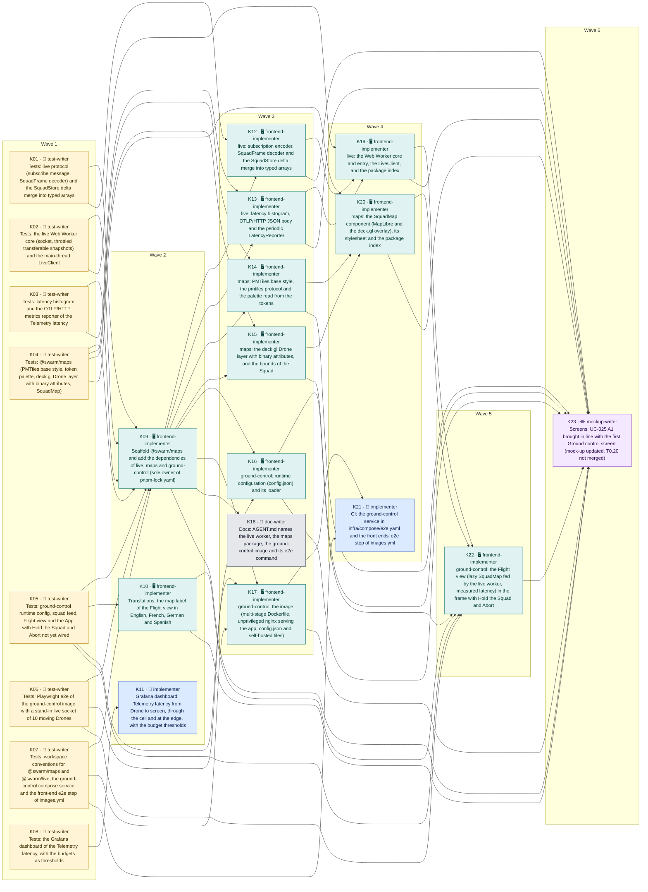

# T0.19: Plan

**Plan:** 🟢 Approved

**Push:** 🟢 Approved

<!-- ticket:specs -->
## 📚 Specifications

The technical pages, features, use cases and business rules of [TICKET.md](TICKET.md), copied by `python3 .claude/scripts/tickets/ticket_refs.py sync`.

- [📏 BR-014](../../specs/functional/business-rules/BR-014-simulation-isolation.md)
- [🖥️ GUI and WebUI: apps and shared packages](../../specs/technical/10-frontends.md#apps)
- [🗺️ GUI and WebUI: maps and 3D](../../specs/technical/10-frontends.md#maps)
- [📨 GUI and WebUI: live data in the browser](../../specs/technical/10-frontends.md#live-data)
- [📨 API layer: live data over WebSocket](../../specs/technical/05-api.md#live)
- [🎨 GUI and WebUI: design system](../../specs/technical/10-frontends.md#design-system)
- [📏 BR-023](../../specs/functional/business-rules/BR-023-fixed-safety-controls.md)
- [🩺 Observability: signals](../../specs/technical/08-observability.md#signals)
- [🎬 UC-025: Monitor a Mission in Ground control](../../specs/functional/use-cases/UC-025-monitor-a-mission-in-ground-control.md)
- [⏱️ GUI and WebUI: front-end budgets](../../specs/technical/10-frontends.md#performance)
- [🖼️ UC-025 A1](../../specs/functional/use-cases/UC-025-monitor-a-mission-in-ground-control.md#screen-a1)
- [⏱️ Telemetry, Drone to Pilot's screen](../../specs/technical/07-scalability.md#budgets)
<!-- /ticket:specs -->

## Summary

T0.19 is split into 23 tasks in 6 waves. Wave 1 has eight test-writer tasks: the live protocol and snapshot store, the live worker and client, the latency histogram and OTLP reporter, the maps package, the ground-control unit tests, the ground-control Playwright e2e, the workspace, compose and images-workflow convention tests, and the Grafana dashboard test. Wave 2 holds three tasks: one scaffold task, the only owner of pnpm-lock.yaml, creates the new frontend/packages/maps package and adds every dependency; the translations; and the dashboard JSON. Wave 3 runs seven tasks in parallel: the live protocol and store, the latency code, the map style and palette, the Drone layer, the ground-control config, the Dockerfile, and the AGENT.md update. Wave 4 adds the Web Worker, the LiveClient and the package index of live, the SquadMap component of maps, and the CI wiring of the compose service and the front-end e2e step. Wave 5 wires the Flight view into Ground control: a lazy-loaded map, the measured latency and the not-yet-wired Hold the Squad and Abort buttons. Wave 6 is the TKT-21 capture task for UC-025 A1. T0.20 is not merged, so it updates the mock-up to what the app shows and renders it, rather than taking screenshots. Every brief fixes the shared contracts (SquadSnapshot, the worker messages, LiveClient, DroneLayerData and SquadMap, AppConfig, the metric names, port 8180) so that tasks of the same wave never need each other's files.

## Assumptions

- TICKET.md and PROGRESS.md already existed and were complete, so they were kept. Only the stale front-end paths were updated to the current layout (frontend/apps/ground-control, frontend/packages/maps, frontend/packages/live).
- The roadmap row names no feature, use case or business rule. BR-014 is linked because epic E0.6 names it, BR-023 because the technical page ties Hold the Squad and Abort to fixed controls, and UC-025 because it is the use case of the Ground control Flight view.
- The row names no screen. The ticket changes a front end, so it links the A1 screen of UC-025 as the most conservative match, to be captured as a screenshot (TKT-21).
- The row names no budget. The Telemetry budget is linked because the row measures that latency.
- The row gives no latency value for its done-when, so the criteria assert none beyond the budget row.
- I did not run check_ticket.py. The workflow runs it next.
- The gateway's /v1/live reads the token from the Authorization header of the handshake (backend/swarm-api/src/swarm_api/dependencies/live_operator.py), and a browser cannot set that header on a WebSocket. The specifications do not settle how a browser sends its token, and the gateway is outside this ticket's areas. Ground control therefore connects to the live URL its runtime config names, by default the edge flight engine's ws://127.0.0.1:8080/v1/live, which checks no Operator. How a browser carries its token through the cell is a follow-up for the gateway.
- No Helm chart deploys the gateway, the flight engine or Ground control in the dev cell, and infra/charts is outside this ticket's areas. Criterion 1 is proven by the Playwright test of the real ground-control image fed by a stand-in socket of 10 moving Drones. Running it in the dev cell is left to the demo and to the deployment work.
- Grafana and the OpenTelemetry collector arrive with T0.17, which depends on T0.19. This ticket measures the latency in the browser and exports OTLP/HTTP JSON histograms to an optional metricsUrl. It also writes the dashboard at infra/charts/observability/dashboards/telemetry-latency.json, assuming T0.17's chart is named observability and provisions that folder. The Prometheus names (swarm_telemetry_drone_to_screen_milliseconds_bucket, swarm_live_frame_to_pixels_milliseconds_bucket, label swarm_live_path) assume the collector's default OTLP-to-Prometheus naming.
- Drone to screen latency is the browser's Date.now() when the frame is drawn minus the frame's t_us. t_us is stamped when the datagram reaches the flight engine, so the measure assumes clocks synchronised by NTP; negative samples are counted as skipped, not recorded. Frame to pixels (worker receipt to draw) is measured too, for the < 50 ms budget of 10-frontends#performance.
- The backend sends a full SquadFrame per tick, not a delta. The worker's delta merge keys each Drone by drone_id, ignores frames whose seq is not newer, and keeps the last values of Drones absent from a frame.
- No PMTiles file is committed. The image serves /tiles/ from a volume the deployment mounts, and the style follows the Protomaps basemap schema (earth, water, landuse, roads, buildings). It has no labels, glyphs or sprite, so nothing is fetched from a third party. The colours come from the tokens, the attribution reads '© OpenStreetMap contributors', and the map first fits the Squad's bounds, so no start coordinates are invented.
- Drones are drawn as dots in the entity colour, and a lost Drone in the failure colour. SquadFrame carries no Drone name, so no labels are shown.
- ✋ Hold the Squad and 🛑 Abort stay the no-op buttons T0.14 left in GroundControlFrame: they are shown, not disabled and not wired, as the roadmap row says.
- When the socket closes, the live client reports 'closed' and does not reconnect, because the specifications give no reconnection policy.
- The runtime config is config.json beside index.html, with liveUrl, missionId, tilesUrl, metricsUrl, metricsIntervalS, cell and livePath. Its defaults come from backend/apps/flight-engine/conf/app.yaml (live port 8080) and from the OpenTelemetry SDK default export interval (60 s). Without a missionId, the map shows no Drones and no new text. The histogram bounds include the budget values 50, 150 and 400 ms.
- The only new on-screen text is the map region's accessible label, flight.map.label ('Map of the Squad'), translated into four languages under BR-017.
- The map is loaded on demand (React.lazy) so that the first route stays within the < 300 kB JavaScript budget of 10-frontends#performance.
- The Playwright test of the image publishes ground-control on host port 8180 in infra/compose/e2e.yaml. images.yml runs the e2e script of every front end after qa/e2e's.
- @swarm/maps does not import @swarm/live: it takes structural types (DroneLayerData), and SquadSnapshot meets them.
- T0.20 is not merged, so the capture task updates the UC-025 A1 mock-up to what the app shows and renders it, and the row stays ✏️ Mock-up. The areas the app does not show yet (Squad panel, video, Alerts, progress) stay as UC-025 specifies them.
- The telemetry export uses no OpenTelemetry SDK, to keep the bundle small. T0.17 brings the TypeScript SDK and may move the reporter onto it.

<!-- plan:graph -->

> [!NOTE]
> Generated from the json block at the end of this page by `python3 .claude/scripts/tickets/plan.py render`.
> To change a task, edit the json block, then render again: never edit this view by hand.

## Waves

| Wave | Tasks | Agents running at once |
| --- | --- | --- |
| 1 | [K01](#k01), [K02](#k02), [K03](#k03), [K04](#k04), [K05](#k05), [K06](#k06), [K07](#k07), [K08](#k08) | 8 of 8 |
| 2 | [K09](#k09), [K10](#k10), [K11](#k11) | 3 of 3 |
| 3 | [K12](#k12), [K13](#k13), [K14](#k14), [K15](#k15), [K16](#k16), [K17](#k17), [K18](#k18) | 7 of 7 |
| 4 | [K19](#k19), [K20](#k20), [K21](#k21) | 3 of 3 |
| 5 | [K22](#k22) | 1 of 1 |
| 6 | [K23](#k23) | 1 of 1 |

| Wave | Task | Agent | Depends on | Unblocks |
| --- | --- | --- | --- | --- |
| 1 | [K01](#k01) Tests: live protocol (subscribe message, SquadFrame decoder) and the SquadStore delta merge into typed arrays | 🧪 test-writer | none | [K09](#k09), [K12](#k12) |
| 1 | [K02](#k02) Tests: the live Web Worker core (socket, throttled transferable snapshots) and the main-thread LiveClient | 🧪 test-writer | none | [K09](#k09), [K19](#k19) |
| 1 | [K03](#k03) Tests: latency histogram and the OTLP/HTTP metrics reporter of the Telemetry latency | 🧪 test-writer | none | [K09](#k09), [K13](#k13) |
| 1 | [K04](#k04) Tests: @swarm/maps (PMTiles base style, token palette, deck.gl Drone layer with binary attributes, SquadMap) | 🧪 test-writer | none | [K09](#k09), [K14](#k14), [K15](#k15), [K20](#k20) |
| 1 | [K05](#k05) Tests: ground-control runtime config, squad feed, Flight view and the App with Hold the Squad and Abort not yet wired | 🧪 test-writer | none | [K09](#k09), [K10](#k10), [K16](#k16), [K22](#k22) |
| 1 | [K06](#k06) Tests: Playwright e2e of the ground-control image with a stand-in live socket of 10 moving Drones | 🧪 test-writer | none | [K09](#k09), [K17](#k17), [K22](#k22) |
| 1 | [K07](#k07) Tests: workspace conventions for @swarm/maps and @swarm/live, the ground-control compose service and the front-end e2e step of images.yml | 🧪 test-writer | none | [K09](#k09), [K17](#k17), [K21](#k21) |
| 1 | [K08](#k08) Tests: the Grafana dashboard of the Telemetry latency, with the budgets as thresholds | 🧪 test-writer | none | [K11](#k11) |
| 2 | [K09](#k09) Scaffold @swarm/maps and add the dependencies of live, maps and ground-control (sole owner of pnpm-lock.yaml) | 🖥️ frontend-implementer | [K01](#k01), [K02](#k02), [K03](#k03), [K04](#k04), [K05](#k05), [K06](#k06), [K07](#k07) | [K12](#k12), [K13](#k13), [K14](#k14), [K15](#k15), [K16](#k16), [K17](#k17), [K18](#k18), [K23](#k23) |
| 2 | [K10](#k10) Translations: the map label of the Flight view in English, French, German and Spanish | 🖥️ frontend-implementer | [K05](#k05) | [K22](#k22), [K23](#k23) |
| 2 | [K11](#k11) Grafana dashboard: Telemetry latency from Drone to screen, through the cell and at the edge, with the budget thresholds | 🐍 implementer | [K08](#k08) | none |
| 3 | [K12](#k12) live: subscription encoder, SquadFrame decoder and the SquadStore delta merge into typed arrays | 🖥️ frontend-implementer | [K01](#k01), [K09](#k09) | [K19](#k19), [K23](#k23) |
| 3 | [K13](#k13) live: latency histogram, OTLP/HTTP JSON body and the periodic LatencyReporter | 🖥️ frontend-implementer | [K03](#k03), [K09](#k09) | [K19](#k19), [K23](#k23) |
| 3 | [K14](#k14) maps: PMTiles base style, the pmtiles protocol and the palette read from the tokens | 🖥️ frontend-implementer | [K04](#k04), [K09](#k09) | [K20](#k20), [K23](#k23) |
| 3 | [K15](#k15) maps: the deck.gl Drone layer with binary attributes, and the bounds of the Squad | 🖥️ frontend-implementer | [K04](#k04), [K09](#k09) | [K20](#k20), [K23](#k23) |
| 3 | [K16](#k16) ground-control: runtime configuration (config.json) and its loader | 🖥️ frontend-implementer | [K05](#k05), [K09](#k09) | [K22](#k22), [K23](#k23) |
| 3 | [K17](#k17) ground-control: the image (multi-stage Dockerfile, unprivileged nginx serving the app, config.json and self-hosted tiles) | 🖥️ frontend-implementer | [K06](#k06), [K07](#k07), [K09](#k09) | [K21](#k21), [K23](#k23) |
| 3 | [K18](#k18) Docs: AGENT.md names the live worker, the maps package, the ground-control image and its e2e command | 📝 doc-writer | [K09](#k09) | none |
| 4 | [K19](#k19) live: the Web Worker core and entry, the LiveClient, and the package index | 🖥️ frontend-implementer | [K02](#k02), [K12](#k12), [K13](#k13) | [K22](#k22), [K23](#k23) |
| 4 | [K20](#k20) maps: the SquadMap component (MapLibre and the deck.gl overlay), its stylesheet and the package index | 🖥️ frontend-implementer | [K04](#k04), [K14](#k14), [K15](#k15) | [K22](#k22), [K23](#k23) |
| 4 | [K21](#k21) CI: the ground-control service in infra/compose/e2e.yaml and the front ends' e2e step of images.yml | 🐍 implementer | [K07](#k07), [K17](#k17) | none |
| 5 | [K22](#k22) ground-control: the Flight view (lazy SquadMap fed by the live worker, measured latency) in the frame with Hold the Squad and Abort | 🖥️ frontend-implementer | [K05](#k05), [K06](#k06), [K10](#k10), [K16](#k16), [K19](#k19), [K20](#k20) | [K23](#k23) |
| 6 | [K23](#k23) Screens: UC-025 A1 brought in line with the first Ground control screen (mock-up updated, T0.20 not merged) | ✏️ mockup-writer | [K09](#k09), [K10](#k10), [K12](#k12), [K13](#k13), [K14](#k14), [K15](#k15), [K16](#k16), [K17](#k17), [K19](#k19), [K20](#k20), [K22](#k22) | none |

## Dependency graph



## Tasks

### <a id="k01"></a>K01: Tests: live protocol (subscribe message, SquadFrame decoder) and the SquadStore delta merge into typed arrays

| Agent | Wave | Depends on | Unblocks |
| --- | --- | --- | --- |
| 🧪 test-writer | 1 | none | [K09](#k09), [K12](#k12) |

**Files** (only this task may change them in its wave):

- `frontend/packages/live/test/protocol/topics.test.ts`
- `frontend/packages/live/test/protocol/squad-frame-decoder.test.ts`
- `frontend/packages/live/test/protocol/frames.ts`
- `frontend/packages/live/test/snapshot/squad-store.test.ts`

**Done when:** The four files exist; `pnpm --filter @swarm/live exec eslint test/protocol test/snapshot` reports no problem other than unresolved imports of the modules K12 writes; running `node --experimental-strip-types --test frontend/packages/live/test/protocol/*.test.ts frontend/packages/live/test/snapshot/*.test.ts` fails only because src/protocol and src/snapshot are missing.

**Brief:**

Write the node:test tests (node --experimental-strip-types --test, like frontend/packages/live/test/render.test.ts: node:assert/strict, imports with the .ts extension) for the protocol and the snapshot store of @swarm/live. Specs: docs/specs/technical/10-frontends.md#live-data ("WebSocket -> Web Worker: MessagePack decode, delta merge, typed arrays (positions, states, battery)"), docs/specs/technical/05-api.md#live (subscribe message, topic mission/&lt;id>/squad, frames in MessagePack), docs/specs/technical/10-frontends.md#apps (live holds the WebSocket client and the MessagePack decoder), ticket docs/tickets/T0.19/TICKET.md (criterion 1, docs/specs/functional/use-cases/UC-025-monitor-a-mission-in-ground-control.md). The wire format is the one the backend sends: backend/swarm-service/src/swarm_service/shared/live/live_codec.py packs Pydantic models with ormsgpack as MessagePack maps with the field names of frontend/packages/live/src/generated/models.ts (SquadFrame {mission_id, t_us, frames}, TelemetryFrame {mission_id, drone_id, seq, t_us, lat_e7, lon_e7, altitude_m, speed_m_s, heading_deg, battery_pct, link_quality_pct, state}, LiveSubscription {op: "subscribe", topic, rate: "full"}). Encode fixtures with @msgpack/msgpack (encode) in the helper test/protocol/frames.ts (aSquadFrame(missionId, drones, tUs) building a valid frame of N Drones; mission ids are version 7 UUIDs such as 01943c5e-8a4b-7c2d-9e1f-0a1b2c3d4e01).

Contract the implementation (K12) must meet, import paths fixed:
- src/protocol/topics.ts: squadTopic(missionId: string): string returns `mission/<id>/squad`; encodeSquadSubscription(missionId: string): Uint8Array returns MessagePack of {op: "subscribe", topic, rate: "full"}; a mission id that is not a version 7 UUID throws LiveTopicInvalidError (exported from src/protocol/live-protocol-errors.ts).
- src/protocol/squad-frame-decoder.ts: decodeSquadFrame(data: ArrayBuffer | Uint8Array): SquadFrame; bytes that are not MessagePack, a missing or mistyped field, a state outside DroneState, or a boolean where a number is expected throw LiveMessageUnreadableError (src/protocol/live-protocol-errors.ts).
- src/snapshot/squad-snapshot.ts: DRONE_STATES = ["ready","grounded","airborne","returning","landed","lost"] (index = state code) and interface SquadSnapshot {version: number; missionId: string; count: number; droneIds: readonly string[]; positions: Float64Array /* lon, lat, altitude_m per Drone */; states: Uint8Array; batteryPct: Float32Array; linkQualityPct: Float32Array; headingDeg: Float32Array; speedMS: Float32Array; tUs: Float64Array; updated: Uint8Array /* 1 when the slot changed since the previous snapshot */; receivedAtMs: number}.
- src/snapshot/squad-store.ts: class SquadStore(missionId) with merge(frame: SquadFrame, receivedAtMs: number): void, get dirty(): boolean, snapshot(): SquadSnapshot, and transferables(snapshot): ArrayBuffer[].

Behaviours to test: the topic and the encoded subscription decode back to the expected map; a bad mission id is refused; a valid frame of 10 Drones decodes; each kind of bad input is refused with the specific error; merge places each Drone in a stable slot in order of first appearance, converts lat_e7/lon_e7 by 1e-7 into positions [lon, lat, alt]; a frame of another Mission is ignored; a Drone frame whose seq is not greater than the last seen for that Drone is ignored; a Drone absent from a frame keeps its last values (delta merge); snapshot() returns fresh buffers (later merges do not change a snapshot already taken), increments version, sets updated only for the slots changed since the previous snapshot, carries the newest receivedAtMs, and clears dirty; transferables() lists the distinct ArrayBuffers of the snapshot. Name tests as sentences. Each test folder holds at most five code files (AGENT.md, File shape). The tests fail now because src/protocol and src/snapshot do not exist yet; that is expected (TKT-4).

### <a id="k02"></a>K02: Tests: the live Web Worker core (socket, throttled transferable snapshots) and the main-thread LiveClient

| Agent | Wave | Depends on | Unblocks |
| --- | --- | --- | --- |
| 🧪 test-writer | 1 | none | [K09](#k09), [K19](#k19) |

**Files** (only this task may change them in its wave):

- `frontend/packages/live/test/worker/live-worker-core.test.ts`
- `frontend/packages/live/test/worker/fake-socket.ts`
- `frontend/packages/live/test/worker/fake-clock.ts`
- `frontend/packages/live/test/client/live-client.test.ts`
- `frontend/packages/live/test/client/fake-worker.ts`

**Done when:** The five files exist; `pnpm --filter @swarm/live exec eslint test/worker test/client` reports no problem other than unresolved imports of src/worker and src/client; `node --experimental-strip-types --test frontend/packages/live/test/worker/*.test.ts frontend/packages/live/test/client/*.test.ts` fails only because those modules are missing.

**Brief:**

Write node:test tests (style of frontend/packages/live/test/render.test.ts, .ts import extensions) for the worker and the client of @swarm/live. Specs: docs/specs/technical/10-frontends.md#live-data ("The main thread never decodes frames"; the worker decodes, merges and posts a "transferable snapshot, at most 30 per second"), docs/specs/technical/05-api.md#live (one socket per client, subscriptions per Mission topic, MessagePack frames), docs/specs/technical/10-frontends.md#performance (live frame to pixels &lt; 50 ms), ticket docs/tickets/T0.19/TICKET.md criterion 1 (docs/specs/functional/use-cases/UC-025-monitor-a-mission-in-ground-control.md). Use fakes, no browser: test/worker/fake-socket.ts (a SocketLike that records what is sent and lets the test fire open, binary message, close and error), test/worker/fake-clock.ts (manual time and timers), test/client/fake-worker.ts (a WorkerLike that records posted messages and lets the test emit messages). Build MessagePack SquadFrames with @msgpack/msgpack encode inside these test folders (do not import K01's helper).

Contract the implementation (K19) must meet:
- src/worker/live-worker-messages.ts: type ToWorker = {kind: "connect"; url: string; missionId: string} | {kind: "close"}; type FromWorker = {kind: "snapshot"; snapshot: SquadSnapshot} | {kind: "status"; status: LiveStatus}; type LiveStatus = "connecting" | "open" | "closed" | "failed". SquadSnapshot comes from src/snapshot/squad-snapshot.ts (K01/K12 contract: version, missionId, count, droneIds, positions Float64Array, states Uint8Array, batteryPct, linkQualityPct, headingDeg, speedMS Float32Array, tUs Float64Array, updated Uint8Array, receivedAtMs).
- src/worker/live-worker-core.ts: class LiveWorkerCore(openSocket: (url: string) => SocketLike, post: (message: FromWorker, transfer: ArrayBuffer[]) => void, clock: {nowMs(): number; setTimer(callback: () => void, delayMs: number): number; clearTimer(id: number): void}, maxSnapshotsPerS = 30) with handle(message: ToWorker): void. SocketLike {binaryType: string; send(data: Uint8Array): void; close(): void; onopen, onmessage(event: {data: ArrayBuffer}), onclose, onerror}.
- src/client/live-client.ts: class LiveClient(createWorker?: () => WorkerLike) with connect(url, missionId): void, onSnapshot(listener): () => void (returns the unsubscribe), onStatus(listener): () => void, close(): void. WorkerLike {postMessage(message: ToWorker): void; terminate(): void; onmessage: ((event: {data: FromWorker}) => void) | null}.

Behaviours: connect opens one socket with binaryType arraybuffer, posts status connecting then open, and sends exactly one MessagePack subscription {op: subscribe, topic: mission/&lt;id>/squad, rate: full} on open; received frames are decoded and merged in the worker and posted as snapshots with their ArrayBuffers in the transfer list; several frames arriving within one interval give one snapshot; never more than 30 snapshots per second of fake time; no snapshot is posted when nothing changed; an unreadable message is skipped (no snapshot, socket stays open); close or a socket close posts status closed and stops the timer; a socket error posts failed; there is no automatic reconnection. LiveClient posts connect and close to the worker, never decodes (it only forwards snapshot and status messages to listeners), unsubscribe stops delivery, close terminates the worker. At most five code files per folder (AGENT.md, File shape). The tests fail until K19 lands; that is expected.

### <a id="k03"></a>K03: Tests: latency histogram and the OTLP/HTTP metrics reporter of the Telemetry latency

| Agent | Wave | Depends on | Unblocks |
| --- | --- | --- | --- |
| 🧪 test-writer | 1 | none | [K09](#k09), [K13](#k13) |

**Files** (only this task may change them in its wave):

- `frontend/packages/live/test/latency/latency-histogram.test.ts`
- `frontend/packages/live/test/latency/otlp-metrics-body.test.ts`
- `frontend/packages/live/test/latency/latency-reporter.test.ts`

**Done when:** The three files exist; `pnpm --filter @swarm/live exec eslint test/latency` reports no problem other than unresolved imports of src/latency; `node --experimental-strip-types --test frontend/packages/live/test/latency/*.test.ts` fails only because src/latency is missing.

**Brief:**

Write node:test tests (style of frontend/packages/live/test/render.test.ts) for the latency measure of @swarm/live. Specs: docs/specs/technical/08-observability.md#signals (metrics through OpenTelemetry; operator_id, mission_id and cell are resource attributes; drone_id is never a metric label; no secrets or personal data), docs/specs/technical/07-scalability.md#budgets (Telemetry, Drone to Pilot's screen: p95 &lt; 150 ms at the edge, &lt; 400 ms through the cell), docs/specs/technical/10-frontends.md#performance (live frame to pixels &lt; 50 ms), ticket docs/tickets/T0.19/TICKET.md criterion 2 (docs/specs/functional/business-rules/BR-014-simulation-isolation.md, docs/specs/functional/use-cases/UC-025-monitor-a-mission-in-ground-control.md).

Contract the implementation (K13) must meet:
- src/latency/latency-histogram.ts: LATENCY_BOUNDS_MS = [10, 25, 50, 75, 100, 150, 200, 300, 400, 600, 800, 1000, 2000]; class LatencyHistogram(bounds = LATENCY_BOUNDS_MS) with record(ms: number): void, and readonly count, sum, min, max, skipped, bucketCounts(): number[] (length bounds.length + 1, explicit-bucket semantics of OTLP: a value equal to a bound falls in that bound's bucket). A negative or non-finite value (clock skew) is not recorded and increments skipped.
- src/latency/otlp-metrics-body.ts: TELEMETRY_METRICS = {droneToScreen: "swarm.telemetry.drone_to_screen", frameToPixels: "swarm.live.frame_to_pixels"}; otlpMetricsBody({missionId: string | null, cell: string | null, path: "edge" | "cell", startTimeUnixNano: string, timeUnixNano: string, histograms: Record&lt;string, LatencyHistogram>}) returns the OTLP/HTTP JSON ExportMetricsServiceRequest: one resourceMetrics with resource attributes service.name = "ground-control", mission_id and cell only when set; one scopeMetrics; one histogram metric per entry with unit "ms", aggregationTemporality cumulative (2), one data point with count, sum, min, max, bucketCounts, explicitBounds and the attribute swarm.live.path. No attribute named drone_id anywhere.
- src/latency/latency-reporter.ts: class LatencyReporter({url: string, intervalS: number, missionId, cell, path, histograms, post?: (url: string, body: string) => Promise&lt;{ok: boolean; status: number}>, clock?: {nowMs(): number; setInterval(callback: () => void, ms: number): number; clearInterval(id: number): void}}) with start(), stop(), flush(): Promise&lt;void>.

Behaviours: bucket placement on and between bounds; sum, count, min, max; skipped samples; the body shape above (parse it back from JSON); the body never holds drone_id; the reporter posts application/json bodies to the url every intervalS seconds of fake time, posts nothing when no sample was recorded since start, keeps running after a failed post (non ok or rejected promise), and stop() clears its interval; flush() posts at once. The tests fail until K13 lands; that is expected.

### <a id="k04"></a>K04: Tests: @swarm/maps (PMTiles base style, token palette, deck.gl Drone layer with binary attributes, SquadMap)

| Agent | Wave | Depends on | Unblocks |
| --- | --- | --- | --- |
| 🧪 test-writer | 1 | none | [K09](#k09), [K14](#k14), [K15](#k15), [K20](#k20) |

**Files** (only this task may change them in its wave):

- `frontend/packages/maps/test/style/base-style.test.ts`
- `frontend/packages/maps/test/style/pmtiles-protocol.test.ts`
- `frontend/packages/maps/test/palette/map-palette.test.ts`
- `frontend/packages/maps/test/drones/drone-layer.test.ts`
- `frontend/packages/maps/test/drones/fit-squad.test.ts`
- `frontend/packages/maps/test/map/squad-map.test.tsx`

**Done when:** The six files exist and import only the module paths of the contract; `node -e` is not needed: once K09 has scaffolded the package, `pnpm --filter @swarm/maps exec vitest run` fails only on the missing src modules.

**Brief:**

Write the Vitest tests (jsdom, as frontend/packages/ui does) of the new package @swarm/maps in frontend/packages/maps. Specs: docs/specs/technical/10-frontends.md#maps ("MapLibre GL JS with self-hosted vector tiles from OpenStreetMap (PMTiles files)" and "deck.gl GPU layers for Drones; binary attribute updates for moving Drones"), docs/specs/technical/10-frontends.md#apps (maps holds the MapLibre and deck.gl layers), docs/specs/technical/10-frontends.md#live-data (deck.gl attributes updated in place), docs/specs/technical/10-frontends.md#design-system (tokens only), docs/specs/visual-identity.md#colours, ticket docs/tickets/T0.19/TICKET.md criterion 1 (docs/specs/functional/use-cases/UC-025-monitor-a-mission-in-ground-control.md). jsdom has no WebGL: test pure functions, and test SquadMap with an injected fake map factory.

Contract the implementation (K14, K15, K20) must meet; the package does not import @swarm/live (structural types only):
- src/style/base-style.ts: buildBaseStyle({tilesUrl: string /* absolute URL of a .pmtiles file */, palette: MapPalette}): StyleSpecification (maplibre-gl) with version 8, one vector source "basemap" whose url is `pmtiles://` + tilesUrl and whose attribution contains "© OpenStreetMap contributors", a background layer in palette.background, and fill or line layers for the Protomaps basemap source layers earth, water, landuse, roads and buildings coloured only from the palette; no glyphs, no sprite, no symbol layer.
- src/style/pmtiles-protocol.ts: registerPmtilesProtocol(target: {addProtocol(name: string, loader: unknown): void}): void registers the "pmtiles" protocol once, however many times it is called.
- src/palette/map-palette.ts: type Rgba = [number, number, number, number]; interface MapPalette {background, surface, border, muted, text, drone, droneLost: Rgba}; readMapPalette(element: Element): MapPalette reads the CSS variables --color-background, --color-surface, --color-border, --color-muted, --color-text, --color-entity (drone) and --color-failure (droneLost) with getComputedStyle and converts #rrggbb to [r, g, b, 255]; a missing or malformed variable throws MapPaletteError.
- src/drones/drone-layer.ts: interface DroneLayerData {version: number; count: number; positions: Float64Array /* lon, lat, alt */; states: Uint8Array}; LOST_STATE = 5; buildDroneLayer(data: DroneLayerData, palette: MapPalette): a deck.gl ScatterplotLayer with id "drones", data {length: count, attributes: {getPosition: {value: positions, size: 3}, getFillColor: {value: Uint8Array of count*4, size: 4, normalized: true}}} (binary attributes, no per-object accessor function), palette.drone for every state but lost and palette.droneLost for lost, and updateTriggers keyed on data.version.
- src/drones/fit-squad.ts: squadBounds(data: DroneLayerData): [[west, south], [east, north]] | null (null when count is 0).
- src/map/SquadMap.tsx: generic React component SquadMap&lt;T extends DroneLayerData>({tilesUrl, palette?, label, source: {current(): T | null; subscribe(listener: () => void): () => void}, onDrawn?: (data: T, drawnAtMs: number) => void, createMap?: (container: HTMLElement, style: StyleSpecification) => MapHandle}) rendering a &lt;div class="map" role="region" aria-label={label}>; MapHandle {setLayers(layers: unknown[]): void; fitBounds(bounds): void; onAfterRender(callback: () => void): void; remove(): void}. With a fake createMap, test: the region and its label; one map created; a source notification sets the Drone layer once per animation frame at most; the first non-empty data fits the bounds once; onDrawn receives the data drawn after the fake fires its after-render callback; unmount removes the map and unsubscribes.
- src/index.ts re-exports all of these. Package stylesheet: ./styles.css.

At most five code files per folder (AGENT.md, File shape). Tests fail until the package code lands; that is expected.

### <a id="k05"></a>K05: Tests: ground-control runtime config, squad feed, Flight view and the App with Hold the Squad and Abort not yet wired

| Agent | Wave | Depends on | Unblocks |
| --- | --- | --- | --- |
| 🧪 test-writer | 1 | none | [K09](#k09), [K10](#k10), [K16](#k16), [K22](#k22) |

**Files** (only this task may change them in its wave):

- `frontend/apps/ground-control/test/app.test.tsx`
- `frontend/apps/ground-control/test/config/app-config.test.ts`
- `frontend/apps/ground-control/test/flight/squad-feed.test.ts`
- `frontend/apps/ground-control/test/flight/flight-view.test.tsx`
- `frontend/apps/ground-control/test/flight/fakes.tsx`

**Done when:** The five files exist; `pnpm --filter @swarm/ground-control exec eslint test` reports no problem other than unresolved imports of the modules K16 and K22 write; `pnpm --filter @swarm/ground-control test` fails only on those missing modules and on the replaced content-area test.

**Brief:**

Write the Vitest tests (jsdom) of the first Ground control screen in frontend/apps/ground-control. Specs: docs/specs/functional/use-cases/UC-025-monitor-a-mission-in-ground-control.md (step 2 and the A1 screen row #screen-a1: the map and the Squad, Hold the Squad and Abort in the title bar), docs/specs/functional/business-rules/BR-023-fixed-safety-controls.md (both controls visible on every screen), docs/specs/technical/10-frontends.md#live-data (React only for panels, the map at display rate), docs/specs/technical/10-frontends.md#performance (heavy libraries loaded on demand), docs/specs/technical/08-observability.md#signals and docs/specs/technical/07-scalability.md#budgets (the measured latency), ticket docs/tickets/T0.19/TICKET.md criteria 1 to 3.

Update test/app.test.tsx: keep every existing frame test, replace "shows no screen in the content area" by: main.content holds one region labelled "Map of the Squad" (message id flight.map.label, which K10 adds in four languages); ✋ Hold the Squad and 🛑 Abort are visible in header.titlebar; clicking them throws nothing and posts nothing to the live client (not yet wired, TICKET.md out of scope). Render App with injected fakes so no WebGL and no Worker is needed. Put shared fakes in test/flight/fakes.tsx: a fake LiveClient (records connect and close, lets the test push SquadSnapshots and statuses) and a fake SquadMap module (loadMap resolving to {SquadMap: a component rendering &lt;div class="map" role="region" aria-label={label}> that exposes the source it got and lets the test call onDrawn}).

Contract the implementation (K16, K22) must meet:
- src/config/app-config.ts: interface AppConfig {liveUrl: string; missionId: string | null; tilesUrl: string; metricsUrl: string | null; metricsIntervalS: number; cell: string | null; livePath: "edge" | "cell"}; DEFAULT_APP_CONFIG = {liveUrl: "ws://127.0.0.1:8080/v1/live", missionId: null, tilesUrl: "tiles/basemap.pmtiles", metricsUrl: null, metricsIntervalS: 60, cell: null, livePath: "edge"}; parseAppConfig(value: unknown): AppConfig (missing keys take the default; unknown keys, a non-ws(s) liveUrl, a missionId that is not a version 7 UUID, a non-positive or boolean metricsIntervalS, a livePath outside edge/cell throw AppConfigError); loadAppConfig(fetchConfig?: (url: string) => Promise&lt;Response>, url = "config.json"): Promise&lt;AppConfig> (a 404 gives the defaults, other failures throw AppConfigError).
- src/flight/squad-feed.ts: class SquadFeed(client: LiveClientLike, histograms: {droneToScreen: LatencyHistogram; frameToPixels: LatencyHistogram}) with current(), subscribe(listener) (the DroneSource of SquadMap), get count(), start(url, missionId), stop(), and drawn(snapshot, drawnAtMs): for every slot with updated = 1 it records drawnAtMs - tUs[slot] / 1000 into droneToScreen, and records drawnAtMs - receivedAtMs once into frameToPixels. LatencyHistogram comes from @swarm/live (K03 contract).
- src/flight/FlightView.tsx: FlightView({config, createLiveClient, loadMap}) where loadMap defaults to () => import("@swarm/maps") (lazy, so the first route stays small); it renders &lt;section class="flight-map" data-drone-count={n}> around the lazily loaded SquadMap labelled with flight.map.label; with a missionId it connects the live client to config.liveUrl and that Mission, without one it connects nothing and shows the empty map; data-drone-count follows the latest snapshot count, updated a few times per second at most; with metricsUrl set it starts a LatencyReporter of @swarm/live with config.metricsIntervalS, missionId, cell and livePath, and stops it on unmount.
- src/App.tsx: App({config, createLiveClient?, loadMap?}) renders GroundControlFrame with the existing status items and FlightView as its child; onHold and onAbort stay no-ops.

Tests: config parsing (defaults, each refusal, 404 gives defaults); squad feed (subscribe and notify, count, latency records for updated slots only, frameToPixels once per draw, stop closes the client); Flight view (connects with the Mission of the config, nothing without one, data-drone-count becomes 10 after a snapshot of 10 Drones, onDrawn records 10 drone-to-screen samples, unmount closes the client); the App tests above. Wrap renders in I18nProvider language en as the existing test does. At most five code files per folder. Tests fail until K16 and K22 land; that is expected.

### <a id="k06"></a>K06: Tests: Playwright e2e of the ground-control image with a stand-in live socket of 10 moving Drones

| Agent | Wave | Depends on | Unblocks |
| --- | --- | --- | --- |
| 🧪 test-writer | 1 | none | [K09](#k09), [K17](#k17), [K22](#k22) |

**Files** (only this task may change them in its wave):

- `frontend/apps/ground-control/playwright.config.ts`
- `frontend/apps/ground-control/e2e/flight-view.spec.ts`
- `frontend/apps/ground-control/e2e/live-stand-in-server.ts`
- `frontend/apps/ground-control/e2e/squad-route.ts`
- `frontend/apps/ground-control/e2e/global-setup.ts`

**Done when:** The five files exist; `pnpm --filter @swarm/ground-control exec eslint e2e playwright.config.ts` reports no problem other than unresolved packages that K09 installs; once K09, K17, K21 and K22 land, `docker build -f frontend/apps/ground-control/Dockerfile -t ghcr.io/gpbcom/swarm/ground-control:local . && SWARM_IMAGE_TAG=local pnpm --filter @swarm/ground-control run e2e` passes.

**Brief:**

Write the Playwright end-to-end test of Ground control against its real image (AGENT.md, Front-end tests: tests in frontend/apps/&lt;frontend>/e2e/, against the images of infra/compose/e2e.yaml, never a development server). Specs: docs/specs/functional/use-cases/UC-025-monitor-a-mission-in-ground-control.md (#screen-a1), docs/specs/functional/business-rules/BR-023-fixed-safety-controls.md, docs/specs/technical/10-frontends.md#live-data, docs/specs/technical/10-frontends.md#maps, docs/specs/technical/05-api.md#live, ticket docs/tickets/T0.19/TICKET.md criteria 1 and 3.

- playwright.config.ts: export default defineE2eConfig({testDir: "./e2e", globalSetup: "./e2e/global-setup.ts", use: {baseURL: "http://127.0.0.1:8180"}}) from @swarm/e2e (qa/e2e/src/define-e2e-config.ts; it needs SWARM_IMAGE_TAG and lets SWARM_E2E_BASE_URL override the base URL); Chromium launch args that enable software WebGL in headless CI (for example --use-angle=swiftshader and --enable-unsafe-swiftshader).
- e2e/global-setup.ts: runs `docker compose -f infra/compose/e2e.yaml up -d ground-control` from the repository root (find it relative to this file, as qa/e2e/e2e/images.spec.ts does), polls the base URL until it answers 200 within 120 s, and returns a teardown that runs `docker compose -f infra/compose/e2e.yaml rm -sf ground-control`. The compose service ground-control publishes host port 8180 to the container's port 8080 (K21 writes it; K17's nginx listens on 8080).
- e2e/squad-route.ts: positions of 10 Drones flying a square of about 200 m around a fixed point, as a function of time.
- e2e/live-stand-in-server.ts: a WebSocket server (package ws) on a free 127.0.0.1 port that records every message received, and after it receives a MessagePack subscription {op: subscribe, topic: mission/&lt;id>/squad, rate: full} sends every 50 ms one MessagePack SquadFrame (@msgpack/msgpack encode; fields of frontend/packages/live/src/generated/models.ts: mission_id, t_us, frames of 10 TelemetryFrames with drone_id UUIDs, increasing seq, t_us = Date.now() * 1000, lat_e7, lon_e7, altitude_m 40, speed_m_s, heading_deg, battery_pct, link_quality_pct, state "airborne").
- e2e/flight-view.spec.ts: route **/config.json to fulfil {liveUrl: ws://127.0.0.1:&lt;port>/v1/live, missionId: a fixed version 7 UUID, tilesUrl: "tiles/basemap.pmtiles", metricsUrl: null, metricsIntervalS: 60, cell: null, livePath: "edge"}; route **/tiles/** to 404 (no PMTiles file in the image under test). Tests: the title bar shows ✋ Hold the Squad and 🛑 Abort (criterion 3); the region labelled "Map of the Squad" is visible; section.flight-map reaches data-drone-count="10"; two screenshots of the map region taken 1 s apart differ (the Drones move, criterion 1); clicking Hold the Squad and Abort leaves the server with exactly one received message, the subscription (not yet wired). Add the HTML report folder to nothing else: defineE2eConfig sets it.

At most five code files per folder (e2e/ holds four). These tests run only once the image, the compose service and the app exist.

### <a id="k07"></a>K07: Tests: workspace conventions for @swarm/maps and @swarm/live, the ground-control compose service and the front-end e2e step of images.yml

| Agent | Wave | Depends on | Unblocks |
| --- | --- | --- | --- |
| 🧪 test-writer | 1 | none | [K09](#k09), [K17](#k17), [K21](#k21) |

**Files** (only this task may change them in its wave):

- `tests/conventions/mono_repo/frontend/test_frontend_workspace.py`
- `tests/ci/e2e/test_compose_e2e.py`
- `tests/ci/images/test_images_workflow.py`

**Done when:** `uv run ruff check tests/conventions/mono_repo/frontend tests/ci/e2e tests/ci/images` and `uv run ruff format --check` on the three files pass; `uv run pytest tests/conventions/mono_repo/frontend/test_frontend_workspace.py tests/ci/e2e/test_compose_e2e.py tests/ci/images/test_images_workflow.py -n 2` fails only on the new tests.

**Brief:**

Extend three pytest files (AGENT.md Python test rules: one Test class per file, three import groups under their comments, no Any, ClassVar constants, tests named as sentences). Specs: docs/specs/technical/10-frontends.md#apps (packages live and maps, app ground-control), docs/specs/technical/10-frontends.md#maps, AGENT.md sections Mono-repo, Docker images, Front-end tests and CI/CD, ticket docs/tickets/T0.19/TICKET.md.

- tests/conventions/mono_repo/frontend/test_frontend_workspace.py: add frontend/packages/maps (@swarm/maps) and frontend/packages/live (@swarm/live) to NAMES so the existing parametrised rules cover them (private module, exact versions, lock importer, shared tsconfig and eslint; live already has tsconfig and eslint). New tests: maps exports "." -> "./src/index.ts" and "./styles.css" -> "./src/styles.css"; maps depends on maplibre-gl, pmtiles, @deck.gl/core, @deck.gl/layers and @deck.gl/mapbox with exact versions and declares react and react-dom 19 as peers; maps tests with vitest; live depends on @msgpack/msgpack with an exact version and its test script runs the tests of its sub-folders (test/**/*.test.ts); ground-control depends on @swarm/live and @swarm/maps as workspace:*, has an e2e script running playwright test, and devDepends on @swarm/e2e (workspace:*) and @playwright/test with the exact version qa/e2e uses.
- tests/ci/e2e/test_compose_e2e.py: a service named ground-control exists, publishes host port 8180 to container port 8080, and (by the existing rules) uses its published image and frontend/apps/ground-control/Dockerfile.
- tests/ci/images/test_images_workflow.py: the e2e job runs the e2e script of the front ends through pnpm (a run containing pnpm, ./frontend/apps/ and e2e), after the step that runs ./qa/e2e, and the report upload path covers frontend/apps/*/playwright-report/ as well as qa/e2e/playwright-report/. Keep every existing test.

The new tests fail until K09, K17 and K21 land; that is expected.

### <a id="k08"></a>K08: Tests: the Grafana dashboard of the Telemetry latency, with the budgets as thresholds

| Agent | Wave | Depends on | Unblocks |
| --- | --- | --- | --- |
| 🧪 test-writer | 1 | none | [K11](#k11) |

**Files** (only this task may change them in its wave):

- `tests/infra/charts/observability/test_telemetry_latency_dashboard.py`

**Done when:** `uv run ruff check tests/infra/charts/observability` and `uv run ruff format --check tests/infra/charts/observability/test_telemetry_latency_dashboard.py` pass; `uv run pytest tests/infra/charts/observability -n 2` fails only because the dashboard file is missing.

**Brief:**

Write a pytest file (AGENT.md test rules: one TestTelemetryLatencyDashboard class, three import groups, no Any, ClassVar constants, JsonValue for parsed JSON) that checks infra/charts/observability/dashboards/telemetry-latency.json, the Grafana dashboard T0.17 will provision with the observability stack. Specs: docs/specs/technical/08-observability.md#signals (drone_id never a metric label), docs/specs/technical/08-observability.md#dashboards ("the budgets are drawn as thresholds on every latency panel"), docs/specs/technical/07-scalability.md#budgets (Telemetry, Drone to Pilot's screen: p95 &lt; 150 ms at the edge, &lt; 400 ms through the cell), docs/specs/technical/10-frontends.md#performance (live frame to pixels &lt; 50 ms), ticket docs/tickets/T0.19/TICKET.md criterion 2 (docs/specs/functional/business-rules/BR-014-simulation-isolation.md, docs/specs/functional/use-cases/UC-025-monitor-a-mission-in-ground-control.md).

The browser exports OTLP histograms swarm.telemetry.drone_to_screen and swarm.live.frame_to_pixels in ms with the data point attribute swarm.live.path (edge or cell); in Prometheus they read swarm_telemetry_drone_to_screen_milliseconds_bucket and swarm_live_frame_to_pixels_milliseconds_bucket with the label swarm_live_path. Assert: the file is valid JSON with uid swarm-telemetry-latency and a title; exactly three panels of type timeseries, each with unit ms and a Prometheus target; panel through the cell: expr is a histogram_quantile(0.95, ...) over swarm_telemetry_drone_to_screen_milliseconds_bucket with swarm_live_path="cell" and a threshold step at 400; panel at the edge: same with swarm_live_path="edge" and a threshold at 150; panel frame to pixels: histogram_quantile(0.95, ...) over swarm_live_frame_to_pixels_milliseconds_bucket with a threshold at 50; the text drone_id appears nowhere in the file. Read the file with an ENCODING ClassVar. The test fails until K11 writes the file; that is expected.

### <a id="k09"></a>K09: Scaffold @swarm/maps and add the dependencies of live, maps and ground-control (sole owner of pnpm-lock.yaml)

| Agent | Wave | Depends on | Unblocks |
| --- | --- | --- | --- |
| 🖥️ frontend-implementer | 2 | [K01](#k01), [K02](#k02), [K03](#k03), [K04](#k04), [K05](#k05), [K06](#k06), [K07](#k07) | [K12](#k12), [K13](#k13), [K14](#k14), [K15](#k15), [K16](#k16), [K17](#k17), [K18](#k18), [K23](#k23) |

**Files** (only this task may change them in its wave):

- `frontend/packages/maps/package.json`
- `frontend/packages/maps/tsconfig.json`
- `frontend/packages/maps/eslint.config.js`
- `frontend/packages/maps/vitest.config.ts`
- `frontend/packages/live/package.json`
- `frontend/packages/live/tsconfig.json`
- `frontend/apps/ground-control/package.json`
- `frontend/apps/ground-control/tsconfig.json`
- `frontend/apps/ground-control/eslint.config.js`
- `frontend/apps/ground-control/vite.config.ts`
- `pnpm-lock.yaml`

**Done when:** `pnpm install --frozen-lockfile` succeeds at the root; `uv run pytest tests/conventions/mono_repo/frontend/test_frontend_workspace.py -n 2` passes; `pnpm --filter @swarm/maps exec vitest --version` prints a version.

**Brief:**

Create the manifests and tool configuration that the later tasks need, and install every dependency in one go: this task alone writes pnpm-lock.yaml. Specs: docs/specs/technical/10-frontends.md#apps (live: WebSocket client, MessagePack decoder in a Web Worker; maps: MapLibre and deck.gl layers; stack React 19, Vite, Vitest and Playwright), docs/specs/technical/10-frontends.md#maps, docs/specs/technical/10-frontends.md#live-data, docs/specs/technical/10-frontends.md#performance, AGENT.md (Commands, Mono-repo, Front-end tests), ticket docs/tickets/T0.19/TICKET.md. Read the convention tests tests/conventions/mono_repo/frontend/test_frontend_workspace.py (K07) and every test of K01 to K06 to know each import. Follow frontend/packages/ui and frontend/apps/ground-control: exact versions only, @swarm/config as workspace:*.

- frontend/packages/maps: package.json for @swarm/maps (private, type module, exports ".": "./src/index.ts" and "./styles.css": "./src/styles.css"; dependencies maplibre-gl, pmtiles, @deck.gl/core, @deck.gl/layers, @deck.gl/mapbox in exact current versions; react and react-dom 19.3.1 as peer and dev dependencies; dev dependencies as @swarm/ui's for vitest, jsdom, testing-library, @vitejs/plugin-react, types, eslint, typescript; scripts lint, typecheck tsc --noEmit -p tsconfig.json, test vitest run); tsconfig.json and eslint.config.js as frontend/packages/ui's; vitest.config.ts with jsdom and test/**/*.test.{ts,tsx}.
- frontend/packages/live: add the dependency @msgpack/msgpack (exact) and the dev dependencies ws and @types/ws only if K02 needs them; change the test script to run `node --experimental-strip-types --test "test/**/*.test.ts"` then the existing generate.ts --check; in tsconfig.json add the DOM and WebWorker libraries the worker and client need (if DOM and WebWorker clash, keep DOM and let the worker entry declare its scope, and report it).
- frontend/apps/ground-control: dependencies @swarm/live and @swarm/maps (workspace:*); dev dependencies @swarm/e2e (workspace:*), @playwright/test with the exact version of qa/e2e/package.json, ws, @types/ws and @msgpack/msgpack for the e2e stand-in server; script e2e: playwright test; tsconfig.json includes e2e and playwright.config.ts; eslint.config.js ignores dist/, playwright-report/ and test-results/; vite.config.ts keeps base "./" and adds worker: {format: "es"} so the module worker of @swarm/live bundles.

Run `pnpm install` at the root. Report every version you picked as a decision (TKT-14). Do not write any src file.

### <a id="k10"></a>K10: Translations: the map label of the Flight view in English, French, German and Spanish

| Agent | Wave | Depends on | Unblocks |
| --- | --- | --- | --- |
| 🖥️ frontend-implementer | 2 | [K05](#k05) | [K22](#k22), [K23](#k23) |

**Files** (only this task may change them in its wave):

- `frontend/packages/i18n/src/messages/en.json`
- `frontend/packages/i18n/src/messages/fr.json`
- `frontend/packages/i18n/src/messages/de.json`
- `frontend/packages/i18n/src/messages/es.json`

**Done when:** `pnpm --filter ./frontend/packages/i18n run check-messages` passes and `pnpm --filter ./frontend/packages/i18n test` passes.

**Brief:**

Add the FormatJS message flight.map.label to the four catalogues of frontend/packages/i18n/src/messages/: English "Map of the Squad", and its French, German and Spanish translations, written with the glossary names (docs/specs/glossary.md: Squad is the entity name; keep the sense "map of the Squad"). Specs: docs/specs/functional/business-rules/BR-017-every-screen-in-four-languages.md (every screen in four languages), docs/specs/technical/10-frontends.md#apps (i18n holds FormatJS messages in four languages), docs/specs/functional/use-cases/UC-025-monitor-a-mission-in-ground-control.md (step 2: the map and the Squad), ticket docs/tickets/T0.19/TICKET.md. Read the tests of K05 (frontend/apps/ground-control/test/) to confirm the id and the English text; add any other message id they use, in all four languages. Keep the existing keys and their order; add the new keys at the end.

### <a id="k11"></a>K11: Grafana dashboard: Telemetry latency from Drone to screen, through the cell and at the edge, with the budget thresholds

| Agent | Wave | Depends on | Unblocks |
| --- | --- | --- | --- |
| 🐍 implementer | 2 | [K08](#k08) | none |

**Files** (only this task may change them in its wave):

- `infra/charts/observability/dashboards/telemetry-latency.json`

**Done when:** `uv run pytest tests/infra/charts/observability -n 2` passes.

**Brief:**

Write the Grafana dashboard JSON infra/charts/observability/dashboards/telemetry-latency.json that shows the Telemetry latency measured in the browser (T0.17 provisions every dashboard of this folder with its Grafana; it creates the rest of the chart). Specs: docs/specs/technical/08-observability.md#signals, docs/specs/technical/08-observability.md#dashboards (budgets drawn as thresholds on every latency panel), docs/specs/technical/07-scalability.md#budgets (Telemetry, Drone to Pilot's screen: p95 &lt; 150 ms at the edge, &lt; 400 ms through the cell), docs/specs/technical/10-frontends.md#performance (live frame to pixels &lt; 50 ms), ticket docs/tickets/T0.19/TICKET.md criterion 2. The test is tests/infra/charts/observability/test_telemetry_latency_dashboard.py (K08); read it first.

Dashboard: uid swarm-telemetry-latency, title "Telemetry latency", a datasource template variable of type prometheus, three timeseries panels with unit ms and red threshold steps: "Telemetry, Drone to Pilot's screen, through the cell" = histogram_quantile(0.95, sum by (le) (rate(swarm_telemetry_drone_to_screen_milliseconds_bucket{swarm_live_path="cell"}[5m]))) with a threshold at 400; "Telemetry, Drone to Pilot's screen, at the edge" = the same with swarm_live_path="edge" and 150; "Live frame to pixels, inside the browser" = histogram_quantile(0.95, sum by (le) (rate(swarm_live_frame_to_pixels_milliseconds_bucket[5m]))) with 50. No label or text drone_id anywhere. Plain British English titles, no em dash.

### <a id="k12"></a>K12: live: subscription encoder, SquadFrame decoder and the SquadStore delta merge into typed arrays

| Agent | Wave | Depends on | Unblocks |
| --- | --- | --- | --- |
| 🖥️ frontend-implementer | 3 | [K01](#k01), [K09](#k09) | [K19](#k19), [K23](#k23) |

**Files** (only this task may change them in its wave):

- `frontend/packages/live/src/protocol/topics.ts`
- `frontend/packages/live/src/protocol/squad-frame-decoder.ts`
- `frontend/packages/live/src/protocol/live-protocol-errors.ts`
- `frontend/packages/live/src/snapshot/squad-snapshot.ts`
- `frontend/packages/live/src/snapshot/squad-store.ts`

**Done when:** `node --experimental-strip-types --test frontend/packages/live/test/protocol/*.test.ts frontend/packages/live/test/snapshot/*.test.ts` passes; `pnpm --filter @swarm/live exec eslint src/protocol src/snapshot test/protocol test/snapshot` passes.

**Brief:**

Implement the protocol and the snapshot store of @swarm/live so the tests of K01 (frontend/packages/live/test/protocol/ and test/snapshot/) pass; read them first, they fix the exact contract (squadTopic, encodeSquadSubscription, decodeSquadFrame, LiveTopicInvalidError, LiveMessageUnreadableError, DRONE_STATES, SquadSnapshot, SquadStore with merge, dirty, snapshot and transferables). Specs: docs/specs/technical/10-frontends.md#live-data (MessagePack decode, delta merge, typed arrays for positions, states and battery, transferable snapshot), docs/specs/technical/05-api.md#live (subscribe message and topic mission/&lt;id>/squad, MessagePack frames), ticket docs/tickets/T0.19/TICKET.md criterion 1. The wire format is what backend/swarm-service/src/swarm_service/shared/live/live_codec.py sends: MessagePack maps with the field names of frontend/packages/live/src/generated/models.ts; use those generated types (SquadFrame, TelemetryFrame, DroneState, LiveSubscription) instead of redefining them. Use @msgpack/msgpack; decode int64 values (t_us) as numbers. The decoder validates every field and refuses booleans where numbers are expected. Merge keeps a stable slot per Drone in order of first appearance, ignores frames of another Mission and frames whose seq is not newer, keeps absent Drones' last values, and snapshot() copies into fresh buffers so they can be transferred. These modules hold no DOM code: they run in the worker and in node tests. Do not touch src/index.ts (K19 exports them). At most five code files per folder.

### <a id="k13"></a>K13: live: latency histogram, OTLP/HTTP JSON body and the periodic LatencyReporter

| Agent | Wave | Depends on | Unblocks |
| --- | --- | --- | --- |
| 🖥️ frontend-implementer | 3 | [K03](#k03), [K09](#k09) | [K19](#k19), [K23](#k23) |

**Files** (only this task may change them in its wave):

- `frontend/packages/live/src/latency/latency-histogram.ts`
- `frontend/packages/live/src/latency/otlp-metrics-body.ts`
- `frontend/packages/live/src/latency/latency-reporter.ts`

**Done when:** `node --experimental-strip-types --test frontend/packages/live/test/latency/*.test.ts` passes; `pnpm --filter @swarm/live exec eslint src/latency test/latency` passes.

**Brief:**

Implement the Telemetry latency measure of @swarm/live so the tests of K03 (frontend/packages/live/test/latency/) pass; read them first, they fix the contract (LATENCY_BOUNDS_MS, LatencyHistogram, TELEMETRY_METRICS, otlpMetricsBody, LatencyReporter). Specs: docs/specs/technical/08-observability.md#signals (OpenTelemetry metrics; mission_id and cell as resource attributes; drone_id never a metric label; no secrets or personal data), docs/specs/technical/07-scalability.md#budgets (the bounds include 150 and 400 ms), docs/specs/technical/10-frontends.md#performance (the bounds include 50 ms), ticket docs/tickets/T0.19/TICKET.md criterion 2. The body is the OTLP/HTTP JSON ExportMetricsServiceRequest (resourceMetrics, scopeMetrics, histogram with cumulative temporality 2, explicitBounds, bucketCounts as the JSON encoding of OTLP expects), service.name ground-control, data point attribute swarm.live.path. The reporter posts with fetch by default (Content-Type application/json), never throws on a failed post (it warns once on the console and keeps going), posts nothing without new samples, and accepts injected post and clock for the tests. No OpenTelemetry SDK dependency: T0.17 brings the SDKs; report this choice and its alternative (TKT-14). Do not touch src/index.ts (K19 exports them).

### <a id="k14"></a>K14: maps: PMTiles base style, the pmtiles protocol and the palette read from the tokens

| Agent | Wave | Depends on | Unblocks |
| --- | --- | --- | --- |
| 🖥️ frontend-implementer | 3 | [K04](#k04), [K09](#k09) | [K20](#k20), [K23](#k23) |

**Files** (only this task may change them in its wave):

- `frontend/packages/maps/src/style/base-style.ts`
- `frontend/packages/maps/src/style/pmtiles-protocol.ts`
- `frontend/packages/maps/src/palette/map-palette.ts`

**Done when:** `pnpm --filter @swarm/maps exec vitest run test/style test/palette` passes; `pnpm --filter @swarm/maps exec eslint src/style src/palette` passes.

**Brief:**

Implement the base map of @swarm/maps so the tests frontend/packages/maps/test/style/*.test.ts and test/palette/map-palette.test.ts (K04) pass; read them first, they fix the contract (buildBaseStyle, registerPmtilesProtocol, MapPalette, Rgba, readMapPalette, MapPaletteError). Specs: docs/specs/technical/10-frontends.md#maps ("MapLibre GL JS with self-hosted vector tiles from OpenStreetMap (PMTiles files ...)"), docs/specs/technical/10-frontends.md#design-system and docs/specs/visual-identity.md#colours (colours come from the tokens only, light and dark), ticket docs/tickets/T0.19/TICKET.md. The style uses one vector source basemap with url pmtiles://&lt;tilesUrl> and the attribution "© OpenStreetMap contributors" (required by the OpenStreetMap licence), a background layer and fill or line layers for the Protomaps basemap source layers earth, water, landuse, roads and buildings, coloured only from the palette (background, surface, border, muted, text); no glyphs, sprite or symbol layer, so nothing is fetched from a third party. registerPmtilesProtocol uses the Protocol of the pmtiles package and registers it once. readMapPalette reads the token CSS variables with getComputedStyle (--color-background, --color-surface, --color-border, --color-muted, --color-text, --color-entity, --color-failure). Do not touch src/index.ts (K20).

### <a id="k15"></a>K15: maps: the deck.gl Drone layer with binary attributes, and the bounds of the Squad

| Agent | Wave | Depends on | Unblocks |
| --- | --- | --- | --- |
| 🖥️ frontend-implementer | 3 | [K04](#k04), [K09](#k09) | [K20](#k20), [K23](#k23) |

**Files** (only this task may change them in its wave):

- `frontend/packages/maps/src/drones/drone-layer.ts`
- `frontend/packages/maps/src/drones/fit-squad.ts`

**Done when:** `pnpm --filter @swarm/maps exec vitest run test/drones` passes; `pnpm --filter @swarm/maps exec eslint src/drones` passes.

**Brief:**

Implement the Drone layer of @swarm/maps so the tests frontend/packages/maps/test/drones/*.test.ts (K04) pass; read them first, they fix the contract (DroneLayerData {version, count, positions Float64Array lon/lat/alt, states Uint8Array}, LOST_STATE = 5, buildDroneLayer(data, palette), squadBounds(data)). Specs: docs/specs/technical/10-frontends.md#maps ("deck.gl GPU layers for Drones ...; binary attribute updates for moving Drones"), docs/specs/technical/10-frontends.md#live-data ("deck.gl attributes updated in place"; 5,000 moving Drones at 60 frames per second), docs/specs/technical/10-frontends.md#performance, ticket docs/tickets/T0.19/TICKET.md criterion 1 (docs/specs/functional/use-cases/UC-025-monitor-a-mission-in-ground-control.md step 2). Use a ScatterplotLayer with id drones and binary attributes only (getPosition {value: positions, size: 3}, getFillColor {value, size: 4, normalized: true}), no per-object accessor function; reuse the colour buffer between calls when count does not change; palette.drone for every state but lost, palette.droneLost for lost; updateTriggers keyed on data.version; radius in pixels so a Drone stays visible at every zoom. MapPalette comes from src/palette/map-palette.ts (K14, same wave): import its type only by that path. Do not touch src/index.ts (K20).

### <a id="k16"></a>K16: ground-control: runtime configuration (config.json) and its loader

| Agent | Wave | Depends on | Unblocks |
| --- | --- | --- | --- |
| 🖥️ frontend-implementer | 3 | [K05](#k05), [K09](#k09) | [K22](#k22), [K23](#k23) |

**Files** (only this task may change them in its wave):

- `frontend/apps/ground-control/src/config/app-config.ts`
- `frontend/apps/ground-control/src/config/load-app-config.ts`
- `frontend/apps/ground-control/public/config.json`

**Done when:** `pnpm --filter @swarm/ground-control exec vitest run test/config` passes; `pnpm --filter @swarm/ground-control exec eslint src/config` passes.

**Brief:**

Implement the runtime configuration of Ground control so frontend/apps/ground-control/test/config/app-config.test.ts (K05) passes; read it first, it fixes the contract (AppConfig, DEFAULT_APP_CONFIG, parseAppConfig, AppConfigError, loadAppConfig). Specs: docs/specs/technical/05-api.md#live ("At the edge Ground control connects straight to the flight engine with the same protocol, so the same front end works locally and remotely": the image reads where to connect at run time), docs/specs/technical/08-observability.md#signals (mission_id and cell as resource attributes), docs/specs/technical/07-scalability.md#budgets (livePath edge or cell selects the budget), ticket docs/tickets/T0.19/TICKET.md. The default liveUrl ws://127.0.0.1:8080/v1/live is the edge flight engine's live socket of backend/apps/flight-engine/conf/app.yaml; metricsIntervalS 60 is the OpenTelemetry SDK default export interval. public/config.json holds every default written out, so the image ships it and a deployment replaces it. Put AppConfigError beside the parser in app-config.ts. No secret in the configuration.

### <a id="k17"></a>K17: ground-control: the image (multi-stage Dockerfile, unprivileged nginx serving the app, config.json and self-hosted tiles)

| Agent | Wave | Depends on | Unblocks |
| --- | --- | --- | --- |
| 🖥️ frontend-implementer | 3 | [K06](#k06), [K07](#k07), [K09](#k09) | [K21](#k21), [K23](#k23) |

**Files** (only this task may change them in its wave):

- `frontend/apps/ground-control/Dockerfile`
- `frontend/apps/ground-control/nginx.conf`

**Done when:** `docker build -f frontend/apps/ground-control/Dockerfile -t ghcr.io/gpbcom/swarm/ground-control:local .` succeeds from the repository root (environment check: skipped if docker is missing); the container started from it answers 200 on / and on /config.json at port 8080.

**Brief:**

Write the image of Ground control (AGENT.md, Docker images: one image per front end, a multi-stage Dockerfile in its folder, built from the repository root because the shared lock files are there; CI discovers it through .github/scripts/detect_changes.py and scans it with Trivy, so use current, pinned base images). Specs: docs/specs/technical/10-frontends.md#apps, docs/specs/technical/10-frontends.md#maps (self-hosted PMTiles), docs/specs/technical/10-frontends.md#performance (the apps cache their shell), docs/specs/technical/09-deployment.md, ticket docs/tickets/T0.19/TICKET.md criterion 1. The e2e test frontend/apps/ground-control/e2e/ (K06) and tests/ci/e2e/test_compose_e2e.py (K07) use it.

- Build stage: node 22 with corepack and the pnpm version of the root package.json packageManager; copy the workspace manifests and pnpm-lock.yaml, `pnpm install --frozen-lockfile --filter @swarm/ground-control...`, copy frontend/, then `pnpm --filter @swarm/ground-control build`.
- Run stage: an unprivileged nginx image (non-root, listening on 8080) serving dist/ from /usr/share/nginx/html with nginx.conf: index.html fallback for the app; config.json served with no-store so a deployment's replacement is read; hashed assets cached long; location /tiles/ served from /srv/tiles (a volume a deployment mounts; no PMTiles file is committed) with the .pmtiles MIME type application/octet-stream and HTTP range requests; a 404 when a tile file is missing.
- No secret, no build argument holding one. Report each base image and version you picked as a decision.

### <a id="k18"></a>K18: Docs: AGENT.md names the live worker, the maps package, the ground-control image and its e2e command

| Agent | Wave | Depends on | Unblocks |
| --- | --- | --- | --- |
| 📝 doc-writer | 3 | [K09](#k09) | none |

**Files** (only this task may change them in its wave):

- `AGENT.md`

**Done when:** `grep -n '@swarm/maps' AGENT.md` and `grep -n 'pnpm --filter @swarm/ground-control run e2e' AGENT.md` each find a line; `grep -c '—' AGENT.md` prints 0.

**Brief:**

Update AGENT.md for what T0.19 adds, in plain British English, no em dash, keeping its style. Specs: docs/specs/technical/10-frontends.md#apps, docs/specs/technical/10-frontends.md#live-data, docs/specs/technical/10-frontends.md#maps, docs/specs/technical/08-observability.md#signals, ticket docs/tickets/T0.19/TICKET.md.

- In the Mono-repo paragraph on the front-end packages (it names frontend/packages/tokens and frontend/packages/ui), add frontend/packages/live (@swarm/live): the generated models, the MessagePack protocol, the Web Worker that owns the live socket and posts typed-array snapshots at most 30 times a second, the main-thread LiveClient, and the Telemetry latency histograms exported as OTLP/HTTP JSON; and frontend/packages/maps (@swarm/maps): the MapLibre base style on self-hosted PMTiles, the deck.gl Drone layer with binary attributes and the SquadMap component, coloured from the tokens.
- In Commands, next to the qa/e2e Playwright command, add the end-to-end test of Ground control: `SWARM_IMAGE_TAG=<tag> pnpm --filter @swarm/ground-control run e2e`, which starts the ground-control service of infra/compose/e2e.yaml (port 8180) and feeds it a stand-in live socket.
- Say that Ground control reads its runtime configuration from config.json beside index.html (live URL, Mission, tiles, metrics endpoint, cell, edge or cell path), and that the image serves PMTiles files from /tiles/, mounted by the deployment.
- Say that infra/charts/observability/dashboards/ holds the Grafana dashboards, the first being the Telemetry latency.
Change nothing else.

### <a id="k19"></a>K19: live: the Web Worker core and entry, the LiveClient, and the package index

| Agent | Wave | Depends on | Unblocks |
| --- | --- | --- | --- |
| 🖥️ frontend-implementer | 4 | [K02](#k02), [K12](#k12), [K13](#k13) | [K22](#k22), [K23](#k23) |

**Files** (only this task may change them in its wave):

- `frontend/packages/live/src/worker/live-worker-messages.ts`
- `frontend/packages/live/src/worker/live-worker-core.ts`
- `frontend/packages/live/src/worker/live.worker.ts`
- `frontend/packages/live/src/client/live-client.ts`
- `frontend/packages/live/src/index.ts`

**Done when:** `pnpm --filter @swarm/live test`, `pnpm --filter @swarm/live typecheck` and `pnpm --filter @swarm/live lint` pass.

**Brief:**

Implement the worker and the client of @swarm/live so the tests of K02 (frontend/packages/live/test/worker/ and test/client/) pass, and the whole package test passes; read them first, they fix the contract (ToWorker, FromWorker, LiveStatus, LiveWorkerCore, SocketLike, LiveClient, WorkerLike). Specs: docs/specs/technical/10-frontends.md#live-data ("The main thread never decodes frames": the worker owns the WebSocket, decodes MessagePack, merges, and posts a transferable snapshot at most 30 times a second), docs/specs/technical/05-api.md#live (one socket per client, a MessagePack subscription per Mission topic), docs/specs/technical/10-frontends.md#performance (live frame to pixels &lt; 50 ms), ticket docs/tickets/T0.19/TICKET.md criterion 1. Use the protocol and the SquadStore of src/protocol and src/snapshot (K12).

- live-worker-core.ts: on connect, open the socket (binaryType arraybuffer), post status connecting then open, send encodeSquadSubscription(missionId) on open; on each binary message decode and merge with receivedAtMs = Date.now() through the clock; post a snapshot with its transferables when the store is dirty, at most maxSnapshotsPerS (30) times a second; skip an unreadable message; post closed on close and failed on error; no automatic reconnection.
- live.worker.ts: the thin worker entry that builds a LiveWorkerCore with the real WebSocket, self.postMessage with the transfer list and real timers, and forwards messages to handle().
- live-client.ts: the default createWorker is new Worker(new URL("../worker/live.worker.ts", import.meta.url), {type: "module"}) (Vite bundles it); the client only forwards.
- src/index.ts: keep `export type * from "./generated/models.ts"` and export the public API: squadTopic, encodeSquadSubscription, decodeSquadFrame, the errors, DRONE_STATES, SquadSnapshot, SquadStore, the worker message types, LiveClient, LatencyHistogram, LATENCY_BOUNDS_MS, TELEMETRY_METRICS, otlpMetricsBody, LatencyReporter (K13).
At most five code files per folder.

### <a id="k20"></a>K20: maps: the SquadMap component (MapLibre and the deck.gl overlay), its stylesheet and the package index

| Agent | Wave | Depends on | Unblocks |
| --- | --- | --- | --- |
| 🖥️ frontend-implementer | 4 | [K04](#k04), [K14](#k14), [K15](#k15) | [K22](#k22), [K23](#k23) |

**Files** (only this task may change them in its wave):

- `frontend/packages/maps/src/map/SquadMap.tsx`
- `frontend/packages/maps/src/styles.css`
- `frontend/packages/maps/src/index.ts`

**Done when:** `pnpm --filter @swarm/maps test`, `pnpm --filter @swarm/maps typecheck` and `pnpm --filter @swarm/maps lint` pass.

**Brief:**

Implement SquadMap so frontend/packages/maps/test/map/squad-map.test.tsx (K04) passes, then the whole package test; read it first, it fixes the contract (generic SquadMap&lt;T extends DroneLayerData> with tilesUrl, palette, label, source {current, subscribe}, onDrawn, createMap and MapHandle {setLayers, fitBounds, onAfterRender, remove}). Specs: docs/specs/technical/10-frontends.md#maps, docs/specs/technical/10-frontends.md#live-data ("deck.gl attributes updated in place, React only for panels and Alerts"; the map at the display rate), docs/specs/technical/10-frontends.md#design-system (tokens only), docs/specs/visual-identity.md#colours (light and dark), docs/specs/functional/use-cases/UC-025-monitor-a-mission-in-ground-control.md (step 2, the map and the Squad), ticket docs/tickets/T0.19/TICKET.md criterion 1.

- The default createMap registers the pmtiles protocol (K14), creates a maplibre-gl Map on the container with buildBaseStyle, and a MapboxOverlay of @deck.gl/mapbox (interleaved) holding the Drone layer of buildDroneLayer (K15); onAfterRender maps to the overlay's after-render callback. Import maplibre-gl's stylesheet here.
- On a source notification, schedule one requestAnimationFrame that rebuilds the layer from source.current() (new layer instance over the same binary buffers, updateTriggers on version); never set React state per frame. Fit the map to squadBounds on the first non-empty data only. After each render, call onDrawn(data, Date.now()) once per new version.
- The palette defaults to readMapPalette(container) and is read again when prefers-color-scheme changes (the style is rebuilt).
- Render &lt;div className="map" role="region" aria-label={label}>; src/styles.css gives .map position relative, flex 1, a minimum height and the background var(--color-background), using var(--...) tokens only and no raw colour or font.
- src/index.ts exports SquadMap and its types, buildBaseStyle, registerPmtilesProtocol, readMapPalette, MapPalette, Rgba, MapPaletteError, buildDroneLayer, DroneLayerData, LOST_STATE and squadBounds.

### <a id="k21"></a>K21: CI: the ground-control service in infra/compose/e2e.yaml and the front ends' e2e step of images.yml

| Agent | Wave | Depends on | Unblocks |
| --- | --- | --- | --- |
| 🐍 implementer | 4 | [K07](#k07), [K17](#k17) | none |

**Files** (only this task may change them in its wave):

- `infra/compose/e2e.yaml`
- `.github/workflows/images.yml`

**Done when:** `uv run pytest tests/ci/e2e/test_compose_e2e.py tests/ci/images/test_images_workflow.py -n 2` passes; `docker compose -f infra/compose/e2e.yaml config --services` with SWARM_IMAGE_TAG=local lists gateway and ground-control.

**Brief:**

Wire the Ground control end-to-end test into the pipeline. Specs: AGENT.md sections CI/CD ("Run Playwright against those images, and upload the HTML report if a test fails"), Front-end tests (tests in frontend/apps/&lt;frontend>/e2e/, against the real images of infra/compose/e2e.yaml) and Docker images; docs/specs/technical/10-frontends.md#apps; ticket docs/tickets/T0.19/TICKET.md criteria 1 and 3. The tests are tests/ci/e2e/test_compose_e2e.py and tests/ci/images/test_images_workflow.py (K07); read them first.

- infra/compose/e2e.yaml: add the service ground-control with image ${SWARM_IMAGE_REGISTRY:-ghcr.io/gpbcom/swarm}/ground-control:${SWARM_IMAGE_TAG:?SWARM_IMAGE_TAG names the images of a pipeline run}, pull_policy missing, restart "no", ports "8180:8080"; no build, no mount of source code, no development server. Its Dockerfile is frontend/apps/ground-control/Dockerfile (K17).
- .github/workflows/images.yml, job e2e: keep the step that runs `pnpm --filter ./qa/e2e run e2e`; after it add a step that runs the e2e script of every front end that has one: `pnpm --filter "./frontend/apps/*" --if-present run e2e` (the Chromium already installed through qa/e2e serves the same @playwright/test version); extend the report upload path to qa/e2e/playwright-report/ and frontend/apps/*/playwright-report/. Change nothing else.

### <a id="k22"></a>K22: ground-control: the Flight view (lazy SquadMap fed by the live worker, measured latency) in the frame with Hold the Squad and Abort

| Agent | Wave | Depends on | Unblocks |
| --- | --- | --- | --- |
| 🖥️ frontend-implementer | 5 | [K05](#k05), [K06](#k06), [K10](#k10), [K16](#k16), [K19](#k19), [K20](#k20) | [K23](#k23) |

**Files** (only this task may change them in its wave):

- `frontend/apps/ground-control/src/App.tsx`
- `frontend/apps/ground-control/src/main.tsx`
- `frontend/apps/ground-control/src/flight/FlightView.tsx`
- `frontend/apps/ground-control/src/flight/squad-feed.ts`
- `frontend/apps/ground-control/src/flight/flight-view.css`

**Done when:** `pnpm --filter @swarm/ground-control test`, `typecheck`, `lint` and `build` pass; `docker build -f frontend/apps/ground-control/Dockerfile -t ghcr.io/gpbcom/swarm/ground-control:local . && SWARM_IMAGE_TAG=local pnpm --filter @swarm/ground-control run e2e` passes (environment check: skipped if docker is missing).

**Brief:**

Build the first screen of Ground control so the Vitest tests of K05 (frontend/apps/ground-control/test/) pass, and the Playwright test of K06 passes against the image; read both first, they fix the contract (SquadFeed, FlightView with config, createLiveClient and loadMap, App with config, section.flight-map with data-drone-count, the region labelled by flight.map.label). Specs: docs/specs/functional/use-cases/UC-025-monitor-a-mission-in-ground-control.md (step 2 and #screen-a1: the map and the Squad; Hold the Squad and Abort in the title bar), docs/specs/functional/business-rules/BR-023-fixed-safety-controls.md (both always visible), docs/specs/functional/business-rules/BR-014-simulation-isolation.md (the screen only reads the live data and sends no command), docs/specs/technical/10-frontends.md#live-data (the main thread never decodes; React only for panels; the map at the display rate), docs/specs/technical/10-frontends.md#performance (first route JavaScript &lt; 300 kB compressed: the map is loaded on demand; live frame to pixels &lt; 50 ms), docs/specs/technical/10-frontends.md#design-system, docs/specs/technical/08-observability.md#signals and docs/specs/technical/07-scalability.md#budgets (the measured latency), ticket docs/tickets/T0.19/TICKET.md criteria 1 to 3.

- squad-feed.ts: SquadFeed bridges a LiveClient of @swarm/live (K19) to the DroneSource of SquadMap (@swarm/maps, K20) without React state per frame, keeps the latest SquadSnapshot, and records the latency into two LatencyHistograms on drawn(): drawnAtMs - tUs / 1000 for each updated slot (drone to screen), drawnAtMs - receivedAtMs once (frame to pixels).
- FlightView.tsx: React.lazy over loadMap (default () => import("@swarm/maps")) inside Suspense; the tiles URL resolved against document.baseURI; connects only when config.missionId is set; data-drone-count refreshed at most a few times a second; starts a LatencyReporter (K13) when config.metricsUrl is set, with missionId, cell, livePath and the two histograms keyed by TELEMETRY_METRICS; cleans up on unmount. flight-view.css lays out section.flight-map to fill main.content, var(--...) tokens only, and imports @swarm/maps/styles.css.
- App.tsx: GroundControlFrame with the existing status items, FlightView as its child, onHold and onAbort left as no-ops (the controls are shown, not yet wired).
- main.tsx: keep the token and ui stylesheets and the I18nProvider; load the runtime configuration with loadAppConfig (K16) before rendering App; on an AppConfigError render nothing in the content and log the error to the console.
At most five code files per folder.

### <a id="k23"></a>K23: Screens: UC-025 A1 brought in line with the first Ground control screen (mock-up updated, T0.20 not merged)

| Agent | Wave | Depends on | Unblocks |
| --- | --- | --- | --- |
| ✏️ mockup-writer | 6 | [K09](#k09), [K10](#k10), [K12](#k12), [K13](#k13), [K14](#k14), [K15](#k15), [K16](#k16), [K17](#k17), [K19](#k19), [K20](#k20), [K22](#k22) | none |

**Files** (only this task may change them in its wave):

- `docs/specs/screens/UC-025/a1.png`
- `docs/specs/screens/UC-025/a1.dark.png`
- `docs/specs/screens/mockups/UC-025/a1.html`
- `docs/specs/functional/use-cases/UC-025-monitor-a-mission-in-ground-control.md`

**Done when:** `python3 .claude/skills/write-specs/scripts/specs.py check` prints nothing, and both docs/specs/screens/UC-025/a1.png and a1.dark.png are rendered from the updated mock-up (or captured as 📸 Screenshot if T0.20 is merged).

**Brief:**

Capture task for the screen listed under Screens touched of docs/tickets/T0.19/TICKET.md: docs/specs/functional/use-cases/UC-025-monitor-a-mission-in-ground-control.md#screen-a1 (TKT-21 in .claude/rules/tickets.md, SPEC-12 and SPEC-13 in .claude/rules/specs.md). Other specs: docs/specs/functional/business-rules/BR-023-fixed-safety-controls.md, docs/specs/visual-identity.md#screens, docs/specs/technical/10-frontends.md#design-system.

T0.20 (the screenshot pipeline) is not merged, so the screenshot check is not applicable yet. If T0.20 is merged when you run: capture the A1 screen from the running app (the ground-control image with the stand-in live socket of frontend/apps/ground-control/e2e/) in light and dark mode with the T0.20 pipeline into docs/specs/screens/UC-025/a1.png and a1.dark.png, set the A1 row's Source cell to 📸 Screenshot and delete docs/specs/screens/mockups/UC-025/a1.html. Otherwise (the expected case): update the mock-up docs/specs/screens/mockups/UC-025/a1.html so that the parts the app now shows match it: the title bar (⚙️ Swarm, Ground control, ✋ Hold the Squad, 🛑 Abort), the side bar items, the status bar, and the map area showing the Squad as 🛸 markers of the Drones; keep the areas the app does not show yet (Squad panel, live video, Alerts and Co-pilot, progress) as they are, because UC-025 still requires them for later tickets. Use only the classes of docs/specs/screens/mockups/components.css, no style attribute, glossary names only (SPEC-2). Then run `python3 .claude/skills/write-specs/scripts/specs.py render` and `python3 .claude/skills/write-specs/scripts/specs.py build`; the A1 row stays ✏️ Mock-up. Change no other screen and no other row of the page.

<!-- /plan:graph -->

## Task graph

<details>
<summary>🤖 Task graph as read by <code>/ticket-run</code> (json)</summary>

```json
[
  {
    "id": "K01",
    "title": "Tests: live protocol (subscribe message, SquadFrame decoder) and the SquadStore delta merge into typed arrays",
    "agent": "test-writer",
    "depends_on": [],
    "files": [
      "frontend/packages/live/test/protocol/topics.test.ts",
      "frontend/packages/live/test/protocol/squad-frame-decoder.test.ts",
      "frontend/packages/live/test/protocol/frames.ts",
      "frontend/packages/live/test/snapshot/squad-store.test.ts"
    ],
    "brief": "Write the node:test tests (node --experimental-strip-types --test, like frontend/packages/live/test/render.test.ts: node:assert/strict, imports with the .ts extension) for the protocol and the snapshot store of @swarm/live. Specs: docs/specs/technical/10-frontends.md#live-data (\"WebSocket -> Web Worker: MessagePack decode, delta merge, typed arrays (positions, states, battery)\"), docs/specs/technical/05-api.md#live (subscribe message, topic mission/<id>/squad, frames in MessagePack), docs/specs/technical/10-frontends.md#apps (live holds the WebSocket client and the MessagePack decoder), ticket docs/tickets/T0.19/TICKET.md (criterion 1, docs/specs/functional/use-cases/UC-025-monitor-a-mission-in-ground-control.md). The wire format is the one the backend sends: backend/swarm-service/src/swarm_service/shared/live/live_codec.py packs Pydantic models with ormsgpack as MessagePack maps with the field names of frontend/packages/live/src/generated/models.ts (SquadFrame {mission_id, t_us, frames}, TelemetryFrame {mission_id, drone_id, seq, t_us, lat_e7, lon_e7, altitude_m, speed_m_s, heading_deg, battery_pct, link_quality_pct, state}, LiveSubscription {op: \"subscribe\", topic, rate: \"full\"}). Encode fixtures with @msgpack/msgpack (encode) in the helper test/protocol/frames.ts (aSquadFrame(missionId, drones, tUs) building a valid frame of N Drones; mission ids are version 7 UUIDs such as 01943c5e-8a4b-7c2d-9e1f-0a1b2c3d4e01).\n\nContract the implementation (K12) must meet, import paths fixed:\n- src/protocol/topics.ts: squadTopic(missionId: string): string returns `mission/<id>/squad`; encodeSquadSubscription(missionId: string): Uint8Array returns MessagePack of {op: \"subscribe\", topic, rate: \"full\"}; a mission id that is not a version 7 UUID throws LiveTopicInvalidError (exported from src/protocol/live-protocol-errors.ts).\n- src/protocol/squad-frame-decoder.ts: decodeSquadFrame(data: ArrayBuffer | Uint8Array): SquadFrame; bytes that are not MessagePack, a missing or mistyped field, a state outside DroneState, or a boolean where a number is expected throw LiveMessageUnreadableError (src/protocol/live-protocol-errors.ts).\n- src/snapshot/squad-snapshot.ts: DRONE_STATES = [\"ready\",\"grounded\",\"airborne\",\"returning\",\"landed\",\"lost\"] (index = state code) and interface SquadSnapshot {version: number; missionId: string; count: number; droneIds: readonly string[]; positions: Float64Array /* lon, lat, altitude_m per Drone */; states: Uint8Array; batteryPct: Float32Array; linkQualityPct: Float32Array; headingDeg: Float32Array; speedMS: Float32Array; tUs: Float64Array; updated: Uint8Array /* 1 when the slot changed since the previous snapshot */; receivedAtMs: number}.\n- src/snapshot/squad-store.ts: class SquadStore(missionId) with merge(frame: SquadFrame, receivedAtMs: number): void, get dirty(): boolean, snapshot(): SquadSnapshot, and transferables(snapshot): ArrayBuffer[].\n\nBehaviours to test: the topic and the encoded subscription decode back to the expected map; a bad mission id is refused; a valid frame of 10 Drones decodes; each kind of bad input is refused with the specific error; merge places each Drone in a stable slot in order of first appearance, converts lat_e7/lon_e7 by 1e-7 into positions [lon, lat, alt]; a frame of another Mission is ignored; a Drone frame whose seq is not greater than the last seen for that Drone is ignored; a Drone absent from a frame keeps its last values (delta merge); snapshot() returns fresh buffers (later merges do not change a snapshot already taken), increments version, sets updated only for the slots changed since the previous snapshot, carries the newest receivedAtMs, and clears dirty; transferables() lists the distinct ArrayBuffers of the snapshot. Name tests as sentences. Each test folder holds at most five code files (AGENT.md, File shape). The tests fail now because src/protocol and src/snapshot do not exist yet; that is expected (TKT-4).",
    "done_when": "The four files exist; `pnpm --filter @swarm/live exec eslint test/protocol test/snapshot` reports no problem other than unresolved imports of the modules K12 writes; running `node --experimental-strip-types --test frontend/packages/live/test/protocol/*.test.ts frontend/packages/live/test/snapshot/*.test.ts` fails only because src/protocol and src/snapshot are missing.",
    "wave": 1
  },
  {
    "id": "K02",
    "title": "Tests: the live Web Worker core (socket, throttled transferable snapshots) and the main-thread LiveClient",
    "agent": "test-writer",
    "depends_on": [],
    "files": [
      "frontend/packages/live/test/worker/live-worker-core.test.ts",
      "frontend/packages/live/test/worker/fake-socket.ts",
      "frontend/packages/live/test/worker/fake-clock.ts",
      "frontend/packages/live/test/client/live-client.test.ts",
      "frontend/packages/live/test/client/fake-worker.ts"
    ],
    "brief": "Write node:test tests (style of frontend/packages/live/test/render.test.ts, .ts import extensions) for the worker and the client of @swarm/live. Specs: docs/specs/technical/10-frontends.md#live-data (\"The main thread never decodes frames\"; the worker decodes, merges and posts a \"transferable snapshot, at most 30 per second\"), docs/specs/technical/05-api.md#live (one socket per client, subscriptions per Mission topic, MessagePack frames), docs/specs/technical/10-frontends.md#performance (live frame to pixels < 50 ms), ticket docs/tickets/T0.19/TICKET.md criterion 1 (docs/specs/functional/use-cases/UC-025-monitor-a-mission-in-ground-control.md). Use fakes, no browser: test/worker/fake-socket.ts (a SocketLike that records what is sent and lets the test fire open, binary message, close and error), test/worker/fake-clock.ts (manual time and timers), test/client/fake-worker.ts (a WorkerLike that records posted messages and lets the test emit messages). Build MessagePack SquadFrames with @msgpack/msgpack encode inside these test folders (do not import K01's helper).\n\nContract the implementation (K19) must meet:\n- src/worker/live-worker-messages.ts: type ToWorker = {kind: \"connect\"; url: string; missionId: string} | {kind: \"close\"}; type FromWorker = {kind: \"snapshot\"; snapshot: SquadSnapshot} | {kind: \"status\"; status: LiveStatus}; type LiveStatus = \"connecting\" | \"open\" | \"closed\" | \"failed\". SquadSnapshot comes from src/snapshot/squad-snapshot.ts (K01/K12 contract: version, missionId, count, droneIds, positions Float64Array, states Uint8Array, batteryPct, linkQualityPct, headingDeg, speedMS Float32Array, tUs Float64Array, updated Uint8Array, receivedAtMs).\n- src/worker/live-worker-core.ts: class LiveWorkerCore(openSocket: (url: string) => SocketLike, post: (message: FromWorker, transfer: ArrayBuffer[]) => void, clock: {nowMs(): number; setTimer(callback: () => void, delayMs: number): number; clearTimer(id: number): void}, maxSnapshotsPerS = 30) with handle(message: ToWorker): void. SocketLike {binaryType: string; send(data: Uint8Array): void; close(): void; onopen, onmessage(event: {data: ArrayBuffer}), onclose, onerror}.\n- src/client/live-client.ts: class LiveClient(createWorker?: () => WorkerLike) with connect(url, missionId): void, onSnapshot(listener): () => void (returns the unsubscribe), onStatus(listener): () => void, close(): void. WorkerLike {postMessage(message: ToWorker): void; terminate(): void; onmessage: ((event: {data: FromWorker}) => void) | null}.\n\nBehaviours: connect opens one socket with binaryType arraybuffer, posts status connecting then open, and sends exactly one MessagePack subscription {op: subscribe, topic: mission/<id>/squad, rate: full} on open; received frames are decoded and merged in the worker and posted as snapshots with their ArrayBuffers in the transfer list; several frames arriving within one interval give one snapshot; never more than 30 snapshots per second of fake time; no snapshot is posted when nothing changed; an unreadable message is skipped (no snapshot, socket stays open); close or a socket close posts status closed and stops the timer; a socket error posts failed; there is no automatic reconnection. LiveClient posts connect and close to the worker, never decodes (it only forwards snapshot and status messages to listeners), unsubscribe stops delivery, close terminates the worker. At most five code files per folder (AGENT.md, File shape). The tests fail until K19 lands; that is expected.",
    "done_when": "The five files exist; `pnpm --filter @swarm/live exec eslint test/worker test/client` reports no problem other than unresolved imports of src/worker and src/client; `node --experimental-strip-types --test frontend/packages/live/test/worker/*.test.ts frontend/packages/live/test/client/*.test.ts` fails only because those modules are missing.",
    "wave": 1
  },
  {
    "id": "K03",
    "title": "Tests: latency histogram and the OTLP/HTTP metrics reporter of the Telemetry latency",
    "agent": "test-writer",
    "depends_on": [],
    "files": [
      "frontend/packages/live/test/latency/latency-histogram.test.ts",
      "frontend/packages/live/test/latency/otlp-metrics-body.test.ts",
      "frontend/packages/live/test/latency/latency-reporter.test.ts"
    ],
    "brief": "Write node:test tests (style of frontend/packages/live/test/render.test.ts) for the latency measure of @swarm/live. Specs: docs/specs/technical/08-observability.md#signals (metrics through OpenTelemetry; operator_id, mission_id and cell are resource attributes; drone_id is never a metric label; no secrets or personal data), docs/specs/technical/07-scalability.md#budgets (Telemetry, Drone to Pilot's screen: p95 < 150 ms at the edge, < 400 ms through the cell), docs/specs/technical/10-frontends.md#performance (live frame to pixels < 50 ms), ticket docs/tickets/T0.19/TICKET.md criterion 2 (docs/specs/functional/business-rules/BR-014-simulation-isolation.md, docs/specs/functional/use-cases/UC-025-monitor-a-mission-in-ground-control.md).\n\nContract the implementation (K13) must meet:\n- src/latency/latency-histogram.ts: LATENCY_BOUNDS_MS = [10, 25, 50, 75, 100, 150, 200, 300, 400, 600, 800, 1000, 2000]; class LatencyHistogram(bounds = LATENCY_BOUNDS_MS) with record(ms: number): void, and readonly count, sum, min, max, skipped, bucketCounts(): number[] (length bounds.length + 1, explicit-bucket semantics of OTLP: a value equal to a bound falls in that bound's bucket). A negative or non-finite value (clock skew) is not recorded and increments skipped.\n- src/latency/otlp-metrics-body.ts: TELEMETRY_METRICS = {droneToScreen: \"swarm.telemetry.drone_to_screen\", frameToPixels: \"swarm.live.frame_to_pixels\"}; otlpMetricsBody({missionId: string | null, cell: string | null, path: \"edge\" | \"cell\", startTimeUnixNano: string, timeUnixNano: string, histograms: Record<string, LatencyHistogram>}) returns the OTLP/HTTP JSON ExportMetricsServiceRequest: one resourceMetrics with resource attributes service.name = \"ground-control\", mission_id and cell only when set; one scopeMetrics; one histogram metric per entry with unit \"ms\", aggregationTemporality cumulative (2), one data point with count, sum, min, max, bucketCounts, explicitBounds and the attribute swarm.live.path. No attribute named drone_id anywhere.\n- src/latency/latency-reporter.ts: class LatencyReporter({url: string, intervalS: number, missionId, cell, path, histograms, post?: (url: string, body: string) => Promise<{ok: boolean; status: number}>, clock?: {nowMs(): number; setInterval(callback: () => void, ms: number): number; clearInterval(id: number): void}}) with start(), stop(), flush(): Promise<void>.\n\nBehaviours: bucket placement on and between bounds; sum, count, min, max; skipped samples; the body shape above (parse it back from JSON); the body never holds drone_id; the reporter posts application/json bodies to the url every intervalS seconds of fake time, posts nothing when no sample was recorded since start, keeps running after a failed post (non ok or rejected promise), and stop() clears its interval; flush() posts at once. The tests fail until K13 lands; that is expected.",
    "done_when": "The three files exist; `pnpm --filter @swarm/live exec eslint test/latency` reports no problem other than unresolved imports of src/latency; `node --experimental-strip-types --test frontend/packages/live/test/latency/*.test.ts` fails only because src/latency is missing.",
    "wave": 1
  },
  {
    "id": "K04",
    "title": "Tests: @swarm/maps (PMTiles base style, token palette, deck.gl Drone layer with binary attributes, SquadMap)",
    "agent": "test-writer",
    "depends_on": [],
    "files": [
      "frontend/packages/maps/test/style/base-style.test.ts",
      "frontend/packages/maps/test/style/pmtiles-protocol.test.ts",
      "frontend/packages/maps/test/palette/map-palette.test.ts",
      "frontend/packages/maps/test/drones/drone-layer.test.ts",
      "frontend/packages/maps/test/drones/fit-squad.test.ts",
      "frontend/packages/maps/test/map/squad-map.test.tsx"
    ],
    "brief": "Write the Vitest tests (jsdom, as frontend/packages/ui does) of the new package @swarm/maps in frontend/packages/maps. Specs: docs/specs/technical/10-frontends.md#maps (\"MapLibre GL JS with self-hosted vector tiles from OpenStreetMap (PMTiles files)\" and \"deck.gl GPU layers for Drones; binary attribute updates for moving Drones\"), docs/specs/technical/10-frontends.md#apps (maps holds the MapLibre and deck.gl layers), docs/specs/technical/10-frontends.md#live-data (deck.gl attributes updated in place), docs/specs/technical/10-frontends.md#design-system (tokens only), docs/specs/visual-identity.md#colours, ticket docs/tickets/T0.19/TICKET.md criterion 1 (docs/specs/functional/use-cases/UC-025-monitor-a-mission-in-ground-control.md). jsdom has no WebGL: test pure functions, and test SquadMap with an injected fake map factory.\n\nContract the implementation (K14, K15, K20) must meet; the package does not import @swarm/live (structural types only):\n- src/style/base-style.ts: buildBaseStyle({tilesUrl: string /* absolute URL of a .pmtiles file */, palette: MapPalette}): StyleSpecification (maplibre-gl) with version 8, one vector source \"basemap\" whose url is `pmtiles://` + tilesUrl and whose attribution contains \"© OpenStreetMap contributors\", a background layer in palette.background, and fill or line layers for the Protomaps basemap source layers earth, water, landuse, roads and buildings coloured only from the palette; no glyphs, no sprite, no symbol layer.\n- src/style/pmtiles-protocol.ts: registerPmtilesProtocol(target: {addProtocol(name: string, loader: unknown): void}): void registers the \"pmtiles\" protocol once, however many times it is called.\n- src/palette/map-palette.ts: type Rgba = [number, number, number, number]; interface MapPalette {background, surface, border, muted, text, drone, droneLost: Rgba}; readMapPalette(element: Element): MapPalette reads the CSS variables --color-background, --color-surface, --color-border, --color-muted, --color-text, --color-entity (drone) and --color-failure (droneLost) with getComputedStyle and converts #rrggbb to [r, g, b, 255]; a missing or malformed variable throws MapPaletteError.\n- src/drones/drone-layer.ts: interface DroneLayerData {version: number; count: number; positions: Float64Array /* lon, lat, alt */; states: Uint8Array}; LOST_STATE = 5; buildDroneLayer(data: DroneLayerData, palette: MapPalette): a deck.gl ScatterplotLayer with id \"drones\", data {length: count, attributes: {getPosition: {value: positions, size: 3}, getFillColor: {value: Uint8Array of count*4, size: 4, normalized: true}}} (binary attributes, no per-object accessor function), palette.drone for every state but lost and palette.droneLost for lost, and updateTriggers keyed on data.version.\n- src/drones/fit-squad.ts: squadBounds(data: DroneLayerData): [[west, south], [east, north]] | null (null when count is 0).\n- src/map/SquadMap.tsx: generic React component SquadMap<T extends DroneLayerData>({tilesUrl, palette?, label, source: {current(): T | null; subscribe(listener: () => void): () => void}, onDrawn?: (data: T, drawnAtMs: number) => void, createMap?: (container: HTMLElement, style: StyleSpecification) => MapHandle}) rendering a <div class=\"map\" role=\"region\" aria-label={label}>; MapHandle {setLayers(layers: unknown[]): void; fitBounds(bounds): void; onAfterRender(callback: () => void): void; remove(): void}. With a fake createMap, test: the region and its label; one map created; a source notification sets the Drone layer once per animation frame at most; the first non-empty data fits the bounds once; onDrawn receives the data drawn after the fake fires its after-render callback; unmount removes the map and unsubscribes.\n- src/index.ts re-exports all of these. Package stylesheet: ./styles.css.\n\nAt most five code files per folder (AGENT.md, File shape). Tests fail until the package code lands; that is expected.",
    "done_when": "The six files exist and import only the module paths of the contract; `node -e` is not needed: once K09 has scaffolded the package, `pnpm --filter @swarm/maps exec vitest run` fails only on the missing src modules.",
    "wave": 1
  },
  {
    "id": "K05",
    "title": "Tests: ground-control runtime config, squad feed, Flight view and the App with Hold the Squad and Abort not yet wired",
    "agent": "test-writer",
    "depends_on": [],
    "files": [
      "frontend/apps/ground-control/test/app.test.tsx",
      "frontend/apps/ground-control/test/config/app-config.test.ts",
      "frontend/apps/ground-control/test/flight/squad-feed.test.ts",
      "frontend/apps/ground-control/test/flight/flight-view.test.tsx",
      "frontend/apps/ground-control/test/flight/fakes.tsx"
    ],
    "brief": "Write the Vitest tests (jsdom) of the first Ground control screen in frontend/apps/ground-control. Specs: docs/specs/functional/use-cases/UC-025-monitor-a-mission-in-ground-control.md (step 2 and the A1 screen row #screen-a1: the map and the Squad, Hold the Squad and Abort in the title bar), docs/specs/functional/business-rules/BR-023-fixed-safety-controls.md (both controls visible on every screen), docs/specs/technical/10-frontends.md#live-data (React only for panels, the map at display rate), docs/specs/technical/10-frontends.md#performance (heavy libraries loaded on demand), docs/specs/technical/08-observability.md#signals and docs/specs/technical/07-scalability.md#budgets (the measured latency), ticket docs/tickets/T0.19/TICKET.md criteria 1 to 3.\n\nUpdate test/app.test.tsx: keep every existing frame test, replace \"shows no screen in the content area\" by: main.content holds one region labelled \"Map of the Squad\" (message id flight.map.label, which K10 adds in four languages); ✋ Hold the Squad and 🛑 Abort are visible in header.titlebar; clicking them throws nothing and posts nothing to the live client (not yet wired, TICKET.md out of scope). Render App with injected fakes so no WebGL and no Worker is needed. Put shared fakes in test/flight/fakes.tsx: a fake LiveClient (records connect and close, lets the test push SquadSnapshots and statuses) and a fake SquadMap module (loadMap resolving to {SquadMap: a component rendering <div class=\"map\" role=\"region\" aria-label={label}> that exposes the source it got and lets the test call onDrawn}).\n\nContract the implementation (K16, K22) must meet:\n- src/config/app-config.ts: interface AppConfig {liveUrl: string; missionId: string | null; tilesUrl: string; metricsUrl: string | null; metricsIntervalS: number; cell: string | null; livePath: \"edge\" | \"cell\"}; DEFAULT_APP_CONFIG = {liveUrl: \"ws://127.0.0.1:8080/v1/live\", missionId: null, tilesUrl: \"tiles/basemap.pmtiles\", metricsUrl: null, metricsIntervalS: 60, cell: null, livePath: \"edge\"}; parseAppConfig(value: unknown): AppConfig (missing keys take the default; unknown keys, a non-ws(s) liveUrl, a missionId that is not a version 7 UUID, a non-positive or boolean metricsIntervalS, a livePath outside edge/cell throw AppConfigError); loadAppConfig(fetchConfig?: (url: string) => Promise<Response>, url = \"config.json\"): Promise<AppConfig> (a 404 gives the defaults, other failures throw AppConfigError).\n- src/flight/squad-feed.ts: class SquadFeed(client: LiveClientLike, histograms: {droneToScreen: LatencyHistogram; frameToPixels: LatencyHistogram}) with current(), subscribe(listener) (the DroneSource of SquadMap), get count(), start(url, missionId), stop(), and drawn(snapshot, drawnAtMs): for every slot with updated = 1 it records drawnAtMs - tUs[slot] / 1000 into droneToScreen, and records drawnAtMs - receivedAtMs once into frameToPixels. LatencyHistogram comes from @swarm/live (K03 contract).\n- src/flight/FlightView.tsx: FlightView({config, createLiveClient, loadMap}) where loadMap defaults to () => import(\"@swarm/maps\") (lazy, so the first route stays small); it renders <section class=\"flight-map\" data-drone-count={n}> around the lazily loaded SquadMap labelled with flight.map.label; with a missionId it connects the live client to config.liveUrl and that Mission, without one it connects nothing and shows the empty map; data-drone-count follows the latest snapshot count, updated a few times per second at most; with metricsUrl set it starts a LatencyReporter of @swarm/live with config.metricsIntervalS, missionId, cell and livePath, and stops it on unmount.\n- src/App.tsx: App({config, createLiveClient?, loadMap?}) renders GroundControlFrame with the existing status items and FlightView as its child; onHold and onAbort stay no-ops.\n\nTests: config parsing (defaults, each refusal, 404 gives defaults); squad feed (subscribe and notify, count, latency records for updated slots only, frameToPixels once per draw, stop closes the client); Flight view (connects with the Mission of the config, nothing without one, data-drone-count becomes 10 after a snapshot of 10 Drones, onDrawn records 10 drone-to-screen samples, unmount closes the client); the App tests above. Wrap renders in I18nProvider language en as the existing test does. At most five code files per folder. Tests fail until K16 and K22 land; that is expected.",
    "done_when": "The five files exist; `pnpm --filter @swarm/ground-control exec eslint test` reports no problem other than unresolved imports of the modules K16 and K22 write; `pnpm --filter @swarm/ground-control test` fails only on those missing modules and on the replaced content-area test.",
    "wave": 1
  },
  {
    "id": "K06",
    "title": "Tests: Playwright e2e of the ground-control image with a stand-in live socket of 10 moving Drones",
    "agent": "test-writer",
    "depends_on": [],
    "files": [
      "frontend/apps/ground-control/playwright.config.ts",
      "frontend/apps/ground-control/e2e/flight-view.spec.ts",
      "frontend/apps/ground-control/e2e/live-stand-in-server.ts",
      "frontend/apps/ground-control/e2e/squad-route.ts",
      "frontend/apps/ground-control/e2e/global-setup.ts"
    ],
    "brief": "Write the Playwright end-to-end test of Ground control against its real image (AGENT.md, Front-end tests: tests in frontend/apps/<frontend>/e2e/, against the images of infra/compose/e2e.yaml, never a development server). Specs: docs/specs/functional/use-cases/UC-025-monitor-a-mission-in-ground-control.md (#screen-a1), docs/specs/functional/business-rules/BR-023-fixed-safety-controls.md, docs/specs/technical/10-frontends.md#live-data, docs/specs/technical/10-frontends.md#maps, docs/specs/technical/05-api.md#live, ticket docs/tickets/T0.19/TICKET.md criteria 1 and 3.\n\n- playwright.config.ts: export default defineE2eConfig({testDir: \"./e2e\", globalSetup: \"./e2e/global-setup.ts\", use: {baseURL: \"http://127.0.0.1:8180\"}}) from @swarm/e2e (qa/e2e/src/define-e2e-config.ts; it needs SWARM_IMAGE_TAG and lets SWARM_E2E_BASE_URL override the base URL); Chromium launch args that enable software WebGL in headless CI (for example --use-angle=swiftshader and --enable-unsafe-swiftshader).\n- e2e/global-setup.ts: runs `docker compose -f infra/compose/e2e.yaml up -d ground-control` from the repository root (find it relative to this file, as qa/e2e/e2e/images.spec.ts does), polls the base URL until it answers 200 within 120 s, and returns a teardown that runs `docker compose -f infra/compose/e2e.yaml rm -sf ground-control`. The compose service ground-control publishes host port 8180 to the container's port 8080 (K21 writes it; K17's nginx listens on 8080).\n- e2e/squad-route.ts: positions of 10 Drones flying a square of about 200 m around a fixed point, as a function of time.\n- e2e/live-stand-in-server.ts: a WebSocket server (package ws) on a free 127.0.0.1 port that records every message received, and after it receives a MessagePack subscription {op: subscribe, topic: mission/<id>/squad, rate: full} sends every 50 ms one MessagePack SquadFrame (@msgpack/msgpack encode; fields of frontend/packages/live/src/generated/models.ts: mission_id, t_us, frames of 10 TelemetryFrames with drone_id UUIDs, increasing seq, t_us = Date.now() * 1000, lat_e7, lon_e7, altitude_m 40, speed_m_s, heading_deg, battery_pct, link_quality_pct, state \"airborne\").\n- e2e/flight-view.spec.ts: route **/config.json to fulfil {liveUrl: ws://127.0.0.1:<port>/v1/live, missionId: a fixed version 7 UUID, tilesUrl: \"tiles/basemap.pmtiles\", metricsUrl: null, metricsIntervalS: 60, cell: null, livePath: \"edge\"}; route **/tiles/** to 404 (no PMTiles file in the image under test). Tests: the title bar shows ✋ Hold the Squad and 🛑 Abort (criterion 3); the region labelled \"Map of the Squad\" is visible; section.flight-map reaches data-drone-count=\"10\"; two screenshots of the map region taken 1 s apart differ (the Drones move, criterion 1); clicking Hold the Squad and Abort leaves the server with exactly one received message, the subscription (not yet wired). Add the HTML report folder to nothing else: defineE2eConfig sets it.\n\nAt most five code files per folder (e2e/ holds four). These tests run only once the image, the compose service and the app exist.",
    "done_when": "The five files exist; `pnpm --filter @swarm/ground-control exec eslint e2e playwright.config.ts` reports no problem other than unresolved packages that K09 installs; once K09, K17, K21 and K22 land, `docker build -f frontend/apps/ground-control/Dockerfile -t ghcr.io/gpbcom/swarm/ground-control:local . && SWARM_IMAGE_TAG=local pnpm --filter @swarm/ground-control run e2e` passes.",
    "wave": 1
  },
  {
    "id": "K07",
    "title": "Tests: workspace conventions for @swarm/maps and @swarm/live, the ground-control compose service and the front-end e2e step of images.yml",
    "agent": "test-writer",
    "depends_on": [],
    "files": [
      "tests/conventions/mono_repo/frontend/test_frontend_workspace.py",
      "tests/ci/e2e/test_compose_e2e.py",
      "tests/ci/images/test_images_workflow.py"
    ],
    "brief": "Extend three pytest files (AGENT.md Python test rules: one Test class per file, three import groups under their comments, no Any, ClassVar constants, tests named as sentences). Specs: docs/specs/technical/10-frontends.md#apps (packages live and maps, app ground-control), docs/specs/technical/10-frontends.md#maps, AGENT.md sections Mono-repo, Docker images, Front-end tests and CI/CD, ticket docs/tickets/T0.19/TICKET.md.\n\n- tests/conventions/mono_repo/frontend/test_frontend_workspace.py: add frontend/packages/maps (@swarm/maps) and frontend/packages/live (@swarm/live) to NAMES so the existing parametrised rules cover them (private module, exact versions, lock importer, shared tsconfig and eslint; live already has tsconfig and eslint). New tests: maps exports \".\" -> \"./src/index.ts\" and \"./styles.css\" -> \"./src/styles.css\"; maps depends on maplibre-gl, pmtiles, @deck.gl/core, @deck.gl/layers and @deck.gl/mapbox with exact versions and declares react and react-dom 19 as peers; maps tests with vitest; live depends on @msgpack/msgpack with an exact version and its test script runs the tests of its sub-folders (test/**/*.test.ts); ground-control depends on @swarm/live and @swarm/maps as workspace:*, has an e2e script running playwright test, and devDepends on @swarm/e2e (workspace:*) and @playwright/test with the exact version qa/e2e uses.\n- tests/ci/e2e/test_compose_e2e.py: a service named ground-control exists, publishes host port 8180 to container port 8080, and (by the existing rules) uses its published image and frontend/apps/ground-control/Dockerfile.\n- tests/ci/images/test_images_workflow.py: the e2e job runs the e2e script of the front ends through pnpm (a run containing pnpm, ./frontend/apps/ and e2e), after the step that runs ./qa/e2e, and the report upload path covers frontend/apps/*/playwright-report/ as well as qa/e2e/playwright-report/. Keep every existing test.\n\nThe new tests fail until K09, K17 and K21 land; that is expected.",
    "done_when": "`uv run ruff check tests/conventions/mono_repo/frontend tests/ci/e2e tests/ci/images` and `uv run ruff format --check` on the three files pass; `uv run pytest tests/conventions/mono_repo/frontend/test_frontend_workspace.py tests/ci/e2e/test_compose_e2e.py tests/ci/images/test_images_workflow.py -n 2` fails only on the new tests.",
    "wave": 1
  },
  {
    "id": "K08",
    "title": "Tests: the Grafana dashboard of the Telemetry latency, with the budgets as thresholds",
    "agent": "test-writer",
    "depends_on": [],
    "files": [
      "tests/infra/charts/observability/test_telemetry_latency_dashboard.py"
    ],
    "brief": "Write a pytest file (AGENT.md test rules: one TestTelemetryLatencyDashboard class, three import groups, no Any, ClassVar constants, JsonValue for parsed JSON) that checks infra/charts/observability/dashboards/telemetry-latency.json, the Grafana dashboard T0.17 will provision with the observability stack. Specs: docs/specs/technical/08-observability.md#signals (drone_id never a metric label), docs/specs/technical/08-observability.md#dashboards (\"the budgets are drawn as thresholds on every latency panel\"), docs/specs/technical/07-scalability.md#budgets (Telemetry, Drone to Pilot's screen: p95 < 150 ms at the edge, < 400 ms through the cell), docs/specs/technical/10-frontends.md#performance (live frame to pixels < 50 ms), ticket docs/tickets/T0.19/TICKET.md criterion 2 (docs/specs/functional/business-rules/BR-014-simulation-isolation.md, docs/specs/functional/use-cases/UC-025-monitor-a-mission-in-ground-control.md).\n\nThe browser exports OTLP histograms swarm.telemetry.drone_to_screen and swarm.live.frame_to_pixels in ms with the data point attribute swarm.live.path (edge or cell); in Prometheus they read swarm_telemetry_drone_to_screen_milliseconds_bucket and swarm_live_frame_to_pixels_milliseconds_bucket with the label swarm_live_path. Assert: the file is valid JSON with uid swarm-telemetry-latency and a title; exactly three panels of type timeseries, each with unit ms and a Prometheus target; panel through the cell: expr is a histogram_quantile(0.95, ...) over swarm_telemetry_drone_to_screen_milliseconds_bucket with swarm_live_path=\"cell\" and a threshold step at 400; panel at the edge: same with swarm_live_path=\"edge\" and a threshold at 150; panel frame to pixels: histogram_quantile(0.95, ...) over swarm_live_frame_to_pixels_milliseconds_bucket with a threshold at 50; the text drone_id appears nowhere in the file. Read the file with an ENCODING ClassVar. The test fails until K11 writes the file; that is expected.",
    "done_when": "`uv run ruff check tests/infra/charts/observability` and `uv run ruff format --check tests/infra/charts/observability/test_telemetry_latency_dashboard.py` pass; `uv run pytest tests/infra/charts/observability -n 2` fails only because the dashboard file is missing.",
    "wave": 1
  },
  {
    "id": "K09",
    "title": "Scaffold @swarm/maps and add the dependencies of live, maps and ground-control (sole owner of pnpm-lock.yaml)",
    "agent": "frontend-implementer",
    "depends_on": [
      "K01",
      "K02",
      "K03",
      "K04",
      "K05",
      "K06",
      "K07"
    ],
    "files": [
      "frontend/packages/maps/package.json",
      "frontend/packages/maps/tsconfig.json",
      "frontend/packages/maps/eslint.config.js",
      "frontend/packages/maps/vitest.config.ts",
      "frontend/packages/live/package.json",
      "frontend/packages/live/tsconfig.json",
      "frontend/apps/ground-control/package.json",
      "frontend/apps/ground-control/tsconfig.json",
      "frontend/apps/ground-control/eslint.config.js",
      "frontend/apps/ground-control/vite.config.ts",
      "pnpm-lock.yaml"
    ],
    "brief": "Create the manifests and tool configuration that the later tasks need, and install every dependency in one go: this task alone writes pnpm-lock.yaml. Specs: docs/specs/technical/10-frontends.md#apps (live: WebSocket client, MessagePack decoder in a Web Worker; maps: MapLibre and deck.gl layers; stack React 19, Vite, Vitest and Playwright), docs/specs/technical/10-frontends.md#maps, docs/specs/technical/10-frontends.md#live-data, docs/specs/technical/10-frontends.md#performance, AGENT.md (Commands, Mono-repo, Front-end tests), ticket docs/tickets/T0.19/TICKET.md. Read the convention tests tests/conventions/mono_repo/frontend/test_frontend_workspace.py (K07) and every test of K01 to K06 to know each import. Follow frontend/packages/ui and frontend/apps/ground-control: exact versions only, @swarm/config as workspace:*.\n\n- frontend/packages/maps: package.json for @swarm/maps (private, type module, exports \".\": \"./src/index.ts\" and \"./styles.css\": \"./src/styles.css\"; dependencies maplibre-gl, pmtiles, @deck.gl/core, @deck.gl/layers, @deck.gl/mapbox in exact current versions; react and react-dom 19.3.1 as peer and dev dependencies; dev dependencies as @swarm/ui's for vitest, jsdom, testing-library, @vitejs/plugin-react, types, eslint, typescript; scripts lint, typecheck tsc --noEmit -p tsconfig.json, test vitest run); tsconfig.json and eslint.config.js as frontend/packages/ui's; vitest.config.ts with jsdom and test/**/*.test.{ts,tsx}.\n- frontend/packages/live: add the dependency @msgpack/msgpack (exact) and the dev dependencies ws and @types/ws only if K02 needs them; change the test script to run `node --experimental-strip-types --test \"test/**/*.test.ts\"` then the existing generate.ts --check; in tsconfig.json add the DOM and WebWorker libraries the worker and client need (if DOM and WebWorker clash, keep DOM and let the worker entry declare its scope, and report it).\n- frontend/apps/ground-control: dependencies @swarm/live and @swarm/maps (workspace:*); dev dependencies @swarm/e2e (workspace:*), @playwright/test with the exact version of qa/e2e/package.json, ws, @types/ws and @msgpack/msgpack for the e2e stand-in server; script e2e: playwright test; tsconfig.json includes e2e and playwright.config.ts; eslint.config.js ignores dist/, playwright-report/ and test-results/; vite.config.ts keeps base \"./\" and adds worker: {format: \"es\"} so the module worker of @swarm/live bundles.\n\nRun `pnpm install` at the root. Report every version you picked as a decision (TKT-14). Do not write any src file.",
    "done_when": "`pnpm install --frozen-lockfile` succeeds at the root; `uv run pytest tests/conventions/mono_repo/frontend/test_frontend_workspace.py -n 2` passes; `pnpm --filter @swarm/maps exec vitest --version` prints a version.",
    "wave": 2
  },
  {
    "id": "K10",
    "title": "Translations: the map label of the Flight view in English, French, German and Spanish",
    "agent": "frontend-implementer",
    "depends_on": [
      "K05"
    ],
    "files": [
      "frontend/packages/i18n/src/messages/en.json",
      "frontend/packages/i18n/src/messages/fr.json",
      "frontend/packages/i18n/src/messages/de.json",
      "frontend/packages/i18n/src/messages/es.json"
    ],
    "brief": "Add the FormatJS message flight.map.label to the four catalogues of frontend/packages/i18n/src/messages/: English \"Map of the Squad\", and its French, German and Spanish translations, written with the glossary names (docs/specs/glossary.md: Squad is the entity name; keep the sense \"map of the Squad\"). Specs: docs/specs/functional/business-rules/BR-017-every-screen-in-four-languages.md (every screen in four languages), docs/specs/technical/10-frontends.md#apps (i18n holds FormatJS messages in four languages), docs/specs/functional/use-cases/UC-025-monitor-a-mission-in-ground-control.md (step 2: the map and the Squad), ticket docs/tickets/T0.19/TICKET.md. Read the tests of K05 (frontend/apps/ground-control/test/) to confirm the id and the English text; add any other message id they use, in all four languages. Keep the existing keys and their order; add the new keys at the end.",
    "done_when": "`pnpm --filter ./frontend/packages/i18n run check-messages` passes and `pnpm --filter ./frontend/packages/i18n test` passes.",
    "wave": 2
  },
  {
    "id": "K11",
    "title": "Grafana dashboard: Telemetry latency from Drone to screen, through the cell and at the edge, with the budget thresholds",
    "agent": "implementer",
    "depends_on": [
      "K08"
    ],
    "files": [
      "infra/charts/observability/dashboards/telemetry-latency.json"
    ],
    "brief": "Write the Grafana dashboard JSON infra/charts/observability/dashboards/telemetry-latency.json that shows the Telemetry latency measured in the browser (T0.17 provisions every dashboard of this folder with its Grafana; it creates the rest of the chart). Specs: docs/specs/technical/08-observability.md#signals, docs/specs/technical/08-observability.md#dashboards (budgets drawn as thresholds on every latency panel), docs/specs/technical/07-scalability.md#budgets (Telemetry, Drone to Pilot's screen: p95 < 150 ms at the edge, < 400 ms through the cell), docs/specs/technical/10-frontends.md#performance (live frame to pixels < 50 ms), ticket docs/tickets/T0.19/TICKET.md criterion 2. The test is tests/infra/charts/observability/test_telemetry_latency_dashboard.py (K08); read it first.\n\nDashboard: uid swarm-telemetry-latency, title \"Telemetry latency\", a datasource template variable of type prometheus, three timeseries panels with unit ms and red threshold steps: \"Telemetry, Drone to Pilot's screen, through the cell\" = histogram_quantile(0.95, sum by (le) (rate(swarm_telemetry_drone_to_screen_milliseconds_bucket{swarm_live_path=\"cell\"}[5m]))) with a threshold at 400; \"Telemetry, Drone to Pilot's screen, at the edge\" = the same with swarm_live_path=\"edge\" and 150; \"Live frame to pixels, inside the browser\" = histogram_quantile(0.95, sum by (le) (rate(swarm_live_frame_to_pixels_milliseconds_bucket[5m]))) with 50. No label or text drone_id anywhere. Plain British English titles, no em dash.",
    "done_when": "`uv run pytest tests/infra/charts/observability -n 2` passes.",
    "wave": 2
  },
  {
    "id": "K12",
    "title": "live: subscription encoder, SquadFrame decoder and the SquadStore delta merge into typed arrays",
    "agent": "frontend-implementer",
    "depends_on": [
      "K01",
      "K09"
    ],
    "files": [
      "frontend/packages/live/src/protocol/topics.ts",
      "frontend/packages/live/src/protocol/squad-frame-decoder.ts",
      "frontend/packages/live/src/protocol/live-protocol-errors.ts",
      "frontend/packages/live/src/snapshot/squad-snapshot.ts",
      "frontend/packages/live/src/snapshot/squad-store.ts"
    ],
    "brief": "Implement the protocol and the snapshot store of @swarm/live so the tests of K01 (frontend/packages/live/test/protocol/ and test/snapshot/) pass; read them first, they fix the exact contract (squadTopic, encodeSquadSubscription, decodeSquadFrame, LiveTopicInvalidError, LiveMessageUnreadableError, DRONE_STATES, SquadSnapshot, SquadStore with merge, dirty, snapshot and transferables). Specs: docs/specs/technical/10-frontends.md#live-data (MessagePack decode, delta merge, typed arrays for positions, states and battery, transferable snapshot), docs/specs/technical/05-api.md#live (subscribe message and topic mission/<id>/squad, MessagePack frames), ticket docs/tickets/T0.19/TICKET.md criterion 1. The wire format is what backend/swarm-service/src/swarm_service/shared/live/live_codec.py sends: MessagePack maps with the field names of frontend/packages/live/src/generated/models.ts; use those generated types (SquadFrame, TelemetryFrame, DroneState, LiveSubscription) instead of redefining them. Use @msgpack/msgpack; decode int64 values (t_us) as numbers. The decoder validates every field and refuses booleans where numbers are expected. Merge keeps a stable slot per Drone in order of first appearance, ignores frames of another Mission and frames whose seq is not newer, keeps absent Drones' last values, and snapshot() copies into fresh buffers so they can be transferred. These modules hold no DOM code: they run in the worker and in node tests. Do not touch src/index.ts (K19 exports them). At most five code files per folder.",
    "done_when": "`node --experimental-strip-types --test frontend/packages/live/test/protocol/*.test.ts frontend/packages/live/test/snapshot/*.test.ts` passes; `pnpm --filter @swarm/live exec eslint src/protocol src/snapshot test/protocol test/snapshot` passes.",
    "wave": 3
  },
  {
    "id": "K13",
    "title": "live: latency histogram, OTLP/HTTP JSON body and the periodic LatencyReporter",
    "agent": "frontend-implementer",
    "depends_on": [
      "K03",
      "K09"
    ],
    "files": [
      "frontend/packages/live/src/latency/latency-histogram.ts",
      "frontend/packages/live/src/latency/otlp-metrics-body.ts",
      "frontend/packages/live/src/latency/latency-reporter.ts"
    ],
    "brief": "Implement the Telemetry latency measure of @swarm/live so the tests of K03 (frontend/packages/live/test/latency/) pass; read them first, they fix the contract (LATENCY_BOUNDS_MS, LatencyHistogram, TELEMETRY_METRICS, otlpMetricsBody, LatencyReporter). Specs: docs/specs/technical/08-observability.md#signals (OpenTelemetry metrics; mission_id and cell as resource attributes; drone_id never a metric label; no secrets or personal data), docs/specs/technical/07-scalability.md#budgets (the bounds include 150 and 400 ms), docs/specs/technical/10-frontends.md#performance (the bounds include 50 ms), ticket docs/tickets/T0.19/TICKET.md criterion 2. The body is the OTLP/HTTP JSON ExportMetricsServiceRequest (resourceMetrics, scopeMetrics, histogram with cumulative temporality 2, explicitBounds, bucketCounts as the JSON encoding of OTLP expects), service.name ground-control, data point attribute swarm.live.path. The reporter posts with fetch by default (Content-Type application/json), never throws on a failed post (it warns once on the console and keeps going), posts nothing without new samples, and accepts injected post and clock for the tests. No OpenTelemetry SDK dependency: T0.17 brings the SDKs; report this choice and its alternative (TKT-14). Do not touch src/index.ts (K19 exports them).",
    "done_when": "`node --experimental-strip-types --test frontend/packages/live/test/latency/*.test.ts` passes; `pnpm --filter @swarm/live exec eslint src/latency test/latency` passes.",
    "wave": 3
  },
  {
    "id": "K14",
    "title": "maps: PMTiles base style, the pmtiles protocol and the palette read from the tokens",
    "agent": "frontend-implementer",
    "depends_on": [
      "K04",
      "K09"
    ],
    "files": [
      "frontend/packages/maps/src/style/base-style.ts",
      "frontend/packages/maps/src/style/pmtiles-protocol.ts",
      "frontend/packages/maps/src/palette/map-palette.ts"
    ],
    "brief": "Implement the base map of @swarm/maps so the tests frontend/packages/maps/test/style/*.test.ts and test/palette/map-palette.test.ts (K04) pass; read them first, they fix the contract (buildBaseStyle, registerPmtilesProtocol, MapPalette, Rgba, readMapPalette, MapPaletteError). Specs: docs/specs/technical/10-frontends.md#maps (\"MapLibre GL JS with self-hosted vector tiles from OpenStreetMap (PMTiles files ...)\"), docs/specs/technical/10-frontends.md#design-system and docs/specs/visual-identity.md#colours (colours come from the tokens only, light and dark), ticket docs/tickets/T0.19/TICKET.md. The style uses one vector source basemap with url pmtiles://<tilesUrl> and the attribution \"© OpenStreetMap contributors\" (required by the OpenStreetMap licence), a background layer and fill or line layers for the Protomaps basemap source layers earth, water, landuse, roads and buildings, coloured only from the palette (background, surface, border, muted, text); no glyphs, sprite or symbol layer, so nothing is fetched from a third party. registerPmtilesProtocol uses the Protocol of the pmtiles package and registers it once. readMapPalette reads the token CSS variables with getComputedStyle (--color-background, --color-surface, --color-border, --color-muted, --color-text, --color-entity, --color-failure). Do not touch src/index.ts (K20).",
    "done_when": "`pnpm --filter @swarm/maps exec vitest run test/style test/palette` passes; `pnpm --filter @swarm/maps exec eslint src/style src/palette` passes.",
    "wave": 3
  },
  {
    "id": "K15",
    "title": "maps: the deck.gl Drone layer with binary attributes, and the bounds of the Squad",
    "agent": "frontend-implementer",
    "depends_on": [
      "K04",
      "K09"
    ],
    "files": [
      "frontend/packages/maps/src/drones/drone-layer.ts",
      "frontend/packages/maps/src/drones/fit-squad.ts"
    ],
    "brief": "Implement the Drone layer of @swarm/maps so the tests frontend/packages/maps/test/drones/*.test.ts (K04) pass; read them first, they fix the contract (DroneLayerData {version, count, positions Float64Array lon/lat/alt, states Uint8Array}, LOST_STATE = 5, buildDroneLayer(data, palette), squadBounds(data)). Specs: docs/specs/technical/10-frontends.md#maps (\"deck.gl GPU layers for Drones ...; binary attribute updates for moving Drones\"), docs/specs/technical/10-frontends.md#live-data (\"deck.gl attributes updated in place\"; 5,000 moving Drones at 60 frames per second), docs/specs/technical/10-frontends.md#performance, ticket docs/tickets/T0.19/TICKET.md criterion 1 (docs/specs/functional/use-cases/UC-025-monitor-a-mission-in-ground-control.md step 2). Use a ScatterplotLayer with id drones and binary attributes only (getPosition {value: positions, size: 3}, getFillColor {value, size: 4, normalized: true}), no per-object accessor function; reuse the colour buffer between calls when count does not change; palette.drone for every state but lost, palette.droneLost for lost; updateTriggers keyed on data.version; radius in pixels so a Drone stays visible at every zoom. MapPalette comes from src/palette/map-palette.ts (K14, same wave): import its type only by that path. Do not touch src/index.ts (K20).",
    "done_when": "`pnpm --filter @swarm/maps exec vitest run test/drones` passes; `pnpm --filter @swarm/maps exec eslint src/drones` passes.",
    "wave": 3
  },
  {
    "id": "K16",
    "title": "ground-control: runtime configuration (config.json) and its loader",
    "agent": "frontend-implementer",
    "depends_on": [
      "K05",
      "K09"
    ],
    "files": [
      "frontend/apps/ground-control/src/config/app-config.ts",
      "frontend/apps/ground-control/src/config/load-app-config.ts",
      "frontend/apps/ground-control/public/config.json"
    ],
    "brief": "Implement the runtime configuration of Ground control so frontend/apps/ground-control/test/config/app-config.test.ts (K05) passes; read it first, it fixes the contract (AppConfig, DEFAULT_APP_CONFIG, parseAppConfig, AppConfigError, loadAppConfig). Specs: docs/specs/technical/05-api.md#live (\"At the edge Ground control connects straight to the flight engine with the same protocol, so the same front end works locally and remotely\": the image reads where to connect at run time), docs/specs/technical/08-observability.md#signals (mission_id and cell as resource attributes), docs/specs/technical/07-scalability.md#budgets (livePath edge or cell selects the budget), ticket docs/tickets/T0.19/TICKET.md. The default liveUrl ws://127.0.0.1:8080/v1/live is the edge flight engine's live socket of backend/apps/flight-engine/conf/app.yaml; metricsIntervalS 60 is the OpenTelemetry SDK default export interval. public/config.json holds every default written out, so the image ships it and a deployment replaces it. Put AppConfigError beside the parser in app-config.ts. No secret in the configuration.",
    "done_when": "`pnpm --filter @swarm/ground-control exec vitest run test/config` passes; `pnpm --filter @swarm/ground-control exec eslint src/config` passes.",
    "wave": 3
  },
  {
    "id": "K17",
    "title": "ground-control: the image (multi-stage Dockerfile, unprivileged nginx serving the app, config.json and self-hosted tiles)",
    "agent": "frontend-implementer",
    "depends_on": [
      "K06",
      "K07",
      "K09"
    ],
    "files": [
      "frontend/apps/ground-control/Dockerfile",
      "frontend/apps/ground-control/nginx.conf"
    ],
    "brief": "Write the image of Ground control (AGENT.md, Docker images: one image per front end, a multi-stage Dockerfile in its folder, built from the repository root because the shared lock files are there; CI discovers it through .github/scripts/detect_changes.py and scans it with Trivy, so use current, pinned base images). Specs: docs/specs/technical/10-frontends.md#apps, docs/specs/technical/10-frontends.md#maps (self-hosted PMTiles), docs/specs/technical/10-frontends.md#performance (the apps cache their shell), docs/specs/technical/09-deployment.md, ticket docs/tickets/T0.19/TICKET.md criterion 1. The e2e test frontend/apps/ground-control/e2e/ (K06) and tests/ci/e2e/test_compose_e2e.py (K07) use it.\n\n- Build stage: node 22 with corepack and the pnpm version of the root package.json packageManager; copy the workspace manifests and pnpm-lock.yaml, `pnpm install --frozen-lockfile --filter @swarm/ground-control...`, copy frontend/, then `pnpm --filter @swarm/ground-control build`.\n- Run stage: an unprivileged nginx image (non-root, listening on 8080) serving dist/ from /usr/share/nginx/html with nginx.conf: index.html fallback for the app; config.json served with no-store so a deployment's replacement is read; hashed assets cached long; location /tiles/ served from /srv/tiles (a volume a deployment mounts; no PMTiles file is committed) with the .pmtiles MIME type application/octet-stream and HTTP range requests; a 404 when a tile file is missing.\n- No secret, no build argument holding one. Report each base image and version you picked as a decision.",
    "done_when": "`docker build -f frontend/apps/ground-control/Dockerfile -t ghcr.io/gpbcom/swarm/ground-control:local .` succeeds from the repository root (environment check: skipped if docker is missing); the container started from it answers 200 on / and on /config.json at port 8080.",
    "wave": 3
  },
  {
    "id": "K18",
    "title": "Docs: AGENT.md names the live worker, the maps package, the ground-control image and its e2e command",
    "agent": "doc-writer",
    "depends_on": [
      "K09"
    ],
    "files": [
      "AGENT.md"
    ],
    "brief": "Update AGENT.md for what T0.19 adds, in plain British English, no em dash, keeping its style. Specs: docs/specs/technical/10-frontends.md#apps, docs/specs/technical/10-frontends.md#live-data, docs/specs/technical/10-frontends.md#maps, docs/specs/technical/08-observability.md#signals, ticket docs/tickets/T0.19/TICKET.md.\n\n- In the Mono-repo paragraph on the front-end packages (it names frontend/packages/tokens and frontend/packages/ui), add frontend/packages/live (@swarm/live): the generated models, the MessagePack protocol, the Web Worker that owns the live socket and posts typed-array snapshots at most 30 times a second, the main-thread LiveClient, and the Telemetry latency histograms exported as OTLP/HTTP JSON; and frontend/packages/maps (@swarm/maps): the MapLibre base style on self-hosted PMTiles, the deck.gl Drone layer with binary attributes and the SquadMap component, coloured from the tokens.\n- In Commands, next to the qa/e2e Playwright command, add the end-to-end test of Ground control: `SWARM_IMAGE_TAG=<tag> pnpm --filter @swarm/ground-control run e2e`, which starts the ground-control service of infra/compose/e2e.yaml (port 8180) and feeds it a stand-in live socket.\n- Say that Ground control reads its runtime configuration from config.json beside index.html (live URL, Mission, tiles, metrics endpoint, cell, edge or cell path), and that the image serves PMTiles files from /tiles/, mounted by the deployment.\n- Say that infra/charts/observability/dashboards/ holds the Grafana dashboards, the first being the Telemetry latency.\nChange nothing else.",
    "done_when": "`grep -n '@swarm/maps' AGENT.md` and `grep -n 'pnpm --filter @swarm/ground-control run e2e' AGENT.md` each find a line; `grep -c '—' AGENT.md` prints 0.",
    "wave": 3
  },
  {
    "id": "K19",
    "title": "live: the Web Worker core and entry, the LiveClient, and the package index",
    "agent": "frontend-implementer",
    "depends_on": [
      "K02",
      "K12",
      "K13"
    ],
    "files": [
      "frontend/packages/live/src/worker/live-worker-messages.ts",
      "frontend/packages/live/src/worker/live-worker-core.ts",
      "frontend/packages/live/src/worker/live.worker.ts",
      "frontend/packages/live/src/client/live-client.ts",
      "frontend/packages/live/src/index.ts"
    ],
    "brief": "Implement the worker and the client of @swarm/live so the tests of K02 (frontend/packages/live/test/worker/ and test/client/) pass, and the whole package test passes; read them first, they fix the contract (ToWorker, FromWorker, LiveStatus, LiveWorkerCore, SocketLike, LiveClient, WorkerLike). Specs: docs/specs/technical/10-frontends.md#live-data (\"The main thread never decodes frames\": the worker owns the WebSocket, decodes MessagePack, merges, and posts a transferable snapshot at most 30 times a second), docs/specs/technical/05-api.md#live (one socket per client, a MessagePack subscription per Mission topic), docs/specs/technical/10-frontends.md#performance (live frame to pixels < 50 ms), ticket docs/tickets/T0.19/TICKET.md criterion 1. Use the protocol and the SquadStore of src/protocol and src/snapshot (K12).\n\n- live-worker-core.ts: on connect, open the socket (binaryType arraybuffer), post status connecting then open, send encodeSquadSubscription(missionId) on open; on each binary message decode and merge with receivedAtMs = Date.now() through the clock; post a snapshot with its transferables when the store is dirty, at most maxSnapshotsPerS (30) times a second; skip an unreadable message; post closed on close and failed on error; no automatic reconnection.\n- live.worker.ts: the thin worker entry that builds a LiveWorkerCore with the real WebSocket, self.postMessage with the transfer list and real timers, and forwards messages to handle().\n- live-client.ts: the default createWorker is new Worker(new URL(\"../worker/live.worker.ts\", import.meta.url), {type: \"module\"}) (Vite bundles it); the client only forwards.\n- src/index.ts: keep `export type * from \"./generated/models.ts\"` and export the public API: squadTopic, encodeSquadSubscription, decodeSquadFrame, the errors, DRONE_STATES, SquadSnapshot, SquadStore, the worker message types, LiveClient, LatencyHistogram, LATENCY_BOUNDS_MS, TELEMETRY_METRICS, otlpMetricsBody, LatencyReporter (K13).\nAt most five code files per folder.",
    "done_when": "`pnpm --filter @swarm/live test`, `pnpm --filter @swarm/live typecheck` and `pnpm --filter @swarm/live lint` pass.",
    "wave": 4
  },
  {
    "id": "K20",
    "title": "maps: the SquadMap component (MapLibre and the deck.gl overlay), its stylesheet and the package index",
    "agent": "frontend-implementer",
    "depends_on": [
      "K04",
      "K14",
      "K15"
    ],
    "files": [
      "frontend/packages/maps/src/map/SquadMap.tsx",
      "frontend/packages/maps/src/styles.css",
      "frontend/packages/maps/src/index.ts"
    ],
    "brief": "Implement SquadMap so frontend/packages/maps/test/map/squad-map.test.tsx (K04) passes, then the whole package test; read it first, it fixes the contract (generic SquadMap<T extends DroneLayerData> with tilesUrl, palette, label, source {current, subscribe}, onDrawn, createMap and MapHandle {setLayers, fitBounds, onAfterRender, remove}). Specs: docs/specs/technical/10-frontends.md#maps, docs/specs/technical/10-frontends.md#live-data (\"deck.gl attributes updated in place, React only for panels and Alerts\"; the map at the display rate), docs/specs/technical/10-frontends.md#design-system (tokens only), docs/specs/visual-identity.md#colours (light and dark), docs/specs/functional/use-cases/UC-025-monitor-a-mission-in-ground-control.md (step 2, the map and the Squad), ticket docs/tickets/T0.19/TICKET.md criterion 1.\n\n- The default createMap registers the pmtiles protocol (K14), creates a maplibre-gl Map on the container with buildBaseStyle, and a MapboxOverlay of @deck.gl/mapbox (interleaved) holding the Drone layer of buildDroneLayer (K15); onAfterRender maps to the overlay's after-render callback. Import maplibre-gl's stylesheet here.\n- On a source notification, schedule one requestAnimationFrame that rebuilds the layer from source.current() (new layer instance over the same binary buffers, updateTriggers on version); never set React state per frame. Fit the map to squadBounds on the first non-empty data only. After each render, call onDrawn(data, Date.now()) once per new version.\n- The palette defaults to readMapPalette(container) and is read again when prefers-color-scheme changes (the style is rebuilt).\n- Render <div className=\"map\" role=\"region\" aria-label={label}>; src/styles.css gives .map position relative, flex 1, a minimum height and the background var(--color-background), using var(--...) tokens only and no raw colour or font.\n- src/index.ts exports SquadMap and its types, buildBaseStyle, registerPmtilesProtocol, readMapPalette, MapPalette, Rgba, MapPaletteError, buildDroneLayer, DroneLayerData, LOST_STATE and squadBounds.",
    "done_when": "`pnpm --filter @swarm/maps test`, `pnpm --filter @swarm/maps typecheck` and `pnpm --filter @swarm/maps lint` pass.",
    "wave": 4
  },
  {
    "id": "K21",
    "title": "CI: the ground-control service in infra/compose/e2e.yaml and the front ends' e2e step of images.yml",
    "agent": "implementer",
    "depends_on": [
      "K07",
      "K17"
    ],
    "files": [
      "infra/compose/e2e.yaml",
      ".github/workflows/images.yml"
    ],
    "brief": "Wire the Ground control end-to-end test into the pipeline. Specs: AGENT.md sections CI/CD (\"Run Playwright against those images, and upload the HTML report if a test fails\"), Front-end tests (tests in frontend/apps/<frontend>/e2e/, against the real images of infra/compose/e2e.yaml) and Docker images; docs/specs/technical/10-frontends.md#apps; ticket docs/tickets/T0.19/TICKET.md criteria 1 and 3. The tests are tests/ci/e2e/test_compose_e2e.py and tests/ci/images/test_images_workflow.py (K07); read them first.\n\n- infra/compose/e2e.yaml: add the service ground-control with image ${SWARM_IMAGE_REGISTRY:-ghcr.io/gpbcom/swarm}/ground-control:${SWARM_IMAGE_TAG:?SWARM_IMAGE_TAG names the images of a pipeline run}, pull_policy missing, restart \"no\", ports \"8180:8080\"; no build, no mount of source code, no development server. Its Dockerfile is frontend/apps/ground-control/Dockerfile (K17).\n- .github/workflows/images.yml, job e2e: keep the step that runs `pnpm --filter ./qa/e2e run e2e`; after it add a step that runs the e2e script of every front end that has one: `pnpm --filter \"./frontend/apps/*\" --if-present run e2e` (the Chromium already installed through qa/e2e serves the same @playwright/test version); extend the report upload path to qa/e2e/playwright-report/ and frontend/apps/*/playwright-report/. Change nothing else.",
    "done_when": "`uv run pytest tests/ci/e2e/test_compose_e2e.py tests/ci/images/test_images_workflow.py -n 2` passes; `docker compose -f infra/compose/e2e.yaml config --services` with SWARM_IMAGE_TAG=local lists gateway and ground-control.",
    "wave": 4
  },
  {
    "id": "K22",
    "title": "ground-control: the Flight view (lazy SquadMap fed by the live worker, measured latency) in the frame with Hold the Squad and Abort",
    "agent": "frontend-implementer",
    "depends_on": [
      "K05",
      "K06",
      "K10",
      "K16",
      "K19",
      "K20"
    ],
    "files": [
      "frontend/apps/ground-control/src/App.tsx",
      "frontend/apps/ground-control/src/main.tsx",
      "frontend/apps/ground-control/src/flight/FlightView.tsx",
      "frontend/apps/ground-control/src/flight/squad-feed.ts",
      "frontend/apps/ground-control/src/flight/flight-view.css"
    ],
    "brief": "Build the first screen of Ground control so the Vitest tests of K05 (frontend/apps/ground-control/test/) pass, and the Playwright test of K06 passes against the image; read both first, they fix the contract (SquadFeed, FlightView with config, createLiveClient and loadMap, App with config, section.flight-map with data-drone-count, the region labelled by flight.map.label). Specs: docs/specs/functional/use-cases/UC-025-monitor-a-mission-in-ground-control.md (step 2 and #screen-a1: the map and the Squad; Hold the Squad and Abort in the title bar), docs/specs/functional/business-rules/BR-023-fixed-safety-controls.md (both always visible), docs/specs/functional/business-rules/BR-014-simulation-isolation.md (the screen only reads the live data and sends no command), docs/specs/technical/10-frontends.md#live-data (the main thread never decodes; React only for panels; the map at the display rate), docs/specs/technical/10-frontends.md#performance (first route JavaScript < 300 kB compressed: the map is loaded on demand; live frame to pixels < 50 ms), docs/specs/technical/10-frontends.md#design-system, docs/specs/technical/08-observability.md#signals and docs/specs/technical/07-scalability.md#budgets (the measured latency), ticket docs/tickets/T0.19/TICKET.md criteria 1 to 3.\n\n- squad-feed.ts: SquadFeed bridges a LiveClient of @swarm/live (K19) to the DroneSource of SquadMap (@swarm/maps, K20) without React state per frame, keeps the latest SquadSnapshot, and records the latency into two LatencyHistograms on drawn(): drawnAtMs - tUs / 1000 for each updated slot (drone to screen), drawnAtMs - receivedAtMs once (frame to pixels).\n- FlightView.tsx: React.lazy over loadMap (default () => import(\"@swarm/maps\")) inside Suspense; the tiles URL resolved against document.baseURI; connects only when config.missionId is set; data-drone-count refreshed at most a few times a second; starts a LatencyReporter (K13) when config.metricsUrl is set, with missionId, cell, livePath and the two histograms keyed by TELEMETRY_METRICS; cleans up on unmount. flight-view.css lays out section.flight-map to fill main.content, var(--...) tokens only, and imports @swarm/maps/styles.css.\n- App.tsx: GroundControlFrame with the existing status items, FlightView as its child, onHold and onAbort left as no-ops (the controls are shown, not yet wired).\n- main.tsx: keep the token and ui stylesheets and the I18nProvider; load the runtime configuration with loadAppConfig (K16) before rendering App; on an AppConfigError render nothing in the content and log the error to the console.\nAt most five code files per folder.",
    "done_when": "`pnpm --filter @swarm/ground-control test`, `typecheck`, `lint` and `build` pass; `docker build -f frontend/apps/ground-control/Dockerfile -t ghcr.io/gpbcom/swarm/ground-control:local . && SWARM_IMAGE_TAG=local pnpm --filter @swarm/ground-control run e2e` passes (environment check: skipped if docker is missing).",
    "wave": 5
  },
  {
    "id": "K23",
    "title": "Screens: UC-025 A1 brought in line with the first Ground control screen (mock-up updated, T0.20 not merged)",
    "agent": "mockup-writer",
    "depends_on": [
      "K09",
      "K10",
      "K12",
      "K13",
      "K14",
      "K15",
      "K16",
      "K17",
      "K19",
      "K20",
      "K22"
    ],
    "files": [
      "docs/specs/screens/UC-025/a1.png",
      "docs/specs/screens/UC-025/a1.dark.png",
      "docs/specs/screens/mockups/UC-025/a1.html",
      "docs/specs/functional/use-cases/UC-025-monitor-a-mission-in-ground-control.md"
    ],
    "brief": "Capture task for the screen listed under Screens touched of docs/tickets/T0.19/TICKET.md: docs/specs/functional/use-cases/UC-025-monitor-a-mission-in-ground-control.md#screen-a1 (TKT-21 in .claude/rules/tickets.md, SPEC-12 and SPEC-13 in .claude/rules/specs.md). Other specs: docs/specs/functional/business-rules/BR-023-fixed-safety-controls.md, docs/specs/visual-identity.md#screens, docs/specs/technical/10-frontends.md#design-system.\n\nT0.20 (the screenshot pipeline) is not merged, so the screenshot check is not applicable yet. If T0.20 is merged when you run: capture the A1 screen from the running app (the ground-control image with the stand-in live socket of frontend/apps/ground-control/e2e/) in light and dark mode with the T0.20 pipeline into docs/specs/screens/UC-025/a1.png and a1.dark.png, set the A1 row's Source cell to 📸 Screenshot and delete docs/specs/screens/mockups/UC-025/a1.html. Otherwise (the expected case): update the mock-up docs/specs/screens/mockups/UC-025/a1.html so that the parts the app now shows match it: the title bar (⚙️ Swarm, Ground control, ✋ Hold the Squad, 🛑 Abort), the side bar items, the status bar, and the map area showing the Squad as 🛸 markers of the Drones; keep the areas the app does not show yet (Squad panel, live video, Alerts and Co-pilot, progress) as they are, because UC-025 still requires them for later tickets. Use only the classes of docs/specs/screens/mockups/components.css, no style attribute, glossary names only (SPEC-2). Then run `python3 .claude/skills/write-specs/scripts/specs.py render` and `python3 .claude/skills/write-specs/scripts/specs.py build`; the A1 row stays ✏️ Mock-up. Change no other screen and no other row of the page.",
    "done_when": "`python3 .claude/skills/write-specs/scripts/specs.py check` prints nothing, and both docs/specs/screens/UC-025/a1.png and a1.dark.png are rendered from the updated mock-up (or captured as 📸 Screenshot if T0.20 is merged).",
    "wave": 6
  }
]
```

</details>
