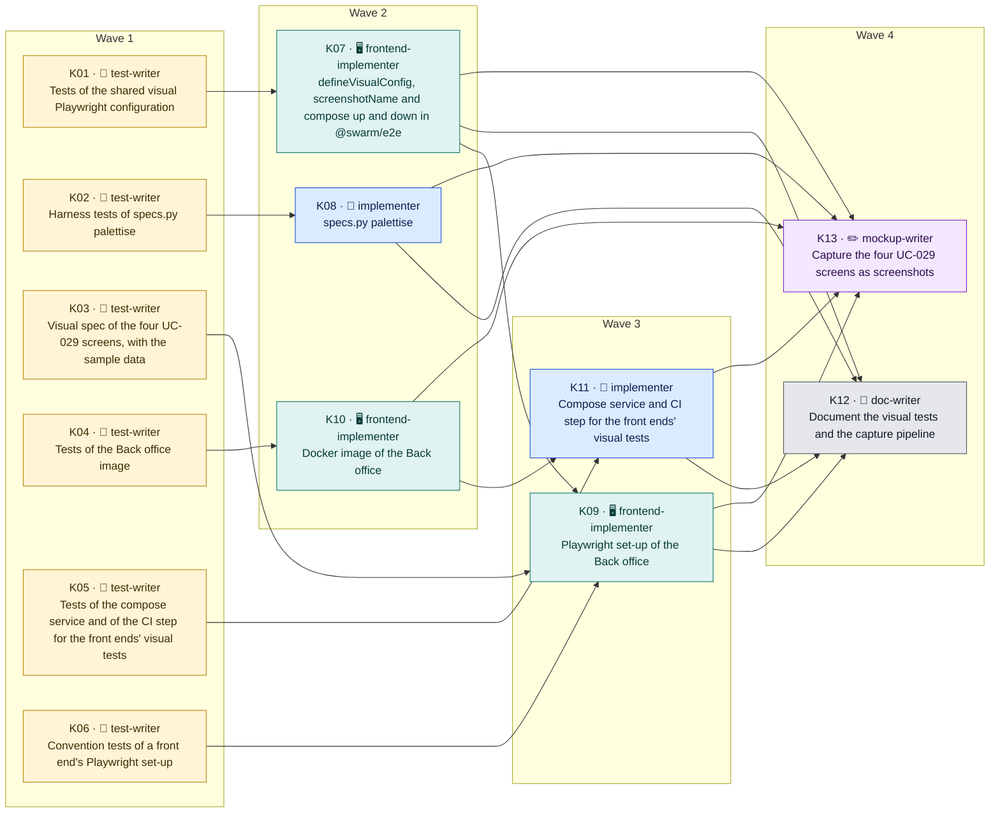

# 📋 Plan: T0.20 · Visual tests and UC-029 screenshots

**Plan:** 🟢 Approved

**Push:** 🟢 Approved

<!-- ticket:specs -->
## 📚 Specifications

The technical pages, features, use cases and business rules of [TICKET.md](TICKET.md), copied by `python3 .claude/scripts/tickets/ticket_refs.py sync`.

- [🖥️ GUI and WebUI: design system](../../specs/technical/10-frontends.md#design-system)
- [🎬 UC-029: Create an Operator](../../specs/functional/use-cases/UC-029-create-an-operator.md)
- [📏 BR-008: Operator isolation](../../specs/functional/business-rules/BR-008-operator-isolation.md)
- [🧰 Deployment: CI/CD](../../specs/technical/09-deployment.md#ci)
- [🖼️ UC-029 A1](../../specs/functional/use-cases/UC-029-create-an-operator.md#screen-a1)
- [🖼️ UC-029 KO](../../specs/functional/use-cases/UC-029-create-an-operator.md#screen-ko)
- [🖼️ UC-029 A2](../../specs/functional/use-cases/UC-029-create-an-operator.md#screen-a2)
- [🖼️ UC-029 OK](../../specs/functional/use-cases/UC-029-create-an-operator.md#screen-ok)
<!-- /ticket:specs -->

## Summary

T0.20 plan in 13 tasks over 4 waves. It builds the visual test pipeline and uses it to capture the four UC-029 screens.

Wave 1 has six test-writer tasks:
- K01: the shared visual Playwright configuration in @swarm/e2e.
- K02: a new `specs.py palettise` command.
- K03: the UC-029 visual spec of the Back office, with its sample-data stubs and a test proving that a large difference fails.
- K04: the Back office image.
- K05: the compose service and the images.yml e2e step.
- K06: the conventions of a front end's Playwright set-up.

Wave 2 implements the shared pieces:
- K07: `defineVisualConfig`, `screenshotName` and compose up and down, in qa/e2e.
- K08: `specs.py palettise`.
- K10: the Back office Dockerfile and nginx.conf.

Wave 3 wires them in:
- K09: the Back office Playwright config, its e2e and capture scripts, and the lock file.
- K11: the compose service on 127.0.0.1:8180 and the CI step that runs the front ends' visual tests.

Wave 4 runs beside the docs:
- K13, the TKT-21 capture task: it builds the image, captures the eight PNGs from the running app, palettises them, sets the four rows to Screenshot, deletes the mock-ups and checks with `specs.py check`.
- K12, the doc-writer: qa/README, AGENT.md, the write-specs skill and enforcement.json.

The allowed difference is set at 2 % of pixels beyond a per-pixel threshold of 0.2.

## Assumptions

- Existing TICKET.md and PROGRESS.md were kept; the only change was correcting the stale path `frontends/back-office` to `frontend/apps/back-office`. I did not run check_ticket.py, because I had no shell. I confirmed by search that the anchors it links exist.
- The roadmap names UC-029 but no business rule for this ticket, so BR-008, the rule UC-029 applies, is linked to give each criterion its rule.
- The roadmap row has no anchor of its own, so the ticket link points to the S04 sprint section.
- The allowed size of the 'large difference' is not specified, so the ticket sets no figure; it is decided in the plan and recorded.
- The roadmap names no budget for this ticket, so none is listed.
- The 'large difference' that fails the build is more than 2 % of a screen's pixels differing beyond a per-pixel colour threshold of 0.2 (Playwright `maxDiffPixelRatio: 0.02` and `threshold: 0.2`). TICKET.md leaves the figure to the plan, and this tolerance also absorbs the shifts that 256-colour palettisation adds.
- The specification's 'sample data' is rendered by stubbing every request the Back office makes to the gateway (and to the identity provider, if T0.16 signs in through Keycloak) with Playwright routes. The stubs hold the cast of the visual identity: Aerowing Services, Léa Martin, lea.martin@aerowing.example as in the A2 mock-up, and 3 December 2026 at 10:00. The Back office image is real, and no backend runs for the visual tests.
- The visual tests compare the app with the PNGs at docs/specs/screens/<UC-ID>/<node>.png and <node>.dark.png. Before the capture these are the mock-up renders, which T0.16's capture task updated to what the app shows. After the capture they are the screenshots, which then become the reference CI compares with.
- The pipeline reaches beyond the three areas of the roadmap row (frontend/apps/back-office, tests/, docs/specs/screens/). It also touches the shared Playwright configuration of qa/e2e (@swarm/e2e), infra/compose/e2e.yaml, the e2e job of .github/workflows/images.yml, a new `specs.py palettise` command, and the docs. AGENT.md puts the shared Playwright configuration in qa/e2e, CI step 5 runs it, and SPEC-12 requires 256-colour palette PNGs.
- T0.16 delivers the UC-029 screens in frontend/apps/back-office but no Docker image of the Back office, because its ticket names none. T0.20 adds it (nginx-unprivileged on port 8080), because infra/compose/e2e.yaml needs a real image. If T0.16 delivered one, K10 keeps it and changes only what the tests ask.
- The Back office is published by compose on 127.0.0.1:8180 (container port 8080), and `SWARM_E2E_BASE_URL` overrides it. The front end's Playwright set-up starts and removes its own compose service in globalSetup and globalTeardown, as qa/e2e's images.spec drives compose itself.
- Screens are captured with locale en-GB and time zone UTC, because the specification's screens are in English.
- The capture runs on the worker's machine with the Chromium pinned by @playwright/test 1.65.1, the same version CI installs. The 2 % tolerance is expected to absorb the font rasterisation differences between that machine and CI's Ubuntu runner. If CI still differs, capturing in CI is a follow-up.
- The `@difference` test proves acceptance criterion 1 by comparing state A1 with the KO PNG under `test.fail()`. The capture script leaves it out (`--grep-invert @difference`) and it skips itself whenever snapshots are being updated, so that a capture never overwrites another screen's PNG.
- T0.16's Back office needs no change to be driven or rendered deterministically. If it does, the visual-test task reports it instead of editing frontend/apps/back-office/src/.

<!-- plan:graph -->

> [!NOTE]
> Generated from the json block at the end of this page by `python3 .claude/scripts/tickets/plan.py render`.
> To change a task, edit the json block, then render again: never edit this view by hand.

## Waves

| Wave | Tasks | Agents running at once |
| --- | --- | --- |
| 1 | [K01](#k01), [K02](#k02), [K03](#k03), [K04](#k04), [K05](#k05), [K06](#k06) | 6 of 6 |
| 2 | [K07](#k07), [K08](#k08), [K10](#k10) | 3 of 3 |
| 3 | [K09](#k09), [K11](#k11) | 2 of 2 |
| 4 | [K12](#k12), [K13](#k13) | 2 of 2 |

| Wave | Task | Agent | Depends on | Unblocks |
| --- | --- | --- | --- | --- |
| 1 | [K01](#k01) Tests of the shared visual Playwright configuration | 🧪 test-writer | none | [K07](#k07) |
| 1 | [K02](#k02) Harness tests of specs.py palettise | 🧪 test-writer | none | [K08](#k08) |
| 1 | [K03](#k03) Visual spec of the four UC-029 screens, with the sample data | 🧪 test-writer | none | [K09](#k09) |
| 1 | [K04](#k04) Tests of the Back office image | 🧪 test-writer | none | [K10](#k10) |
| 1 | [K05](#k05) Tests of the compose service and of the CI step for the front ends' visual tests | 🧪 test-writer | none | [K11](#k11) |
| 1 | [K06](#k06) Convention tests of a front end's Playwright set-up | 🧪 test-writer | none | [K09](#k09) |
| 2 | [K07](#k07) defineVisualConfig, screenshotName and compose up and down in @swarm/e2e | 🖥️ frontend-implementer | [K01](#k01) | [K09](#k09), [K12](#k12), [K13](#k13) |
| 2 | [K08](#k08) specs.py palettise | 🐍 implementer | [K02](#k02) | [K12](#k12), [K13](#k13) |
| 2 | [K10](#k10) Docker image of the Back office | 🖥️ frontend-implementer | [K04](#k04) | [K11](#k11), [K13](#k13) |
| 3 | [K09](#k09) Playwright set-up of the Back office | 🖥️ frontend-implementer | [K03](#k03), [K06](#k06), [K07](#k07) | [K12](#k12), [K13](#k13) |
| 3 | [K11](#k11) Compose service and CI step for the front ends' visual tests | 🐍 implementer | [K05](#k05), [K10](#k10) | [K12](#k12), [K13](#k13) |
| 4 | [K12](#k12) Document the visual tests and the capture pipeline | 📝 doc-writer | [K07](#k07), [K08](#k08), [K09](#k09), [K11](#k11) | none |
| 4 | [K13](#k13) Capture the four UC-029 screens as screenshots | ✏️ mockup-writer | [K07](#k07), [K08](#k08), [K09](#k09), [K10](#k10), [K11](#k11) | none |

## Dependency graph



## Tasks

### <a id="k01"></a>K01: Tests of the shared visual Playwright configuration

| Agent | Wave | Depends on | Unblocks |
| --- | --- | --- | --- |
| 🧪 test-writer | 1 | none | [K07](#k07) |

**Files** (only this task may change them in its wave):

- `qa/e2e/test/define-visual-config.test.ts`

**Done when:** qa/e2e/test/define-visual-config.test.ts exists, covers every point of the contract above, and fails only because the exports of K07 are missing (`pnpm --filter ./qa/e2e test`).

**Brief:**

Write the unit tests, run with Node's test runner like qa/e2e/test/define-e2e-config.test.ts (read it and copy its style), of two exports that K07 will add to `@swarm/e2e` (qa/e2e/src/index.ts): `defineVisualConfig(options, env?)` and `screenshotName(useCase, node, projectName)`. The configuration is the one every front end's visual tests share: Playwright renders each screen of a use case and compares it with the PNG of the specification, in light and dark mode, and a large difference fails the build.

Specification applied: docs/specs/technical/10-frontends.md#design-system (visual tests), docs/specs/technical/09-deployment.md#ci (step 5, Playwright against the real images with visual comparison), docs/specs/visual-identity.md#screens (a screenshot is the real window at `screen.width` x `screen.height`, scale 1, light and dark), .claude/rules/specs.md#spec-12 (paths `docs/specs/screens/<UC-ID>/<node>.png` and `<node>.dark.png`), AGENT.md 'Front-end tests'.

The contract to test, which K07 implements exactly:
- `defineVisualConfig(options: PlaywrightTestConfig & { composeService: string }, env = process.env)` returns the result of the existing `defineE2eConfig`, so it still throws without `SWARM_IMAGE_TAG` and throws when `options.webServer` is set.
- It returns two projects named `light` and `dark` (the exported constants `LIGHT_PROJECT` and `DARK_PROJECT`), with `use.colorScheme` `light` and `dark`.
- Each project uses a viewport whose width and height are read from `--screen-width` and `--screen-height` of frontend/packages/tokens/src/tokens.css, 1280 x 800 today. The test reads the expected values from that file, never a hard-coded 1280. Each project also has `deviceScaleFactor: 1`, `locale: 'en-GB'` and `timezoneId: 'UTC'`.
- `snapshotPathTemplate` is `<repository root>/docs/specs/screens/{arg}{ext}`, absolute.
- `updateSnapshots` is `'none'`.
- `expect.toHaveScreenshot` holds `maxDiffPixelRatio` equal to the exported `VISUAL_MAX_DIFF_PIXEL_RATIO` (0.02), `threshold` equal to `VISUAL_THRESHOLD` (0.2), `animations: 'disabled'`, `caret: 'hide'` and `scale: 'css'`.
- `metadata.composeService` equals the option given.
- `globalSetup` and `globalTeardown` are absolute paths of existing files, qa/e2e/src/compose-up.ts and qa/e2e/src/compose-down.ts.
- `SWARM_E2E_BASE_URL`, when set, overrides `use.baseURL`.
- `screenshotName('UC-029', 'a1', 'light')` returns `'UC-029/a1'` and `screenshotName('UC-029', 'a1', 'dark')` returns `'UC-029/a1.dark'`: Playwright adds `{ext}`, so the PNG is `.png` or `.dark.png`. Any other project name throws.

Tests come first (TKT-4): they fail until K07 lands. Do not change any other file.

### <a id="k02"></a>K02: Harness tests of specs.py palettise

| Agent | Wave | Depends on | Unblocks |
| --- | --- | --- | --- |
| 🧪 test-writer | 1 | none | [K08](#k08) |

**Files** (only this task may change them in its wave):

- `tests/harness/write_specs/test_palettise.py`
- `tests/harness/write_specs/helpers.py`

**Done when:** tests/harness/write_specs/test_palettise.py exists with the cases above, and `uv run pytest tests/harness/write_specs/test_tokens_package.py -n 2` still passes with the changed helpers.py.

**Brief:**

Write the pytest tests of a new command, `python3 .claude/skills/write-specs/scripts/specs.py palettise [<UC-ID> ...]`, which K08 adds. A screenshot captured by Playwright is an RGB PNG, but SPEC-12 and SPEC-13 require every screen to be a 256-colour palette PNG (see .claude/rules/specs.md#spec-12, .claude/rules/specs.md#spec-13 and docs/specs/visual-identity.md#screens). `specs.py check` already reports 'not a 256-colour palette PNG' (.claude/skills/write-specs/scripts/spec_check.py line 363).

Follow tests/harness/write_specs/test_tokens_package.py and its helpers.py: copy the skill and the specifications into tmp_path with `copy_project`, then run the script of the copy. In helpers.py, add `PALETTISE = 'palettise'` and let `run_specs(root, command, *args)` take extra arguments, without breaking the existing callers.

The contract (K08 implements it):
- Replace docs/specs/screens/UC-029/a1.png of the copy with an RGB PNG of 1280 x 800 made with PIL, with a gradient so that it holds more than 256 colours. `palettise UC-029` then makes it colour type 3 (palette), still 1280 x 800, and keeps its tEXt chunks.
- `palettise` with no group does every screen PNG outside docs/specs/screens/mockups/.
- `palettise UC-029` leaves an RGB PNG of another group untouched.
- A PNG that is already a palette PNG is not rewritten: its bytes are unchanged after a second run (TKT-23, commands run again safely). The output names each file it palettised, and nothing on the second run.
- After `palettise`, `check` no longer prints 'not a 256-colour palette PNG' for that file.
- An unknown group such as `UC-999` exits with 1 and says so on standard error.

Use one class `TestPalettise`, test names as sentences, constants at module level or as ClassVar, and the three import groups with their comments (AGENT.md Tests, Imports). Tests come first: they fail until K08 lands.

### <a id="k03"></a>K03: Visual spec of the four UC-029 screens, with the sample data

| Agent | Wave | Depends on | Unblocks |
| --- | --- | --- | --- |
| 🧪 test-writer | 1 | none | [K09](#k09) |

**Files** (only this task may change them in its wave):

- `frontend/apps/back-office/e2e/create-an-operator.spec.ts`
- `frontend/apps/back-office/e2e/sample-data.ts`

**Done when:** The two files exist. The spec has 4 state tests and the `@difference` test, and `pnpm --filter @swarm/back-office exec playwright test --list` lists them in projects light and dark once K09 has landed.

**Brief:**

Write the Playwright visual tests of the Back office for UC-029. Each one drives the app delivered by T0.16 (read frontend/apps/back-office/src/ and the gateway's frontend/packages/api-client/openapi/gateway.json) to one state of the flow chart. It then compares the window with the specification PNG, in the `light` and `dark` projects of the shared configuration (K07, K09).

Specification applied: docs/specs/functional/use-cases/UC-029-create-an-operator.md (main flow, flow chart, screens A1, KO, A2 and OK, alternative flows A1 and A2), docs/specs/functional/business-rules/BR-008-operator-isolation.md, docs/specs/technical/10-frontends.md#design-system, docs/specs/visual-identity.md#screens (the fixed sample cast) and .claude/rules/specs.md#spec-12.

1. e2e/sample-data.ts exports `installSampleData(page: Page, state: 'a1' | 'ko' | 'a2' | 'ok')`.
   - It stubs, with `page.route`, every request the Back office makes to the gateway (and to the identity provider, if T0.16 signs in through Keycloak). No backend runs in the visual tests.
   - The bodies follow the gateway's OpenAPI document and use only the cast: Operator Aerowing Services, deployment cloud, Jurisdiction EU (EASA), the default LLM provider and Anchoring, and Mission planner Léa Martin with lea.martin@aerowing.example (the address of the A2 mock-up). The persona is shown as "Swarm administrator".
   - For `ko`, the stub answers creation as the gateway does for a taken name and a missing Jurisdiction (alternative flows A1 and A2).
   - It also fixes the clock with `page.clock.setFixedTime(new Date('2026-12-03T10:00:00Z'))`.
   - Keep the values as named constants.
2. e2e/create-an-operator.spec.ts has one test per state: A1 Enter the Operator, KO Operator not created, A2 Invite the first Mission planner, OK Operator created and isolated.
   - Each test goes to `/`, then installs the sample data and reaches the state through the visible labels (`getByRole` and `getByLabel`, with the English messages of `@swarm/i18n`).
   - Each ends with `await expect(page).toHaveScreenshot(screenshotName('UC-029', node, testInfo.project.name) + '.png')`. Check how Playwright joins `{arg}` and `{ext}` with K07's template, so that the files are docs/specs/screens/UC-029/&lt;node>.png and &lt;node>.dark.png. `screenshotName` is imported from `@swarm/e2e`.
3. Add one test tagged `@difference`, which proves acceptance criterion 1: a large difference fails the build.
   - It renders state A1 and compares it with the KO name inside `test.fail()`.
   - It calls `test.skip(testInfo.config.updateSnapshots !== 'none')`, so that a capture never overwrites ko.png.

Tests come first (TKT-4): they fail until K07, K09, K10 and K11 land, and until K13 captures the PNGs. If the app needs a change to be driven or rendered deterministically, report it rather than changing src/.

### <a id="k04"></a>K04: Tests of the Back office image

| Agent | Wave | Depends on | Unblocks |
| --- | --- | --- | --- |
| 🧪 test-writer | 1 | none | [K10](#k10) |

**Files** (only this task may change them in its wave):

- `tests/infra/images/test_back_office_image.py`

**Done when:** tests/infra/images/test_back_office_image.py exists with these cases, `uv run ruff check tests/infra/images` passes, and the tests fail only because the Dockerfile is missing.

**Brief:**

Write pytest tests of frontend/apps/back-office/Dockerfile, which K10 creates so that infra/compose/e2e.yaml can start the real Back office image for Playwright.

Specification applied: docs/specs/technical/09-deployment.md#ci (step 3, one multi-stage image per front end with the repository root as context; step 5, Playwright against the real images), docs/specs/technical/10-frontends.md#design-system and AGENT.md 'Docker images'.

The existing tests/infra/images/test_service_images.py already checks every front-end Dockerfile: multi-stage, pinned bases, a non-root final user and an entrypoint or command. Do not repeat those. Read it for the parsing helpers and the style: one class, ClassVar constants, the three import groups.

In one class `TestBackOfficeImage`, test that:
- the Dockerfile exists;
- a build stage copies `pnpm-lock.yaml` and `pnpm-workspace.yaml` from the root, and the back office's package.json;
- the build stage runs `pnpm install --frozen-lockfile` and builds with `pnpm --filter @swarm/back-office` ... `build`;
- the final stage is based on `nginxinc/nginx-unprivileged`;
- the final stage copies `--from=build` the `frontend/apps/back-office/dist` folder into `/usr/share/nginx/html`, and `frontend/apps/back-office/nginx.conf` into `/etc/nginx/conf.d/default.conf`;
- nginx.conf listens on 8080 and falls back to `/index.html` (`try_files`);
- the final stage `EXPOSE`s 8080.

Tests come first: they fail until K10 lands.

### <a id="k05"></a>K05: Tests of the compose service and of the CI step for the front ends' visual tests

| Agent | Wave | Depends on | Unblocks |
| --- | --- | --- | --- |
| 🧪 test-writer | 1 | none | [K11](#k11) |

**Files** (only this task may change them in its wave):

- `tests/ci/e2e/test_compose_e2e.py`
- `tests/ci/images/test_images_workflow.py`

**Done when:** Both files hold the new tests, `uv run ruff check tests/ci` passes, and the existing tests of both files still pass (`uv run pytest tests/ci/e2e tests/ci/images -n 2` fails only on the new tests).

**Brief:**

Extend two existing test classes for what K11 changes.

Specification applied: docs/specs/technical/09-deployment.md#ci (step 5: Playwright against the real images started by infra/compose/e2e.yaml, with visual comparison with the specification screens) and docs/specs/technical/10-frontends.md#design-system (a large difference fails the build).

1. tests/ci/e2e/test_compose_e2e.py, class TestComposeE2e: add `test_the_back_office_is_served_on_its_local_port`. The service `back-office` exists and its `ports` hold `127.0.0.1:8180:8080`. The existing tests already check the image pattern and the Dockerfile.
2. tests/ci/images/test_images_workflow.py, class TestImagesWorkflow:
   - Add `test_e2e_runs_the_front_ends_visual_tests`. A `run` of the e2e job is exactly `pnpm --filter "./frontend/apps/*" --if-present run e2e`. It comes after the run of `./qa/e2e` and before the `docker compose ... down` step.
   - Add `test_e2e_uploads_the_front_end_reports_on_failure`. A step using `actions/upload-artifact` has `if` holding `failure()`, `with.name` `frontend-playwright-reports` and `with.path` `frontend/apps/*/playwright-report/`.
   - Keep `test_e2e_uploads_the_report_on_failure` working: the qa/e2e upload step stays the first upload step.

Keep the ClassVar constants and the import groups of each file. Tests come first: they fail until K11 lands.

### <a id="k06"></a>K06: Convention tests of a front end's Playwright set-up

| Agent | Wave | Depends on | Unblocks |
| --- | --- | --- | --- |
| 🧪 test-writer | 1 | none | [K09](#k09) |

**Files** (only this task may change them in its wave):

- `tests/conventions/mono_repo/frontend/test_frontend_e2e.py`

**Done when:** tests/conventions/mono_repo/frontend/test_frontend_e2e.py exists, `uv run ruff check tests/conventions/mono_repo/frontend` passes, and it fails only because the back office's e2e set-up is missing.

**Brief:**

Write a convention test for every app of frontend/apps/ that has an `e2e/` folder, with the back office required among them. Its Playwright tests must run against the real images and compare its screens with the specification.

Specification applied: AGENT.md 'Front-end tests' (Playwright in frontend/apps/&lt;frontend>/e2e/, against the images of infra/compose/e2e.yaml, never a development server, with the shared configuration @swarm/e2e of qa/e2e), docs/specs/technical/10-frontends.md#design-system and .claude/rules/tickets.md#tkt-21.

In one class `TestFrontendE2e`, parametrised over the apps found, so that adding an app needs no change to the test (AGENT.md Mono-repo), check that:
- package.json has the script `e2e` holding `playwright test`;
- package.json has the script `capture` holding `playwright test`, `--update-snapshots=all` and `--grep-invert @difference`;
- `devDependencies` holds `@playwright/test` at exactly the version of qa/e2e/package.json, and `@swarm/e2e` at `workspace:*`;
- playwright.config.ts imports from `@swarm/e2e`, calls `defineVisualConfig` and has no `webServer`;
- the `include` of tsconfig.json holds `e2e` and `playwright.config.ts`.

Add a test that frontend/apps/back-office is among the apps with an `e2e/` folder.

Use `repo_root` of tests/conventions/mono_repo/helpers.py, like test_frontend_workspace.py, with ClassVar constants and the three import groups. Tests come first: they fail until K03 and K09 land.

### <a id="k07"></a>K07: defineVisualConfig, screenshotName and compose up and down in @swarm/e2e

| Agent | Wave | Depends on | Unblocks |
| --- | --- | --- | --- |
| 🖥️ frontend-implementer | 2 | [K01](#k01) | [K09](#k09), [K12](#k12), [K13](#k13) |

**Files** (only this task may change them in its wave):

- `qa/e2e/src/define-visual-config.ts`
- `qa/e2e/src/compose-up.ts`
- `qa/e2e/src/compose-down.ts`
- `qa/e2e/src/index.ts`

**Done when:** `pnpm --filter ./qa/e2e test`, `pnpm --filter ./qa/e2e lint` and `pnpm --filter ./qa/e2e typecheck` all pass.

**Brief:**

Implement, in `@swarm/e2e` (qa/e2e), the shared configuration of the visual tests, so that qa/e2e/test/define-visual-config.test.ts (K01) passes. Read that test first: its contract is the specification of this task.

Specification applied: docs/specs/technical/10-frontends.md#design-system, docs/specs/technical/09-deployment.md#ci (step 5), docs/specs/visual-identity.md#screens (1280 x 800 from `screen.width` and `screen.height`, scale 1, light and dark), .claude/rules/specs.md#spec-12 and AGENT.md 'Front-end tests'.

1. qa/e2e/src/define-visual-config.ts exports `LIGHT_PROJECT`, `DARK_PROJECT`, `VISUAL_MAX_DIFF_PIXEL_RATIO = 0.02`, `VISUAL_THRESHOLD = 0.2`, `screenshotName` and `defineVisualConfig`, as K01 states.
   - It reads the viewport from `--screen-width` and `--screen-height` of frontend/packages/tokens/src/tokens.css. Find the file from the repository root, computed from `import.meta.url` like qa/e2e/e2e/images.spec.ts does. Throw a clear error when a token is missing.
   - It sets `snapshotPathTemplate` to `<root>/docs/specs/screens/{arg}{ext}`, `updateSnapshots: 'none'` (a capture overrides it with `--update-snapshots=all`), the `expect.toHaveScreenshot` options, `metadata.composeService`, and `globalSetup` and `globalTeardown` as absolute paths.
   - It delegates to `defineE2eConfig`, so that `SWARM_IMAGE_TAG`, the refusal of `webServer`, `SWARM_E2E_BASE_URL` and the HTML report behave as today.
2. qa/e2e/src/compose-up.ts is the default export used by Playwright's globalSetup, receiving FullConfig.
   - From the repository root, it runs `docker compose -f infra/compose/e2e.yaml up -d <metadata.composeService>`.
   - It then polls the first project's `use.baseURL` until it answers 200, for at most 60 s with a timeout per call, and throws with the compose output otherwise.
3. qa/e2e/src/compose-down.ts is the default export used by globalTeardown. It runs `docker compose -f infra/compose/e2e.yaml rm --stop --force <service>`.
4. Export the new names and types from qa/e2e/src/index.ts.

Add no dependency: package.json and pnpm-lock.yaml are not this task's files. Keep at most five code files in qa/e2e/src (AGENT.md File shape).

### <a id="k08"></a>K08: specs.py palettise

| Agent | Wave | Depends on | Unblocks |
| --- | --- | --- | --- |
| 🐍 implementer | 2 | [K02](#k02) | [K12](#k12), [K13](#k13) |

**Files** (only this task may change them in its wave):

- `.claude/skills/write-specs/scripts/specs.py`
- `.claude/skills/write-specs/scripts/spec_check.py`

**Done when:** `uv run pytest tests/harness/write_specs -n 2` passes and `python3 .claude/skills/write-specs/scripts/specs.py check` prints nothing.

**Brief:**

Add the command `palettise [<UC-ID> ...]` to .claude/skills/write-specs/scripts/specs.py, so that tests/harness/write_specs/test_palettise.py (K02) passes. A Playwright screenshot is an RGB PNG, while SPEC-12 and SPEC-13 require 256-colour palette PNGs.

Specification applied: .claude/rules/specs.md#spec-12, .claude/rules/specs.md#spec-13 and docs/specs/visual-identity.md#screens.

- Add a `case ['palettise', *groups]` to `main()`, and the command to USAGE.
- Use the existing `screen_pngs()`, `png_colour_type()`, `PALETTE_TYPE` and `palettise()` of spec_screens.py, which keeps the tEXt chunks, and add no new file: the scripts folder already holds five code files.
- It palettises only the PNGs of the groups named (all of them without a group) that are not already palette PNGs, and prints `palettised <path>` for each. A second run changes nothing and prints nothing (TKT-23).
- An unknown group prints a message on standard error and returns 1.
- In spec_check.py, change the message 'not a 256-colour palette PNG: run specs.py render --all, or palettise the screenshot.' to name the new command: `run specs.py palettise <UC-ID> for a screenshot, or specs.py render --all for a mock-up`.
- Keep the style of the existing functions.

### <a id="k10"></a>K10: Docker image of the Back office

| Agent | Wave | Depends on | Unblocks |
| --- | --- | --- | --- |
| 🖥️ frontend-implementer | 2 | [K04](#k04) | [K11](#k11), [K13](#k13) |

**Files** (only this task may change them in its wave):

- `frontend/apps/back-office/Dockerfile`
- `frontend/apps/back-office/nginx.conf`

**Done when:** `uv run pytest tests/infra/images -n 2` passes. `docker build -f frontend/apps/back-office/Dockerfile -t ghcr.io/gpbcom/swarm/back-office:local .` succeeds, and a container of it on `-p 127.0.0.1:8180:8080` answers 200 with the Back office's index.html.

**Brief:**

Create the multi-stage image of the Back office, built from the repository root, so that tests/infra/images/test_back_office_image.py (K04) and tests/infra/images/test_service_images.py pass. infra/compose/e2e.yaml starts this image for the visual tests.

Specification applied: docs/specs/technical/09-deployment.md#ci (steps 3 and 5) and docs/specs/technical/10-frontends.md#apps, plus AGENT.md 'Docker images' (one image per front end, multi-stage, root as context, pinned bases, non-root).

The build stage:
- uses a pinned Node 22 image with pnpm through corepack;
- copies the root package.json, `pnpm-workspace.yaml`, `pnpm-lock.yaml`, the package.json of every workspace project pnpm needs for a frozen install, then frontend/packages and frontend/apps/back-office;
- runs `pnpm install --frozen-lockfile` and `pnpm --filter @swarm/back-office build`.

The final stage is a pinned `nginxinc/nginx-unprivileged`. It copies `--from=build` the dist folder into /usr/share/nginx/html and nginx.conf into /etc/nginx/conf.d/default.conf, runs as its non-root user, has `EXPOSE 8080` and keeps nginx's command.

nginx.conf listens on 8080, serves index.html and falls back to /index.html (`try_files $uri $uri/ /index.html`).

If T0.16 already delivered a Dockerfile, keep its design and change only what the tests ask.

### <a id="k09"></a>K09: Playwright set-up of the Back office

| Agent | Wave | Depends on | Unblocks |
| --- | --- | --- | --- |
| 🖥️ frontend-implementer | 3 | [K03](#k03), [K06](#k06), [K07](#k07) | [K12](#k12), [K13](#k13) |

**Files** (only this task may change them in its wave):

- `frontend/apps/back-office/package.json`
- `frontend/apps/back-office/playwright.config.ts`
- `frontend/apps/back-office/tsconfig.json`
- `frontend/apps/back-office/eslint.config.js`
- `pnpm-lock.yaml`

**Done when:** `uv run pytest tests/conventions/mono_repo/frontend -n 2` passes. `pnpm --filter @swarm/back-office lint`, `typecheck` and `test` pass. `SWARM_IMAGE_TAG=local pnpm --filter @swarm/back-office exec playwright test --list` lists the 5 tests in projects light and dark.

**Brief:**

Wire the Back office's visual tests (frontend/apps/back-office/e2e/, written by K03) to the shared configuration of K07, so that tests/conventions/mono_repo/frontend/test_frontend_e2e.py (K06) passes.

Specification applied: docs/specs/technical/10-frontends.md#design-system, docs/specs/technical/09-deployment.md#ci (step 5), docs/specs/visual-identity.md#screens and AGENT.md 'Front-end tests'.

1. package.json:
   - add the scripts `"e2e": "playwright test"` and `"capture": "playwright test --update-snapshots=all --grep-invert @difference"`;
   - add `@playwright/test` to devDependencies at exactly the version of qa/e2e/package.json (1.65.1), so that CI's browser matches, and `@swarm/e2e` at `workspace:*`;
   - run `pnpm install` to update pnpm-lock.yaml.
2. playwright.config.ts: `export default defineVisualConfig({ testDir: './e2e', composeService: 'back-office', use: { baseURL: 'http://127.0.0.1:8180' } })`.
3. tsconfig.json: add `e2e` and `playwright.config.ts` to `include`. eslint.config.js: lint them, and ignore `playwright-report/` and `test-results/`.
4. Keep `test` (Vitest, `test/**/*.test.tsx`) as it is, so that it never runs the e2e specs.

If K03's spec cannot reach a state, or uses a wrong label or import, report it as blocked by that file (TKT-19) rather than changing it.

### <a id="k11"></a>K11: Compose service and CI step for the front ends' visual tests

| Agent | Wave | Depends on | Unblocks |
| --- | --- | --- | --- |
| 🐍 implementer | 3 | [K05](#k05), [K10](#k10) | [K12](#k12), [K13](#k13) |

**Files** (only this task may change them in its wave):

- `infra/compose/e2e.yaml`
- `.github/workflows/images.yml`

**Done when:** `uv run pytest tests/ci/e2e tests/ci/images -n 2` passes, and `SWARM_IMAGE_TAG=local docker compose -f infra/compose/e2e.yaml config --services` lists gateway and back-office.

**Brief:**

Make step 5 of CI run the Back office's visual tests against its real image, so that the new tests of tests/ci/e2e/test_compose_e2e.py and tests/ci/images/test_images_workflow.py (K05) pass.

Specification applied: docs/specs/technical/09-deployment.md#ci (step 5: Playwright against the real images of infra/compose/e2e.yaml, with visual comparison) and docs/specs/technical/10-frontends.md#design-system (a large difference fails the build).

1. infra/compose/e2e.yaml: add the service `back-office` with `image: ${SWARM_IMAGE_REGISTRY:-ghcr.io/gpbcom/swarm}/back-office:${SWARM_IMAGE_TAG:?SWARM_IMAGE_TAG names the images of a pipeline run}`, `pull_policy: missing`, `restart: "no"` and `ports: ["127.0.0.1:8180:8080"]`. It has no build, no volume and no development server.
2. .github/workflows/images.yml, job e2e: after 'Run Playwright', add a step named 'Run the front ends' visual tests' whose run is exactly `pnpm --filter "./frontend/apps/*" --if-present run e2e`. Then add a step 'Keep the front ends' Playwright reports' with `if: failure()`, `uses: actions/upload-artifact@v4`, `name: frontend-playwright-reports` and `path: frontend/apps/*/playwright-report/`, before 'Stop the stack'.
   - The existing loop already builds the back-office image from frontend/apps/back-office when the run did not build it.
   - Interpolate no untrusted expression in a run.

### <a id="k12"></a>K12: Document the visual tests and the capture pipeline

| Agent | Wave | Depends on | Unblocks |
| --- | --- | --- | --- |
| 📝 doc-writer | 4 | [K07](#k07), [K08](#k08), [K09](#k09), [K11](#k11) | none |

**Files** (only this task may change them in its wave):

- `qa/README.md`
- `AGENT.md`
- `.claude/skills/write-specs/SKILL.md`
- `.claude/rules/enforcement.json`

**Done when:** `uv run pytest tests/harness/wiring -n 2` passes and `python3 .claude/skills/write-specs/scripts/specs.py check` prints nothing.

**Brief:**

Document the screenshot pipeline that later front-end tickets reuse (TKT-21). Write in plain British English, with no em dash.

Specification applied: docs/specs/technical/10-frontends.md#design-system, docs/specs/technical/09-deployment.md#ci, docs/specs/visual-identity.md#screens, .claude/rules/specs.md#spec-12, .claude/rules/tickets.md#tkt-21 and .claude/rules/tickets.md#tkt-22.

1. qa/README.md: add qa/e2e/src/define-visual-config.ts, compose-up.ts and compose-down.ts to the table.
   - Explain `defineVisualConfig`: the projects light and dark, the viewport from the tokens, `snapshotPathTemplate` into docs/specs/screens, and a screen that fails when more than 2 % of its pixels differ beyond a per-pixel threshold of 0.2.
   - Explain `screenshotName`, and that a front end's Playwright set-up starts its compose service itself.
   - Give the commands, from the root: `docker build -f frontend/apps/back-office/Dockerfile -t ghcr.io/gpbcom/swarm/back-office:local .`, `SWARM_IMAGE_TAG=local pnpm --filter @swarm/back-office run e2e`, and to capture, `SWARM_IMAGE_TAG=local pnpm --filter @swarm/back-office run capture` then `python3 .claude/skills/write-specs/scripts/specs.py palettise <UC-ID>`.
   - Explain that CI's e2e job runs `pnpm --filter "./frontend/apps/*" --if-present run e2e`.
2. AGENT.md: under 'Front-end tests', add one bullet on the visual tests and the capture, pointing to qa/README.md. Under 'Commands', add the Playwright commands of the back office.
3. .claude/skills/write-specs/SKILL.md: document `specs.py palettise [<UC-ID> ...]` beside `render`, as the step after capturing a 📸 Screenshot.
4. .claude/rules/enforcement.json:
   - under SPEC-12, add `{"kind": "test", "path": "frontend/apps/back-office/e2e/create-an-operator.spec.ts", "what": "the Back office's screens are compared with their PNGs in light and dark mode"}` and `{"kind": "ci", "path": ".github/workflows/images.yml", "what": "the e2e job runs the front ends' visual tests against the real images"}`;
   - under SPEC-13, add `{"kind": "test", "path": "tests/harness/write_specs/test_palettise.py", "what": "screenshots are turned into 256-colour palette PNGs"}`.

### <a id="k13"></a>K13: Capture the four UC-029 screens as screenshots

| Agent | Wave | Depends on | Unblocks |
| --- | --- | --- | --- |
| ✏️ mockup-writer | 4 | [K07](#k07), [K08](#k08), [K09](#k09), [K10](#k10), [K11](#k11) | none |

**Files** (only this task may change them in its wave):

- `docs/specs/screens/UC-029/a1.png`
- `docs/specs/screens/UC-029/a1.dark.png`
- `docs/specs/screens/UC-029/ko.png`
- `docs/specs/screens/UC-029/ko.dark.png`
- `docs/specs/screens/UC-029/a2.png`
- `docs/specs/screens/UC-029/a2.dark.png`
- `docs/specs/screens/UC-029/ok.png`
- `docs/specs/screens/UC-029/ok.dark.png`
- `docs/specs/screens/mockups/UC-029/a1.html`
- `docs/specs/screens/mockups/UC-029/ko.html`
- `docs/specs/screens/mockups/UC-029/a2.html`
- `docs/specs/screens/mockups/UC-029/ok.html`
- `docs/specs/functional/use-cases/UC-029-create-an-operator.md`

**Done when:** `python3 .claude/skills/write-specs/scripts/specs.py check` prints nothing. The four UC-029 rows read 📸 Screenshot, the four mock-ups are gone, and the 8 PNGs are 1280 x 800 palette PNGs captured by this task. `SWARM_IMAGE_TAG=local pnpm --filter @swarm/back-office run e2e` passes.

**Brief:**

Capture task (TKT-21). Capture the four screens of UC-029 that the ticket lists, A1, KO, A2 and OK, from the running Back office, in light and dark mode, with the screenshot pipeline this ticket builds.

Specification applied: docs/specs/functional/use-cases/UC-029-create-an-operator.md#screens, docs/specs/visual-identity.md#screens (1280 x 800, scale 1, light and dark, the fixed sample cast), docs/specs/technical/10-frontends.md#design-system ('Once a screen matches, its row becomes 📸 Screenshot'), .claude/rules/specs.md#spec-12, .claude/rules/tickets.md#tkt-21 and docs/specs/functional/business-rules/BR-008-operator-isolation.md.

Run from the repository root, in this order:
1. `docker build -f frontend/apps/back-office/Dockerfile -t ghcr.io/gpbcom/swarm/back-office:local .`
2. `pnpm --filter @swarm/back-office exec playwright install chromium`
3. `SWARM_IMAGE_TAG=local pnpm --filter @swarm/back-office run capture`. This rewrites the 8 PNGs of docs/specs/screens/UC-029/ from the app.
4. `python3 .claude/skills/write-specs/scripts/specs.py palettise UC-029`.
5. Open each of the 8 PNGs and check that it shows the state of its row:
   - A1: the entry of Aerowing Services;
   - KO: the name taken and the missing Jurisdiction;
   - A2: the invitation of Léa Martin;
   - OK: Aerowing Services created.
   The dark PNGs must be in dark mode. If one is wrong, stop and report it; do not edit code.
6. In docs/specs/functional/use-cases/UC-029-create-an-operator.md, change the Source cell of the rows screen-a1, screen-ko, screen-a2 and screen-ok from `✏️ Mock-up` to `📸 Screenshot`, and set **Updated:** to today.
7. Delete docs/specs/screens/mockups/UC-029/a1.html, ko.html, a2.html and ok.html, and the folder once it is empty.
8. `python3 .claude/skills/write-specs/scripts/specs.py build`, then `specs.py check`, which must print nothing.
9. `SWARM_IMAGE_TAG=local pnpm --filter @swarm/back-office run e2e` must pass: the 8 comparisons and the @difference test.

Change no other file.

<!-- /plan:graph -->

## Task graph

<details>
<summary>🤖 Task graph as read by <code>/ticket-run</code> (json)</summary>

```json
[
  {
    "id": "K01",
    "title": "Tests of the shared visual Playwright configuration",
    "agent": "test-writer",
    "depends_on": [],
    "files": [
      "qa/e2e/test/define-visual-config.test.ts"
    ],
    "brief": "Write the unit tests, run with Node's test runner like qa/e2e/test/define-e2e-config.test.ts (read it and copy its style), of two exports that K07 will add to `@swarm/e2e` (qa/e2e/src/index.ts): `defineVisualConfig(options, env?)` and `screenshotName(useCase, node, projectName)`. The configuration is the one every front end's visual tests share: Playwright renders each screen of a use case and compares it with the PNG of the specification, in light and dark mode, and a large difference fails the build.\n\nSpecification applied: docs/specs/technical/10-frontends.md#design-system (visual tests), docs/specs/technical/09-deployment.md#ci (step 5, Playwright against the real images with visual comparison), docs/specs/visual-identity.md#screens (a screenshot is the real window at `screen.width` x `screen.height`, scale 1, light and dark), .claude/rules/specs.md#spec-12 (paths `docs/specs/screens/<UC-ID>/<node>.png` and `<node>.dark.png`), AGENT.md 'Front-end tests'.\n\nThe contract to test, which K07 implements exactly:\n- `defineVisualConfig(options: PlaywrightTestConfig & { composeService: string }, env = process.env)` returns the result of the existing `defineE2eConfig`, so it still throws without `SWARM_IMAGE_TAG` and throws when `options.webServer` is set.\n- It returns two projects named `light` and `dark` (the exported constants `LIGHT_PROJECT` and `DARK_PROJECT`), with `use.colorScheme` `light` and `dark`.\n- Each project uses a viewport whose width and height are read from `--screen-width` and `--screen-height` of frontend/packages/tokens/src/tokens.css, 1280 x 800 today. The test reads the expected values from that file, never a hard-coded 1280. Each project also has `deviceScaleFactor: 1`, `locale: 'en-GB'` and `timezoneId: 'UTC'`.\n- `snapshotPathTemplate` is `<repository root>/docs/specs/screens/{arg}{ext}`, absolute.\n- `updateSnapshots` is `'none'`.\n- `expect.toHaveScreenshot` holds `maxDiffPixelRatio` equal to the exported `VISUAL_MAX_DIFF_PIXEL_RATIO` (0.02), `threshold` equal to `VISUAL_THRESHOLD` (0.2), `animations: 'disabled'`, `caret: 'hide'` and `scale: 'css'`.\n- `metadata.composeService` equals the option given.\n- `globalSetup` and `globalTeardown` are absolute paths of existing files, qa/e2e/src/compose-up.ts and qa/e2e/src/compose-down.ts.\n- `SWARM_E2E_BASE_URL`, when set, overrides `use.baseURL`.\n- `screenshotName('UC-029', 'a1', 'light')` returns `'UC-029/a1'` and `screenshotName('UC-029', 'a1', 'dark')` returns `'UC-029/a1.dark'`: Playwright adds `{ext}`, so the PNG is `.png` or `.dark.png`. Any other project name throws.\n\nTests come first (TKT-4): they fail until K07 lands. Do not change any other file.",
    "done_when": "qa/e2e/test/define-visual-config.test.ts exists, covers every point of the contract above, and fails only because the exports of K07 are missing (`pnpm --filter ./qa/e2e test`).",
    "wave": 1
  },
  {
    "id": "K02",
    "title": "Harness tests of specs.py palettise",
    "agent": "test-writer",
    "depends_on": [],
    "files": [
      "tests/harness/write_specs/test_palettise.py",
      "tests/harness/write_specs/helpers.py"
    ],
    "brief": "Write the pytest tests of a new command, `python3 .claude/skills/write-specs/scripts/specs.py palettise [<UC-ID> ...]`, which K08 adds. A screenshot captured by Playwright is an RGB PNG, but SPEC-12 and SPEC-13 require every screen to be a 256-colour palette PNG (see .claude/rules/specs.md#spec-12, .claude/rules/specs.md#spec-13 and docs/specs/visual-identity.md#screens). `specs.py check` already reports 'not a 256-colour palette PNG' (.claude/skills/write-specs/scripts/spec_check.py line 363).\n\nFollow tests/harness/write_specs/test_tokens_package.py and its helpers.py: copy the skill and the specifications into tmp_path with `copy_project`, then run the script of the copy. In helpers.py, add `PALETTISE = 'palettise'` and let `run_specs(root, command, *args)` take extra arguments, without breaking the existing callers.\n\nThe contract (K08 implements it):\n- Replace docs/specs/screens/UC-029/a1.png of the copy with an RGB PNG of 1280 x 800 made with PIL, with a gradient so that it holds more than 256 colours. `palettise UC-029` then makes it colour type 3 (palette), still 1280 x 800, and keeps its tEXt chunks.\n- `palettise` with no group does every screen PNG outside docs/specs/screens/mockups/.\n- `palettise UC-029` leaves an RGB PNG of another group untouched.\n- A PNG that is already a palette PNG is not rewritten: its bytes are unchanged after a second run (TKT-23, commands run again safely). The output names each file it palettised, and nothing on the second run.\n- After `palettise`, `check` no longer prints 'not a 256-colour palette PNG' for that file.\n- An unknown group such as `UC-999` exits with 1 and says so on standard error.\n\nUse one class `TestPalettise`, test names as sentences, constants at module level or as ClassVar, and the three import groups with their comments (AGENT.md Tests, Imports). Tests come first: they fail until K08 lands.",
    "done_when": "tests/harness/write_specs/test_palettise.py exists with the cases above, and `uv run pytest tests/harness/write_specs/test_tokens_package.py -n 2` still passes with the changed helpers.py.",
    "wave": 1
  },
  {
    "id": "K03",
    "title": "Visual spec of the four UC-029 screens, with the sample data",
    "agent": "test-writer",
    "depends_on": [],
    "files": [
      "frontend/apps/back-office/e2e/create-an-operator.spec.ts",
      "frontend/apps/back-office/e2e/sample-data.ts"
    ],
    "brief": "Write the Playwright visual tests of the Back office for UC-029. Each one drives the app delivered by T0.16 (read frontend/apps/back-office/src/ and the gateway's frontend/packages/api-client/openapi/gateway.json) to one state of the flow chart. It then compares the window with the specification PNG, in the `light` and `dark` projects of the shared configuration (K07, K09).\n\nSpecification applied: docs/specs/functional/use-cases/UC-029-create-an-operator.md (main flow, flow chart, screens A1, KO, A2 and OK, alternative flows A1 and A2), docs/specs/functional/business-rules/BR-008-operator-isolation.md, docs/specs/technical/10-frontends.md#design-system, docs/specs/visual-identity.md#screens (the fixed sample cast) and .claude/rules/specs.md#spec-12.\n\n1. e2e/sample-data.ts exports `installSampleData(page: Page, state: 'a1' | 'ko' | 'a2' | 'ok')`.\n   - It stubs, with `page.route`, every request the Back office makes to the gateway (and to the identity provider, if T0.16 signs in through Keycloak). No backend runs in the visual tests.\n   - The bodies follow the gateway's OpenAPI document and use only the cast: Operator Aerowing Services, deployment cloud, Jurisdiction EU (EASA), the default LLM provider and Anchoring, and Mission planner Léa Martin with lea.martin@aerowing.example (the address of the A2 mock-up). The persona is shown as \"Swarm administrator\".\n   - For `ko`, the stub answers creation as the gateway does for a taken name and a missing Jurisdiction (alternative flows A1 and A2).\n   - It also fixes the clock with `page.clock.setFixedTime(new Date('2026-12-03T10:00:00Z'))`.\n   - Keep the values as named constants.\n2. e2e/create-an-operator.spec.ts has one test per state: A1 Enter the Operator, KO Operator not created, A2 Invite the first Mission planner, OK Operator created and isolated.\n   - Each test goes to `/`, then installs the sample data and reaches the state through the visible labels (`getByRole` and `getByLabel`, with the English messages of `@swarm/i18n`).\n   - Each ends with `await expect(page).toHaveScreenshot(screenshotName('UC-029', node, testInfo.project.name) + '.png')`. Check how Playwright joins `{arg}` and `{ext}` with K07's template, so that the files are docs/specs/screens/UC-029/<node>.png and <node>.dark.png. `screenshotName` is imported from `@swarm/e2e`.\n3. Add one test tagged `@difference`, which proves acceptance criterion 1: a large difference fails the build.\n   - It renders state A1 and compares it with the KO name inside `test.fail()`.\n   - It calls `test.skip(testInfo.config.updateSnapshots !== 'none')`, so that a capture never overwrites ko.png.\n\nTests come first (TKT-4): they fail until K07, K09, K10 and K11 land, and until K13 captures the PNGs. If the app needs a change to be driven or rendered deterministically, report it rather than changing src/.",
    "done_when": "The two files exist. The spec has 4 state tests and the `@difference` test, and `pnpm --filter @swarm/back-office exec playwright test --list` lists them in projects light and dark once K09 has landed.",
    "wave": 1
  },
  {
    "id": "K04",
    "title": "Tests of the Back office image",
    "agent": "test-writer",
    "depends_on": [],
    "files": [
      "tests/infra/images/test_back_office_image.py"
    ],
    "brief": "Write pytest tests of frontend/apps/back-office/Dockerfile, which K10 creates so that infra/compose/e2e.yaml can start the real Back office image for Playwright.\n\nSpecification applied: docs/specs/technical/09-deployment.md#ci (step 3, one multi-stage image per front end with the repository root as context; step 5, Playwright against the real images), docs/specs/technical/10-frontends.md#design-system and AGENT.md 'Docker images'.\n\nThe existing tests/infra/images/test_service_images.py already checks every front-end Dockerfile: multi-stage, pinned bases, a non-root final user and an entrypoint or command. Do not repeat those. Read it for the parsing helpers and the style: one class, ClassVar constants, the three import groups.\n\nIn one class `TestBackOfficeImage`, test that:\n- the Dockerfile exists;\n- a build stage copies `pnpm-lock.yaml` and `pnpm-workspace.yaml` from the root, and the back office's package.json;\n- the build stage runs `pnpm install --frozen-lockfile` and builds with `pnpm --filter @swarm/back-office` ... `build`;\n- the final stage is based on `nginxinc/nginx-unprivileged`;\n- the final stage copies `--from=build` the `frontend/apps/back-office/dist` folder into `/usr/share/nginx/html`, and `frontend/apps/back-office/nginx.conf` into `/etc/nginx/conf.d/default.conf`;\n- nginx.conf listens on 8080 and falls back to `/index.html` (`try_files`);\n- the final stage `EXPOSE`s 8080.\n\nTests come first: they fail until K10 lands.",
    "done_when": "tests/infra/images/test_back_office_image.py exists with these cases, `uv run ruff check tests/infra/images` passes, and the tests fail only because the Dockerfile is missing.",
    "wave": 1
  },
  {
    "id": "K05",
    "title": "Tests of the compose service and of the CI step for the front ends' visual tests",
    "agent": "test-writer",
    "depends_on": [],
    "files": [
      "tests/ci/e2e/test_compose_e2e.py",
      "tests/ci/images/test_images_workflow.py"
    ],
    "brief": "Extend two existing test classes for what K11 changes.\n\nSpecification applied: docs/specs/technical/09-deployment.md#ci (step 5: Playwright against the real images started by infra/compose/e2e.yaml, with visual comparison with the specification screens) and docs/specs/technical/10-frontends.md#design-system (a large difference fails the build).\n\n1. tests/ci/e2e/test_compose_e2e.py, class TestComposeE2e: add `test_the_back_office_is_served_on_its_local_port`. The service `back-office` exists and its `ports` hold `127.0.0.1:8180:8080`. The existing tests already check the image pattern and the Dockerfile.\n2. tests/ci/images/test_images_workflow.py, class TestImagesWorkflow:\n   - Add `test_e2e_runs_the_front_ends_visual_tests`. A `run` of the e2e job is exactly `pnpm --filter \"./frontend/apps/*\" --if-present run e2e`. It comes after the run of `./qa/e2e` and before the `docker compose ... down` step.\n   - Add `test_e2e_uploads_the_front_end_reports_on_failure`. A step using `actions/upload-artifact` has `if` holding `failure()`, `with.name` `frontend-playwright-reports` and `with.path` `frontend/apps/*/playwright-report/`.\n   - Keep `test_e2e_uploads_the_report_on_failure` working: the qa/e2e upload step stays the first upload step.\n\nKeep the ClassVar constants and the import groups of each file. Tests come first: they fail until K11 lands.",
    "done_when": "Both files hold the new tests, `uv run ruff check tests/ci` passes, and the existing tests of both files still pass (`uv run pytest tests/ci/e2e tests/ci/images -n 2` fails only on the new tests).",
    "wave": 1
  },
  {
    "id": "K06",
    "title": "Convention tests of a front end's Playwright set-up",
    "agent": "test-writer",
    "depends_on": [],
    "files": [
      "tests/conventions/mono_repo/frontend/test_frontend_e2e.py"
    ],
    "brief": "Write a convention test for every app of frontend/apps/ that has an `e2e/` folder, with the back office required among them. Its Playwright tests must run against the real images and compare its screens with the specification.\n\nSpecification applied: AGENT.md 'Front-end tests' (Playwright in frontend/apps/<frontend>/e2e/, against the images of infra/compose/e2e.yaml, never a development server, with the shared configuration @swarm/e2e of qa/e2e), docs/specs/technical/10-frontends.md#design-system and .claude/rules/tickets.md#tkt-21.\n\nIn one class `TestFrontendE2e`, parametrised over the apps found, so that adding an app needs no change to the test (AGENT.md Mono-repo), check that:\n- package.json has the script `e2e` holding `playwright test`;\n- package.json has the script `capture` holding `playwright test`, `--update-snapshots=all` and `--grep-invert @difference`;\n- `devDependencies` holds `@playwright/test` at exactly the version of qa/e2e/package.json, and `@swarm/e2e` at `workspace:*`;\n- playwright.config.ts imports from `@swarm/e2e`, calls `defineVisualConfig` and has no `webServer`;\n- the `include` of tsconfig.json holds `e2e` and `playwright.config.ts`.\n\nAdd a test that frontend/apps/back-office is among the apps with an `e2e/` folder.\n\nUse `repo_root` of tests/conventions/mono_repo/helpers.py, like test_frontend_workspace.py, with ClassVar constants and the three import groups. Tests come first: they fail until K03 and K09 land.",
    "done_when": "tests/conventions/mono_repo/frontend/test_frontend_e2e.py exists, `uv run ruff check tests/conventions/mono_repo/frontend` passes, and it fails only because the back office's e2e set-up is missing.",
    "wave": 1
  },
  {
    "id": "K07",
    "title": "defineVisualConfig, screenshotName and compose up and down in @swarm/e2e",
    "agent": "frontend-implementer",
    "depends_on": [
      "K01"
    ],
    "files": [
      "qa/e2e/src/define-visual-config.ts",
      "qa/e2e/src/compose-up.ts",
      "qa/e2e/src/compose-down.ts",
      "qa/e2e/src/index.ts"
    ],
    "brief": "Implement, in `@swarm/e2e` (qa/e2e), the shared configuration of the visual tests, so that qa/e2e/test/define-visual-config.test.ts (K01) passes. Read that test first: its contract is the specification of this task.\n\nSpecification applied: docs/specs/technical/10-frontends.md#design-system, docs/specs/technical/09-deployment.md#ci (step 5), docs/specs/visual-identity.md#screens (1280 x 800 from `screen.width` and `screen.height`, scale 1, light and dark), .claude/rules/specs.md#spec-12 and AGENT.md 'Front-end tests'.\n\n1. qa/e2e/src/define-visual-config.ts exports `LIGHT_PROJECT`, `DARK_PROJECT`, `VISUAL_MAX_DIFF_PIXEL_RATIO = 0.02`, `VISUAL_THRESHOLD = 0.2`, `screenshotName` and `defineVisualConfig`, as K01 states.\n   - It reads the viewport from `--screen-width` and `--screen-height` of frontend/packages/tokens/src/tokens.css. Find the file from the repository root, computed from `import.meta.url` like qa/e2e/e2e/images.spec.ts does. Throw a clear error when a token is missing.\n   - It sets `snapshotPathTemplate` to `<root>/docs/specs/screens/{arg}{ext}`, `updateSnapshots: 'none'` (a capture overrides it with `--update-snapshots=all`), the `expect.toHaveScreenshot` options, `metadata.composeService`, and `globalSetup` and `globalTeardown` as absolute paths.\n   - It delegates to `defineE2eConfig`, so that `SWARM_IMAGE_TAG`, the refusal of `webServer`, `SWARM_E2E_BASE_URL` and the HTML report behave as today.\n2. qa/e2e/src/compose-up.ts is the default export used by Playwright's globalSetup, receiving FullConfig.\n   - From the repository root, it runs `docker compose -f infra/compose/e2e.yaml up -d <metadata.composeService>`.\n   - It then polls the first project's `use.baseURL` until it answers 200, for at most 60 s with a timeout per call, and throws with the compose output otherwise.\n3. qa/e2e/src/compose-down.ts is the default export used by globalTeardown. It runs `docker compose -f infra/compose/e2e.yaml rm --stop --force <service>`.\n4. Export the new names and types from qa/e2e/src/index.ts.\n\nAdd no dependency: package.json and pnpm-lock.yaml are not this task's files. Keep at most five code files in qa/e2e/src (AGENT.md File shape).",
    "done_when": "`pnpm --filter ./qa/e2e test`, `pnpm --filter ./qa/e2e lint` and `pnpm --filter ./qa/e2e typecheck` all pass.",
    "wave": 2
  },
  {
    "id": "K08",
    "title": "specs.py palettise",
    "agent": "implementer",
    "depends_on": [
      "K02"
    ],
    "files": [
      ".claude/skills/write-specs/scripts/specs.py",
      ".claude/skills/write-specs/scripts/spec_check.py"
    ],
    "brief": "Add the command `palettise [<UC-ID> ...]` to .claude/skills/write-specs/scripts/specs.py, so that tests/harness/write_specs/test_palettise.py (K02) passes. A Playwright screenshot is an RGB PNG, while SPEC-12 and SPEC-13 require 256-colour palette PNGs.\n\nSpecification applied: .claude/rules/specs.md#spec-12, .claude/rules/specs.md#spec-13 and docs/specs/visual-identity.md#screens.\n\n- Add a `case ['palettise', *groups]` to `main()`, and the command to USAGE.\n- Use the existing `screen_pngs()`, `png_colour_type()`, `PALETTE_TYPE` and `palettise()` of spec_screens.py, which keeps the tEXt chunks, and add no new file: the scripts folder already holds five code files.\n- It palettises only the PNGs of the groups named (all of them without a group) that are not already palette PNGs, and prints `palettised <path>` for each. A second run changes nothing and prints nothing (TKT-23).\n- An unknown group prints a message on standard error and returns 1.\n- In spec_check.py, change the message 'not a 256-colour palette PNG: run specs.py render --all, or palettise the screenshot.' to name the new command: `run specs.py palettise <UC-ID> for a screenshot, or specs.py render --all for a mock-up`.\n- Keep the style of the existing functions.",
    "done_when": "`uv run pytest tests/harness/write_specs -n 2` passes and `python3 .claude/skills/write-specs/scripts/specs.py check` prints nothing.",
    "wave": 2
  },
  {
    "id": "K10",
    "title": "Docker image of the Back office",
    "agent": "frontend-implementer",
    "depends_on": [
      "K04"
    ],
    "files": [
      "frontend/apps/back-office/Dockerfile",
      "frontend/apps/back-office/nginx.conf"
    ],
    "brief": "Create the multi-stage image of the Back office, built from the repository root, so that tests/infra/images/test_back_office_image.py (K04) and tests/infra/images/test_service_images.py pass. infra/compose/e2e.yaml starts this image for the visual tests.\n\nSpecification applied: docs/specs/technical/09-deployment.md#ci (steps 3 and 5) and docs/specs/technical/10-frontends.md#apps, plus AGENT.md 'Docker images' (one image per front end, multi-stage, root as context, pinned bases, non-root).\n\nThe build stage:\n- uses a pinned Node 22 image with pnpm through corepack;\n- copies the root package.json, `pnpm-workspace.yaml`, `pnpm-lock.yaml`, the package.json of every workspace project pnpm needs for a frozen install, then frontend/packages and frontend/apps/back-office;\n- runs `pnpm install --frozen-lockfile` and `pnpm --filter @swarm/back-office build`.\n\nThe final stage is a pinned `nginxinc/nginx-unprivileged`. It copies `--from=build` the dist folder into /usr/share/nginx/html and nginx.conf into /etc/nginx/conf.d/default.conf, runs as its non-root user, has `EXPOSE 8080` and keeps nginx's command.\n\nnginx.conf listens on 8080, serves index.html and falls back to /index.html (`try_files $uri $uri/ /index.html`).\n\nIf T0.16 already delivered a Dockerfile, keep its design and change only what the tests ask.",
    "done_when": "`uv run pytest tests/infra/images -n 2` passes. `docker build -f frontend/apps/back-office/Dockerfile -t ghcr.io/gpbcom/swarm/back-office:local .` succeeds, and a container of it on `-p 127.0.0.1:8180:8080` answers 200 with the Back office's index.html.",
    "wave": 2
  },
  {
    "id": "K09",
    "title": "Playwright set-up of the Back office",
    "agent": "frontend-implementer",
    "depends_on": [
      "K03",
      "K06",
      "K07"
    ],
    "files": [
      "frontend/apps/back-office/package.json",
      "frontend/apps/back-office/playwright.config.ts",
      "frontend/apps/back-office/tsconfig.json",
      "frontend/apps/back-office/eslint.config.js",
      "pnpm-lock.yaml"
    ],
    "brief": "Wire the Back office's visual tests (frontend/apps/back-office/e2e/, written by K03) to the shared configuration of K07, so that tests/conventions/mono_repo/frontend/test_frontend_e2e.py (K06) passes.\n\nSpecification applied: docs/specs/technical/10-frontends.md#design-system, docs/specs/technical/09-deployment.md#ci (step 5), docs/specs/visual-identity.md#screens and AGENT.md 'Front-end tests'.\n\n1. package.json:\n   - add the scripts `\"e2e\": \"playwright test\"` and `\"capture\": \"playwright test --update-snapshots=all --grep-invert @difference\"`;\n   - add `@playwright/test` to devDependencies at exactly the version of qa/e2e/package.json (1.65.1), so that CI's browser matches, and `@swarm/e2e` at `workspace:*`;\n   - run `pnpm install` to update pnpm-lock.yaml.\n2. playwright.config.ts: `export default defineVisualConfig({ testDir: './e2e', composeService: 'back-office', use: { baseURL: 'http://127.0.0.1:8180' } })`.\n3. tsconfig.json: add `e2e` and `playwright.config.ts` to `include`. eslint.config.js: lint them, and ignore `playwright-report/` and `test-results/`.\n4. Keep `test` (Vitest, `test/**/*.test.tsx`) as it is, so that it never runs the e2e specs.\n\nIf K03's spec cannot reach a state, or uses a wrong label or import, report it as blocked by that file (TKT-19) rather than changing it.",
    "done_when": "`uv run pytest tests/conventions/mono_repo/frontend -n 2` passes. `pnpm --filter @swarm/back-office lint`, `typecheck` and `test` pass. `SWARM_IMAGE_TAG=local pnpm --filter @swarm/back-office exec playwright test --list` lists the 5 tests in projects light and dark.",
    "wave": 3
  },
  {
    "id": "K11",
    "title": "Compose service and CI step for the front ends' visual tests",
    "agent": "implementer",
    "depends_on": [
      "K05",
      "K10"
    ],
    "files": [
      "infra/compose/e2e.yaml",
      ".github/workflows/images.yml"
    ],
    "brief": "Make step 5 of CI run the Back office's visual tests against its real image, so that the new tests of tests/ci/e2e/test_compose_e2e.py and tests/ci/images/test_images_workflow.py (K05) pass.\n\nSpecification applied: docs/specs/technical/09-deployment.md#ci (step 5: Playwright against the real images of infra/compose/e2e.yaml, with visual comparison) and docs/specs/technical/10-frontends.md#design-system (a large difference fails the build).\n\n1. infra/compose/e2e.yaml: add the service `back-office` with `image: ${SWARM_IMAGE_REGISTRY:-ghcr.io/gpbcom/swarm}/back-office:${SWARM_IMAGE_TAG:?SWARM_IMAGE_TAG names the images of a pipeline run}`, `pull_policy: missing`, `restart: \"no\"` and `ports: [\"127.0.0.1:8180:8080\"]`. It has no build, no volume and no development server.\n2. .github/workflows/images.yml, job e2e: after 'Run Playwright', add a step named 'Run the front ends' visual tests' whose run is exactly `pnpm --filter \"./frontend/apps/*\" --if-present run e2e`. Then add a step 'Keep the front ends' Playwright reports' with `if: failure()`, `uses: actions/upload-artifact@v4`, `name: frontend-playwright-reports` and `path: frontend/apps/*/playwright-report/`, before 'Stop the stack'.\n   - The existing loop already builds the back-office image from frontend/apps/back-office when the run did not build it.\n   - Interpolate no untrusted expression in a run.",
    "done_when": "`uv run pytest tests/ci/e2e tests/ci/images -n 2` passes, and `SWARM_IMAGE_TAG=local docker compose -f infra/compose/e2e.yaml config --services` lists gateway and back-office.",
    "wave": 3
  },
  {
    "id": "K12",
    "title": "Document the visual tests and the capture pipeline",
    "agent": "doc-writer",
    "depends_on": [
      "K07",
      "K08",
      "K09",
      "K11"
    ],
    "files": [
      "qa/README.md",
      "AGENT.md",
      ".claude/skills/write-specs/SKILL.md",
      ".claude/rules/enforcement.json"
    ],
    "brief": "Document the screenshot pipeline that later front-end tickets reuse (TKT-21). Write in plain British English, with no em dash.\n\nSpecification applied: docs/specs/technical/10-frontends.md#design-system, docs/specs/technical/09-deployment.md#ci, docs/specs/visual-identity.md#screens, .claude/rules/specs.md#spec-12, .claude/rules/tickets.md#tkt-21 and .claude/rules/tickets.md#tkt-22.\n\n1. qa/README.md: add qa/e2e/src/define-visual-config.ts, compose-up.ts and compose-down.ts to the table.\n   - Explain `defineVisualConfig`: the projects light and dark, the viewport from the tokens, `snapshotPathTemplate` into docs/specs/screens, and a screen that fails when more than 2 % of its pixels differ beyond a per-pixel threshold of 0.2.\n   - Explain `screenshotName`, and that a front end's Playwright set-up starts its compose service itself.\n   - Give the commands, from the root: `docker build -f frontend/apps/back-office/Dockerfile -t ghcr.io/gpbcom/swarm/back-office:local .`, `SWARM_IMAGE_TAG=local pnpm --filter @swarm/back-office run e2e`, and to capture, `SWARM_IMAGE_TAG=local pnpm --filter @swarm/back-office run capture` then `python3 .claude/skills/write-specs/scripts/specs.py palettise <UC-ID>`.\n   - Explain that CI's e2e job runs `pnpm --filter \"./frontend/apps/*\" --if-present run e2e`.\n2. AGENT.md: under 'Front-end tests', add one bullet on the visual tests and the capture, pointing to qa/README.md. Under 'Commands', add the Playwright commands of the back office.\n3. .claude/skills/write-specs/SKILL.md: document `specs.py palettise [<UC-ID> ...]` beside `render`, as the step after capturing a 📸 Screenshot.\n4. .claude/rules/enforcement.json:\n   - under SPEC-12, add `{\"kind\": \"test\", \"path\": \"frontend/apps/back-office/e2e/create-an-operator.spec.ts\", \"what\": \"the Back office's screens are compared with their PNGs in light and dark mode\"}` and `{\"kind\": \"ci\", \"path\": \".github/workflows/images.yml\", \"what\": \"the e2e job runs the front ends' visual tests against the real images\"}`;\n   - under SPEC-13, add `{\"kind\": \"test\", \"path\": \"tests/harness/write_specs/test_palettise.py\", \"what\": \"screenshots are turned into 256-colour palette PNGs\"}`.",
    "done_when": "`uv run pytest tests/harness/wiring -n 2` passes and `python3 .claude/skills/write-specs/scripts/specs.py check` prints nothing.",
    "wave": 4
  },
  {
    "id": "K13",
    "title": "Capture the four UC-029 screens as screenshots",
    "agent": "mockup-writer",
    "depends_on": [
      "K07",
      "K08",
      "K09",
      "K10",
      "K11"
    ],
    "files": [
      "docs/specs/screens/UC-029/a1.png",
      "docs/specs/screens/UC-029/a1.dark.png",
      "docs/specs/screens/UC-029/ko.png",
      "docs/specs/screens/UC-029/ko.dark.png",
      "docs/specs/screens/UC-029/a2.png",
      "docs/specs/screens/UC-029/a2.dark.png",
      "docs/specs/screens/UC-029/ok.png",
      "docs/specs/screens/UC-029/ok.dark.png",
      "docs/specs/screens/mockups/UC-029/a1.html",
      "docs/specs/screens/mockups/UC-029/ko.html",
      "docs/specs/screens/mockups/UC-029/a2.html",
      "docs/specs/screens/mockups/UC-029/ok.html",
      "docs/specs/functional/use-cases/UC-029-create-an-operator.md"
    ],
    "brief": "Capture task (TKT-21). Capture the four screens of UC-029 that the ticket lists, A1, KO, A2 and OK, from the running Back office, in light and dark mode, with the screenshot pipeline this ticket builds.\n\nSpecification applied: docs/specs/functional/use-cases/UC-029-create-an-operator.md#screens, docs/specs/visual-identity.md#screens (1280 x 800, scale 1, light and dark, the fixed sample cast), docs/specs/technical/10-frontends.md#design-system ('Once a screen matches, its row becomes 📸 Screenshot'), .claude/rules/specs.md#spec-12, .claude/rules/tickets.md#tkt-21 and docs/specs/functional/business-rules/BR-008-operator-isolation.md.\n\nRun from the repository root, in this order:\n1. `docker build -f frontend/apps/back-office/Dockerfile -t ghcr.io/gpbcom/swarm/back-office:local .`\n2. `pnpm --filter @swarm/back-office exec playwright install chromium`\n3. `SWARM_IMAGE_TAG=local pnpm --filter @swarm/back-office run capture`. This rewrites the 8 PNGs of docs/specs/screens/UC-029/ from the app.\n4. `python3 .claude/skills/write-specs/scripts/specs.py palettise UC-029`.\n5. Open each of the 8 PNGs and check that it shows the state of its row:\n   - A1: the entry of Aerowing Services;\n   - KO: the name taken and the missing Jurisdiction;\n   - A2: the invitation of Léa Martin;\n   - OK: Aerowing Services created.\n   The dark PNGs must be in dark mode. If one is wrong, stop and report it; do not edit code.\n6. In docs/specs/functional/use-cases/UC-029-create-an-operator.md, change the Source cell of the rows screen-a1, screen-ko, screen-a2 and screen-ok from `✏️ Mock-up` to `📸 Screenshot`, and set **Updated:** to today.\n7. Delete docs/specs/screens/mockups/UC-029/a1.html, ko.html, a2.html and ok.html, and the folder once it is empty.\n8. `python3 .claude/skills/write-specs/scripts/specs.py build`, then `specs.py check`, which must print nothing.\n9. `SWARM_IMAGE_TAG=local pnpm --filter @swarm/back-office run e2e` must pass: the 8 comparisons and the @difference test.\n\nChange no other file.",
    "done_when": "`python3 .claude/skills/write-specs/scripts/specs.py check` prints nothing. The four UC-029 rows read 📸 Screenshot, the four mock-ups are gone, and the 8 PNGs are 1280 x 800 palette PNGs captured by this task. `SWARM_IMAGE_TAG=local pnpm --filter @swarm/back-office run e2e` passes.",
    "wave": 4
  }
]
```

</details>
