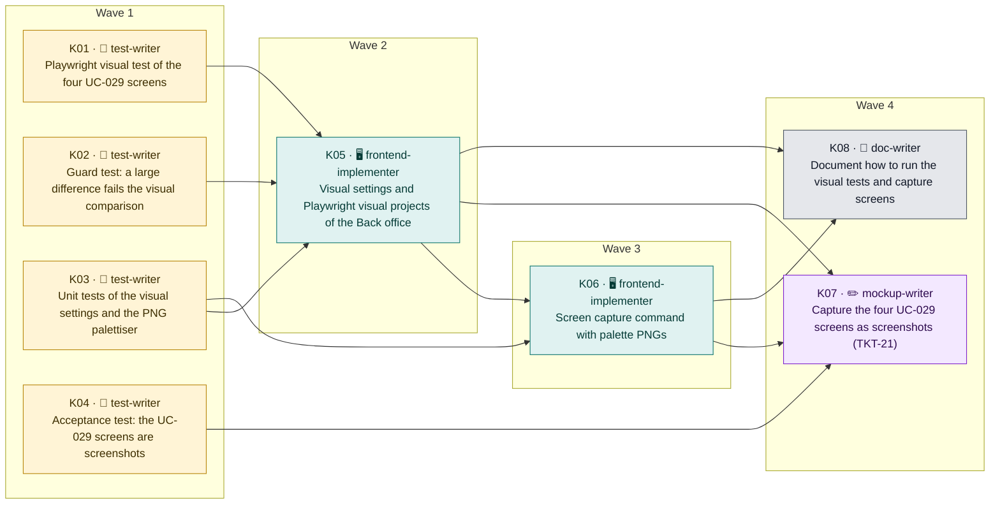

# T0.20: Plan

**Plan:** 🟢 Approved

<!-- ticket:specs -->
## 📚 Specifications

The technical pages, features, use cases and business rules of [TICKET.md](TICKET.md), copied by `python3 .claude/scripts/tickets/ticket_refs.py sync`.

- [🖥️ GUI and WebUI: design system](../../specs/technical/10-frontends.md#design-system)
- [🎬 UC-029: Create an Operator](../../specs/functional/use-cases/UC-029-create-an-operator.md)
- [📏 BR-008: Operator isolation](../../specs/functional/business-rules/BR-008-operator-isolation.md)
- [🧰 Deployment: CI/CD](../../specs/technical/09-deployment.md#ci)
- [🖼️ UC-029 A1](../../specs/functional/use-cases/UC-029-create-an-operator.md#screen-a1)
- [🖼️ UC-029 KO](../../specs/functional/use-cases/UC-029-create-an-operator.md#screen-ko)
- [🖼️ UC-029 A2](../../specs/functional/use-cases/UC-029-create-an-operator.md#screen-a2)
- [🖼️ UC-029 OK](../../specs/functional/use-cases/UC-029-create-an-operator.md#screen-ok)
<!-- /ticket:specs -->

## 🧭 Summary

T0.20 adds the visual test pipeline to the Back office and captures the four UC-029 screens. The plan has 8 tasks in 4 waves.

- **Wave 1 (tests first):** four test-writer tasks.
  - K01: the Playwright visual test of UC-029 (A1, A2, OK, KO) with the sample cast.
  - K02: a guard test with `test.fail()` that proves a large difference fails.
  - K03: unit tests for the visual settings and the palettiser.
  - K04: a Python acceptance test in `tests/` for the four screenshots.
- **Wave 2:** K05 (frontend-implementer) writes `visual/visual-settings.ts` and three Playwright projects in the Back office configuration: visual-light, visual-dark and visual-guard.
  - The baselines are the specification PNGs themselves, under `docs/specs/screens/`.
  - The view is 1280 x 800 at scale 1, in light and dark mode.
  - The difference allowed is in one constant, and CI never writes a baseline.
- **Wave 3:** K06 (frontend-implementer) writes the reusable `screens:capture <UC-ID>` command and the `e2e:visual` script. The capture palettises the PNGs with sharp so they pass SPEC-13.
- **Wave 4:**
  - K07 is the TKT-21 capture task (mockup-writer). It depends on every front-end task. On a fresh `compose.e2e.yaml` stack it first checks the app against the mock-ups, then captures the four screens in both modes. It sets the rows to 📸 Screenshot, deletes the mock-ups and runs `specs.py build`, then `check` must print nothing.
  - K08 (doc-writer) writes how to run and capture the visual tests in the Back office README.

No two tasks in a wave share a file. Each brief links its specification pages from `TICKET.md`.

## 📌 Assumptions

- The roadmap names UC-029 but no business rule, so BR-008 (applied by UC-029) is linked to give each criterion a rule.
- The roadmap row has no anchor of its own, so the ticket link points to the S04 sprint section.
- The allowed size of the "large difference" is not specified, so no figure is set; it is decided in the plan.
- The roadmap names no budget for this ticket, so none is listed.
- The "large difference" is not quantified by the specifications. The plan sets it as more than 2 % of the pixels (`maxDiffPixelRatio` 0.02) differing beyond Playwright's default per-pixel colour threshold of 0.2. Both are kept in one constant pair of `frontends/back-office/visual/visual-settings.ts`, for the person to confirm or change at approval.
- The baselines of the comparison are the specification PNGs themselves, in `docs/specs/screens/<UC-ID>/`, through Playwright's `snapshotPathTemplate`. They are not copies. Before the capture they are the mock-up renders. After it they are the screenshots, so the same test guards against regressions.
- The visual tests live in `frontends/back-office/e2e/visual/` (AGENT.md, Front-end tests) and run through the Back office's Playwright configuration. That is the configuration T0.10's CI step 5 job runs against `compose.e2e.yaml`, so no CI workflow changes. If T0.10's job calls a named package script, K06 makes that script include the visual projects.
- CI never writes a baseline: the configuration sets `updateSnapshots: 'none'`, and only the capture command passes `--update-snapshots`.
- Screenshots are palettised to 256 colours with `sharp` (libimagequant, no dithering), because SPEC-13 and `specs.py check` refuse a PNG that is not a palette PNG. This adds one pinned devDependency to the Back office and changes `pnpm-lock.yaml`.
- The capture pipeline sits in `frontends/back-office`, the ticket's area. Moving it to a shared package so that Ground control and the other front ends can reuse it is left to the tickets that need it, as a follow-up.
- The Back office from T0.14 and T0.16 uses Vitest for unit tests (the stack of docs/specs/technical/10-frontends.md). It also follows `prefers-color-scheme` for light and dark mode, and T0.16 provides e2e helpers to sign in as the Swarm administrator and to accept the Mission planner's invitation.
- The UC-029 visual test runs serially, in the order A1, A2, OK, KO, on a freshly started `compose.e2e.yaml` stack. Aerowing Services is created on the way to OK, then entered again with no Jurisdiction to show KO, which matches the KO mock-up (name taken and Jurisdiction missing). No test-only route is added to the app.
- The guard test proves acceptance criterion 1 with `test.fail()`: it compares the A1 screen rendered in dark mode with the light baseline. It runs only in the `visual-guard` project, which the capture command never runs, so it can never overwrite a baseline.
- If the app differs from a mock-up beyond the threshold, the capture task captures nothing and reports blocked with the diff images. The Back office screens belong to T0.16, which is out of scope here. T0.16's own capture task, run before T0.20 is merged, has already updated the mock-ups to what the app shows.
- The capture is run in the same Playwright browser environment as CI, so that the captured baselines match what CI renders.
- The Python acceptance test of criteria 2 and 3 sits in `tests/specs/screens/`, inside the ticket's `tests/` area, because no existing folder mirrors `docs/specs/screens`.

<!-- plan:graph -->

> [!NOTE]
> Generated from the json block at the end of this page by `python3 .claude/scripts/tickets/plan.py render`.
> To change a task, edit the json block, then render again: never edit this view by hand.

## Waves

| Wave | Tasks | Agents running at once |
| --- | --- | --- |
| 1 | [K01](#k01), [K02](#k02), [K03](#k03), [K04](#k04) | 4 of 4 |
| 2 | [K05](#k05) | 1 of 1 |
| 3 | [K06](#k06) | 1 of 1 |
| 4 | [K07](#k07), [K08](#k08) | 2 of 2 |

| Wave | Task | Agent | Depends on | Unblocks |
| --- | --- | --- | --- | --- |
| 1 | [K01](#k01) Playwright visual test of the four UC-029 screens | 🧪 test-writer | none | [K05](#k05) |
| 1 | [K02](#k02) Guard test: a large difference fails the visual comparison | 🧪 test-writer | none | [K05](#k05) |
| 1 | [K03](#k03) Unit tests of the visual settings and the PNG palettiser | 🧪 test-writer | none | [K05](#k05), [K06](#k06) |
| 1 | [K04](#k04) Acceptance test: the UC-029 screens are screenshots | 🧪 test-writer | none | [K07](#k07) |
| 2 | [K05](#k05) Visual settings and Playwright visual projects of the Back office | 🖥️ frontend-implementer | [K01](#k01), [K02](#k02), [K03](#k03) | [K06](#k06), [K07](#k07), [K08](#k08) |
| 3 | [K06](#k06) Screen capture command with palette PNGs | 🖥️ frontend-implementer | [K03](#k03), [K05](#k05) | [K07](#k07), [K08](#k08) |
| 4 | [K07](#k07) Capture the four UC-029 screens as screenshots (TKT-21) | ✏️ mockup-writer | [K04](#k04), [K05](#k05), [K06](#k06) | none |
| 4 | [K08](#k08) Document how to run the visual tests and capture screens | 📝 doc-writer | [K05](#k05), [K06](#k06) | none |

## Dependency graph



## Tasks

### <a id="k01"></a>K01: Playwright visual test of the four UC-029 screens

| Agent | Wave | Depends on | Unblocks |
| --- | --- | --- | --- |
| 🧪 test-writer | 1 | none | [K05](#k05) |

**Files** (only this task may change them in its wave):

- `frontends/back-office/e2e/visual/uc-029-create-an-operator.spec.ts`
- `frontends/back-office/e2e/visual/sample-cast.ts`

**Done when:** Both files exist. `pnpm --filter ./frontends/back-office exec playwright test --list --grep @visual` lists the four UC-029 tests once K05 is integrated (the files may fail to compile before then). `pnpm --filter ./frontends/back-office run lint` reports nothing on these files.

**Brief:**

Write the Playwright visual test that renders every state of UC-029 from the real Back office and compares it with its specification PNG. It covers acceptance criteria 1 and 2 of docs/tickets/T0.20/TICKET.md.

Specification it applies:
- docs/specs/technical/10-frontends.md#design-system: "Playwright renders each screen of the use cases with the specification's sample data and compares it with the mock-up PNG, in light and dark mode; a large difference fails the build".
- docs/specs/technical/09-deployment.md#ci: step 5, Playwright against the real images started by compose.e2e.yaml.
- docs/specs/visual-identity.md#screens: the screen size and the sample cast.
- docs/specs/functional/use-cases/UC-029-create-an-operator.md: the main flow, alternative flows A1 and A2, and the screen rows A1, KO, A2 and OK.
- docs/specs/functional/business-rules/BR-008-operator-isolation.md: the OK state shows the Operator created and isolated.

What to write:
- `frontends/back-office/e2e/visual/sample-cast.ts`: the sample data of docs/specs/visual-identity.md#screens used by UC-029, as exported constants. They are the Operator `Aerowing Services`, deployment Cloud, Jurisdiction `EU (EASA)`, the default LLM provider and Anchoring, the Mission planner `Léa Martin` and her e-mail address `lea.martin@aerowing.example`. Take each value from docs/specs/screens/mockups/UC-029/*.html, and invent no value.
- `frontends/back-office/e2e/visual/uc-029-create-an-operator.spec.ts`: one `test.describe.serial`, tagged `@visual`, with one test per state in this order.
  - A1: sign in as the Swarm administrator, open ➕ Operators, then ➕ Create an Operator, and fill the entry with the cast.
  - A2: go on to 👥 People and enter Léa Martin and her e-mail address.
  - OK: create the Operator, let Léa Martin accept the invitation and sign in, then show the Swarm administrator's view of the created Operator.
  - KO: enter Aerowing Services again with no Jurisdiction and submit, so the name is taken and the Jurisdiction is missing, as the KO mock-up shows.
  - Each test ends with `await expect(page).toHaveScreenshot(screenName(USE_CASE, node, colourScheme))`.
- Import `screenName` and the colour scheme of the running project (`testInfo.project.use.colorScheme`) from `frontends/back-office/visual/visual-settings.ts`. Task K05 writes that file, so the import fails until then.
- Drive the app through roles and labels, and reuse the sign-in and invitation helpers of the Back office e2e tests delivered by T0.16 (import them, do not copy them). Do not add test-only routes or hooks to the app.
- Read the four mock-ups in docs/specs/screens/mockups/UC-029/ to know what each state must show.

Rules: AGENT.md "Front-end tests" (Playwright in `frontends/<frontend>/e2e/`, against the real images), strict TypeScript of `@swarm/config`, no `any`.

### <a id="k02"></a>K02: Guard test: a large difference fails the visual comparison

| Agent | Wave | Depends on | Unblocks |
| --- | --- | --- | --- |
| 🧪 test-writer | 1 | none | [K05](#k05) |

**Files** (only this task may change them in its wave):

- `frontends/back-office/e2e/visual/large-difference.spec.ts`

**Done when:** The file exists and is listed by `pnpm --filter ./frontends/back-office exec playwright test --list --project=visual-guard` once K05 is integrated. `pnpm --filter ./frontends/back-office run lint` reports nothing on it.

**Brief:**

Write the Playwright test proving acceptance criterion 1 of docs/tickets/T0.20/TICKET.md: when a screen differs from its PNG by more than the allowed difference, the build fails.

Specification it applies:
- docs/specs/technical/10-frontends.md#design-system: "a large difference fails the build".
- docs/specs/technical/09-deployment.md#ci: step 5.
- docs/specs/functional/use-cases/UC-029-create-an-operator.md#screen-a1: the screen used as the reference.
- docs/specs/functional/business-rules/BR-008-operator-isolation.md: cited by the criterion.

What to write, in `frontends/back-office/e2e/visual/large-difference.spec.ts`:
- One test marked `test.fail()` and tagged `@visual-guard`.
- It signs in as the Swarm administrator with T0.16's e2e helper and opens ➕ Create an Operator (the A1 state).
- It forces the dark colour scheme with `page.emulateMedia({ colorScheme: 'dark' })`.
- It compares the page with the light baseline: `expect(page).toHaveScreenshot(screenName('UC-029', 'a1', 'light'))`.
- The comparison must fail on the real threshold of the configuration, so the test passes only while a large difference is refused.
- Import `screenName` from `frontends/back-office/visual/visual-settings.ts` (task K05).
- This test runs only in the `visual-guard` project (K05). The capture command never runs that project, so it can never overwrite a baseline.

Rules: AGENT.md "Front-end tests", strict TypeScript, no `any`.

### <a id="k03"></a>K03: Unit tests of the visual settings and the PNG palettiser

| Agent | Wave | Depends on | Unblocks |
| --- | --- | --- | --- |
| 🧪 test-writer | 1 | none | [K05](#k05), [K06](#k06) |

**Files** (only this task may change them in its wave):

- `frontends/back-office/visual/visual-settings.test.ts`
- `frontends/back-office/visual/palettise-screens.test.ts`

**Done when:** Both test files exist and compile against the exported names listed in this brief. `pnpm --filter ./frontends/back-office run lint` reports nothing on them.

**Brief:**

Write the Vitest unit tests of the two helpers of the visual pipeline. The helpers live in `frontends/back-office/visual/`, outside `e2e/`, so Playwright never loads these tests.

Specification it applies:
- docs/specs/visual-identity.md#screens: `screen.width` x `screen.height`, scale 1, light and dark, PNGs at `screens/<UC-ID>/<node>.png` and `<node>.dark.png`.
- docs/specs/technical/10-frontends.md#design-system: the visual tests.
- docs/specs/functional/use-cases/UC-029-create-an-operator.md: the screens named in the examples.
- docs/specs/functional/business-rules/BR-008-operator-isolation.md: cited by the ticket's criteria.
- .claude/rules/specs.md SPEC-12 and SPEC-13: 256-colour palette PNGs at the exact screen size.

`visual-settings.test.ts`, for `frontends/back-office/visual/visual-settings.ts` (task K05):
- `SCREEN_WIDTH_PX` and `SCREEN_HEIGHT_PX` equal the `screen.width` and `screen.height` tokens, parsed by the test from docs/specs/visual-identity.md (no hard-coded 1280 or 800).
- `DEVICE_SCALE_FACTOR` is 1.
- `COLOUR_SCHEMES` is light then dark.
- `screenName('UC-029', 'a1', 'light')` returns `['UC-029', 'a1.png']`, and dark returns `['UC-029', 'a1.dark.png']`.
- `SCREENS_DIR` is an absolute path ending in `docs/specs/screens` that exists.
- `MAX_DIFF_PIXEL_RATIO` is 0.02 and `PIXEL_THRESHOLD` is 0.2 (the plan's assumption).
- `PROJECTS` names `visual-light`, `visual-dark` and `visual-guard`.

`palettise-screens.test.ts`, for `frontends/back-office/visual/palettise-screens.ts` (task K06):
- Create an RGBA PNG of the screen size with many colours in a temporary folder, using `sharp`.
- `palettise(path)` rewrites it in place: byte 25 of the file (IHDR colour type) is 3, the size is unchanged and the palette holds at most 256 colours.
- Palettising twice gives a file that is still a valid palette PNG of the same size.
- A PNG of another size is refused with an error naming the expected size.

The tests fail until K05 and K06 land. Rules: strict TypeScript, no `any`, test names as sentences.

### <a id="k04"></a>K04: Acceptance test: the UC-029 screens are screenshots

| Agent | Wave | Depends on | Unblocks |
| --- | --- | --- | --- |
| 🧪 test-writer | 1 | none | [K07](#k07) |

**Files** (only this task may change them in its wave):

- `tests/specs/screens/test_uc_029_screenshots.py`

**Done when:** `uv run ruff check tests/specs/screens` and `uv run ruff format --check tests/specs/screens/test_uc_029_screenshots.py` pass. `uv run pytest tests/specs/screens -n 2` collects the parametrised tests, which fail only on the missing screenshots until K07.

**Brief:**

Write the Python acceptance test of criteria 2 and 3 of docs/tickets/T0.20/TICKET.md: the four screens A1, KO, A2 and OK of UC-029 are 📸 Screenshot in light and dark mode at `screen.width` x `screen.height`, and their mock-ups are deleted.

Specification it applies:
- docs/specs/visual-identity.md#screens: the screen size, the two modes, and that the mock-up is deleted once the screen is a screenshot.
- docs/specs/functional/use-cases/UC-029-create-an-operator.md#screens: the rows of A1, KO, A2 and OK.
- docs/specs/functional/business-rules/BR-008-operator-isolation.md: cited by the criteria.
- docs/specs/technical/10-frontends.md#design-system: "Once a screen matches, its row becomes 📸 Screenshot".
- .claude/rules/specs.md SPEC-12 and SPEC-13: 256-colour palette PNGs, colour type 3.

What to write, in `tests/specs/screens/test_uc_029_screenshots.py`: one class `TestUc029Screenshots`, parametrised over the nodes `a1`, `ko`, `a2` and `ok`, with these tests.
- The row `<a id="screen-<node>"></a>` of the UC-029 page has the source `📸 Screenshot`.
- `docs/specs/screens/UC-029/<node>.png` and `<node>.dark.png` both exist.
- Each is exactly the size of the `screen.width` and `screen.height` tokens, parsed from docs/specs/visual-identity.md.
- Each is a palette PNG (IHDR colour type 3, read with `struct`).
- `docs/specs/screens/mockups/UC-029/<node>.html` does not exist.

Rules: AGENT.md "Tests" and "Code rules never to break" for `tests/`.
- `from __future__ import annotations`, typed signatures, no `Any` and no `object` as a type.
- Constants are `UPPER_CASE` `ClassVar`s, and no dict with hard-coded keys inside a method.
- Test names are sentences, there is no `__init__.py`, and the repository root comes from `Path(__file__).resolve().parents[3]`.
- The test fails until the capture task K07 lands.

### <a id="k05"></a>K05: Visual settings and Playwright visual projects of the Back office

| Agent | Wave | Depends on | Unblocks |
| --- | --- | --- | --- |
| 🖥️ frontend-implementer | 2 | [K01](#k01), [K02](#k02), [K03](#k03) | [K06](#k06), [K07](#k07), [K08](#k08) |

**Files** (only this task may change them in its wave):

- `frontends/back-office/visual/visual-settings.ts`
- `frontends/back-office/playwright.config.ts`
- `frontends/back-office/vitest.config.ts`

**Done when:** Three commands pass: `pnpm --filter ./frontends/back-office exec vitest run visual/visual-settings.test.ts`, `pnpm --filter ./frontends/back-office run typecheck` and `pnpm --filter ./frontends/back-office run lint`. `pnpm --filter ./frontends/back-office exec playwright test --list --project=visual-light --project=visual-dark --project=visual-guard` lists the four UC-029 tests in each mode and the guard test.

**Brief:**

Make the Back office's Playwright run compare every screen with its specification PNG in light and dark mode, and fail on a large difference. This covers acceptance criterion 1 of docs/tickets/T0.20/TICKET.md.

Specification it applies:
- docs/specs/technical/10-frontends.md#design-system.
- docs/specs/technical/09-deployment.md#ci: step 5, "Playwright against the real images started by compose.e2e.yaml; visual comparison with the specification mock-ups".
- docs/specs/visual-identity.md#screens: "a capture of the real window at exactly screen.width x screen.height, scale 1, once in light and once in dark mode".
- docs/specs/functional/use-cases/UC-029-create-an-operator.md and docs/specs/functional/business-rules/BR-008-operator-isolation.md: the screens under test.

What to write:
1. `frontends/back-office/visual/visual-settings.ts` exports exactly what the tests of K03 expect:
   - `SCREEN_WIDTH_PX` = 1280 and `SCREEN_HEIGHT_PX` = 800, the tokens of docs/specs/visual-identity.md#screens;
   - `DEVICE_SCALE_FACTOR` = 1 and `COLOUR_SCHEMES` = ['light', 'dark'];
   - `MAX_DIFF_PIXEL_RATIO` = 0.02 and `PIXEL_THRESHOLD` = 0.2, which define the large difference (a plan assumption, kept in this one place);
   - `SCREENS_DIR`, the absolute path of `docs/specs/screens`;
   - `PROJECTS` with the names `visual-light`, `visual-dark` and `visual-guard`;
   - `screenName(useCase, node, colourScheme)`, which returns `[useCase, node + '.png']` in light mode and `[useCase, node + '.dark.png']` in dark mode.
2. `frontends/back-office/playwright.config.ts`: extend the configuration of T0.10 and T0.16. Keep their projects and their base URL on the compose.e2e.yaml stack, and make their projects ignore `e2e/visual/**`. Add three projects on `e2e/visual`:
   - `visual-light` and `visual-dark` match `uc-*.spec.ts`, use a 1280 x 800 viewport, `deviceScaleFactor` 1 and their `colorScheme`;
   - `visual-guard` matches `large-difference.spec.ts`, in light mode.
   - Set `snapshotPathTemplate` so that `{arg}{ext}` resolves under `SCREENS_DIR`: the baselines are the specification PNGs themselves.
   - Set `expect.toHaveScreenshot` with `maxDiffPixelRatio: MAX_DIFF_PIXEL_RATIO`, `threshold: PIXEL_THRESHOLD`, `animations: 'disabled'`, `caret: 'hide'` and `scale: 'css'`.
   - Set `updateSnapshots: 'none'`, so that CI never writes a baseline. Only an explicit `--update-snapshots` does.
3. `frontends/back-office/vitest.config.ts`: include `visual/**/*.test.ts` in the unit tests, and keep `e2e/` excluded.

Do not change the app's screens (T0.16 owns them) or the CI workflows. T0.10's e2e job runs this configuration. Rules: strict TypeScript of `@swarm/config`, no `any`.

### <a id="k06"></a>K06: Screen capture command with palette PNGs

| Agent | Wave | Depends on | Unblocks |
| --- | --- | --- | --- |
| 🖥️ frontend-implementer | 3 | [K03](#k03), [K05](#k05) | [K07](#k07), [K08](#k08) |

**Files** (only this task may change them in its wave):

- `frontends/back-office/visual/palettise-screens.ts`
- `frontends/back-office/visual/capture-screens.ts`
- `frontends/back-office/package.json`
- `pnpm-lock.yaml`

**Done when:** Four commands pass: `pnpm install --frozen-lockfile` at the root, `pnpm --filter ./frontends/back-office exec vitest run visual/palettise-screens.test.ts`, `pnpm --filter ./frontends/back-office run typecheck` and `pnpm --filter ./frontends/back-office run lint`.

**Brief:**

Write the screenshot pipeline that capture tasks use (TKT-21). It captures the screens of a use case from the running Back office, in light and dark mode, as specification PNGs.

Specification it applies:
- docs/specs/visual-identity.md#screens: a capture of the real window at `screen.width` x `screen.height`, scale 1, light and dark, at `screens/<UC-ID>/<node>.png` and `<node>.dark.png`.
- docs/specs/technical/10-frontends.md#design-system.
- docs/specs/technical/09-deployment.md#ci: step 5.
- docs/specs/functional/use-cases/UC-029-create-an-operator.md: its first user.
- docs/specs/functional/business-rules/BR-008-operator-isolation.md: cited by the criteria.
- .claude/rules/specs.md SPEC-12 and SPEC-13: 256-colour palette PNGs, checked by `specs.py check`.

What to write:
1. `frontends/back-office/visual/palettise-screens.ts` exports `palettise(path)`, which K03's test drives:
   - it refuses a PNG that is not `SCREEN_WIDTH_PX` x `SCREEN_HEIGHT_PX` (from `visual-settings.ts`), with an error naming the expected size;
   - otherwise it rewrites the PNG in place as a palette PNG with `sharp(...).png({ palette: true, colours: 256, dither: 0 })`, through a temporary file.
2. `frontends/back-office/visual/capture-screens.ts` is a Node script that takes one or more use case IDs (such as `UC-029`). For each one it:
   - runs `playwright test --project=visual-light --project=visual-dark --grep <UC-ID> --update-snapshots=all`, never the `visual-guard` project;
   - palettises every PNG of `docs/specs/screens/<UC-ID>/`;
   - prints the files it wrote;
   - exits non-zero when Playwright or a palettise step fails.
3. `frontends/back-office/package.json`:
   - add `sharp` as a pinned devDependency;
   - add the script `screens:capture` (runs `visual/capture-screens.ts` and passes on its arguments);
   - add the script `e2e:visual`, which compares the screens with the projects `visual-light`, `visual-dark` and `visual-guard`;
   - make sure the e2e script that T0.10's CI job calls also runs those three projects.
4. `pnpm-lock.yaml`: run `pnpm install`.

Rules: strict TypeScript, no `any`. Report the choice of `sharp` against the alternatives (`pngjs` with a quantiser, or Pillow through Python) as a decision.

### <a id="k07"></a>K07: Capture the four UC-029 screens as screenshots (TKT-21)

| Agent | Wave | Depends on | Unblocks |
| --- | --- | --- | --- |
| ✏️ mockup-writer | 4 | [K04](#k04), [K05](#k05), [K06](#k06) | none |

**Files** (only this task may change them in its wave):

- `docs/specs/screens/UC-029/a1.png`
- `docs/specs/screens/UC-029/a1.dark.png`
- `docs/specs/screens/UC-029/ko.png`
- `docs/specs/screens/UC-029/ko.dark.png`
- `docs/specs/screens/UC-029/a2.png`
- `docs/specs/screens/UC-029/a2.dark.png`
- `docs/specs/screens/UC-029/ok.png`
- `docs/specs/screens/UC-029/ok.dark.png`
- `docs/specs/screens/mockups/UC-029/a1.html`
- `docs/specs/screens/mockups/UC-029/ko.html`
- `docs/specs/screens/mockups/UC-029/a2.html`
- `docs/specs/screens/mockups/UC-029/ok.html`
- `docs/specs/functional/use-cases/UC-029-create-an-operator.md`

**Done when:** `python3 .claude/skills/write-specs/scripts/specs.py check` prints nothing. `uv run pytest tests/specs/screens -n 2` passes. `pnpm --filter ./frontends/back-office run e2e:visual` passes on a fresh compose.e2e.yaml stack. The four UC-029 rows read `📸 Screenshot`, and docs/specs/screens/mockups/UC-029/ no longer exists.

**Brief:**

Capture task (TKT-21). Capture the four UC-029 screens of the ticket's "Screens touched" from the running Back office, in light and dark mode, with the screenshot pipeline this ticket builds (T0.20). The screens are A1 Enter the Operator, KO Operator not created, A2 Invite the first Mission planner, and OK Operator created and isolated.

Specification it applies:
- docs/specs/visual-identity.md#screens: a capture of the real window at 1280 x 800, scale 1, light and dark; the mock-up is then deleted.
- docs/specs/technical/10-frontends.md#design-system: "Once a screen matches, its row becomes 📸 Screenshot".
- docs/specs/technical/09-deployment.md#ci: step 5.
- docs/specs/functional/use-cases/UC-029-create-an-operator.md#screens: the rows #screen-a1, #screen-ko, #screen-a2 and #screen-ok.
- docs/specs/functional/business-rules/BR-008-operator-isolation.md.
- .claude/rules/specs.md SPEC-12 and SPEC-13.

Steps:
1. Start a fresh e2e stack: `docker compose -f compose.e2e.yaml down -v`, then `docker compose -f compose.e2e.yaml up --build -d --wait`. The stack must be fresh because the test creates Aerowing Services.
2. Run `pnpm --filter ./frontends/back-office run e2e:visual`. The app is compared with the current mock-up PNGs and must pass.
   - If it fails, do not capture anything.
   - Copy Playwright's diff images and its report into docs/tickets/T0.20/tests-evidences/.
   - Report the task as blocked, naming each screen and mode over the threshold. The app's screens belong to T0.16.
3. Restart the stack fresh (step 1), then run `pnpm --filter ./frontends/back-office run screens:capture UC-029`. It writes and palettises the eight PNGs.
4. On docs/specs/functional/use-cases/UC-029-create-an-operator.md, change the source cell of the four rows from `✏️ Mock-up` to `📸 Screenshot`. Change nothing else.
5. Delete docs/specs/screens/mockups/UC-029/a1.html, ko.html, a2.html and ok.html.
6. Run `python3 .claude/skills/write-specs/scripts/specs.py build`, then `python3 .claude/skills/write-specs/scripts/specs.py check` until it prints nothing. Never run `specs.py render` for UC-029, which would need the deleted mock-ups.
7. Restart the stack fresh and run `pnpm --filter ./frontends/back-office run e2e:visual` again. It now compares with the screenshots, and the guard test still passes.
8. Run `uv run pytest tests/specs/screens -n 2`.
9. Stop the stack with `docker compose -f compose.e2e.yaml down -v`.

Open each light and dark PNG and check that it shows its state as the use case describes. Never redraw a mock-up instead.

### <a id="k08"></a>K08: Document how to run the visual tests and capture screens

| Agent | Wave | Depends on | Unblocks |
| --- | --- | --- | --- |
| 📝 doc-writer | 4 | [K05](#k05), [K06](#k06) | none |

**Files** (only this task may change them in its wave):

- `frontends/back-office/README.md`

**Done when:** `frontends/back-office/README.md` has the section, and every command and constant it names exists in `frontends/back-office/package.json` or `frontends/back-office/visual/visual-settings.ts`.

**Brief:**

Add a section "Visual tests and screenshots" to `frontends/back-office/README.md`, creating the file if T0.14 did not. Write it in plain British English, with no em dash.

Specification it applies:
- docs/specs/technical/10-frontends.md#design-system.
- docs/specs/technical/09-deployment.md#ci: step 5.
- docs/specs/visual-identity.md#screens.
- docs/specs/functional/use-cases/UC-029-create-an-operator.md: the first use case captured.
- docs/specs/functional/business-rules/BR-008-operator-isolation.md: cited by the ticket's criteria.
- .claude/rules/tickets.md TKT-21.

What the section says, taken from the code of K05 and K06 only:
- The visual tests live in `e2e/visual/`, one spec per use case. They run in the Playwright projects `visual-light`, `visual-dark` and `visual-guard`, against the real images of `compose.e2e.yaml`.
- Their baselines are the PNGs of `docs/specs/screens/<UC-ID>/`.
- The allowed difference is `MAX_DIFF_PIXEL_RATIO` and `PIXEL_THRESHOLD` of `visual/visual-settings.ts`. Quote their values and say they are the only place to change it.
- The guard test proves that a large difference fails.
- How to run the comparison: `pnpm --filter ./frontends/back-office run e2e:visual`.
- How a front-end ticket captures its screens: start a fresh stack, run `screens:capture <UC-ID>`, set the rows to `📸 Screenshot`, delete the mock-ups, then `specs.py build` and `check`.
- CI never writes a baseline.

Invent no command or value that is not in those files.

<!-- /plan:graph -->

## Task graph

<details>
<summary>🤖 Task graph as read by <code>/ticket-run</code> (json)</summary>

```json
[
  {
    "id": "K01",
    "title": "Playwright visual test of the four UC-029 screens",
    "agent": "test-writer",
    "depends_on": [],
    "files": [
      "frontends/back-office/e2e/visual/uc-029-create-an-operator.spec.ts",
      "frontends/back-office/e2e/visual/sample-cast.ts"
    ],
    "brief": "Write the Playwright visual test that renders every state of UC-029 from the real Back office and compares it with its specification PNG. It covers acceptance criteria 1 and 2 of docs/tickets/T0.20/TICKET.md.\n\nSpecification it applies:\n- docs/specs/technical/10-frontends.md#design-system: \"Playwright renders each screen of the use cases with the specification's sample data and compares it with the mock-up PNG, in light and dark mode; a large difference fails the build\".\n- docs/specs/technical/09-deployment.md#ci: step 5, Playwright against the real images started by compose.e2e.yaml.\n- docs/specs/visual-identity.md#screens: the screen size and the sample cast.\n- docs/specs/functional/use-cases/UC-029-create-an-operator.md: the main flow, alternative flows A1 and A2, and the screen rows A1, KO, A2 and OK.\n- docs/specs/functional/business-rules/BR-008-operator-isolation.md: the OK state shows the Operator created and isolated.\n\nWhat to write:\n- `frontends/back-office/e2e/visual/sample-cast.ts`: the sample data of docs/specs/visual-identity.md#screens used by UC-029, as exported constants. They are the Operator `Aerowing Services`, deployment Cloud, Jurisdiction `EU (EASA)`, the default LLM provider and Anchoring, the Mission planner `Léa Martin` and her e-mail address `lea.martin@aerowing.example`. Take each value from docs/specs/screens/mockups/UC-029/*.html, and invent no value.\n- `frontends/back-office/e2e/visual/uc-029-create-an-operator.spec.ts`: one `test.describe.serial`, tagged `@visual`, with one test per state in this order.\n  - A1: sign in as the Swarm administrator, open ➕ Operators, then ➕ Create an Operator, and fill the entry with the cast.\n  - A2: go on to 👥 People and enter Léa Martin and her e-mail address.\n  - OK: create the Operator, let Léa Martin accept the invitation and sign in, then show the Swarm administrator's view of the created Operator.\n  - KO: enter Aerowing Services again with no Jurisdiction and submit, so the name is taken and the Jurisdiction is missing, as the KO mock-up shows.\n  - Each test ends with `await expect(page).toHaveScreenshot(screenName(USE_CASE, node, colourScheme))`.\n- Import `screenName` and the colour scheme of the running project (`testInfo.project.use.colorScheme`) from `frontends/back-office/visual/visual-settings.ts`. Task K05 writes that file, so the import fails until then.\n- Drive the app through roles and labels, and reuse the sign-in and invitation helpers of the Back office e2e tests delivered by T0.16 (import them, do not copy them). Do not add test-only routes or hooks to the app.\n- Read the four mock-ups in docs/specs/screens/mockups/UC-029/ to know what each state must show.\n\nRules: AGENT.md \"Front-end tests\" (Playwright in `frontends/<frontend>/e2e/`, against the real images), strict TypeScript of `@swarm/config`, no `any`.",
    "done_when": "Both files exist. `pnpm --filter ./frontends/back-office exec playwright test --list --grep @visual` lists the four UC-029 tests once K05 is integrated (the files may fail to compile before then). `pnpm --filter ./frontends/back-office run lint` reports nothing on these files.",
    "wave": 1
  },
  {
    "id": "K02",
    "title": "Guard test: a large difference fails the visual comparison",
    "agent": "test-writer",
    "depends_on": [],
    "files": [
      "frontends/back-office/e2e/visual/large-difference.spec.ts"
    ],
    "brief": "Write the Playwright test proving acceptance criterion 1 of docs/tickets/T0.20/TICKET.md: when a screen differs from its PNG by more than the allowed difference, the build fails.\n\nSpecification it applies:\n- docs/specs/technical/10-frontends.md#design-system: \"a large difference fails the build\".\n- docs/specs/technical/09-deployment.md#ci: step 5.\n- docs/specs/functional/use-cases/UC-029-create-an-operator.md#screen-a1: the screen used as the reference.\n- docs/specs/functional/business-rules/BR-008-operator-isolation.md: cited by the criterion.\n\nWhat to write, in `frontends/back-office/e2e/visual/large-difference.spec.ts`:\n- One test marked `test.fail()` and tagged `@visual-guard`.\n- It signs in as the Swarm administrator with T0.16's e2e helper and opens ➕ Create an Operator (the A1 state).\n- It forces the dark colour scheme with `page.emulateMedia({ colorScheme: 'dark' })`.\n- It compares the page with the light baseline: `expect(page).toHaveScreenshot(screenName('UC-029', 'a1', 'light'))`.\n- The comparison must fail on the real threshold of the configuration, so the test passes only while a large difference is refused.\n- Import `screenName` from `frontends/back-office/visual/visual-settings.ts` (task K05).\n- This test runs only in the `visual-guard` project (K05). The capture command never runs that project, so it can never overwrite a baseline.\n\nRules: AGENT.md \"Front-end tests\", strict TypeScript, no `any`.",
    "done_when": "The file exists and is listed by `pnpm --filter ./frontends/back-office exec playwright test --list --project=visual-guard` once K05 is integrated. `pnpm --filter ./frontends/back-office run lint` reports nothing on it.",
    "wave": 1
  },
  {
    "id": "K03",
    "title": "Unit tests of the visual settings and the PNG palettiser",
    "agent": "test-writer",
    "depends_on": [],
    "files": [
      "frontends/back-office/visual/visual-settings.test.ts",
      "frontends/back-office/visual/palettise-screens.test.ts"
    ],
    "brief": "Write the Vitest unit tests of the two helpers of the visual pipeline. The helpers live in `frontends/back-office/visual/`, outside `e2e/`, so Playwright never loads these tests.\n\nSpecification it applies:\n- docs/specs/visual-identity.md#screens: `screen.width` x `screen.height`, scale 1, light and dark, PNGs at `screens/<UC-ID>/<node>.png` and `<node>.dark.png`.\n- docs/specs/technical/10-frontends.md#design-system: the visual tests.\n- docs/specs/functional/use-cases/UC-029-create-an-operator.md: the screens named in the examples.\n- docs/specs/functional/business-rules/BR-008-operator-isolation.md: cited by the ticket's criteria.\n- .claude/rules/specs.md SPEC-12 and SPEC-13: 256-colour palette PNGs at the exact screen size.\n\n`visual-settings.test.ts`, for `frontends/back-office/visual/visual-settings.ts` (task K05):\n- `SCREEN_WIDTH_PX` and `SCREEN_HEIGHT_PX` equal the `screen.width` and `screen.height` tokens, parsed by the test from docs/specs/visual-identity.md (no hard-coded 1280 or 800).\n- `DEVICE_SCALE_FACTOR` is 1.\n- `COLOUR_SCHEMES` is light then dark.\n- `screenName('UC-029', 'a1', 'light')` returns `['UC-029', 'a1.png']`, and dark returns `['UC-029', 'a1.dark.png']`.\n- `SCREENS_DIR` is an absolute path ending in `docs/specs/screens` that exists.\n- `MAX_DIFF_PIXEL_RATIO` is 0.02 and `PIXEL_THRESHOLD` is 0.2 (the plan's assumption).\n- `PROJECTS` names `visual-light`, `visual-dark` and `visual-guard`.\n\n`palettise-screens.test.ts`, for `frontends/back-office/visual/palettise-screens.ts` (task K06):\n- Create an RGBA PNG of the screen size with many colours in a temporary folder, using `sharp`.\n- `palettise(path)` rewrites it in place: byte 25 of the file (IHDR colour type) is 3, the size is unchanged and the palette holds at most 256 colours.\n- Palettising twice gives a file that is still a valid palette PNG of the same size.\n- A PNG of another size is refused with an error naming the expected size.\n\nThe tests fail until K05 and K06 land. Rules: strict TypeScript, no `any`, test names as sentences.",
    "done_when": "Both test files exist and compile against the exported names listed in this brief. `pnpm --filter ./frontends/back-office run lint` reports nothing on them.",
    "wave": 1
  },
  {
    "id": "K04",
    "title": "Acceptance test: the UC-029 screens are screenshots",
    "agent": "test-writer",
    "depends_on": [],
    "files": [
      "tests/specs/screens/test_uc_029_screenshots.py"
    ],
    "brief": "Write the Python acceptance test of criteria 2 and 3 of docs/tickets/T0.20/TICKET.md: the four screens A1, KO, A2 and OK of UC-029 are 📸 Screenshot in light and dark mode at `screen.width` x `screen.height`, and their mock-ups are deleted.\n\nSpecification it applies:\n- docs/specs/visual-identity.md#screens: the screen size, the two modes, and that the mock-up is deleted once the screen is a screenshot.\n- docs/specs/functional/use-cases/UC-029-create-an-operator.md#screens: the rows of A1, KO, A2 and OK.\n- docs/specs/functional/business-rules/BR-008-operator-isolation.md: cited by the criteria.\n- docs/specs/technical/10-frontends.md#design-system: \"Once a screen matches, its row becomes 📸 Screenshot\".\n- .claude/rules/specs.md SPEC-12 and SPEC-13: 256-colour palette PNGs, colour type 3.\n\nWhat to write, in `tests/specs/screens/test_uc_029_screenshots.py`: one class `TestUc029Screenshots`, parametrised over the nodes `a1`, `ko`, `a2` and `ok`, with these tests.\n- The row `<a id=\"screen-<node>\"></a>` of the UC-029 page has the source `📸 Screenshot`.\n- `docs/specs/screens/UC-029/<node>.png` and `<node>.dark.png` both exist.\n- Each is exactly the size of the `screen.width` and `screen.height` tokens, parsed from docs/specs/visual-identity.md.\n- Each is a palette PNG (IHDR colour type 3, read with `struct`).\n- `docs/specs/screens/mockups/UC-029/<node>.html` does not exist.\n\nRules: AGENT.md \"Tests\" and \"Code rules never to break\" for `tests/`.\n- `from __future__ import annotations`, typed signatures, no `Any` and no `object` as a type.\n- Constants are `UPPER_CASE` `ClassVar`s, and no dict with hard-coded keys inside a method.\n- Test names are sentences, there is no `__init__.py`, and the repository root comes from `Path(__file__).resolve().parents[3]`.\n- The test fails until the capture task K07 lands.",
    "done_when": "`uv run ruff check tests/specs/screens` and `uv run ruff format --check tests/specs/screens/test_uc_029_screenshots.py` pass. `uv run pytest tests/specs/screens -n 2` collects the parametrised tests, which fail only on the missing screenshots until K07.",
    "wave": 1
  },
  {
    "id": "K05",
    "title": "Visual settings and Playwright visual projects of the Back office",
    "agent": "frontend-implementer",
    "depends_on": [
      "K01",
      "K02",
      "K03"
    ],
    "files": [
      "frontends/back-office/visual/visual-settings.ts",
      "frontends/back-office/playwright.config.ts",
      "frontends/back-office/vitest.config.ts"
    ],
    "brief": "Make the Back office's Playwright run compare every screen with its specification PNG in light and dark mode, and fail on a large difference. This covers acceptance criterion 1 of docs/tickets/T0.20/TICKET.md.\n\nSpecification it applies:\n- docs/specs/technical/10-frontends.md#design-system.\n- docs/specs/technical/09-deployment.md#ci: step 5, \"Playwright against the real images started by compose.e2e.yaml; visual comparison with the specification mock-ups\".\n- docs/specs/visual-identity.md#screens: \"a capture of the real window at exactly screen.width x screen.height, scale 1, once in light and once in dark mode\".\n- docs/specs/functional/use-cases/UC-029-create-an-operator.md and docs/specs/functional/business-rules/BR-008-operator-isolation.md: the screens under test.\n\nWhat to write:\n1. `frontends/back-office/visual/visual-settings.ts` exports exactly what the tests of K03 expect:\n   - `SCREEN_WIDTH_PX` = 1280 and `SCREEN_HEIGHT_PX` = 800, the tokens of docs/specs/visual-identity.md#screens;\n   - `DEVICE_SCALE_FACTOR` = 1 and `COLOUR_SCHEMES` = ['light', 'dark'];\n   - `MAX_DIFF_PIXEL_RATIO` = 0.02 and `PIXEL_THRESHOLD` = 0.2, which define the large difference (a plan assumption, kept in this one place);\n   - `SCREENS_DIR`, the absolute path of `docs/specs/screens`;\n   - `PROJECTS` with the names `visual-light`, `visual-dark` and `visual-guard`;\n   - `screenName(useCase, node, colourScheme)`, which returns `[useCase, node + '.png']` in light mode and `[useCase, node + '.dark.png']` in dark mode.\n2. `frontends/back-office/playwright.config.ts`: extend the configuration of T0.10 and T0.16. Keep their projects and their base URL on the compose.e2e.yaml stack, and make their projects ignore `e2e/visual/**`. Add three projects on `e2e/visual`:\n   - `visual-light` and `visual-dark` match `uc-*.spec.ts`, use a 1280 x 800 viewport, `deviceScaleFactor` 1 and their `colorScheme`;\n   - `visual-guard` matches `large-difference.spec.ts`, in light mode.\n   - Set `snapshotPathTemplate` so that `{arg}{ext}` resolves under `SCREENS_DIR`: the baselines are the specification PNGs themselves.\n   - Set `expect.toHaveScreenshot` with `maxDiffPixelRatio: MAX_DIFF_PIXEL_RATIO`, `threshold: PIXEL_THRESHOLD`, `animations: 'disabled'`, `caret: 'hide'` and `scale: 'css'`.\n   - Set `updateSnapshots: 'none'`, so that CI never writes a baseline. Only an explicit `--update-snapshots` does.\n3. `frontends/back-office/vitest.config.ts`: include `visual/**/*.test.ts` in the unit tests, and keep `e2e/` excluded.\n\nDo not change the app's screens (T0.16 owns them) or the CI workflows. T0.10's e2e job runs this configuration. Rules: strict TypeScript of `@swarm/config`, no `any`.",
    "done_when": "Three commands pass: `pnpm --filter ./frontends/back-office exec vitest run visual/visual-settings.test.ts`, `pnpm --filter ./frontends/back-office run typecheck` and `pnpm --filter ./frontends/back-office run lint`. `pnpm --filter ./frontends/back-office exec playwright test --list --project=visual-light --project=visual-dark --project=visual-guard` lists the four UC-029 tests in each mode and the guard test.",
    "wave": 2
  },
  {
    "id": "K06",
    "title": "Screen capture command with palette PNGs",
    "agent": "frontend-implementer",
    "depends_on": [
      "K03",
      "K05"
    ],
    "files": [
      "frontends/back-office/visual/palettise-screens.ts",
      "frontends/back-office/visual/capture-screens.ts",
      "frontends/back-office/package.json",
      "pnpm-lock.yaml"
    ],
    "brief": "Write the screenshot pipeline that capture tasks use (TKT-21). It captures the screens of a use case from the running Back office, in light and dark mode, as specification PNGs.\n\nSpecification it applies:\n- docs/specs/visual-identity.md#screens: a capture of the real window at `screen.width` x `screen.height`, scale 1, light and dark, at `screens/<UC-ID>/<node>.png` and `<node>.dark.png`.\n- docs/specs/technical/10-frontends.md#design-system.\n- docs/specs/technical/09-deployment.md#ci: step 5.\n- docs/specs/functional/use-cases/UC-029-create-an-operator.md: its first user.\n- docs/specs/functional/business-rules/BR-008-operator-isolation.md: cited by the criteria.\n- .claude/rules/specs.md SPEC-12 and SPEC-13: 256-colour palette PNGs, checked by `specs.py check`.\n\nWhat to write:\n1. `frontends/back-office/visual/palettise-screens.ts` exports `palettise(path)`, which K03's test drives:\n   - it refuses a PNG that is not `SCREEN_WIDTH_PX` x `SCREEN_HEIGHT_PX` (from `visual-settings.ts`), with an error naming the expected size;\n   - otherwise it rewrites the PNG in place as a palette PNG with `sharp(...).png({ palette: true, colours: 256, dither: 0 })`, through a temporary file.\n2. `frontends/back-office/visual/capture-screens.ts` is a Node script that takes one or more use case IDs (such as `UC-029`). For each one it:\n   - runs `playwright test --project=visual-light --project=visual-dark --grep <UC-ID> --update-snapshots=all`, never the `visual-guard` project;\n   - palettises every PNG of `docs/specs/screens/<UC-ID>/`;\n   - prints the files it wrote;\n   - exits non-zero when Playwright or a palettise step fails.\n3. `frontends/back-office/package.json`:\n   - add `sharp` as a pinned devDependency;\n   - add the script `screens:capture` (runs `visual/capture-screens.ts` and passes on its arguments);\n   - add the script `e2e:visual`, which compares the screens with the projects `visual-light`, `visual-dark` and `visual-guard`;\n   - make sure the e2e script that T0.10's CI job calls also runs those three projects.\n4. `pnpm-lock.yaml`: run `pnpm install`.\n\nRules: strict TypeScript, no `any`. Report the choice of `sharp` against the alternatives (`pngjs` with a quantiser, or Pillow through Python) as a decision.",
    "done_when": "Four commands pass: `pnpm install --frozen-lockfile` at the root, `pnpm --filter ./frontends/back-office exec vitest run visual/palettise-screens.test.ts`, `pnpm --filter ./frontends/back-office run typecheck` and `pnpm --filter ./frontends/back-office run lint`.",
    "wave": 3
  },
  {
    "id": "K07",
    "title": "Capture the four UC-029 screens as screenshots (TKT-21)",
    "agent": "mockup-writer",
    "depends_on": [
      "K04",
      "K05",
      "K06"
    ],
    "files": [
      "docs/specs/screens/UC-029/a1.png",
      "docs/specs/screens/UC-029/a1.dark.png",
      "docs/specs/screens/UC-029/ko.png",
      "docs/specs/screens/UC-029/ko.dark.png",
      "docs/specs/screens/UC-029/a2.png",
      "docs/specs/screens/UC-029/a2.dark.png",
      "docs/specs/screens/UC-029/ok.png",
      "docs/specs/screens/UC-029/ok.dark.png",
      "docs/specs/screens/mockups/UC-029/a1.html",
      "docs/specs/screens/mockups/UC-029/ko.html",
      "docs/specs/screens/mockups/UC-029/a2.html",
      "docs/specs/screens/mockups/UC-029/ok.html",
      "docs/specs/functional/use-cases/UC-029-create-an-operator.md"
    ],
    "brief": "Capture task (TKT-21). Capture the four UC-029 screens of the ticket's \"Screens touched\" from the running Back office, in light and dark mode, with the screenshot pipeline this ticket builds (T0.20). The screens are A1 Enter the Operator, KO Operator not created, A2 Invite the first Mission planner, and OK Operator created and isolated.\n\nSpecification it applies:\n- docs/specs/visual-identity.md#screens: a capture of the real window at 1280 x 800, scale 1, light and dark; the mock-up is then deleted.\n- docs/specs/technical/10-frontends.md#design-system: \"Once a screen matches, its row becomes 📸 Screenshot\".\n- docs/specs/technical/09-deployment.md#ci: step 5.\n- docs/specs/functional/use-cases/UC-029-create-an-operator.md#screens: the rows #screen-a1, #screen-ko, #screen-a2 and #screen-ok.\n- docs/specs/functional/business-rules/BR-008-operator-isolation.md.\n- .claude/rules/specs.md SPEC-12 and SPEC-13.\n\nSteps:\n1. Start a fresh e2e stack: `docker compose -f compose.e2e.yaml down -v`, then `docker compose -f compose.e2e.yaml up --build -d --wait`. The stack must be fresh because the test creates Aerowing Services.\n2. Run `pnpm --filter ./frontends/back-office run e2e:visual`. The app is compared with the current mock-up PNGs and must pass.\n   - If it fails, do not capture anything.\n   - Copy Playwright's diff images and its report into docs/tickets/T0.20/tests-evidences/.\n   - Report the task as blocked, naming each screen and mode over the threshold. The app's screens belong to T0.16.\n3. Restart the stack fresh (step 1), then run `pnpm --filter ./frontends/back-office run screens:capture UC-029`. It writes and palettises the eight PNGs.\n4. On docs/specs/functional/use-cases/UC-029-create-an-operator.md, change the source cell of the four rows from `✏️ Mock-up` to `📸 Screenshot`. Change nothing else.\n5. Delete docs/specs/screens/mockups/UC-029/a1.html, ko.html, a2.html and ok.html.\n6. Run `python3 .claude/skills/write-specs/scripts/specs.py build`, then `python3 .claude/skills/write-specs/scripts/specs.py check` until it prints nothing. Never run `specs.py render` for UC-029, which would need the deleted mock-ups.\n7. Restart the stack fresh and run `pnpm --filter ./frontends/back-office run e2e:visual` again. It now compares with the screenshots, and the guard test still passes.\n8. Run `uv run pytest tests/specs/screens -n 2`.\n9. Stop the stack with `docker compose -f compose.e2e.yaml down -v`.\n\nOpen each light and dark PNG and check that it shows its state as the use case describes. Never redraw a mock-up instead.",
    "done_when": "`python3 .claude/skills/write-specs/scripts/specs.py check` prints nothing. `uv run pytest tests/specs/screens -n 2` passes. `pnpm --filter ./frontends/back-office run e2e:visual` passes on a fresh compose.e2e.yaml stack. The four UC-029 rows read `📸 Screenshot`, and docs/specs/screens/mockups/UC-029/ no longer exists.",
    "wave": 4
  },
  {
    "id": "K08",
    "title": "Document how to run the visual tests and capture screens",
    "agent": "doc-writer",
    "depends_on": [
      "K05",
      "K06"
    ],
    "files": [
      "frontends/back-office/README.md"
    ],
    "brief": "Add a section \"Visual tests and screenshots\" to `frontends/back-office/README.md`, creating the file if T0.14 did not. Write it in plain British English, with no em dash.\n\nSpecification it applies:\n- docs/specs/technical/10-frontends.md#design-system.\n- docs/specs/technical/09-deployment.md#ci: step 5.\n- docs/specs/visual-identity.md#screens.\n- docs/specs/functional/use-cases/UC-029-create-an-operator.md: the first use case captured.\n- docs/specs/functional/business-rules/BR-008-operator-isolation.md: cited by the ticket's criteria.\n- .claude/rules/tickets.md TKT-21.\n\nWhat the section says, taken from the code of K05 and K06 only:\n- The visual tests live in `e2e/visual/`, one spec per use case. They run in the Playwright projects `visual-light`, `visual-dark` and `visual-guard`, against the real images of `compose.e2e.yaml`.\n- Their baselines are the PNGs of `docs/specs/screens/<UC-ID>/`.\n- The allowed difference is `MAX_DIFF_PIXEL_RATIO` and `PIXEL_THRESHOLD` of `visual/visual-settings.ts`. Quote their values and say they are the only place to change it.\n- The guard test proves that a large difference fails.\n- How to run the comparison: `pnpm --filter ./frontends/back-office run e2e:visual`.\n- How a front-end ticket captures its screens: start a fresh stack, run `screens:capture <UC-ID>`, set the rows to `📸 Screenshot`, delete the mock-ups, then `specs.py build` and `check`.\n- CI never writes a baseline.\n\nInvent no command or value that is not in those files.",
    "done_when": "`frontends/back-office/README.md` has the section, and every command and constant it names exists in `frontends/back-office/package.json` or `frontends/back-office/visual/visual-settings.ts`.",
    "wave": 4
  }
]
```

</details>
